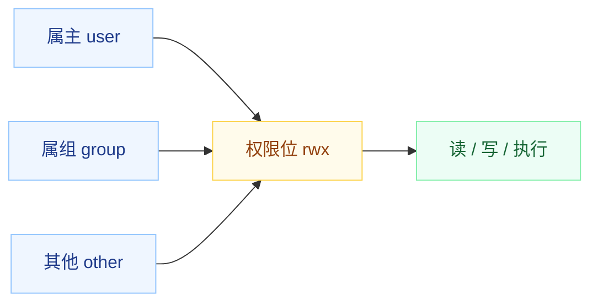
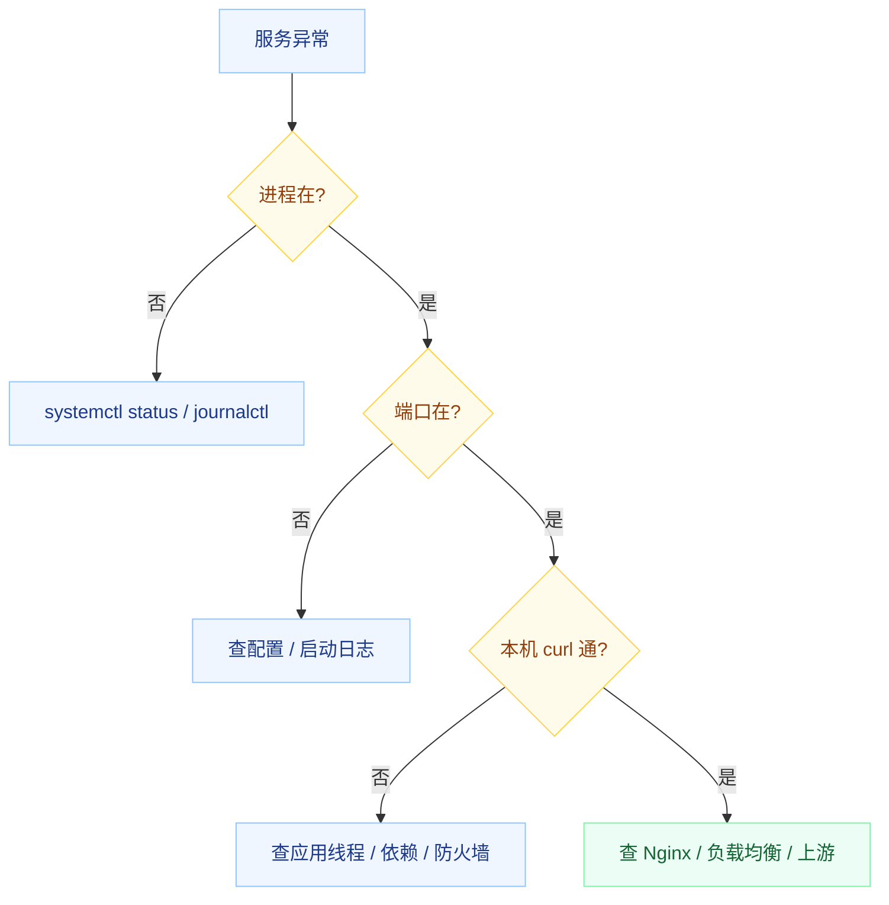

# Linux系统与命令

> 这篇从 Linux 的定位讲起，经过登录、文件与权限、文本三剑客、进程与网络、包管理和定时任务，最后落到排障现场手册。
>
> 学完能完成日常服务器操作，并按现象查到第一条命令。

## 一、Linux 的定位

Linux 是内核，发行版是“内核 + 包管理 + 系统工具 + 服务”的组合。日常操作面对的是 shell 和发行版工具，不是内核源码。

Linux 的核心判断：一切皆文件，设备、配置、进程信息大多可以通过文件或文件式接口访问；权限决定能做什么，很多问题都落在用户、组、权限和路径上；先看现场，再改配置，`ps`、`ss`、`df`、`journalctl` 比猜测更快。

> 版本基线（2026-11）：Ubuntu 24.04/26.04 LTS，Rocky Linux 9/10；命令以 Ubuntu 为主，RHEL 系用 dnf。

## 二、登录与最小验证

```bash
ssh user@192.0.2.10
whoami
hostnamectl
uname -a
```

预期输出（示例）：

```text
user
 Static hostname: web-01
       Operating System: Ubuntu 24.04.1 LTS
Linux web-01 6.8.0-45-generic #45-Ubuntu SMP x86_64 GNU/Linux
```

### 2.1 SSH 密钥登录

```bash
ssh-keygen -t ed25519 -C "ops@example.com"
ssh-copy-id user@192.0.2.10
ssh user@192.0.2.10
```

`~/.ssh/config` 可以简化登录：

```text
Host web-01
    HostName 192.0.2.10
    User deploy
    IdentityFile ~/.ssh/id_ed25519
```

> 边界：生产环境优先密钥登录，禁用密码和 root 直登；改 `sshd_config` 前先保留一个已登录会话，避免把自己锁在门外。

## 三、文件与权限

### 3.1 文件操作

```bash
pwd                         # 当前目录
ls -lah                     # 详细列表，含隐藏文件
cd /var/log                 # 切换目录
cp -a config.yml /etc/app/  # 保留属性复制
mv old.txt new.txt          # 移动/重命名
rm -i old.txt               # 删除前确认
ln -s /opt/app/releases/v1 /opt/app/current    # 软链接
find /var/log -type f -size +100M -print    # 找大文件
```

> 边界：`rm -rf` 不进入回收站，执行前先用 `ls` 或 `find` 确认路径；变量拼接路径时加引号，避免空变量变成 `rm -rf /`。

### 3.2 权限模型

```text
-rwxr-xr--  1 deploy ops  1024 Nov 13 10:00 deploy.sh
```

| 位置 | 含义 |
|---|---|
| 第 1 位 | 文件类型：`-` 普通文件，`d` 目录，`l` 链接 |
| 第 2–4 位 | 属主权限 |
| 第 5–7 位 | 属组权限 |
| 第 8–10 位 | 其他用户权限 |

```bash
chmod 755 deploy.sh      # rwxr-xr-x
chmod 644 config.yml     # rw-r--r--
chown deploy:ops deploy.sh
umask 022                # 新建文件默认 644，目录 755
```

| 数字 | 权限 | 常见用途 |
|---:|---|---|
| 7 | rwx | 目录、可执行脚本 |
| 6 | rw- | 普通文件 |
| 5 | r-x | 目录只读进入 |
| 4 | r-- | 只读文件 |



> 边界：目录的 `x` 权限表示“能进入/穿过”，没有 `x` 即使有 `r` 也看不到目录内容。排障时用 `namei -l /path/to/file` 检查每一级目录权限。

## 四、文本三剑客

### 4.1 grep：找内容

```bash
grep -n "ERROR" app.log              # 显示行号
grep -rn "timeout" /etc/app/         # 递归搜索目录
grep -v "^#" config.yml              # 排除注释行
grep -E "ERROR|WARN" app.log         # 扩展正则
```

### 4.2 sed：做替换

```bash
sed -n '1,20p' app.log               # 只看前 20 行
sed -i 's/8080/9090/g' config.yml    # 原地替换（先备份）
sed -i.bak 's/old/new/g' file.txt    # 保留 .bak 备份
```

### 4.3 awk：按列处理

```bash
awk '{print $1, $7}' access.log          # 第 1、7 列
awk -F: '$3 >= 1000 {print $1}' /etc/passwd  # 普通用户
awk '{sum += $1} END {print sum}' nums.txt   # 求和
```

### 4.4 管道与重定向

```bash
ps aux | grep java | grep -v grep
tail -f app.log | grep --line-buffered "ERROR"
command > out.log 2>&1       # 标准输出和错误都写入文件
command >> out.log 2>&1      # 追加
```

> 边界：`sed -i` 直接改文件，生产环境先备份或先不加 `-i` 预览；`grep` 默认按行匹配，跨行日志要用 `-z` 或专门工具。

## 五、进程与系统状态

```bash
ps aux | head
ps -ef | grep java
top
top -Hp 12345          # 看线程
kill -15 12345         # 优雅终止
kill -9 12345          # 强制终止，最后手段
systemctl status nginx
journalctl -u nginx -n 100 --no-pager
```

| 命令 | 看什么 | 典型用途 |
|---|---|---|
| `ps aux` | 进程快照 | 找 PID、启动参数 |
| `top` / `htop` | 实时 CPU/内存 | 找高负载进程 |
| `free -h` | 内存使用 | 判断是否 OOM |
| `df -h` | 文件系统空间 | 磁盘是否满 |
| `du -sh *` | 目录占用 | 找大目录 |
| `ss -lntp` | 监听端口 | 端口是否被占用 |
| `lsof -p PID` | 进程打开的文件 | 文件句柄、日志 |

> 边界：`kill -9` 不给进程清理机会，可能导致数据损坏；先 `-15`，确认无响应再 `-9`。

## 六、包管理与定时任务

### 6.1 包管理

```bash
# Debian/Ubuntu
sudo apt update
sudo apt install -y nginx
apt list --installed | grep nginx

# RHEL/Rocky
sudo dnf install -y nginx
rpm -qa | grep nginx
```

### 6.2 systemd 与 cron

```bash
sudo systemctl start nginx
sudo systemctl enable --now nginx
sudo systemctl restart nginx
systemctl list-units --type=service --state=running
```

```bash
crontab -e
# 每天 02:30 备份，日志追加
30 2 * * * /opt/scripts/backup.sh >> /var/log/backup.log 2>&1
```

| 字段 | 含义 | 范围 |
|---|---|---|
| 第 1 列 | 分钟 | 0–59 |
| 第 2 列 | 小时 | 0–23 |
| 第 3 列 | 日 | 1–31 |
| 第 4 列 | 月 | 1–12 |
| 第 5 列 | 星期 | 0–7 |

> 边界：cron 的环境变量和登录 shell 不同，脚本里用绝对路径，显式设置 `PATH`；需要秒级或复杂依赖用 systemd timer。

## 七、排障现场手册

| 现象 | 最可能原因 | 第一条命令 |
|---|---|---|
| CPU 高 | 死循环、频繁 GC、流量突增 | `top`，再 `top -Hp PID` 找线程 |
| 内存高 / OOM | 泄漏、缓存过大、堆配置不合理 | `free -h`、`ps aux --sort=-%mem` |
| 磁盘满 | 日志、镜像、删除未释放的文件 | `df -h`、`du -sh *`、`lsof +L1` |
| 端口被占用 | 旧进程未退出、配置冲突 | `ss -lntp \| grep :8080` |
| Permission denied | 用户/组/目录权限 | `ls -l`、`namei -l /path` |
| 服务起不来 | 配置错误、端口冲突、依赖缺失 | `systemctl status`、`journalctl -u` |
| 网络不通 | DNS、路由、防火墙、安全组 | `ping`、`curl -I`、`ss`、`ip addr` |



### 7.1 一个完整排查案例

现象：Web 服务 502，Nginx 正常，后端 Java 进程存在。

```bash
systemctl status myapp
journalctl -u myapp -n 100 --no-pager
ss -lntp | grep 8080
curl -v http://127.0.0.1:8080/health
```

若 `ss` 没有 8080 监听，说明应用没起来或端口配置错；若监听存在但 `curl` 超时，检查应用线程、数据库连接和防火墙；若 `journalctl` 有 `OutOfMemoryError`，再看 `free -h` 和 JVM 堆参数。

> 排障顺序：先确认“进程在不在、端口在不在、日志说什么”，再改配置。不要一上来就重启。

## 八、最佳实践案例

### 8.1 案例背景

把一个 Spring Boot jar 部署到 Ubuntu 24.04，使用 systemd 管理进程，Nginx 反向代理到 `app.example.com`，要求可回滚。

### 8.2 案例实操

```bash
# 创建系统用户和组，禁止登录
sudo groupadd --system ops || true
sudo useradd --system --gid ops --home /opt/app --shell /usr/sbin/nologin deploy || true

# 目录权限：属主可读写执行，属组可读执行，其他无权限
sudo mkdir -p /opt/app/releases/20261113
sudo chown -R deploy:ops /opt/app
sudo chmod 750 /opt/app
```

`/etc/systemd/system/myapp.service`：

```ini
[Unit]
Description=MyApp
After=network.target

[Service]
User=deploy
WorkingDirectory=/opt/app/current
ExecStart=/usr/bin/java -jar /opt/app/current/app.jar
# 失败自动重启，3 秒后重试
Restart=on-failure
RestartSec=3

[Install]
WantedBy=multi-user.target
```

```bash
# current 指向当前版本，回滚时只改这个软链接
sudo ln -sfn /opt/app/releases/20261113 /opt/app/current
sudo systemctl daemon-reload
sudo systemctl enable --now myapp
```

`/etc/nginx/conf.d/myapp.conf`：

```nginx
server {
    listen 80;
    server_name app.example.com;

    location / {
        # 反代到本机应用，只暴露 Nginx
        proxy_pass http://127.0.0.1:8080;
        proxy_set_header Host $host;
        proxy_set_header X-Real-IP $remote_addr;
    }
}
```

```bash
# 先校验配置，再平滑重载
sudo nginx -t
sudo systemctl reload nginx
```


验证：

```bash
systemctl status myapp --no-pager
ss -lntp | grep 8080
curl -I http://127.0.0.1:8080/health
curl -I http://app.example.com
journalctl -u myapp -n 50 --no-pager
```

回滚：

```bash
# 切回上一版本，重启后验证健康检查
sudo ln -sfn /opt/app/releases/20261112 /opt/app/current
sudo systemctl restart myapp
curl -I http://127.0.0.1:8080/health
```

### 8.3 案例结果

上线后 `systemctl status` 为 active，8080 正常监听，本机和域名健康检查都返回 200。回滚演练只改 `current` 软链接并重启，2 分钟内恢复。

复盘：上线检查的顺序是“进程→端口→本机→入口”，不要一上来就重启；`current` 软链接让回滚只改一个指向；日志交给 journald，避免应用自己切日志切出磁盘问题。
