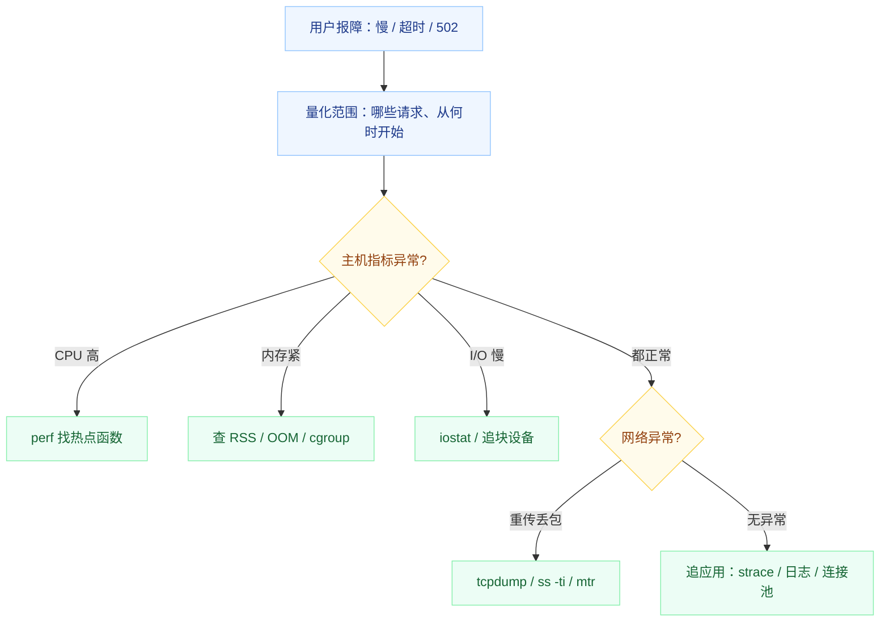

# Linux性能与网络排错

> 这篇从性能问题的观测模型讲起，经过 CPU、内存、磁盘 I/O、网络四条资源线和 tcpdump、strace、perf、bpftrace 四类追踪手段，最后落到一张按现象查第一条命令的现场手册和一个慢请求的完整排查案例。
>
> 学完能在不重启服务的前提下判断瓶颈落在哪条资源线，抓出可复现的证据，并区分主机问题、网络问题与应用自身问题。

## 一、排错的观测模型

性能排错的第一步是量化，不是猜。所有可靠的结论都来自“先看全局指标，再缩小到进程，最后追到函数或数据包”这条路径。

资源瓶颈用 USE 方法（Utilization、Saturation、Errors）做检查表：对每类资源问三个问题——用了多少、有没有排队、有没有报错。利用率高不一定是问题，排队和报错才是。

| 资源 | 利用率指标 | 饱和信号 | 错误信号 |
|---|---|---|---|
| CPU | `%usr`、`%sys` | 运行队列长度、`steal` | 机器检查、RCU stall |
| 内存 | `used`、`available` | `si/so`、直接回收 | OOM kill、分配失败 |
| 磁盘 | `%util`、`rkB/s` | `aqu-sz`、`await` | I/O error、只读挂载 |
| 网络 | 带宽、pps | 重传、丢包、`dropped` | CRC 错误、`RST` |

观测手段分三层，开销和精度相反：

| 层次 | 代表工具 | 开销 | 回答的问题 |
|---|---|---|---|
| 计数器 | `vmstat`、`iostat`、`ss -s` | 极低 | 哪条资源线异常 |
| 采样 | `perf`、`top`、`bpftrace profile` | 低到中 | 热点在哪个进程/函数 |
| 追踪 | `strace`、`tcpdump`、kprobe | 中到高 | 这一次调用/这一个包发生了什么 |

时间还有另一种分法：on-CPU 时间花在计算上，off-CPU 时间花在等锁、等 I/O、等网络。`top` 只能看到前者，一个 CPU 很闲但响应很慢的服务，问题几乎一定在 off-CPU 一侧。



> 边界：USE 是检查表，不是根因分析。它负责证明“哪条资源不是瓶颈”，避免在错误的方向上反复取样。应用逻辑错误、锁竞争、连接池配置这类问题，USE 只能提示方向，最终要靠追踪和日志确认。

## 二、工具准备与版本基线

工具装齐、权限配对，是后面所有排查能复现的前提。排障最怕现场发现 `perf` 没装、`bpftrace` 权限不够，只能靠重启争取时间。

基线（2026-11）：Ubuntu 24.04/26.04 LTS（内核 6.8+），Rocky Linux 9/10；sysstat 12.x，iproute2 6.x，tcpdump 4.99+，bpftrace 0.20+，perf 随内核版本。`perf` 与内核强绑定，跨版本复制二进制通常不可用。

```bash
# Ubuntu：基础观测工具一次装齐
sudo apt update
sudo apt install -y sysstat procps iproute2 strace ltrace \
  linux-tools-common "linux-tools-$(uname -r)" \
  bpftrace bpfcc-tools tcpdump tshark \
  iotop iftop nethogs mtr-tiny dnsutils jq

# RHEL / Rocky
sudo dnf install -y sysstat procps-ng iproute strace ltrace \
  perf bpftrace bcc-tools tcpdump wireshark-cli \
  iotop iftop nethogs mtr bind-utils jq
```

Windows 与 macOS 只覆盖“能观测到什么”这一层：Windows 用性能监视器（Performance Monitor）、资源监视器、`pktmon`、WPR/WPA 抓 ETW；macOS 用活动监视器、`sample`、`nettop`、`tcpdump`，`dtrace` 受系统完整性保护（SIP）限制。eBPF 只存在于 Linux，跨平台开发时通过 WSL2 或远程 Linux 主机做内核级观测。

权限检查与最小验证：

```bash
perf --version
bpftrace --version
tcpdump --version
ss -s
sar -u 1 3
```

预期输出（示例）：

```text
perf version 6.8.12
bpftrace v0.20.4
tcpdump version 4.99.4
Total: 412
TCP:   188 (estab 96, closed 62, orphaned 0, timewait 55)

Linux 6.8.0-45-generic (web-01)  11/13/2026  _x86_64_  (8 CPU)

10:12:01 AM     CPU     %user     %system   %iowait    %steal     %idle
10:12:02 AM     all      6.21      2.34      0.41      0.00     90.94
```

`perf` 默认只允许 root 采样，非 root 需要调整：

```bash
# 1 表示允许非 root 采样内核（仍受 kptr_restrict 影响），临时生效
sudo sysctl -w kernel.perf_event_paranoid=1

# perf 的权限由这个 sysctl 统一控制，setcap 对 perf 无效
# eBPF 工具可以只给二进制授权，避免放开全局：
sudo setcap cap_bpf,cap_perfmon+ep /usr/bin/bpftrace
```

> 边界：放开 `perf_event_paranoid` 等于允许本机用户读取内核地址与调度信息，多租户机器不要这么做。容器内做 `perf`/`bpftrace` 需要宿主 PID 命名空间与相应 capability，多数托管 K8s 不开放，应改用节点级 DaemonSet 或宿主机排查。

## 三、CPU：负载、热点与调度

CPU 问题的判断顺序是“负载是否真的高 → 高在用户态还是内核态 → 哪个线程 → 哪个函数”。`load average` 包含不可中断睡眠（D 状态）的进程，数值高不代表 CPU 忙。

```bash
uptime
# 10:15:01 up 12 days,  3:21,  2 users,  load average: 9.42, 8.77, 7.90

vmstat 1 5
# procs -----------memory---------- ---swap-- -----io---- -system-- ------cpu-----
#  r  b   swpd   free   buff  cache   si   so    bi    bo   in   cs us sy id wa st
#  9  2      0 812340  92140 6218304    0    0    12    88 4201 8830 34  6 57  3  0
```

`r` 列是运行队列长度，持续大于 CPU 核数说明 CPU 饱和；`b` 列大于 0 且 `wa` 高，说明阻塞在 I/O 而非计算。进一步拆到每个 CPU 和每个进程：

```bash
mpstat -P ALL 1 3          # 看是否有单核被打满、steal 是否异常
pidstat -u -p ALL 1 5      # 按进程看 %usr/%system
top -H -p 12345            # 进入线程视图，按 1 展开 CPU
ps -L -p 12345 -o pid,tid,psr,pcpu,stat,comm --sort=-pcpu | head
```

单线程打满而总 CPU 不高，常见于 GC 线程、单线程事件循环、自旋锁；`%system` 高则要怀疑系统调用过多、锁竞争或网络软中断。软中断单独看：

```bash
cat /proc/softirqs
mpstat -I SUM -P ALL 1 3
```

定位到进程后，用 `perf` 采样热点函数：

```bash
# -F 99：每秒 99 次，避开与定时器同频造成的采样偏差
# -g：记录调用栈，才能区分“叶子函数热”还是“上游反复调用”
sudo perf record -F 99 -g -p 12345 -- sleep 30
sudo perf report --stdio --no-children --percent-limit 1
sudo perf stat -p 12345 -- sleep 10
```

预期输出（示例，已截断）：

```text
Samples: 2K of event 'cpu-clock', Event count (approx.): 1823000000
  Children      Self  Command  Shared Object      Symbol
    62.31%     0.00%  java     [unknown]          [.] 0x00007f...
    41.20%    38.90%  java     libjvm.so          [.] G1ParScanThreadState::copy_object
     9.80%     8.10%  java     libc.so.6          [.] memcpy
```

`perf report` 是文本视角，火焰图适合看“整棵调用树的时间分布”，一次采样出一张图：

```bash
# 采样 30 秒并落盘
sudo perf record -F 99 -g -p 12345 -o /tmp/perf.data -- sleep 30

# 折叠调用栈再画图（FlameGraph 脚本来自 brendangregg/FlameGraph 仓库）
sudo perf script -i /tmp/perf.data > /tmp/out.stacks
stackcollapse-perf.pl /tmp/out.stacks > /tmp/out.folded
flamegraph.pl /tmp/out.folded > /tmp/oncpu.svg
```

读图规则：横轴宽度是 CPU 时间占比，纵向高度是调用深度；要找的是“宽而平的平台”，它对应一个吃掉大量 CPU 的函数；又高又窄的栈通常只是偶发调用。off-CPU 视角用 BCC 的 `offcputime` 生成，数据源不同但画图方式相同：

```bash
sudo offcputime-bpfcc -f -p 12345 30 > /tmp/off.folded
flamegraph.pl --color=io /tmp/off.folded > /tmp/offcpu.svg
```

`perf stat` 回答的是“效率”而不是“热点”，用它判断是算力不足还是访存与锁等待：

```text
 Performance counter stats for process id '12345':
      10,004.21 msec task-clock                #    0.981 CPUs utilized
         18,204      context-switches          #    1.820 K/sec
          2,931      cpu-migrations            #  292.980 /sec
     32,421,000,000  cycles                    #    3.204 GHz
      2,882,000,000  instructions              #    0.09  insn per cycle
```

每周期指令数（IPC）低于 0.2，通常是内存访问或锁等待，不是算力不足。调度延迟另有一条命令：

```bash
sudo perf sched latency --sort max
# Task                  | Runtime ms | Switches | Average delay ms | Maximum delay ms
# java:12350            |  8821.4    |    19022 |           0.42   |          182.3
```

Java 场景不一定要用 `perf`：`jcmd 12345 GC.heap_info`、`jstack 12345`、`jcmd 12345 Thread.print` 更快，`async-profiler` 能直接出火焰图。容器场景先看限流：

```bash
cat /sys/fs/cgroup/cpu.stat
# nr_periods  nr_throttled  throttled_usec
#     88211          921      48221004
```

`throttled_usec` 持续增长说明进程被 cgroup 配额掐住，CPU 看起来“不高”但请求在排队。

> 边界：`perf record` 对高吞吐进程有 1%–5% 的额外开销，生产上限制采样时长并优先指定 PID，不要对全系统长时间采样。火焰图适合看分布，不适合证明单次延迟。

## 四、内存：可用量、缓存与 OOM

Linux 的 `free` 很小是正常现象，内核把空闲内存拿去做页缓存（page cache）。判断内存是否紧张，看 `available` 和回收行为，不看 `free`。

```bash
free -h
#                total        used        free      shared  buff/cache   available
# Mem:            15Gi       9.2Gi       412Mi       284Mi       5.4Gi       5.1Gi
# Swap:          2.0Gi       1.2Gi       800Mi

grep -E 'MemAvailable|MemFree|Dirty|Writeback|Slab|SReclaimable|SwapCached' /proc/meminfo
vmstat 1 5     # si/so 持续非 0 表示已经在换页，性能会显著下降
```

`available` 是可回收缓存加空闲内存的估算值，低于总内存 10% 且伴随 `si/so`，才算真正吃紧。找占用者：

```bash
ps aux --sort=-rss | head -10
smem -tk | tail -5                 # 按比例分摊内存（PSS）比常驻内存集（RSS）更接近真实占用
cat /proc/12345/smaps_rollup       # 单进程的 Rss/Pss/Swap 汇总
pmap -x 12345 | sort -k3 -n | tail # 进程内各映射区，找异常大的匿名段
```

OOM 先看内核日志，再看 cgroup 计数：

```bash
sudo dmesg -T | grep -iE 'oom|killed process'
journalctl -k --since '1 hour ago' | grep -i oom

# cgroup v2：确认是容器限额触发还是宿主整体内存不足
cat /sys/fs/cgroup/system.slice/myapp.service/memory.current
cat /sys/fs/cgroup/system.slice/myapp.service/memory.events
# low 0
# high 128
# max 4211
# oom 3
# oom_kill 3
```

`memory.events` 中 `max` 增长说明反复撞上限，`oom_kill` 增长才是真的被杀。容器被 OOM kill 后 `exit code 137`，`kubectl describe pod` 会显示 `OOMKilled`。

泄漏判断靠趋势，不靠单点：

```bash
# 每 10 秒记录一次 RSS，观察是否单调增长且不回落
# 时间戳用 date 生成，不依赖 gawk 的 strftime，mawk 也能跑
while sleep 10; do
  printf '%s ' "$(date -u +%FT%TZ)"
  awk '/VmRSS/{print $2, "kB"}' /proc/12345/status
done | tee /tmp/rss.log
```

> 边界：`echo 3 > /proc/sys/vm/drop_caches` 会清掉页缓存，瞬间让所有服务变慢，只在测试机做实验用，生产禁用。Java 进程 RSS 高不等于泄漏，堆外内存、元空间、线程栈、glibc arena 都要分别看；`jcmd GC.heap_info` 与 `pmap` 对不上时，优先怀疑堆外或原生库。

## 五、磁盘与 I/O：空间、inode 与队列

磁盘问题先分成三类：空间满、inode 满、文件已删除但句柄未释放。三者的第一条命令不同。

```bash
df -hT                    # 空间与文件系统类型
df -i                     # inode 使用率，maildir/小文件场景常见
du -xhd1 /var | sort -h | tail    # -x 不跨文件系统，避免扫到挂载点
lsof +L1 2>/dev/null      # 已删除但仍被进程占用的文件
```

`df` 显示有空间但写入报 `No space left on device`，多数是 inode 耗尽或保留块不足；`df` 与 `du` 相差很大，多数是删除未释放。

I/O 压力用 `iostat` 看设备，不看进程：

```bash
iostat -xz 1 5
# Device   r/s     w/s     rkB/s   wkB/s  await  r_await  w_await  aqu-sz  %util
# nvme0n1  12.0   480.0    512.0  38400   2.41     0.82     2.55    2.10   38.2
# nvme1n1   0.4     0.2      3.2      8.0   0.31     0.28     0.44    0.01    0.6
```

| 字段 | 含义 | 异常判断 |
|---|---|---|
| `await` | 平均完成时间（ms） | 持续高于基线 3 倍 |
| `aqu-sz` | 平均队列深度 | 持续 > 1 说明排队 |
| `%util` | 设备忙比例 | 多队列 NVMe 上参考价值低 |
| `r_await`/`w_await` | 读/写分别的延迟 | 区分读放大与写放大 |

`%util` 在支持多队列的设备上可能长期接近 100% 而并未饱和，应以 `await` 和 `aqu-sz` 为准。定位到进程：

```bash
sudo iotop -oPa -d 2        # -o 只显示有 I/O 的进程，-P 按进程而非线程
pidstat -d 1 5              # kB_rd/s、kB_wr/s、iodelay
```

块设备层再往下可以用 `biolatency`（BCC）看延迟分布，或用 `blktrace` 追单次请求，但后者开销大，通常只在存储团队协同排查时使用。应用侧的文件系统调用用 `strace -e trace=file` 或 `opensnoop` 更快。

容量规划用 `fio` 做基线，不要用 `dd` 得出错误结论：

```bash
# 4K 随机读、队列深度 32、持续 30 秒，模拟数据库类负载
fio --name=randread --ioengine=libaio --direct=1 --rw=randread \
  --bs=4k --iodepth=32 --size=1G --numjobs=4 --runtime=30 --group_reporting
```

> 边界：`fio` 会写测试文件、占满 I/O，绝不能在正在服务的生产盘上跑。云盘有 burst 额度，短时间压测得出的 IOPS 不能直接当作持续能力。

## 六、网络：分层排查与连接状态

网络排错按层走，每层一条命令，确认后再进入下一层：链路与地址 → 路由 → 端口监听 → 握手与传输 → 应用协议。跳层会浪费大量时间。

```bash
ip -br addr                 # 接口与地址
ip route get 10.0.2.20      # 实际选中的路由与出口网卡
ping -c 4 10.0.2.20
mtr -n -c 100 10.0.2.20     # 逐跳丢包，比 traceroute 更适合定位间歇问题
dig +short api.example.com
dig +trace api.example.com  # 怀疑 DNS 时看委派链
```

端口与连接：

```bash
ss -lntp                    # 监听中的 TCP 端口与进程
ss -s                       # 汇总： estab / timewait / orphan
ss -tan state established '( sport = :8080 )' | wc -l
ss -tan state time-wait | wc -l
ss -ti dst 10.0.2.20        # 单连接的往返时延（rtt）、拥塞窗口（cwnd）、重传计数
```

`ss -ti` 的输出是判断网络质量的核心证据：

```text
ESTAB 0 0 10.0.2.15:8080 10.0.2.20:54321
  cubic wscale:7,7 rto:204 rtt:2.41/0.82 ato:40 mss:1448 pmtu:1500
  rcvmss:1448 advmss:1448 cwnd:38 ssthresh:32 bytes_sent:88211
  bytes_acked:88212 segs_out:1204 segs_in:1102 data_segs_out:980
  send 3.2Mbps lastsnd:12 lastrcv:8 lastack:8 pacing_rate 6.4Mbps
  retrans:0/12 rcv_space:29200
```

`retrans:0/12` 表示累计 12 次重传；`rtt` 的第二个数字是方差，方差大说明抖动。应用层耗时用 `curl` 拆解，比“接口慢”这种描述有用得多：

```bash
curl -o /dev/null -sS \
  -w 'dns=%{time_namelookup} connect=%{time_connect} tls=%{time_appconnect} ttfb=%{time_starttransfer} total=%{time_total}\n' \
  https://api.example.com/health
# dns=0.004 connect=0.012 tls=0.038 ttfb=2.281 total=2.284
```

`connect` 小、`ttfb` 大，说明 TCP 与 TLS 都正常，时间耗在服务端处理；`connect` 大则先查路由、防火墙和 backlog。网卡层丢弃与错包：

```bash
ip -s link show eth0
ethtool -S eth0 | grep -iE 'drop|error|fifo|miss'
ethtool eth0 | grep -E 'Speed|Duplex'
```

半双工、速率协商错误会表现为大量 CRC 错误和重传，属于物理层问题，调应用参数无效。NAT 场景还要看 conntrack：

```bash
sysctl net.netfilter.nf_conntrack_count net.netfilter.nf_conntrack_max
dmesg -T | grep -i 'nf_conntrack: table full'
```

> 边界：`ping` 通不代表端口通，ICMP 与 TCP 可能被不同策略放行；`curl` 通不代表所有客户端都通，DNS、代理、MTU 都可能只在特定路径上出问题。MTU 问题用 `ping -M do -s 1472` 验证，不要靠猜。

## 七、抓包：tcpdump 的过滤与判读

抓包是网络排错的最后证据，前提是过滤条件足够窄。线上无过滤抓全量包，几分钟就能写满磁盘并拖高 CPU。

```bash
# -i any：所有接口；-nn：不解析主机名与端口名；-s 0：抓完整包
# -c 200：抓够 200 个包就停，避免无限增长
sudo tcpdump -i any -nn -s 0 -c 200 'host 10.0.2.20 and tcp port 8080'

# 落盘供 tshark/Wireshark 分析；-C 100 -W 10 表示 100MB 一个文件、保留 10 个
sudo tcpdump -i eth0 -nn -s 0 -w /tmp/8080.pcap -C 100 -W 10 'tcp port 8080'

# 只看 RST，定位“谁先断开”
sudo tcpdump -r /tmp/8080.pcap -nn \
  'tcp[tcpflags] & (tcp-rst|tcp-syn|tcp-fin) != 0'
```

常用过滤表达式：

| 目的 | 表达式 |
|---|---|
| 指定主机与端口 | `host 10.0.2.20 and port 5432` |
| 网段 | `net 10.0.2.0/24` |
| 排除本机 SSH | `not port 22` |
| 只看 SYN | `tcp[tcpflags] & tcp-syn != 0` |
| 只看大于 1000 字节的包 | `greater 1000` |
| 只看到某 IP 的 ICMP | `icmp and dst 10.0.2.20` |

用 `tshark` 做统计比逐个看包快：

```bash
tshark -r /tmp/8080.pcap -q -z conv,tcp
tshark -r /tmp/8080.pcap -q -z io,stat,1,'tcp.analysis.retransmission'
tshark -r /tmp/8080.pcap -Y 'tcp.analysis.retransmission' -T fields \
  -e frame.time_relative -e ip.src -e tcp.seq -e tcp.len | head
```

判读时先看握手，再看时序：

| 抓到的现象 | 含义 | 下一步 |
|---|---|---|
| SYN 重发，无 SYN-ACK | 对端未监听或被防火墙丢弃 | 查对端 `ss -lntp`、安全组 |
| SYN 后立刻 RST | 端口关闭或中间设备拒绝 | 查 `iptables`/`nft`、负载均衡健康检查 |
| 大量重传、重复 ACK | 丢包、链路拥塞、MTU 不当 | `mtr`、`ethtool -S`、`ping -M do` |
| ZeroWindow | 接收端应用不读数据 | 查接收端线程与消费速度 |
| 握手正常但无请求 | 客户端/代理超时或阻塞 | 查上游与连接池 |

> 边界：TLS 加密后只能看到握手、包长与时序，看不到业务内容；需要内容时在应用侧打日志或做 TLS 卸载后抓包。容器内抓包要选对 veth 或宿主网卡，`-i any` 在部分内核上会丢失出接口信息。pcap 含凭证与个人信息，按敏感数据管理，排查完及时删除。

## 八、动态追踪：strace、perf 与 eBPF

当指标指向“进程在等什么”而日志说不清时，用追踪补最后一层。三类工具的分工是：`strace` 看系统调用，`perf` 看 CPU 与调度，`bpftrace`/BCC 看内核路径且开销可控。

`strace` 适合短时确认阻塞点：

```bash
# -f 跟子进程，-tt 绝对时间，-T 每个调用耗时，-s 256 完整显示字符串
sudo strace -f -tt -T -s 256 -p 12345 -o /tmp/strace.log
sudo strace -c -f -p 12345          # 汇总：哪个系统调用耗时最多
sudo strace -f -e trace=network -s 256 ./client
```

预期输出（示例）：

```text
10:31:02.114521 read(52, 0x7f2c..., 8192) = -1 EAGAIN (Resource temporarily unavailable) <0.000021>
10:31:02.114690 epoll_wait(11, [], 1024, 1000) = 0 <1.000342>
10:31:02.115102 futex(0x7f2c..., FUTEX_WAIT_PRIVATE, 2, NULL) = 0 <0.182441>
```

`futex` 长时间等待指向锁竞争，`epoll_wait` 返回 0 说明空闲无事件，`read` 反复 `EAGAIN` 说明非阻塞读没数据。`strace` 会让目标进程慢一个数量级，只允许分钟级使用。

需要系统调用汇总、又无法接受 `strace` 的开销时，用 `perf trace` 采样：

```bash
# -s 输出汇总而不是逐条；基于采样，开销比 ptrace 低一个量级
sudo perf trace -s -p 12345 -- sleep 10
```

预期输出（示例，已截断）：

```text
 Summary of events:

 java (12345), 1842 events, 0.0%
   syscall            calls  total_time       avg       max
   futex                812    4.812 s     5.93 ms   182.1 ms
   epoll_wait           184    1.842 s    10.01 ms    32.4 ms
   read                 398    0.112 s     0.28 ms     4.1 ms
```

eBPF 工具适合生产短时观测，开销通常在个位数百分比：

```bash
# 统计打开文件最多的进程，30 秒后输出
sudo bpftrace -e 'tracepoint:syscalls:sys_enter_openat { @[comm] = count(); } interval:s:30 { exit(); }'

# 按调用栈统计 off-CPU 时间，找“CPU 不忙但很慢”的原因
sudo bpftrace -e 'kprobe:finish_task_switch { @[kstack] = count(); } interval:s:10 { exit(); }'

# TCP 重传按对端地址聚合
sudo bpftrace -e 'tracepoint:tcp:tcp_retransmit_skb { @[ntop(args->saddr)] = count(); }'
```

BCC 工具是封装好的常用脚本，优先于手写探针：

```bash
sudo execsnoop-bpfcc            # 新进程，抓短命进程与脚本
sudo opensnoop-bpfcc -p 12345   # 打开的文件与返回码
sudo biolatency-bpfcc -m 10     # 块设备延迟直方图
sudo tcpretrans-bpfcc           # 重传与连接四元组
sudo runqlat-bpfcc              # 调度等待分布
sudo offcputime-bpfcc -p 12345  # off-CPU 火焰图数据
```

| 工具 | 观测对象 | 相对开销 | 典型场景 |
|---|---|---|---|
| `strace` | 系统调用 | 高 | 确认阻塞、权限、文件路径 |
| `perf` | CPU、调度、硬件事件 | 低到中 | 热点函数、IPC、调度延迟 |
| `bpftrace` | 内核函数与 tracepoint | 低 | 延迟分布、按栈聚合 |
| BCC | 常见问题封装 | 低 | 快速取证，少写脚本 |

> 边界：内核级追踪依赖符号表与内核版本，裁剪过的内核或云厂商定制内核可能缺 tracepoint；容器内需要 `--pid=host` 与 `CAP_BPF`，多数托管集群不提供。任何探针都不要长期挂着，观测完立即停止并记录版本，否则下次无法复现。

## 九、现场手册

现场手册的目标是三十秒内找到第一条命令，不是替代分析。顺序固定为：确认影响面 → 看主机四条资源线 → 看网络 → 看应用，最后才考虑变更。

| 现象 | 最可能原因 | 第一条命令 |
|---|---|---|
| 整机卡顿 | CPU 饱和、内存换页、I/O 排队 | `vmstat 1`，再看 `mpstat -P ALL 1` |
| 单请求慢、CPU 不高 | 锁竞争、下游超时、连接池耗尽 | `ss -ti`、`curl -w`、线程栈 |
| P99 周期性抖动 | GC、定时任务、备份、限流 | 对齐时间点看 `jstat`/cron/journal |
| 内存持续上涨 | 泄漏、缓存无上限、连接未释放 | RSS 趋势、`smem`、`memory.events` |
| 磁盘满 | 日志、镜像、已删除未释放 | `df -h`、`df -i`、`lsof +L1` |
| 502 / 连接被拒 | 后端未监听、端口错、accept 队列满 | `ss -lntp`、`journalctl -u`、`nstat -az` |
| 间歇超时 | 丢包、重传、DNS、MTU | `mtr -n`、`ss -ti`、`tcpdump` |
| 吞吐上不去 | 带宽、窗口、单线程、限流 | `ss -ti`、`ethtool`、压测对照 |

三件事在任何排障开始时都要问清：什么时候开始、影响哪些用户与接口、最近上线或改配置了什么。前两个决定范围，第三个决定是否需要先回滚。

“什么时候开始”要靠历史数据回答，不能靠记忆。sysstat 每天归档一个数据文件，能回放任意一天的负载、内存与分页曲线：

```bash
# Ubuntu 默认未开启采集：/etc/default/sysstat 里把 ENABLED 改为 true 后重启 sysstat
sudo sed -i 's/^ENABLED=.*/ENABLED="true"/' /etc/default/sysstat
sudo systemctl restart sysstat

# 当月 12 日的运行队列、内存、分页
sar -q -f /var/log/sysstat/sa12
sar -r -f /var/log/sysstat/sa12
sar -B -f /var/log/sysstat/sa12

# sadf 输出 CSV，导入表格画图，与告警时间线对齐
sadf -d /var/log/sysstat/sa12 -- -u | head -5
```

Rocky 的历史数据在 `/var/log/sa/`，命令与字段一致，只是路径不同。

预期输出（`sar -q`，示例）：

```text
02:30:01 AM   runq-sz  plist-sz   ldavg-1   ldavg-5  ldavg-15
02:40:01 AM         2       182      1.02      1.12      1.20
03:10:01 AM         9       204      7.90      5.12      2.88
```

运行队列与 ldavg 在 03:10 抬升，与告警时间对齐，问题窗口就锁定了。

```bash
# 变更关联：近一小时内的包升级、配置改动、重启
journalctl --since '1 hour ago' -u myapp --no-pager | tail -50
last -x | head
sudo ausearch -ts recent -m EXECVE 2>/dev/null | tail -20   # 审计开启时
```

采集证据的最小集合，离开现场前打包：

```bash
OUT=/tmp/triage-$(date +%Y%m%d%H%M)
mkdir -p "$OUT"
{ uptime; free -h; vmstat 1 5; iostat -xz 1 3; ss -s; ss -lntp; } > "$OUT/host.txt" 2>&1
dmesg -T | tail -200 > "$OUT/dmesg.txt"
journalctl -u myapp --since '30 min ago' --no-pager > "$OUT/app.log"
```

> 边界：先取证再重启。重启会清掉线程栈、连接状态、页缓存命中情况，等于销毁证据；只有在明确是进程僵死且已抓到栈时才直接重启。回滚与重启是可逆动作，改内核参数、改文件系统挂载不是。

## 十、最佳实践案例

### 10.1 案例背景

一套订单服务部署在 Ubuntu 24.04、8 核 16GB 的云主机上，Java 21 + Spring Boot 3.5，前面是 Nginx，数据库是同可用区的 MySQL 8.4。应用已接入配置中心，只读数据源支持热刷新，因此切换副本不需要重启 JVM。监控告警显示订单查询接口 P99（99 分位响应时间）从常态 80ms 涨到 2.3s，常态平均 90ms、受影响时段平均约 500ms，约 20% 的请求变慢，错误率没有明显上升。

约束：业务高峰在 20:00–23:00，不能重启应用；只能做只读观测；变更窗口在 23:30 之后。目标是 30 分钟内给出根因证据，并在窗口内恢复。

### 10.2 案例实操

第一步，量化范围，确认入口链路正常、慢在服务端之后：

```bash
curl -o /dev/null -sS \
  -w 'dns=%{time_namelookup} connect=%{time_connect} ttfb=%{time_starttransfer} total=%{time_total}\n' \
  https://order.example.com/api/orders/20261113001
# dns=0.003 connect=0.011 ttfb=2.214 total=2.216
```

`connect` 正常、`ttfb` 高，排除 DNS、TCP 握手与 TLS。连续采样 20 次，只有 4 次超过 2 秒，与监控的 20% 比例吻合。

第二步，看主机四条资源线：

```bash
uptime
# load average: 4.12, 4.30, 4.02        # 8 核，未饱和
vmstat 1 5
#  r  b   swpd   free   buff  cache   si   so    bi    bo   in   cs us sy id wa st
#  4  0      0 912340  88240 6102304    0    0     8    96 3801 7204 31  5 63  1  0
iostat -xz 1 3
# Device   r/s     w/s    rkB/s   wkB/s  await  aqu-sz  %util
# nvme0n1  8.0    42.0   128.0   1024.0   1.12    0.04    9.2
```

CPU 使用率 36%、无换页、磁盘延迟正常，三条资源线排除。`wa` 与 `steal` 均为 0，说明不是宿主争抢。

第三步，看连接与重传：

```bash
ss -s
# TCP:   412 (estab 168, closed 102, orphaned 0, timewait 96)
ss -tan state established '( sport = :8080 )' | wc -l
# 168
ss -ti dst 10.0.2.20 | head -40
```

关键片段（示例）：

```text
ESTAB 0 0 10.0.2.15:8080 10.0.2.20:3306
  cubic rtt:212.4/48.2 rto:440 cwnd:10 bytes_sent:1842201
  retrans:0/38 sacked:4
```

到数据库的往返时延（RTT）从基线 0.6ms 涨到 212ms，且方差 48ms，累计重传 38 次。问题指向应用与数据库之间的网络路径，而不是应用 CPU。

第四步，逐跳确认丢包位置：

```bash
mtr -n -c 100 10.0.2.20
# HOST: web-01            Loss%   Snt   Last   Avg  Best  Wrst StDev
#   1.|-- 10.0.2.1         0.0%   100    0.4   0.5   0.3   1.2   0.1
#   2.|-- 10.0.2.9        1.0%   100   18.2  22.4  12.1  98.2   9.4
#   3.|-- 10.0.2.20       1.0%   100   19.0  21.8  11.8  96.4   9.1
```

第二跳开始出现 1% 丢包，且延迟分布有长尾，符合“偶发重传导致少部分请求超时”的表现。同时检查本机网卡计数：

```bash
ip -s link show eth0
# RX: bytes  packets  errors  dropped overrun mcast
#     88213340 72011    0       142     0       0
# TX: bytes  packets  errors  dropped carrier collsns
#     42011882 51220    0       0       0       0
ethtool -S eth0 | grep -iE 'drop|error|fifo|miss|crc'
# rx_fifo_errors: 142
# rx_missed_errors: 0
```

接收方向 `dropped` 与 `rx_fifo_errors` 同步增长，说明包在到达协议栈前就被丢弃，属于链路或网卡队列问题，不是应用读得慢。不同驱动的计数字段名不一致，virtio 常见 `rx_dropped`，物理网卡常见 `rx_fifo_errors`，以 `ethtool -S` 的实际输出为准。

第五步，抓包固定证据：

```bash
sudo timeout 30 tcpdump -i eth0 -nn -s 96 -w /tmp/db.pcap \
  'host 10.0.2.20 and tcp port 3306'
sudo tcpdump -r /tmp/db.pcap -nn 'tcp[tcpflags] & tcp-rst != 0' | head
tshark -r /tmp/db.pcap -q -z io,stat,1,'tcp.analysis.retransmission'
```

统计结果（示例）显示每秒 1–3 个重传，集中在 2.2 秒以上的请求；没有 RST，说明连接没有被重置，只是重传等待超时后由数据库客户端重试。

第六步，确认阻塞点在内核发送队列：

```bash
sudo bpftrace -e '
  kprobe:tcp_sendmsg { @start[tid] = nsecs; }
  kretprobe:tcp_sendmsg /@start[tid]/ {
    $d = (nsecs - @start[tid]) / 1000000;
    @ms[comm] = hist($d);
    delete(@start[tid]);
  }
  interval:s:15 { exit(); }'
```

输出显示部分 `tcp_sendmsg` 调用在 200ms 以上，与 RTT 抬升一致；进程不是算得慢，而是在等发送窗口与重传恢复。

综合证据链：应用 CPU 与磁盘正常 → 到数据库的 RTT 抬升、重传增加 → 第二跳开始 1% 丢包 → 网卡 `rx_fifo_errors` 增长。根因是云主机所在宿主的链路质量下降，不是应用代码。

处置在变更窗口执行：把读流量切到另一可用区的只读副本，观察 10 分钟；同时提交工单要求更换宿主或交换机端口。切换靠配置中心加热刷新完成，不改代码、不重启：

```bash
# 只读数据源的新地址，写入配置中心（示例用 Nacos Open API）
cat > /tmp/readonly.yml <<'YAML'
spring:
  datasource:
    readonly:
      url: jdbc:mysql://10.0.3.20:3306/orders
YAML

curl -sS -X POST 'http://nacos:8848/nacos/v1/cs/configs' \
  --data-urlencode 'dataId=order-api-prod.yml' \
  --data-urlencode 'group=DEFAULT_GROUP' \
  --data-urlencode 'content@/tmp/readonly.yml'

# 触发 @RefreshScope 重建只读连接池，已有连接按 maxLifetime 逐步退出
curl -sS -X POST http://127.0.0.1:8080/actuator/refresh
```

```bash
# 切换后立即复测；慢请求比例应随连接池换新而下降
curl -o /dev/null -sS -w 'ttfb=%{time_starttransfer}\n' https://order.example.com/api/orders/20261113001
```

示例只截取只读数据源相关片段；实际写入前要在配置中心比对完整内容，避免整份覆盖丢掉其他键。

### 10.3 案例结果

切换后连续 30 分钟采样：P99 从 2.3s 回落到 110ms，`ss -ti` 的 RTT 回到 0.7ms、重传计数不再增长，`ip -s link` 的 `dropped` 停止上升。业务侧错误率保持 0，未重启应用。

失败模式与复盘：

- 第一轮曾直接怀疑 GC，`jstat -gcutil 12345 1000` 显示老年代占用稳定、Full GC 次数为 0，才转向网络；先看资源线省下了至少 15 分钟。
- 只抓 200 个包时没有覆盖到慢请求，改为按时间窗口落盘 30 秒才拿到重传证据；抓包必须覆盖故障发生时刻。
- `mtr` 的 1% 丢包容易被当成噪声，真正让它成立的是 `ss -ti` 的重传计数与网卡 `rx_fifo_errors` 三处证据一致。
- 切流只解决了症状，链路问题仍需基础设施侧处理；复盘时把“云主机网络质量”加入季度巡检项，并给数据库访问增加基于 RTT 的告警。

以上数字为一次复现实验的示例数据，用于说明口径与证据链；真实环境的基线需要在同一主机上预先采集。
