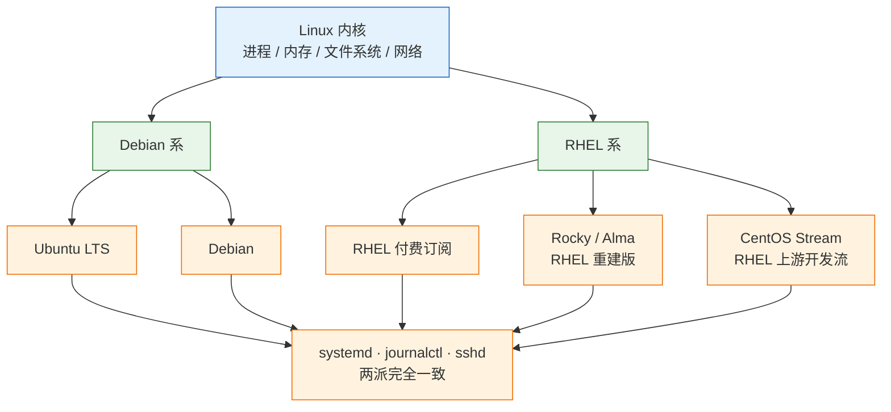
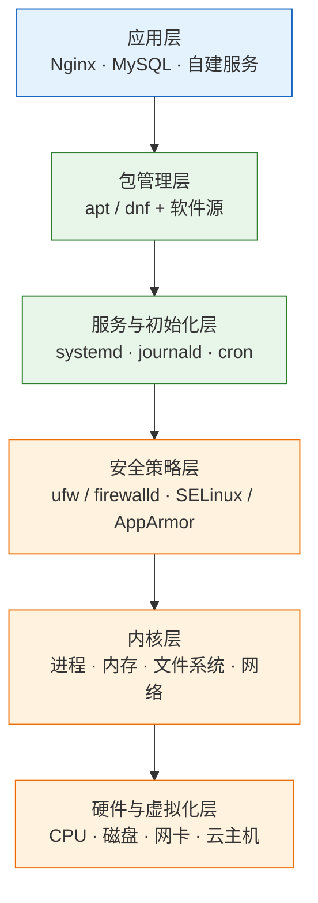
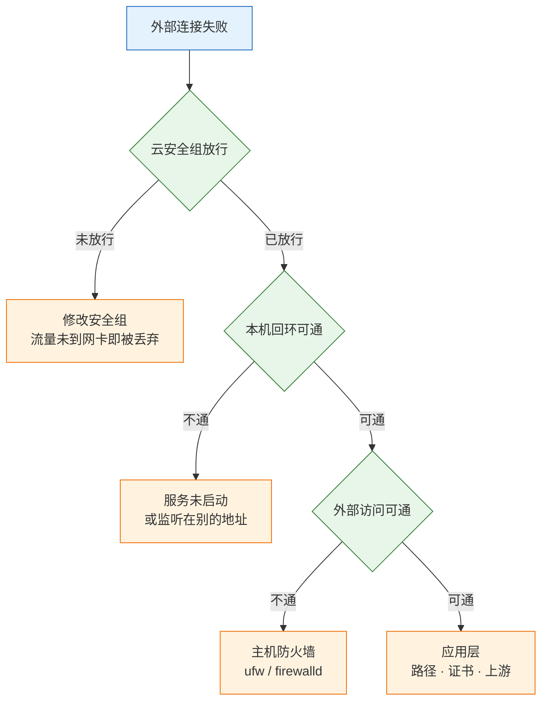

# CentOS 与 Ubuntu 系统

> 发行版的选择不是选命令，而是选一整套默认值：包管理、防火墙、强制访问控制、支持周期。这套默认值定下来，装机文档、脚本和排障手册才有统一写法。

---

## 一、CentOS 与 Ubuntu 是什么

### 1.1 核心概念

Linux 严格说只是内核，负责进程调度、内存管理、文件系统和网络协议栈。日常操作的 `ls`、`apt`、`systemctl`、`nginx` 全部来自发行版。发行版等于内核加包管理、初始化系统、基础工具集、安全策略和支持周期。

从运维视角看，一台服务器能不能交付，只看四件事有没有定死：

- **谁能登录**：账号、密钥、sudo 授权、sshd 策略
- **数据在哪块盘**：分区、文件系统、挂载点、备份范围
- **时间准不准**：时区、NTP、应用自身的时区
- **哪些端口对外**：监听地址、主机防火墙、云安全组

CentOS 与 Ubuntu 是两大流派的代表。Ubuntu 属于 Debian 系，CentOS 及其替代品 Rocky、Alma 属于 RHEL 系。它们在上述四件事上给出的默认答案不同，同一份操作文档不能无差别套用。

| 构成层 | 具体内容 | 出问题时的表现 |
|---|---|---|
| 内核 | 进程、内存、文件系统、网络 | 特性不支持、驱动缺失 |
| 包管理 | apt/dpkg 或 dnf/rpm | 装不上、依赖冲突 |
| 初始化系统 | systemd、journald | 服务不自启、日志丢失 |
| 安全策略 | ufw/firewalld、SELinux/AppArmor | 权限正确却访问被拒 |

发行版不解决的事也要说清：它不保证应用能跑，依赖、JDK、内核参数属于另一层；手工敲命令装机不保证可复现，那属于 cloud-init、Ansible 或镜像的职责；装完系统也不等于加固完成，账号、审计、补丁策略是持续动作。

### 1.2 与相邻技术的关系

分叉只发生在“包和策略”这一层。内核、systemd、sshd、Nginx、MySQL 的行为，两个门派没有本质区别，网上大部分 Linux 教程可以通用。真正需要分头查的，是包名、配置文件路径、防火墙工具和强制访问控制。

CentOS 已经不是当年的 CentOS。CentOS Linux 8 在 2021 年底停止维护，CentOS Linux 7 在 2024-06-30 到期。现在的 CentOS Stream 是 RHEL 的上游开发流，用来给 RHEL 试错，版本节奏比 RHEL 快。要“免费的 RHEL”，应选 Rocky 或 Alma。



与容器和配置管理的关系同样要建立：容器基础镜像通常用 Alpine 或 debian-slim，不用完整发行版；cloud-init 和 Ansible 负责把本文的初始化步骤变成可重复执行的动作；跨发行版部署应用时，glibc 版本差异要靠统一基础镜像或容器消除。

| 对比维度 | Debian 系 | RHEL 系 |
|---|---|---|
| 代表系统 | Ubuntu LTS、Debian | RHEL、Rocky、Alma、CentOS Stream |
| 包格式与工具 | `.deb` / `apt`、`dpkg` | `.rpm` / `dnf`、`rpm` |
| 装包前动作 | `apt update` 刷新索引 | `dnf` 自动处理元数据 |
| 默认防火墙 | `ufw`，默认未启用 | `firewalld`，默认启用 |
| 强制访问控制 | AppArmor，按路径配 profile | SELinux，默认 enforcing |

> **注意**：`yum` 和 `dnf` 不是两套东西。RHEL 8 以后 `yum` 是 `dnf` 的软链接，CentOS 7 上才是真的 `yum`。写新文档一律写 `dnf`。

### 1.3 架构组成

发行版从下到上可以分成六层，排障时按层定位，比盲试配置快得多。



| 层级 | 职责 | 常用入口 |
|---|---|---|
| 应用层 | 业务进程与配置 | `systemctl status`、应用日志 |
| 包管理层 | 安装、升级、依赖求解 | `apt`、`dnf`、`rpm`、`dpkg` |
| 服务层 | 单元管理、日志、定时任务 | `systemctl`、`journalctl`、`crontab` |
| 安全层 | 访问控制与包过滤 | `ufw`、`firewall-cmd`、`getenforce` |
| 内核层 | 资源调度与设备驱动 | `uname`、`dmesg`、`sysctl` |
| 硬件层 | 计算、存储、网络 | `lscpu`、`lsblk`、`ip` |

这六层的顺序就是排障顺序。应用报错先看应用日志，日志说端口绑定失败再看监听和防火墙，防火墙放行后仍不通再查安全策略和内核参数。跳过中间层直接改内核参数，通常只是把问题挪到更难发现的位置。

---

## 二、安装与初始化配置

> **版本现状（2026）**：RHEL 10、Rocky 10、Alma 10 已进入主线，要求 x86-64-v3 指令集（含 AVX2）；Ubuntu 侧以 LTS 版本为准，24.04 及后续 LTS 均可用于生产。具体小版本以官方镜像列表为准。

### 2.1 版本选择与硬件确认

选型先看约束，不看个人习惯。支持周期决定两年后是打补丁还是整体迁移，指令集决定老硬件能不能装上，安全合规决定要不要商业订阅。

| 场景 | 选择 | 理由 |
|---|---|---|
| 新建环境、团队熟悉 apt | Ubuntu LTS | 软件新、社区资料多 |
| 要求 RHEL 兼容 | Rocky / Alma 9 或 10 | 免费且二进制兼容 |
| 需要厂商支持合同 | RHEL 订阅 | 有 SLA 与认证 |
| 老硬件不支持 v3 | 9 系列 | 10 系列装不上 |
| 存量 CentOS 7 | 先维持，制定迁移 | 已停止维护 |

装前确认 CPU 是否支持目标版本要求的指令集，避免装到一半失败：

```bash
# ========== 硬件与固件确认 ==========
# 查看 CPU 型号、核心数和指令集标志
lscpu

# 只筛出 avx2，有输出说明支持 x86-64-v3 的关键指令
grep -o 'avx2' /proc/cpuinfo | head -1

# 查看内存总量，判断是否满足最低要求
free -h

# 查看磁盘与现有分区，确认安装目标盘
lsblk

# 查看固件模式，UEFI 与 Legacy 的分区方案不同
ls /sys/firmware/efi
```

`lsblk` 的输出要重点看三件事：目标盘有没有挂载点、有没有现存分区、容量是否与订单一致。云主机还可能有一块未挂载的数据盘，装系统时不要误选。

### 2.2 系统信息确认

拿到机器不要急着改配置，先确认自己在什么系统上。发行版判断错，后面的包管理命令会全部失效。

```bash
# ========== 系统身份 ==========
# 查看发行版名称、版本号和 ID
cat /etc/os-release

# 查看内核版本，判断是否支持 cgroup v2、BBR 等特性
uname -r

# 查看内核架构位数
getconf LONG_BIT

# 查看系统启动时间与负载
uptime
```

预期输出类似（Ubuntu 24.04，内核小版本会不同）：

```text
PRETTY_NAME="Ubuntu 24.04.3 LTS"
NAME="Ubuntu"
VERSION_ID="24.04"
ID=ubuntu
...
6.8.0-51-generic
64
```

| 字段 | 决定什么 | 用错后的后果 |
|---|---|---|
| `ID` | 用 `apt` 还是 `dnf` | 命令不存在 |
| `VERSION_ID` | 软件源地址与支持周期 | 源 404、装到不兼容包 |
| `uname -r` | 内核特性与驱动 | 特性不可用、驱动编译失败 |
| `getconf LONG_BIT` | 用户态位数 | 装错架构的包 |

装第一个包，顺便验证包管理和服务管理都通：

```bash
# ========== 首次安装验证 ==========
# 刷新本地包索引（Debian 系必须，RHEL 系可跳过）
sudo apt update

# 安装 Nginx 作为验证对象
sudo apt install -y nginx

# 设置开机自启并立即启动
sudo systemctl enable --now nginx

# 本机访问，确认服务真的在监听
curl -I http://127.0.0.1

# 查看服务状态与最近日志
systemctl status nginx --no-pager
```

预期返回 `HTTP/1.1 200 OK` 和 `Server: nginx/...`。`enable --now` 拆开就是“设开机自启 + 现在启动”。只 `start` 不 `enable`，重启机器后服务就没了，这是“昨天还好好的”最常见的来源。

### 2.3 账号与 SSH 密钥

初始化账号分两类：给人用的运维账号，给应用用的服务账号。两者权限边界必须分开。

```bash
# ========== 运维账号 ==========
# 创建带家目录、登录 Shell 为 bash 的账号
sudo useradd -m -s /bin/bash deploy

# 设置初始密码，首次登录后应改为密钥
sudo passwd deploy

# 加入 sudo 组（RHEL 系改为 wheel）
sudo usermod -aG sudo deploy

# 确认 uid、家目录和附加组
id deploy

# ========== 服务账号 ==========
# 创建系统用户，禁止登录，指定不自动创建的家目录
sudo useradd -r -s /usr/sbin/nologin -d /opt/app appuser

# 创建应用目录与日志目录
sudo mkdir -p /opt/app /data/app /data/logs

# 只把需要写的目录交给服务账号
sudo chown -R appuser:appuser /opt/app /data/app /data/logs
```

| 参数 | 作用 | 省略后的后果 |
|---|---|---|
| `-m` | 创建家目录 | 密钥登录失败、配置无处存放 |
| `-s` | 指定登录 Shell | 默认可能是 `/bin/sh` |
| `-r` | 创建系统用户 | 占用普通用户 uid 区间 |
| `-aG` | 追加附加组 | 只写 `-G` 会替换全部附加组 |

`usermod -G` 少写 `-a` 会把 docker、dev 等附加组一起冲掉，sudo 权限可能当场消失。改完必须用 `id` 复核。

密钥登录在自己电脑上生成，不在服务器上：

```bash
# ========== 生成并分发密钥 ==========
# 生成 ed25519 密钥对，-C 是注释，-f 指定私钥路径
ssh-keygen -t ed25519 -C "deploy@web01" -f ~/.ssh/web01_key

# 把公钥复制到服务器目标账号
ssh-copy-id -i ~/.ssh/web01_key.pub deploy@203.0.113.10

# 先验证密钥能登录，再改 sshd
ssh -i ~/.ssh/web01_key deploy@203.0.113.10
```

这一步不通过，绝对不要往下改 sshd。改坏了只能走云控制台的 VNC，恢复成本远高于多验证一次。

### 2.4 权限与安全加固

拿到密钥能进之后，再关闭 root 直登和密码登录。配置写在 `sshd_config.d/` 的独立文件里，不动原厂配置。

```bash
# ========== SSH 加固 ==========
# 写入独立 drop-in 配置，避免升级时与原厂文件冲突
sudo tee /etc/ssh/sshd_config.d/99-hardening.conf >/dev/null <<'EOF'
PermitRootLogin no
PasswordAuthentication no
KbdInteractiveAuthentication no
MaxAuthTries 3
EOF

# 先做语法检查，通过后再 reload
sudo sshd -t

# reload 不断开现有连接；restart 会断，配错就只能走 VNC
sudo systemctl reload ssh
```

| 配置项 | 作用 | 漏配的后果 |
|---|---|---|
| `PermitRootLogin no` | 禁止 root 直接登录 | root 成为爆破目标 |
| `PasswordAuthentication no` | 关闭密码认证 | 弱口令可被撞库 |
| `KbdInteractiveAuthentication no` | 关闭键盘交互认证 | PAM 通道仍可收密码 |
| `MaxAuthTries 3` | 限制认证尝试次数 | 爆破窗口变大 |

为什么写在 `sshd_config.d/`：OpenSSH 的规则是先读到的值生效，主配置顶部的 `Include` 会先把 `sshd_config.d/*.conf` 读进来，所以独立文件能覆盖主配置的同名项，又不动原厂文件，升级不冲突。服务名在两派不同：Ubuntu 是 `ssh`，RHEL 系是 `sshd`，`reload` 时按发行版替换。

> **注意**：只关 `PasswordAuthentication` 不够。PAM 的键盘交互通道仍可能接受密码，`KbdInteractiveAuthentication no` 不能漏。

> **运维红线**：改 sshd 前必须确认云控制台 VNC 可用，并保留一个已登录的会话。真连不上时，VNC 进去删除 `/etc/ssh/sshd_config.d/99-hardening.conf`，再 `systemctl reload ssh`。

验证方式是 root 登录应被拒绝：

```bash
# ========== 加固验证 ==========
# 预期返回 Permission denied (publickey)
ssh root@203.0.113.10

# 确认 sshd 实际生效的配置
sudo sshd -T | grep -E 'permitrootlogin|passwordauthentication'

# 查看认证失败记录
sudo journalctl -u ssh --since "10 min ago" --no-pager
```

---

## 三、软件包管理

### 3.1 包管理原理

包管理器解决三个问题：从哪里拿包、依赖怎么解、装完怎么记账。理解这三步，才能判断“装不上”卡在哪一环。


| 概念 | Debian 系 | RHEL 系 |
|---|---|---|
| 包文件 | `.deb` | `.rpm` |
| 高层工具 | `apt` | `dnf` |
| 低层工具 | `dpkg` | `rpm` |
| 包数据库 | `/var/lib/dpkg` | `/var/lib/rpm` |
| 查文件归属 | `dpkg -S /path` | `rpm -qf /path` |

高层工具负责联网、依赖和仓库，低层工具只负责单个包文件的安装与查询。离线环境里拿到一个 `.deb` 或 `.rpm`，用的就是低层工具。

### 3.2 apt 常用命令

```bash
# ========== 索引与查询 ==========
# 刷新软件源索引，安装前必做
sudo apt update

# 搜索包名与描述
apt search nginx

# 查看候选版本、已装版本和来源
apt policy nginx

# 查看包内包含哪些文件（已安装）
dpkg -L nginx

# 反查某个文件属于哪个包
dpkg -S /usr/sbin/nginx

# ========== 安装与卸载 ==========
# 安装并自动确认
sudo apt install -y nginx

# 只下载不安装，用于离线传输
apt download nginx

# 卸载但保留配置
sudo apt remove nginx

# 连配置一起卸载
sudo apt purge nginx

# 清理不再被依赖的包
sudo apt autoremove -y

# ========== 升级 ==========
# 列出可升级的包
apt list --upgradable

# 执行升级，不处理内核与依赖大变动
sudo apt upgrade -y

# 允许删除旧包以完成完整升级
sudo apt full-upgrade -y
```

`apt upgrade` 与 `full-upgrade` 的差别在于是否允许为满足依赖而删除包。生产环境执行前先看 `apt list --upgradable`，确认没有意外的大版本跃迁。

### 3.3 dnf 常用命令

```bash
# ========== 查询 ==========
# 刷新元数据缓存
sudo dnf makecache

# 搜索包
dnf search nginx

# 查看包信息与来源仓库
dnf info nginx

# 查看某个文件属于哪个包
rpm -qf /usr/sbin/nginx

# 查看包安装后释放哪些文件
rpm -ql nginx

# ========== 安装与卸载 ==========
# 安装并自动确认
sudo dnf install -y nginx

# 只下载 RPM 到本地目录
dnf download --destdir /tmp/rpms nginx

# 卸载包
sudo dnf remove nginx

# 清理缓存
sudo dnf clean all

# ========== 历史与回滚 ==========
# 查看事务历史
dnf history

# 回滚到指定事务之前
sudo dnf history undo <事务ID>
```

`dnf history undo` 只在包层面回滚，不会还原被改写的配置文件。数据库、证书这类有状态的组件，回滚包版本不等于回滚数据。

### 3.4 软件源配置与离线安装

Ubuntu 24.04 使用 deb822 格式，改 `/etc/apt/sources.list` 是空操作，真正生效的是 `/etc/apt/sources.list.d/*.sources`。

```bash
# ========== Ubuntu 换源 ==========
# 备份原文件，出问题可立即恢复
sudo cp /etc/apt/sources.list.d/ubuntu.sources /etc/apt/sources.list.d/ubuntu.sources.bak

# 把官方域名替换为镜像站占位符，实际地址按环境替换
sudo sed -i 's@//.*archive.ubuntu.com@//mirrors.example.com@g' /etc/apt/sources.list.d/ubuntu.sources

# 刷新索引，输出里出现新域名才算成功
sudo apt update

# 确认文件里实际写的是什么
grep -E 'URIs|Suites' /etc/apt/sources.list.d/ubuntu.sources
```

RHEL 系对应动作是替换 `baseurl` 并禁用 `mirrorlist`：

```bash
# ========== Rocky / Alma 换源 ==========
# 注释 mirrorlist，替换 baseurl，同时生成 .bak 备份
sudo sed -e 's|^mirrorlist=|#mirrorlist=|g' \
         -e 's|^#baseurl=http://dl.rockylinux.org/$contentdir|baseurl=https://mirrors.example.com/rockylinux|g' \
         -i.bak /etc/yum.repos.d/[Rr]ocky*.repo

# 重建元数据缓存
sudo dnf makecache

# 确认仓库地址已生效
dnf repolist -v
```

Rocky 10 的 repo 文件名是小写 `rocky.repo`，8/9 是 `Rocky-*.repo`，`[Rr]ocky*.repo` 两种都能匹配。写错通配符会报 `sed: can't read`，一个文件都不改。

> **注意**：`sed -i` 直接覆盖源文件且不可撤销。换源前必须备份，执行后先 `cat` 或 `grep` 核对文件内容，再运行 `apt update` 或 `dnf makecache`。源地址写错会导致后续所有安装失败。

离线环境用低层工具安装，注意依赖顺序：

```bash
# ========== 离线安装 ==========
# 安装本地 deb 包，缺失依赖会报错
sudo dpkg -i ./nginx_1.24.0_amd64.deb

# 自动补齐缺失依赖
sudo apt install -f -y

# 安装本地 rpm 包
sudo rpm -ivh ./nginx-1.24.0.x86_64.rpm

# 仅升级已安装的包
sudo rpm -Uvh ./nginx-1.24.0.x86_64.rpm
```

> **注意**：`rpm -ivh --nodeps` 与 `dpkg --force-depends` 会跳过依赖检查，装完往往在启动时才报缺库。除非明确知道缺的是什么，否则不要用。

> **运维提示**：镜像站地址用占位符，不要硬编码某一家。公共镜像站会失效、会限速，也可能有同步延迟；生产环境优先用内网源或自建代理。

---

## 四、系统服务与运行时管理

### 4.1 systemd 单元与服务

systemd 是两派共用的初始化系统，负责把系统从内核交接到用户态，并管理所有常驻服务。服务能否开机自启、崩溃后是否重启，都由单元文件决定。

| 单元类型 | 作用 | 常见例子 |
|---|---|---|
| `.service` | 常驻服务 | `nginx.service` |
| `.timer` | 定时任务 | `logrotate.timer` |
| `.socket` | 按需激活 | `docker.socket` |
| `.mount` | 挂载点 | `data.mount` |

```bash
# ========== 服务生命周期 ==========
# 启动服务，仅当前生效
sudo systemctl start nginx

# 设置开机自启
sudo systemctl enable nginx

# 停止服务
sudo systemctl stop nginx

# 重启服务，会中断连接
sudo systemctl restart nginx

# 重载配置，尽量不中断连接
sudo systemctl reload nginx

# 查看是否 active，脚本里用返回值判断
systemctl is-active nginx

# 查看是否 enabled，确认重启后会不会回来
systemctl is-enabled nginx

# ========== 单元排查 ==========
# 查看状态、主进程和最近日志
systemctl status nginx --no-pager

# 查看单元文件路径与覆盖关系
systemctl cat nginx

# 查看依赖关系，判断启动顺序
systemctl list-dependencies nginx

# 重新加载单元文件，改完 .service 后必做
sudo systemctl daemon-reload
```

改完单元文件必须 `daemon-reload`，否则 systemd 仍用旧定义。`restart` 会断开现有连接，`reload` 是否生效取决于服务是否实现了重载信号，不能假设两者等价。

### 4.2 时间同步

时间错了会连锁出问题：HTTPS 证书校验失败、日志顺序错乱、cron 在错误的时间跑、分布式心跳误判。

```bash
# ========== 时区与 NTP ==========
# 设置系统时区
sudo timedatectl set-timezone Asia/Shanghai

# 启用网络时间同步
sudo timedatectl set-ntp true

# 查看时区、同步状态和 NTP 服务
timedatectl

# 查看当前时间源与偏差
chronyc sources -v

# 立即校准一次
sudo chronyc makestep
```

预期输出包含 `System clock synchronized: yes` 与 `NTP service: active`。

| 检查项 | 正常值 | 异常处理 |
|---|---|---|
| 时区 | `Asia/Shanghai (CST, +0800)` | `set-timezone` 重设 |
| 同步状态 | `synchronized: yes` | 检查 UDP 123 与上游 |
| NTP 服务 | `active` | `systemctl status chronyd` |
| 偏差 | 毫秒级 | `chronyc makestep` 强制校准 |

> **注意**：时区对了不代表应用对了。JVM、MySQL、容器各有自己的默认时区，常见默认是 UTC，需要分别确认。

### 4.3 日志管理

systemd 用 journald 收集内核与服务日志，应用日志则通常落在 `/var/log`。两类日志的查询方式不同。

```bash
# ========== journald 查询 ==========
# 查看指定服务的日志
journalctl -u nginx --no-pager

# 实时跟踪
journalctl -u nginx -f

# 按时间窗口过滤
journalctl --since "2026-10-28 09:00" --until "2026-10-28 10:00"

# 只看错误级别
journalctl -p err -b

# 查看本次启动的日志
journalctl -b

# 查看磁盘占用
journalctl --disk-usage

# 清理到只保留 500M
sudo journalctl --vacuum-size=500M
```

| 命令 | 用途 | 易错点 |
|---|---|---|
| `journalctl -u` | 按单元过滤 | 单元名要写全 |
| `journalctl -p err` | 按级别过滤 | 级别是上限不是精确匹配 |
| `journalctl -b -1` | 看上次启动 | 需持久化存储才保留 |
| `journalctl --vacuum-size` | 限制占用 | 会删历史日志 |

应用日志要靠 logrotate 控制体积，否则单文件能长到几十 GB：

```bash
# ========== 日志轮转 ==========
# 查看轮转配置
cat /etc/logrotate.d/nginx

# 手动触发一次轮转，测试配置
sudo logrotate -f /etc/logrotate.d/nginx

# 调试模式试运行，只打印动作不实际轮转
sudo logrotate -d /etc/logrotate.d/nginx
```

### 4.4 计划任务

cron 负责周期任务，systemd timer 负责需要依赖管理和精确控制的场景。两者都不读用户的 `~/.bashrc`。

| 类型 | 配置位置 | 适用场景 |
|---|---|---|
| 用户 cron | `crontab -e` | 简单周期脚本 |
| 系统 cron | `/etc/cron.d/` | 多用户统一管理 |
| systemd timer | `/etc/systemd/system/*.timer` | 需要日志与依赖 |
| 一次性任务 | `at` | 延迟执行 |

```bash
# ========== cron 操作 ==========
# 编辑当前用户的任务
crontab -e

# 列出当前用户的任务
crontab -l

# 查看 cron 服务状态
systemctl status crond --no-pager

# 查看 cron 执行记录
journalctl -u crond --since today --no-pager

# ========== 手动验证脚本 ==========
# 用空环境复现 cron 的运行条件
env -i /bin/bash --noprofile --norc -c '/opt/scripts/backup.sh'
```

`env -i` 清空环境变量后能复现问题，说明是 PATH、LANG 或工作目录差异；不能复现再查脚本本身。cron 任务里一律用绝对路径，并在脚本开头显式设置 `PATH`。

> **注意**：cron 服务名两派不同，RHEL 系为 `crond`，Ubuntu/Debian 为 `cron`。`systemctl status` 与 `journalctl -u` 都要换成实际名称，否则会得到 `Unit not found`。

---

## 五、存储与文件系统

### 5.1 文件系统层级

Linux 没有 C 盘 D 盘，所有东西挂在 `/` 下面。发行版按“会不会变”把这棵树分成两半，这个划分直接决定备份范围和排障入口。

| 目录 | 放什么 | 运维意义 |
|---|---|---|
| `/etc` | 配置 | 服务行为不对先来这里 |
| `/var/log` | 日志 | 服务为什么挂了先来这里 |
| `/var/lib` | 运行状态与数据 | 备份必须覆盖 |
| `/opt` | 第三方程序 | 自建应用放这里 |
| `/tmp` | 临时文件 | 会被清理，不放数据 |
| `/home`、`/root` | 用户家目录 | 密钥与脚本，权限要收紧 |

所以备份不是打包 `/etc` 就完了：配置在 `/etc`，状态在 `/var/lib`，业务数据在数据盘，三处都要覆盖。只恢复配置，数据库仍然是空的。

### 5.2 分区、格式化与挂载

新数据盘从识别到可用分四步：分区、格式化、挂载、写 fstab。

```bash
# ========== 识别与分区 ==========
# 确认目标盘容量、挂载点和现有分区
lsblk

# 查看内核识别到的磁盘
sudo fdisk -l

# 写入 GPT 分区表（会重写分区表）
sudo parted -s /dev/vdb mklabel gpt

# 创建一个占满全盘的分区
sudo parted -s /dev/vdb mkpart data ext4 0% 100%

# 让内核重新读取分区表
sudo partprobe /dev/vdb

# ========== 格式化与挂载 ==========
# 格式化为 ext4（会清空分区）
sudo mkfs.ext4 /dev/vdb1

# 创建挂载点
sudo mkdir -p /data

# 临时挂载，验证可用
sudo mount /dev/vdb1 /data

# 查看挂载结果与容量
df -h /data
```

> **运维红线**：`parted mklabel` 会重写分区表，`mkfs.ext4` 会清空整个分区。执行前必须用 `lsblk` 确认这块盘没有挂载点、没有数据，并且设备名没有写错。云主机的系统盘通常是 `/dev/vda`，误操作等于重装。

写 fstab 要用 UUID，设备名会随插拔和云盘挂载顺序变化：

```bash
# ========== 持久化挂载 ==========
# 读取分区 UUID
sudo blkid -s UUID -o value /dev/vdb1

# 追加 fstab 条目，nofail 保证盘缺失时系统仍能启动
echo "UUID=$(sudo blkid -s UUID -o value /dev/vdb1)  /data  ext4  defaults,nofail  0  2" | sudo tee -a /etc/fstab

# 先卸载再全量挂载，当场验证 fstab 是否正确
sudo umount /data && sudo mount -a

# 确认挂载点与容量
df -h /data
```

`nofail` 的作用是这块盘挂不上时系统仍能启动，不会卡在紧急模式。改完 fstab 必须当场 `mount -a` 验证，不要等重启才发现写错。

**逻辑卷管理。** 数据盘需要后续扩容时，用 LVM 比裸分区灵活：物理卷组成卷组，卷组再切逻辑卷，扩容时先扩逻辑卷再扩文件系统。

```bash
# ========== LVM 创建与扩容 ==========
# 创建物理卷
sudo pvcreate /dev/vdb1

# 创建卷组，命名为 data_vg
sudo vgcreate data_vg /dev/vdb1

# 从卷组切出 50G 逻辑卷
sudo lvcreate -L 50G -n data_lv data_vg

# 格式化为 xfs（RHEL 系常用；若选 ext4 则改用 mkfs.ext4）
sudo mkfs.xfs /dev/data_vg/data_lv

# 扩容逻辑卷，增加 20G
sudo lvextend -L +20G /dev/data_vg/data_lv

# 同步扩容文件系统：ext4 使用 resize2fs，本例为 xfs 故跳过
# sudo resize2fs /dev/data_vg/data_lv

# 同步扩容文件系统：本例 xfs 使用 xfs_growfs
sudo xfs_growfs /data

# 查看卷组剩余空间，确认还能不能扩
sudo vgs
```

> **运维红线**：`lvextend` 只扩逻辑卷，不扩文件系统，`df` 不会立刻变化；漏掉 `resize2fs` 或 `xfs_growfs` 会误判为扩容失败。缩容 ext4 需要先卸载，xfs 不支持缩容，生产上不要把它当常规操作。

### 5.3 容量、inode 与日志轮转

容量问题分三种：块用满、inode 用满、文件被删但空间没释放。三者的判断命令不同。

| 指标 | 命令 | 判断依据 |
|---|---|---|
| 块容量 | `df -h` | `Use%` 接近 100% |
| inode | `df -i` | `IUse%` 接近 100% |
| 目录占用 | `du -h --max-depth=1 /var` | 定位增长目录 |
| 已删未释放 | `lsof \| grep deleted` | 进程仍持有 fd |

```bash
# ========== 容量定位 ==========
# 查看各分区块使用率
df -h

# 查看 inode 使用率，海量小文件先看这里
df -i

# 按目录统计占用并排序
sudo du -h --max-depth=1 /var | sort -rh | head

# 找出大于 1G 的文件
sudo find /var -xdev -type f -size +1G -print

# 查看被删除但仍被进程占用的文件
sudo lsof | grep deleted

# 清空正在被写入的日志，不改变 inode
sudo truncate -s 0 /var/log/app.log
```

文件系统给每个文件分配块（内容占的空间）和 inode（权限、属主、时间、数据块位置），两者是独立配额。`df -h` 有空间也可能写不进去，`df -i` 到 100% 就是 inode 耗尽，常见于 session、缓存碎片、邮件队列这类海量小文件。

`rm` 只删“文件名到 inode 的链接”，只要还有进程开着这个文件，块就不会回收，`df` 也不会降。此时重启进程或 `truncate -s 0` 才能释放。

---

## 六、网络与访问控制

### 6.1 网络配置与监听地址

连通性排障先分清三件事：网卡有没有地址、服务监听在哪个地址、包有没有被过滤。

| 命令 | 用途 | 关键输出 |
|---|---|---|
| `ip addr` | 查看网卡与地址 | `inet` 行 |
| `ip route` | 查看路由与默认网关 | `default via` |
| `ss -tunlp` | 查看监听端口与进程 | `LISTEN` 行 |
| `curl -I` | 验证应用层响应 | 状态码 |

```bash
# ========== 地址与路由 ==========
# 查看所有网卡的 IP 地址
ip addr show

# 查看默认网关和路由表
ip route show

# 测试到网关的连通性
ping -c 4 192.0.2.1

# 测试 DNS 解析
getent hosts example.com

# ========== 监听与连接 ==========
# 查看 TCP/UDP 监听端口及对应进程
sudo ss -tunlp

# 只看指定端口
sudo ss -tunlp | grep 8080

# 查看 IPv6 监听
sudo ss -6 -tunlp

# 本机验证服务响应
curl -I http://127.0.0.1:8080
```

看到 `127.0.0.1:8080` 说明只有本机能访问，此时改防火墙没有意义，要改应用监听地址为 `0.0.0.0` 或具体网卡地址。只监听 IPv6 的服务，用 IPv4 访问同样不通。

固定地址的配置方式两派不同。Ubuntu 用 netplan 生成后端配置，RHEL 系用 NetworkManager：

```bash
# ========== Ubuntu netplan 静态地址 ==========
# 查看现有 netplan 配置
ls /etc/netplan/

# 备份后再编辑，YAML 缩进必须用空格
sudo cp /etc/netplan/50-cloud-init.yaml /etc/netplan/50-cloud-init.yaml.bak

# 应用配置，超时未确认会自动回滚
sudo netplan try

# 确认地址已生效
ip addr show

# ========== RHEL 系 nmcli 静态地址 ==========
# 查看连接名称
nmcli connection show

# 修改 IPv4 地址与网关
sudo nmcli connection modify eth0 ipv4.addresses 203.0.113.10/24
sudo nmcli connection modify eth0 ipv4.gateway 203.0.113.1
sudo nmcli connection modify eth0 ipv4.dns 223.5.5.5
sudo nmcli connection modify eth0 ipv4.method manual

# 重新激活连接
sudo nmcli connection up eth0
```

> **注意**：改远程主机的网络配置前，先确认云控制台 VNC 可用，并用 `netplan try` 而不是直接 `apply`。配置一旦写错，SSH 会立即断开，且没有第二次机会修正。`nmcli` 示例中的 `eth0` 是连接名占位符，执行前用 `nmcli connection show` 换成实际名称。

### 6.2 ufw 防火墙

Ubuntu 默认安装 ufw 但未启用。启用前必须先放行 SSH，否则当前连接会在规则生效后被切断。

```bash
# ========== 规则配置 ==========
# 默认拒绝入站，允许出站
sudo ufw default deny incoming
sudo ufw default allow outgoing

# 先放行 SSH，顺序不能反
sudo ufw allow 22/tcp

# 放行 Web 端口
sudo ufw allow 80,443/tcp

# 启用防火墙
sudo ufw enable

# 查看带编号的规则列表
sudo ufw status numbered verbose

# 删除指定编号的规则
sudo ufw delete 3
```

> **运维红线**：`ufw enable` 之前没有放行 22/tcp，当前 SSH 会立即失联。云主机只能通过 VNC 进去执行 `ufw allow 22/tcp`。规则顺序和启用顺序都不能颠倒。

| 端口 | 用途 | 是否开放 |
|---|---|---|
| 22/tcp | SSH | 开，尽量限制来源 IP |
| 80/443 | Web 与 HTTPS | 开 |
| 3306/6379 | MySQL/Redis | 不开，只走内网 |
| 8080 | 应用 | 不开，由 Nginx 反代 |

> **注意**：改非标 SSH 端口只减少日志噪音，不算安全措施。云上还有一层安全组，和主机防火墙是两套机制，两边都要配且保持一致。

### 6.3 firewalld 防火墙

RHEL 系默认启用 firewalld，用 zone 管理规则。改规则用 `--permanent` 加 `--reload`，否则重启后丢失。

```bash
# ========== 状态与区域 ==========
# 查看运行状态
sudo firewall-cmd --state

# 查看默认区域
sudo firewall-cmd --get-default-zone

# 查看当前区域的全部规则
sudo firewall-cmd --list-all

# ========== 放行端口 ==========
# 永久放行 HTTP，当前不生效
sudo firewall-cmd --permanent --add-service=http

# 永久放行 HTTPS
sudo firewall-cmd --permanent --add-service=https

# 重载使永久规则生效
sudo firewall-cmd --reload

# 确认结果
sudo firewall-cmd --list-services
```

> **注意**：不带 `--permanent` 的规则只存在于运行时，重启即消失；只带 `--permanent` 不 `--reload`，当前又不生效。两条一起用才是完整动作。

### 6.4 SELinux 与 AppArmor

强制访问控制是包管理之外最容易误判的一层。文件权限全对、服务仍然读不到，先看这里。

| 维度 | SELinux（RHEL 系） | AppArmor（Ubuntu） |
|---|---|---|
| 默认状态 | enforcing | 按 profile 启用 |
| 查看状态 | `getenforce` | `aa-status` |
| 审计日志 | `ausearch -m avc` | `dmesg`、`journalctl` |
| 调整方式 | 布尔值、上下文、策略 | profile 模式 |

```bash
# ========== SELinux 排查 ==========
# 查看当前模式
getenforce

# 查看文件的安全上下文
ls -Z /data/app

# 查看最近的拒绝记录
sudo ausearch -m avc -ts recent

# 临时切换到宽容模式，仅用于确认根因
sudo setenforce 0

# 恢复强制模式
sudo setenforce 1

# 永久修改需编辑 /etc/selinux/config
grep '^SELINUX=' /etc/selinux/config
```

> **安全警告**：`setenforce 0` 只能用于临时验证，不能作为长期方案。确认是 SELinux 拦截后，应修正文件上下文或加布尔值，而不是关闭整个机制。

> **注意**：不要同时启用 ufw 和 firewalld。两者都是 nftables/iptables 的前端，规则会互相覆盖，排障会变成猜谜。

---

## 七、标准化交付与组合

### 7.1 交付验收清单

初始化做完不等于交付完成。下面八项必须逐条验证，其中涉及重启的两项要真重启一次。

| 检查项 | 命令 | 通过标准 |
|---|---|---|
| 账号可用 | `id deploy` | 有 uid，附加组含 sudo/wheel |
| 密钥登录 | `ssh -i key deploy@IP` | 不提示输密码 |
| root 被禁 | `ssh root@IP` | `Permission denied` |
| 时间正确 | `timedatectl` | CST、已同步、NTP active |
| 数据盘 | `df -h /data` | 挂载点与容量正确 |
| fstab | 重启后再 `df -h /data` | 仍然挂载 |
| 防火墙 | `ufw status verbose` | active，仅 22/80/443 |
| 服务自启 | 重启后 `systemctl is-active nginx` | `active` |

第 6、8 项必须真重启。`mount -a` 只证明当前配置能挂，不证明开机时能挂；`enable` 只证明会被拉起，不证明拉起来能用。RHEL 系把防火墙检查换成 `firewall-cmd --list-all`。

### 7.2 自动化与幂等

机器超过三台就不要再手敲。把初始化步骤写成 cloud-init 或 Ansible，否则第 20 台一定和第 1 台不一样。

| 操作 | 幂等风险 | 安全写法 |
|---|---|---|
| `useradd` | 第二次报用户已存在 | 先 `id` 判断再创建 |
| `mkfs` | 每次都清空数据 | 先 `blkid` 判断是否已格式化 |
| `>> fstab` | 重复追加导致启动失败 | 先 `grep` 再写，或用 UUID 去重 |
| `sed -i` | 重复替换可能叠加 | 用精确匹配并保留 `.bak` |

```bash
# ========== 幂等写法示例 ==========
# 用户不存在才创建
id deploy >/dev/null 2>&1 || sudo useradd -m -s /bin/bash deploy

# 分区没有文件系统才格式化
sudo blkid /dev/vdb1 >/dev/null 2>&1 || sudo mkfs.ext4 /dev/vdb1

# fstab 没有该 UUID 才追加
grep -q "$(sudo blkid -s UUID -o value /dev/vdb1)" /etc/fstab || \
  echo "UUID=$(sudo blkid -s UUID -o value /dev/vdb1)  /data  ext4  defaults,nofail  0  2" | sudo tee -a /etc/fstab
```

> **运维红线**：`blkid ... || mkfs` 只在确认设备是空盘时成立。`blkid` 无输出也可能是分区表尚未刷新或设备名写错，误判会直接清空数据。格式化前先 `lsblk` 确认设备、容量和挂载点，必要时人工复核，不要把这行直接放进无人值守脚本。

### 7.3 补丁与重启判断

补丁装完不等于生效。内核、glibc、systemd 这类基础组件升级后，运行中的进程仍在使用旧版本的内存映射。

| 升级内容 | 判断 | 依据 |
|---|---|---|
| 内核、glibc、systemd | 必须重启 | 运行时仍是旧版本 |
| 普通应用包 | 重启对应服务 | 进程重新加载 |
| 拿不准 | 查重启标记 | 见下方命令 |

```bash
# ========== 重启判断 ==========
# Ubuntu 查看是否需要重启
ls -l /var/run/reboot-required

# RHEL 系检查是否需要重启，需装 dnf-plugins-core
sudo dnf needs-restarting -r

# 查看当前运行内核与已安装内核
uname -r
rpm -qa kernel | sort

# 重启前确认关键服务是 enabled（RHEL 系把 ssh 换成 sshd）
systemctl is-enabled nginx ssh
```

内核打了补丁不重启，漏洞仍然在内存里，这是“补丁装了但没生效”的典型来源。但重启前先确认业务是 `enabled`，否则重启后不会自己回来。

---

## 八、常见排障

| 现象 | 最可能原因 | 处理 |
|---|---|---|
| `apt install` 报 `Unable to locate package` | 索引过期或包名错 | `apt update` 后 `apt policy` 看 Candidate |
| `usermod -G` 后 sudo 失效 | 少写 `-a`，附加组被替换 | 用其他 sudo 账号补回组 |
| 能 `ls` 出文件名但读不了 | 目录缺 `x` 权限 | `namei -l /path/file` 逐级看 |
| `df -h` 有空间却写不进 | inode 耗尽 | `df -i` 看 IUse% |
| 删大文件空间不降 | 进程仍持有 fd | `lsof \| grep deleted` 后重启进程 |
| 改完 sshd 重连不上 | 配置错误或 22 未放行 | VNC 删除 drop-in 后 reload |
| `ufw enable` 后失联 | 启用前没放行 22 | VNC 内 `ufw allow 22/tcp` |
| 重启卡在 emergency mode | fstab 的 UUID 不存在 | 救援模式注释该行并加 nofail |
| 端口放行后外部仍不通 | 安全组未放或只监听回环 | `ss -tunlp` 看监听地址 |
| RHEL 上权限正确仍读不了 | SELinux 拦截 | `getenforce`、`ausearch -m avc` |

“连不上”按层排除，不要一上来就抓包：



排障顺序固定为：**安全组 → 主机防火墙 → 监听地址 → 进程 → 权限与磁盘**。前一层没排除，查后一层都是白费。

两个高频误判：`Connection refused` 是端口没人监听或被 REJECT，`连接超时` 是包被丢了，后者才优先怀疑安全组和 DROP 规则。权限判定是“属主 → 属组 → other，命中就停”，文件属主是当前用户、属主位是 `r--`，即使组权限给了 `rw`，也写不进去。

> **运维提示**：排障记录要留下命令和输出。同一现象第二次出现时，能直接对比两次的 `ss`、`df`、`journalctl` 结果，比重新猜一遍快得多。
