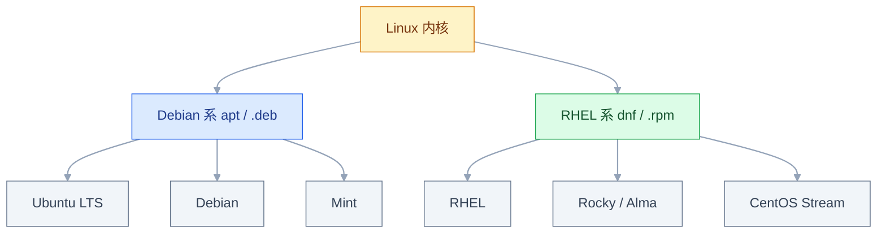
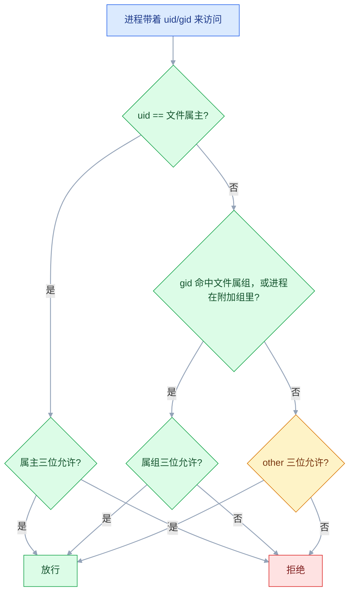
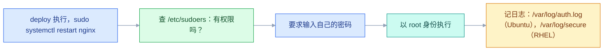

# CentOS 与 Ubuntu 系统

## 一、工程案例：把一台裸机变成能交付的服务器

**场景**：新买一台 Ubuntu 24.04（4 核 8G，40G 系统盘 + 100G 数据盘），当前用 **root + 密码**登录。目标是把它变成一台**能交给项目用**的机器：有专用账号、只能密钥登录、数据盘挂好、防火墙收口，且这套流程能复制到后面 19 台。

**为什么必须做**：开 root 密码登录的公网机器，几分钟内就会被自动化扫描盯上，开始尝试常见密码。下面 8 步是**最小可交付集**，做完这一节，机器就可以上业务了。每步为什么要这么做、复制到 20 台时注意什么，都写在这一节里。

**动手前确认**：云控制台的 VNC / 救援登录可用（万一 SSH 配错，这是唯一的后门）。

### 1.1 主线（按顺序执行，不要跳步）

```bash
# ① 建运维账号（不要用 root 干活）
useradd -m -s /bin/bash deploy      # -m 必加：没有家目录，密钥登录会失败
passwd deploy                       # 只用于 sudo 提权；第 ④ 步会关掉 SSH 密码登录
usermod -aG sudo deploy             # ⚠️ 必须 -aG；只写 -G sudo 会覆盖掉已有附加组
id deploy                           # 期望看到 groups 里有 sudo

# ② 本地生成密钥并传到服务器（在你自己电脑上执行，不是服务器）
ssh-keygen -t ed25519 -C "deploy@web01" -f ~/.ssh/web01_key
ssh-copy-id -i ~/.ssh/web01_key.pub deploy@<公网IP>

# ③ 验证密钥登录（这一步不通过，绝对不要往下走）
ssh -i ~/.ssh/web01_key deploy@<公网IP>     # 不提示输密码才算成功

# ④ 关掉 root 登录和密码登录（已登录的 deploy 会话里执行）
sudo tee /etc/ssh/sshd_config.d/99-hardening.conf >/dev/null <<'EOF'
PermitRootLogin no
PasswordAuthentication no
PermitEmptyPasswords no
KbdInteractiveAuthentication no
MaxAuthTries 3
EOF

sudo sshd -t                 # 语法检查，无输出=正确
sudo systemctl reload ssh    # Ubuntu 服务名是 ssh，RHEL 系是 sshd
# 用 reload 不用 restart：不断开当前连接，配错还能改回来
# 为什么写 sshd_config.d：OpenSSH 是「首次出现的配置生效」，
# 独立文件既覆盖默认值、又不改原厂配置，升级时不冲突
# CentOS 7 默认没有 Include 这一行、也没这个目录，只能改主文件
# 连不上时自救：VNC 进去 rm 掉 99-hardening.conf，再 systemctl reload ssh

# ⑤ 时区 + 时间同步（时间不对会导致证书校验失败、日志错序、cron 跑错）
sudo timedatectl set-timezone Asia/Shanghai
sudo timedatectl set-ntp true
sudo hostnamectl set-hostname web01   # 主机名会进日志、监控标签与证书申请，先定下来
timedatectl                  # 期望：Time zone = CST，System clock synchronized: yes

# ⑥ 挂数据盘
lsblk                        # 确认 vdb 有 SIZE 但没有 MOUNTPOINT
sudo fdisk /dev/vdb          # 交互：n → p → 回车 ×3 → w
sudo mkfs.ext4 /dev/vdb1
sudo mkdir -p /data && sudo mount /dev/vdb1 /data
UUID_STR=$(sudo blkid -s UUID -o value /dev/vdb1)
echo "UUID=${UUID_STR}  /data  ext4  defaults,nofail  0  2" | sudo tee -a /etc/fstab
sudo umount /data && sudo mount -a && df -h /data    # 必须先验证，写错 fstab 会开不了机
sudo mkdir -p /data/{app,logs,backup,www} && sudo chown -R deploy:deploy /data
# 应用用独立账号跑（不能登录）：-r 系统用户，-s nologin 禁登录
sudo useradd -r -s /sbin/nologin -d /opt/app appuser
sudo mkdir -p /opt/app && sudo chown appuser:appuser /opt/app
# 只把应用要写的两个目录交给它，备份目录它碰不到
sudo chown -R appuser:appuser /data/app /data/logs && sudo chmod 750 /data/app /data/logs

# ⑦ 换国内源 + 装基础工具（Ubuntu 24.04）
# 24.04 的源是 deb822 格式的 ubuntu.sources；改 /etc/apt/sources.list 是空操作
sudo cp /etc/apt/sources.list.d/ubuntu.sources /etc/apt/sources.list.d/ubuntu.sources.bak
sudo sed -i 's@//.*archive.ubuntu.com@//mirrors.aliyun.com@g; s@//.*security.ubuntu.com@//mirrors.aliyun.com@g' /etc/apt/sources.list.d/ubuntu.sources
sudo apt update          # 输出里出现 mirrors.aliyun.com 才算换成功
sudo apt install -y curl wget vim git unzip net-tools dnsutils telnet htop lsof tree jq

# ⑧ 防火墙（顺序不能错：先放行 22，最后 enable）
sudo ufw default deny incoming
sudo ufw default allow outgoing
sudo ufw allow 22/tcp && sudo ufw allow 80/tcp && sudo ufw allow 443/tcp
sudo ufw enable
sudo ufw status verbose
```

**Rocky 9 / 10 的等价动作**（第 ⑦ 步换成这个）：

```bash
sudo sed -e 's|^mirrorlist=|#mirrorlist=|g' \
         -e 's|^#baseurl=http://dl.rockylinux.org/$contentdir|baseurl=https://mirrors.aliyun.com/rockylinux|g' \
         -i.bak /etc/yum.repos.d/[Rr]ocky*.repo
sudo dnf makecache
sudo dnf repolist -v | grep -i 'Repo-baseurl'    # 显示出 aliyun 地址才算成功
```

> Rocky 10 的 repo 文件是**小写** `rocky.repo` 等，8/9 是 `Rocky-*.repo`；`[Rr]ocky*.repo` 两种都能匹配。写错通配符会 `sed: can't read`，一个文件都不改。
> 阿里云 ECS 走内网更快：`mirrors.aliyun.com` → `mirrors.cloud.aliyuncs.com`（VPC）/ `mirrors.aliyuncs.com`（经典网络）。
> Ubuntu 24.04 懒得 sed，可直接用阿里云官网给的整份 deb822 内容覆盖（noble 与 noble-security 两段）。
> 存量 CentOS 7：阿里云 `centos/7` 仍在（已冻结、不再更新）；CentOS 6/8 才需要 vault 版。

**端口只开这三个，其余一律关**：

| 端口 | 用途 | 是否开放 |
|---|---|---|
| 22/tcp | SSH | ✅ 优先限制来源 IP；改非标端口只减少日志噪音，不算安全措施 |
| 80 / 443 | Web / HTTPS | ✅ |
| 3306 / 6379 | MySQL / Redis | ❌ 绝不公网（Redis 未授权访问是最常见的事故） |
| 8080 | 应用 | ❌ 由 Nginx 反代，不直接暴露 |

> `enable` 之前必须先放行 22；云安全组和主机防火墙是两层，两边都要配且一致。

### 1.2 验收（9 项全过才算交付）

| # | 检查 | 命令 | 通过标准 |
|---|---|---|---|
| 1 | 运维账号可用 | `id deploy` | 有 uid，`groups` 含 `sudo` |
| 2 | 密钥登录 | `ssh -i ~/.ssh/web01_key deploy@IP` | 不提示密码 |
| 3 | root 被禁 | `ssh root@IP` | `Permission denied (publickey)` |
| 4 | 时间 | `timedatectl` | CST、`synchronized: yes`、NTP active |
| 5 | 数据盘 | `df -h /data` | 有 `/data`，容量正确 |
| 6 | fstab 正确 | `sudo mount -a`（再重启一次验证） | 无报错，重启后仍挂载 |
| 7 | 软件 | `command -v curl jq htop` | 都能输出路径 |
| 8 | 防火墙 | `sudo ufw status verbose` | active，仅 22/80/443 |
| 9 | 应用账号隔离 | `sudo -u appuser touch /data/logs/x` | 写 logs 成功；换 `/data/backup/x` 应失败 |

> **第 6 项要真的重启一次**。`mount -a` 只验证当前配置能挂，不验证开机时能不能挂。
> **别忘了云安全组**：安全组在云网络层，ufw 在主机层，**两层都要放行**。「端口开了还连不上」先查另一层。

### 1.3 复制到 20 台

手工做 1 台可以，做 20 台要把上面 8 步写成脚本。但**上面的命令不是幂等的**：`useradd` 第二次报「已存在」、`mkfs` 会把盘清空、`>> fstab` 会重复追加。脚本至少补三处判断：

```bash
id deploy >/dev/null 2>&1 || useradd -m -s /bin/bash deploy
lsblk -no FSTYPE /dev/vdb1 | grep -q . || sudo mkfs.ext4 /dev/vdb1
grep -q "UUID=${UUID_STR}" /etc/fstab || echo "UUID=${UUID_STR}  /data  ext4  defaults,nofail  0  2" | sudo tee -a /etc/fstab
```

`fdisk` 是交互式的，脚本里会卡住，换成 `parted`（`mklabel` 会清掉分区表，只在空盘上跑）：

```bash
sudo parted -s /dev/vdb mklabel gpt
sudo parted -s /dev/vdb mkpart data ext4 0% 100% && sudo partprobe /dev/vdb
```

复制时的四个现实约束：

| 约束 | 处理 |
|---|---|
| 每台 UUID 不同 | 脚本里 `blkid` 现取，不要写死 |
| 公钥要逐台分发 | 云控制台批量绑定，或 `ssh-copy-id` 循环 |
| 安全组是云层配置 | 脚本管不到，单独在控制台或 IaC 里做 |
| 部分机器已有数据盘 | 先 `lsblk` 判断，别重复格式化 |

---

## 二、高频问答：会卡住你的地方，也是面试最常问的

### 2.1 `apt install` 报 `Unable to locate package`

**现场**

```bash
sudo apt update          # 只刷新索引，不装东西
apt policy nginx         # 有 Candidate 才说明索引里有它
```

先刷新索引再查一遍，确认「本地到底知不知道有这个包」。

**要点**

- 这个报错基本等于「本地索引里没有这个包」，不是安装过程出错。
- `apt` 是先查本地索引再装，索引过期就查不到新发布的包。
- 判断依据是 `apt policy` 有没有 `Candidate`，以及它来自哪个源。

**追问**

- 刷新了索引还是找不到？→ 包名写错，或这个软件不在已启用的源里。
- `apt update` 到底改了什么？→ 只重写本地的包列表快照，不动已安装的软件。

> ⚠️ `apt update` ≠ `apt upgrade`。前者只是刷新「有哪些包、什么版本」，装包前必须先做。

### 2.2 加完 sudo 组，sudo 反而不能用了

**现场**

先 `id deploy`，看 `groups` 里原来的 `docker`、`dev` 是不是没了。

```bash
# ✘ 会把其它附加组全部冲掉
sudo usermod -G sudo deploy

# ✔ 追加
sudo usermod -aG sudo deploy
```

**要点**

- 少写了一个 `a`：`-G` 是**替换**附加组，不是追加。
- 系统没坏，文件也没坏，丢的是这个人原来在其他组里的身份。
- 补救要用另一个有 sudo 的账号（或云控制台 VNC 用 root）把组加回来。

**追问**

- 丢的只是 sudo 吗？→ 不止，`docker`、`dev` 这类附加组一起丢了，要按原清单补回来。
- `-g` 和 `-G` 怎么区分？→ `-g` 改主组，`-G` 改附加组，只有 `-G` 需要配 `-a`。

### 2.3 目录能 `ls` 出文件名，但读不了也进不去

**现场**

```bash
namei -l /opt/app/config.yml
# 每一层都要有 x，否则路径走不到
```

**要点**

- 目录有 `r` 没 `x`：能看见名字，但进不去、也读不了里面的文件。
- 目录的 `x` 是**通行证**，文件的 `x` 是**可执行**，同名不同义。
- 逐级看到底哪一层缺 `x`，路径上任何一层断掉都走不到目标。

**追问**

- 直接 `chmod 777` 为什么是错的？→ 把写权限也给了所有人，目录有 `w` 和 `x` 就能删里面任何文件。
- 只有 `r` 能 `ls` 出什么？→ 只能列出名字，拿不到属性，也进不去。

> 目录的 `x` 是**通行证**，文件的 `x` 是**可执行**。同名不同义，这是最容易混的一处。

### 2.4 磁盘明明有空间，却报 `No space left on device`

**现场**

```bash
df -i                              # IUse% 到 100% 就是这个原因
# 找哪个目录的文件数最多
sudo find / -xdev -type d -exec sh -c 'echo "$(ls -f "$1" | wc -l) $1"' _ {} \; 2>/dev/null | sort -rn | head
```

**要点**

- `df -h` 有空间还报满，先查 inode，不是系统 bug。
- 块和 inode 是两套**互相独立**的配额：小文件极多时块还有剩，inode 已经用完。
- `df -i` 的 `IUse%` 到 100% 就是确诊，不用再猜。

**追问**

- 哪些东西会烧 inode？→ 日志、缓存碎片、session、邮件队列这类海量小文件。
- 定位到分区后下一步？→ 按目录统计文件数，找那个几十万文件的目录。
- 为什么删大文件没用？→ 大文件占的是块，不是 inode。

> 这条会遍历全部目录，文件多的机器上跑很久。先 `du -h --max-depth=1 /var | sort -rh | head` 定位到可疑分区再查。
>
> **低频但致命，所以留在这一节而不是扔进冷门**。一年遇不到一次，遇到时业务直接写不进去，而且人的直觉判断一定是错的。

### 2.5 删了大文件，空间没释放

**现场**

```bash
sudo lsof | grep deleted
# 正确做法：重启那个进程，或清空而不是删除
sudo truncate -s 0 /var/log/nginx/access.log
```

**要点**

- `rm` 只删了「文件名到 inode 的链接」，进程还开着句柄，inode 还在被引用，块就不回收。
- 所以 `df` 不降不是删得不够，继续删只会把问题扩大。
- 正确做法是重启那个进程，或者一开始就清空而不是删除。

**追问**

- 为什么 Nginx 日志删了还在写？→ 它持有已删除文件的 fd，写进去的是旧 inode。
- 不重启进程还有什么办法？→ `truncate -s 0` 清空，或让进程重新打开文件。
- 怎么从源头避免？→ 日志交给 logrotate 轮转，不要手工 `rm`。

> 典型场景：日志文件被 `rm` 了但 Nginx 还在往里写，`df` 一直不降。

### 2.6 `ufw enable` 之后 SSH 断了，再也连不上

**现场**

云控制台 VNC 进去 `sudo ufw status`，会看到 22 不在列表里。

```bash
# 补救（VNC 里执行）
sudo ufw allow 22/tcp
```

**要点**

- 服务器没挂，是 `enable` 之前没放行 22，默认策略 deny incoming 立即生效。
- ufw 的规则一 `enable` 就落地，没有「先试试」的阶段。

**追问**

- 已经断了怎么救？→ 走 VNC 或救援登录，补 `ufw allow 22/tcp`，不要再重启网络。
- 改非标端口能防住吗？→ 只减少日志噪音，不算安全措施，该放行的还得放行。
- 云上还有一层要管吗？→ 有，云安全组和主机防火墙都要配且一致。

**正确顺序永远是**：`default deny` → `allow 22/80/443` → `enable`。

### 2.7 端口放行了，外面还是连不上

**现场**

```bash
ss -tunlp | grep 8080
# 127.0.0.1:8080 → 只监听本机，外部永远连不上
# 0.0.0.0:8080   → 监听所有网卡
```

**要点**

- 先分两层：云安全组在云网络层，ufw 在主机层，只开一层就等于没开。
- 再看服务监听地址，绑 `127.0.0.1` 的只对本机，外部永远连不上。
- 排查顺序：安全组 → 主机防火墙 → 服务监听地址。

**追问**

- `0.0.0.0` 和 `127.0.0.1` 差在哪？→ 前者所有网卡，后者只有本机回环。
- 两层都放行了还不通？→ 回到 `ss` 看进程到底绑在哪个地址和端口上。

### 2.8 CentOS 上 Nginx 就是读不了某个目录

**现场**

```bash
getenforce                       # Enforcing 就要考虑它
sudo setenforce 0                # 仅用于快速验证，重启失效
# 验证确实是它 → 用 restorecon / chcon / setsebool 修，不要长期关掉
```

**要点**

- 权限位都对还读不了，先看 SELinux：RHEL 系默认 `enforcing`，它比权限位更早生效。
- `setenforce 0` 只用于确认，重启就恢复，它不是修复方案。
- 长期方案是打标签（`restorecon` / `chcon`）或放行对应布尔值。

**追问**

- 怎么确认是 SELinux 而不是权限？→ `getenforce` 为 Enforcing，且 `ausearch -m avc -ts recent` 有拒绝记录。
- 生产直接关掉行不行？→ 等于拆掉一层防护，只在排障时临时关。
- Ubuntu 上有对应物吗？→ 有，AppArmor，按 profile 限制程序。

> ⚠️ 「生产直接关掉 SELinux」是老做法，等于拆掉一层防护。**只在排障时临时 `setenforce 0` 确认，长期方案是打标签或放行对应布尔值。**

### 2.9 `chmod` 的数字不是减法（umask 也是）

**现场**

```bash
umask            # 022 → 新文件 644、新目录 755
umask 027        # 新文件 640、新目录 750
```

**要点**

- 是**按位与取反**：`666 & ~027 = 640`，不是 `666 - 027 = 637`。
- 位掩码的语义是「取反再按位与」，不是算术减法，数字看起来接近只是巧合。
- 记法：umask 里出现的位，就是「要从基础权限里拿掉的位」。

**追问**

- 为什么新文件从 666 算、目录从 777 算？→ 文件默认不给执行位，目录必须能进。
- `umask -S` 有什么用？→ 直接看符号形式，比对着数字心算可靠。

### 2.10 改完 `/etc/fstab` 重启，机器起不来了

**现场**

进救援模式看 `journalctl -xb`，或者改完就用 `mount -a` 提前验证。

```bash
# 加 nofail：这块盘挂了，系统仍然能起来
UUID=xxxx  /data  ext4  defaults,nofail  0  2
sudo mount -a          # 改完立刻验证，别等重启
```

**要点**

- 不是系统坏了，是 fstab 里写的设备/UUID 不存在或写错，开机挂载失败。
- 没有 `nofail` 就会卡在紧急模式，整机起不来。
- 改完必须 `mount -a` 验证，别等重启才发现。

**追问**

- 已经起不来了怎么进去？→ 救援模式或 VNC，`journalctl -xb` 定位后注释掉那一行再重启。
- 为什么用 UUID 不用 `/dev/vdb1`？→ 设备名会随插拔和云盘挂载顺序变，UUID 才稳定。
- 加了 `nofail` 会不会掩盖问题？→ 盘挂了系统照常启动，缺盘的后果要业务自己兜。

---

## 三、核心知识：只留要理解的部分

### 3.1 发行版与包管理器

Linux 是**内核**；你能操作的命令、包、服务来自**发行版**。发行版分成两大门派，最实际的区别是包管理和软件源格式：



| | Debian 系 | RHEL 系 |
|---|---|---|
| 代表 | Debian、**Ubuntu** | **CentOS**、Rocky、Alma、RHEL |
| 包管理器 | `apt`（`.deb`） | `yum` / `dnf`（`.rpm`） |
| 服务管理 | systemd | systemd（**两边已统一**） |
| 防火墙 | `ufw`（默认不启用） | `firewalld`（默认启用） |
| 强制访问控制 | AppArmor（默认启用，按 profile 限制程序） | SELinux（默认 `enforcing`） |

**选型**：新机器默认 **Ubuntu 24.04 LTS**；客户是政企/老机房跟 **Rocky 9 / Alma 9**；容器里用 Alpine。

- Ubuntu：22.04 → 2027、24.04 → 2029、26.04 → 2031（标准支持截止，开 ESM 再延 5 年）
- RHEL 10 / Rocky 10 / Alma 10 已于 2025 年 GA，但**要求 x86-64-v3 CPU**，老硬件装不上
- **CentOS Linux 已于 2024-06-30 停止维护**，新机器不要再用；存量 CentOS 7 仍在跑，该学的照学

> **`yum` 和 `dnf` 不是两套东西**：RHEL 8+ 上 `yum` 是 `dnf` 的软链接。CentOS 7 才是真正的 `yum`。

> **面试**：常问「CentOS 和 Ubuntu 最实际的区别是什么？」答：包管理和软件源格式两套，服务管理都是 systemd。

### 3.2 权限模型

**核心模型：每个进程属于某个用户；每个文件属于某个用户和一个组；「能不能操作」= 拿进程身份去比对文件归属与权限位。**

判定顺序是**固定的**，理解它就不用背规则：



**「不再往下看」是理解权限的关键**：属主位一旦匹配，就只用属主那三位，哪怕组权限更宽也不生效。这解释了大量「我明明给了组权限，为什么还是不行」。

**主组 vs 附加组**：给用户加权限最常用的办法**不是改文件，而是把人加进组**（附加组，记录在 `/etc/group` 里）。

**r / w / x 对文件和目录含义不同**：

| 权限 | 对文件 | 对目录 |
|---|---|---|
| `r` | 读内容 | 列出名字（`ls`） |
| `w` | 改内容 | 在目录里增删文件 |
| `x` | 执行 | **进入目录 / 访问内含文件** |

两个反直觉结论：
1. **目录的 `w` 比文件的 `w` 更危险**：目录有 `w` 和 `x` 就能删掉里面任何文件，哪怕文件本身是 `444`；只有 `w` 没有 `x` 时，连目录都进不去。
2. **目录的 `x` 是门票**：只有 `r` 没有 `x`，能看见名字，但进不去、也读不了内容（对应 2.3）。

**数字表示**：r=4、w=2、x=1 相加。

| 数字 | 含义 | 用在哪 |
|---|---|---|
| `644` | 属主读写，其他只读 | 普通文件默认 |
| `600` | 仅属主读写 | **私钥**、含密码的配置 |
| `755` | 属主全权，其他读+执行 | 目录默认、可执行程序 |
| `700` | 仅属主可进 | 家目录、`.ssh` |
| `777` | 所有人全权 | ⚠️ 几乎永远不该出现 |

**umask**：新文件/目录的默认权限是 `基础权限 & ~umask`（文件 666、目录 777），**不是减法**（对应 2.9）。

> **口令文件三件套**：`/etc/passwd` 存账号（`644`，人人可读）、`/etc/shadow` 存密码哈希（只有 root 可读）、`/etc/group` 存组。`passwd` 七个字段：`用户名:x:uid:gid:描述:家目录:shell`；uid `0` 是 root、`1–999` 是系统用户、`1000+` 是普通用户。
> **`ls -l` 显示的是数字 uid 而不是用户名**，说明该 uid 在 `passwd` 里查不到——常见于容器挂载宿主机目录。

> **面试**：常问「权限判定的顺序是什么？为什么给了组权限还是不生效？」答：属主→属组→other，属主位一匹配就不再往下看。

### 3.3 sudo 与提权

`sudo` = 以 root 身份执行**一条**命令。它验证的是**你自己的密码**，而不是 root 的——因为验证 root 密码等于又发了一个 root 权限，`sudo` 的意义就没了。



**为什么必须用 `visudo`**：它会做语法检查。`/etc/sudoers` 语法一错，所有 sudo 全部失效——包括你想改回来的那一次。

```bash
sudo visudo                          # 永远用这个，不要直接 vim /etc/sudoers
sudo visudo -f /etc/sudoers.d/deploy # 推荐：放独立文件
```

语法：`用户或%组  从哪登录  以谁身份  [NOPASSWD:]  允许的命令`

```bash
deploy  ALL=(ALL) NOPASSWD: ALL                             # 自动化账号免密
opsuser ALL=(ALL) NOPASSWD: /bin/systemctl restart nginx    # 最小权限
%dev    ALL=(ALL) ALL                                       # 组成员需输密码
```

> **面试**：常问「sudo 为什么验证的是自己的密码？为什么必须用 visudo？」答：验证 root 密码等于再发一个 root 权限；visudo 做语法检查，写错会让所有 sudo 一起失效。

### 3.4 文件系统

文件系统给每个文件分配两样东西：

| | 管什么 | 用完的报错 |
|---|---|---|
| **块（block）** | 文件内容的实际空间 | `No space left on device` |
| **inode** | 元数据：权限、属主、时间、数据块位置 | 同样报 `No space left on device` |

**关键**：这两套配额**互相独立**。所以「`df -h` 还有空间但写不进去」是真实存在的——inode 用完了（对应 2.4）。

**什么会烧 inode**：大量小文件——session 文件、缓存碎片、邮件队列、几百万行的小日志文件。

**`rm` 为什么不一定释放空间**：`rm` 删的是「文件名 → inode」的链接。只要还有进程打开着这个 inode，块就不会回收（对应 2.5）。

### 3.5 设备挂载

**挂载 = 把一个文件系统接到目录树的某个点上**。Linux 没有 C/D 盘，所有东西都挂在 `/` 下面。

| 目录 | 装什么 | 排查时的意义 |
|---|---|---|
| `/etc` | 配置 | 「服务配错了」→ 来这里找 |
| `/var/log` | 日志 | 「服务为什么挂了」→ 来这里找 |
| `/var/lib` | 状态数据（mysql、docker） | 备份要覆盖这里 |
| `/opt` | 自己装的第三方业务系统 | 自装应用放这 |
| `/tmp` | 临时文件 | **会被定时清理，重启也没**，别放重要东西 |

**fstab 为什么要用 UUID**：`/dev/vdb1` 这种设备名会随插拔顺序、云盘挂载顺序变化，**UUID 才是稳定的身份**。

**`nofail` 的作用**：这块盘挂不上时，系统**继续启动**而不是卡在紧急模式。数据盘都应该加。

fstab 六列：`UUID | 挂载点 | 文件系统 | 挂载选项 | dump(0) | fsck顺序(根=1,其他=2,0=不检查)`。dump 列现在固定写 `0`，早就不靠它备份了。

### 3.6 系统时区

时间不对会连锁出问题：日志顺序错乱、HTTPS 证书校验失败、cron 在错误的时间跑、分布式系统的心跳判断出错。

| 层 | 谁管 | 怎么查 |
|---|---|---|
| 时区 | `timedatectl set-timezone` | `timedatectl` 第一行 |
| 系统时钟同步 | NTP（chrony / systemd-timesyncd） | `System clock synchronized: yes` |
| 应用自己的时区 | Java `-Duser.timezone`、MySQL `default-time-zone`、容器 `TZ` | 各自配置 |

> **系统时区对了，应用不一定对**。JVM、MySQL、容器都可能用自己的默认时区（常见是 UTC）。

### 3.7 firewalld 与 ufw 的对应

RHEL 系默认 firewalld，Ubuntu 默认 ufw（且未启用）。两者都是管理前端，底层最终都落到 nftables/iptables；**不要同时开两套**。

| 动作 | ufw | firewalld |
|---|---|---|
| 放行端口 | `ufw allow 443/tcp` | `firewall-cmd --permanent --add-port=443/tcp` |
| 放行服务 | `ufw allow 'Nginx Full'` | `firewall-cmd --permanent --add-service=https` |
| 查看规则 | `ufw status verbose` | `firewall-cmd --list-all` |
| 生效 | `ufw enable`（规则立即生效） | `firewall-cmd --reload`（`--permanent` 必须 reload） |

**边界**：firewalld 的 zone 决定规则作用在哪个网卡与来源；默认 `public`。不加 `--permanent` 的规则只在当前运行时有效，reload 或重启就消失。

> **面试**：常问「ufw 和 firewalld 是什么关系？能同时开两套吗？」答：都是管理前端，底层都落到 nftables/iptables，不要同时开。

---

## 四、冷门知识汇总

| 知识点 | 为什么冷门 | 用到时的关键词 |
|---|---|---|
| SUID / SGID / 粘滞位 | 日常配权限只用 rwx，特殊权限多见于安全审计场景 | 第十、十一位；`find / -perm -4000 -type f` |
| swap 交换分区 | 现代云主机内存普遍较大；swap 还会掩盖内存泄漏，很多团队干脆不用 | `fallocate` + `mkswap` + `swapon` |
| 云盘在线扩容 | 频率低，但云上一定会遇到一次 | `growpart` + `resize2fs` / `xfs_growfs` |
| 系统更新后要不要重启 | 多数时候随手重启就行，很少需要精确判断 | `/var/run/reboot-required`；`needs-restarting -r` |
| 磁盘安全清理 | 有 logrotate 和云监控后很少手工做 | `apt clean`、`journalctl --vacuum-time=7d` |
| 备份关键配置 | 有配置管理和镜像后，极少手工备份 | `tar -czf /data/backup/etc-$(date +%F).tar.gz /etc/ssh /etc/fstab` |
| 查看登录情况 | 出事查审计时才用 | `who` / `last` / `sudo lastb` / `sudo chage -l 用户` |
| 手工编译安装 | 现代都用包管理或容器，编译多是踩坑 | `./configure --prefix=/usr/local/xxx` + `make && make install` |
| rpm / dpkg 手动装包 | 只在离线环境或装厂商给的包时用 | `rpm -ivh x.rpm` / `dpkg -i x.deb` |
| 拿 Linux 环境的其他方式 | 有云服务器后基本不用 | Vagrant 本地虚拟机；Windows 的 WSL2（默认不启用 systemd，网络仍受 Windows 防火墙约束） |
| 服务开机自启与日志 | 日常由 systemd 统一管理，展开内容多 | `systemctl enable --now` / `journalctl -u` |
