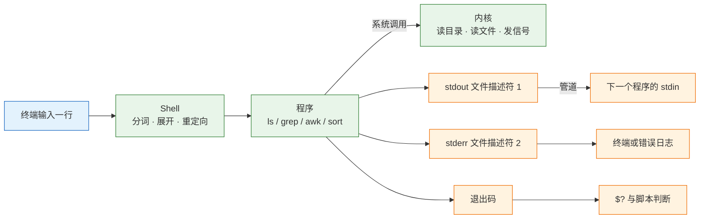
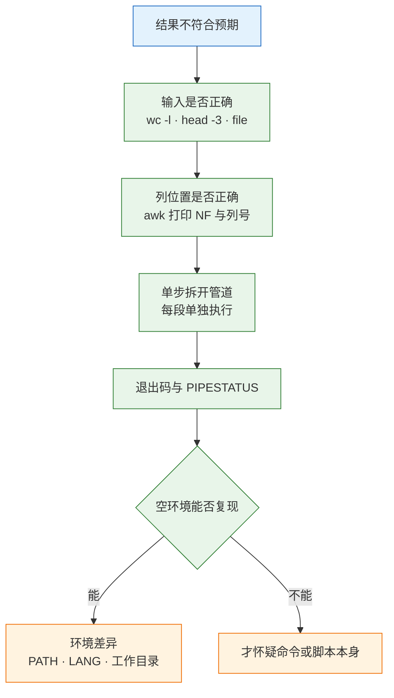

# Linux 核心命令

> 命令行的价值不在记住多少条命令，而在于把文件、文本、进程当成可以互相连接的数据流。一次排障能不能收敛，取决于能否用一条管道把“现象”缩到“一行证据”。

---

## 一、Linux 核心命令是什么

### 1.1 核心概念

Linux 命令是存放在磁盘上的可执行程序，Shell 负责把一行文本拆成程序名、参数和重定向，再交给内核执行。命令行的核心模型只有三件事：**输入从哪来、输出到哪去、失败怎么表达**。

掌握这套模型之后，命令不再是需要背诵的条目，而是可以拼装的标准件：

- **文件是字节流**：`cat`、`grep`、`wc` 都不关心内容的业务含义
- **文本是行序列**：绝大多数工具按行处理，一行就是一条记录
- **进程是文件**：`/proc` 把进程状态暴露成可读文件
- **组合靠管道**：前一个程序的 stdout 直接成为后一个程序的 stdin

命令行的能力边界同样清楚：它擅长在一堆文本里定位、过滤和统计，不擅长解析深层嵌套的 JSON、实现复杂业务逻辑、处理多步事务。那类工作应交给 `jq` 或一段 Python。

| 能力 | 代表命令 | 适用边界 |
|---|---|---|
| 文件定位 | `find`、`ls`、`stat` | 按路径与元数据筛选 |
| 行级过滤 | `grep`、`sed` | 保留或改写整行 |
| 字段统计 | `awk`、`cut`、`sort` | 结构化文本聚合 |
| 进程与资源 | `ps`、`ss`、`lsof`、`df` | 运行时状态观察 |

### 1.2 与相邻技术的关系

命令行位于操作系统与应用之间。向下通过系统调用访问内核，向上为脚本、定时任务、CI 流水线提供最小执行单元。它和图形化工具、监控平台不是替代关系，而是分工关系。

监控大盘只说明“5xx 比例升高”，但不说明哪个接口、从几点开始、后端报了什么。日志平台能做聚合，但前提是日志已经采集进去。命令行解决的是“现场只有一台机器和几个日志文件”时的定位问题。

| 层次 | 组件 | 职责 |
|---|---|---|
| 交互层 | Bash、Zsh | 分词、展开、重定向、作业控制 |
| 工具层 | coreutils、grep、awk、sed | 单一职责的文本与文件处理 |
| 内核层 | 系统调用、VFS、调度器 | 真正读写文件、创建进程 |
| 编排层 | Shell 脚本、cron、CI | 把命令组织成可重复流程 |

Shell 脚本不是编程语言的替代品。超过几十行的文本处理、需要数据结构和异常处理的逻辑，继续用 Shell 只会得到一堆难以调试的引号。

### 1.3 架构组成

一条命令从敲下回车到返回提示符，中间经过分词、展开、重定向、`fork`、`execve`、系统调用和退出码回收。



| 通道 | 编号 | 默认去向 | 重定向写法 |
|---|---|---|---|
| 标准输入 | 0 | 键盘 | `< file` |
| 标准输出 | 1 | 终端 | `> file`、`>> file`、`\|` |
| 标准错误 | 2 | 终端 | `2> file`、`2>&1` |

三个通道彼此独立，这是命令能够组合的根本原因。`grep` 把匹配行写 stdout、把错误写 stderr，管道只接 stdout，所以错误信息不会污染下游统计。

---

## 二、命令行环境与执行模型

### 2.1 命令类型与查找路径

同名命令可能来自不同位置：Shell 内置、别名、函数、`/usr/bin` 下的二进制、`/usr/local/bin` 下的自装程序。执行前先确认实际调用的是哪一个。

```bash
# ========== 判断命令类型 ==========
# 查看命令是内置、别名还是外部程序
type ls
type cd
type ll

# 只输出可执行文件路径，脚本里用这个
command -v nginx

# 查看所有同名候选
type -a python3

# ========== 查找路径 ==========
# 查看 PATH 的组成与顺序
echo "$PATH" | tr ':' '\n'

# 确认文件存在但命令找不到时的差异
ls -l /usr/sbin/nginx

# 清理 Shell 的命令路径缓存
hash -r
```

| 类型 | 例子 | 查找方式 |
|---|---|---|
| Shell 内置 | `cd`、`export`、`source` | 不经过 PATH |
| 别名 | `ll`、`grep --color` | `alias` 查看 |
| 外部程序 | `ls`、`nginx` | 按 PATH 顺序查找 |
| 函数 | 自定义脚本片段 | `declare -f` 查看 |

`command -v` 有输出说明命令可用；`/usr/sbin` 里有文件但命令找不到，说明该目录不在当前用户的 PATH 里，普通用户默认常常没有 `/usr/sbin`。脚本中一律写绝对路径，避免 cron 或 systemd 环境下 PATH 不同。

### 2.2 标准输入输出与重定向

重定向由 Shell 完成，不是程序完成。理解这一点，才能解释 `sudo echo x > /etc/f` 为什么仍然报权限不足。

```bash
# ========== 输出重定向 ==========
# 覆盖写入文件
echo "hello" > /tmp/demo.txt

# 追加写入文件
echo "world" >> /tmp/demo.txt

# 同时保留屏幕输出并写入文件
echo "both" | tee -a /tmp/demo.txt

# 丢弃标准输出
ls / > /dev/null

# 丢弃标准错误
ls /nope 2> /dev/null

# 标准输出和标准错误都写入同一文件，顺序不能反
ls /nope > /tmp/all.log 2>&1

# ========== 输入重定向 ==========
# 从文件读取标准输入
wc -l < /tmp/demo.txt

# Here Document，多行输入不进交互
cat > /tmp/notes.txt <<'EOF'
line one
line two
EOF

# Here String，把字符串作为标准输入
grep -c "line" <<< "line one"
```

| 写法 | 作用 | 易错点 |
|---|---|---|
| `> file` | 覆盖 stdout | 文件先被截断 |
| `>> file` | 追加 stdout | 重复执行会重复写入 |
| `2>&1` | stderr 并入 stdout | 必须写在 `>` 之后 |
| `&> file` | 两者都写入 | Bash 专有，不通用 |

`cmd > all.log 2>&1` 才是两个都进文件；写成 `cmd 2>&1 > all.log`，stderr 仍留在屏幕上，因为重定向从左到右生效，`2>&1` 复制的是当时还指向终端的 stdout。

> **注意**：`sudo echo x > /etc/f` 报 `Permission denied`，是因为重定向由当前 Shell 执行，Shell 仍是普通用户。正确写法是 `echo x | sudo tee /etc/f`，或者 `sudo sh -c 'echo x > /etc/f'`。

### 2.3 通配符、引号与展开

输入 `ls *.log`，把 `*.log` 展开成文件名列表的是 Shell；写 `grep 'error.*'`，解释 `.*` 的是 grep 的正则引擎。区别不在长相，在谁先动手。

| 写法 | 谁处理 | 匹配对象 | 结果 |
|---|---|---|---|
| `*.log` | Shell 通配符 | 文件名 | 展开为文件列表 |
| `'error.*'` | grep 正则 | 文件内容 | 匹配 error 后任意字符 |
| `error.*` 不加引号 | Shell 先尝试 | 文件名 | 命中文件时正则被替换 |
| `{a,b}` | Shell 花括号展开 | 字面量 | 直接生成两个词 |

```bash
# ========== 展开与引用 ==========
# 查看通配符实际展开成什么，不执行命令
echo *.log

# 单引号：内部一切原样，最安全
grep 'error.*timeout' /var/log/app.log

# 双引号：保留变量和命令替换，其余原样
echo "当前用户: $USER"

# 命令替换，取命令输出作为参数
kill -15 "$(pgrep -f app.jar | head -1)"

# 算术展开
echo $((1024 * 1024))

# ========== 花括号展开 ==========
# 一次创建多个目录
mkdir -p /data/{app,logs,backup}

# 生成序列
echo {01..05}
```

两条规则：正则一律用单引号包住；变量和命令替换用双引号包住，防止空格被再次分词。`*` 不匹配隐藏文件，所以 `rm *` 删不掉 `.env`，清理时最容易漏。

### 2.4 退出码与管道状态

每条命令结束时留下一个退出码，`0` 是成功，非 `0` 是失败。管道默认只取最后一段的退出码，这是“备份失败了但脚本报成功”的根源。

```bash
# ========== 退出码验证 ==========
# 成功命令返回 0
true; echo $?

# 失败命令返回非 0
ls /nope; echo $?

# 管道只看最后一段
false | true; echo $?

# 开启 pipefail 后，任意一段失败即整体失败
set -o pipefail
false | true; echo $?

# 查看管道每一段的退出码
false | true | false
echo "${PIPESTATUS[@]}"
```

| 退出码 | 含义 | 典型来源 |
|---|---|---|
| 0 | 成功 | 命令正常结束 |
| 1 | 一般错误 | grep 未匹配、脚本自定义 |
| 2 | 用法错误 | 参数不合法 |
| 126 | 不可执行 | 权限不足 |
| 127 | 命令不存在 | PATH 或拼写错误 |
| 130 | 被中断 | Ctrl+C |
| 137 | 被 SIGKILL 终止 | OOM 或 `kill -9` |

`grep` 的退出码本身就是返回值：`0` 匹配到、`1` 没匹配、`2` 出错。`if grep -q ERROR app.log; then ...` 可以直接使用，不需要再解析输出。

脚本开头写 `set -euo pipefail`：遇错退出、未定义变量报错、管道任一段失败即失败。这三项能挡住大部分“脚本静默跑完但结果不对”的问题。

---

## 三、文件与目录操作

### 3.1 路径与元数据

文件操作的第一步是确认“操作对象到底是谁”。相对路径、软链接、挂载点都会让看起来相同的路径指向不同位置。

```bash
# ========== 路径确认 ==========
# 查看当前工作目录的绝对路径
pwd

# 解析软链接到最终目标
readlink -f /usr/bin/nginx

# 查看路径每一级的权限，定位是哪一层挡住
namei -l /data/app/config.yml

# ========== 元数据 ==========
# 查看 inode、权限、属主、大小和时间
stat /etc/hostname

# 带 inode 列出目录内容
ls -li /etc/hostname

# 查看文件类型，不靠后缀判断
file /tmp/archive.tar.gz

# 查看目录实际占用
du -h /var/log/nginx
```

| 命令 | 观察内容 | 典型用途 |
|---|---|---|
| `pwd` | 当前绝对路径 | 确认脚本工作目录 |
| `stat` | inode、权限、时间 | 判断是否被替换 |
| `readlink -f` | 软链接最终目标 | 排查版本切换 |
| `namei -l` | 逐级目录权限 | 定位权限拒绝 |

`stat` 里的三个时间要分清：`Access` 是最后读取，`Modify` 是内容最后修改，`Change` 是元数据最后变化。`chmod` 只改元数据，所以 `Change` 会变、`Modify` 不变。

### 3.2 查看、查找与统计

`find` 按元数据遍历，适合“按时间、大小、类型、权限”筛选；`grep -r` 按内容搜索，适合“文件里有什么”。两者解决的不是同一个问题。

| 表达式 | 作用 | 示例 |
|---|---|---|
| `-name` | 按文件名匹配 | `-name "*.log"` |
| `-type` | 按类型筛选 | `-type f`、`-type d` |
| `-mtime` | 按修改天数 | `-mtime +30` |
| `-size` | 按大小筛选 | `-size +100M` |
| `-perm` | 按权限筛选 | `-perm 644` |
| `-xdev` | 不跨文件系统 | 避免扫到挂载盘 |

```bash
# ========== 查找文件 ==========
# 查找 30 天前的日志文件
find /data/logs -type f -name "*.log" -mtime +30 -print

# 查找大于 100M 的文件，限制目录深度
find /var -xdev -maxdepth 3 -type f -size +100M -print

# 查找权限为 777 的文件，安全检查常用
find /data -xdev -type f -perm 777 -print

# 对结果执行命令，批量传参比逐个启动进程快
find /data/logs -name "*.gz" -exec ls -lh {} +

# 过滤无权目录产生的噪音
find / -xdev -name "*.conf" 2>/dev/null

# ========== 内容搜索 ==========
# 递归搜索并显示行号
grep -rn "listen 80" /etc/nginx/

# 只列出匹配的文件名
grep -rl "ERROR" /data/logs/
```

`find -exec {} \;` 和 `{} +` 差一个数量级：前者每个文件启动一次进程，后者批量传参。文件名可能带空格时，用 `-print0 | xargs -0`。

### 3.3 复制、移动与删除

删除是唯一不可逆的文件操作。`rm` 没有回收站，删错只能靠备份。

```bash
# ========== 复制与移动 ==========
# 递归复制并保留权限、时间、软链接
cp -a /data/app /data/app.bak

# 交互式覆盖，防止误覆盖
cp -i config.yml config.yml.bak

# 移动或重命名
mv old.log new.log

# 跨文件系统移动会先复制再删除
mv /data/app /backup/app

# ========== 安全删除 ==========
# 变量为空时立即退出，避免变成删根
: "${DIR:?DIR 未设置}"
rm -rf -- "${DIR:?}/tmp"

# 批量删除前先看清单
find "$DIR" -name "*.log" -mtime +30 -print

# 确认清单无误后再执行
find "$DIR" -name "*.log" -mtime +30 -delete

# 拿不准时先移动到临时目录观察
mv "$DIR/old" /tmp/old.$$
```

> **运维红线**：`rm -rf $DIR/` 在变量为空时等于 `rm -rf /`。脚本里必须用 `: "${DIR:?}"` 做非空校验，并用 `--` 终止选项解析，防止文件名以 `-` 开头被当成参数。生产环境优先 `mv` 到 `/tmp` 观察，确认后再真删。

目录有 `w` 和 `x` 权限就能删掉里面任何文件，哪怕文件本身是 `444`。删文件靠的是父目录权限，不是文件权限。

### 3.4 权限、属主与 umask

Linux 权限分三组：属主、属组、其他。每组三位：读、写、执行。权限判定按“属主 → 属组 → other”顺序进行，命中就停。

| 权限位 | 对文件 | 对目录 |
|---|---|---|
| `r` | 读取内容 | 列出文件名 |
| `w` | 修改内容 | 创建、删除、重命名 |
| `x` | 作为程序执行 | 进入目录、访问子项 |

```bash
# ========== 权限修改 ==========
# 数字写法：属主 rwx，属组 r-x，其他 r-x
chmod 755 /opt/app/start.sh

# 符号写法：给属组增加写权限
chmod g+w /data/app

# 递归修改目录权限
chmod -R 750 /data/app

# 修改属主与属组
sudo chown appuser:appuser /data/app

# 只改属组
sudo chgrp appgroup /data/app

# ========== 默认权限 ==========
# 查看当前 umask
umask

# 设置 umask，新建文件默认 644、目录 755
umask 022

# 查看文件的 ACL，排查“权限都对但进不去”
getfacl /data/app
```

| umask | 新建文件 | 新建目录 | 适用场景 |
|---|---|---|---|
| `022` | `644` | `755` | 通用服务器 |
| `027` | `640` | `750` | 多用户隔离 |
| `077` | `600` | `700` | 密钥与私有数据 |

`umask` 是“从默认权限里减掉”的掩码，不是直接设置权限。文件默认不给执行位，所以 `666 - 022 = 644`；目录默认 `777 - 022 = 755`。

> **注意**：`chmod -R 777` 不是排障手段。它会让任何用户修改程序和数据，也会掩盖真正的属主配置错误。正确做法是找出服务实际运行用户，把必要目录交给它。

---

## 四、文本处理核心命令

### 4.1 grep 行筛选

`grep` 的模型是“逐行判断留不留”，不改变行内容。它是日志排障的第一道筛子。

| 参数 | 作用 | 常用组合 |
|---|---|---|
| `-i` | 忽略大小写 | 搜 error/ERROR |
| `-n` | 显示行号 | 定位上下文 |
| `-c` | 只输出匹配行数 | 快速计数 |
| `-v` | 反向选择 | 排除噪音 |
| `-F` | 固定字符串 | 不当正则解释 |
| `-E` | 扩展正则 | 多条件或 |
| `-A/-B/-C` | 前后文 | 看异常堆栈 |
| `-r` | 递归目录 | 搜配置 |

```bash
# ========== 基础筛选 ==========
# 忽略大小写搜索错误
grep -in "error" /var/log/app.log

# 统计匹配行数
grep -c "ERROR" /var/log/app.log

# 排除包含 DEBUG 的行
grep -v "DEBUG" /var/log/app.log

# 固定字符串搜索，不解释元字符
grep -F "a.b.c" config.yml

# 扩展正则，多条件匹配
grep -E "ERROR|WARN|FATAL" /var/log/app.log

# ========== 上下文 ==========
# 显示匹配行后 5 行
grep -A5 "Exception" /var/log/app.log

# 显示前后各 3 行
grep -C3 "timeout" /var/log/app.log

# ========== 递归搜索 ==========
# 只搜指定后缀，跳过二进制
grep -rn --include="*.conf" "listen" /etc/

# 二进制文件也按文本处理
grep -a "pattern" /var/log/binary.log
```

> **注意**：`grep` 搜不到不一定是没有。先确认大小写、编码、是否被当成正则、文件是否为二进制。用 `grep -c` 看计数，用 `file` 看编码，用 `grep -a` 强制按文本处理。

### 4.2 sed 流编辑

`sed` 按行读取、按规则改写、输出结果。适合配置替换、脱敏、删除空行，不适合跨行结构化处理。

| 写法 | 作用 | 示例 |
|---|---|---|
| `s///` | 替换首个匹配 | `s/old/new/` |
| `s///g` | 替换全部匹配 | `s/old/new/g` |
| `d` | 删除行 | `/^#/d` |
| `p` | 打印行 | 配合 `-n` |
| `-i.bak` | 原地修改并备份 | 生产必加 |
| `-E` | 扩展正则 | 少写转义 |

```bash
# ========== 替换 ==========
# 预览替换结果，不改文件
sed 's/8080/9090/' app.conf

# 原地修改并生成 .bak 备份
sed -i.bak 's/8080/9090/g' app.conf

# 只替换匹配行的内容
sed -i.bak '/^listen/s/80/8080/' nginx.conf

# 删除注释行和空行
sed -E '/^#|^$/d' config.yml

# 同时执行多条规则
sed -e 's/foo/bar/g' -e 's/baz/qux/g' input.txt

# ========== 提取区间 ==========
# 打印指定行范围
sed -n '10,20p' app.log

# 打印匹配行到文件末尾
sed -n '/ERROR/,$p' app.log
```

> **运维红线**：`sed -i` 原地覆盖且不可撤销。生产环境一律写 `-i.bak`，批量修改前先不带 `-i` 试跑一遍，确认输出无误再落盘。

`sed -i` 的实现是“写临时文件再改名”，inode 会变。单文件挂载进容器的配置，容器里看到的还是旧 inode，所以改完不生效。要么改挂载的目录，要么用 `cat > file` 原地写。

### 4.3 awk 字段处理

`awk` 把每行按分隔符切成字段，支持条件、数组和格式化输出。凡是“按列比较、分组统计、求和”的需求，优先用它。

| 变量 | 含义 | 用途 |
|---|---|---|
| `$0` | 整行 | 原样输出 |
| `$1`…`$n` | 第 n 个字段 | 取列 |
| `NF` | 当前行字段数 | 校验列数 |
| `NR` | 当前行号 | 定位 |
| `FS` | 输入分隔符 | `-F` 设置 |
| `OFS` | 输出分隔符 | 重组输出 |

```bash
# ========== 取列 ==========
# 按空格取第 1 和第 9 列
awk '{print $1, $9}' access.log

# 指定分隔符为冒号
awk -F: '{print $1, $3}' /etc/passwd

# 先确认列数，避免字段位移
awk '{print NR, NF}' access.log | head

# ========== 条件与统计 ==========
# 筛选状态码大于等于 500 的行
awk '$9 >= 500 {print $7}' access.log

# 按状态码计数
awk '{count[$9]++} END {for (k in count) print k, count[k]}' access.log

# 对某一列求和
awk '{sum += $10} END {print sum}' access.log

# 格式化输出，保留两位小数
awk '{printf "%.2f\n", $10 / 1024}' sizes.txt
```

`awk` 的字段按连续空白切分，行内出现空格或引号时列会整体位移。统计前先 `awk '{print NF}'` 确认列数，再用带列号的方式标定，不要凭肉眼数。

### 4.4 sort、uniq 与统计组合

统计类需求几乎都是固定套路：取列 → 排序 → 去重计数 → 再排序取 TOP N。缺任何一步，结果都可能错。

| 命令 | 作用 | 关键参数 |
|---|---|---|
| `sort` | 排序 | `-n` 数值、`-r` 倒序、`-k` 指定列 |
| `uniq` | 相邻去重 | `-c` 计数、`-d` 只看重复 |
| `cut` | 按字符或分隔符取列 | `-d`、`-f` |
| `tr` | 字符替换或压缩 | `-s`、`-d` |
| `wc` | 行数、词数、字节数 | `-l`、`-c` |
| `xargs` | 把 stdin 转成参数 | `-0`、`-n` |

```bash
# ========== TOP N 统计 ==========
# 状态码分布，从多到少
awk '{print $9}' access.log | sort | uniq -c | sort -rn | head

# 访问量最高的前 10 个 IP
awk '{print $1}' access.log | sort | uniq -c | sort -rn | head -10

# 只统计重复出现的项
awk '{print $7}' access.log | sort | uniq -d

# ========== 排序细节 ==========
# 按数值而不是字典序排序
sort -n sizes.txt

# 指定第二列倒序排序
sort -k2,2nr data.txt

# 去重但保留首次出现顺序
awk '!seen[$0]++' list.txt

# ========== 其他组合 ==========
# 统计行数
wc -l access.log

# 压缩连续空格
tr -s ' ' < access.log

# 批量删除匹配文件，文件名可能带空格
find /data/logs -name "*.tmp" -print0 | xargs -0 rm -f
```

> **运维红线**：`xargs -0 rm -f` 与 `find -delete` 一样不可恢复。执行前先去掉 `rm` 或 `-delete`，用 `-print` 看一遍清单，确认路径和匹配条件无误后再删。

`uniq` 只处理相邻的重复行，所以它前面几乎总得有一个 `sort`。这个细节决定了所有 TOP N 统计的正确性。


---

## 五、进程与系统资源管理

### 5.1 进程查看与状态

进程排查先回答三个问题：还在不在、在干什么、为什么不动。

| 状态 | 含义 | 处理方向 |
|---|---|---|
| `R` | 运行或可运行 | 正常 |
| `S` | 可中断睡眠 | 最常见，等事件 |
| `D` | 不可中断 IO | 查磁盘、NFS、挂载 |
| `Z` | 僵尸 | 查父进程是否回收 |
| `T` | 暂停 | 检查作业控制信号 |

```bash
# ========== 进程列表 ==========
# 查看全部进程的 CPU、内存、状态和命令
ps aux

# 查看完整命令行和父进程
ps -ef

# 按名称查找，避免匹配到 grep 自己
pgrep -af "java"

# 查看指定 PID 的状态、父进程、启动时长
ps -o pid,ppid,stat,etime,cmd -p 2140

# ========== 实时观察 ==========
# 按 CPU 排序查看前 20 个进程
top -b -n 1 -o %CPU | head -20

# 查看进程打开的文件与端口
sudo lsof -p 2140

# 查看进程的工作目录与启动参数
sudo ls -l /proc/2140/cwd
tr '\0' ' ' < /proc/2140/cmdline
```

看到 `D` 状态就去查磁盘和挂载，继续发信号没有任何意义。`D` 状态进程不响应任何信号，包括 `-9`，只能等 IO 返回或修复底层存储。

### 5.2 信号与进程终止

`kill` 发的是信号，不是“杀死”。信号是进程间通信机制，进程可以捕获、忽略或按默认动作处理。

| 信号 | 编号 | 默认行为 | 适用场景 |
|---|---|---|---|
| `SIGTERM` | 15 | 终止 | 优先使用，允许清理 |
| `SIGKILL` | 9 | 强制终止 | 15 无效时最后手段 |
| `SIGHUP` | 1 | 终止或重载 | 重读配置 |
| `SIGINT` | 2 | 中断 | 等价 Ctrl+C |
| `SIGSTOP` | 19 | 暂停 | 不可捕获 |

```bash
# ========== 优雅终止 ==========
# 先发 TERM，让进程落盘、关连接
kill -15 2140

# 等待并确认进程是否退出
sleep 2
ps -p 2140 -o pid,stat,cmd

# 仍不退出再发 KILL
kill -9 2140

# 按名称终止，-f 匹配完整命令行
pkill -15 -f "app.jar"

# ========== 服务方式终止 ==========
# 优先用服务管理器，它会处理依赖和重启策略
sudo systemctl stop myapp

# 查看服务主进程号
systemctl show -p MainPID myapp
```

> **运维红线**：`kill -9` 不给进程任何清理机会。数据库可能留下未完成事务，文件可能只写了一半，消息队列可能重复消费。只有 `SIGTERM` 等待超时后才使用，且要记录被强杀的进程。

`kill -9` 之后进程还在，通常是 `D` 状态。用 `ps -o stat,wchan -p PID` 看内核等待点，去查磁盘或 NFS，不要继续加信号。

### 5.3 端口与打开文件

“服务起没起”“谁占着 8080”是最高频的运行时问题。`ss` 看监听，`lsof` 看占用。

| 命令 | 用途 | 关键输出 |
|---|---|---|
| `ss -tunlp` | 监听端口与进程 | `LISTEN` 行 |
| `ss -s` | 连接统计 | 各状态计数 |
| `lsof -i :8080` | 按端口找进程 | `COMMAND`、`PID` |
| `lsof -p PID` | 进程打开的文件 | fd 与路径 |

```bash
# ========== 端口反查 ==========
# 查看所有 TCP/UDP 监听及进程，需 root 才显示进程名
sudo ss -tunlp

# 只查指定端口
sudo ss -tunlp | grep 8080

# 查看 IPv6 监听
sudo ss -6 -tunlp

# 用 lsof 反查端口占用
sudo lsof -i :8080

# 查看建立的连接及对端地址
ss -tn state established

# ========== 进程与端口 ==========
# 查看进程监听的端口
sudo lsof -nP -p 2140 | grep LISTEN
```

`ss` 的 `-p` 要 root 才看得到进程名，普通用户那一列是空的，不是命令坏了。看到 `127.0.0.1:8080` 说明只有本机能访问，改防火墙没用，得改监听地址。

### 5.4 磁盘与内存

资源排查要区分“容量用满”“inode 用满”“内存被缓存占用”“进程被 OOM 杀死”，四者的处理完全不同。

| 指标 | 命令 | 判断依据 |
|---|---|---|
| 分区容量 | `df -h` | `Use%` 接近 100% |
| inode | `df -i` | `IUse%` 接近 100% |
| 目录占用 | `du -h --max-depth=1` | 定位增长目录 |
| 内存 | `free -h` | 看 `available` |
| OOM | `dmesg -T` | `Killed process` |

```bash
# ========== 磁盘 ==========
# 查看分区剩余空间
df -h

# 查看 inode 使用率
df -i

# 定位大目录
sudo du -h --max-depth=1 /var | sort -rh | head

# 找大文件
sudo find /var -xdev -type f -size +1G -print

# ========== 内存 ==========
# 查看内存与 swap，重点看 available
free -h

# 查看内存占用最高的进程
ps aux --sort=-%mem | head

# 确认是否发生 OOM
sudo dmesg -T | grep -i "killed process"

# 查看内核内存参数
sysctl vm.swappiness
```

`free` 列小是正常的，Linux 会把空闲内存拿去做页缓存。真正要看的是 `available`，它表示还能分配给新进程的内存。页缓存会在压力下自动回收，不需要手动清理。

---

## 六、日志分析与故障定位

### 6.1 样本构造与范围确认

下面用一份可复现的访问日志走完整流程。每条命令都可以直接执行，输出用于说明方法，实际数值以现场为准。

```bash
# ========== 构造样本 ==========
# 写入 8 行 Nginx 访问日志，字段与真实格式一致
cat > /tmp/access.log <<'EOF'
203.0.113.7 - - [18/Oct/2026:09:01:12 +0800] "GET /api/orders?page=1 HTTP/1.1" 500 312 "-" "curl/8.5.0"
203.0.113.7 - - [18/Oct/2026:09:01:40 +0800] "GET /api/orders?page=2 HTTP/1.1" 500 312 "-" "curl/8.5.0"
198.51.100.22 - - [18/Oct/2026:09:02:03 +0800] "GET /api/products HTTP/1.1" 200 5210 "-" "Mozilla/5.0"
198.51.100.22 - - [18/Oct/2026:09:02:04 +0800] "GET /static/app.js HTTP/1.1" 200 88123 "-" "Mozilla/5.0"
203.0.113.7 - - [18/Oct/2026:09:02:31 +0800] "POST /api/orders HTTP/1.1" 502 157 "-" "curl/8.5.0"
192.0.2.9 - - [18/Oct/2026:09:03:10 +0800] "GET /api/orders?page=1 HTTP/1.1" 500 312 "-" "curl/8.5.0"
192.0.2.9 - - [18/Oct/2026:09:03:55 +0800] "GET /nope HTTP/1.1" 404 153 "-" "Mozilla/5.0"
198.51.100.22 - - [18/Oct/2026:09:04:02 +0800] "GET /api/users HTTP/1.1" 200 980 "-" "Mozilla/5.0"
EOF

# ========== 范围确认 ==========
# 确认文件行数，判断样本规模
wc -l /tmp/access.log

# 看首行，确认字段位置
head -1 /tmp/access.log

# 状态码分布
awk '{print $9}' /tmp/access.log | sort | uniq -c | sort -rn
```

```text
8
      3 500
      3 200
      1 502
      1 404
```

先看状态码分布，是为了确认“到底是哪种错误”。500 和 502 根因完全不同：500 是后端处理出错，502 是网关没拿到有效响应。混在一起查会浪费一半时间。

| 步骤 | 命令 | 目的 |
|---|---|---|
| 规模确认 | `wc -l` | 判断是否需要采样 |
| 格式确认 | `head -1` | 标定字段位置 |
| 分布确认 | `awk` + `uniq -c` | 分离错误类型 |

### 6.2 接口与时间维度聚合

范围确认后，下一步是定位“哪个接口、什么时间”。

```bash
# ========== 接口定位 ==========
# 筛出 5xx，切掉查询串再聚合
awk '$9 >= 500 {split($7, p, "?"); print p[1]}' /tmp/access.log | sort | uniq -c | sort -rn

# ========== 时间分布 ==========
# 取时间字段的小时和分钟，统计每分钟错误数
awk '$9 >= 500 {print $4}' /tmp/access.log | cut -d: -f2,3 | sort | uniq -c

# ========== 客户端分布 ==========
# 看错误是否集中在少数来源
awk '$9 >= 500 {print $1}' /tmp/access.log | sort | uniq -c | sort -rn
```

```text
      4 /api/orders
      2 09:01
      1 09:02
      1 09:03
```

如果直接 `print $7`，`/api/orders?page=1`、`/api/orders?page=2`、`/api/orders` 会各算一条，看起来“错误很分散”，实际全在同一个接口。这是日志统计里最常见的假象。

`$4` 形如 `[18/Oct/2026:09:01:12`，按 `:` 切开，第 2、3 段就是小时和分钟。结论是 09:01 起量、09:03 之后没有新增，属于一波突发而不是持续故障。此时先别改配置，先弄清那几分钟发生了什么；改配置会让“本来已经恢复”的问题无法复盘。

| 维度 | 取字段 | 聚合方式 |
|---|---|---|
| 接口 | `$7` 去查询串 | `sort \| uniq -c` |
| 时间 | `$4` 切分 | 按分钟计数 |
| 来源 IP | `$1` | 判断是否集中 |
| 状态码 | `$9` | 分离 4xx/5xx |

### 6.3 后端日志对齐

时间对上之后，去应用日志里找同一时刻的异常。前端状态码只是表象，根因通常在后端堆栈里。

```bash
# ========== 按时间窗口搜索 ==========
# 找 09:01 到 09:03 之间的错误与异常
grep -n "09:0[1-3]" /data/logs/app.log | grep -iE "error|exception|timeout" | head -5

# ========== 看上下文 ==========
# 显示异常前后各若干行
grep -A5 -B2 "SQLTransientConnectionException" /data/logs/app.log | head -20

# ========== systemd 服务日志 ==========
# 按时间窗口查服务日志
journalctl -u myapp --since "2026-10-18 09:00" --until "2026-10-18 09:05" --no-pager

# 只看错误级别
journalctl -u myapp -p err --since today --no-pager
```

典型结果类似（实际内容以现场为准）：

```text
18423 2026-10-18 09:02:11.214 ERROR c.e.OrderService - 订单查询失败 orderId=9921
18424 java.sql.SQLTransientConnectionException: HikariPool-1 - Connection is not available, request timed out after 30001ms.
```

到这一步根因才出现：连接池耗尽。09:01 一波流量打进来，`/api/orders` 查询变慢，连接不释放，30 秒后全部超时。前面的 500/502 只是表象。

| 现象 | 说明 | 下一步 |
|---|---|---|
| 500 集中单接口 | 后端处理异常 | 查应用日志堆栈 |
| 502 少量出现 | 网关等不到响应 | 查上游超时与重启 |
| 错误集中数分钟 | 突发流量或依赖抖动 | 对齐时间窗口 |

### 6.4 处置与验证

故障进行中先止血，再查根因。在故障中做完整根因分析，会把 4 分钟的故障拖成 40 分钟。

| 动作 | 目的 | 验证方式 |
|---|---|---|
| 扩容连接池、重启释放连接 | 先止血 | 5xx 计数停止增长 |
| 给慢查询加索引 | 治本 | 接口 P95 下降 |
| 增加连接池饱和度告警 | 提前发现 | 告警能触发 |

验证只认数字，不认感觉：

```bash
# ========== 结果验证 ==========
# 连续请求 10 次，统计状态码
for i in $(seq 1 10); do
  curl -s -o /dev/null -w '%{http_code}\n' http://127.0.0.1:8080/api/orders
done | sort | uniq -c

# 查看错误是否还在新增
awk '$9 >= 500' /var/log/nginx/access.log | wc -l

# 观察连接池指标（按应用实际暴露方式调整）
curl -s http://127.0.0.1:8080/actuator/metrics/hikaricp.connections.active
```

---

## 七、命令组合与脚本化

### 7.1 管道组合模式

常见排障需求可以归纳成几种固定骨架。记住骨架，比记住具体命令更有用。

| 模式 | 命令骨架 | 场景 |
|---|---|---|
| TOP N | `awk 取列 \| sort \| uniq -c \| sort -rn \| head` | 高频 IP、接口、状态码 |
| 时间窗口 | `grep 时间 \| grep 关键字` | 对齐故障时段 |
| 求和 | `awk '{s+=$n} END {print s}'` | 流量、耗时、字节数 |
| 关联 | `grep -f 清单 目标` | 按 ID 批量匹配 |
| 采样 | `head`、`tail`、`shuf -n` | 大文件快速预览 |

```bash
# ========== 组合示例 ==========
# 访问量前 10 的接口，去掉查询串
awk '{split($7, p, "?"); print p[1]}' access.log | sort | uniq -c | sort -rn | head -10

# 统计 5xx 的响应字节总数
awk '$9 >= 500 {sum += $10} END {print sum}' access.log

# 按接口统计平均响应时间（需日志格式包含 $request_time）
awk '{sum[$7] += $11; cnt[$7]++} END {for (k in sum) printf "%s %.2f\n", k, sum[k]/cnt[k]}' access_timed.log

# 从清单文件批量匹配日志
grep -F -f /tmp/order_ids.txt app.log

# 大文件随机抽样 1000 行
shuf -n 1000 access.log > /tmp/sample.log
```

### 7.2 find 与 xargs 批量处理

批量操作的难点不是命令，而是文件名里的空格、引号和换行。默认按空白分词会把一个文件名拆成多个参数。

| 写法 | 行为 | 风险 |
|---|---|---|
| `find ... \| xargs rm` | 按空白分词 | 文件名带空格即误删 |
| `find ... -print0 \| xargs -0` | 以 NUL 分隔 | 安全，推荐 |
| `find ... -exec {} \;` | 每个文件起进程 | 慢，但隔离好 |
| `find ... -exec {} +` | 批量传参 | 快，推荐 |
| `find ... -delete` | 直接删除 | 不可逆，先 `-print` |

```bash
# ========== 安全批量处理 ==========
# 先打印清单，确认范围
find /data/logs -type f -name "*.log" -mtime +30 -print

# 确认后批量压缩
find /data/logs -type f -name "*.log" -mtime +30 -print0 | xargs -0 gzip

# 批量修改权限
find /data/app -type f -name "*.sh" -exec chmod 750 {} +

# 统计目录下文件总数
find /data/app -type f | wc -l
```

> **运维红线**：`find ... -delete` 与 `xargs rm` 都没有回收站。执行前必须先 `-print` 看清单，确认路径没有写错、`-mtime` 没有写反。生产环境优先压缩归档，而不是直接删除。

### 7.3 脚本健壮性

脚本要在无人值守环境下运行，必须显式处理错误、变量和临时文件。

| 选项 | 作用 | 不写的后果 |
|---|---|---|
| `set -e` | 命令失败即退出 | 错误被忽略继续跑 |
| `set -u` | 未定义变量报错 | 空变量变成危险参数 |
| `set -o pipefail` | 管道任一段失败即失败 | 中间失败被最后一段掩盖 |
| `trap` | 退出时清理 | 临时文件残留 |

```bash
# ========== 脚本骨架 ==========
#!/usr/bin/env bash
set -euo pipefail

# 固定 PATH，避免 cron 环境找不到命令
export PATH=/usr/local/sbin:/usr/local/bin:/usr/sbin:/usr/bin:/sbin:/bin

# 必填参数校验，缺失立即退出
: "${BACKUP_DIR:?BACKUP_DIR 未设置}"

# 创建临时目录并在退出时清理
TMP_DIR=$(mktemp -d)
trap 'rm -rf "$TMP_DIR"' EXIT

# 所有变量加引号，防止空格分词
mkdir -p "$BACKUP_DIR"
tar -czf "$BACKUP_DIR/app-$(date +%F).tar.gz" -C /opt app

# 检查关键命令是否成功，再继续下一步
if ! systemctl is-active --quiet nginx; then
  echo "nginx 未运行" >&2
  exit 1
fi
```

> **注意**：`trap` 里的 `rm -rf` 只允许作用于 `mktemp -d` 生成的目录。清理逻辑必须使用变量并加引号，不能拼接用户输入，否则脚本自己就会变成删库入口。

脚本里不要用 `cd` 依赖当前目录，改为在关键命令前显式 `cd` 或用绝对路径。cron 不读 `~/.bashrc`，PATH 短、没有 LANG，所有环境假设都要在脚本内部写死。

> **运维提示**：写完脚本先用 `bash -n script.sh` 做语法检查，再用 `shellcheck script.sh` 查常见陷阱，最后在空环境下跑一遍 `env -i /bin/bash --noprofile --norc -c './script.sh'`。

按任务选工具，比背参数更重要：

| 想做的事 | 工具 | 原因 |
|---|---|---|
| 按行筛选、整行保留 | `grep` | 模型就是留不留这一行 |
| 改行内内容、删行 | `sed` | 逐行改写，适合配置与脱敏 |
| 按列比较、分组统计 | `awk` | 有字段和数组，不会误匹配正文 |
| 排序、去重、计数 | `sort` + `uniq` | 缺了 `sort`，`uniq` 等于没去重 |
| 结构化数据 | `jq` | 正则切 JSON 会漏嵌套和转义 |

一次性操作不值得写成脚本。三条命令能解决的事，封装成脚本反而多一层维护成本；超过几十行的文本处理则应换 Python，Shell 没有数据结构、异常和单元测试，硬写只会得到一堆难以调试的引号。

---

## 八、常见排障

| 现象 | 最可能原因 | 处理 |
|---|---|---|
| `grep` 明明有却搜不到 | 大小写、正则、二进制、编码 | `grep -c`、`-a`、`-F`、`file` |
| `awk` 取错列 | 字段含空格或引号导致位移 | 先 `print NF` 标定列 |
| `sed -i` 把配置改坏 | 原地覆盖不可撤销 | 一律 `-i.bak`，先试跑 |
| 终端能跑，cron 跑不了 | 不读 bashrc、PATH 短 | 脚本内设 PATH 与绝对路径 |
| `tail -f` 日志不动 | 日志被轮转成新文件 | 改用 `tail -F` |
| `ps aux \| grep xxx` 多一条 | 匹配到 grep 自身 | 用 `pgrep -af` |
| `kill -9` 后进程还在 | `D` 状态不可中断 IO | 查磁盘/NFS，别再发信号 |
| `ss` 看不到端口但服务起了 | 只监听 IPv6 或回环 | `ss -6 -tunlp`、`curl 127.0.0.1` |
| 管道中间失败脚本却成功 | 只取最后一段退出码 | `set -o pipefail`、`PIPESTATUS` |
| `sudo echo x > /etc/f` 被拒 | 重定向由普通用户 Shell 执行 | `echo x \| sudo tee /etc/f` |
| `tar` 报 `not in gzip format` | 后缀与真实格式不符 | 先 `file` 再 `tar -xf` |
| `find` 刷一屏 Permission denied | 遍历到无权目录 | `2>/dev/null`、`-xdev` |

命令结果不对时，按固定顺序排查，不要一上来就怀疑工具：



排障顺序固定为：**输入 → 列位置 → 中间结果 → 退出码 → 环境 → 工具**。大部分“命令有 bug”最后都是列错位、编码不对、环境不同。

几个必须现场记住的细节：

- `grep` 的退出码就是返回值，`if grep -q` 可直接用；脚本里写 `grep -F` 更快也更安全。
- `sed -i` 会改变 inode，容器单文件挂载场景要用 `cat > file` 原地写。
- `kill` 先 `-15` 再 `-9`，`-9` 下数据库可能损坏、文件可能写半截。
- `tail -F` 按文件名重开，能跟上 logrotate；`tail -f` 跟的是旧 inode。
- `env -i /bin/bash --noprofile --norc -c '命令'` 是复现 cron 环境差异的最快方式。

> **运维提示**：排障时把关键命令和输出一起记录。同一现象再次出现时，直接对比两次的计数、时间和堆栈，比重新从头猜一遍快得多。
