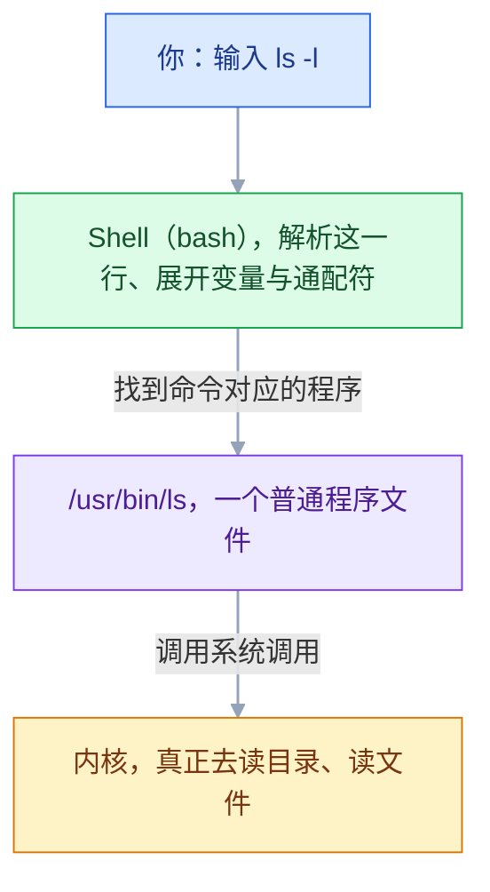
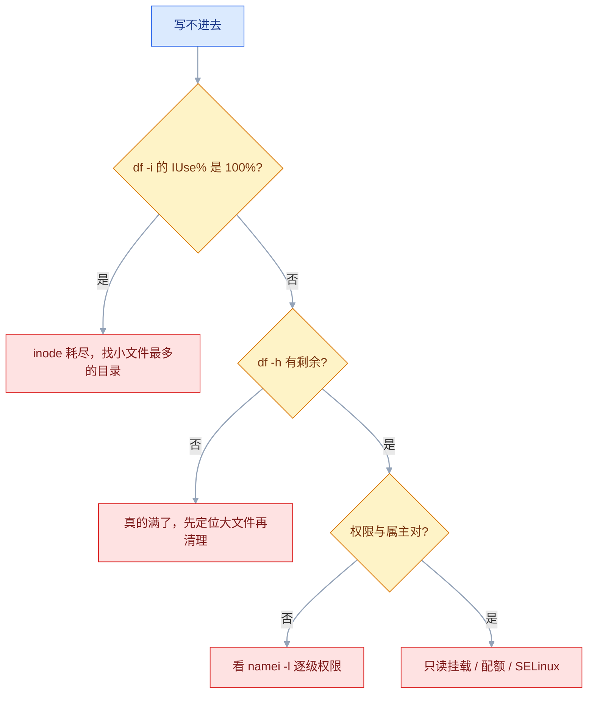
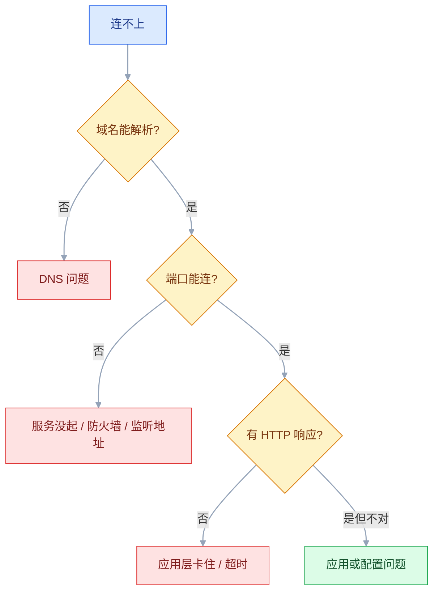

# Linux 核心命令

## 一、工程案例：从一条告警到根因

**场景**：周一 09:05 收到告警「5xx 比例 8%，持续 10 分钟」。你 SSH 上一台 Nginx 机器，手上只有两个文件：

```text
/var/log/nginx/access.log     # 访问日志（combined 格式，$request_time 已加）
/data/logs/app.log            # Spring Boot 应用日志
```

**目标**：在 15 分钟内回答四个问题——错误集中在哪个接口、从几点开始、后端报了什么、现在怎么处置。

**为什么必须按顺序**：先看现象再看细节，能避免「一上来就 grep error，结果被 3 万行噪音淹没」。下面是这条路径。

### 1.1 第一步：确认范围，不要先猜原因

```bash
wc -l /var/log/nginx/access.log                 # 数据量，决定后面能不能直接扫
awk '{print $9}' /var/log/nginx/access.log | sort | uniq -c | sort -rn | head
```

```text
   8214 200
    612 500      ← 有这个数，说明不是误报
     88 404
     41 502
```

> 先看状态码分布，就是先确认「到底哪种错误」。**5xx 里 500 和 502 根因完全不同**：500 是后端处理出错，502 是根本没拿到后端响应。

### 1.2 第二步：定位到接口

```bash
# 只看 5xx，按路径聚合
awk '$9 >= 500 {print $7}' /var/log/nginx/access.log | sort | uniq -c | sort -rn | head -5
```

```text
    480 /api/orders
    101 /api/products
     31 /api/users
```

**结论**：`/api/orders` 一个接口占了 80% 的错误，问题不在网络，在这个接口。

### 1.3 第三步：看时间分布，判断是「突发」还是「一直」

```bash
# 时间字段 $4 形如 [18/Oct/2026:09:03:12，取小时:分钟
awk '$9 >= 500 {print $4}' /var/log/nginx/access.log | cut -d: -f2,3 | sort | uniq -c | tail -10
```

```text
     12 08:58
     88 09:01
    164 09:02
    197 09:03
     71 09:04
      8 09:05
```

**结论**：09:01 起量，09:05 自己回落。是突发，不是持续故障——**先别急着改配置，先弄明白那 4 分钟发生了什么**。

### 1.4 第四步：进后端日志找根因

```bash
# 按时间对齐（两边都要有毫秒/秒级时间）
grep -n "09:0[1-4]" /data/logs/app.log | grep -iE "error|exception|timeout" | head -5
```

```text
18423 2026-10-18 09:02:11.214 ERROR c.e.OrderService - 订单查询失败 orderId=9921
18424 java.sql.SQLTransientConnectionException: HikariPool-1 - Connection is not available,
      request timed out after 30001ms.
```

**根因**：连接池耗尽。09:01 有一波流量进来，`/api/orders` 的查询变慢，连接迟迟不释放，30 秒后全部超时。

再确认一句「为什么会慢」：

```bash
grep -c "HikariPool" /data/logs/app.log                    # 有多少条
grep "09:02" /data/logs/app.log | grep -i "slow" | head    # 有没有慢查询日志
```

### 1.5 第五步：处置与验证

| 动作 | 目的 | 验证 |
|---|---|---|
| 重启应用释放连接 | 立刻恢复可用 | `awk '$9>=500' ...` 计数停止增长 |
| 把连接池从 10 调到 30 | 扛住下一波 | 压测或等下一波流量 |
| 给慢查询加索引 | 治本 | 接口 P95 从 1.2s 降到 200ms |
| 加「连接池饱和度」告警 | 下次提前 5 分钟发现 | 告警规则能触发 |

**验收**：`curl -s -o /dev/null -w "%{http_code}"` 连续 10 次都是 200；`awk '$9>=500'` 在接下来 30 分钟没有新增。

> **一条经验**：**告警响了先止血（重启/限流/降级），再查根因**。在故障中做根因分析，会把 4 分钟的故障拖成 40 分钟。

### 1.6 这次排查用到的命令，按「想知道什么」查

| 想知道 | 用什么 |
|---|---|
| 整体状态码分布 | `awk '{print $9}' f \| sort \| uniq -c \| sort -rn` |
| 哪些接口在报错 | `awk '$9>=500 {print $7}' f \| sort \| uniq -c \| sort -rn` |
| 什么时候开始 | `awk '{print $4}' f \| cut -d: -f2,3 \| uniq -c` |
| 某段时间的日志 | `sed -n '/09:01/,/09:05/p' f` 或 `awk -F'[][]' '$2>"..."'` |
| 前后几行上下文 | `grep -A5 -B2 "Exception" f` |
| 实时盯新的错误 | `tail -F f \| grep --line-buffered -i error` |
| 按接口统计耗时 | `awk '{s[$7]+=$13; c[$7]++} END{for(p in s) print s[p]/c[p], p}' f` |
| 谁在扫你的站 | `awk '{print $7}' f \| sort -u \| grep -Ev "^(/api\|/static)"` |

> 这张表的用处是**从问题出发找工具**，而不是从工具出发背参数。参数忘了现场 `man`，思路忘了就卡住了。

---

## 二、高频问答：会卡住你的地方，也是面试最常问的

### 2.1 `grep` 明明有，却搜不到

**现场**

先分三步查：`grep -c` 看计数是真没有还是没匹配上，`file` 看编码，`grep -a` 强制当文本。

```bash
grep -c "error" app.log          # 0 就是真没有，非 0 就看下面
grep -a "error" app.log          # 二进制文件也能搜（-a = --text）
grep -F "a.b[c]" app.log         # 搜固定字符串，关掉正则
grep -i "error" app.log          # 忽略大小写
file app.log                     # 看是不是 UTF-8
```

> **写脚本时一律加 `-F`**：又快，又不会把 `.` `*` 当元字符。

**要点**

- 搜不到不等于文件里没有，先分清是匹配规则、编码还是文件类型的问题。
- 五种常见原因：大小写、被当成正则（`.` `*` `[` 有特殊含义）、被识别成二进制只回一句 `Binary file matches`、编码不是 UTF-8（GBK 中文搜不到）、目标是软链接没跟进去。
- 写脚本一律加 `-F`：既快，又不会把 `.` `*` 当元字符。

**追问**

- 英文能搜到、中文搜不到？→ 文件多半是 GBK，`file` 确认后转成 UTF-8 再搜。
- 为什么明明有 `error` 却匹配出一堆别的行？→ 没加 `-F`，`.` 和 `*` 被当成正则元字符了。
- 目标是软链接目录，`grep -r` 为什么没进去？→ 递归默认不跟随软链接，直接搜真实路径。

### 2.2 `sed -i` 把配置文件改坏了

**现场**

先 `diff` 备份和现文件，看改了哪些行；没备份就先别二次修改。

```bash
# ✔ 永远带备份
sudo sed -i.bak 's/worker_processes 1;/worker_processes 4;/' /etc/nginx/nginx.conf
diff /etc/nginx/nginx.conf.bak /etc/nginx/nginx.conf

# ✔ 批量改之前，先在单个文件上不带 -i 试跑
sed 's/old/new/g' a.conf | head -20
```

**要点**

- `-i` 是原地覆盖、没有撤销，备份是唯一的保险。
- 正则写宽了会大面积命中，批量改之前必须先在单个文件上不带 `-i` 试跑。
- macOS 的 BSD sed `-i` 必须带后缀（`-i ''`），照抄 Linux 命令会直接报错。

**追问**

- 改坏了怎么救？→ `mv x.conf.bak x.conf`；没有备份就只能从包里重新取默认配置（`dpkg -S` 查它属于哪个包）。
- `-i.bak` 和 `-i` 差在哪？→ 前者顺手留一份备份文件，后者直接覆盖原文件。
- 为什么挂进容器的单文件配置 `sed -i` 改完不生效？→ 它写临时文件再改名，inode 换了，容器还指着旧文件。

### 2.3 `awk` 取错了列

**现场**

`awk '{print NF}'` 看字段数对不对，`awk '{print $1, $2}'` 看切在哪。

```bash
head -1 access.log | awk '{print NF}'        # 字段数
head -1 access.log | awk -F'[][]' '{print $2}'   # 按 [ ] 切，取出时间
head -1 access.log | awk '{print "9="$9, "10="$10}'  # 带上列号，肉眼对齐
```

> **先标定列位置，再写统计**。列错一位，后面所有结论都是错的。

**要点**

- `awk` 默认按「连续空白」切分，字段里有空格就会把后面的列整体推移。
- 日志里带引号的字段（`"GET /a b HTTP/1.1"`）内部有空格，是列错位最常见的原因；也可能是忘了 `-F`。
- 先标定列位置、确认 `NF` 再写统计，列错一位后面所有结论都是错的。

**追问**

- 怎么确认第 9 列真的是状态码？→ 把列号和值一起打印，肉眼对齐第一行。
- 字段本身带空格，怎么切才准？→ 用 `-F` 指定不会出现在字段里的分隔符，或按引号切。
- `$9` 和 `$NF` 哪个更稳？→ `$NF` 取最后一列，字段数变化时更稳。

### 2.4 命令在终端能跑，写进脚本/cron 就失败

**现场**

用空环境复现，把真实的环境变量记进日志。

```bash
env -i /bin/bash --noprofile --norc -c '/path/to/script.sh'
# 在脚本开头打一行，把真实环境记进日志
echo "PATH=$PATH PWD=$PWD USER=$USER" >> /tmp/script.log
```

**要点**

- 终端能跑、cron 跑不了，几乎都是环境不同，不是脚本有 bug。
- cron 的环境和登录 shell 不是同一个：PATH 短（找不到 `/usr/local/bin` 里的命令）、没有 `LANG`（中文乱码）、工作目录是 `$HOME`。
- 修法：脚本里用绝对路径、自己设 `PATH` 和 `LANG`、`cd` 到脚本所在目录。

**追问**

- 为什么 `~/.bashrc` 里配的变量 cron 看不到？→ cron 不启动登录 shell，不读 rc 文件。
- 怎么确认是环境问题？→ `env -i` 能复现就是环境问题，否则再查脚本本身。
- systemd 的 timer 也这样吗？→ 同样不读 shell 配置，要在 unit 里写 `Environment=`。

### 2.5 `tail -f` 日志不更新了

**现场**

`ls -l /proc/$(pgrep -f app.jar)/fd | grep log` 看进程当前打开的是哪个文件。

```bash
tail -F /data/logs/app.log       # 大写 F：文件名变了会自动重新打开
```

> **看长期日志一律用 `-F`**，`-f` 只适合看几分钟。

**要点**

- `-f` 跟的是文件描述符（inode），日志被 logrotate 改名后它还在读那个旧文件。
- 程序已经往新文件写了，所以表现是「日志停了」，而不是程序卡死。
- 看长期日志一律用 `-F`，文件名变了它会自动重新打开。

**追问**

- 怎么确认进程现在写的是哪个文件？→ `ls -l /proc/PID/fd` 看它打开的 fd 指向哪。
- `copytruncate` 和 `rename` 两种轮转有什么区别？→ 前者原地清空不换 inode，后者换新文件；`-F` 两种都能跟上。
- 容器里为什么 `tail -f` 看不到应用日志？→ 应用写在容器内的文件里，宿主机只有 stdout 的 json 日志。

### 2.6 `ps aux | grep xxx` 总是多出一条

**现场**

用 `pgrep -af xxx` 对一下，它不包含自己。

```bash
ps aux | grep [n]ginx        # 用字符类绕过自己
pgrep -af nginx              # 更干净，直接给 pid + 完整命令行
```

**要点**

- 多出来的那条就是 `grep xxx` 自己，它也在进程表里。
- 用 `[n]ginx` 字符类让 grep 的命令行匹配不到自己。
- 要 pid + 完整命令行，直接 `pgrep -af` 更干净。

**追问**

- 为什么 `[n]ginx` 能绕过自己？→ 命令行里是字面的 `[n]ginx`，不匹配这个正则。
- `pgrep` 和 `ps` 结果对不上？→ 匹配规则不同，`pgrep` 按进程名或完整命令行匹配，默认排除自己。
- 已知端口怎么反查进程？→ `ss -tunlp` 或 `lsof -i :8080`。

### 2.7 `kill -9` 之后进程还在

**现场**

`ps -o pid,stat,wchan,cmd -p <pid>` 先看状态和它卡在哪。

```bash
ps -o pid,stat,wchan:20,cmd -p 1234
# D  -> 只能等 IO 返回（检查磁盘/挂载/NFS），或重启
# Z  -> 进程已死，父进程没 wait；处理父进程，僵尸自己消失
```

> `kill -9` 不是万能的：**D 状态连 SIGKILL 都收不到**。看到 D 就要去查 IO，不是继续加信号。

**要点**

- `kill -9` 没反应，先看进程状态，不是内核有问题。
- `D` 是不可中断睡眠（等磁盘/网络 IO），任何信号都不响应，只能等 IO 返回或重启。
- `Z` 是僵尸，进程已经死了，只是父进程没回收，要处理父进程。

**追问**

- 为什么 D 状态连 SIGKILL 都收不到？→ 信号要等进程回到可中断点才处理，它正卡在内核 IO 里。
- 僵尸进程占资源吗？→ 只占一个 PID 表项，攒多了会耗尽 PID。
- 怎么确认它卡在哪个 IO？→ `ps -o wchan` 看内核函数，再配合 `iostat -x 1` 和 `mount | grep nfs`。

### 2.8 `ss` 看不到端口，但服务明明起了

**现场**

两个协议族都查一遍，再用 curl 区分「没监听」和「防火墙挡」。

```bash
sudo ss -tunlp                 # t=TCP u=UDP n=不解析 p=进程
sudo ss -tunlp | grep 8080
sudo ss -6 -tunlp | grep 8080  # 只看 IPv6
curl -sS 127.0.0.1:8080        # 本机能不能通，区分「没监听」和「防火墙挡」
```

> 看到 `127.0.0.1:8080` 就是「只有本机能访问」，这时候改防火墙没用，得改监听地址。

**要点**

- `ss` 看不到端口，先分清是没监听、只监听回环、只监听 IPv6，还是在别的 netns 里。
- 查进程信息要 root（`-p`），普通用户看到的进程列是空的。
- 看到 `127.0.0.1:8080` 就是只有本机能访问，改防火墙没用，得改监听地址。

**追问**

- `ss -4` 查不到但服务确实起了？→ 只监听了 `::`，两个协议族都查一遍。
- 本机能通、外部连不上？→ 监听地址是回环，或者防火墙、安全组拦了。
- 容器里的端口宿主机 `ss` 看不到？→ 不在同一个 netns，要在宿主机看映射端口或 `nsenter` 进去查。

### 2.9 管道中间失败了，脚本却以为成功

**现场**

`echo ${PIPESTATUS[@]}` 看每一段的退出码。

```bash
mysqldump ... | gzip > /backup/a.gz
echo "${PIPESTATUS[@]}"        # 例：1 0 —— 第一段失败了

set -o pipefail                # 任一段失败，整条管道就算失败
```

> 这是「备份文件是空的，但监控显示备份成功」最常见的原因。

**要点**

- 管道的退出码等于最后一个命令的退出码，前面的失败会被吞掉。
- `mysqldump | gzip` 里 mysqldump 失败了，gzip 照样正常结束返回 0。
- 脚本开头 `set -o pipefail`，或者用 `PIPESTATUS` 逐段检查。

**追问**

- `PIPESTATUS` 为什么读出来不对？→ 任何后续命令都会覆盖它，必须紧跟着读。
- 只写 `set -e` 能发现吗？→ 不能，它看的还是整条管道的退出码，要配 `pipefail`。
- 备份文件是空的但监控显示成功，怎么防？→ 别只看退出码，备份后校验文件大小或能否解压。

### 2.10 `find` 刷一屏 `Permission denied`

**现场**

把 stderr 丢掉再看结果。

```bash
sudo find / -xdev -name "*.jar" 2>/dev/null
# -xdev 不跨文件系统（不进 /proc、/sys、挂载的数据盘）
# -maxdepth 2 大目录上必加，否则很慢
sudo find /data -maxdepth 2 -type f -size +100M -exec ls -lh {} +
```

**要点**

- 普通用户遍历 `/proc`、`/root`、其他用户的目录必然被拒，这些是噪音，不是命令出错。
- 用 `2>/dev/null` 丢掉即可，真要搜那些目录就上 `sudo`。
- `-xdev` 不跨文件系统、`-maxdepth` 限制深度，大目录上必加。

**追问**

- 丢掉 stderr 会不会漏掉真错误？→ 会，所以先单独跑一次关键路径确认。
- `-exec {} \;` 和 `-exec {} +` 有什么区别？→ 前者每个文件调一次，后者批量传参，快很多。
- 文件名带空格怎么处理？→ `-print0` 配 `xargs -0`。

### 2.11 `sudo echo xxx > /etc/xxx` 报 Permission denied

**现场**

换成 `tee` 试一下，通了就说明是重定向的权限问题。

```bash
# ✘ Shell 以普通用户身份打开 /etc/xxx，直接被拒
sudo echo "x" > /etc/xxx

# ✔ 让 tee 以 root 身份写
echo "x" | sudo tee /etc/xxx
echo "x" | sudo tee -a /etc/xxx      # 追加
```

**要点**

- `sudo` 只提权了 `echo`，重定向是 Shell 做的，Shell 还是普通用户。
- 报错发生在 Shell 打开文件那一步，跟 echo 有没有权限无关。
- 换成 `sudo tee`（追加用 `-a`）就通了。

**追问**

- 为什么 `sudo sh -c 'echo > file'` 也行？→ 整个 shell 都以 root 跑，重定向也由它做。
- `tee` 写的文件属主是谁？→ 以 root 身份写，新建的文件属主是 root，必要时补 `chmod` / `chown`。
- 还有哪些「看起来提权了其实没有」的写法？→ 管道后半段、`$(...)` 命令替换、通配符展开，都在原用户下执行。

### 2.12 `tar` 解压报 `not in gzip format` / 建包报 `Cannot stat`

**现场**

`file x.tar.gz` 看真实格式，`tar -tf x` 先看目录再动手。

```bash
file pkg.tar.gz                  # 先确认到底是什么格式
tar -tf pkg.tar.gz | head        # 只看内容，不解压

# 让 tar 自己识别压缩格式（现代 GNU tar 都支持）
tar -xf pkg.tar.gz -C /opt

# 建包：czf 的顺序不能乱，f 在最后
tar -czf app.tar.gz /opt/app
```

**要点**

- 报格式错先 `file` 看真实格式，别按后缀猜。
- `-z` 只对应 gzip，`.xz` 用 `-J`、`.bz2` 用 `-j`。
- 带 `-` 时 `f` 必须放最后，`-cfz` 会把 `z` 当成归档名。

**追问**

- `Cannot stat` 是什么意思？→ 要打包的文件不存在，或者 `f` 位置错了把参数吃成了文件名。
- 不想解压只想看内容？→ `tar -tf`，先看目录结构再解。
- 现代 GNU tar 还要写 `-z` 吗？→ 可以只写 `-xf` 自动识别，脚本里写清楚更保险。

---

## 三、核心知识：从零开始要建立的东西

这一节按「一个完全没用过 Linux 的人，第一次上手需要知道什么」来排。**工作里用不到、也没有学习价值的（比如 vim 全键位、各种命令的冷门参数）不在这里**，在第四节的冷门表里。

### 3.1 命令的执行过程

三层，从上到下：



三个关键结论：

**① Shell 本身也是一个程序。** 你登录后看到的提示符，就是 bash 在等你输入。它不做具体的事，只负责「读懂这一行、找到程序、启动它、把结果接过来」。

**② 大部分命令是磁盘上的可执行文件。** `ls` 就是 `/usr/bin/ls`。可以自己验证：

```bash
type ls          # ls is /usr/bin/ls
which ls         # /usr/bin/ls
file /usr/bin/ls # ELF 64-bit executable
```

**③ 少数命令是 Shell 自带的（内置命令）。** `cd`、`echo`、`export` 属于这一类：

```bash
type cd          # cd is a shell builtin
```

**为什么 `cd` 必须是内置的**：改变「当前目录」改变的是 **Shell 进程自己的工作目录**。如果 `cd` 是个独立程序，它改的是自己那个进程的目录，**退出后什么都没变**。

> 这也是理解后面一切的基础：**命令是对「进程」和「文件」的操作**，而 Shell 负责把这些操作串起来。

> **面试**：常问「为什么 `cd` 必须是 Shell 内置命令？」答：它改的是 Shell 进程自己的工作目录，独立进程改完一退出就什么都没变。

### 3.2 一条命令的构成

```text
命令名  [选项]  [参数]
ls      -l      /var/log
```

| 部分 | 说明 | 例子 |
|---|---|---|
| **命令名** | 要执行的程序 | `ls`、`grep`、`tar` |
| **选项** | 改变行为，通常以 `-` 开头 | `-l`（长格式）、`-a`（含隐藏文件） |
| **参数** | 操作对象 | `/var/log`、`file.txt` |

**短选项可以合并**：`ls -l -a -h` 等价于 `ls -lah`。**长选项更可读**：`--help`、`--exclude=xxx`。

**选项和参数的区别有时不明显**，但记住一条：**选项是给命令的开关，参数是你要处理的东西**。

**忘了怎么用怎么办**：

```bash
ls --help        # 快速帮助，最常用
man ls           # 完整手册（q 退出，/ 搜索）
man 5 crontab    # 第 5 节是「配置文件格式」，1 是命令，8 是管理命令
```

**命令找不到（`command not found`）**：不是没装，就是不在 `PATH` 里。查法：

```bash
which nginx            # 在 PATH 里找
ls /usr/sbin/nginx     # 常见位置（/usr/sbin 常不在普通用户 PATH 里）
echo $PATH             # 看搜索路径
```

### 3.3 文件系统与路径

Linux 只有**一棵树**，根是 `/`，没有 C 盘 D 盘。所有文件、U 盘、数据盘都是这棵树上的某个分支。

```text
/
├── etc        配置
├── var        经常变的数据（日志、数据库、缓存）
├── home       每个用户的家目录
├── opt        自己装的第三方软件
├── usr        系统程序和库
├── tmp        临时文件（会被清理）
└── root       root 用户的家目录（不是 /）
```

**两种路径写法**：

| 写法 | 含义 | 例子 |
|---|---|---|
| **绝对路径** | 从 `/` 开始，任何时候都指向同一个地方 | `/var/log/nginx/access.log` |
| **相对路径** | 从「当前目录」开始 | `logs/access.log` |

**四个必须记住的特殊路径**：

| 符号 | 含义 |
|---|---|
| `.` | 当前目录 |
| `..` | 上一级目录 |
| `~` | 当前用户的家目录（`/home/你` 或 `/root`） |
| `-` | 上一次所在的目录（`cd -` 来回切） |

**三个最基本的导航命令**：

```bash
pwd              # 我现在在哪（绝对路径）
ls               # 这里有什么
cd /var/log      # 过去
cd ..            # 上一级
cd -             # 回上一次的目录
cd               # 不带参数 = 回家目录
```

> **写脚本时一律用绝对路径**。脚本执行时的「当前目录」不一定是你以为的那个，这是脚本跑挂的常见原因之一

### 3.4 文件属性与权限位

这一行包含的信息比看上去多，逐个拆开：

```text
-rw-r--r--.  1 deploy devops  4096 Oct 18 09:03  app.log
│└┬┘└┬┘└┬┘   │   │      │      │        │        │
│ │  │  │    │   │      │      │        │        └─ 文件名
│ │  │  │    │   │      │      │        └────────── 最后修改时间
│ │  │  │    │   │      │      └─────────────────── 大小（字节，加 -h 会变 K/M）
│ │  │  │    │   │      └────────────────────────── 属组
│ │  │  │    │   └───────────────────────────────── 属主
│ │  │  │    └───────────────────────────────────── 硬链接数（目录的「子目录数+2」）
│ │  │  └─────────────────────────────────────────  其他人（other）的权限
│ │  └────────────────────────────────────────────  属组（group）的权限
│ └───────────────────────────────────────────────  属主（user）的权限
└─────────────────────────────────────────────────  文件类型：- 普通文件  d 目录  l 软链接
```

**权限那 9 位怎么读**：每三位一组，顺序是 `rwx`，有就是有、没有就是 `-`

- 补充：9位权限位后有时会带一个`.`，这个是SELINUX开启的意思

```text
rw-  r--  r--
属主  属组  其他人
读写  只读  只读
```

**文件类型的第一个字符**：

| 字符 | 类型 |
|---|---|
| `-` | 普通文件 |
| `d` | 目录（directory） |
| `l` | 软链接（link） |
| `c` / `b` | 字符设备 / 块设备（几乎不用管） |

**`ls` 的几个常用组合**：

```bash
ls -l            # 长格式
ls -a            # 含隐藏文件（以 . 开头的文件默认不显示）
ls -lh           # 大小变成人看得懂的 K/M/G
ls -lt           # 按修改时间排序（最新在上），排查「最近改了什么」必用
ls -ltr          # 反过来，最新的在最下面
ls -R            # 递归列出子目录
```

> `ls -lt | head -5` 是排查现场最常用的一行：**最近被改动的 5 个文件**，往往就是问题来源。

**九位为什么分三组**：因为访问者只分三种身份——**属主（user）、属组（group）、其他人（other）**。一个进程来访问时，系统只按其中一种身份判定，**命中就停，不再往下看**。

```text
进程 uid == 文件属主    → 只看属主那三位（哪怕组权限更宽也不生效）
否则 组匹配            → 只看属组那三位
否则                  → 只看其他人那三位
```

**「命中就停」解释了大量怪现象**：文件属主是 `deploy`、组权限给了 `rw`，但你用 `deploy` 去写还是失败——因为属主那三位是 `r--`，系统认定你是属主后，就不再参考组权限了。

**数字表示**：r=4、w=2、x=1，三位相加。常用：644、600、755

| 数字 | 含义 | 常见用途 |
|---|---|---|
| `644` | 属主读写，其他人只读 | 普通文件默认 |
| `600` | 只有属主读写 | 私钥、含密码的配置 |
| `755` | 属主全权，其他人读+执行 | 目录默认、可执行程序 |
| `700` | 只有属主能进 | 家目录、`.ssh` |
| `777` | 所有人全权 | 几乎永远不该出现 |

```bash
chmod 644 app.log          # 数字法
chmod u+x run.sh           # 符号法：属主加执行
chmod -R u+rwX /data       # 递归；大写 X 只给目录加 x
chown deploy:devops /opt/app
```

> **目录的 `w` 比文件的 `w` 更危险**：目录有 `w` 和 `x` 才能删掉里面任何文件，哪怕文件本身是 `444`。**目录的 `x` 是门票**：只有 `r` 没有 `x`，能看见名字但进不去、也读不了内容。
>
> `umask`、特殊权限（SUID/SGID/粘滞位）、`sudo` 的完整设计属于系统层，不在命令篇展开；这里要建立的是「能读懂、能改对」。

> **面试**：常问「文件属主是 `r--`、组权限给了 `rw`，属主本人为什么还是写不进去？」答：访问者只按一种身份判定，命中属主就停，不再看组权限。

### 3.5 通配符与正则

这是最容易混的一对，因为两者都长着 `*`。区别不在长相，在**谁在处理**。


| 写法 | 谁在处理 | 匹配什么 | 例子 |
|---|---|---|---|
| `*.log` | **Shell** 展开成文件名列表 | 文件名 | `ls *.log` → `a.log b.log` |
| `"error.*"` | grep 的正则引擎 | 文件内容 | 匹配「error 后面任意字符」 |
| `error.*timeout`（不加引号） | Shell 先当文件名找 | 基本找不到 | 所以会报 `No such file` |

**Shell 通配符速查**：

| 通配符 | 匹配 | 例子 |
|---|---|---|
| `*` | 任意多个字符（**不含**隐藏文件） | `*.conf` |
| `?` | 恰好一个字符 | `log?.txt` → `log1.txt` |
| `[abc]` | 括号里任一字符 | `file[123].txt` |
| `[a-z]` | 范围 | `log[0-9].txt` |
| `{a,b}` | 展开成多个（**不是**匹配） | `mkdir /data/{app,logs}` → 建两个目录 |
| `[!abc]` | 取反 | `file[!0-9].txt` → 名字不以数字结尾的 |

**`*` 不匹配隐藏文件**，这是新手最常困惑的点：`rm *` 删不掉 `.env`，清理时容易漏。

**为什么写正则可一律用单引号**：单引号里 `$`、`*`、`\` 都不会被 Shell 动，原样交给工具。

```bash
grep 'error.*timeout' app.log    # ✔ 正则原样传给 grep
grep error.*timeout app.log      # ✘ Shell 先当文件名展开，可能变成一串文件名
```

### 3.6 文件内容查看

| 命令 | 适合 | 不适合 |
|---|---|---|
| `cat` | 小文件、拼接到管道 | **大文件**（刷屏且卡） |
| `less` | 大文件，可上下翻、可搜索 | 需要精确取行（用 sed） |
| `head` / `tail` | 开头 / 结尾 N 行 | 中间部分 |
| `tail -F` | **实时跟踪**（-f 只看几分钟） | 看历史 |

```bash
cat /etc/hostname                 # 只有一行的文件
less /var/log/syslog              # 大文件，进来后：/搜索  F跟踪  q退出
head -20 access.log               # 前 20 行
tail -50 app.log                  # 最后 50 行
tail -F app.log                   # 持续跟踪（大写 F，-f只看几分钟）
tail -F app.log | grep --line-buffered ERROR   # 实时过滤，不缓冲
```

**`less` 只要记三个键**：`/关键词` 搜（`n` 下一个）、`F` 实时跟踪、`q` 退出。

> **`--line-buffered` 是关键**：不加它，grep 会攒一批才输出，实时监控会延迟几十秒。

### 3.7 文件与目录操作

```bash
# 创建
mkdir -p /data/app/logs           # -p：父目录不存在就一起建（脚本里必加）
touch app.log                     # 建空文件 / 更新修改时间

# 复制
cp a.txt b.txt                    # 复制文件
cp -r /opt/app /opt/app.bak       # 复制目录（必须 -r）
cp -a /opt/app /backup/           # 归档模式：保留权限、属主、时间（备份用这个）

# 移动 / 重命名（是同一个命令）
mv old.txt new.txt                # 重命名
mv /tmp/app.jar /opt/app/         # 移动

# 删除
rm file.txt
rm -r /data/olddir                # 删目录（递归）
rm -rf /data/olddir               # 强制不提示
```

**三条必须建立的直觉**：

**① `rm` 没有回收站。** 删了就是删了，没有「从废纸篓恢复」。所以生产上删东西前先 `ls` 看一眼，或者用 `mv` 移到 `/tmp` 观察几天。

**② `rm -rf` 的危险在空格和空变量。**

```bash
rm -rf /data/logs /data/app      # 想删两个目录
rm -rf /data /logs /data/app     # 手滑多打一个空格 → 变成删 /data 下更多东西
rm -rf $DIR/                     # $DIR 为空 → rm -rf / （删根）
```

**③ 目录的 `w` 权限比文件的 `w` 更危险**：目录有 `w` 和 `x` 就能删掉里面任何文件，哪怕那个文件是 `444`（只读）。删文件靠的是「对目录有写和执行权限」，不是「对文件有写权限」。

### 3.8 管道与重定向

**每个进程天生有三个通道**：

| 编号 | 名字 | 默认接到哪 |
|---|---|---|
| 0 | stdin 标准输入 | 键盘 |
| 1 | stdout 标准输出 | 屏幕 |
| 2 | stderr 标准错误 | 屏幕 |

**重定向就是改这些通道的去向**：

| 写法 | 作用 |
|---|---|
| `> file` | stdout 写文件（**覆盖**） |
| `>> file` | stdout 追加 |
| `2> file` | stderr 写文件 |
| `&> file` | stdout + stderr 都写（bash 专有） |
| `2>&1` | 把 stderr 也指到 stdout 的目标 |
| `< file` | 从文件读入 stdin |
| `> /dev/null` | 丢弃 |

**`2>&1` 为什么有顺序要求**：

```bash
cmd > all.log 2>&1     # ✔ 先把 1 指向文件，再让 2 复制 1 → 两个都进文件
cmd 2>&1 > all.log     # ✘ 2 先复制了当时的 1（还是屏幕），之后 1 才改向文件
                       #    → 错误仍打在屏幕，只有正常输出进了文件
```

**记住一句话：重定向从左到右依次生效**，`2>&1` 里的 `&1` 是「复制 1 当前指向的位置」，不是「指向 1 这个变量」。

**管道 `|`**：把前一个命令的 stdout 接到后一个命令的 stdin。

```bash
cat access.log | grep " 500 " | wc -l     # 有几条 500
ps aux | grep [j]ava                      # 找 java 进程
```

> **`cat f | grep x` 有个更短的写法 `grep x f`**。管道的价值在「多个命令串联」，不在于替代单命令的参数。

**`tee`：既要看又要存**（也是解决 2.11 那个权限问题的办法）。

```bash
cmd | tee -a run.log                      # 屏幕显示 + 追加文件
echo x | sudo tee /etc/sysctl.d/99.conf   # 需要 root 写文件时
```

> **面试**：常问「`cmd > all.log 2>&1` 和 `cmd 2>&1 > all.log` 有什么区别？」答：重定向从左到右生效，顺序反了 stderr 还留在屏幕上。

### 3.9 文本处理三剑客

不是「三套语法」，是**三种不同的处理模型**。选错模型，命令会写得很别扭。

| 工具 | 模型 | 一句话 | 典型任务 |
|---|---|---|---|
| `grep` | **逐行，判断留不留** | 留下匹配的行，整行原样输出 | 找错误、排除健康检查 |
| `sed` | **逐行，改内容** | 对每行做替换/删除/打印 | 改配置、脱敏、取区间 |
| `awk` | **逐行，按列算** | 切成字段，可条件、可累加、可分组 | 统计、求和、按列过滤 |

**grep 的最小用法**：

```bash
grep "error" app.log             # 含 error 的行
grep -i "error" app.log          # 忽略大小写
grep -c "error" app.log          # 只输出条数
grep -n "error" app.log          # 带行号
grep -v "200" access.log         # 反向：不含 200 的行
grep -r "port" /etc/nginx/       # 递归搜索目录
grep -A3 -B1 "Exception" app.log # 后 3 行 / 前 1 行上下文
grep -F "a.b" app.log            # 固定字符串（关掉正则）
```

**grep 的退出码很有用**（写脚本时）：`0` 匹配到了、`1` 没匹配、`2` 出错。

```bash
if grep -q "ERROR" app.log; then echo "有错误"; fi
```

**sed 的最小用法**：

```bash
sed 's/old/new/' f               # 每行替换第一个
sed 's/old/new/g' f              # 全部替换（g）
sed -i.bak 's/old/new/g' f       # 原地修改，留 .bak
sed -n '10,20p' f                # 只打印 10–20 行
sed -n '/09:01/,/09:05/p' f      # 打印两个时间点之间的行
sed '/^#/d' f                    # 删除以 # 开头的行（去注释）
sed '/^$/d' f                    # 删除空行
```

**awk 的最小用法**：

```bash
awk '{print $1}' f                       				   # 第 1 列
awk '{print $1, $NF}' f                 					 # 第 1 列 + 最后一列
awk -F: '{print $1}' /etc/passwd         					 # 用 : 当分隔符
awk '$9 == 500' access.log              					 # 条件：第 9 列等于 500 才输出整行
awk '$9 >= 500 {print $7}' access.log    					 # 条件 + 只输出某列
awk '{sum+=$5} END{print sum}' f         					 # 求和
awk '{c[$9]++} END{for(k in c) print k, c[k]}' f   # 按状态码计数
```

**awk 的内置变量**（记住这五个就够）：

| 变量 | 含义 |
|---|---|
| `$0` | 整行 |
| `$1` `$2` … | 第 1、2 列 |
| `$NF` | 最后一列 |
| `NF` | 这一行有几列 |
| `NR` | 当前是第几行 |

**最值钱的一个模式：TOP N**

```bash
awk '{print $N}' 文件 | sort | uniq -c | sort -rn | head
```

拆开看每一步为什么不能省：

| 步骤 | 不写会怎样 |
|---|---|
| `sort` | `uniq` **只处理相邻的重复行**，不排序就统计不出来 |
| `uniq -c` | 只去重不计数 |
| `sort -rn` | 默认按字典序，`100` 会排在 `9` 前面 |

**怎么选工具**：要在「行」这个粒度上筛 → `grep`；要改「行里的内容」 → `sed`；要用「某一列」做运算或统计 → `awk`。

> 三者能互相替代，但没必要。**按字段比较一定用 awk**：`grep " 500 "` 会把响应体字节数里的 500 也匹配上。

### 3.10 磁盘、内存与链接

这三样是排查机器状态的入口，和 `find` 一样属于「每天都用但没人教」的命令。

**磁盘容量：`df` 看分区，`du` 看目录。**

```bash
df -h          # 每个分区的总量/已用/剩余（-h 才是给人看的）
df -i          # inode 用量——有空间却写不进去时看这个
du -sh /var/*  # 每个子目录占多少
du -h --max-depth=1 /data | sort -rh | head   # 找最占空间的目录
```

**`df -h` 有空间但写不进去**，按这个顺序查：



**内存：`free` 要加 `-h`，且要看 `available`。**

```bash
free -h
# 关键是 available 那一列，不是 free——Linux 会把空闲内存拿去做缓存
```

> 进程真被杀了，去 `dmesg -T | grep -i 'killed process'` 看是不是 OOM killer 干的。

**软链接与硬链接**：`ln -s` 建软链接（存路径，跨分区，原文件删了就断），`ln` 建硬链接（同一 inode，不能跨分区，不能指向目录）。

```bash
ln -s /data/app/current /opt/app     # 发布用：current 指向带版本号的目录
ls -l /opt/app                       # l 开头 + 箭头就是软链接
readlink -f /opt/app                 # 解析出真实路径
```

### 3.11 文件与内容查找

这是两个完全不同的问题，所以是两个命令：

| 想找 | 用什么 | 找的是什么 |
|---|---|---|
| 名字叫 `*.conf` 的文件 | `find` | **文件属性**（名字、大小、时间、类型、权限） |
| 内容里有 `timeout` 的文件 | `grep -r` | **文件内容** |

**`find` 的常用写法**：

```bash
find /var/log -name "*.log"                  # 按名字
find /etc -name "*.conf" -mtime -7           # 7 天内改过的
find /data -type f -size +100M               # 大于 100M 的文件
find /tmp -type f -mtime +30 -delete         # 删 30 天前的（先 -print 确认）
find / -xdev -type f -name "*.jar"           # -xdev 不跨文件系统
find /data -maxdepth 2 -name "*.log"         # 限制深度（大目录必加）
```

**`-exec` 和 `xargs` 的区别**：

```bash
find . -name "*.log" -exec ls -lh {} \;      		 # 每个文件调一次（慢）
find . -name "*.log" -exec ls -lh {} +       		 # 批量传给一次（快）
find . -name "*.log" -print0 | xargs -0 ls -lh   # 最安全，能处理文件名带空格
```

**为什么 `-print0` + `xargs -0`**：默认按空格分词，文件名里有空格就会被拆错。

### 3.12 进程、信号与退出码

**进程 = 正在运行的程序实例**。每个进程有一个 PID。

```bash
ps aux                 # 所有进程（BSD 风格）
ps -ef                 # 所有进程（System V 风格，带 PPID 父进程）
ps aux | grep [j]ava   # 找特定进程（见 2.6）
pgrep -af java         # 更干净：直接给 pid + 命令行
top                    # 实时看谁在吃 CPU/内存（P 按 CPU、M 按内存、q 退出）
```

**`ps aux` 里要会看的几列**：

| 列 | 含义 |
|---|---|
| `PID` | 进程号（kill 要用） |
| `%CPU` / `%MEM` | 占用 |
| `RSS` | 实际占用的物理内存 |
| `STAT` | 状态（见 3.13） |
| `TIME` | 累计 CPU 时间 |

**前台 / 后台**：

```bash
long_task &            			 # 放后台，返回 PID
jobs -l                			 # 看当前 shell 的后台任务
fg %1                  			 # 调回前台
Ctrl+Z                 			 # 暂停（挂起），再用 bg 放后台
nohup cmd > out.log 2>&1 &   # 关掉 SSH 也不死
```

**`kill` 发的是信号，不是「杀死」**：

| 信号 | 编号 | 能否被捕获 | 用途 |
|---|---|---|---|
| `SIGTERM` | 15 | 能 | **默认先发它**，进程可以清理连接、落盘 |
| `SIGKILL` | 9 | 不能 | 15 无效时才用 |
| `SIGHUP` | 1 | 能 | 很多服务用来「重载配置」 |
| `SIGINT` | 2 | 能 | Ctrl+C |

**必须先 15 后 9**：`-9` 让进程没机会关连接、刷盘、删临时文件——数据库可能损坏、文件可能写半截。

```bash
kill -15 1234          # 先礼
kill -9 1234           # 后兵（还在才用）
kill -1 1234           # 让服务重读配置
```

**退出码**：每条命令结束时都会留下一个 0–255 的数字，**0 表示成功**。

```bash
ls /nope; echo $?      # 2
ls /tmp; echo $?       # 0

# 最常用的判断写法
ls /nope 2>/dev/null || echo "目录不存在"
```

常见值：`1` 一般错误、`2` 用法错误、`126` 不可执行、`127` 命令找不到、`128+n` 被信号 n 杀掉（如 130 = Ctrl+C）。

### 3.13 进程状态与信号响应

`ps` 的 `STAT` 第一位是状态：

| 状态 | 含义 | 能杀吗 |
|---|---|---|
| `R` | 正在运行 | 能 |
| `S` | 可中断睡眠（等事件，最常见） | 能 |
| `D` | **不可中断睡眠**（等 IO） | **不能**，连 -9 都不响应 |
| `Z` | 僵尸（已退出，等父进程回收） | 已经死了，要处理父进程 |
| `T` | 暂停（Ctrl+Z 或被 SIGSTOP） | 能（先 SIGCONT） |

**看到 `D` 就去查 IO**，不要继续 kill：

```bash
ps -o pid,stat,wchan:20,cmd -p <pid>   # wchan 会告诉你卡在哪个内核函数
iostat -x 1                             # 磁盘是不是饱和
mount | grep nfs                        # 有没有挂住的 NFS
```

**看到 `Z`**：进程已经死了，只是父进程没 `wait`。处理父进程（重启它），僵尸自然消失。

### 3.14 环境变量与 PATH

**环境变量 = 一组会被子进程继承的键值对。**

```bash
echo $HOME        # /home/deploy
echo $PATH        # 命令的搜索路径，冒号分隔
echo $LANG        # 语言与编码
env               # 看全部
```

**最影响日常的是 `PATH`**：你敲 `nginx`，Shell 会按 `PATH` 里的目录顺序去找，找到第一个就用。

```bash
echo $PATH
# /usr/local/sbin:/usr/local/bin:/usr/sbin:/usr/bin:/sbin:/bin

which -a python3     # 同名命令的所有位置
```

**`/usr/local/bin` 通常排在最前**，所以自己装的新版本会覆盖系统自带的——这既是方便，也是「版本莫名变了」的常见原因。

**临时 vs 永久**：

```bash
export MY_VAR=1                    # 只对当前 shell 和它的子进程生效，关掉就没了
VAR=1                              # 只对当前 shell 有效，不 export 子进程看不到

echo 'export MY_VAR=1' >> ~/.bashrc    # 永久（当前用户，重新登录生效）
sudo tee -a /etc/profile.d/my.sh <<'EOF'
export MY_VAR=1
EOF
```

**三个必须知道的点**：

| 点 | 说明 |
|---|---|
| 子进程继承父进程的环境 | 所以 `export` 之后启动的程序都能看到 |
| **cron / systemd 不看 `~/.bashrc`** | 这是「终端能跑、定时任务失败」的根本原因（见 2.4） |
| 改完要让新配置生效 | `source ~/.bashrc` 或重新登录 |

### 3.15 压缩与归档

| | 做什么 | 命令 |
|---|---|---|
| **归档** | 把多个文件打成一个包（**不减小体积**） | `tar -cf` |
| **压缩** | 减小体积，通常只处理单个文件 | `gzip` / `xz` / `bzip2` |
| **归档 + 压缩** | 打包并压缩，一步完成 | `tar -czf` |

`tar.gz` = 先归档、再压缩，一步完成。**`tar` 只是那个「打包 + 调用压缩器」的工具**。

```bash
# 记法：主操作（c/x/t）+ 压缩方式（z/j/J）+ f（文件名，必须最后）
tar -czf app.tar.gz /opt/app        # c 创建 + z gzip
tar -tzf app.tar.gz | head          # t 查看内容（先看再解，好习惯）
tar -xzf app.tar.gz -C /opt/restore # x 解压到指定目录
tar -cJf app.tar.xz /opt/app        # J = xz，压缩率最高最慢
tar -cjf app.tar.bz2 /opt/app       # j = bzip2

# zip打包与解压
zip -r app.zip /opt/app							# -r 递归处理
unzip app.zip -d /opt/app						# -d 指定解压路径
```

| 后缀 | 用什么 |
|---|---|
| `.tar.gz` / `.tgz` | `-z`，最通用 |
| `.tar.xz` | `-J`，压缩率最高，慢 |
| `.tar.bz2` | `-j`，介于两者之间 |
| `.zip` | `zip -r` / `unzip`，跨平台（Windows 能直接解） |
| `.gz` | `gzip`，**只能压单个文件**，不能打包多个 |

**`f` 必须放最后**：`tar -cfz x.tar.gz f` 会被解析成 `-c -f z`——归档名变成 `z`，后面的 `x.tar.gz` 和 `f` 都被当成要打包的文件。文件不存在时报 `Cannot stat`，存在则会静默生成一个叫 `z` 的包。

### 3.16 网络与端口排查



**顺序的意义是「每步排除一类原因」**，不用一上来就抓包：

```bash
dig +short example.com          # ① 解析出 IP 了吗
nc -zv 10.0.0.5 8080            # ② 端口通吗（比 telnet 干净）
curl -v http://10.0.0.5:8080/health   # ③ HTTP 通吗、返回什么
sudo tcpdump -i any -nn port 8080 -c 10   # ④ 最后才抓包
```

**端口监听地址的含义**（必须理解）：

```text
0.0.0.0:8080     → 监听所有网卡，外部能连
127.0.0.1:8080   → 只有本机能连，外部永远连不上
[::]:8080        → IPv6 所有地址（多数系统同时接受 IPv4）
```

```bash
sudo ss -tunlp                   # 谁在监听哪些端口
sudo ss -tnp                     # 已建立的连接
sudo ss -s                       # 连接状态统计（TIME_WAIT 过多时用）
```

**三种「连不上」的含义完全不同**：

| 现象 | 含义 | 往哪查 |
|---|---|---|
| `Connection refused` | 端口没人监听（或被 REJECT） | 服务是不是没起、`ss -tunlp` |
| 连接超时 | 包被丢了 | 安全组、防火墙 DROP、路由 |
| `No route to host` | 路由不可达 | 网络配置、VPC |

> **面试**：常问「`Connection refused` 和连接超时分别说明什么？」答：前者是端口没人监听或被 REJECT，后者是包被丢了，查安全组、防火墙和路由。

---

## 四、冷门知识汇总

**「冷门」的标准是：低频 + 出错代价低 + 能现查。** 低频但致命的（如 inode 耗尽、`pipefail`）留在高频问题里。

| 知识点 | 为什么冷门 | 用到时的关键词 |
|---|---|---|
| `xargs -0` 与 `-print0` | 文件名带空格才会出问题 | `find ... -print0 \| xargs -0 rm` |
| 进程替换 `<(...)` | 需要「把命令输出当文件用」时 | `diff <(sort a) <(sort b)` |
| `cut` | 有 awk 后很少单独用 | `cut -d: -f1`、`cut -c1-10` |
| `tr` | 简单字符替换，awk 也能做 | `tr -s ' '`、`tr -d '0-9'` |
| `sort -h` | 只用于「人类可读大小」排序 | `du -sh * \| sort -rh` |
| `watch -d` | 实时对比变化时 | `watch -d -n 2 'df -h'` |
| `strace` | 深度排查，平时不需要 | `strace -f -e trace=openat` |
| `lsof` 定位文件/端口 | 需要「谁占着这个文件」时 | `lsof -p PID`、`lsof -i :8080` |
| `ncdu` | 交互式磁盘分析，服务器不一定装 | `ncdu /var` |
| `jq` | 只在处理 JSON 时用 | `curl ... \| jq -r '.data.id'` |
| `date -d` 时间运算 | 写脚本才会用到 | `date -d "-7 days" +%F` |
| `openssl rand` / `sha256sum` | 生成密码、校验下载 | `openssl rand -base64 24` |
| `Ctrl+R` 反向搜历史 | 大多数人只会按上箭头 | `Ctrl+R`、`!!`、`!$` |
| `/proc` 运行时信息 | 需要看进程内部状态时 | `/proc/PID/cwd`、`fd`、`environ` |
| `$()` 可嵌套 | 反引号不能嵌套 | `echo $(date +%F)_$(hostname)` |
| `locate` | 数据库有延迟，现在多用 find | `updatedb` 后 `locate nginx.conf` |
| emacs 风格键位 | 极少有人改默认 | `set -o vi` / `set -o emacs` |
