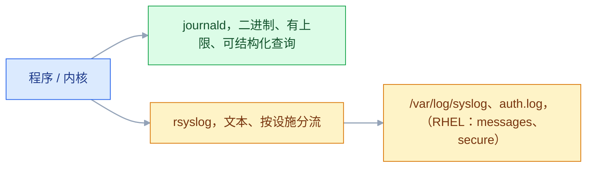
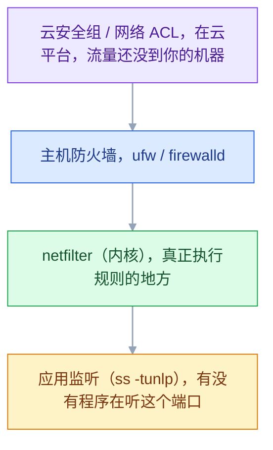
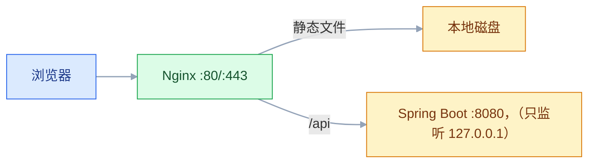
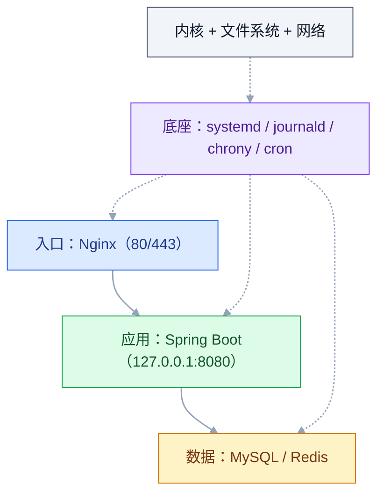

# Linux 核心服务

## 一、工程案例：用 systemd 托管一个 Spring Boot 应用

**场景**：一台已经初始化好的 Ubuntu 24.04（有 `deploy` 账号、数据盘挂在 `/data`）。手上有一个 `app.jar`，要求：

- 开机自启、崩了自动重启
- 日志能查、能按天切割、不撑爆磁盘
- 只监听本机，外部通过 Nginx 访问
- 出问题时能一眼看出是「没起来」还是「起错了」

**为什么要用 systemd 而不是 `nohup`**：`nohup` 只能解决「关掉 SSH 别死」，剩下的开机自启、崩溃重启、日志收集、资源限制、依赖顺序，全都要自己写脚本。**systemd 是这台机器上唯一该管进程的东西**。

### 1.1 主线（六步）

```bash
# ① 放好程序、目录、专用账号（复用 01 里建好的 appuser）
sudo mkdir -p /opt/app/current /data/logs/app
sudo cp app.jar /opt/app/current/
sudo chown -R appuser:appuser /opt/app /data/logs/app

# ② 环境变量单独放文件，不要写进 unit
sudo tee /opt/app/app.env >/dev/null <<'EOF'
SPRING_PROFILES_ACTIVE=prod
SERVER_PORT=8080
# Spring Boot 默认监听 0.0.0.0；必须显式绑回本机，否则外部可直连 8080
SERVER_ADDRESS=127.0.0.1
TZ=Asia/Shanghai
EOF
sudo chown root:appuser /opt/app/app.env && sudo chmod 640 /opt/app/app.env

# ③ 写 unit
sudo tee /etc/systemd/system/app.service >/dev/null <<'EOF'
[Unit]
Description=Order Service
After=network-online.target
Wants=network-online.target

[Service]
Type=simple
User=appuser
Group=appuser
WorkingDirectory=/opt/app/current
EnvironmentFile=/opt/app/app.env
ExecStart=/usr/bin/java -Xms512m -Xmx1g -jar /opt/app/current/app.jar
Restart=always
RestartSec=5
TimeoutStopSec=30
StandardOutput=journal
StandardError=journal

[Install]
WantedBy=multi-user.target
EOF

# ④ 语法、启动、自启
sudo systemctl daemon-reload
sudo systemctl enable --now app
systemctl status app --no-pager

# ⑤ 验证「只监听本机」和「能访问」
ss -tunlp | grep 8080          # 期望 127.0.0.1:8080；若是 0.0.0.0 说明没绑上
curl -sS 127.0.0.1:8080/actuator/health

# ⑥ Nginx 反代（外部只暴露 80/443）
sudo tee /etc/nginx/conf.d/app.conf >/dev/null <<'EOF'
server {
    listen 80;
    server_name app.example.com;

    location / {
        proxy_pass http://127.0.0.1:8080;
        proxy_set_header Host $host;
        proxy_set_header X-Real-IP $remote_addr;
        proxy_set_header X-Forwarded-For $proxy_add_x_forwarded_for;
        proxy_set_header X-Forwarded-Proto $scheme;
        proxy_read_timeout 60s;
    }
}
EOF
sudo nginx -t && sudo systemctl reload nginx
```

### 1.2 验收（7 项）

| # | 检查 | 命令 | 通过标准 |
|---|---|---|---|
| 1 | 服务在跑且开机自启 | `systemctl is-enabled app; systemctl is-active app` | `enabled` / `active` |
| 2 | 崩溃能自愈 | `sudo kill -9 $(pgrep -f app.jar)`，等 10 秒 | `systemctl status` 显示又起来了，`Restart` 计数 +1 |
| 3 | 只监听本机 | `ss -tunlp \| grep 8080` | `127.0.0.1:8080` |
| 4 | 本机能通 | `curl -sS 127.0.0.1:8080/actuator/health` | 返回 `{"status":"UP"}` |
| 5 | 外部经 Nginx 能通 | `curl -I http://app.example.com/` | 200/302，不是 502 |
| 6 | 日志可查 | `journalctl -u app -n 20 --no-pager` | 有启动日志，无报错 |
| 7 | 重启机器后自动恢复 | `sudo reboot`，等 1 分钟 | 上面 1–6 全部依然成立 |

> **第 7 项一定要真做一次**。`enable` 只保证「会被拉起」，不保证「拉起来能用」——比如依赖的盘没挂上、环境变量没读到，都会在重启后才暴露。

---

## 二、高频问答：会卡住你的地方，也是面试最常问的

### 2.1 `systemctl start` 失败，但看不出原因

**现场**

三步走：看日志、看 unit 最终内容、手动跑 ExecStart。

```bash
systemctl status app --no-pager -l     # -l 不截断长行
journalctl -u app -n 50 --no-pager     # 最近 50 行
journalctl -u app -p err -b            # 本次开机以来的错误
systemctl cat app                      # 看 unit 最终生效内容（含 drop-in）
```

**要点**

- systemd 只报「failed」，真正的原因在 journal 里，不在 status 那一行。
- 最常见是路径写错、权限不对、环境变量没读到。
- 手动能跑、systemd 不能跑，基本就是用户、PATH、工作目录、环境变量的差异。

**追问**

- 为什么手动跑成功、systemd 还是失败？→ 运行身份和环境不同，逐个对 `User=`、`WorkingDirectory=`、`EnvironmentFile=`。
- `systemctl cat` 和 `status` 有什么区别？→ cat 看最终生效的 unit（含 drop-in），status 只给运行状态和最近日志。
- 改了 unit 文件为什么 restart 没变化？→ 先 `daemon-reload`，否则 systemd 还在用旧内容。

### 2.2 服务起来几秒就退，`Restart=always` 一直循环

**现场**

`systemctl show app -p NRestarts` 看重启次数，`journalctl -u app -b` 看每次退出的最后一行。

```bash
systemctl show app -p NRestarts -p ExecMainStatus
# 端口被占的典型报错：Address already in use
ss -tunlp | grep 8080
```

**要点**

- 起来几秒就退，是程序启动即崩，`Restart=always` 只是让它反复重试。
- 常见原因是端口被占、配置缺项、连不上数据库；也可能 `Type=simple` 但程序其实 fork 到后台。
- 依赖数据库时，`After=` / `Wants=` 只控制启动顺序，不保证对方已经可用，程序得自己重试或 `ExecStartPre` 探活。

**追问**

- 怎么区分「崩了被拉起」和「正常退出」？→ `ExecMainStatus` 是非 0 就是崩，0 是正常结束。
- 重启太频繁刷日志怎么办？→ `StartLimitBurst` / `StartLimitIntervalSec` 限流。
- 程序自己 fork 到后台会怎样？→ `Type=simple` 以为主进程已退出，要改 `Type=forking` 或让它前台跑。

### 2.3 日志把磁盘写满

**现场**

`journalctl --disk-usage` 看系统日志，`du -sh /data/logs/*` 看应用日志。

```bash
# 系统日志：限制总量
sudo journalctl --vacuum-size=500M          # 立刻清到 500M
sudo sed -i 's/^#SystemMaxUse=.*/SystemMaxUse=500M/' /etc/systemd/journald.conf
sudo systemctl restart systemd-journald

# 应用日志：交给 logrotate（推荐），不要 rm
sudo tee /etc/logrotate.d/app >/dev/null <<'EOF'
/data/logs/app/*.log {
    daily
    rotate 14
    compress
    delaycompress
    missingok
    notifempty
    copytruncate
}
EOF
sudo logrotate -d /etc/logrotate.d/app      # -d 只演练，不真改
```

> **`copytruncate` 解决的是「程序不会重开日志文件」**：先复制一份、再把原文件截断为 0。代价是截断瞬间可能丢几行。能配 `postrotate` 让程序重开 file descriptor 更严谨（如 Nginx 发 `USR1`）。

**要点**

- 日志写满磁盘，两套日志都要管，直接删文件不是办法。
- journald 默认最多占文件系统 10%，同时至少留 15% 空闲（取小、各自封顶 4G）；应用自己写的文件没有任何上限。
- 系统日志用 `--vacuum-size` 或 `SystemMaxUse` 限总量，应用日志交给 logrotate。

**追问**

- 为什么 `rm` 掉正在写的日志磁盘不降？→ 进程还开着 fd，空间不释放，要 truncate 或让程序重开文件。
- `copytruncate` 的代价是什么？→ 截断那一瞬间可能丢几行。
- 为什么配 `postrotate` 更好？→ 让程序真正重开文件描述符，不丢日志。

### 2.4 `journalctl` 里日志被截断、或干脆没输出

**现场**

`journalctl -u app -o verbose` 看有没有 `Suppressed` 提示，`systemctl show app -p StandardOutput` 看输出被指到哪。

```bash
# 默认是 30 秒 10000 条；要放宽就得写得比默认更大，否则这条命令等于没改
sudo sed -i 's/^#\?RateLimitBurst=.*/RateLimitBurst=50000/' /etc/systemd/journald.conf
sudo sed -i 's/^#\?RateLimitIntervalSec=.*/RateLimitIntervalSec=30s/' /etc/systemd/journald.conf
sudo systemctl restart systemd-journald
```

> 刷屏型应用（每请求一行）建议**写文件 + logrotate**，不要全塞 journald。

**要点**

- 日志被截断或干脆没输出，先分清是 journald 限流、程序没走 stdout，还是 `StandardOutput=null`。
- journald 默认 30 秒内 10000 条，超出即丢弃，还会按可用磁盘空间放大倍数。
- 刷屏型应用写文件 + logrotate，不要全塞 journald。

**追问**

- 怎么确认是被限流？→ `-o verbose` 里会出现 `Suppressed` 提示。
- 放宽限流为什么必须写得比默认大？→ 比默认小等于没改，配了也不生效。
- 程序自己写文件，`journalctl` 能看到吗？→ 看不到，它只收 stdout/stderr 和 syslog。

### 2.5 `cron` 任务没执行

**现场**

让 cron 把环境和输出都写进文件，跑一次就知道差在哪。

```bash
# 先临时加一条「只记录」，跑一次就知道差在哪
* * * * * ( date; echo "PATH=$PATH"; echo "PWD=$PWD"; /usr/bin/env ) >> /tmp/cron-env.log 2>&1

# 在真正的任务里：绝对路径 + 重定向 + 显式 PATH
0 3 * * * /usr/bin/bash /opt/scripts/backup.sh >> /var/log/backup.log 2>&1
```

```bash
systemctl status cron            # Ubuntu；CentOS 是 crond
grep CRON /var/log/syslog | tail # Ubuntu；CentOS 是 /var/log/cron
```

> **排查 cron 的万能手段**：在脚本第一行 `env > /tmp/env.txt`，然后和你在终端里的 `env` 对比。

**要点**

- cron 没执行，按概率查：PATH 太短、没有可执行权限或 shebang、工作目录不对、`%` 没转义、输出没重定向报错被邮件吞掉。
- 环境是最大的坑：cron 不读 `~/.bashrc`，PATH 很短。
- 万能手段是让脚本第一行 `env > /tmp/env.txt`，和终端里的 `env` 对比。

**追问**

- 日志里一条执行记录都没有？→ 先确认 cron 服务在跑，再看 `/var/log/syslog` 或 `/var/log/cron`。
- 报错去哪了？→ 默认发本地邮件，没配 MTA 就丢了，必须自己重定向到文件。
- `%` 为什么要转义？→ 在 cron 里它是换行符，`date +%F` 要写成 `date +\%F`。

### 2.6 `nginx -t` 通过，访问却是 502

**现场**

从 Nginx 所在机器直接访问上游，再看 error.log 的关键词。

```bash
curl -sS -o /dev/null -w "%{http_code}\n" http://127.0.0.1:8080/actuator/health
tail -20 /var/log/nginx/error.log     # 会写 connect() failed / no live upstreams
```

| error.log 里的关键词 | 含义 |
|---|---|
| `Connection refused` | 后端没起 / 端口错 |
| `no live upstreams` | 上游全都挂了（健康检查全失败） |
| `upstream timed out` | 后端在，但处理太慢 |
| `Permission denied` | SELinux 或文件权限 |

**要点**

- 502 是「连不上上游」，不是 Nginx 自己配置错。
- 常见原因：后端没起、端口不对、只监听 `127.0.0.1` 而 Nginx 在容器里、SELinux 拦了出站。
- 先看 error.log 的关键词，再决定往哪一层查。

**追问**

- `no live upstreams` 和 `Connection refused` 差在哪？→ 前者是健康检查全失败，后者是连不上这一个上游。
- 502 和 504 怎么区分？→ 504 是连上了但处理超时，502 是没连上或上游返回非法响应。
- Nginx 在容器里为什么连不上宿主机的 `127.0.0.1`？→ 容器有自己的 netns，回环不是宿主机的回环。

### 2.7 改了 Nginx 配置不生效

**现场**

`nginx -T` 打印最终生效的完整配置（含 include），直接搜你的规则在不在。

```bash
sudo nginx -t                 # 先验证
sudo nginx -T | grep -n "server_name"   # 看最终生效的配置
sudo systemctl reload nginx
```

> **`nginx -T` 是排查 Nginx 最强的命令**：它能回答「我写的这段到底有没有生效、生效在哪里」。

**要点**

- 配置不生效，先用 `nginx -T` 确认它到底有没有被加载。
- 常见原因：文件没被 include（`conf.d/*.conf` 只加载 `.conf`）、改完没 reload、多个 `server_name` 命中了另一个、有语法错误没跑 `nginx -t` 就 reload。
- `nginx -T` 能回答「我写的这段生效在哪里」。

**追问**

- `nginx -t` 通过为什么还是 502？→ 语法对不代表上游通，那是连通性问题。
- reload 和 restart 差在哪？→ reload 不断连接重读配置，restart 会断连接。
- 放到 `sites-enabled` 里为什么不生效？→ 主配置没 include，或软链接没建。

### 2.8 HTTPS 证书过期，或续期后没生效

**现场**

看证书实际到期时间和续期记录。

```bash
echo | openssl s_client -connect app.example.com:443 2>/dev/null | openssl x509 -noout -dates
sudo certbot renew --dry-run                 # 演练续期
systemctl list-timers | grep certbot         # 确认定时器在跑
```

**要点**

- 证书问题先看线上实际用的那张证书的到期时间，不要只看配置文件。
- Let's Encrypt 只有 90 天，靠定时任务续期，手工续期一定会忘。
- 续期成功但没 reload Nginx，进程还在用旧证书。

**追问**

- 怎么确认线上用的是哪张证书？→ `openssl s_client` 连上去取 `-dates`。
- 续期一直失败怎么查？→ `certbot renew --dry-run` 演练，再看 80 端口可达或 DNS 权限。
- 怎么做到续期后自动生效？→ 把钩子放进 `/etc/letsencrypt/renewal-hooks/deploy/`。

### 2.9 时间同步了，日志时间还是不对

**现场**

四层分别查：系统、JVM、MySQL、容器。

```bash
timedatectl                     # ① 系统
date                            # ① 再看一眼实际时间
java -XshowSettings:properties -version 2>&1 | grep timezone   # ② JVM
mysql -e "SELECT @@global.time_zone, @@session.time_zone;"      # ③ MySQL
docker exec <c> date            # ④ 容器
```

**要点**

- 时间不对先分层：系统时区、JVM、MySQL、容器，每一层都有自己的时区。
- 系统对了不代表应用对，JVM 默认从系统取，容器里常常是 UTC。
- 修法各自配：JVM 加 `-Duser.timezone=Asia/Shanghai`（或 `TZ`）、MySQL 配 `default-time-zone='+08:00'`、容器加 `TZ=Asia/Shanghai`。

**追问**

- `timedatectl` 显示已同步，日志还是差 8 小时？→ 那不是同步问题，是应用自己的时区。
- 容器里为什么默认是 UTC？→ 镜像里没有 `/etc/localtime`，也没设 `TZ`。
- 数据库该存 UTC 还是本地时间？→ 存 UTC、展示层转，跨时区不会错。

### 2.10 服务在跑，但健康检查一直失败

**现场**

手动执行同一个检查命令，先排除命令本身的问题。

```bash
# 强制走 IPv4，排除 ::1 的干扰
curl -4 -sS -m 3 -o /dev/null -w "%{http_code}\n" http://127.0.0.1:8080/actuator/health
```

**要点**

- 健康检查失败先手动跑同一条命令，别先怀疑接口写错。
- 常见原因：用 `localhost` 先解析到 `::1` 而服务只监听 IPv4 的 `127.0.0.1`、超时设太短、检查脚本依赖的 `curl` 没装。
- 冷启动要 30 秒的服务，检查超时必须留够。

**追问**

- 为什么 `curl localhost` 不通、`curl 127.0.0.1` 通？→ `localhost` 先解析到 `::1`。
- 健康检查该探端口还是探业务接口？→ 探业务接口，端口通不代表服务可用。
- 检查脚本里能直接用 `curl` 吗？→ 先确认机器上有，精简镜像里常常没有。

---

## 三、核心知识：从零开始要建立的东西

### 3.1 服务与前台程序

你在终端敲 `top`，它占着你的终端，你按 `q` 它才退出——这是**前台程序**。

**服务（daemon）** 是另一类程序：**在后台一直跑，没人看着，开机就在，退出要主动停**。

| | 前台程序 | 服务 |
|---|---|---|
| 谁启动 | 你敲命令 | 开机时由 init 系统启动 |
| 占不占终端 | 占 | 不占 |
| 退出条件 | 你按 q / Ctrl+C | 被 stop / 崩溃 / 关机 |
| 典型 | `ls`、`top`、`vim` | `sshd`、`nginx`、`mysql` |

**为什么需要「服务管理器」**：一台机器上几十个服务，要解决五个问题——谁先启动、崩了怎么办、日志去哪、资源限制、怎么统一停。**systemd 就是干这五件事的**。

**历史上换过好几代**（知道有这回事就行，不用记）：

```text
SysV init（/etc/init.d/ 脚本） → Upstart（Ubuntu 曾用） → systemd（现在所有主流发行版）
```

所以看到老教程里的 `service nginx start`、`/etc/init.d/nginx restart`，**它们现在都是转到 systemctl**，能用但不推荐。

### 3.2 systemd 基本概念

| 概念 | 是什么 | 对应文件 |
|---|---|---|
| **unit** | 一个可管理的对象 | `/etc/systemd/system/*.service` |
| **target** | 一组 unit 的集合，代表一个运行级别 | `multi-user.target`（≈ 旧 runlevel 3） |
| **drop-in** | 不改原文件、只覆盖某几项 | `/etc/systemd/system/app.service.d/*.conf` |
| **enable / start** | 两个**不同**的动作 | 见下表 |

**`enable` 和 `start` 的区别是新手第一个坑**：

| 命令 | 做什么 | 重启后还在吗 |
|---|---|---|
| `systemctl start app` | 现在启动 | **不在**（重启就没了） |
| `systemctl enable app` | 设成开机自启 | 在，但现在不启动 |
| `systemctl enable --now app` | 两个一起做 | 在，且现在启动 |

**为什么用 drop-in**：升级软件包时原 unit 会被覆盖，你自己的改动会丢；放 drop-in 里能保住。

```bash
sudo systemctl edit app          # 自动创建 drop-in 并打开编辑器
```

> **面试**：常问「`systemctl enable` 和 `start` 有什么区别？」答：start 只是现在启动，enable 是设开机自启，两个都要用 `enable --now`。

### 3.3 Unit 文件结构

| 段 | 配置 | 作用 / 坑 |
|---|---|---|
| `[Unit]` | `Description=` | 人看的一句话说明 |
| | `After=` | **只管启动顺序，不管对方是否可用** |
| | `Wants=` / `Requires=` | 弱依赖 / 强依赖（后者对方失败则自己也停） |
| `[Service]` | `Type=simple` | 默认，认为 `ExecStart` 启动即就绪（不需要 fork） |
| | `User=` / `Group=` | 用哪个身份跑；**不写就是 root** |
| | `WorkingDirectory=` | 相对路径的基准，不写就是 `/` |
| | `EnvironmentFile=` | 环境变量放文件，**别把密码写进 unit**（unit 是 644） |
| | `ExecStart=` | 启动命令，**必须写绝对路径** |
| | `Restart=always` | 崩了重启；`on-failure` 只在非 0 退出时重启 |
| | `RestartSec=` | 重启间隔，太短会疯狂刷日志 |
| | `TimeoutStopSec=` | 发 TERM 后等多久才 KILL |
| `[Install]` | `WantedBy=` | `enable` 时创建软链接到哪个 target |

**`Type` 的三种常用值**：`simple`（前台运行，最常见）、`forking`（自己 daemon 化，老式程序）、`notify`（主动通知 systemd 已就绪，最精确但需要程序支持）。

### 3.4 systemctl 常用命令

| 想做什么 | 命令 |
|---|---|
| 启动 / 停止 / 重启 | `systemctl start\|stop\|restart app` |
| 重载配置（不断连接） | `systemctl reload app` |
| 看状态 | `systemctl status app` |
| 开机自启 / 取消 | `systemctl enable\|disable app` |
| 看是否在跑 / 是否自启 | `systemctl is-active\|is-enabled app` |
| 列出所有服务 | `systemctl list-units --type=service` |
| 列出失败的服务 | `systemctl --failed` |
| 看 unit 最终内容 | `systemctl cat app` |
| 改配置后重载 systemd | `systemctl daemon-reload` |

> **规律**：改了 unit 文件 → `daemon-reload` 再 `restart`；改了**程序自己的配置**（如 nginx.conf）→ 只 `reload` 服务即可。

### 3.5 重启策略与自愈

`Restart=always` 由 systemd 直接监听子进程退出，**不依赖任何轮询脚本**；而自己写的 `while true; do ./app; done` 有三个问题：重启无上限、没有退避、日志会混在一起。

**但要注意**：

| 现象 | 说明 |
|---|---|
| `Restart=always` + 启动即崩 | 会变成无限重启，日志刷屏。用 `StartLimitBurst` / `StartLimitIntervalSec` 限流 |
| 崩溃后立刻重启 | 依赖的服务可能还没恢复，加 `RestartSec=5` 以上 |
| 程序「假活」 | 进程在、但不响应请求。systemd 管不了 |

### 3.6 健康检查的层次

systemd 只能判断「进程在不在」，不能判断「业务能不能用」。所以生产上通常叠加一层**业务级健康检查**：


| 层次 | 手段 | 发现什么 |
|---|---|---|
| 进程级 | `Restart=always` | 进程崩溃、被杀 |
| 端口级 | `ss -tunlp` / 监控探活 | 进程在但没监听 |
| 业务级 | HTTP 健康接口 + 定时探测 | 进程在、端口通，但接口返回 500 |
| 用户级 | 错误率、P95 告警 | 用户真的受影响 |

**顺序是「越往下越贵」**：能用进程级解决的，不必上业务级。

> **面试**：常问「systemd 的 `Restart=always` 能保证服务可用吗？」答：它只能判断进程在不在，端口不通、接口返回 500 都发现不了，要叠加业务级探测。

### 3.7 日志体系



| | journald | rsyslog 文件 |
|---|---|---|
| 查询 | `journalctl -u app -p err -b` | `grep` |
| 上限 | 有（默认按磁盘比例） | **无，必须靠 logrotate** |
| 结构化 | 有字段（unit、priority、pid） | 纯文本 |
| 适合 | 服务日志、排查 | 长期归档、给第三方采集 |

**`journalctl` 的四个常用参数**：

```bash
journalctl -u app              		# 只看这个服务
journalctl -f                  		# 实时跟踪（等价 tail -f）
journalctl -p err -b           		# 本次开机以来的错误
journalctl --since "10 min ago"   # 按时间
```

**日志为什么需要「轮转」**：程序会一直往同一个文件写，文件只会变大。logrotate 做三件事——**改名归档 → 通知程序重开文件 → 删除过旧的归档**。

### 3.8 定时任务 cron

```text
分 时 日 月 周   命令
0  3  *  *  *   /opt/scripts/backup.sh
```

**五个字段 + 一个命令**，`*` 表示「每个」。几个例子：

| 表达式 | 含义 |
|---|---|
| `0 3 * * *` | 每天 03:00 |
| `*/5 * * * *` | 每 5 分钟 |
| `0 9 * * 1-5` | 工作日 09:00 |
| `0 0 1 * *` | 每月 1 号 |

**三种写法，位置不同**：

| 写法 | 位置 | 用户字段 | 适用 |
|---|---|---|---|
| `crontab -e` | 每用户一份 | 无（就是当前用户） | 个人任务 |
| `/etc/cron.d/name` | 系统级 | **有**（多一列） | 部署时由脚本写入 |
| `/etc/cron.{hourly,daily,weekly}/` | 系统级 | 无 | 放个可执行脚本即可，logrotate 就走这里 |

**两条容易忽略的规则**：

- **`%` 在 cron 里是换行符**，`date +%F` 必须写成 `date +\%F`（更推荐在脚本内部处理日期）
- **`@reboot`** 是开机执行一次；但开机时网络/磁盘可能没就绪，别放重活

**cron 最大的坑是环境**（见 2.5）：它不读 `~/.bashrc`，PATH 很短。**这是「终端能跑、定时任务失败」的原因**。

### 3.9 SSH 服务

**SSH 是服务器的正门**，也是被扫描最多的入口。它解决的是「在不安全的网络上安全地操作远程机器」。

**密钥认证的原理**（必须理解，否则只是抄命令）：


**关键点：私钥永远不传输**。所以抓包抓不到，也没有「密码被撞库」的问题。这也是为什么公网机器必须只允许密钥登录。

**四个文件/目录**：

| 位置 | 作用 | 权限要求 |
|---|---|---|
| `~/.ssh/` | 存密钥和配置 | `700` |
| `~/.ssh/authorized_keys` | 允许登录的公钥 | `600` |
| `~/.ssh/known_hosts` | 客户端记住的服务器指纹 | `600` |
| `~/.ssh/id_ed25519` | 私钥 | `600`（错了 ssh 会拒绝使用） |
| `/etc/ssh/sshd_config` | 服务端配置 | `644`（无敏感信息，写错权限不影响读取，但别改成 600） |

> **权限不对会直接拒绝登录**，而且报错很含糊（只是 `Permission denied`）。SSH 对权限的要求比别的服务严格得多。

**加固的四项**：

| 配置 | 作用 |
|---|---|
| `PermitRootLogin no` | root 不能直登，必须先用自己的账号再 sudo |
| `PasswordAuthentication no` | 只能密钥，杜绝撞库 |
| `KbdInteractiveAuthentication no` | **必配**：PAM 的键盘交互通道仍可能接受密码，不关它等于密码登录没关干净 |
| `AllowUsers deploy` | 只允许指定用户登录（可选，但很有效） |

```bash
sudo tee /etc/ssh/sshd_config.d/99-hardening.conf >/dev/null <<'EOF'
PermitRootLogin no
PasswordAuthentication no
KbdInteractiveAuthentication no
MaxAuthTries 3
EOF
sudo sshd -t && sudo systemctl reload ssh
```

**为什么配置要放 `sshd_config.d/`**：sshd 是「**先读到的值生效**」，主配置顶部的 `Include` 会先把 `sshd_config.d/*.conf` 读进来，所以 drop-in 里的值覆盖主配置后面的同名项。同目录内按**文件名字典序**加载，同样以先读到者生效——所以想覆盖别人的 drop-in，就用更靠前的名字（如 `00-`）。

**改完必须验证**：

```bash
sudo sshd -t                  # 语法检查（不通过就别 reload）
sudo systemctl reload ssh     # Ubuntu；RHEL 是 sshd
```

**端口转发（隧道）**：不改防火墙、不开公网端口，也能临时打通内网。

| 方向 | 命令 | 用途 |
|---|---|---|
| 本地转发 `-L` | `ssh -L 3307:127.0.0.1:3306 user@db` | 把本机 3307 映射到 db 的 3306，本地连 `127.0.0.1:3307` 就行 |
| 远程转发 `-R` | `ssh -R 8080:127.0.0.1:3000 user@server` | 把服务器的 8080 映射回你本机的 3000，用来给外面演示本地服务 |
| 动态转发 `-D` | `ssh -D 1080 user@server` | 起一个 SOCKS 代理 |

> 隧道的本质是「用已经建立的 SSH 连接转发 TCP」，所以**不经过防火墙的端口开放**，但你的 SSH 连接必须通。

> **面试**：常问「SSH 密钥登录为什么比密码安全？」答：私钥不出本机，服务器只发一段随机挑战做验签，抓包也拿不到凭据。

### 3.10 防火墙

**先分清三层**，很多人卡住是因为只改了一层：



**关系是「上层工具写底层规则」**：

```text
ufw / firewalld   ← 易用的前端
      ↓
iptables / nftables  ← 命令行工具
      ↓
netfilter         ← 内核里的包过滤框架
```

**默认策略决定一切**：生产的标准是「**默认拒绝入站、允许出站**」，然后逐个放行需要的端口。反过来（默认允许）等于没有防火墙。

**ufw（Ubuntu）**：

```bash
sudo ufw default deny incoming
sudo ufw default allow outgoing
sudo ufw allow 22/tcp
sudo ufw allow 80,443/tcp
sudo ufw enable                  # ⚠️ 必须在放行 22 之后
sudo ufw status verbose
sudo ufw delete allow 80/tcp
sudo ufw limit 22/tcp            # 限速，缓解暴力破解
```

**firewalld（RHEL 系）**：

```bash
sudo firewall-cmd --permanent --add-service=http
sudo firewall-cmd --permanent --add-service=https
sudo firewall-cmd --reload                    # ⚠️ 不加 --permanent，reload 后就没了
sudo firewall-cmd --list-all
sudo firewall-cmd --add-port=8080/tcp --permanent && sudo firewall-cmd --reload
```

| 概念 | 说明 |
|---|---|
| **zone** | 按「信任程度」分组（public / trusted / drop…），网卡归属某个 zone |
| **service** | 预定义的端口组合（`http` = 80/tcp） |
| **rich rule** | 带源地址、限速等条件的复杂规则 |

**规则的顺序**：底层 iptables 是**顺序匹配、命中即停**。所以「先 deny all 再 allow 22」和「先 allow 22 再 deny all」在 iptables 里结果不同（前者会把 22 也拒掉）。用 ufw/firewalld 时它们会帮你排好，但自己写 iptables 时必须注意。

> **云服务器最常见的问题**：主机防火墙放行了，**云安全组没放行**，流量在到达网卡前就被丢了。这类现象是「连接超时」而不是「Connection refused」。

> **面试**：常问「主机防火墙放行了，为什么外网还是连不上？」答：云安全组在流量到达网卡前就丢了，现象是连接超时，不是 Connection refused。

### 3.11 时间同步

| 工具 | 现状 | 说明 |
|---|---|---|
| `chrony` | RHEL 8+ 与 Ubuntu Server 的默认实现 | 收敛快、对网络抖动友好、适合云主机 |
| `systemd-timesyncd` | 部分极简镜像默认，功能少 | 只做 SNTP 客户端；**和 chrony 二选一，别同时开** |
| `ntpd` | 老版本默认 | CentOS 6 时代，基本被 chrony 取代 |

```bash
timedatectl                 			# 看整体状态（时区、是否同步、NTP 服务）
timedatectl show-timesync --all   # 看 timesyncd 是否在跑、用哪个服务器
chronyc tracking            			# 看偏差（System time 微秒级就很好）
chronyc sources -v          			# 每个时间源的状态；`^*` 表示当前在用
```

**为什么时间必须准**：HTTPS 证书校验依赖时间、日志要靠时间排序、分布式系统的心跳和 token 都有时效。**差几分钟就可能全线认证失败**。

> **UTC 还是本地时间**：服务器建议统一 UTC（跨时区部署不会错），展示层再转；单地域业务用本地时区也行，**关键是全链路一致**。

### 3.12 Nginx 在架构中的位置

**Nginx 是一个「站在应用前面」的服务器**，做三件事：



| 角色 | 做什么 | 为什么需要 |
|---|---|---|
| **静态资源服务** | 直接返回 html/css/js/图片 | 比 Java 处理静态文件快得多 |
| **反向代理** | 把请求转给后端，再把结果返回 | 后端不直接暴露公网；能统一加 HTTPS、限流、压缩 |
| **HTTPS 终结** | 在 Nginx 上解密 TLS | 后端不用管证书，内网可以用 HTTP |
| **负载均衡** | 一个域名分给多个后端 | 扩容时不用改前端配置 |

**为什么后端只监听 `127.0.0.1`**：这样即使防火墙配错，后端也不会直接暴露在公网。**所有流量都必须经过 Nginx**，安全策略只需在一处维护。

**配置文件的结构**（理解层级就够）：

```text
/etc/nginx/nginx.conf          主配置（全局、events、http 块）
/etc/nginx/conf.d/*.conf       站点配置，每个站点一个文件（被 include）
/etc/nginx/sites-enabled/      Ubuntu 的默认做法（软链接到 sites-available）
```

**反代必带的四个头**：

```nginx
proxy_set_header Host $host;
proxy_set_header X-Real-IP $remote_addr;
proxy_set_header X-Forwarded-For $proxy_add_x_forwarded_for;
proxy_set_header X-Forwarded-Proto $scheme;
```

不带会怎样：后端日志里全是 `127.0.0.1`（拿不到真实 IP）、`request.getScheme()` 永远是 `http`（生成的链接是 http）、基于 Host 的多租户识别失效。

### 3.13 域名与 TLS 证书

| 前提 | 说明 |
|---|---|
| 域名解析到这台机器 | `dig +short app.example.com` 要能返回你的 IP |
| 80 端口可达（HTTP-01 验证） | 否则用 DNS-01（适合泛域名、内网） |
| **国内服务器 80/443 要备案** | 未备案会被运营商拦截，这不是技术问题 |

**证书验证方式的选择**：

| 方式 | 特点 | 适合 |
|---|---|---|
| HTTP-01 | 最常用，自动、无需 DNS 权限 | 单域名 |
| DNS-01 | 需要 DNS 接口权限 | **泛域名 `*.example.com`** |
| TLS-ALPN-01 | 走 443 | 80 被封的场景 |

**证书为什么需要自动续期**：Let's Encrypt 只有 90 天，**手工续期一定会忘**。标准做法是 timer + 续期后自动 reload（见 2.8）。

### 3.14 服务分层与排障定位

把上面这些放在一起，一台机器上的服务是分层的：



**排障时按层找**：

| 现象 | 先看哪层 |
|---|---|
| 域名打不开 | 入口（Nginx、证书、DNS） |
| 502 / 504 | 入口 → 应用之间 |
| 接口 500 | 应用 |
| 应用连不上数据库 | 应用 → 数据 |
| 开机后什么都没起来 | 底座（systemd、磁盘挂载） |

---

## 四、冷门知识汇总

| 知识点 | 为什么冷门 | 用到时的关键词 |
|---|---|---|
| socket 激活（`.socket`） | 按需启动服务，非高并发场景用不上 | `app.socket` + `ListenStream` |
| path 监控（`.path`） | 文件变化触发服务，只在特定流水线用 | `PathChanged=` |
| `systemd-analyze` | 排查启动慢或验证 timer 语法时才用 | `blame`、`calendar`、`verify app.service` |
| timer 替代 cron | 要日志、依赖、随机延迟时才值得换 | `OnCalendar=`、`Persistent=true` |
| `systemctl show` | 查某个属性的实际值（不是配置文件里的值） | `systemctl show app -p NRestarts` |
| journald 限流 | 刷屏型应用才会撞到 | `RateLimitBurst`、`RateLimitIntervalSec` |
| rsyslog 设施与级别 | 需要按来源分流时才配 | `auth`/`kern`/`cron`、`*.emerg` |
| firewalld 的 zone / rich rule | Ubuntu 场景用不到，RHEL 也多用默认 | `--add-rich-rule`、`--list-all` |
| nftables | iptables 的继任者，底层细节 | `nft list ruleset` |
| SSH 连接复用 | 频繁跳板/批量操作时显著提速 | `ControlMaster`、`ControlPersist` |
| SSH 隧道 | 临时打通内网端口 | `ssh -L 3307:127.0.0.1:3306`、`-R` |
| Nginx 主动健康检查 | **开源版没有**，只有被动检查 | 需要 Plus / OpenResty / APISIX |
| `nginx -T` | 排查「改了不生效」的终极手段 | 打印最终生效配置（含 include） |
| HTTP/2、HTTP/3 | 需要 TLS 与新版本 Nginx | `listen 443 ssl http2;` |
| DNS 记录类型 | 配域名时会遇到 | A / AAAA / CNAME / MX / TXT；**CNAME 不能用在根域名** |
| `systemd-run` | 临时跑一次性任务并纳入 systemd 管理 | `systemd-run --on-active=10m cmd` |
