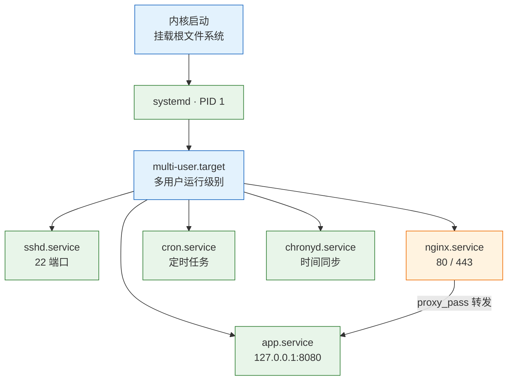
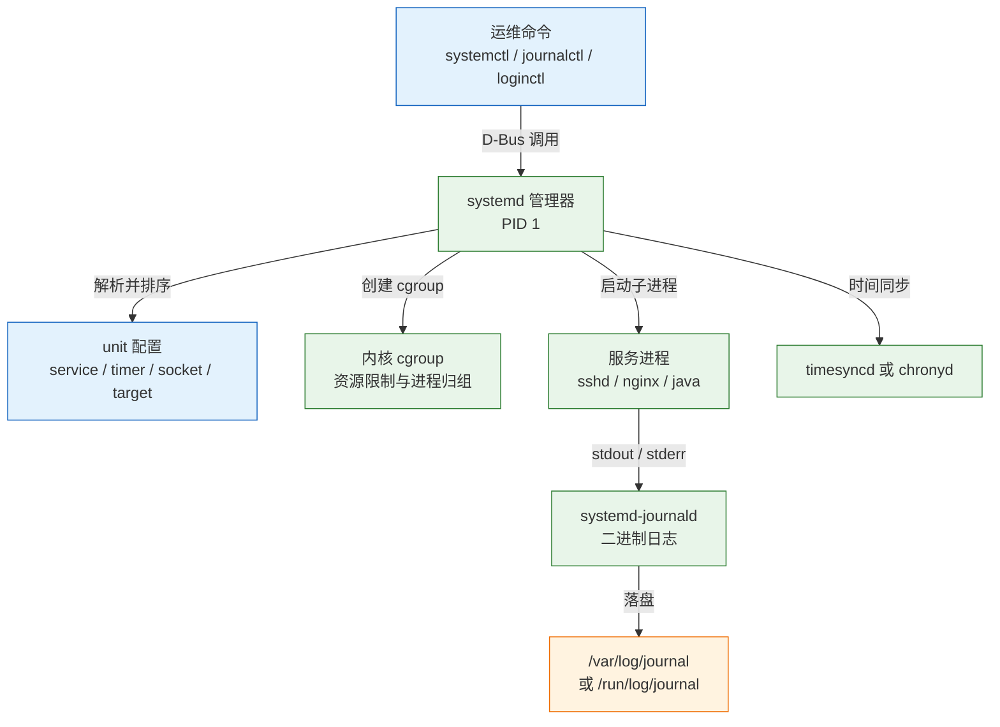
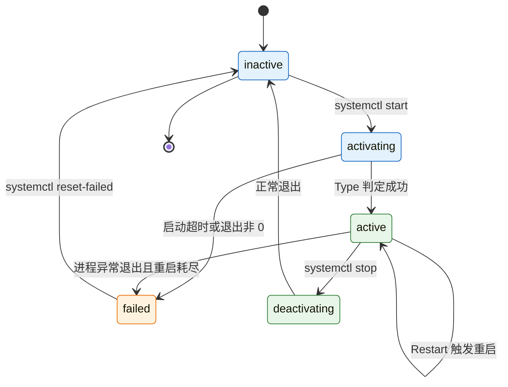
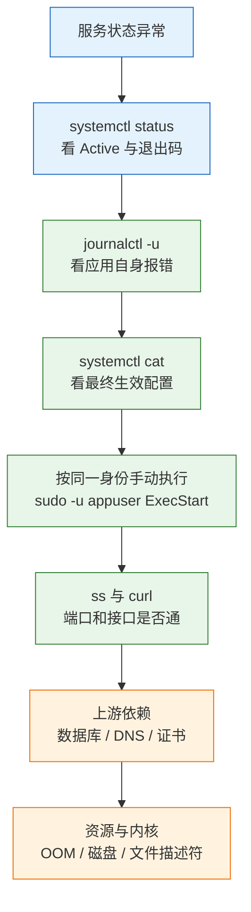

# Linux 核心服务

---

## 一、Linux 核心服务是什么

### 1.1 核心概念

Linux 核心服务，指系统启动后长期驻留、为上层业务提供基础能力的一组守护进程。它们不直接产生业务价值，却决定了业务进程能否被拉起、日志能否被追查、时间是否准确、定时任务是否执行、外部请求从哪个端口进入。五件事合起来是一个问题：**谁来托管这台机器上持续运行的东西**。

很多故障的起点是一句 `nohup java -jar app.jar > app.log 2>&1 &`。命令本身没有错，它能让进程脱离终端继续跑，但它没有解决后面这些问题：

- 机器重启后进程不会自动回来，因为没有单元记录“它应该运行”。
- 进程半夜崩溃无人知晓，因为没有监督者记录退出码并重新拉起。
- 日志持续增长直到写满磁盘，因为既无轮转也无容量上限。
- 进程以 root 运行，一次应用漏洞就等价于整台机器失守。
- 重复启动产生两份实例争抢端口，停止时只能 `pkill -f`，无法确认子进程是否清理干净。

这些问题的共同点是缺乏进程管理者。Linux 上承担这件事的组件是 **systemd**。它从内核挂载根文件系统后开始运行，按依赖启动服务、监控退出状态、执行重启策略、收集标准输出、限制资源，并在关机时逆序停止。托管就是把长期驻留的事交给一个自身不会退出的管理器，而不是依赖某个终端会话。

服务与前台程序的差别不在名字，而在是否依附终端。`top` 占据当前终端，按下 `q` 才退出；`sshd` 从开机起就在后台运行，没有控制终端，只能通过 `systemctl stop` 结束。systemd 把后台运行抽象成 unit，用声明式配置描述“用什么身份、在什么目录、执行什么命令、失败后怎么办”，让同一套方法适用于 sshd、Nginx、数据库和自研应用。

边界是：**systemd 只保证进程存在，不保证业务可用**。端口没有监听、接口持续返回 500、数据库连接不上、证书已经过期，它看不出来。可用性靠健康检查、监控告警与上游探活补足，重启只是兜底。



这张图有两个读法。纵向是启动链：内核拉起 systemd，systemd 到达 `multi-user.target`，再由 target 拉起各 service，`WantedBy=multi-user.target` 即“开机时被这个 target 拉起”。横向是请求链：外部只能访问 80 和 443，8080 只绑回环，由 Nginx 收敛入口。

一台机器上真正需要日常管理的核心服务可以归为五类，它们全部以 unit 的形式存在，配置和排障方法一致：

| 关注点 | 负责组件 | 典型故障表现 |
|---|---|---|
| 进程生命周期 | systemd（`.service`） | 起不来、起来就退、无限重启 |
| 日志 | journald、rsyslog | 查不到日志、日志写满磁盘 |
| 时间 | chrony 或 systemd-timesyncd | 证书校验失败、日志时间错乱 |
| 定时任务 | cron、systemd `.timer` | 到点没跑、跑了没有输出 |
| 网络入口 | sshd、Nginx | 连不上、502、证书过期 |

### 1.2 与相邻技术的关系

理解 systemd 的定位，要把它放回初始化系统与进程管理器的谱系。它替代 SysVinit 和 Upstart，竞争者是 OpenRC、runit、s6，补充它的是 Supervisor、容器编排与配置管理。它们不互相替代，而是负责不同层次。

| 技术 | 管理范围 | 与 systemd 的关系 |
|---|---|---|
| SysVinit | 串行执行 `/etc/init.d` 脚本 | 被 systemd 取代，依赖顺序靠编号约定 |
| Supervisor | 单机用户态进程组 | 能力重叠，缺少 target、日志、定时器等系统级能力 |
| Docker / K8s | 容器生命周期与跨节点编排 | 容器内不使用 systemd，宿主机仍由 systemd 管理 |
| Ansible | 多机配置一致性 | 负责“把 unit 文件放到机器上”，不负责运行状态 |
| cron | 周期任务 | 与 systemd timer 并存，后者可依赖服务并补跑 |

几个边界值得单独说明。systemd 不是配置管理工具，它不会让十台机器的 unit 文件保持一致，那属于 Ansible 或镜像构建。systemd 也不是跨机编排系统，它只认识本机 unit，跨节点调度、服务发现、滚动发布属于 Kubernetes。Supervisor 常被用来托管 Python 进程，功能上可行，但它自身需要被 systemd 拉起，多一层管理反而增加排障路径。

容器的最佳实践是“一个容器一个前台主进程”，由 Docker 或 K8s 负责重启，**不要在容器里再安装 systemd**。宿主机的 docker.service、containerd.service 本身是 systemd unit，容器内 PID 1 则是应用进程。混在一起会出现“容器里 systemctl 不可用”“容器退出后 unit 显示 failed”的误判。

> **运维提示**：判断一台机器该用 systemd 还是容器，看的是交付边界。单个二进制、依赖简单、需要直接使用宿主机资源，用 systemd 最省事；需要环境一致、多实例、快速回滚，用容器。两者可以共存：容器运行时由 systemd 托管，应用由容器托管。

### 1.3 架构组成

systemd 不是一个单独的命令，而是一组围绕 PID 1 的组件集合。PID 1 只负责 unit 的依赖计算、启动停止和状态维护，日志、登录、网络、时间、设备管理分别由独立守护进程完成，通过 D-Bus 和 journal 协同。

| 组件 | 职责 | 常用观察方式 |
|---|---|---|
| systemd（PID 1） | unit 生命周期、依赖排序、cgroup 管理 | `systemctl status`、`systemd-analyze` |
| systemctl | 与 PID 1 通信的命令行客户端 | 日常全部管理命令 |
| systemd-journald | 收集内核、服务、标准输出日志 | `journalctl` |
| systemd-udevd | 设备事件与设备节点管理 | `udevadm monitor` |
| systemd-logind | 会话、用户登录、电源事件 | `loginctl` |
| systemd-timesyncd | 轻量 NTP 客户端 | `timedatectl show-timesync` |
| systemd-resolved | 本地 DNS 存根解析 | `resolvectl status` |
| systemd-tmpfiles | 临时目录与文件清理 | `systemd-tmpfiles --cat-config` |



架构有两个关键设计。第一是 **cgroup 归组**：每个 service 拥有独立 cgroup，派生的子进程全部落在其中，停止时整组收到信号，比 `pkill -f` 精确。第二是 **声明式状态**：unit 描述期望状态，systemctl 负责收敛，因此重复执行 `start` 是幂等的。

---

## 二、systemd 环境与配置

### 2.1 运行环境确认

systemd 已是主流发行版默认初始化系统，RHEL/CentOS 7、Ubuntu 15.04、Debian 8、SUSE 12 以后均内置，无需单独安装。需要确认当前环境是否以 systemd 为 PID 1，容器、精简镜像常不完整。

```bash
# ========== 确认初始化系统 ==========
# 查看 PID 1 的进程名，正常应为 systemd
ps -p 1 -o pid,comm,args

# 查看 systemd 版本与编译特性
systemctl --version

# 查看系统整体运行状态，degraded 表示有单元失败
systemctl is-system-running

# 查看默认启动 target
systemctl get-default

# ========== 确认时间与主机名 ==========
# 查看时间、时区、NTP 同步状态
timedatectl

# 查看静态主机名与内核主机名
hostnamectl
```

`systemctl is-system-running` 返回 `running`、`degraded`、`starting`、`maintenance` 四种状态。`degraded` 不代表系统不可用，但说明至少有一个 unit 进入 failed，应立刻用 `systemctl --failed` 定位。返回 `off-line` 通常意味着当前不在 systemd 管理中，例如容器内的 shell。

> **注意**：在容器里执行 `systemctl` 报 `System has not been booted with systemd as init system (PID 1). Can't operate.`，不是权限问题，而是容器 PID 1 是应用进程。此时应使用 `docker exec` 或 `crictl exec` 管理，不要尝试在容器内安装 systemd。

### 2.2 unit 文件目录与加载优先级

systemd 按固定顺序扫描多个目录，同名 unit 以优先级高者为准。理解这一点，才能解释“明明改了文件却没生效”和“升级软件包后配置被覆盖”。

| 目录 | 用途 | 优先级 |
|---|---|---|
| `/etc/systemd/system` | 管理员自定义与覆盖 | 最高 |
| `/run/systemd/system` | 运行时动态生成 | 中 |
| `/usr/lib/systemd/system` | 软件包安装的原始 unit | 最低 |
| `/etc/systemd/system/<unit>.d` | drop-in 片段目录 | 覆盖主文件单项 |

```bash
# ========== 查看 unit 的真实来源 ==========
# 显示主文件与全部 drop-in，按加载顺序拼接后的结果
systemctl cat nginx

# 只显示主文件路径
systemctl show nginx -p FragmentPath

# 列出所有 unit 文件及开机自启状态
systemctl list-unit-files --type=service

# 列出当前已加载的 unit
systemctl list-units --type=service --all

# ========== 修改后重新加载 ==========
# 扫描 unit 目录变化，修改或新增 unit 后必须执行
sudo systemctl daemon-reload
```

> **注意**：`daemon-reload` 只重读 unit，不重启服务。改 `ExecStart` 后需 `restart`；只改应用配置时 `daemon-reload` 无效，应 `restart` 或 `reload`。

`/usr/lib/systemd/system` 属于软件包，升级会被覆盖，不能直接修改。正确做法是用 `systemctl edit` 生成 `/etc/systemd/system/<unit>.d/override.conf`，只写变更项。合并规则是“同名指令后者覆盖，列表型追加”，因此覆盖 `ExecStart` 前必须先写一行空的 `ExecStart=`，否则会出现两个启动命令。

### 2.3 核心配置项

一个 service unit 由三个 section 组成：`[Unit]` 描述元信息与依赖，`[Service]` 描述进程如何运行，`[Install]` 描述如何被 target 启用。排障信息大多集中在这三个 section 的十几个指令上。

| Section | 指令 | 作用 |
|---|---|---|
| `[Unit]` | `Description` | 人类可读描述，出现在 status 输出中 |
| `[Unit]` | `After` / `Before` | 仅控制启动顺序，不建立依赖 |
| `[Unit]` | `Wants` / `Requires` | 建立弱依赖 / 强依赖 |
| `[Service]` | `Type` | 进程模型，决定何时判定启动完成 |
| `[Service]` | `ExecStart` | 启动命令，必须使用绝对路径 |
| `[Service]` | `Restart` / `RestartSec` | 退出后的重启策略与间隔 |
| `[Service]` | `User` / `Group` | 运行身份，缺省为 root |
| `[Service]` | `EnvironmentFile` | 从文件加载环境变量 |
| `[Install]` | `WantedBy` | 挂到哪个 target 下实现开机自启 |

`Type` 是最容易被忽略却最影响行为的一项。它决定 systemd 在什么时刻认为服务“启动成功”，进而影响后续依赖服务和 `start` 命令的返回时机。

| Type | 判定启动完成的时机 | 典型场景 |
|---|---|---|
| `simple` | `ExecStart` 一 fork 就认为成功 | 前台常驻进程，最常用 |
| `exec` | 可执行文件真正 exec 成功后 | 需要尽早发现路径错误 |
| `forking` | 父进程退出、子进程留在后台 | 传统守护进程 |
| `oneshot` | 进程执行完毕并退出 | 初始化脚本、一次性任务 |
| `notify` | 进程通过 sd_notify 主动上报 | 支持就绪通知的服务 |
| `idle` | 所有任务排队后再启动 | 控制台输出类任务 |

`Type=simple` 的语义是“启动即成功”，即使进程下一秒因配置错误退出，`start` 也会返回 0。判断服务是否可用不能只看返回码，必须结合 `is-active`、端口监听和健康检查。

### 2.4 权限与安全

systemd 默认以 root 运行服务，这是许多安全问题的根源。unit 文件通常为 644，本地用户都能读取，因此**密码、令牌、私钥绝不能写进 unit**，必须放进权限 640 或 600 的环境文件，并以 root 为属主、服务用户为属组。

```bash
# ========== 创建服务账号 ==========
# 创建无登录 shell 的系统用户，专供服务使用
sudo useradd --system --no-create-home --shell /usr/sbin/nologin appuser

# ========== 配置文件权限 ==========
# 环境文件归 root 所有，服务用户只读
sudo chown root:appuser /opt/app/app.env

# 去掉组外与其他人权限，避免凭据泄露
sudo chmod 640 /opt/app/app.env

# ========== 安全检查 ==========
# 按 unit 逐项给出安全评分与加固建议
systemd-analyze security app.service

# 查看服务实际生效的用户与能力集
systemctl show app -p User -p Group -p CapabilityBoundingSet
```

除了降低运行身份，还可以用一组沙箱指令收缩攻击面。这些指令由内核 namespace、seccomp 和 mount 传播机制实现，不改变应用代码。

| 指令 | 效果 | 适用性 |
|---|---|---|
| `NoNewPrivileges=true` | 禁止通过 setuid 提权 | 绝大多数服务 |
| `PrivateTmp=true` | 独立 `/tmp`，隔离临时文件 | 绝大多数服务 |
| `ProtectSystem=strict` | 根文件系统只读 | 需配 `ReadWritePaths` |
| `ProtectHome=true` | 隐藏 `/home`、`/root` | 不需要用户目录的服务 |
| `ReadWritePaths=/data` | 在只读基础上放行写目录 | 配合 strict 使用 |
| `CapabilityBoundingSet=` | 清空或收窄内核能力 | 不需要特权的服务 |

> **安全警告**：`ProtectSystem=strict` 会让整个根文件系统变为只读，应用若在 `/opt` 下写日志会直接失败。上线前必须逐一确认写路径并用 `ReadWritePaths` 放行，否则表现为“服务能启动，一处理请求就报只读文件系统”。

---

## 三、unit 核心对象管理

### 3.1 unit 类型与生命周期

unit 是 systemd 管理的最小对象，按后缀区分类型。日常接触最多的是 service 和 timer，socket、mount、path 在特定场景下能简化设计。

| 后缀 | 管理对象 | 典型用途 |
|---|---|---|
| `.service` | 进程 | 应用、数据库、Web 服务器 |
| `.socket` | 套接字 | 按需唤醒服务，替代常驻 |
| `.timer` | 定时器 | 替代 cron，支持依赖与补跑 |
| `.target` | unit 分组 | 运行级别、启动阶段 |
| `.mount` / `.automount` | 挂载点 | 开机挂载、按需挂载 |
| `.path` | 文件路径 | 文件变化触发任务 |
| `.slice` | cgroup 分组 | 按业务划分资源配额 |

service 的状态不是简单的“开/关”，而是一台状态机。`start` 触发 `activating`，`Type` 判定成功后进入 `active`，进程退出进入 `deactivating`，最终落到 `inactive` 或 `failed`。`failed` 是需人工介入的终态，不会自动清除，必须 `reset-failed` 或成功重启一次。



### 3.2 基本命令

systemctl 的命令可分为查询、生命周期、开机自启、配置查看四组。日常排障应先查询再操作，避免在信息不足时重启，把现场证据一起清掉。

```bash
# ========== 查询状态 ==========
# 查看单个服务的完整状态，含最近日志
systemctl status app --no-pager

# 只取是否运行，适合写进脚本判断
systemctl is-active app

# 只取是否开机自启
systemctl is-enabled app

# 列出所有失败的 unit
systemctl --failed

# 列出 unit 的依赖关系树
systemctl list-dependencies app

# ========== 生命周期操作 ==========
# 启动服务，不改变开机自启状态
sudo systemctl start app

# 优雅停止，向整个 cgroup 发送 SIGTERM
sudo systemctl stop app

# 重启服务，先停后起
sudo systemctl restart app

# 仅重载应用配置，不中断进程
sudo systemctl reload app

# 重载失败则回退为重启
sudo systemctl reload-or-restart app

# ========== 开机自启 ==========
# 建立 target 软链接并立即启动
sudo systemctl enable --now app

# 取消开机自启，同时停止当前实例
sudo systemctl disable --now app

# 彻底屏蔽，禁止被依赖或手动启动
sudo systemctl mask app

# 解除屏蔽
sudo systemctl unmask app

# ========== 配置查看与编辑 ==========
# 查看合并后的最终配置
systemctl cat app

# 查看运行时属性，如主进程号、重启次数
systemctl show app -p MainPID -p NRestarts -p ExecMainStatus

# 生成 drop-in 覆盖文件
sudo systemctl edit app

# 清除 failed 状态，让服务可以重新计数
sudo systemctl reset-failed app
```

> **注意**：只 `start` 不 `enable`，重启后不会自动恢复；`enable --now` 同时完成开机自启与立即启动。判断时分别看 `is-enabled` 与 `is-active`。

> **运维红线**：`systemctl isolate` 会切换到指定 target，并停止所有不属于该 target 的 unit。在远程服务器上执行 `systemctl isolate rescue.target` 会停掉网络和 sshd，直接失去连接。除非有带外管理或控制台，否则不要在生产机器上验证 target 切换。

### 3.3 service 配置详解

先用一个每 10 秒输出一行的脚本，把“编写、启动、观察、改配置”完整走一遍。这个例子不依赖任何业务组件，能排除应用因素，单独验证 systemd 的行为。

```bash
# ========== 创建演示脚本 ==========
# 写入一个持续输出时间戳的脚本
sudo tee /usr/local/bin/tick.sh >/dev/null <<'EOF'
#!/bin/bash
while true; do
  echo "tick $(date '+%F %T')"
  sleep 10
done
EOF

# 赋予执行权限
sudo chmod 755 /usr/local/bin/tick.sh
```

```ini
# /etc/systemd/system/tick.service
[Unit]
# 服务描述，会显示在 status 首行
Description=Tick demo
# 在网络就绪后启动，仅控制顺序
After=network-online.target

[Service]
# 前台进程模型，fork 即视为启动成功
Type=simple
# 启动命令必须使用绝对路径
ExecStart=/usr/local/bin/tick.sh
# 非零退出、被信号杀死、超时都重启
Restart=on-failure
# 重启前等待 3 秒，避免高频循环
RestartSec=3

[Install]
# 挂到多用户 target，enable 时建立软链接
WantedBy=multi-user.target
```

```bash
# ========== 启动与观察 ==========
# 重新扫描 unit 目录
sudo systemctl daemon-reload

# 设置开机自启并立即启动
sudo systemctl enable --now tick

# 查看状态，确认 Active 为 running
systemctl status tick --no-pager

# 查看最近三条日志
journalctl -u tick -n 3 --no-pager
```

预期输出类似：

```text
● tick.service - Tick demo
     Loaded: loaded (/etc/systemd/system/tick.service; enabled; preset: enabled)
     Active: active (running) since Wed 2026-10-28 10:31:02 CST; 12s ago
   Main PID: 5121 (tick.sh)
     CGroup: /system.slice/tick.service
             ├─5121 /bin/bash /usr/local/bin/tick.sh
             └─5123 sleep 10
```

四行各回答一个问题：`Loaded` 后的 `enabled` 说明开机自启已生效；`Active` 说明正在运行；`Main PID` 是主进程号；`CGroup` 列出派生进程。最后一项解释了 systemd 为什么比 `pkill` 可靠：停止时向整个 cgroup 发信号，`sleep 10` 这类子进程不会残留。

改配置不要编辑原文件，用 drop-in 覆盖需要变更的项：

```bash
# ========== 使用 drop-in 覆盖 ==========
# 生成 override.conf 并打开编辑器
sudo systemctl edit tick

# 重新加载 unit 配置
sudo systemctl daemon-reload

# 查看最终生效的重启间隔
systemctl show tick -p RestartUSec
```

在编辑器中写入：

```ini
[Service]
# 把重启间隔从 3 秒改为 10 秒
RestartSec=10
```

输出 `RestartUSec=10s` 说明覆盖成功。`systemctl show` 展示的是**最终生效值**，不是某个文件里写了什么。两者不一致的原因通常是 drop-in 覆盖、旧配置未 reload，或模板 unit 的实例参数不同。

```bash
# ========== 收尾清理 ==========
# 停止并取消开机自启
sudo systemctl disable --now tick

# 删除演示 unit 与 drop-in 目录
sudo rm -f /etc/systemd/system/tick.service
sudo rm -rf /etc/systemd/system/tick.service.d

# 再次重载，清除内存中的旧定义
sudo systemctl daemon-reload
```

### 3.4 配置校验与最佳实践

unit 文件写错时，systemd 往往只给一句含糊的报错。启动前先做静态校验，能提前发现路径不存在、指令拼写错误、section 写错位置。

```bash
# ========== 启动前校验 ==========
# 校验 unit 语法与可执行文件是否存在
systemd-analyze verify /etc/systemd/system/app.service

# 查看 unit 的全部运行时属性，排查异常值
systemctl show app --no-pager

# 按启动耗时排序，定位开机慢的单元
systemd-analyze blame

# 查看关键启动链，找出串行等待
systemd-analyze critical-chain
```

几条长期有效的实践：

1. **`ExecStart` 只指向一个可执行文件**。unit 不解析管道、重定向、通配符，`/bin/sh -c '... | tee x.log'` 虽然能跑，但 systemd 看到的主进程是 `sh`，信号和退出码都隔了一层。复合逻辑写进脚本，unit 只调用脚本。
2. **路径全部写绝对路径**。systemd 不继承登录 shell 的 `PATH`，`ExecStart=java` 可能测试时成功、重启后失败。
3. **显式设置 `WorkingDirectory`**。相对路径的配置文件默认从 `/` 查找，与手工在项目目录执行的结果不同。
4. **为重启设置上限并给停止留时间**。`Restart=always` 遇到启动即崩会无限循环，必须配 `StartLimitBurst`；`TimeoutStopSec=30` 让应用处理完在途请求再被 `SIGKILL`。

`Restart=` 的取值决定哪些退出会触发重启，它只看退出状态，不包含业务健康度：

| 取值 | 触发条件 | 适用场景 |
|---|---|---|
| `no` | 从不重启 | 一次性任务、调试 |
| `on-success` | 正常退出也重启 | 常驻循环脚本 |
| `on-failure` | 非零退出、信号、超时 | 大多数服务 |
| `on-abnormal` | 信号、超时、看门狗 | 不希望正常退出被重启 |
| `always` | 任何退出都重启 | 必须常驻的关键服务 |

> **注意**：`StartLimitIntervalSec` 与 `StartLimitBurst` 属于 `[Unit]`，写在 `[Service]` 里会被忽略且不报错。若重启次数限制完全不起作用，先检查 section 位置。`Restart=always` 只观察退出，无法发现进程仍在不响应请求的假活，这类场景需要健康检查，或用 `Type=notify` 配合 `WatchdogSec`。

---

## 四、服务运行时管理

### 4.1 进程与资源观察

服务跑起来后，需要观察 CPU、内存、文件描述符与进程树。systemd 把这些信息集中在 cgroup 维度，比逐个 `ps` 更接近资源限制的真实口径。

```bash
# ========== 进程与 cgroup ==========
# 查看服务的进程树，按 cgroup 展开
systemd-cgls /system.slice/app.service

# 按 cgroup 实时展示 CPU、内存、任务数
systemd-cgtop

# 查看主进程号与子进程
systemctl status app --no-pager

# ========== 资源限制 ==========
# 查看服务当前生效的资源限制
systemctl show app -p MemoryMax -p CPUQuotaPerSecUSec -p TasksMax -p LimitNOFILE

# 运行时调整内存上限，立即生效并写入 drop-in
sudo systemctl set-property app MemoryMax=1G

# 限制 CPU 使用为单核的 50%
sudo systemctl set-property app CPUQuota=50%
```

| 指令 | 作用 | 常见取值 |
|---|---|---|
| `MemoryMax` | 内存硬上限，超出触发 OOM | `1G`、`70%` |
| `MemoryHigh` | 内存软上限，超出后限速回收 | 略低于 `MemoryMax` |
| `CPUQuota` | CPU 带宽上限 | `50%`、`200%` |
| `TasksMax` | 最大任务数，防 fork 炸弹 | `512`、`infinity` |
| `LimitNOFILE` | 文件描述符上限 | `65535` |
| `IOWeight` | 块设备 IO 权重 | `100`–`1000` |

资源限制通过 cgroup 实现，不需要应用配合。`MemoryMax` 是硬限制，超过会触发内核 OOM Killer，表现为服务突然消失、日志里没有异常。排查“无征兆退出”时，应检查 `dmesg` 的 oom-kill 记录与 `ExecMainStatus`。

### 4.2 日志管理

日志分两层：journald 收集内核与服务输出，rsyslog 可把 journal 转发为文本文件。应用自己写文件的日志在 systemd 之外，必须单独轮转。

```bash
# ========== 按范围查询 ==========
# 限定服务与本次开机
journalctl -u app -b --no-pager

# 限定时间窗口与级别
journalctl -u app --since "30 min ago" -p err --no-pager

# 实时跟踪，等价于 tail -F 但支持过滤
journalctl -u app -f

# 查看本次开机的全部错误
journalctl -b -p err --no-pager

# 查看内核日志，排查 OOM 与磁盘错误
journalctl -k -b --no-pager

# ========== 容量管理 ==========
# 查看日志当前占用
journalctl --disk-usage

# 按总量清理，保留最近 500M
sudo journalctl --vacuum-size=500M

# 按时间清理，只保留最近 14 天
sudo journalctl --vacuum-time=14d

# ========== 配额配置 ==========
# 把系统日志总量限制为 500M
sudo sed -i 's/^#SystemMaxUse=.*/SystemMaxUse=500M/' /etc/systemd/journald.conf

# 重启日志服务使配额生效
sudo systemctl restart systemd-journald
```

| 参数 | 含义 | 排障价值 |
|---|---|---|
| `-u` | 限定 unit | 排除其他服务干扰 |
| `-b` | 限定本次开机 | 避免翻到上次启动 |
| `--since` | 起始时间 | 缩小到故障窗口 |
| `-p` | 最低优先级 | 只看 err 及以上 |
| `-o verbose` | 输出全部字段 | 查看 `_PID`、`_COMM` |
| `-f` | 持续跟踪 | 复现问题时实时观察 |

journald 默认最多占文件系统 10%，且至少保留 15% 空闲。对大磁盘过于宽松，应在 `/etc/systemd/journald.conf` 设置 `SystemMaxUse`。重启后已写入日志不会自动删除，需再 vacuum。

应用日志用 logrotate 管理。策略必须与写文件方式匹配：支持重开文件的程序（如 Nginx）用 `postrotate` 发 USR1；不支持的程序用 `copytruncate`，代价是截断瞬间可能丢几行。

```bash
# ========== 应用日志轮转 ==========
# 写入 logrotate 规则
sudo tee /etc/logrotate.d/app >/dev/null <<'EOF'
/data/logs/app/*.log {
    daily
    rotate 14
    compress
    delaycompress
    missingok
    notifempty
    copytruncate
}
EOF

# 演练模式，只打印动作不真正轮转
sudo logrotate -d /etc/logrotate.d/app

# 强制执行一次，验证权限与路径
sudo logrotate -f /etc/logrotate.d/app
```

> **运维提示**：`copytruncate` 与 `postrotate` 二选一。前者复制后清空原文件，后者假设程序会自己重开文件；同时使用会让新文件在轮转后立刻被清空。

### 4.3 定时任务管理

定时任务有两套实现：传统 cron 与 systemd timer。cron 简单直接，适合短小的清理、上报任务；timer 能依赖服务、记录日志、补跑错过的执行。

cron 配置分散在多个位置，排障时需知道去哪找：

| 路径 | 写法 | 适用场景 |
|---|---|---|
| `/etc/crontab` | 六段，含用户字段 | 系统级任务 |
| `/etc/cron.d/*` | 六段，含用户字段 | 软件包或运维投放 |
| `/var/spool/cron/<user>` | 五段，无用户字段 | `crontab -e` 编辑 |
| `/etc/cron.{hourly,daily}` | 可执行脚本 | 发行版预置周期任务 |

```bash
# ========== cron 管理 ==========
# 编辑当前用户的 crontab
crontab -e

# 列出当前用户的定时任务
crontab -l

# 查看 cron 服务状态
systemctl status cron --no-pager

# 查看 cron 执行日志，Debian 系在 syslog 中
journalctl -u cron --since today --no-pager
```

系统级任务写入 `/etc/cron.d/app-backup`，比用户 crontab 多一个用户字段：

```text
# 每天 03:00 以 root 执行备份脚本，标准输出与错误都追加到日志
0 3 * * * root /usr/bin/bash /opt/scripts/mysql-backup.sh >> /var/log/mysql-backup.log 2>&1
```

timer 由两个文件组成：`.timer` 定义触发规则，`.service` 定义执行内容。两者同名时，timer 会自动触发对应的 service。

```ini
# /etc/systemd/system/backup.timer
[Unit]
# 定时器描述
Description=Daily database backup timer

[Timer]
# 每天 03:00 触发，支持日历语法
OnCalendar=*-*-* 03:00:00
# 开机补跑错过的执行
Persistent=true
# 随机延迟 0 到 300 秒，避免多机同时打库
RandomizedDelaySec=300
# 指定触发的 service，缺省为同名 service
Unit=backup.service

[Install]
# 挂到 timers target 才会被启用
WantedBy=timers.target
```

```bash
# ========== timer 管理 ==========
# 重载并启用定时器
sudo systemctl daemon-reload
sudo systemctl enable --now backup.timer

# 列出所有定时器及下次触发时间
systemctl list-timers --all

# 手动触发一次，验证 service 本身
sudo systemctl start backup.service

# 查看定时器最近一次执行结果
systemctl status backup.timer --no-pager
```

| 维度 | cron | systemd timer |
|---|---|---|
| 日志 | 需自行重定向 | 自动进入 journal |
| 依赖 | 无 | 可 `After=` 其他服务 |
| 错过补跑 | 不支持 | `Persistent=true` |
| 随机延迟 | 需自行实现 | `RandomizedDelaySec=` |
| 粒度 | 分钟 | 秒级，支持日历表达式 |
| 上手成本 | 一行 | 两个文件 |

> **注意**：只启用 `.timer` 而不启用 `.service` 是正确做法，timer 触发时会自行启动 service。若把两者都 `enable`，开机时 service 会立即执行一次，与预期的时间点不符。

---

## 五、网络入口与系统时间

### 5.1 sshd 服务配置

sshd 是远程运维的唯一入口，配置错误会直接导致失联。修改前保留一个已登录会话，改完先用 `sshd -t` 校验，再用新端口另开连接验证，确认后关闭旧会话。

| 指令 | 作用 | 生产建议 |
|---|---|---|
| `Port` | 监听端口 | 改非默认端口可减少扫描 |
| `PermitRootLogin` | root 登录策略 | 设为 `no` 或 `prohibit-password` |
| `PasswordAuthentication` | 密码登录开关 | 仅密钥登录时设为 `no` |
| `PubkeyAuthentication` | 公钥登录 | 保持 `yes` |
| `AllowUsers` / `AllowGroups` | 登录白名单 | 显式限定运维账号 |
| `MaxAuthTries` | 单连接认证次数 | 设为 3 到 5 |
| `ClientAliveInterval` | 心跳间隔 | 防止 NAT 断连 |

```bash
# ========== 修改与校验 ==========
# 备份原配置，便于回滚
sudo cp /etc/ssh/sshd_config /etc/ssh/sshd_config.bak

# 编辑配置后先做语法检查
sudo sshd -t

# 查看最终生效配置，排除 Include 覆盖
sudo sshd -T | grep -E 'permitrootlogin|passwordauthentication|port'

# 重载而非重启，已建立连接不受影响
sudo systemctl reload sshd

# ========== 密钥登录 ==========
# 生成 ed25519 密钥对
ssh-keygen -t ed25519 -C "ops@example.com"

# 把公钥安装到目标主机
ssh-copy-id -i ~/.ssh/id_ed25519.pub ops@server

# 验证免密登录并查看详细握手过程
ssh -v ops@server
```

> **注意**：SSH 单元名随发行版不同，RHEL 系为 `sshd`，Debian/Ubuntu 为 `ssh`。执行前用 `systemctl list-unit-files | grep ssh` 确认，避免误判为配置错误。

sshd 还提供三种端口转发能力，本质是用已建立的 SSH 连接承载其他 TCP 流量，不需要在防火墙额外开口。调试数据库、临时访问内网面板时非常实用，但不适合作为长期方案。

| 方向 | 命令 | 用途 |
|---|---|---|
| 本地转发 `-L` | `ssh -L 3307:127.0.0.1:3306 ops@db` | 本机 3307 连到 db 的 3306 |
| 远程转发 `-R` | `ssh -R 8080:127.0.0.1:3000 ops@server` | 服务器 8080 转回本机 3000 |
| 动态转发 `-D` | `ssh -D 1080 ops@server` | 建立 SOCKS5 代理 |

```bash
# ========== 隧道实操 ==========
# 本地转发：把远端数据库映射到本机 3307
ssh -N -L 3307:127.0.0.1:3306 ops@db.example.com

# 另开终端验证隧道
mysql -h 127.0.0.1 -P 3307 -u app -p

# 动态转发：本机 1080 提供 SOCKS5
ssh -N -D 1080 ops@gateway.example.com
```

> **安全警告**：`-R` 远程转发若配合 `GatewayPorts yes`，会把内网端口暴露到服务器所有网卡。默认只绑定回环是安全的前提，不要为了省事打开 `GatewayPorts`。

### 5.2 Nginx 反向代理接入

后端只监听 `127.0.0.1`，由 Nginx 承接公网流量，这是单机部署的入口模型，兼顾 TLS 终止、静态资源、访问日志、限流与灰度分流。

```nginx
# /etc/nginx/conf.d/app.conf
server {
    # 对外监听 80，TLS 场景改为 443 并配置证书
    listen 80;
    # 对外域名，需与 DNS 解析一致
    server_name app.example.com;

    # 上传体积上限，默认 1m，超过直接返回 413
    client_max_body_size 20m;

    location / {
        # 转发到本机后端，端口与 unit 中一致
        proxy_pass http://127.0.0.1:8080;

        # 保留原始 Host，后端生成绝对链接时使用
        proxy_set_header Host $host;
        # 传递真实客户端地址，否则后端日志全是 127.0.0.1
        proxy_set_header X-Real-IP $remote_addr;
        # 追加代理链，多层代理时保留完整路径
        proxy_set_header X-Forwarded-For $proxy_add_x_forwarded_for;
        # 传递原始协议，避免后端生成 http 跳转
        proxy_set_header X-Forwarded-Proto $scheme;

        # 后端处理超时，长任务需相应调大
        proxy_read_timeout 60s;
        # 大文件边收边转，不先落 Nginx 临时目录
        proxy_request_buffering off;
    }
}
```

```bash
# ========== 配置校验与生效 ==========
# 只校验语法，不输出完整配置
sudo nginx -t

# 输出合并后的完整配置，排查 include 与 server 匹配
sudo nginx -T | grep -n "server_name"

# 平滑重载，不中断现有连接
sudo systemctl reload nginx

# 查看错误日志中的上游失败原因
sudo tail -f /var/log/nginx/error.log
```

四个转发头不是形式主义。缺少 `X-Real-IP`，后端审计与按 IP 限流全部失效；缺少 `X-Forwarded-Proto`，跳转链接会退回 `http://`，触发混合内容拦截；缺少 `Host`，基于域名的路由会拿错值。

`client_max_body_size` 默认只有 1m，超出时 Nginx 直接返回 413，请求根本不到后端，应用日志里一条记录都没有。排查上传失败应先看 Nginx 访问日志的状态码。

### 5.3 时间同步

时间偏差会以隐蔽方式破坏系统：TLS 证书校验失败、Kerberos 认证被拒、日志跨主机无法对齐、主从延迟判断错误。时间同步必须收口到一套 NTP 客户端，不能同时运行 chrony 与 systemd-timesyncd。

```bash
# ========== 查看与设置 ==========
# 查看当前时间、时区、NTP 同步状态
timedatectl

# 列出可用时区
timedatectl list-timezones | grep Asia

# 设置时区为上海
sudo timedatectl set-timezone Asia/Shanghai

# 开启网络时间同步
sudo timedatectl set-ntp true

# 查看 timesyncd 使用的服务器与同步结果
timedatectl show-timesync --all

# ========== chrony 观察 ==========
# 查看时间源与偏差估计
chronyc tracking

# 查看所有时间源及其状态
chronyc sources -v

# 手动立即校准一次
sudo chronyc makestep
```

| 命令 | 观察对象 | 关键字段 |
|---|---|---|
| `timedatectl` | 系统时间总览 | `System clock synchronized` |
| `timedatectl show-timesync` | timesyncd 细节 | `ServerName`、`PollInterval` |
| `chronyc tracking` | 当前偏差 | `System time`、`Last offset` |
| `chronyc sources -v` | 时间源质量 | `^*` 为当前优选源 |

> **注意**：chrony 与 systemd-timesyncd 只能保留一套。两者同时运行会争抢内核时钟，表现为偏差跳动、`timedatectl` 显示已同步但 `chronyc tracking` 偏差很大。切换时先 `systemctl disable --now systemd-timesyncd`，再启用 `chronyd`。

系统时间正确，不代表应用时间正确。JVM 可能仍使用 UTC，数据库可能配置了独立时区，容器可能没有继承宿主机时区。三处都要显式设置。

| 层 | 配置方式 | 验证命令 |
|---|---|---|
| 操作系统 | `timedatectl set-timezone` | `date` |
| JVM | `-Duser.timezone=Asia/Shanghai` | 日志时间戳 |
| MySQL | `default-time-zone='+08:00'` | `SELECT @@global.time_zone` |
| 容器 | `-e TZ=Asia/Shanghai` | `docker exec <容器> date` |

---

## 六、服务组合与部署

### 6.1 启动依赖与顺序

多个服务协同时，顺序与依赖是两个概念。`After`/`Before` 只决定谁先启动，`Wants`/`Requires` 决定是否拉起对方。只写 `After` 不写 `Wants`，对方不会启动；只写 `Wants` 不写 `After`，两者可能并行。

| 指令 | 是否拉起对方 | 对方失败时 | 用途 |
|---|---|---|---|
| `Wants=` | 是 | 不影响自身 | 弱依赖，推荐默认 |
| `Requires=` | 是 | 自身也停止 | 强依赖，谨慎使用 |
| `Requisite=` | 否 | 自身启动失败 | 仅检查，不拉起 |
| `After=` | 否 | 无 | 仅排序 |
| `Before=` | 否 | 无 | 反向排序 |
| `BindsTo=` | 是 | 自身停止 | 强绑定设备或挂载 |

```ini
# /etc/systemd/system/app.service
[Unit]
# 描述业务服务
Description=Order Service
# 网络真正就绪后再启动，避免绑定地址失败
After=network-online.target
# 拉起网络等待单元，否则 After 没有对象
Wants=network-online.target
# 数据库在本机时，排在数据库之后
After=mysql.service

[Service]
# 前台常驻进程
Type=simple
# 以专用账号运行，禁止 root
User=appuser
Group=appuser
# 固定工作目录，保证相对路径配置可读
WorkingDirectory=/opt/app/current
# 从受限文件加载环境变量
EnvironmentFile=/opt/app/app.env
# 启动命令，参数与生产 JVM 配置一致
ExecStart=/usr/bin/java -Xms512m -Xmx1g -jar /opt/app/current/app.jar
# 崩溃后始终拉起
Restart=always
# 重启间隔 5 秒
RestartSec=5
# 停止时给 30 秒处理在途请求
TimeoutStopSec=30
# 标准输出与错误都交给 journal
StandardOutput=journal
StandardError=journal

[Install]
# 开机随多用户 target 启动
WantedBy=multi-user.target
```

> **注意**：`After=network-online.target` 只保证网络配置完成，不保证数据库可连接。数据库从 fork 到监听存在窗口，应用必须重试，或在 `ExecStartPre` 中探活。

### 6.2 jar 应用完整部署

下面从目录、账号、环境文件到 unit 启动，走完一次可复现的部署。目录约定：程序放 `/opt/app/current`，日志放 `/data/logs/app`，环境变量放 `/opt/app/app.env`，三者权限分离。

```bash
# ========== 目录与账号 ==========
# 创建程序目录与独立日志盘目录
sudo mkdir -p /opt/app/current /data/logs/app

# 放入构建产物
sudo cp app.jar /opt/app/current/

# 目录归属服务账号，避免运行时无写权限
sudo chown -R appuser:appuser /opt/app /data/logs/app

# ========== 环境变量文件 ==========
# 写入生产环境变量，只监听回环
sudo tee /opt/app/app.env >/dev/null <<'EOF'
SPRING_PROFILES_ACTIVE=prod
SERVER_PORT=8080
SERVER_ADDRESS=127.0.0.1
TZ=Asia/Shanghai
EOF

# 环境文件归 root，服务账号只读，防止同机其他用户读取
sudo chown root:appuser /opt/app/app.env
sudo chmod 640 /opt/app/app.env
```

```bash
# ========== 写入 unit 并启动 ==========
# 创建 service 文件
sudo tee /etc/systemd/system/app.service >/dev/null <<'EOF'
[Unit]
Description=Order Service
After=network-online.target
Wants=network-online.target

[Service]
Type=simple
User=appuser
Group=appuser
WorkingDirectory=/opt/app/current
EnvironmentFile=/opt/app/app.env
ExecStart=/usr/bin/java -Xms512m -Xmx1g -jar /opt/app/current/app.jar
Restart=always
RestartSec=5
TimeoutStopSec=30
StandardOutput=journal
StandardError=journal

[Install]
WantedBy=multi-user.target
EOF

# 校验 unit 语法与可执行文件路径
sudo systemd-analyze verify /etc/systemd/system/app.service

# 重载配置并设置开机自启
sudo systemctl daemon-reload
sudo systemctl enable --now app

# 查看启动结果
systemctl status app --no-pager
```

```bash
# ========== 监听与接口验证 ==========
# 确认只绑定回环地址
ss -tunlp | grep 8080

# 直接访问健康检查，绕过 Nginx
curl -sS -m 5 http://127.0.0.1:8080/actuator/health

# 查看环境变量是否被正确加载
systemctl show app -p Environment

# 查看最近启动日志
journalctl -u app -n 30 --no-pager
```

如果 `ss` 显示 `0.0.0.0:8080`，说明 `SERVER_ADDRESS` 没有生效，应先检查环境变量是否被读取，而不是去改防火墙。Spring Boot 的绑定地址也可以通过 `--server.address` 命令行参数覆盖，优先级高于环境变量。

### 6.3 部署验收

部署完成的标志不是 `systemctl start` 返回 0，而是下面七项全部通过。最后一项必须真做一次重启，`enable` 只保证会被拉起，不保证拉起来能用。

| # | 检查项 | 命令 | 通过标准 |
|---|---|---|---|
| 1 | 正在运行且开机自启 | `systemctl is-enabled app; systemctl is-active app` | `enabled` 与 `active` |
| 2 | 崩溃后能自愈 | `sudo kill -9 $(pgrep -f app.jar)` 后等待 10 秒 | 进程重新出现，`NRestarts` 增加 |
| 3 | 只监听本机 | `ss -tunlp \| grep 8080` | `127.0.0.1:8080` |
| 4 | 本机接口可用 | `curl -sS 127.0.0.1:8080/actuator/health` | 返回健康状态 |
| 5 | 外部经 Nginx 可达 | `curl -I http://app.example.com/` | 200 或 302，不是 502 |
| 6 | 日志可追查 | `journalctl -u app -n 20 --no-pager` | 有启动与请求日志 |
| 7 | 重启后仍成立 | `sudo reboot` 后重跑第 1 至 6 项 | 全部通过 |

验收第 2 项时，`kill -9` 会留下非正常退出记录，正好验证 `Restart=always`。第 7 项能暴露数据盘未挂载、环境变量未持久化等只在重启后出现的问题。

---

## 七、常见排障

| 现象 | 最可能原因 | 处理 |
|---|---|---|
| `start` 失败，`status` 看不出原因 | 真正错误在 journal 中 | `journalctl -u app -n 50 --no-pager`，再看 `systemctl cat app` |
| 启动几秒就退出并循环重启 | 端口占用、配置缺项、连不上数据库 | `systemctl show app -p NRestarts -p ExecMainStatus` 看退出码 |
| 改了 unit 没有任何变化 | 未执行 `daemon-reload` | `systemctl daemon-reload` 后 restart |
| 日志把磁盘写满 | 应用日志无上限，journal 也到配额 | `journalctl --disk-usage`、`du -sh /data/logs/*`，补 logrotate |
| `journalctl` 没有输出 | 程序写文件、`StandardOutput=null`、被限流 | `systemctl show app -p StandardOutput`，`-o verbose` 看 Suppressed |
| 定时任务到点没跑 | PATH 过短、无执行权限、`%` 未转义 | 脚本首行 `env > /tmp/env.txt` 对比 cron 环境 |
| 外部访问 502 | 后端未起、端口错、容器内连不到宿主回环 | 在 Nginx 主机 `curl 127.0.0.1:8080`，查 error.log |
| 改了 Nginx 配置不生效 | 文件未被 include、未 reload、命中其他 server | `nginx -T \| grep -n server_name` |
| 证书过期或续期未生效 | 只续证书未 reload | `openssl s_client` 看线上到期时间，配 deploy hook |
| 健康检查持续失败 | `localhost` 解析到 `::1`、超时过短、镜像无 curl | 手动执行同一命令，强制 `-4` |
| 开机后服务没起来 | 未 enable、依赖盘未挂、unit 有语法错 | `systemctl --failed`、`journalctl -b -p err` |
| 服务无征兆消失 | 触发 cgroup 内存上限被 OOM | `dmesg -T \| grep -i oom`，调 `MemoryMax` |

三个机制经常被误解。`Restart=always` 只观察进程退出，发现不了“假活”，启动即崩还会无限循环，必须配 `StartLimitBurst` 限制。journald 默认最多占文件系统 10% 且至少保留 15% 空闲，应用用 `>>` 写出的文件却没有上限，两套都要管。`After=` 只排启动顺序，对方端口尚未监听时本服务就已启动，等就绪只能靠应用重试或 `ExecStartPre` 探活。

服务起不来时的排查顺序应固定下来，避免每次凭直觉跳步：



`systemctl cat` 和手动执行这两步最关键。前者排除“配置没生效”，后者排除“systemd 环境特殊”。绝大多数“手动能跑、systemd 不能跑”都停在三项上：`User=` 导致权限不足、`WorkingDirectory=` 导致相对路径失效、`EnvironmentFile=` 未读取导致变量为空。

查日志时先限定范围，再逐层缩小：

```bash
# ========== 缩小日志范围 ==========
# 限定服务、本次开机、错误级别、最近 30 分钟
journalctl -u app -b -p err --since "30 min ago" --no-pager

# 实时跟踪，等价于 tail -F 但可按 unit 过滤
journalctl -u app -f

# 查看服务被限流的记录
journalctl -u app -o verbose --no-pager | grep -i suppressed

# ========== 开机相关 ==========
# 一次列出所有失败单元
systemctl --failed

# 按耗时排序启动项，定位开机慢
systemd-analyze blame

# 查看关键启动链中的串行等待
systemd-analyze critical-chain
```

四个过滤参数叠加后，几万行日志通常只剩几十行。若日志本身缺失，再回头检查 `StandardOutput`、`Storage=` 与 journald 的限流设置，而不是怀疑应用没有输出。

日常巡检可固定为四条命令：`systemctl --failed` 看失败单元，`systemctl list-timers` 看下次任务，`journalctl --disk-usage` 看日志占用，`ss -tunlp` 看端口监听。
