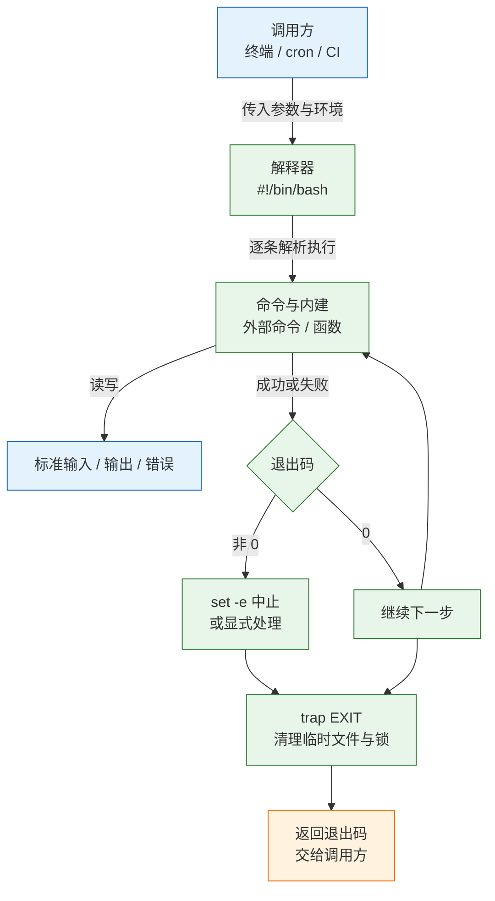
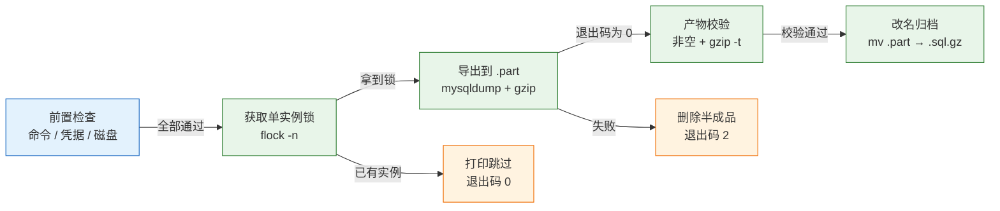
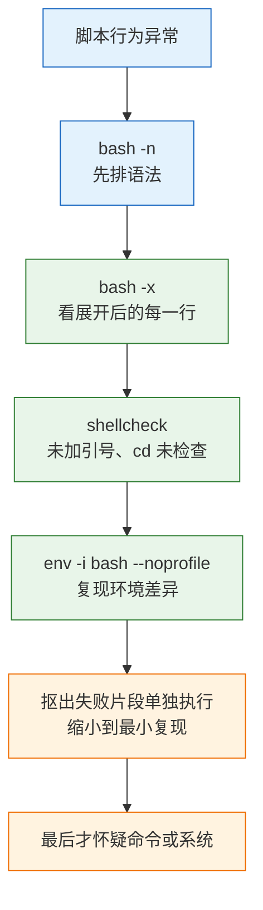

# Shell 脚本

---

## 一、Shell 脚本是什么

### 1.1 核心概念

Shell 脚本是把一系列命令、判断和循环写进文本文件，交给 Shell 解释器顺序执行的程序。它不经过编译，直接复用系统上已有的命令，因此特别适合做命令编排、环境检查、批量处理和定时任务。脚本的真正价值不是“少敲几行”，而是让一件重复的事拥有固定的输入、固定的步骤和固定的失败方式。

一台服务器每天 03:00 要备份数据库。手工执行会暴露一连串问题：

- 凌晨无人值守，迟早会忘记。
- 忘记检查磁盘，写出一个 0 字节文件，还留在目录里。
- 上一次没跑完，下一次又启动，两个 `mysqldump` 互相拖慢。
- 密码写在命令行里，任何能执行 `ps` 的用户都能看到。
- 失败信息打在终端上，cron 执行时没有终端，直接丢失。

脚本要解决的是五件事：**什么时候跑、按什么顺序、失败怎么办、产物怎么验、结果怎么让外面知道**。这五件事分别对应调度、控制流、退出码、校验和日志，缺任何一项，脚本都只是“把命令堆在一起”。

它不解决的问题同样要提前说清。脚本不是配置管理，十台机器的一致性属于 Ansible、SaltStack 或镜像构建；脚本也不是通用编程语言，超过一百行、需要解析复杂结构、并发、重试或单元测试时，应换 Python 或 Go。Shell 的强项是调用外部命令和拼接流程，弱项是数据结构、错误模型和可测试性。

### 1.2 与相邻技术的关系

Shell 脚本处在“命令”与“程序”之间。它比逐条敲命令可重复，比写一个服务轻量，但不具备配置管理、服务托管和跨机编排能力。理解它与相邻工具的边界，能避免把所有自动化都塞进一个 `.sh`。

| 技术 | 负责范围 | 与 Shell 脚本的关系 |
|---|---|---|
| 单条命令 | 一次操作 | 脚本的最小组成单元 |
| Shell 脚本 | 单机命令编排 | 无编译、依赖系统命令 |
| Python / Go | 复杂逻辑与数据结构 | 脚本变复杂后的替代 |
| Ansible | 多机配置一致性 | 调用脚本，但不替代脚本内部逻辑 |
| systemd timer | 定时与依赖 | 调度脚本，不管脚本内容 |
| cron | 周期触发 | 最轻量的调度方式 |

一条实用判断：**脚本负责“把现成工具串起来”，程序负责“实现现成工具没有的能力”**。需要解析 JSON、维护状态机、做并发控制或提供 API 时，Shell 会迅速变成引号和子 shell 的堆叠，维护成本高于重写。

Shell 与调度器的关系也常被误解。cron 只负责在时间点启动进程，不负责环境、重试、日志和并发；systemd timer 补上了依赖、日志和补跑，但仍不检查脚本内部是否成功。调度器与脚本之间唯一的契约是退出码，脚本必须把失败翻译成非 0，调度器才能感知。

### 1.3 架构组成

一个脚本从被调用到退出，经过解释器加载、逐条执行、产生输出、返回退出码四个阶段。理解这条链路，才能解释“终端能跑、cron 不跑”“明明失败却返回 0”这类问题。



四个组成部分缺一不可：

| 部分 | 靠什么实现 | 缺失后果 |
|---|---|---|
| 输入 | `$1`、环境变量、`${VAR:-默认}` | 参数漏传时拿空值继续跑 |
| 状态 | 变量、数组、`local` | 函数改掉外部同名变量，越查越乱 |
| 控制流 | 退出码、`if`、`&&`、`\|\|` | 上一步失败，下一步照跑 |
| 收尾 | `trap ... EXIT` | 临时文件、锁、半成品留在机器上 |

最容易被忽略的是收尾。脚本的退出码是它与外界唯一的契约，cron 不看日志，监控也不看日志，它们只看退出码。日志写“成功”但退出码是 0，和真的成功，在外部看来没有区别。

---

## 二、运行环境与脚本骨架

### 2.1 解释器与版本确认

脚本第一行的 shebang 决定由哪个解释器执行。`#!/bin/bash` 与 `#!/bin/sh` 不是同一个东西：前者启用 bash 扩展，后者在 Debian/Ubuntu 上通常指向 dash，不支持数组、`[[ ]]`、`local` 的部分用法。

| 解释器 | 特点 | 适用场景 |
|---|---|---|
| `bash` | 功能完整，支持数组、`[[ ]]`、关联数组 | 运维脚本默认选择 |
| `sh` / `dash` | POSIX 兼容，启动快，功能少 | 容器入口、可移植脚本 |
| `zsh` | 交互体验好，默认配置不同 | 个人终端，不建议写运维脚本 |
| `ksh` | 商业 Unix 常见，兼容性较好 | 传统 Unix 环境 |

```bash
# ========== 确认解释器 ==========
# 查看当前 shell 与 bash 版本
echo "$SHELL"
bash --version

# 查看 sh 实际指向哪个解释器
ls -l /bin/sh

# 检查脚本语法，不执行
bash -n backup.sh

# 检查脚本是否只使用 POSIX 语法
shellcheck --shell=sh backup.sh
```

> **注意**：`#!/usr/bin/env bash` 会从 `PATH` 中查找 bash，适合脚本需要在多台机器复用的场景；`#!/bin/bash` 更确定，但在 bash 不在该路径的系统上会失败。生产脚本应固定一种写法并在验收时确认。

### 2.2 脚本创建与执行方式

同一个脚本，用不同方式调用，运行环境完全不同。`./x.sh` 与 `bash x.sh` 都会启动子进程，脚本里的 `cd`、`export`、`umask` 不影响当前终端；`source x.sh` 在当前 shell 执行，会改变当前环境。

| 调用方式 | 是否新进程 | 是否受执行权限限制 | 典型用途 |
|---|---|---|---|
| `./script.sh` | 是 | 需要 `+x` | 正常执行 |
| `bash script.sh` | 是 | 不需要 `+x` | 调试、临时执行 |
| `source script.sh` | 否 | 不需要 `+x` | 加载环境变量、函数库 |
| `. script.sh` | 否 | 不需要 `+x` | 同上，POSIX 写法 |

```bash
# ========== 创建与授权 ==========
# 创建脚本文件并写入 shebang
cat > hello.sh <<'EOF'
#!/bin/bash
printf 'hello %s\n' "${1:-world}"
EOF

# 赋予属主执行权限
chmod 750 hello.sh

# 直接执行，使用 shebang 指定的解释器
./hello.sh ops

# 显式指定解释器执行，便于调试
bash -x hello.sh ops

# 在当前 shell 加载，变量会保留
source ./env.sh
```

`source` 的双刃性必须记住：加载 `app.env` 很方便，但如果文件里写了 `exit`，会把当前终端一起关掉；如果文件里有语法错误，错误会污染当前 shell。加载外部文件前应确认来源可信，并优先使用 `set -a` 配合 `source` 导入变量。

### 2.3 严格模式配置

运维脚本默认应在严格模式下运行。`set -euo pipefail` 分别处理命令失败、未定义变量和管道失败，三者组合能拦住大部分“失败了却继续跑”的场景。

| 选项 | 作用 | 典型收益 |
|---|---|---|
| `-e` | 命令非 0 立即退出 | 失败不再被忽略 |
| `-u` | 引用未定义变量报错 | 参数漏传立刻暴露 |
| `-o pipefail` | 管道任一环失败即失败 | 避免 `gzip` 失败被 `tee` 掩盖 |
| `-E` | 让 `ERR` trap 继承到函数与子 shell | 统一错误处理 |
| `-x` | 打印展开后的命令 | 调试执行路径 |

```bash
#!/bin/bash
# ========== 严格模式演示 ==========
# 命令失败、未定义变量、管道失败都终止脚本
set -euo pipefail

# 打印参数个数与第一个参数，缺省值为“未提供”
printf '参数个数: %s\n' "$#"
printf '第一个参数: %s\n' "${1:-未提供}"
```

```text
$ ./demo.sh
参数个数: 0
第一个参数: 未提供
$ ./demo.sh world
参数个数: 1
第一个参数: world
```

严格模式并非万无一失。`set -e` 在 `if` 条件、`&&`/`||` 左侧、`!` 取反、管道中间（未开 `pipefail` 时）以及 `local x=$(cmd)` 的赋值中都不生效。下面的最小复现说明了管道的问题：

```bash
# ========== 验证 pipefail ==========
# false 失败但 true 成功，未开 pipefail 时整体返回 0
bash -c 'set -eu; false | true; echo "不会执行"'; echo "退出码: $?"

# 开启 pipefail 后，整条管道返回失败
bash -c 'set -euo pipefail; false | true; echo "不会执行"'; echo "退出码: $?"
```

第一条命令会打印“不会执行”，退出码为 0；第二条直接以 1 退出。备份脚本里 `mysqldump | gzip` 正是这种结构，没有 `pipefail` 时，即使 `mysqldump` 失败，`gzip` 仍会正常结束并返回 0，最终留下一个看似正常的空备份。

### 2.4 权限与安全

脚本的权限决定谁能修改它，而“谁能修改脚本”等价于“谁能以脚本运行者的身份执行命令”。放在 root 的 cron 里、权限却是 777 的脚本，是一条直白的提权通道。

```bash
# ========== 脚本权限 ==========
# 属主 root，属组运维组，组外不可读写执行
sudo chown root:ops /opt/scripts/mysql-backup.sh
sudo chmod 750 /opt/scripts/mysql-backup.sh

# 查看权限与属主
ls -l /opt/scripts/mysql-backup.sh

# ========== 凭据文件 ==========
# 创建空文件并直接设定 600，避免先 644 再改的窗口
install -m 600 /dev/null "$HOME/.my.cnf.backup"

# 写入客户端凭据，属主可读写
cat > "$HOME/.my.cnf.backup" <<'EOF'
[client]
user=backup
password=change-me
host=127.0.0.1
port=3306
EOF
```

> **安全警告**：密码写在命令行参数里，任何能执行 `ps` 的用户都能看到，还会进入 shell history。数据库客户端应使用 `--defaults-extra-file` 读取 600 权限的配置文件，或从受限环境变量读取，不要把密码拼进命令。

脚本中还应避免把未过滤的外部输入拼进命令。文件名、主机名、用户输入都可能包含空格、分号、通配符，直接拼接会导致分词或命令注入。变量一律加双引号，路径用 `--` 终止选项解析，执行外部命令前用 `command -v` 确认存在。

---

## 三、语法核心对象

### 3.1 变量与参数展开

Shell 变量没有类型，赋值等号两边不能有空格，引用时默认加双引号。参数展开提供了大量免外部命令的字符串处理能力，熟练使用能显著减少 `cut`、`sed` 的调用。

| 写法 | 含义 |
|---|---|
| `"$VAR"` | 一个参数，原样传入 |
| `'$VAR'` | 不展开，原样输出 `$VAR` |
| `${VAR:-默认}` | 为空或未定义时用默认值 |
| `${VAR:?错误}` | 为空时打印错误并退出 |
| `${#VAR}` | 字符串长度 |
| `${VAR%.*}` / `${VAR%/*}` | 去掉最后一个后缀 / 取所在目录 |
| `${VAR#*/}` / `${VAR##*/}` | 去掉第一个前缀 / 取文件名 |
| `${VAR//a/b}` | 全部替换 |
| `${VAR:2:3}` | 从偏移 2 取 3 个字符 |

```bash
# ========== 变量与展开 ==========
# 赋值等号两边不能有空格
NAME="web01"

# 用花括号划清变量边界，避免把 _bak 当成变量名的一部分
echo "${NAME}_bak"

# 为空时使用默认值，适合可选参数
PORT="${PORT:-8080}"

# 必填变量为空时立即退出，避免后续用空路径操作
: "${BACKUP_DIR:?BACKUP_DIR 未设置}"

# 取文件名与目录
path="/data/backup/app.sql.gz"
printf '文件名=%s 目录=%s\n' "${path##*/}" "${path%/*}"
```

数组用于保存多个值，遍历时必须加引号写成 `"${arr[@]}"`，否则包含空格的元素会被拆开。关联数组需要 bash 4 以上，用 `declare -A` 声明。

```bash
# ========== 数组 ==========
# 索引数组，元素可含空格
hosts=("web01" "web02" "db 01")

# 遍历时加引号，保持元素完整
for h in "${hosts[@]}"; do
  printf 'host=%s\n' "$h"
done

# 关联数组，用字符串键索引
declare -A ports
ports[web]=8080
ports[db]=3306

# 按 key 遍历
for k in "${!ports[@]}"; do
  printf '%s=%s\n' "$k" "${ports[$k]}"
done
```

> **注意**：`$NAME_bak` 会被解析为变量 `NAME_bak`，不是 `$NAME` 加 `_bak`。凡是变量后紧跟字母、数字或下划线，都必须写成 `${NAME}_bak`。

### 3.2 条件判断与测试

条件判断有两套语法：`[ ]` 是外部命令，会分词，变量必须加引号；`[[ ]]` 是 bash 语法，不分词，支持正则和逻辑组合。运维脚本优先使用 `[[ ]]`，需要 POSIX 兼容时再用 `[ ]`。

| 写法 | 判断内容 |
|---|---|
| `[[ -f $f ]]` | 是普通文件 |
| `[[ -d $d ]]` | 是目录 |
| `[[ -s $f ]]` | 存在且非空 |
| `[[ -z $v ]]` / `[[ -n $v ]]` | 为空 / 非空 |
| `[[ $a -gt 10 ]]` | 数字比较 |
| `(( n > 10 ))` | 算术比较 |
| `[[ $s =~ ^[0-9]+$ ]]` | 正则匹配 |
| `[[ $a == x* ]]` | 通配符匹配 |

```bash
# ========== 条件判断 ==========
# 文件存在且非空才继续，判断备份是否为空常用
[[ -s "$backup" ]] || { echo "备份为空" >&2; exit 2; }

# 目录不存在则创建
[[ -d "$BACKUP_DIR" ]] || mkdir -p "$BACKUP_DIR"

# 数字比较，先校验是否为整数
[[ "${n:-}" =~ ^[0-9]+$ ]] || { echo "n 不是整数" >&2; exit 2; }

# 算术比较，空值会被当作 0，因此前面必须先校验
if (( n > 10 )); then
  echo "大于 10"
fi

# 多分支用 case，比嵌套 if 清晰
case "${1:-}" in
  start|stop|restart) echo "执行 $1" ;;
  *) echo "用法: $0 {start|stop|restart}" >&2; exit 2 ;;
esac
```

数字比较有一个常见陷阱：`[ "$n" -gt 10 ]` 在 `n` 为空时直接报 `integer expression expected`，而 `(( n > 10 ))` 把空当 0 并放行。外部传入的数字必须先做格式校验，再进入比较。

### 3.3 循环与函数

循环用于遍历文件、逐行读取输入和重试。遍历文件用通配符，逐行读文件用 `while IFS= read -r`；不要用 `for f in $(ls)`，它会对文件名分词，含空格的文件会被拆成两个。

```bash
# ========== 循环 ==========
# 遍历通配符结果，没有匹配时跳过
for f in /data/logs/*.log; do
  [[ -e "$f" ]] || continue
  gzip "$f"
done

# 逐行读取，IFS= 保留行首尾空白，-r 不解释反斜杠
while IFS= read -r line; do
  printf 'line=%s\n' "$line"
done < hosts.txt

# 带超时的重试，最多 5 次，间隔 3 秒
for i in {1..5}; do
  if curl -fsS --max-time 5 http://127.0.0.1:8080/health; then
    break
  fi
  sleep 3
done
```

`cat f | while read` 中的循环运行在子 shell，循环里修改的变量在循环外看不到；`while ... done < f` 不会产生子 shell。需要保留循环内状态时，优先用输入重定向而不是管道。

函数用于复用逻辑，`local` 必须写，不写就会覆盖全局变量。`return` 只能返回 0 到 255 的整数，要返回字符串就用 `echo` 加命令替换。

```bash
# ========== 函数 ==========
# 日志函数，第一个参数为级别，其余为消息
log() {
  local level="${1:-INFO}"
  shift
  printf '%s [%s] %s\n' "$(date '+%F %T')" "$level" "$*"
}

# 失败函数，打印到 stderr 并以指定码退出
die() {
  local msg="$1"
  local code="${2:-1}"
  log ERROR "$msg" >&2
  exit "$code"
}

# 返回字符串用 echo，调用方用命令替换接收
db_name() {
  echo "app_prod"
}
name=$(db_name)
```

> **注意**：`local x=$(cmd)` 会掩盖 `cmd` 的退出码，`set -e` 不会在此触发。需要感知失败时写成两行：`local x; x=$(cmd) || die "命令失败"`。

### 3.4 文本处理与命令组合

Shell 脚本的大量工作是从命令输出中提取字段。原则是能用参数展开和 `awk` 一次完成，就不要串接多个 `cut`、`sed`；能用 `printf` 格式化，就不要用 `echo -e`。

| 工具 | 适用场景 | 注意点 |
|---|---|---|
| `printf` | 格式化输出 | 比 `echo` 可移植 |
| `cut` | 按固定分隔符取列 | 不处理连续空格 |
| `awk` | 按字段处理、条件过滤 | 默认空格分词 |
| `sed` | 行级替换与删除 | 修改前先备份 |
| `jq` | JSON 解析 | 无 jq 时不要手写正则 |
| `xargs -0` | 批量传参 | 配合 `find -print0` |

```bash
# ========== 字段提取 ==========
# 取 df 输出的第四列，-P 保证 POSIX 单行格式
free_mb=$(df -Pm /data | awk 'NR==2 {print $4}')

# 取文件大小，人类可读
size=$(du -h "$out" | cut -f1)

# 用 printf 生成固定格式日志
printf '%s [%s] db=%s size=%s\n' "$(date '+%F %T')" INFO "$DB_NAME" "$size"

# 用 jq 读取 JSON 字段，-r 去掉引号，-e 让 null 返回非 0
status=$(curl -fsS http://127.0.0.1:8080/actuator/health | jq -r '.status')
```

---

## 四、运行时控制

### 4.1 退出码与信号

退出码是脚本与外界沟通的唯一稳定接口。0 表示成功，非 0 表示失败，具体数值可用于区分失败类型。约定俗成的码值能减少调用方的判断成本。

| 退出码 | 含义 | 使用建议 |
|---|---|---|
| `0` | 成功 | 唯一表示成功 |
| `1` | 一般错误 | 未分类失败 |
| `2` | 用法错误 | 参数缺失、格式错误 |
| `126` | 无执行权限 | 检查 `chmod` |
| `127` | 命令不存在 | 检查 `PATH` 与安装 |
| `128+n` | 被信号 n 终止 | 如 130 表示 SIGINT |

```bash
# ========== 退出码 ==========
# 查看上一条命令的退出码
false
echo "$?"

# 查看管道中每一环的退出码
false | true | true
printf '%s\n' "${PIPESTATUS[@]}"

# 显式以指定码退出
exit 2

# 判断进程是否存在，不发送信号
kill -0 "$pid" 2>/dev/null && echo "进程存在"
```

脚本末尾的退出码取最后一条命令的结果。如果最后一条是 `echo "完成"`，即使前面失败过，脚本也会返回 0。失败必须立刻 `exit`，或在 `trap` 中保存原始状态。

### 4.2 trap 与资源清理

`trap` 在收到信号或脚本退出时执行指定命令，是清理临时文件、释放锁、删除半成品的标准手段。`EXIT` 陷阱在正常结束、`exit`、未捕获错误和收到可捕获信号时都会触发。

| 信号 | 触发场景 | 是否可捕获 |
|---|---|---|
| `EXIT` | 脚本退出（伪信号） | 是 |
| `ERR` | 命令返回非 0 | 是 |
| `INT` | Ctrl+C | 是 |
| `TERM` | `kill` 默认信号 | 是 |
| `HUP` | 终端断开 | 是 |
| `KILL` | `kill -9` | 否 |

```bash
# ========== 临时文件与清理 ==========
# 创建临时文件，失败则退出
tmp=$(mktemp) || { echo "创建临时文件失败" >&2; exit 1; }

# 无论正常退出还是异常退出都删除临时文件
trap 'rm -f "$tmp"' EXIT

# 捕获 INT 与 TERM，先清理再以 130/143 退出
trap 'exit 130' INT
trap 'exit 143' TERM

# 写入临时内容
date '+%F %T' > "$tmp"
```

需要保留原始退出码时，不能在 `trap` 里直接写 `exit 0`。正确写法是先保存 `$?`，执行清理，再以原码退出：

```bash
# ========== 保留退出码的清理 ==========
# 先存原始状态，清理动作失败也不改变最终结果
trap 'rc=$?; rm -rf "$workdir"; exit $rc' EXIT
```

> **运维红线**：`trap 'rm -rf "$TMP"' EXIT` 中的变量必须确保已赋值且非空。若 `TMP` 为空，命令会展开成 `rm -rf ""`，看似无害；若写成 `rm -rf $TMP/` 且 `TMP` 为空，则可能删除根目录。清理路径前必须用 `: "${TMP:?未设置}"` 兜底。

### 4.3 锁与并发控制

定时任务最常见的并发问题是“上一次还没跑完，下一次已经启动”。用 `ps | grep` 判断存在检查与启动之间的时间窗口，等于没有判断。可靠做法是文件锁，锁随进程退出自动释放。

| 方式 | 原子性 | 进程退出自动释放 | 建议 |
|---|---|---|---|
| `flock -n` | 是 | 是 | 首选 |
| PID 文件 | 否 | 否 | 需处理残留与复用 |
| `mkdir` 锁 | 是 | 否 | 需人工清理 |
| `ps \| grep` | 否 | 不适用 | 不可用于互斥 |

```bash
# ========== 单实例锁 ==========
# 打开文件描述符 200，指向锁文件
exec 200>"/tmp/$(basename "$0").lock"

# 非阻塞加锁，拿不到立即退出，不排队
flock -n 200 || { echo "已有实例在运行，本次跳过"; exit 0; }

# 阻塞加锁，最多等待 30 秒
flock -w 30 200 || { echo "等待锁超时" >&2; exit 1; }

# 锁在进程退出时自动释放，无需手动删除文件
```

`flock -n` 拿不到锁时返回非 0，脚本应打印“跳过”并以 0 退出，避免监控把正常的并发保护误判为失败。锁文件本身可以长期存在，锁的状态由内核维护，删除文件反而会破坏互斥。

### 4.4 日志与调试

日志要能定位问题，必须带时间、级别、关键参数和结果。只写“失败”等于没写，排障时仍要翻代码猜是哪个库、哪个文件。日志写 stderr 还是 stdout 也要区分：正常数据走 stdout，错误与诊断走 stderr。

```bash
# ========== 日志输出 ==========
# 信息日志写 stdout，供下游采集
log INFO "备份完成 db=${DB_NAME} file=${out} size=${size}"

# 错误日志写 stderr，避免混入正常数据
log ERROR "mysqldump 失败：${reason}" >&2

# 同时输出到终端与文件，保留颜色时用 tee
./backup.sh 2>&1 | tee -a /var/log/backup.log
```

调试脚本有固定顺序：先 `bash -n` 排语法，再 `bash -x` 看展开，再用 ShellCheck 找常见错误，最后用干净环境复现差异。`-x` 默认输出不带行号，在脚本开头设置 `PS4` 可以定位到文件和行。

```bash
# ========== 调试 ==========
# 只做语法检查，不执行任何命令
bash -n backup.sh

# 逐行打印展开后的命令
bash -x backup.sh

# 在脚本内设置提示符，输出文件、行号、函数名
PS4='+${BASH_SOURCE}:${LINENO}:${FUNCNAME[0]}: '

# 静态检查未加引号、cd 未检查、无用变量
shellcheck -x backup.sh
```

> **开发提示**：`set -x` 会把变量值完整打印到 stderr，包含密码、令牌等敏感信息。生产环境启用前必须确认日志访问权限，或在敏感命令前后临时 `set +x`。

---

## 五、输入输出与数据处理

### 5.1 重定向与管道

Shell 用文件描述符管理输入输出：0 是标准输入，1 是标准输出，2 是标准错误。重定向改变描述符指向，管道把前一个命令的 stdout 接到后一个命令的 stdin。错误默认不走管道，这是“日志里看不到报错”的常见原因。

| 写法 | 含义 |
|---|---|
| `> file` | stdout 覆盖写入 |
| `>> file` | stdout 追加 |
| `2> file` | stderr 写入文件 |
| `2>&1` | stderr 并入 stdout |
| `&> file` | stdout 与 stderr 都写入 |
| `<<EOF` | here document，保留变量展开 |
| `<<'EOF'` | here document，禁止展开 |
| `< <(cmd)` | 进程替换，把命令输出当文件 |

```bash
# ========== 重定向 ==========
# 标准输出与错误一起追加到日志
./backup.sh >> /var/log/backup.log 2>&1

# 丢弃标准输出，只保留错误
./backup.sh > /dev/null

# 打开文件描述符 3，供后续命令写入
exec 3>> /var/log/audit.log

# 写入后关闭描述符
printf 'done\n' >&3
exec 3>&-

# 用进程替换比较两个命令的输出
diff <(sort a.txt) <(sort b.txt)
```

`2>&1` 的顺序很重要。`cmd > file 2>&1` 先把 stdout 指向文件，再把 stderr 复制到 stdout 的当前指向，两者都进文件；`cmd 2>&1 > file` 先把 stderr 指向终端，再改 stdout，错误仍留在终端。

### 5.2 文件遍历与安全删除

批量处理文件时，路径中的空格、换行、通配符都会破坏朴素写法。遍历用 glob 并加引号，配合 `find -print0` 与 `xargs -0` 处理任意文件名。删除前先打印清单，确认后再执行。

| 需求 | 写法 | 风险点 |
|---|---|---|
| 按后缀遍历 | `for f in *.log` | 无匹配时原样保留 |
| 递归查找 | `find /data -type f -name '*.log'` | 漏 `-type f` 会匹配目录 |
| 处理特殊文件名 | `find ... -print0 \| xargs -0` | 普通 `xargs` 会分词 |
| 按时间筛选 | `find ... -mtime +7` | `+7` 表示超过 7 天 |
| 删除前确认 | `find ... -print` | 先看清单再改 `-delete` |

```bash
# ========== 查找与清理 ==========
# 先打印超过保留期的备份文件，人工确认
find "$BACKUP_DIR" -name "${DB_NAME}_*.sql.gz" -type f -mtime "+$KEEP_DAYS" -print

# 确认后改为删除，-delete 必须放在所有条件之后
find "$BACKUP_DIR" -name "${DB_NAME}_*.sql.gz" -type f -mtime "+$KEEP_DAYS" -delete

# 处理含空格与换行的文件名
find /data/inbox -type f -print0 | while IFS= read -r -d '' f; do
  printf 'file=%s\n' "$f"
done
```

> **运维红线**：`rm -rf "$DIR"/*` 在 `DIR` 为空时会变成 `rm -rf /*`。删除前必须 `: "${DIR:?未设置}"`，并确认变量不是 `/`、`/data` 这类宽路径。任何带通配符的递归删除，都应先 `echo` 展开结果。

### 5.3 JSON 与结构化数据

现代接口几乎都返回 JSON，用 `grep`、`sed` 解析字段迟早会出错。`jq` 是命令行 JSON 处理器，支持过滤、取值、默认值和退出码判断，适合在脚本里做轻量数据提取。

| 用法 | 作用 |
|---|---|
| `jq -r '.status'` | 取字段并去掉引号 |
| `jq -e '.status == "UP"'` | 条件为假时返回非 0 |
| `jq -r '.items[]?.name'` | 遍历数组，缺失时跳过 |
| `jq -r '.count // 0'` | 字段为空时用默认值 |
| `jq -c` | 输出单行紧凑 JSON |

```bash
# ========== JSON 提取 ==========
# 取健康状态，-e 让 false 或 null 返回非 0
status=$(curl -fsS --max-time 5 http://127.0.0.1:8080/actuator/health | jq -r '.status')

# 判断状态并决定退出码
[[ "$status" == "UP" ]] || { echo "健康检查失败: $status" >&2; exit 1; }

# 取数组长度，字段缺失时按 0 处理
count=$(jq -r '.items // [] | length' response.json)
```

> **注意**：`jq` 不是所有最小镜像都预装，脚本依赖它之前应先用 `command -v jq` 检查并给出明确报错。若环境无法安装，应换用 Python 的 `json` 模块，而不是退回正则解析。

---

## 六、脚本组合与调度

### 6.1 模块化与被引用

当多个脚本共享日志、锁、参数解析逻辑时，应抽成函数库，用 `source` 加载。库文件只定义函数和常量，不执行主逻辑；入口脚本负责参数解析和调用，避免“source 一下就跑了半套流程”。

| 组织方式 | 做法 | 适用场景 |
|---|---|---|
| 单文件 | 全部逻辑写在一起 | 100 行以内 |
| 函数库 | `lib/common.sh` 只放函数 | 多脚本复用 |
| 入口脚本 | 解析参数、调用函数 | 对外暴露命令 |
| 配置分离 | `source env.sh` | 环境相关变量 |

```bash
# ========== 函数库 ==========
# lib/common.sh 只定义函数，不执行主流程
log() { printf '%s [%s] %s\n' "$(date '+%F %T')" "${1:-INFO}" "${*:2}"; }
die() { log ERROR "$1" >&2; exit "${2:-1}"; }

# 入口脚本加载库，路径基于脚本自身位置，避免依赖当前目录
SCRIPT_DIR=$(cd -- "$(dirname -- "${BASH_SOURCE[0]}")" && pwd)
source "${SCRIPT_DIR}/lib/common.sh"

# ========== 参数解析 ==========
# 用 getopts 解析短选项，非法选项直接报错
while getopts ":d:k:" opt; do
  case "$opt" in
    d) DB_NAME="$OPTARG" ;;
    k) KEEP_DAYS="$OPTARG" ;;
    *) die "用法: $0 -d 数据库 -k 保留天数" 2 ;;
  esac
done
```

入口脚本应设置 `main` 保护，只有被直接执行时才运行主逻辑，被 `source` 时只加载函数。判断方式是比较 `BASH_SOURCE[0]` 与 `$0`，两者相同说明是直接执行。

### 6.2 cron 与 systemd timer 接入

cron 用五个时间字段加一条命令描述周期任务，系统级配置比用户 crontab 多一个用户字段。它不加载登录环境，`PATH` 很短，工作目录是用户家目录，这三个差异是“终端能跑、cron 不跑”的主要原因。

| 路径 | 字段数 | 适用场景 |
|---|---|---|
| `/etc/crontab` | 6，含用户 | 系统级任务 |
| `/etc/cron.d/*` | 6，含用户 | 软件包或运维投放 |
| `crontab -e` | 5，无用户 | 当前用户任务 |
| `/etc/cron.{hourly,daily}` | 脚本 | 发行版预置周期任务 |

```bash
# ========== cron 配置 ==========
# 每天 03:00 以 root 执行备份，stdout 与 stderr 都追加到日志
# 写入 /etc/cron.d/app-backup，文件末尾必须留一个换行
0 3 * * * root /usr/bin/bash /opt/scripts/mysql-backup.sh >> /var/log/mysql-backup.log 2>&1

# 查看当前用户的 crontab
crontab -l

# 查看 cron 服务状态
systemctl status cron --no-pager
```

cron 里的 `%` 有特殊含义，表示换行，日期格式中的 `%F` 必须转义成 `\%F`。更稳妥的做法是把所有逻辑写进脚本，crontab 只保留“解释器 + 脚本路径 + 重定向”三部分，避免引号和百分号嵌套。

```ini
# /etc/systemd/system/backup.timer
[Unit]
# 定时器描述
Description=Daily database backup timer

[Timer]
# 每天 03:00 触发
OnCalendar=*-*-* 03:00:00
# 开机补跑错过的执行
Persistent=true
# 随机延迟，避免多机同时打库
RandomizedDelaySec=300
# 指定触发的 service
Unit=backup.service

[Install]
# 挂到 timers target
WantedBy=timers.target
```

```bash
# ========== timer 管理 ==========
# 重载并启用定时器，只启用 timer 即可
sudo systemctl daemon-reload
sudo systemctl enable --now backup.timer

# 查看下次触发时间
systemctl list-timers backup.timer

# 手动触发一次，验证 service
sudo systemctl start backup.service
```

| 维度 | cron | systemd timer |
|---|---|---|
| 日志 | 需自行重定向 | 自动进入 journal |
| 依赖 | 无 | 可 `After=` 其他服务 |
| 错过补跑 | 不支持 | `Persistent=true` |
| 随机延迟 | 需自行实现 | `RandomizedDelaySec=` |
| 环境 | 极简，需显式设置 | 可配 `Environment=` |

### 6.3 数据库备份完整示例

下面把前述要素组合成一个可运行的备份脚本。它的关键不在 `mysqldump` 参数，而在前置检查、单实例锁、临时文件、产物校验和清理策略五道防线。



```bash
#!/bin/bash
# ========== 参数与函数 ==========
# 严格模式，任何未处理失败都终止
set -euo pipefail

# 允许环境变量覆盖默认值
DB_NAME="${DB_NAME:-app}"
BACKUP_DIR="${BACKUP_DIR:-/data/backup/mysql}"
KEEP_DAYS="${KEEP_DAYS:-7}"
MIN_FREE_MB="${MIN_FREE_MB:-2048}"
CNF="${CNF:-$HOME/.my.cnf.backup}"

# 日志与失败函数，错误统一写 stderr
log() { printf '%s [%s] %s\n' "$(date '+%F %T')" "$1" "${*:2}"; }
die() { local msg="$1" code="${2:-1}"; log ERROR "$msg" >&2; exit "$code"; }

# 临时错误文件，退出时自动清理
err_file=$(mktemp)
trap 'rm -f "$err_file"' EXIT

# ========== ① 前置检查 ==========
# 宁可现在退出，也别生成空文件
command -v mysqldump >/dev/null || die "找不到 mysqldump"
command -v flock >/dev/null || die "找不到 flock（util-linux）"
[[ -r "$CNF" ]] || die "读不到 $CNF"
mkdir -p "$BACKUP_DIR"

# 取可用空间，-P 保证单行输出，-m 以 MB 为单位
free_mb=$(df -Pm "$BACKUP_DIR" | awk 'NR==2 {print $4}')
[[ "$free_mb" -ge "$MIN_FREE_MB" ]] || die "空间不足：${free_mb}MB < ${MIN_FREE_MB}MB"

# ========== ② 单实例锁 ==========
# 上次没跑完就跳过，不排队
exec 200>"/tmp/$(basename "$0").lock"
flock -n 200 || { log INFO "已有实例在运行，本次跳过"; exit 0; }

# ========== ③ 导出到临时文件 ==========
# 先写 .part，成功后才改名，避免留下半个文件
ts=$(date +%F_%H%M%S)
out="${BACKUP_DIR}/${DB_NAME}_${ts}.sql.gz"
tmp="${out}.part"

log INFO "开始备份 ${DB_NAME} -> ${out}"
if ! mysqldump --defaults-extra-file="$CNF" \
      --single-transaction --quick --routines --triggers --events \
      "$DB_NAME" 2>"$err_file" | gzip >"$tmp"; then
  log ERROR "mysqldump 失败：$(tail -1 "$err_file")" >&2
  rm -f "$tmp"
  exit 2
fi

# ========== ④ 产物验收 ==========
# 非空，且确实是完整的 gzip 流
[[ -s "$tmp" ]] || { rm -f "$tmp"; die "备份文件为空"; }
gzip -t "$tmp" || { rm -f "$tmp"; die "备份文件损坏"; }
mv "$tmp" "$out"
log INFO "备份完成 db=${DB_NAME} file=${out} size=$(du -h "$out" | cut -f1)"

# ========== ⑤ 清理策略 ==========
# 先打印清单，人工确认后再打开删除
find "$BACKUP_DIR" -name "${DB_NAME}_*.sql.gz" -type f -mtime "+$KEEP_DAYS" -print
```

几个决定成败的细节：

- `--single-transaction` 让 InnoDB 在不锁表的情况下拿到一致快照，MyISAM 表不适用。
- `.part` 加改名保证中途失败或磁盘满时，目录里不会出现看起来正常的坏备份。
- `gzip -t` 必须做。gzip 流被截断时文件大小可能正常，解压才报错。
- `flock -n` 拿不到锁立刻退出，用 `ps | grep` 判断存在检查与启动之间的窗口，等于没判断。
- `--defaults-extra-file` 把凭据移出命令行，`ps` 与 history 都看不到密码。

> **注意**：`mysqldump` 的 `--routines`、`--triggers`、`--events` 需要相应权限。备份账号权限不足时，命令可能只打印警告并以 0 退出，必须结合错误文件与恢复演练确认对象完整。

### 6.4 脚本验收

脚本写完不等于可用。至少覆盖正常、凭据错误、缺变量、并发、空间不足和恢复六个场景，其中恢复是唯一真正重要的验收。

| # | 场景 | 怎么做 | 通过标准 |
|---|---|---|---|
| 1 | 正常备份 | 直接执行 | 退出码 0，生成 `.sql.gz`，`gzip -t` 通过 |
| 2 | 凭据错误 | 改错配置文件密码 | 退出码 2，日志有原因，无 `.part` 残留 |
| 3 | 缺变量 | `env -u HOME ./mysql-backup.sh` | 立即退出，提示读不到配置 |
| 4 | 并发 | 同时启动两个实例 | 第二个打印跳过，退出码 0，只有一个文件 |
| 5 | 空间不足 | `MIN_FREE_MB=999999` | 前置检查退出，不启动 mysqldump |
| 6 | 能恢复 | `gunzip < x.sql.gz \| mysql testdb` | 导入成功，表与数据完整 |

第 6 项必须定期做。密码过期、权限变更、表结构不兼容，都只有恢复那天才暴露。“备份成功”和“能恢复”是两件事，前者只证明命令退出码为 0。

---

## 七、工程化边界与替代方案

### 7.1 语言选择信号

Shell 适合胶水逻辑，不适合承载复杂业务。出现下列信号时，应停止在脚本里加功能，改用 Python 或 Go，把脚本收缩为“调用程序并检查退出码”。

| 需求 | 建议工具 | 原因 |
|---|---|---|
| 调命令、串流程、做前置检查 | Shell | 直接复用系统命令 |
| 解析 JSON、YAML、复杂配置 | Python + `jq` / `PyYAML` | 有数据结构与异常模型 |
| 并发、重试、超时控制 | Python / Go | 标准库支持完善 |
| 单元测试、被其他程序引用 | Python / Go | 可测试、可打包 |
| 单条命令即可完成 | 不写脚本 | 减少维护面 |

一条经验：脚本超过一百行、出现嵌套函数、开始手写参数解析，就该考虑换语言。Shell 没有类型、没有异常、没有标准库，硬撑的代价是后面每次改动都要重新理解一遍引号与分词。

### 7.2 不宜自动化的场景

- 一次性操作：写脚本、调试、验收的时间超过手动执行。
- 已有成熟工具：日志轮转用 logrotate，定时用 systemd timer，不要自己写守护循环。
- 需要人判断的步骤：把“确认删哪台机器”写进脚本，等于把判断权交给一个不会犹豫的程序。
- 需要强一致的事务：Shell 无法保证多步骤的原子性，中途失败只能靠人工补偿。

自动化的前提是流程稳定、输入可控、失败可观测。三者缺一，脚本只是把不确定性批量执行。

---

## 八、常见排障

脚本问题集中在四类：语法与引号、`set -e` 的例外、环境差异、退出码被覆盖。先排除前两类，再看环境，最后才怀疑命令本身。

| 现象 | 最可能原因 | 处理 |
|---|---|---|
| `set -e` 没停，脚本继续跑 | 命令在 `if`、`&&` 左侧、`!` 后、管道中间、`local x=$(cmd)` 中 | 关键步骤显式 `\|\| die`，管道加 `pipefail` |
| `unbound variable` 但明明赋过值 | 位置参数未传、空数组、只在某分支赋值 | 用 `${1:-}`、`"${arr[@]:-}"` |
| `[ -n $VAR ]` 在空值时判真 | 未加引号，展开成单参数 `[ -n ]` | 一律 `[ -n "$VAR" ]` 或改用 `[[ ]]` |
| `VAR: command not found` | 赋值等号两边有空格 | 写成 `VAR="x"` |
| 终端能跑，cron 不跑 | PATH 过短、无 LANG、工作目录是家目录 | 脚本内设 PATH、用绝对路径、`cd` 到固定目录 |
| 退出码永远是 0 | 最后一条 `echo`/`log` 覆盖了失败 | 失败立即 `exit`，或在 `trap` 中保存 `$?` |
| 文件名带空格被拆成两个 | `for f in $(ls)` 会分词 | `for f in *.log` 并加引号；换行名用 `-print0` |
| 并发跑出两份 | 无锁，或 PID 文件判断有窗口 | `flock -n`，锁随进程退出释放 |
| 中文乱码 | 运行环境无 `LANG`，或文件是 GBK | `locale` 看环境，`file -I` 看编码，统一 UTF-8 |
| 删多了 | 路径变量为空、通配符过宽、`find` 缺 `-type f` | `: "${DIR:?}"`，先 `-print` 再 `-delete` |
| 密码出现在 `ps` 里 | 密码写在命令行参数 | `--defaults-extra-file`，或从受限环境变量读取 |
| 函数改了外部变量 | 未写 `local` | 函数内变量一律 `local` |

三个必须校准的机制：

**`set -e` 是兜底，不是保证。** 它有一串例外：`if` 条件、`&&`/`||` 左侧、`!` 取反、管道中间（除非 `pipefail`）、`local x=$(cmd)` 赋值。指望它兜住一切，迟早遇到“失败了但脚本继续跑”。

**`[` 是命令，`[[` 是语法。** `[` 会分词，变量必须加引号；`[[ ]]` 不分词，支持 `=~` 正则，但只有 bash、ksh、zsh 有，`sh`（Ubuntu 上是 dash）里没有。

**错误要写 stderr。** `echo "$*" >&2`，否则错误信息与正常输出混在一起，被下游当成数据。清理动作放 `trap`，但不要在 `trap` 里无条件 `exit 0`，否则失败会被改写成成功。

脚本行为不对时的排查顺序：



顺序的道理：语法错、展开错、环境错占绝大多数，且都能在本地几十秒内排除。一上来就怀疑命令有 bug，通常是在错误的方向上花时间。

```bash
# ========== 复现环境差异 ==========
# 用干净环境执行，排除个人配置与 PATH 干扰
env -i bash --noprofile --norc ./backup.sh

# 打印脚本实际看到的 PATH 与工作目录
printf 'PATH=%s\nPWD=%s\n' "$PATH" "$PWD"

# 查看脚本使用的解释器与文件编码
head -1 backup.sh
file -I backup.sh

# 跟踪系统调用，定位文件与权限问题
strace -f -e trace=openat,execve ./backup.sh
```

若脚本在 cron 下失败，先把 cron 的环境导出到文件，与登录环境逐项对比：

```bash
# ========== 对比 cron 环境 ==========
# 在 crontab 中临时加入，下一分钟导出环境
* * * * * root env > /tmp/cron-env.txt 2>&1

# 与当前登录环境排序后比较
sort /tmp/cron-env.txt > /tmp/a.txt
env | sort > /tmp/b.txt
diff /tmp/a.txt /tmp/b.txt
```

多数差异集中在 `PATH`、`HOME`、`LANG`、`SHELL` 四项。脚本应在开头显式设置 `PATH`，所有外部命令使用绝对路径或先 `command -v` 检查，避免依赖调用方的环境。

最后一条实践：脚本改动后必须重新跑一遍验收，尤其是涉及删除、覆盖、凭据的改动。脚本的错误会被定时任务放大，每天执行一次，错误也会每天发生一次。
