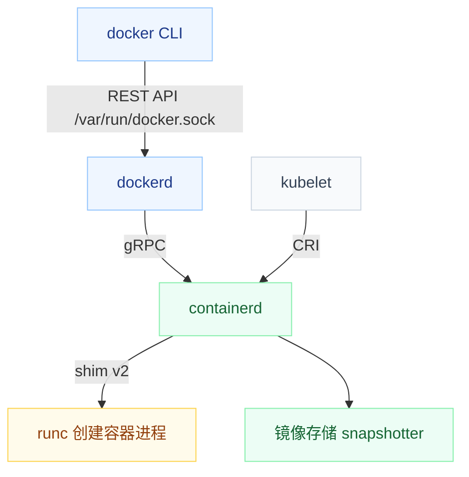
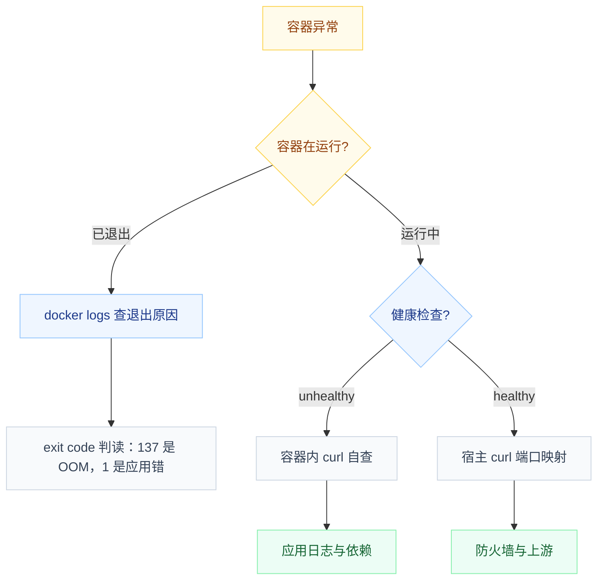

# Docker容器引擎

> 这篇从 Docker 的定位与架构讲起，经过安装配置、镜像与 Dockerfile 构建、容器与数据卷管理、网络模式、Compose 多容器编排，最后落到排障现场手册和一个完整的单机部署案例。
>
> 学完能独立完成单机应用的容器化构建、部署、数据持久化与编排，并按现象定位容器故障。

## 一、Docker 的定位与架构

Docker 是一个把应用连同依赖打包成镜像、再把镜像运行成容器的完整工具链；它解决的问题只有一个：开发机、CI、生产机的运行环境不一致。

先分清两个概念，后面所有命令都围绕它们展开：

- 镜像（Image）：只读的分层文件系统 + 配置（入口命令、环境变量、暴露端口），是容器的模板；
- 容器（Container）：镜像的一个运行实例，在镜像顶部加一个可写层，容器删除后可写层随之消失。

### 1.1 与虚拟机的区别

容器共享宿主机内核，没有 Guest OS，所以启动是秒级、开销是一个进程；虚拟机虚拟整套硬件并运行独立内核，隔离更强但更重。

| 维度 | 容器 | 虚拟机 |
|---|---|---|
| 内核 | 共享宿主机内核 | 每台独立内核 |
| 启动速度 | 秒级 | 分钟级 |
| 磁盘占用 | MB 级 | GB 级 |
| 隔离强度 | 进程级，依赖内核机制 | 硬件级 |
| 密度 | 单机数百个 | 单机数十个 |

边界：容器隔离依赖 Namespace 和 cgroup，内核漏洞会放大风险；强隔离多租户场景（对外的公有 PaaS）应叠加虚拟机或 Kata Containers，而不是直接裸跑容器。

### 1.2 架构与调用链

Docker 不是单进程：命令行走 CLI，真正干活的是 dockerd（守护进程），容器生命周期由 containerd 管理，最终由 runc 创建容器进程。



两个结论：

- `docker` 命令挂了不代表容器挂了：dockerd 重启时容器可以继续运行（`live-restore`），排查时先分清是 CLI、dockerd 还是容器本体的问题；
- Kubernetes 通过 CRI 直接对接 containerd，绕过 dockerd。所以生产集群里“没有 Docker 很正常”，Docker 的主战场是开发机、CI 构建和单机部署。

### 1.3 镜像规范与版本基线

Docker 镜像遵循 OCI 镜像规范（OCI Image Specification）：镜像由 manifest、配置文件和一组分层文件组成，任何兼容 OCI 的运行时（containerd、CRI-O）都能运行同一个镜像。

版本基线（2026-11）：Docker Engine 29.x、containerd 2.x、BuildKit 默认构建、Compose v2 插件（`docker compose` 子命令）、OCI 镜像规范 1.1。`docker-compose`（带连字符的 Python 旧版）已经淘汰，不再使用。

> 版本基线（2026-11）：Ubuntu 24.04/26.04 LTS，Rocky Linux 9/10；命令以 Ubuntu 为主，RHEL 系用 dnf。

## 二、安装与配置

这章解决“装好并跑通第一个容器”，包括官方仓库安装、非 root 使用和 daemon.json 三个关键配置。

### 2.1 Ubuntu 安装（官方仓库）

Ubuntu 自带的 `docker.io` 包版本旧，生产统一用 Docker 官方仓库：

```bash
# 依赖与密钥
sudo apt-get update
sudo apt-get install -y ca-certificates curl
sudo install -m 0755 -d /etc/apt/keyrings
# 官方 GPG 密钥落地为 apt 可校验的 keyring 文件
sudo curl -fsSL https://download.docker.com/linux/ubuntu/gpg -o /etc/apt/keyrings/docker.asc
sudo chmod a+r /etc/apt/keyrings/docker.asc

# 仓库地址按发行版代号生成，保证升级路径正确
echo "deb [arch=$(dpkg --print-architecture) signed-by=/etc/apt/keyrings/docker.asc] \
https://download.docker.com/linux/ubuntu $(. /etc/os-release && echo $VERSION_CODENAME) stable" | \
sudo tee /etc/apt/sources.list.d/docker.list > /dev/null

# engine + CLI + containerd + buildx + compose 一次装齐
sudo apt-get update
sudo apt-get install -y docker-ce docker-ce-cli containerd.io docker-buildx-plugin docker-compose-plugin
```

Rocky Linux 9/10 同理：

```bash
sudo dnf -y install dnf-plugins-core
sudo dnf config-manager --add-repo https://download.docker.com/linux/centos/docker-ce.repo
sudo dnf install -y docker-ce docker-ce-cli containerd.io docker-buildx-plugin docker-compose-plugin
sudo systemctl enable --now docker
```

### 2.2 macOS 与 Windows

macOS 与 Windows 内核不是 Linux，容器跑在一个轻量 Linux 虚拟机里，这是开发机方案，不用于生产服务器。

| 平台 | 安装方式 | 说明 |
|---|---|---|
| macOS | Docker Desktop DMG 或 `brew install --cask docker` | 内置 VM 与 CLI |
| Windows | `winget install Docker.DockerDesktop` | 先启用 WSL2 |
| Linux 服务器 | 官方 apt/dnf 仓库 | 生产唯一选择 |

### 2.3 非 root 用户与最小验证

```bash
# 把当前用户加入 docker 组，避免每次 sudo
sudo usermod -aG docker $USER
# 重新登录使组生效
newgrp docker
```

> 警告：docker 组等价于 root 权限——能挂载宿主机任意目录就能读到 `/etc/shadow`。多用户服务器上只给可信用户加组，公共环境保持 sudo 调用并审计。

最小验证：

```bash
docker version        # Client 与 Server 都有输出才算装好
docker run hello-world
```

预期输出（节选，示例）：

```text
Client: Docker Engine - Community
 Version:           29.0.0
Server: Docker Engine - Community
 Engine:
  Version:          29.0.0

Hello from Docker!
This message shows that your installation appears to be working correctly.
```

### 2.4 daemon.json 三个必配项

`/etc/docker/daemon.json` 是 dockerd 的主配置，生产环境至少配日志上限、镜像加速和故障恢复：

```json
{
  "registry-mirrors": ["https://mirror.example.com"],
  "log-driver": "json-file",
  "log-opts": {
    "max-size": "10m",
    "max-file": "3"
  },
  "live-restore": true
}
```

- `log-opts`：不限制日志大小的容器写满磁盘是最常见的生产事故，必须配；
- `live-restore`：dockerd 重启或升级时容器不中断，单机部署必配；
- `registry-mirrors`：直连 Docker Hub 慢或不稳定时配国内镜像加速地址。

```bash
sudo systemctl daemon-reload
sudo systemctl restart docker
docker info | grep -A2 "Logging\|Live"
```

## 三、镜像与 Dockerfile

这章解决“把一个应用变成镜像”：理解分层、写 Dockerfile、用 BuildKit 高效构建。

### 3.1 分层与镜像命名

镜像由多个只读层叠加，每条 Dockerfile 指令产生一层；容器启动时在最上面加一个可写层，写时复制。两个直接推论：

- 多个镜像共享基础层，拉取和存储都省；
- 层是缓存的单位，指令顺序决定构建速度，把不常变的放前面。

镜像全名的结构：`registry/repo:tag`，例如 `registry.example.com/team/app:1.0.0`；省略 registry 默认 `docker.io`，省略 tag 默认 `latest`。生产禁用 `latest`——它不可复现，回滚时不知道回的是什么。引用唯一镜像用摘要（digest）：

```bash
# digest 是镜像内容的哈希，全球唯一，不受同名 tag 覆盖影响
docker pull nginx:1.27-alpine
# 先取出 RepoDigests 里的摘要，再用 名字@摘要 精确拉取
DIGEST=$(docker inspect --format '{{index .RepoDigests 0}}' nginx:1.27-alpine | cut -d@ -f2)
echo "$DIGEST"
docker pull "nginx@$DIGEST"
```

常用命令：

```bash
docker pull nginx:1.27-alpine      # 拉取指定 tag
docker images                      # 本地镜像列表
docker history nginx:1.27-alpine   # 查看分层与大小，定位镜像为何变大
docker tag app:1.0.0 registry.example.com/team/app:1.0.0
docker push registry.example.com/team/app:1.0.0
docker rmi nginx:1.25              # 删除本地镜像
```

### 3.2 Dockerfile 指令与写法

Dockerfile 是镜像的构建脚本；写得对不对，直接决定镜像大小、构建速度和安全基线。核心指令：

| 指令 | 作用 | 关键点 |
|---|---|---|
| FROM | 基础镜像 | 优先官方 slim/alpine 变体 |
| COPY | 复制文件进镜像 | 优于 ADD，语义明确 |
| RUN | 构建期执行命令 | 合并多层，清理缓存 |
| ENV | 环境变量 | 构建期与运行期都生效 |
| EXPOSE | 声明端口 | 仅文档作用，不映射 |
| USER | 切换运行用户 | 不加就默认 root |
| HEALTHCHECK | 健康检查 | 生产镜像必配 |
| ENTRYPOINT | 容器入口 | 固定入口 |
| CMD | 默认参数 | 可被 run 覆盖 |

一个可直接用的多阶段构建例子（Spring Boot 3.5 / Java 21）：

```dockerfile
# syntax=docker/dockerfile:1

# ---- 构建阶段：JDK 完整工具链，产物是 jar ----
FROM eclipse-temurin:21-jdk-jammy AS build
WORKDIR /src
COPY mvnw .
COPY .mvn .mvn
COPY pom.xml .
# 依赖层单独缓存：pom 不变时这层直接命中缓存，省去每次下载依赖
RUN --mount=type=cache,target=/root/.m2 ./mvnw -q dependency:go-offline
COPY src src
# --mount=type=cache 是 BuildKit 缓存挂载，比把 .m2 打进层里干净
RUN --mount=type=cache,target=/root/.m2 ./mvnw -q package -DskipTests

# ---- 运行阶段：只要 JRE，最终镜像不含源码和构建工具 ----
FROM eclipse-temurin:21-jre-jammy
RUN apt-get update \
 && apt-get install -y --no-install-recommends curl \
 && rm -rf /var/lib/apt/lists/* \
 && useradd --system --uid 1001 app
WORKDIR /app
COPY --from=build --chown=app:app /src/target/app.jar app.jar
# 固定非 root 运行，容器被攻破也不是宿主机 root
USER app
EXPOSE 8080
ENV JAVA_OPTS="-XX:MaxRAMPercentage=75"
# 健康检查失败 3 次标记 unhealthy，编排层据此重启
HEALTHCHECK --interval=15s --timeout=3s --retries=3 \
  CMD curl -fsS http://127.0.0.1:8080/actuator/health || exit 1
ENTRYPOINT ["sh", "-c", "java $JAVA_OPTS -jar app.jar"]
```

写法要点（每条都有为什么）：

- 多阶段：构建工具链（JDK、Maven）不进最终镜像，最终层里只有 JRE 和 jar，体积从 GB 级降到 300MB 级；
- `dependency:go-offline` 放在 `COPY src` 之前：源码改动不会让依赖层缓存失效；
- 每条 `RUN` 自己清理 apt 缓存：层是只读的，下一层删文件不会让上一层变小；
- `.dockerignore` 排除 `target/`、`.git/`、`node_modules/`：`COPY . .` 时既提速又避免泄露本地文件。

`.dockerignore`：

```text
target/
.git/
.idea/
node_modules/
*.log
```

### 3.3 BuildKit 与构建

Docker 29.x 默认用 BuildKit 构建，不需要再设置 `DOCKER_BUILDKIT=1`；`buildx` 插件提供跨平台构建等高级能力。

```bash
# 一次构建打两个 tag：本地调试名 + 生产仓库名，避免 latest 漂移
docker build -t app:1.0.0 -t registry.example.com/team/app:1.0.0 .
docker buildx build --platform linux/amd64,linux/arm64 -t registry.example.com/team/app:1.0.0 --push .
```

预期输出（节选）：

```text
#5 [build 3/5] COPY pom.xml .
#5 CACHED
#8 [build 5/5] RUN --mount=type=cache,target=/root/.m2 ./mvnw -q package -DskipTests
#8 DONE 45.2s
#12 exporting layers
#12 writing image sha256:9f2a...c41d
```

构建结果验证：

```bash
docker images app
docker run --rm app:1.0.0 java -version
```

边界：`--platform` 多平台构建在 amd64 机器上跑 arm64 目标需要 QEMU 模拟，速度慢且个别指令会失败；多平台构建还必须换用 `docker-container` 驱动的 builder（`docker buildx create --name multi --driver docker-container --use`），默认的 docker 驱动只支持单平台。

## 四、容器管理

这章解决“把镜像跑起来并管好”：生命周期命令、资源限制和数据持久化。

### 4.1 生命周期与常用参数

```bash
docker run -d \
  --name app \
  --restart unless-stopped \
  -p 8080:8080 \
  --memory 512m --cpus 1.0 \
  registry.example.com/team/app:1.0.0
```

| 参数 | 含义 | 默认行为 |
|---|---|---|
| -d | 后台运行 | 前台占用终端 |
| --name | 容器名 | 随机名 |
| --restart | 重启策略 | no |
| -p | 端口映射 宿主:容器 | 不映射则外部不可见 |
| -v | 挂载卷 | 容器删除数据丢失 |
| --memory | 内存上限 | 不限，可被 OOM |
| --cpus | CPU 配额 | 不限 |

日常管理命令：

```bash
docker ps                    # 运行中的容器
docker ps -a                 # 含已退出的，查 exit code 用
docker logs -f --tail 100 app
docker exec -it app sh       # 进容器看现场；只读排查优先 docker inspect
docker stats --no-stream     # 一次性资源快照
docker stop app && docker rm app
docker inspect app --format '{{.State.Status}} {{.State.ExitCode}}'
```

`--restart` 三种常用值：`no`（默认，退出就退出）、`unless-stopped`（异常退出自动拉起，人工 stop 后不再拉起）、`always`（dockerd 重启后也拉起）。单机部署首选 `unless-stopped`。

退出码是最快的诊断入口：`exit 137` 是 SIGKILL（多数是内存超限被 OOM），`exit 1` 是应用自身错误，`exit 125/126/127` 是 Docker 或命令本身的问题。

> 边界：`docker rm -f` 直接杀容器不给应用清理机会，数据库类容器可能损坏数据；先 `docker stop`（默认给 10 秒优雅退出，应用应处理 SIGTERM）再 `docker rm`。

### 4.2 数据持久化：卷与绑定挂载

容器可写层随容器删除而消失；要留数据必须显式挂载。三种方式：

| 类型 | 写法 | 数据由谁管 | 适用 |
|---|---|---|---|
| 卷 Volume | -v data:/data | Docker 管理 | 数据库、应用数据 |
| 绑定挂载 | -v /host/path:/data | 用户管理 | 配置文件、开发热载 |
| tmpfs | --tmpfs /tmp | 内存 | 临时敏感文件 |

```bash
docker volume create pgdata
docker run -d --name pg \
  -e POSTGRES_PASSWORD=example \
  -v pgdata:/var/lib/postgresql/data \
  postgres:16

# 卷备份：起一个临时容器把卷内容打包出来
docker run --rm -v pgdata:/data -v $PWD:/backup alpine \
  tar czf /backup/pgdata-$(date +%F).tgz -C /data .
```

卷不随容器删除而删除，这是特性也是坑：反复重建数据库容器会看到“数据怎么还在”。确认不要了再删：

```bash
docker volume ls
docker volume inspect pgdata
docker volume rm pgdata     # 删除前确认已无容器引用
```

> 警告：`docker run --rm -v vol:/data` 不会删除卷，卷只能显式删除；而 `docker compose down -v` 会把 compose 里声明的卷一并删掉。生产库容器可以挂卷，但严禁随手执行带 `-v` 的 `down`。

## 五、Docker 网络

这章解决“容器之间、容器与外部怎么通信”。

### 5.1 四种网络模式

```bash
docker network ls
```

默认有一个 `bridge`（docker0），容器通过 NAT 访问外网。模式对比：

| 模式 | 特点 | 适用 |
|---|---|---|
| bridge（默认） | NAT，宿主可映射端口 | 单机对外服务 |
| 自定义 bridge | 内置 DNS，容器名互通 | 单机多容器协作 |
| host | 直接用宿主网络栈 | 追求性能、端口无冲突 |
| none | 无网络 | 离线任务、安全隔离 |

关键差异：默认 bridge 上容器互相 ping IP 可以、按容器名不通（无 DNS）；自定义 bridge 上容器名即域名。所以多容器协作必须建自定义网络：

```bash
docker network create appnet
docker run -d --name db --network appnet -e POSTGRES_PASSWORD=example postgres:16
docker run -d --name app --network appnet -p 8080:8080 registry.example.com/team/app:1.0.0
# app 容器内可以直接用 db:5432 连数据库
docker exec -it app getent hosts db
```

预期输出（示例）：

```text
172.18.0.2      db
```

### 5.2 端口映射与连接路径

`-p 8080:8080` 把宿主 8080 转发到容器 8080，由 dockerd 的 iptables 规则实现；出问题时先分清断在哪一段：


排查三步：宿主 `curl 127.0.0.1:8080` 通不通（DNAT 规则）、容器内 `curl 127.0.0.1:8080` 通不通（应用是否监听）、`docker port app`（映射是否声明）。最常见的错因是应用监听 `127.0.0.1` 而不是 `0.0.0.0`——容器内 loopback 只有容器自己能访问。

### 5.3 host 模式与边界

`--network host` 下容器直接使用宿主端口，没有 NAT 开销；但端口冲突、网络隔离全部失效，等于容器进程以宿主网络身份运行。只在明确需要极致网络性能或抓包排障时使用，不作为常规部署方式。

## 六、Compose 多容器编排

这章解决“多个容器一起管”：一份 compose.yml 声明全部服务，一条命令起停。

### 6.1 compose.yml 结构

Compose 用一份声明式文件描述服务、网络、卷和依赖关系；`docker compose`（v2 插件）是唯一支持的命令形式。一个 Web + Redis 的完整例子：

```yaml
services:
  app:
    # 同时写 build 与 image：构建产物直接打成这个 tag，不需要手工 docker tag
    image: registry.example.com/team/app:1.0.0
    build: .
    environment:
      SPRING_DATA_REDIS_HOST: redis
    depends_on:
      # condition 保证 Redis 健康后才启动 app，避免启动期连接失败
      redis:
        condition: service_healthy
    healthcheck:
      test: ["CMD", "curl", "-fsS", "http://127.0.0.1:8080/actuator/health"]
      interval: 15s
      timeout: 3s
      retries: 3
    restart: unless-stopped
    deploy:
      resources:
        limits:
          memory: 512M

  redis:
    image: redis:7.4-alpine
    command: ["redis-server", "--appendonly", "yes"]
    volumes:
      - redis-data:/data
    healthcheck:
      test: ["CMD", "redis-cli", "ping"]
      interval: 10s
      timeout: 3s
      retries: 3

volumes:
  redis-data:
```

结构要点：

- 服务名即 DNS 名，`app` 用 `redis:6379` 直连，不需要 IP；
- `depends_on` 不写 condition 只是启动顺序，不保证就绪；数据库类依赖必须配 `service_healthy`；
- `deploy.resources` 在单机 Compose 里同样生效，限制内存防止一个服务拖垮整机；
- `restart: unless-stopped` 让异常退出的服务自动拉起，是单机部署的最低保障。

### 6.2 常用命令

```bash
docker compose up -d          # 后台启动全部服务
docker compose ps             # 各服务状态与健康检查结果
docker compose logs -f app    # 跟踪单个服务日志
docker compose exec app sh    # 进入容器
docker compose up -d --build  # 代码变了，强制重建镜像再滚动更新
docker compose down           # 停止并删除容器与网络，卷保留
```

`up -d` 幂等：镜像没变的服务不会重启，只重建配置有变化的服务，因此改配置的重启代价是可控的。

> 警告：`docker compose down -v` 会删除 compose 中声明的命名卷，数据库数据一并消失；确认要清数据才用。

### 6.3 多环境与覆盖文件

同一份 `compose.yml`，用 `compose.override.yml`（默认自动叠加）放本机差异，用 `-f` 组合多环境：

```bash
docker compose -f compose.yml -f compose.prod.yml up -d
```

覆盖文件只写差异项（如生产加端口映射、去掉挂载的源码目录），基础文件保持一份，避免环境和环境之间漂移。

## 七、排障现场手册

这章按现象给出原因和第一条命令，救火时直接查表。

### 7.1 现象速查表

| 现象 | 最可能原因 | 第一条命令 |
|---|---|---|
| 容器立刻退出 | 应用启动报错 | `docker logs <容器>` |
| exit 137 | 内存超限被 OOM | `docker inspect` 看 OOMKilled |
| 端口外部不通 | 未映射、应用监听 loopback | `docker port <容器>` |
| 容器间不通 | 用了默认 bridge | `docker network inspect` |
| 磁盘满 | 镜像、卷、日志堆积 | `docker system df` |
| 构建巨慢 | 缓存未命中 | `docker build` 看哪层 CACHED 失效 |
| 无法连注册表 | 网络、凭据、限流 | `docker login` 复测 |
| dockerd 无响应 | socket 权限、守护进程僵死 | `systemctl status docker` |

### 7.2 排障顺序



### 7.3 典型故障与处理

容器立刻退出：

```bash
docker ps -a --filter "name=app"
docker logs --tail 50 app
docker inspect app --format '{{.State.ExitCode}} {{.State.OOMKilled}}'
```

`OOMKilled: true` 说明内存上限太低，调 `--memory` 或应用自身的堆参数；`ExitCode: 1` 看日志里的应用异常，通常是配置或依赖连不上。

磁盘满（最常见的历史问题）：

```bash
docker system df          # 镜像、容器、卷、缓存各占多少
docker image prune -a --filter "until=168h"   # 清理一周前所有未被使用的镜像（含悬空层）
```

> 警告：`docker system prune -a --volumes` 会删除所有未使用镜像和卷（含数据库卷），生产环境禁止整段执行；清理前先 `docker system df -v` 确认每一项。

构建缓存全部失效：检查 Dockerfile 指令顺序（`COPY pom.xml` 是否在 `COPY src` 之前）、`.dockerignore` 是否漏了高频变动文件（如本地日志），以及 BuildKit 缓存挂载是否配置。

构建速度慢且日志出现网络拉取失败：CI 机器直连 Docker Hub 不稳定时，在 daemon.json 配 `registry-mirrors`，或改用私有仓库的代理缓存（见《容器安全与供应链》）。

## 八、最佳实践案例

### 8.1 案例背景

一个 5 人小组内部系统：Spring Boot 3.5 应用 + Redis，原部署方式是 Ubuntu 虚机上 systemd 直跑 jar，每次发版手工 scp、重启，回滚靠旧包还在磁盘上。目标：容器化部署到同一台 Ubuntu 24.04 服务器，要求镜像可控（版本化 tag、非 root）、数据可持久化（Redis 重启不丢）、故障自愈（异常退出自动拉起）、发版与回滚各一条命令、5 分钟内完成。约束：单机，不引入 Kubernetes；公司有私有镜像仓库 `registry.example.com`。

### 8.2 案例实操

目录结构：

```text
deploy/
├── compose.yml
├── compose.prod.yml
├── Dockerfile
├── .dockerignore
└── nginx.conf
```

`Dockerfile` 是 3.2 节的多阶段构建，`.dockerignore` 排除 `target/` 与 `.git/`，完整文件在 8.2 节后半部分。

`compose.yml`（基础定义）：

```yaml
services:
  app:
    image: registry.example.com/team/app:${TAG}
    environment:
      SPRING_DATA_REDIS_HOST: redis
    depends_on:
      redis:
        condition: service_healthy
    healthcheck:
      test: ["CMD", "curl", "-fsS", "http://127.0.0.1:8080/actuator/health"]
      interval: 15s
      timeout: 3s
      retries: 3
    restart: unless-stopped
    deploy:
      resources:
        limits:
          memory: 512M

  redis:
    image: redis:7.4-alpine
    command: ["redis-server", "--appendonly", "yes"]
    volumes:
      - redis-data:/data
    healthcheck:
      test: ["CMD", "redis-cli", "ping"]
      interval: 10s
      timeout: 3s
      retries: 3
    restart: unless-stopped

volumes:
  redis-data:
```

`compose.prod.yml`（生产差异：加生产 profile 与 Nginx 入口）：

```yaml
services:
  app:
    environment:
      SPRING_PROFILES_ACTIVE: prod
  nginx:
    image: nginx:1.27-alpine
    ports:
      - "80:80"
    volumes:
      - ./nginx.conf:/etc/nginx/conf.d/default.conf:ro
    depends_on:
      app:
        condition: service_healthy
    restart: unless-stopped
```

`Dockerfile`（案例用完整构建脚本，与 3.2 节的写法一致）：

```dockerfile
# syntax=docker/dockerfile:1
FROM eclipse-temurin:21-jdk-jammy AS build
WORKDIR /src
COPY mvnw .
COPY .mvn .mvn
COPY pom.xml .
RUN --mount=type=cache,target=/root/.m2 ./mvnw -q dependency:go-offline
COPY src src
RUN --mount=type=cache,target=/root/.m2 ./mvnw -q package -DskipTests

FROM eclipse-temurin:21-jre-jammy
RUN apt-get update \
 && apt-get install -y --no-install-recommends curl \
 && rm -rf /var/lib/apt/lists/* \
 && useradd --system --uid 1001 app
WORKDIR /app
COPY --from=build --chown=app:app /src/target/app.jar app.jar
USER app
EXPOSE 8080
HEALTHCHECK --interval=15s --timeout=3s --retries=3 \
  CMD curl -fsS http://127.0.0.1:8080/actuator/health || exit 1
ENTRYPOINT ["sh", "-c", "java -XX:MaxRAMPercentage=75 -jar app.jar"]
```

`nginx.conf`：

```nginx
server {
    listen 80;
    location / {
        # 只反代到容器网络内的 app 服务名，Compose 内置 DNS 解析
        proxy_pass http://app:8080;
        proxy_set_header Host $host;
        proxy_set_header X-Real-IP $remote_addr;
        proxy_set_header X-Forwarded-For $proxy_add_x_forwarded_for;
    }
}
```

注意 `nginx` 没有 `ports: 8080` 的 app 直接暴露：app 不映射宿主端口，只通过 Compose 网络内被 Nginx 访问，攻击面只剩 80。

构建、推送、部署：

```bash
# TAG 由发版命令传入，镜像 tag 与代码版本一一对应
export TAG=1.4.2
docker build -t registry.example.com/team/app:$TAG .
docker push registry.example.com/team/app:$TAG
docker login registry.example.com   # 服务器上执行一次

# 服务器上部署；-f 叠加生产差异文件
TAG=1.4.2 docker compose -f compose.yml -f compose.prod.yml up -d
```

验证：

```bash
docker compose -f compose.yml -f compose.prod.yml ps
curl -I http://127.0.0.1/actuator/health
docker compose -f compose.yml -f compose.prod.yml logs --tail 20 app
```

预期输出（示例）：

```text
NAME                STATUS
deploy-app-1        Up (healthy)
deploy-nginx-1      Up (healthy)
deploy-redis-1      Up (healthy)

HTTP/1.1 200
```

回滚（只改 TAG，一条命令）：

```bash
TAG=1.4.1 docker compose -f compose.yml -f compose.prod.yml up -d
docker compose -f compose.yml -f compose.prod.yml logs --tail 5 app
```

Redis 数据持久化验证——模拟宿主重启：

```bash
sudo reboot
# 重启后（--restart 策略与 dockerd 开机自启保证服务恢复）
docker compose -f compose.yml -f compose.prod.yml ps
docker exec deploy-redis-1 redis-cli info keyspace
```

预期输出（示例）：

```text
db0:keys=128,expires=0,avg_ttl=0
```

### 8.3 案例结果

部署结果（示例，单机 4C8G）：最终镜像 289MB（多阶段构建，JDK 构建层不进镜像）；`up -d` 增量发版 40 秒（镜像已拉取，仅重建变化的 app 容器）；回滚 1.4.1 耗时 35 秒，一条命令完成；宿主重启后三个容器全部自动恢复且 Redis 数据完整（命名卷未受影响）。

失败模式与复盘：

- 第一次部署时 app 容器反复重启，日志显示连不上 Redis——原因是 `depends_on` 没写 `condition: service_healthy`，Redis 进程在但未就绪。改为条件依赖后解决，结论：数据库类依赖必须等健康检查而不是等启动；
- 曾有一次 `docker compose down` 后 Redis 数据仍在，让团队误以为 down 清数据——实际卷只有 `down -v` 才删。复盘后把 `down -v` 列入生产禁用命令，回滚一律用 `TAG=旧版本 up -d`；
- 发版脚本统一入口：`TAG=x.y.z make deploy`，避免有人手工 `up` 忘了叠加 `compose.prod.yml`。
