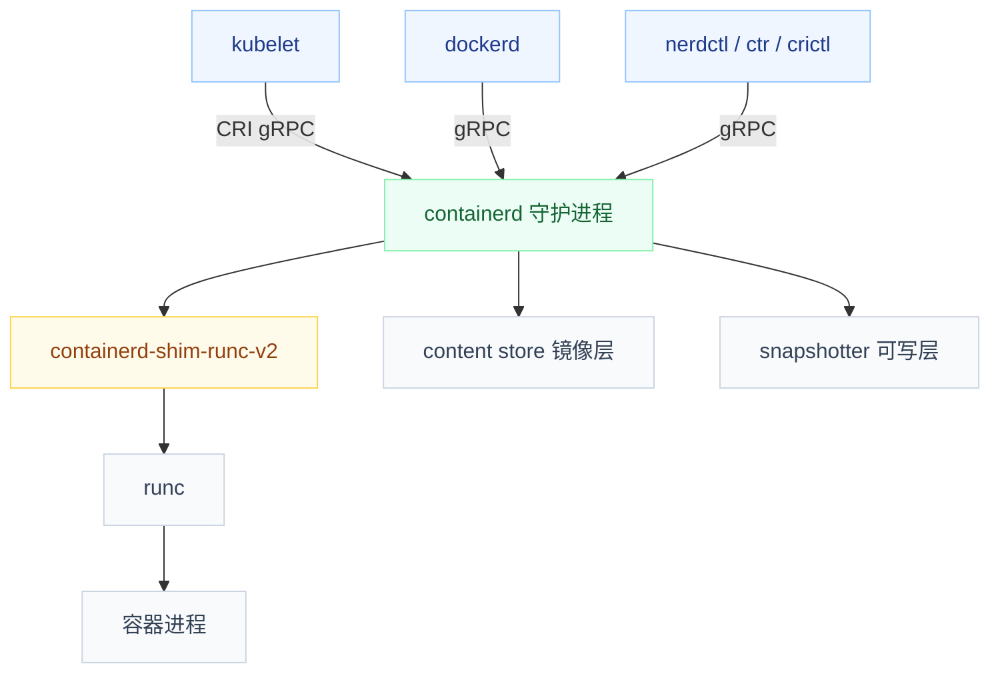
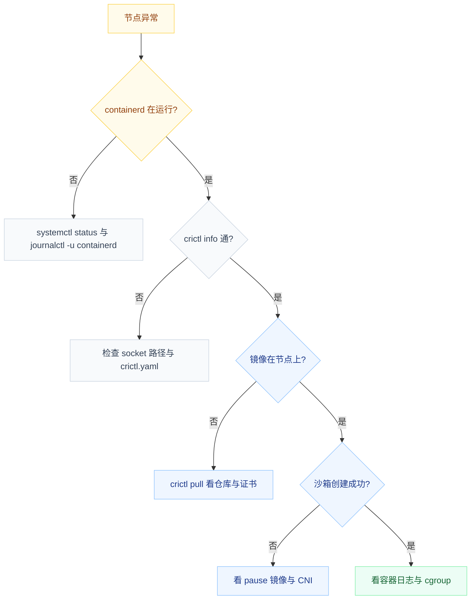

# containerd容器运行时

> 这篇从容器运行时的调用链与 containerd 的职责讲起，经过二进制安装与 config.toml 配置、CRI 与 Kubernetes 节点的对接、nerdctl 与 crictl 两套日常操作、镜像与快照管理，最后落到节点排障现场手册和一个多层故障叠加的排查案例。
>
> 学完能独立把 containerd 装成 Kubernetes 节点的运行时，用正确的 CLI 管理容器和镜像，并在节点 NotReady、镜像拉取失败时按调用链定位问题。

## 一、运行时的调用链与定位

containerd 是一个常驻的容器运行时守护进程：它管理镜像、快照、容器与任务，自己不直接创建进程，而是通过 shim 调用 runc 完成。理解这一点，才能判断故障出在哪一层。

### 1.1 从 kubelet 到容器进程



关键结论：

- 容器进程的父进程是 `containerd-shim-runc-v2`，不是 containerd 本身。containerd 重启后容器继续运行，靠的就是 shim 把进程托管住；
- 镜像落在 content store（按 digest 存储的只读层），运行时由 snapshotter（默认 overlayfs）组装成可写层；
- kubelet 只认 CRI 协议，不认 Docker API。Docker 29.x 内部同样把活交给 containerd 2.x，只是多了一层 dockerd。

### 1.2 三个 CLI 的分工

同一台机器上可能同时装了 `ctr`、`nerdctl`、`crictl`，它们连的是同一个 socket，但视角和命名空间不同，用错会“看不到容器”。

| 工具 | 视角 | 命名空间 | 典型用途 |
|---|---|---|---|
| ctr | containerd 原生 | default | 调试、镜像导入导出 |
| nerdctl | Docker 兼容 | default | 日常运行、构建、Compose |
| crictl | Kubernetes Pod | k8s.io | 节点排障、Pod 与沙箱 |

最容易犯的错：在 Kubernetes 节点上执行 `ctr containers ls` 看到空列表——因为 K8s 的容器在 `k8s.io` 命名空间，必须 `ctr -n k8s.io containers ls`。而 `nerdctl ps` 默认也是 default 命名空间，看 K8s 容器要 `nerdctl -n k8s.io ps`。

### 1.3 版本基线与适用边界

版本基线（2026-11）：containerd 2.x（配置文件 `version = 3`）、runc 1.3+、nerdctl 2.x、cri-tools 与集群小版本对齐（Kubernetes 1.33 配 cri-tools 1.33）、OCI 镜像规范 1.1。

containerd 适合所有需要跑 OCI 容器的 Linux 场景，尤其是 Kubernetes 节点；不适合直接当“开发者的 Docker”用——没有 `docker build`、没有 Compose 原生命令，需要 nerdctl 或 buildkit 补齐。单机开发环境仍推荐 Docker Desktop 或 Docker Engine。

> 版本基线（2026-11）：Ubuntu 24.04/26.04 LTS，Rocky Linux 9/10；命令以 Ubuntu 为主，RHEL 系用 dnf。

## 二、安装与最小验证

这章解决“装好 containerd 并跑起第一个容器”，给出二进制安装、系统服务、config.toml 和最小验证四步。

### 2.1 二进制安装（Ubuntu）

Kubernetes 官方推荐用 containerd 上游二进制，版本可控，不依赖发行版仓库：

```bash
# 版本按节点规划固定，不用 latest，便于全集群一致
VERSION=2.1.3
wget https://github.com/containerd/containerd/releases/download/v${VERSION}/containerd-${VERSION}-linux-amd64.tar.gz
sudo tar Cxzvf /usr/local containerd-${VERSION}-linux-amd64.tar.gz
```

安装 systemd 服务单元：

```bash
sudo mkdir -p /usr/local/lib/systemd/system
sudo wget -O /usr/local/lib/systemd/system/containerd.service \
  https://raw.githubusercontent.com/containerd/containerd/main/containerd.service
sudo systemctl daemon-reload
sudo systemctl enable --now containerd
```

runc 单独安装（containerd 包不含它）：

```bash
wget https://github.com/opencontainers/runc/releases/download/v1.3.0/runc.amd64
sudo install -m 755 runc.amd64 /usr/local/sbin/runc
runc --version
```

Rocky Linux 9/10 的替代路径是用 Docker 仓库的 `containerd.io` 包（内含 CRI 插件，开箱可用）：

```bash
sudo dnf config-manager --add-repo https://download.docker.com/linux/centos/docker-ce.repo
sudo dnf install -y containerd.io
sudo systemctl enable --now containerd
```

> 边界：`containerd.io` 包会随 Docker 仓库升级，节点上自动升级可能带来运行时版本漂移；K8s 节点建议锁定版本（`dnf versionlock` 或二进制安装），升级走滚动维护窗口。

### 2.2 config.toml 的三个关键配置

先生成默认配置再改，不要手写整份文件：

```bash
sudo mkdir -p /etc/containerd
containerd config default | sudo tee /etc/containerd/config.toml
```

containerd 2.x 的配置是 `version = 3`，CRI 插件拆成 runtime 与 images 两个插件。需要确认的三处：

```toml
version = 3

# 1) CRI 运行时插件：沙箱镜像与 runc 选项
[plugins.'io.containerd.cri.v1.runtime']
  sandbox_image = 'registry.k8s.io/pause:3.10'
  [plugins.'io.containerd.cri.v1.runtime'.containerd]
    default_runtime_name = 'runc'
    [plugins.'io.containerd.cri.v1.runtime'.containerd.runtimes.runc]
      runtime_type = 'io.containerd.runc.v2'
      [plugins.'io.containerd.cri.v1.runtime'.containerd.runtimes.runc.options]
        # 与 kubelet 的 cgroupDriver 必须一致，systemd 是 K8s 的推荐值
        SystemdCgroup = true

# 2) 镜像插件：私有仓库与镜像加速的证书目录
[plugins.'io.containerd.cri.v1.images'.registry]
  config_path = '/etc/containerd/certs.d'

# 3) 运行时辅助目录；内容与快照的存储根是顶层 root，默认 /var/lib/containerd
[plugins.'io.containerd.internal.v1.opt']
  path = '/opt/containerd'
```

为什么这三处关键：

- `SystemdCgroup = true`：kubelet 默认用 systemd 管理 cgroup，不一致时 kubelet 可能启动失败或节点 NotReady，日志报 cgroup 驱动不匹配，是最常见的节点故障之一；
- `sandbox_image`：每个 Pod 都要先起一个 pause 容器，镜像拉不到时所有 Pod 都卡在 `SandboxChanged`；
- `config_path`：私有仓库的自签证书和镜像加速都通过这个目录下的 `hosts.toml` 配置，不配就只能拉公网 HTTPS 仓库。

修改后重启并验证：

```bash
sudo systemctl restart containerd
sudo systemctl status containerd --no-pager
sudo ctr version
```

预期输出（节选）：

```text
Client:
  Version:  v2.1.3
Server:
  Version:  v2.1.3
```

### 2.3 最小验证：拉镜像并跑容器

```bash
# ctr 要求完整镜像引用，简写会报 "object required"
sudo ctr images pull docker.io/library/nginx:1.27-alpine
# 覆盖镜像入口，跑一条命令即退出，适合验证运行时是否正常
sudo ctr run --rm -t docker.io/library/nginx:1.27-alpine nginx-test nginx -v
```

预期输出：

```text
nginx version: nginx/1.27.4
```

输出这一行即说明 containerd、shim、runc 整条链路正常；若报 `ctr: failed to create shim task`，问题在 runc 与内核，不在镜像。

再验证 CRI 侧（Kubernetes 路径）：

```bash
sudo crictl --runtime-endpoint unix:///run/containerd/containerd.sock version
```

预期输出：

```text
Version:  0.1.0
RuntimeName:  containerd
RuntimeVersion:  v2.1.3
RuntimeApiVersion:  v1
```

两条路径都通，说明 containerd 本体和 CRI 插件都正常；只通 ctr 不通 crictl，问题在 CRI 插件配置或 socket 路径。

## 三、CRI 与 Kubernetes 节点

这章解决“让 kubelet 用上 containerd”：CRI 的约定、节点配置、crictl 的 Pod 视角操作。

### 3.1 CRI 的约定

CRI（Container Runtime Interface）是 kubelet 与运行时之间的 gRPC 接口，只定义两件事：镜像服务（拉取、查询、删除）和运行时服务（Pod 沙箱、容器、exec、日志、统计）。

由此产生几个固定事实：

- 每个 Pod 有一个 pause 容器（沙箱容器），它持有 Pod 的网络命名空间，业务容器加入这个命名空间；
- 删除 Pod 时先停业务容器再停沙箱，沙箱残留会导致 Pod 卡在 `Terminating`；
- kubelet 配置里只有 socket 地址，没有“容器引擎”概念，所以从 Docker 迁移到 containerd 不改任何业务镜像。

```bash
# kubelet 实际使用的运行时端点，可用来确认配置是否生效
sudo cat /var/lib/kubelet/kubeadm-flags.env
```

预期输出（示例）：

```text
KUBELET_KUBEADM_ARGS="--container-runtime-endpoint=unix:///run/containerd/containerd.sock"
```

kubeadm 加入节点时显式指定：

```yaml
apiVersion: kubeadm.k8s.io/v1beta4
kind: JoinConfiguration
nodeRegistration:
  criSocket: unix:///run/containerd/containerd.sock
  kubeletExtraArgs:
    - name: cgroup-driver
      value: systemd
```

### 3.2 crictl 配置与 Pod 视角

`/etc/crictl.yaml` 写死后，所有 crictl 命令不用再带 `--runtime-endpoint`：

```yaml
runtime-endpoint: unix:///run/containerd/containerd.sock
image-endpoint: unix:///run/containerd/containerd.sock
timeout: 10
debug: false
```

```bash
sudo crictl info | head -20
```

Pod 视角的常用命令：

| 命令 | 看什么 | 排障用途 |
|---|---|---|
| crictl pods | 沙箱列表与状态 | Pod 是否创建成功 |
| crictl ps -a | 容器列表 | 容器退出与重启次数 |
| crictl images | 节点镜像 | 镜像是否存在 |
| crictl logs ID | 容器日志 | 应用报错 |
| crictl inspect ID | 完整配置 | 挂载、环境变量 |
| crictl stats | 实时资源 | CPU 内存异常 |
| crictl pull 镜像 | 主动拉取 | 验证仓库连通 |
| crictl rmi --prune | 清理无用镜像 | 磁盘告警 |

```bash
# 只看 kube-system 的沙箱
sudo crictl pods --label io.kubernetes.pod.namespace=kube-system
# 找退出码非 0 的业务容器
sudo crictl ps -a --state exited
```

`crictl ps` 输出里的 `ATTEMPT` 列是重启次数，大于 3 说明容器在 CrashLoop；`EXIT CODE` 与 `docker ps -a` 的退出码语义一致（137 为 SIGKILL，常见于 OOM）。

### 3.3 节点侧的 pause 镜像与离线预热

pause 镜像必须提前存在节点上，否则任何 Pod 都起不来。离线环境的做法：

```bash
# --all-platforms 把索引里所有平台的层都导出，离线交付最稳妥
sudo ctr -n k8s.io images pull registry.k8s.io/pause:3.10
sudo ctr -n k8s.io images export --all-platforms pause-3.10.tar registry.k8s.io/pause:3.10

# 目标节点导入，命名空间必须是 k8s.io，否则 kubelet 看不到
sudo ctr -n k8s.io images import pause-3.10.tar
sudo crictl images | grep pause
```

业务镜像同理。批量场景把镜像清单写成循环：

```bash
# images.txt 每行一个完整引用
while read -r img; do
  sudo crictl pull "$img" || echo "FAILED $img"
done < images.txt
```

> 边界：`ctr images import` 不带 `-n k8s.io` 会把镜像导进 default 命名空间，kubelet 完全看不到，表现为“明明导入了还是 ImagePullBackOff”。

## 四、nerdctl 日常使用

这章解决“没有 Docker CLI 时怎么日常操作”：用 nerdctl 补齐 build、run、Compose，并知道它和 Docker 的差异。

### 4.1 安装

`nerdctl-full` 包含 containerd、runc、CNI 插件、BuildKit 和常用工具，适合独立单机：

```bash
VERSION=2.1.3
wget https://github.com/containerd/nerdctl/releases/download/v${VERSION}/nerdctl-full-${VERSION}-linux-amd64.tar.gz
sudo tar Cxzvf /usr/local nerdctl-full-${VERSION}-linux-amd64.tar.gz
sudo systemctl enable --now containerd buildkit
nerdctl version
```

> 警告：`nerdctl-full` 会覆盖 `/usr/local/bin` 下已有的 containerd、runc 和 CNI 配置。已经在跑 Kubernetes 的节点只装单个 `nerdctl` 二进制（`nerdctl-${VERSION}-linux-amd64.tar.gz`），不要用 full 包。

### 4.2 与 Docker 命令对照

| Docker | nerdctl | 说明 |
|---|---|---|
| docker run | nerdctl run | 参数基本一致 |
| docker build | nerdctl build | 依赖 buildkitd |
| docker compose | nerdctl compose | 需 CNI 支持端口映射 |
| docker exec | nerdctl exec | 一致 |
| docker logs | nerdctl logs | 一致 |
| docker volume | nerdctl volume | 一致 |

```bash
# 端口映射依赖 CNI 插件，装 full 包才有
nerdctl run -d --name web -p 8080:80 nginx:1.27-alpine
nerdctl ps
curl -I http://127.0.0.1:8080
nerdctl logs --tail 20 web
nerdctl rm -f web
```

### 4.3 构建与 Compose

```bash
nerdctl build -t app:1.0.0 .
nerdctl compose up -d
nerdctl compose ps
```

nerdctl 的构建同样走 BuildKit，Dockerfile 完全兼容（`# syntax=docker/dockerfile:1` 也支持）。差异点：

- 默认不使用 `docker` 命名空间，与 Docker 的容器互不可见；
- 端口映射需要 CNI 插件与 `nerdctl0` 网桥，只在容器网络内可解析服务名；
- `deploy` 段是 Swarm 语义，在单机 Compose 里不可靠；资源限制写在服务级 `mem_limit`、`cpus` 字段更稳妥。

## 五、镜像与快照管理

这章解决“镜像存在哪、怎么搬、怎么清”：理解存储结构，掌握导入导出与清理。

### 5.1 存储结构

```text
/var/lib/containerd/
├── io.containerd.content.v1.content/           # 按 digest 存的只读层，跨命名空间共享
├── io.containerd.metadata.v1.bolt/meta.db      # 元数据：镜像、容器、快照的索引
└── io.containerd.snapshotter.v1.overlayfs/     # 快照：容器可写层与挂载点
```

三个直接推论：

- 同一个层被多个镜像引用时只存一份，所以“删一个镜像没释放多少空间”是正常的；
- 镜像、容器、快照的对应关系由 containerd 内部 GC 维护，手工删目录必然把索引弄坏；
- 备份节点只有两条路：重新拉镜像，或用 `ctr images export` 导出。

### 5.2 导出、导入与命名空间

```bash
# 导出整份镜像（含所有平台层），可直接拷到离线节点
sudo ctr -n k8s.io images export --all-platforms app-1.4.2.tar registry.example.com/team/app:1.4.2

sudo ctr -n k8s.io images import app-1.4.2.tar
sudo ctr -n k8s.io images ls | grep app
```

查看命名空间里到底有什么：

```bash
sudo ctr namespaces ls
sudo ctr -n k8s.io containers ls
sudo ctr -n k8s.io tasks ls
sudo du -sh /var/lib/containerd/io.containerd.snapshotter.v1.overlayfs
```

### 5.3 清理与磁盘告警

```bash
# 删除未被任何容器使用的镜像，K8s 节点最安全的清理方式
sudo crictl rmi --prune
sudo crictl images | wc -l
df -h /var/lib/containerd
```

> 警告：不要 `rm -rf /var/lib/containerd`。元数据库与快照目录必须一起维护，直接删目录会导致 containerd 启动后索引损坏、容器无法删除，恢复只能重装运行时并重建节点。

日志和镜像之外，另一个常见占用是容器日志：kubelet 默认按 `/var/log/pods` 落盘，`/etc/containerd/config.toml` 里配 `max_container_log_line_size` 只控制单行长度，日志轮转要靠 kubelet 的 `containerLogMaxSize` 与 `containerLogMaxFiles`。

## 六、节点排障现场手册

这章按现象给出原因与第一条命令，覆盖节点 NotReady、镜像拉取、容器创建和 cgroup 四类问题。

### 6.1 现象速查表

| 现象 | 最可能原因 | 第一条命令 |
|---|---|---|
| 节点 NotReady | containerd 或 kubelet 挂了 | systemctl status containerd |
| 所有 Pod 卡 SandboxChanged | pause 镜像缺失 | crictl images 看 pause |
| ImagePullBackOff | 仓库不通、证书、凭据 | crictl pull 镜像 |
| CreateContainerError | 配置或挂载错误 | crictl inspect 容器 |
| 容器反复重启 | cgroup 驱动不一致 | journalctl -u kubelet |
| 节点磁盘满 | 镜像与日志堆积 | df -h 与 crictl rmi --prune |
| crictl 报 connection refused | socket 路径错或服务停 | crictl info |

### 6.2 排障顺序



### 6.3 四类典型故障

containerd 起不来：

```bash
sudo systemctl status containerd --no-pager
sudo journalctl -u containerd -n 50 --no-pager
```

日志里 `failed to load plugin` 或 `toml: parse error` 基本都是 config.toml 改坏：用 `containerd config dump` 校验，或回退到备份配置。注意 containerd 2.x 的插件名与 1.x 不同，把 1.7 的配置整份拷过来会报 `unknown configuration key`。

镜像拉取失败（三层原因依次查）：

```bash
sudo crictl pull registry.example.com/team/app:1.4.2
# 1) 网络与 DNS
getent hosts registry.example.com
# 2) 证书
sudo ls /etc/containerd/certs.d/registry.example.com/
# 3) 凭据（私有仓库）
sudo grep -n -A3 'registry.configs' /etc/containerd/config.toml
```

报 `x509: certificate signed by unknown authority` 是证书没放进 `certs.d`；报 `401 Unauthorized` 是凭据缺失。containerd CRI 认 `config.toml` 的 `registry.configs.<host>.auth` 或 Kubernetes `imagePullSecrets`，默认不读 Docker CLI 的 `/root/.docker/config.json`，`docker login` 生成的凭据要手工转换过去。

容器创建失败：

```bash
sudo crictl ps -a --state exited
sudo crictl inspect <容器ID> | grep -A5 "exitCode\|reason"
sudo crictl logs <容器ID>
```

`failed to create shim task` 通常指向 runc 与内核不兼容（如旧 runc 遇到新内核的 cgroup 接口），升级 runc 即可；`no such file or directory` 指向镜像里的入口命令或挂载路径不存在。

cgroup 驱动不一致：

```bash
sudo journalctl -u kubelet -n 50 --no-pager | grep -i cgroup
```

典型输出：

```text
misconfiguration: kubelet cgroup driver: "systemd" is different from runtime cgroup driver: "cgroupfs"
```

修法是把 containerd 的 `SystemdCgroup` 改为 `true`（或反过来把 kubelet 改成 cgroupfs，但 K8s 新版本已不推荐）。改完重启 containerd 与 kubelet，并用 `crictl info` 确认：

```bash
sudo crictl info | grep -i systemd
```

## 七、最佳实践案例

### 7.1 案例背景

一个 12 节点 Kubernetes 1.33 集群正在从 Docker 运行时迁移到 containerd 2.x。迁移当天，节点 `node-2` 重启后变为 NotReady，随后调度到该节点的业务 Pod 全部 `ImagePullBackOff`。约束：节点上跑着 40 多个 Pod，不能整机重装；镜像仓库 `registry.example.com` 使用公司自签 CA；值班人员只有 15 分钟处置窗口。现状：containerd 是二进制安装，kubelet 由 kubeadm 管理，配置通过 Ansible 下发。

### 7.2 案例实操

第一步，确认节点与运行时状态：

```bash
kubectl get nodes -o wide
ssh ops@node-2
systemctl status containerd --no-pager
systemctl status kubelet --no-pager
```

预期输出（节选）：

```text
NAME     STATUS     ROLES    AGE   VERSION
node-2   NotReady   worker   41d   v1.33.4

● containerd.service - containerd container runtime
     Active: active (running) since ...
● kubelet.service - kubelet
     Active: active (running)
```

containerd 与 kubelet 都在跑，说明不是进程挂了，继续看 kubelet 日志：

```bash
journalctl -u kubelet -n 100 --no-pager | grep -iE "cgroup|runtime|failed"
```

关键输出：

```text
misconfiguration: kubelet cgroup driver: "systemd" is different from runtime cgroup driver: "cgroupfs"
```

第二步，修 cgroup 驱动。Ansible 模板化时把 `SystemdCgroup` 渲染成了默认值 `false`，containerd 使用 cgroupfs，与 kubelet 的 systemd 不一致：

```bash
sudo cp /etc/containerd/config.toml /etc/containerd/config.toml.bak.$(date +%F)
sudo sed -i "s/SystemdCgroup = false/SystemdCgroup = true/" /etc/containerd/config.toml
sudo systemctl restart containerd
sudo systemctl restart kubelet
```

验证：

```bash
sudo crictl info | grep -i systemd
```

预期输出：

```text
"systemdCgroup": true
```

节点状态恢复：

```bash
kubectl get nodes
```

预期输出：

```text
NAME     STATUS   ROLES    AGE   VERSION
node-2   Ready    worker   41d   v1.33.4
```

第三步，处理 ImagePullBackOff。节点 Ready 后 Pod 仍拉不到镜像：

```bash
kubectl get pods -o wide | grep node-2
kubectl describe pod app-7d9c8f5b6-x2k4n | tail -20
sudo crictl pull registry.example.com/team/app:1.4.2
```

预期报错：

```text
FATA[0002] failed to pull image: ... x509: certificate signed by unknown authority
```

自签 CA 没有放进 containerd 的证书目录。补上：

```bash
sudo mkdir -p /etc/containerd/certs.d/registry.example.com
sudo cp /etc/ssl/certs/corp-root-ca.crt /etc/containerd/certs.d/registry.example.com/ca.crt
```

`/etc/containerd/certs.d/registry.example.com/hosts.toml`：

```toml
server = "https://registry.example.com"

# capabilities 里 pull 与 resolve 是拉取必须的；push 只在构建机上开
[host."https://registry.example.com"]
  capabilities = ["pull", "resolve"]
  ca = "/etc/containerd/certs.d/registry.example.com/ca.crt"
```

```bash
sudo systemctl restart containerd
sudo crictl pull registry.example.com/team/app:1.4.2
```

预期输出：

```text
Image is up to date for sha256:0f2c...9a71
```

第四步，触发 Pod 重建并验证：

```bash
kubectl delete pod app-7d9c8f5b6-x2k4n
kubectl get pods -w | grep app
sudo crictl ps | grep app
```

预期输出（节选）：

```text
app-7d9c8f5b6-9mz7q   1/1   Running   0   18s
CONTAINER   IMAGE    CREATED   STATE    NAME
a91f3c2d4e5f  0f2c9a71  18s ago  Running  app
```

同时把 pause 镜像预热到其余节点，避免下一台节点重启时重复踩坑：

```bash
for h in node-3 node-4 node-5; do
  ssh "$h" "sudo crictl pull registry.k8s.io/pause:3.10 && sudo crictl pull registry.example.com/team/app:1.4.2"
done
```

### 7.3 案例结果

处置结果（示例）：从告警到节点 Ready 用时 6 分钟，Pod 全部 Running 用时 18 分钟，未重装节点、未丢数据。两层故障分别对应 `SystemdCgroup` 与 `certs.d` 证书；pause 与业务镜像预热是同一轮处置里补上的预防动作。

失败模式与复盘：

- 第一层根因是配置漂移：Ansible 模板渲染出的 `SystemdCgroup` 与节点手工状态不一致，重启后回到默认 `false`。复盘后把 `containerd config dump` 纳入节点启动检查，并在模板里显式写死该项；
- 第二层根因是证书只配在 Docker 时代（`/etc/docker/certs.d`），迁移到 containerd 后目录变成 `/etc/containerd/certs.d`，迁移清单漏了这一步。复盘后把证书、镜像加速、pause 镜像列为迁移检查表的三项必检；
- 排障顺序的价值：先 `systemctl status` 再 `journalctl`，先 `crictl info` 再 `crictl pull`，每一步都用命令确认而不是猜。若一上来就重装 containerd，40 个 Pod 的镜像要全部重拉，恢复时间会翻几倍。
