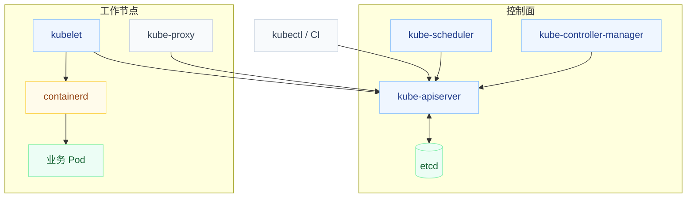
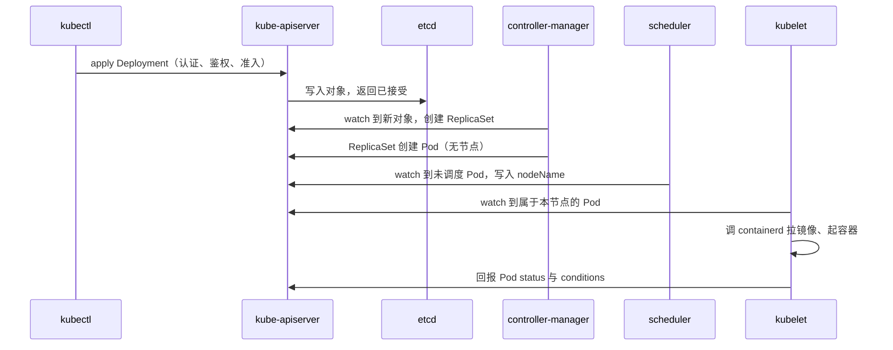
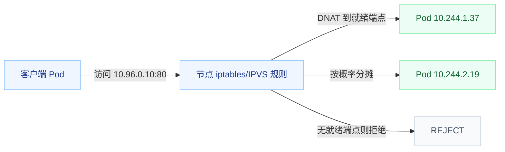

# Kubernetes集群与核心对象

> 这篇从 Kubernetes 的职责边界和集群架构讲起，经过 kubeadm 建集群、声明式对象模型、Pod、工作负载控制器、Service、Ingress、ConfigMap 与 Secret，最后落到集群日常维护、排障现场手册和一次带 TLS 的上线与回滚。
>
> 学完能独立搭起一个可用的 Kubernetes 集群，把无状态应用以声明式方式发布，通过 Service 和 Ingress 对外提供访问，并完成滚动更新、回滚和常见故障定位。

## 一、Kubernetes 的职责与边界

Kubernetes 是容器的调度与控制系统，只做三件事：把 Pod 放到合适的节点、把实际状态收敛到期望状态、为 Pod 提供稳定的网络入口与配置注入。它不构建镜像、不跑 CI、不做日志聚合、不备份业务数据。

把这个边界记清楚，能省掉大量错误选型。常见的越界期待有四类：

- 以为 K8s 会构建镜像：它只拉取已存在的镜像，构建属于 CI 或本地开发；
- 以为 K8s 会收集日志：容器 stdout 落在节点磁盘，聚合要靠 Loki、ELK 或云日志；
- 以为 K8s 会备份数据：Velero 备份的是 API 对象和 PV 快照，数据库一致性仍要自己做；
- 以为上了 K8s 就高可用：单控制面、单副本、没有 PDB 的集群，节点一挂照样中断。

不适合上 K8s 的情况同样明确：只有一两个小应用、团队没有容器与网络基础、业务是单体且发布频率很低。这些场景用 Docker Compose 或直接 systemd 部署，运维成本低一个数量级。

### 1.1 控制面与工作节点

集群由控制面（Control Plane）和工作节点（Node）两部分组成，前者存状态、做决策，后者跑容器。



各组件的职责与失效表现：

| 组件 | 职责 | 失效表现 |
|---|---|---|
| kube-apiserver | 唯一读写入口、认证授权、准入控制 | `kubectl` 超时，集群“假死” |
| etcd | 存全部对象与状态 | apiserver 起不来，写入全部失败 |
| kube-scheduler | 为未绑定节点位的 Pod 选节点 | Pod 停在 Pending |
| kube-controller-manager | 副本数、节点、端点等控制器 | 删了 Pod 不重建，端点不更新 |
| kubelet | 管本节点 Pod 生命周期 | 节点 NotReady，容器不启动 |
| containerd | 拉镜像、跑容器 | `ImagePullBackOff`、容器起不来 |
| kube-proxy | 把 Service 规则写进节点 | Service IP 不通，ClusterIP 超时 |

判断故障在哪一层，先看 `kubectl get --raw='/readyz?verbose'` 和各组件日志，不要一上来重启整个节点。

### 1.2 一次 kubectl apply 的完整链路

理解这条链路，等于拿到了排障地图：任何一步失败，现象都不一样。



几个容易忽略的细节：

- `kubectl apply` 返回成功只代表 etcd 写入成功，不代表 Pod 能跑起来；
- 调度只看 requests、亲和性、污点，不看实际负载，节点“看起来不忙”也可能调度失败；
- kubelet 上报状态有延迟，`kubectl get` 看到的是缓存与心跳的综合结果，秒级判断要用 `describe` 和事件。

### 1.3 版本基线

2026-11 的生产基线：Kubernetes 1.33 及以上（新集群建议选当前稳定版的前一到两个小版本），容器运行时 containerd 2.1，CNI 用 Calico 3.30 或 Cilium 1.18，入口用 ingress-nginx 1.13，CoreDNS 1.12，etcd 3.5。

版本偏斜规则要记住，升级顺序由它决定：

| 组件 | 允许偏斜 | 说明 |
|---|---|---|
| kubelet | 比 apiserver 低 3 个小版本 | 节点可以一批批升 |
| kube-proxy | 与 kubelet 同版本 | 随节点升 |
| kubectl | 比 apiserver 高或低 1 个 | 客户端工具宽松 |
| CNI / CSI | 按各自兼容矩阵 | 升级前先查 |

> 版本选择边界：托管集群（ACK、EKS、GKE）跟随厂商支持的版本，不要追最新；自建集群优先选已发布 3 个月以上、CNI 与 CSI 都声明兼容的版本。

## 二、用 kubeadm 建一个可用集群

kubeadm 只负责生成证书、启动控制面组件和引导节点，不负责装 CNI、不负责网络和负载均衡。一套能用的集群 = kubeadm + CNI + 入口控制器 + 存储，缺一个就是半成品。

本章用三台 Ubuntu 24.04 搭一套：`cp-01`（控制面，4C8G）、`node-01`、`node-02`（工作节点，4C8G），网段 `10.0.0.0/24`，Pod 网段 `10.244.0.0/16`。

### 2.1 所有节点的系统准备

三台机器都要执行同一套准备，任何一台漏掉都会在加入集群时报错。

```bash
# 主机名与解析：kubelet 用节点名注册，重名会导致节点互相覆盖
sudo hostnamectl set-hostname cp-01
sudo tee -a /etc/hosts <<'EOF'
10.0.0.10 cp-01
10.0.0.11 node-01
10.0.0.12 node-02
EOF

# 关闭 swap：kubelet 默认拒绝在 swap 开启时启动，且内存压力判断会被 swap 掩盖
sudo swapoff -a
sudo sed -ri '/\sswap\s/s/^#?/#/' /etc/fstab

# 内核模块：overlay 供 containerd 的 overlayfs 存储驱动使用
# br_netfilter 让网桥流量经过 iptables，否则 NetworkPolicy 与 Service 规则会漏包
cat <<'EOF' | sudo tee /etc/modules-load.d/k8s.conf
overlay
br_netfilter
EOF
sudo modprobe overlay
sudo modprobe br_netfilter

# 内核参数：允许 iptables 处理桥接流量，并开启 IP 转发
cat <<'EOF' | sudo tee /etc/sysctl.d/99-k8s.conf
net.bridge.bridge-nf-call-iptables  = 1
net.bridge.bridge-nf-call-ip6tables = 1
net.ipv4.ip_forward                 = 1
EOF
sudo sysctl --system

# 时间同步：证书校验、事件时间、日志排序都依赖时钟
sudo apt-get update && sudo apt-get install -y chrony
sudo systemctl enable --now chrony
```

RHEL/Rocky 的对应写法：

```bash
sudo dnf install -y chrony
sudo systemctl enable --now chrony
sudo firewall-cmd --permanent --add-port=6443/tcp   # apiserver
sudo firewall-cmd --permanent --add-port=10250/tcp  # kubelet
sudo firewall-cmd --permanent --add-port=2379-2380/tcp  # etcd
sudo firewall-cmd --permanent --add-port=4789/udp    # VXLAN，Calico/Cilium 需要
sudo firewall-cmd --reload
```

### 2.2 安装 containerd 2.x

Ubuntu 24.04 自带的 containerd 是 1.7，需要 2.x 的新配置格式和镜像加速能力，从 Docker 官方源安装。

```bash
sudo install -m 0755 -d /etc/apt/keyrings
curl -fsSL https://download.docker.com/linux/ubuntu/gpg \
  | sudo gpg --dearmor -o /etc/apt/keyrings/docker.gpg
echo "deb [arch=amd64 signed-by=/etc/apt/keyrings/docker.gpg] \
https://download.docker.com/linux/ubuntu noble stable" \
  | sudo tee /etc/apt/sources.list.d/docker.list
sudo apt-get update
sudo apt-get install -y containerd.io
```

生成配置并改两个关键项：

```bash
sudo mkdir -p /etc/containerd
containerd config default | sudo tee /etc/containerd/config.toml >/dev/null

# SystemdCgroup 必须为 true：kubelet 用 systemd 管理 cgroup，
# 两边不一致会导致容器启动后立刻退出、资源限制不生效
sudo sed -i 's/SystemdCgroup = false/SystemdCgroup = true/' /etc/containerd/config.toml

# 沙箱镜像版本必须与集群版本匹配，1.33 用 pause:3.10
sudo sed -i 's|sandbox_image = .*|sandbox_image = "registry.k8s.io/pause:3.10"|' \
  /etc/containerd/config.toml

sudo systemctl enable --now containerd
sudo systemctl restart containerd
containerd --version
```

预期输出：

```text
containerd github.com/containerd/containerd/v2 v2.1.3 9f7d8b2...
```

内网环境要配镜像仓库代理：先在 `config.toml` 的 CRI images 插件里指明 `config_path`，再把每个仓库的 `hosts.toml` 放进该目录（containerd 2.x 的镜像加速不会自动生效，缺 `config_path` 时 `certs.d` 会被忽略）：

```bash
# config.toml 里必须已有这一段，重启 containerd 生效
# [plugins.'io.containerd.cri.v1.images'.registry]
#   config_path = '/etc/containerd/certs.d'

sudo mkdir -p /etc/containerd/certs.d/registry.k8s.io
sudo tee /etc/containerd/certs.d/registry.k8s.io/hosts.toml <<'EOF'
server = "https://registry.k8s.io"
[host."https://mirror.example.com"]
  capabilities = ["pull", "resolve"]
EOF
```

### 2.3 安装 kubeadm、kubelet、kubectl

```bash
sudo apt-get install -y apt-transport-https ca-certificates curl gpg
curl -fsSL https://pkgs.k8s.io/core:/stable:/v1.33/deb/Release.key \
  | sudo gpg --dearmor -o /etc/apt/keyrings/kubernetes-apt-keyring.gpg
echo 'deb [signed-by=/etc/apt/keyrings/kubernetes-apt-keyring.gpg] \
https://pkgs.k8s.io/core:/stable:/v1.33/deb/ /' \
  | sudo tee /etc/apt/sources.list.d/kubernetes.list

sudo apt-get update
sudo apt-get install -y kubelet kubeadm kubectl

# 锁版本：无人值守升级会让 kubelet 越过 apiserver 3 个小版本的上限
sudo apt-mark hold kubelet kubeadm kubectl
kubeadm version -o short
```

预期输出：

```text
v1.33.4
```

RHEL/Rocky 用同一个源，把 `deb` 换成 `rpm`：

```bash
cat <<'EOF' | sudo tee /etc/yum.repos.d/kubernetes.repo
[kubernetes]
name=Kubernetes
baseurl=https://pkgs.k8s.io/core:/stable:/v1.33/rpm/
enabled=1
gpgcheck=1
gpgkey=https://pkgs.k8s.io/core:/stable:/v1.33/rpm/repodata/repomd.xml.key
EOF
sudo dnf install -y kubelet kubeadm kubectl
sudo systemctl enable kubelet
```

### 2.4 初始化控制面

先写配置文件，避免命令行参数散落、事后无法复现。

```yaml
# kubeadm.yaml
apiVersion: kubeadm.k8s.io/v1beta4
kind: InitConfiguration
localAPIEndpoint:
  advertiseAddress: 10.0.0.10      # 必须是节点上真实可达的地址，写 127.0.0.1 后其它节点加不进来
  bindPort: 6443
nodeRegistration:
  criSocket: unix:///run/containerd/containerd.sock
  name: cp-01
---
apiVersion: kubeadm.k8s.io/v1beta4
kind: ClusterConfiguration
kubernetesVersion: v1.33.4
clusterName: prod-lab
controlPlaneEndpoint: "10.0.0.10:6443"   # 即使单控制面也写死，日后扩成 3 控制面不用重签证书
networking:
  podSubnet: 10.244.0.0/16               # 必须与 CNI 的 IPPool 一致，不一致会出现跨节点不通
  serviceSubnet: 10.96.0.0/12
apiServer:
  certSANs:
    - 10.0.0.10
    - api.k8s.example.com                # 以后用域名访问 apiserver 时，证书里要提前有
---
apiVersion: kubelet.config.k8s.io/v1beta1
kind: KubeletConfiguration
cgroupDriver: systemd                    # 与 containerd 的 SystemdCgroup 保持一致
```

执行初始化，并把加入命令和证书密钥一并上传，方便扩容控制面：

```bash
sudo kubeadm init --config kubeadm.yaml --upload-certs
```

关键输出：

```text
[init] Using Kubernetes version: v1.33.4
[mark-control-plane] Marking the node cp-01 as control-plane
[addons] Applied essential addon: CoreDNS
[addons] Applied essential addon: kube-proxy

Your Kubernetes control-plane has initialized successfully!

To start using your cluster, you need to run the following as a regular user:

  mkdir -p $HOME/.kube
  sudo cp -i /etc/kubernetes/admin.conf $HOME/.kube/config
  sudo chown $(id -u):$(id -g) $HOME/.kube/config
```

```bash
mkdir -p $HOME/.kube
sudo cp -i /etc/kubernetes/admin.conf $HOME/.kube/config
sudo chown $(id -u):$(id -g) $HOME/.kube/config
kubectl get nodes
```

此时唯一的节点是 `NotReady`，这是正常的：**没有装 CNI，kubelet 无法给 Pod 分配网络，节点就不会就绪**。这是新集群第一个高频误判，不要先去查 kubelet 日志。

### 2.5 安装 CNI 与加入工作节点

```bash
# Calico 3.30：先装 operator，再用 Installation 声明 IPPool
kubectl create -f https://raw.githubusercontent.com/projectcalico/calico/v3.30.3/manifests/tigera-operator.yaml
```

`custom-resources.yaml`：

```yaml
apiVersion: operator.tigera.io/v1
kind: Installation
metadata:
  name: default
spec:
  calicoNetwork:
    ipPools:
      - name: default-ipv4-ippool
        cidr: 10.244.0.0/16          # 与 kubeadm 的 podSubnet 完全一致
        encapsulation: VXLAN         # VXLAN 不依赖底层网络支持 BGP，跨网段也能通
        natOutgoing: Enabled
        nodeSelector: all()
```

```bash
kubectl apply -f custom-resources.yaml
kubectl -n calico-system rollout status ds/calico-node --timeout=180s
kubectl get nodes
```

预期输出：

```text
NAME     STATUS   ROLES           AGE   VERSION
cp-01    Ready    control-plane   12m   v1.33.4
```

生成加入命令，在 `node-01`、`node-02` 上执行：

```bash
kubeadm token create --print-join-command
# 输出形如：kubeadm join 10.0.0.10:6443 --token abcdef.0123456789abcdef \
#   --discovery-token-ca-cert-hash sha256:...
```

```bash
# 在工作节点上执行上一条命令输出的完整内容
sudo kubeadm join 10.0.0.10:6443 --token abcdef.0123456789abcdef \
  --discovery-token-ca-cert-hash sha256:3f2a...
```

### 2.6 集群最小验证

装完必须逐项跑通，任何一项不过都不算“集群可用”。

```bash
kubectl get nodes -o wide
kubectl -n kube-system get pods
kubectl get --raw='/readyz?verbose' | tail -5
kubectl run smoke --image=registry.k8s.io/e2e-test-images/agnhost:2.45 \
  --restart=Never --command -- /agnhost netexec --http-port=8080
kubectl wait --for=condition=Ready pod/smoke --timeout=90s
kubectl get pod smoke -o wide
POD_IP=$(kubectl get pod smoke -o jsonpath='{.status.podIP}')
echo "smoke IP: $POD_IP"
```

预期输出（示例）：

```text
NAME      STATUS   ROLES           AGE   VERSION   INTERNAL-IP
cp-01     Ready    control-plane   20m   v1.33.4   10.0.0.10
node-01   Ready    <none>          11m   v1.33.4   10.0.0.11
node-02   Ready    <none>          11m   v1.33.4   10.0.0.12

[+]ping ok
[+]poststarthook/start-kube-apiserver-admission-initializer ok
readyz check passed

pod/smoke condition met
```

`smoke` Pod 落在哪个节点，就去那个节点确认容器网络，确认完再清理：

```bash
echo "smoke IP: $POD_IP"
kubectl delete pod smoke
```

### 2.7 本地集群与其它安装方式

生产和预发用 kubeadm 或托管集群，本地只做开发与验证，不要用本地集群模拟生产网络和存储。

| 方式 | 适用 | 边界 |
|---|---|---|
| kubeadm | 自建生产、预发 | 要自己管证书、升级、etcd |
| kind | 本地开发、CI 里跑集成测试 | 节点是容器，网络与真实环境差异大 |
| minikube | 个人学习、单机验证 | 默认单节点，多节点需显式配置 |
| k3s | 边缘、资源受限、单机小集群 | 默认用 SQLite 存集群状态（不是 etcd），规模有限 |
| 托管集群 | 绝大多数生产 | 控制面不可见，成本随规模上升 |

macOS / Windows 本地起 kind：

```bash
# macOS
brew install kind kubectl
# Windows（PowerShell，需先装 Docker Desktop 或 WSL2）
winget install Kubernetes.kubectl
winget install Kubernetes.kind

kind create cluster --name dev --image kindest/node:v1.33.4
kubectl cluster-info --context kind-dev
```

### 2.8 集群验收清单

- 所有节点 `Ready`，`kubectl get nodes` 无 `SchedulingDisabled`；
- `kube-system` 下 CoreDNS 至少 2 副本且 Running，kube-proxy 与 CNI 的 DaemonSet 每个节点一个；
- `/readyz?verbose` 全绿；
- `kubectl -n kube-system get pods` 没有反复重启（`RESTARTS` 不持续增长）；
- etcd 已配置定时快照，见 9.3；
- `kubeadm certs check-expiration` 显示剩余时间大于 90 天。

## 三、kubectl 与声明式对象模型

Kubernetes 的一切都是对象：期望状态写在 `spec`，实际状态写在 `status`，控制器不断把后者拉向前者。理解这一点，就不会用“重启服务”的思维去运维集群。

### 3.1 对象的结构

常见工作负载对象有五个顶层字段：`apiVersion`、`kind`、`metadata`、`spec`、`status`。ConfigMap、Secret 这类对象没有 `spec` 和 `status`，字段缺失不代表对象非法。

```yaml
apiVersion: apps/v1        # 决定用哪个 API 组和版本，版本错了 apply 直接失败
kind: Deployment           # 资源类型
metadata:
  name: portal             # 同 namespace 内同类资源唯一
  namespace: demo          # 不写则用当前 context 的 namespace
  labels:                  # 给选择器用，会被 Service、NetworkPolicy 匹配
    app.kubernetes.io/name: portal
  annotations:             # 给工具用，不参与选择，可存任意文本
    deployment.kubernetes.io/revision: "3"
spec:                      # 期望状态，由用户写
  replicas: 3
status:                    # 实际状态，由控制器写，用户不要手改
  readyReplicas: 3
```

几个字段的实际影响：

- `labels` 是选择器的唯一依据，改标签会让 Service 立刻失去后端；
- `annotations` 是入口控制器、证书管理器、GitOps 工具的配置入口，长度上限 256KB；
- `ownerReferences` 决定级联删除，删 Deployment 会连带删 ReplicaSet 和 Pod；
- `finalizers` 会阻塞删除，PVC 卡在 `Terminating` 多半是它。

常用资源与短名：

| 资源 | 短名 | 用途 |
|---|---|---|
| Pod | po | 最小调度单元 |
| Deployment | deploy | 无状态应用 |
| StatefulSet | sts | 有状态应用 |
| DaemonSet | ds | 每节点一个 |
| Service | svc | 集群内固定入口 |
| Ingress | ing | 七层入口 |
| ConfigMap / Secret | cm / secret | 配置与密钥 |

### 3.2 日常命令矩阵

排障时用 `get` 看现象、`describe` 看事件、`logs` 看应用，顺序不要反。

| 目的 | 命令 |
|---|---|
| 看对象概况 | `kubectl get deploy,pod -n demo -o wide` |
| 看事件与条件 | `kubectl describe pod web-abc -n demo` |
| 看容器日志 | `kubectl logs -f web-abc -n demo --tail=200` |
| 看上次崩溃日志 | `kubectl logs web-abc -n demo --previous` |
| 进容器 | `kubectl exec -it web-abc -n demo -- sh` |
| 本地转发端口 | `kubectl port-forward svc/web 8080:80 -n demo` |
| 临时调试 Pod | `kubectl run -it --rm dbg --image=nicolaka/netshoot -- bash` |
| 查字段含义 | `kubectl explain deploy.spec.strategy --recursive` |
| 查权限 | `kubectl auth can-i delete pods -n demo` |
| 看最近事件 | `kubectl get events -n demo --sort-by=.lastTimestamp` |

`-o` 的输出格式决定了能不能快速定位：

```bash
# 自定义列：一次性看 Pod 的节点、IP、重启次数
kubectl get pod -n demo -o custom-columns='NAME:.metadata.name,NODE:.spec.nodeName,IP:.status.podIP,RESTARTS:.status.containerStatuses[0].restartCount'

# jsonpath：取镜像名，确认滚动更新是否真的换了版本
kubectl get deploy portal -n demo -o jsonpath='{.spec.template.spec.containers[0].image}{"\n"}'
```

### 3.3 声明式 apply 与字段归属

生产环境只用 `apply`，不用 `create` 和 `edit`。`apply` 记录字段管理者，多人或多工具改同一对象时才不会互相覆盖。

```bash
# 先看差异，再决定是否提交
kubectl diff -f deploy.yaml

# 服务端 apply：冲突时报错而不是静默覆盖，适合 GitOps
kubectl apply --server-side --field-manager=argocd -f deploy.yaml

# 强制接管字段，只在一个工具彻底替代另一个时使用
kubectl apply --server-side --force-conflicts -f deploy.yaml
```

> 边界：`kubectl edit` 改生产对象会与 Git 里的 manifest 产生字段冲突，下次同步时被改回去，故障排查时容易误判“配置没生效”。线上变更一律走 manifest。

### 3.4 namespace 与隔离

namespace 是名字作用域和 RBAC 边界，不是网络或计算隔离边界。

```bash
kubectl create namespace demo
kubectl config set-context --current --namespace=demo   # 之后命令省略 -n
kubectl get ns
```

> 边界：不同 namespace 的 Pod 默认可以互相访问，要隔离必须加 NetworkPolicy（见 [04-Kubernetes网络存储与调度](./04-Kubernetes网络存储与调度.md)）；namespace 不能嵌套；删除 namespace 会异步删掉其中全部对象，误删无法撤销。

## 四、Pod：最小调度单元

Pod 是一组共享网络命名空间和存储卷的容器，是调度的原子单位。一个 Pod 里的容器一定在同一节点，一起生一起死。

### 4.1 Pod 的字段与生命周期

```yaml
apiVersion: v1
kind: Pod
metadata:
  name: web
  labels:
    app: web
spec:
  restartPolicy: Always          # Always / OnFailure / Never，Job 用后两个
  terminationGracePeriodSeconds: 30   # 收到 SIGTERM 后留给应用清理的时间
  initContainers:
    - name: wait-db
      image: busybox:1.36
      command: ['sh', '-c', 'until nc -z db 5432; do sleep 2; done']
      # 初始化容器必须成功退出，主容器才会启动；用于等依赖就绪
  containers:
    - name: app
      image: nginxinc/nginx-unprivileged:1.27-alpine
      ports:
        - name: http
          containerPort: 8080
      env:
        - name: TZ
          value: Asia/Shanghai
      resources:
        requests:
          cpu: 100m            # 调度依据，也决定 QoS
          memory: 128Mi
        limits:
          memory: 256Mi        # 超过就被 OOMKill，不设则可能拖垮节点
      volumeMounts:
        - name: cache
          mountPath: /tmp
  volumes:
    - name: cache
      emptyDir: {}             # 随 Pod 删除而清空，适合临时文件
```

Pod 的 `phase` 只有五个值，判断问题时看 `status.conditions` 比看 phase 更有用：

| phase | 含义 | 常见原因 |
|---|---|---|
| Pending | 未调度或镜像未就绪 | 资源不足、污点、亲和性不满足 |
| Running | 至少一个容器在运行 | 可能 readiness 未通过 |
| Succeeded | 全部容器正常退出 | Job 完成 |
| Failed | 至少一个容器异常退出 | 命令报错、OOMKill |
| Unknown | 与 kubelet 失联 | 节点宕机、网络分区 |

### 4.2 多容器协作与原生边车

一个 Pod 放多个容器的唯一理由是它们必须共享网络或本地文件。典型组合是主容器 + 日志/代理边车。

```yaml
# 片段：原生边车，以 initContainer 形式声明，restartPolicy: Always
initContainers:
  - name: log-shipper
    image: fluent/fluent-bit:3.1
    restartPolicy: Always        # 与主容器同生命周期，主容器退出它也退出
    volumeMounts:
      - name: logs
        mountPath: /var/log/app
containers:
  - name: app
    image: nginxinc/nginx-unprivileged:1.27-alpine
    volumeMounts:
      - name: logs
        mountPath: /var/log/app
```

> 边界：原生边车在 1.29 之后可用，1.33 已稳定；老集群仍要用普通 sidecar 容器。能用 Sidecar 模式解决的就不要拆成两个 Deployment，网络命名空间共享是它不可替代的价值。

### 4.3 requests、limits 与 QoS

`requests` 决定调度和 CPU 保障，`limits` 决定上限。两者配置方式直接决定 Pod 的 QoS 等级和被杀顺序。

| QoS | 条件 | 驱逐优先级 |
|---|---|---|
| Guaranteed | 每个容器 CPU、内存的 request 等于 limit | 最后被杀 |
| Burstable | 设了 request，但不满足 Guaranteed | 中间 |
| BestEffort | 完全没设 request 和 limit | 最先被杀 |

```yaml
resources:
  requests:
    cpu: 500m
    memory: 512Mi
  limits:
    cpu: 1000m       # CPU 超限是限流（throttling），不会杀进程
    memory: 512Mi    # 内存超限是 OOMKill，request 等于 limit 才进 Guaranteed
```

> 边界：CPU limit 设得过低会造成长尾延迟，Web 服务常常只限内存不限 CPU；内存 limit 必须设，否则一个泄漏的 Pod 能把节点拖进 OOM。看限流用 `container_cpu_cfs_throttled_seconds_total`，看 OOM 用 `kubectl describe pod` 里的 `OOMKilled`。

### 4.4 临时容器与在线调试

镜像里没有 shell 时，用临时容器（ephemeral container）挂进目标 Pod 的命名空间，不重启、不改镜像。

```bash
# 挂进目标容器的进程命名空间，能直接看到它的网络与进程
kubectl debug -it web-abc -n demo \
  --image=nicolaka/netshoot --target=app -- bash

# 调试节点本身：会在节点上起一个特权 Pod，挂载宿主根文件系统
kubectl debug node/node-01 -it --image=nicolaka/netshoot

# 复制一个 Pod 并改命令，用于排查“起不来”的容器
kubectl debug web-abc -n demo --copy-to=web-debug --container=app \
  --image=busybox:1.36 -- sleep 3600
```

> 边界：临时容器不能删除，只能重建 Pod；它不参与就绪判断，也不适合长期驻留。生产集群应在 RBAC 上限制 `pods/ephemeralcontainers` 权限。

## 五、工作负载控制器

不要直接创建裸 Pod：节点重启后它不会重建，也没有副本和滚动更新能力。生产只用控制器。

### 5.1 Deployment：无状态应用

```yaml
apiVersion: apps/v1
kind: Deployment
metadata:
  name: portal
  namespace: demo
spec:
  replicas: 3
  revisionHistoryLimit: 5            # 保留 5 个 ReplicaSet，回滚够用又不堆垃圾
  progressDeadlineSeconds: 300       # 5 分钟无进展就标记失败，避免发布卡死无人发现
  strategy:
    type: RollingUpdate
    rollingUpdate:
      maxSurge: 1                    # 允许多起 1 个，先加后减
      maxUnavailable: 0              # 旧 Pod 必须等新 Pod 就绪才下线，容量不下降
  selector:
    matchLabels:
      app.kubernetes.io/name: portal # 必须与 template 标签一致，创建后不可修改
  template:
    metadata:
      labels:
        app.kubernetes.io/name: portal
    spec:
      containers:
        - name: web
          image: nginxinc/nginx-unprivileged:1.27-alpine
          ports:
            - name: http
              containerPort: 8080
          readinessProbe:            # 没有就绪探针，滚动更新会把流量打到未启动的容器
            httpGet:
              path: /                # 默认 nginx 没有 /healthz，先用首页探测；要专用路径见 8.2 的 ConfigMap
              port: http
            periodSeconds: 5
            failureThreshold: 2
```

发布与回滚命令：

```bash
kubectl -n demo rollout status deploy/portal --timeout=180s
kubectl -n demo rollout history deploy/portal
kubectl -n demo rollout undo deploy/portal            # 回上一版
kubectl -n demo rollout undo deploy/portal --to-revision=2
kubectl -n demo rollout pause deploy/portal           # 暂停，配合灰度验证
kubectl -n demo rollout resume deploy/portal
```

> 边界：`kubectl rollout restart` 是通过改 Pod 模板注解触发滚动，不是重启进程；`maxUnavailable: 0` 要求集群有富余资源，资源紧张时发布会一直卡在 `Pending`。回滚只回 Deployment 模板，不会回滚数据库变更和 ConfigMap。

### 5.2 StatefulSet：有状态应用

StatefulSet 提供稳定网络标识、稳定存储和有序启停，数据库、消息队列、ZooKeeper 这类需要“身份”的服务才用它。

```yaml
apiVersion: apps/v1
kind: StatefulSet
metadata:
  name: db
  namespace: demo
spec:
  serviceName: db-headless           # 必须指向一个 headless Service，否则没有稳定 DNS
  replicas: 3
  podManagementPolicy: OrderedReady   # 默认按序启动，0 就绪后才起 1
  selector:
    matchLabels:
      app: db
  template:
    metadata:
      labels:
        app: db
    spec:
      containers:
        - name: postgres
          image: postgres:17-alpine
          env:
            - name: POSTGRES_PASSWORD
              valueFrom:
                secretKeyRef:
                  name: db-secret
                  key: password
          volumeMounts:
            - name: data
              mountPath: /var/lib/postgresql/data
  volumeClaimTemplates:              # 每个副本一份独立 PVC，删 Pod 不丢数据
    - metadata:
        name: data
      spec:
        accessModes: ["ReadWriteOnce"]
        storageClassName: local-path
        resources:
          requests:
            storage: 20Gi
```

稳定标识体现在三处：Pod 名固定为 `db-0/1/2`；DNS 为 `db-0.db-headless.demo.svc.cluster.local`；PVC 名为 `data-db-0`，重建 Pod 会挂回同一块盘。

> 边界：删除 StatefulSet 默认不删 PVC，这是保护数据的默认行为；缩容只删编号最大的副本，且对应 PVC 保留。StatefulSet 不解决主从选举和脑裂，那属于应用层。

### 5.3 DaemonSet：每节点一个

DaemonSet 保证每个（满足条件的）节点跑一个 Pod，用于日志采集、监控代理、CNI、节点级存储。

```yaml
apiVersion: apps/v1
kind: DaemonSet
metadata:
  name: node-exporter
  namespace: monitoring
spec:
  selector:
    matchLabels:
      app: node-exporter
  updateStrategy:
    type: RollingUpdate
    rollingUpdate:
      maxUnavailable: 10%            # 一次最多影响 10% 节点，避免监控同时全断
  template:
    metadata:
      labels:
        app: node-exporter
    spec:
      hostNetwork: true              # 采集宿主机网络指标需要宿主网络命名空间
      hostPID: true
      tolerations:                   # 控制面节点默认有污点，要显式容忍才会部署上去
        - key: node-role.kubernetes.io/control-plane
          operator: Exists
          effect: NoSchedule
      containers:
        - name: node-exporter
          image: prom/node-exporter:v1.9.1
          args: ["--path.rootfs=/host"]
          volumeMounts:
            - name: root
              mountPath: /host
              readOnly: true
      volumes:
        - name: root
          hostPath:
            path: /
```

### 5.4 Job 与 CronJob：一次性任务

```yaml
apiVersion: batch/v1
kind: CronJob
metadata:
  name: report
  namespace: demo
spec:
  schedule: "30 2 * * *"
  timeZone: "Asia/Shanghai"          # 1.27 起支持，不写则按控制面时区，容易差 8 小时
  concurrencyPolicy: Forbid          # 上一轮没跑完就跳过，防止任务堆积
  startingDeadlineSeconds: 600       # 错过 10 分钟以上就不再补跑
  successfulJobsHistoryLimit: 3
  jobTemplate:
    spec:
      backoffLimit: 3                # 失败重试 3 次后标记 Failed
      activeDeadlineSeconds: 1800    # 单次任务最长 30 分钟，超时强制结束
      ttlSecondsAfterFinished: 86400 # 一天后自动清理 Job 与 Pod，避免堆积
      template:
        spec:
          restartPolicy: Never
          containers:
            - name: report
              image: busybox:1.36
              command: ["/bin/sh", "-c", "date; echo done"]
```

控制器选型：

| 场景 | 控制器 | 关键点 |
|---|---|---|
| 无状态 Web / API | Deployment | 任意副本可替换 |
| 数据库 / 集群中间件 | StatefulSet | 稳定标识与独立存储 |
| 每节点一个代理 | DaemonSet | 容忍控制面污点 |
| 一次性批处理 | Job | 重试与超时 |
| 定时任务 | CronJob | 时区与并发策略 |

## 六、Service 与集群内服务发现

Pod IP 随重建变化，Service 提供一个固定虚拟 IP 和 DNS 名，把流量分给当前就绪的 Pod。

### 6.1 四种 Service 类型

| 类型 | 访问范围 | 典型用途 | 代价 |
|---|---|---|---|
| ClusterIP | 集群内 | 服务间调用 | 无 |
| NodePort | 集群外，经节点端口 | 自建集群临时暴露 | 端口范围有限，多一层转发 |
| LoadBalancer | 集群外，经云负载均衡 | 生产入口 | 要云厂商或 MetalLB |
| ExternalName | 集群内 CNAME | 指向外部数据库 | 不做代理，无健康检查 |

```yaml
apiVersion: v1
kind: Service
metadata:
  name: portal
  namespace: demo
spec:
  type: ClusterIP
  selector:
    app.kubernetes.io/name: portal   # 与 Pod 标签完全匹配才会产生端点
  ports:
    - name: http
      port: 80                       # Service 暴露的端口
      targetPort: http               # 用端口名，容器改端口时不用改 Service
```

端点由就绪状态决定，这是 Service 排查的核心：

```bash
kubectl -n demo get endpointslice -l kubernetes.io/service-name=portal
kubectl -n demo get pod -l app.kubernetes.io/name=portal \
  -o custom-columns='NAME:.metadata.name,READY:.status.containerStatuses[0].ready,IP:.status.podIP'
```

预期输出（正常时三个地址）：

```text
NAME           READY   IP
portal-7d9f8-4m2xk    true    10.244.1.37
portal-7d9f8-9pq7t    true    10.244.2.19
portal-6b5c4    true    10.244.1.41
```

headless Service（`clusterIP: None`）不分配虚拟 IP，DNS 直接返回所有 Pod IP，StatefulSet 和客户端侧负载均衡用它。

### 6.2 转发实现与 kube-proxy

Service 的虚拟 IP 不是真实网卡地址，靠节点上的规则把访问重定向到 Pod。



三种模式的区别：

| 模式 | 规则规模大时 | 长连接 | 备注 |
|---|---|---|---|
| iptables | 线性增长，同步慢 | 依赖 conntrack | 默认，兼容性最好 |
| IPVS | 哈希表，规模大更稳 | 支持多种调度算法 | 需内核模块 |
| nftables | 1.31 起 beta | 同 iptables | 新集群可评估 |

```bash
# 看当前模式与规则条数
kubectl -n kube-system get cm kube-proxy -o yaml | grep mode
sudo iptables -t nat -L KUBE-SERVICES -n | wc -l
sudo ipvsadm -Ln | head
```

`externalTrafficPolicy: Local` 保留客户端源 IP、少一跳，但只有运行了 Pod 的节点才接收流量，节点少时容易不均；`Cluster` 会二次转发，源 IP 变成节点 IP。

### 6.3 DNS 解析

CoreDNS 为每个 Service 生成 A 记录，解析格式决定跨 namespace 能不能通。

| 写法 | 解析结果 | 使用场景 |
|---|---|---|
| `portal` | 同 namespace 内 | 同 ns 调用 |
| `portal.demo` | 指定 namespace | 跨 ns 调用 |
| `portal.demo.svc` | 带 svc 域 | 少用 |
| `portal.demo.svc.cluster.local` | 完整 FQDN | 跨集群、避免搜索域干扰 |

`/etc/resolv.conf` 里默认 `ndots:5`，意味着少于 5 个点的名字会先尝试多个搜索域，跨 namespace 调用会多出几次无效查询。延迟敏感的服务可以显式降低：

```yaml
spec:
  dnsConfig:
    options:
      - name: ndots
        value: "2"          # 域名里点够 2 个就直接按绝对域名解析，减少无效查询
```

解析排查：

```bash
kubectl run -it --rm dnstest --image=busybox:1.36 --restart=Never -- \
  nslookup portal.demo
kubectl -n kube-system logs deploy/coredns --tail=50
```

### 6.4 Service 不通的排查顺序

按“端点有没有、端口对不对、监听地址对不对”三步走，不要先怀疑网络插件。

```bash
# 1. 端点是否为空：空则查 selector 与 readiness
kubectl -n demo get endpointslice -l kubernetes.io/service-name=portal

# 2. 端口映射是否正确
kubectl -n demo get svc portal -o jsonpath='{.spec.ports}{"\n"}'

# 3. 从集群内直接打 Pod IP，绕过 Service
kubectl run -it --rm nettest --image=nicolaka/netshoot --restart=Never -- \
  curl -sv --max-time 3 http://10.244.1.37:8080/healthz
```

判断规则：

- 端点为 `[]`：selector 不匹配，或 Pod 未就绪（readiness 探针失败最常见）；
- 端点有值但 `curl` 超时：`targetPort` 写错，或容器只监听 `127.0.0.1`；
- Pod IP 能通、Service IP 不通：kube-proxy 未运行或规则未同步，看 `kubectl -n kube-system logs ds/kube-proxy`。

## 七、Ingress 与外部入口

Ingress 只是一组七层路由规则，必须有 Ingress Controller 执行才生效。只创建 Ingress 对象而不装控制器，是最常见的“配了没反应”。

### 7.1 安装 ingress-nginx

```bash
helm repo add ingress-nginx https://kubernetes.github.io/ingress-nginx
helm repo update
helm install ingress-nginx ingress-nginx/ingress-nginx \
  --namespace ingress-nginx --create-namespace \
  --version 4.13.0 \
  --set controller.replicaCount=2 \
  --set controller.metrics.enabled=true \
  --set controller.service.type=NodePort \
  --set controller.service.nodePorts.http=30080 \
  --set controller.service.nodePorts.https=30443
```

```bash
kubectl -n ingress-nginx get pods,svc
kubectl get ingressclass
```

预期输出：

```text
NAME                                        READY   STATUS    RESTARTS
ingress-nginx-controller-6c9f7d8b5c-2xk4l   1/1     Running   0

NAME                       TYPE       CLUSTER-IP      PORT(S)
ingress-nginx-controller   NodePort   10.96.184.201   80:30080/TCP,443:30443/TCP

NAME    CONTROLLER             PARAMETERS   AGE
nginx   k8s.io/ingress-nginx   <none>       2m
```

> 边界：ingress-nginx 上游已宣布 2026 年 3 月后停止维护，存量集群仍在大量使用，运维要锁定版本并关注安全公告；新项目应评估 Gateway API 或其它控制器，迁移时 Ingress 规则可以逐条平移。

### 7.2 规则、路径与 TLS

```yaml
apiVersion: networking.k8s.io/v1
kind: Ingress
metadata:
  name: portal
  namespace: demo
  annotations:
    nginx.ingress.kubernetes.io/ssl-redirect: "true"        # HTTP 自动 301 到 HTTPS
    nginx.ingress.kubernetes.io/proxy-body-size: "8m"       # 默认 1m，上传接口会 413
    nginx.ingress.kubernetes.io/proxy-read-timeout: "60"    # 默认 60s，长轮询要调大
spec:
  ingressClassName: nginx          # 不写则用默认 IngressClass，多控制器时必须写
  tls:
    - hosts: ["portal.example.com"]
      secretName: portal-tls       # 必须是同 namespace 的 kubernetes.io/tls Secret
  rules:
    - host: portal.example.com
      http:
        paths:
          - path: /
            pathType: Prefix       # Prefix 按路径段匹配，Exact 要求完全相等
            backend:
              service:
                name: portal
                port:
                  name: http
```

常用注解：

| 注解 | 作用 | 默认值 |
|---|---|---|
| `proxy-body-size` | 请求体上限 | 1m |
| `proxy-read-timeout` | 读上游超时 | 60s |
| `ssl-redirect` | 强制 HTTPS | true |
| `rewrite-target` | 重写路径 | 无 |
| `canary-weight` | 灰度流量比例 | 无 |

> 边界：`pathType: Prefix` 按路径段匹配，`/api` 不会匹配 `/apix`；`rewrite-target` 与 `use-regex` 组合容易把静态资源路径改坏，先在测试环境用 `curl -I` 验证。

### 7.3 灰度发布

同一 host 再建一个带 canary 注解的 Ingress，按权重切流。

```yaml
apiVersion: networking.k8s.io/v1
kind: Ingress
metadata:
  name: portal-canary
  namespace: demo
  annotations:
    nginx.ingress.kubernetes.io/canary: "true"
    nginx.ingress.kubernetes.io/canary-weight: "10"   # 10% 流量进新版本
spec:
  ingressClassName: nginx
  rules:
    - host: portal.example.com
      http:
        paths:
          - path: /
            pathType: Prefix
            backend:
              service:
                name: portal-canary
                port:
                  name: http
```

验证权重是否生效：

```bash
for i in $(seq 1 20); do
  curl -sk -H 'Host: portal.example.com' https://10.0.0.11:30443/version
done | sort | uniq -c
```

> 边界：注解式灰度只支持按权重和 Header，做不到按用户维度、自动分析和自动回滚；复杂发布用 Argo Rollouts 或 Gateway API。

### 7.4 从集群外访问的三种方式

| 方式 | 做法 | 优点 | 代价 |
|---|---|---|---|
| NodePort | Service 类型 NodePort | 无需云设施 | 端口受限，节点 IP 暴露 |
| LoadBalancer | MetalLB 或云 LB | 标准 VIP，可保留源 IP | 要地址池或云资源 |
| hostNetwork | 控制器用宿主网络 | 少一层 NAT，性能好 | 端口独占，调度受限 |

自建机房用 MetalLB 给 `LoadBalancer` 分配内网 VIP，前提是地址池与交换机路由已打通：

```bash
helm repo add metallb https://metallb.github.io/metallb
helm install metallb metallb/metallb -n metallb-system --create-namespace
```

```yaml
apiVersion: metallb.io/v1beta1
kind: IPAddressPool
metadata:
  name: default
  namespace: metallb-system
spec:
  addresses:
    - 10.0.0.200-10.0.0.220      # 必须是内网未被占用的地址段
---
apiVersion: metallb.io/v1beta1
kind: L2Advertisement
metadata:
  name: default
  namespace: metallb-system
spec:
  ipAddressPools: ["default"]
```

## 八、ConfigMap 与 Secret

配置与镜像分离，同一个镜像可以在不同环境跑。区别只有一个：Secret 是“需要额外保护的配置”，不是“加密后的配置”。

### 8.1 ConfigMap 的三种用法

```bash
# 从字面量创建
kubectl -n demo create configmap app-env \
  --from-literal=APP_ENV=prod --from-literal=LOG_LEVEL=info

# 从文件创建，key 默认是文件名
kubectl -n demo create configmap nginx-conf --from-file=default.conf

# 从目录创建，目录下每个文件一个 key
kubectl -n demo create configmap html --from-file=./site/
```

```yaml
apiVersion: v1
kind: ConfigMap
metadata:
  name: portal-html
  namespace: demo
data:
  index.html: |
    <!doctype html>
    <html><body><h1>portal v1</h1></body></html>
immutable: false        # 设为 true 后不可修改，只能删了重建，可减少 apiserver 压力
```

挂载方式决定了变更是否生效：

| 方式 | 变更后是否自动生效 | 说明 |
|---|---|---|
| env / envFrom | 否 | 必须重建 Pod |
| volume 挂载 | 是，有延迟 | kubelet 同步周期，通常 1 分钟内 |
| subPath 挂载 | 否 | 不接收更新，是常见坑 |

### 8.2 Secret 的类型与真实边界

| 类型 | 用途 | 关键字段 |
|---|---|---|
| Opaque | 通用键值 | `data` / `stringData` |
| kubernetes.io/tls | Ingress 证书 | `tls.crt`、`tls.key` |
| kubernetes.io/dockerconfigjson | 拉私有镜像 | `.dockerconfigjson` |
| kubernetes.io/service-account-token | 服务账号令牌 | 由控制面生成 |

```bash
kubectl -n demo create secret generic db-secret \
  --from-literal=password='S3cure!Pass' \
  --dry-run=client -o yaml | kubectl apply -f -

# 查看内容：base64 只是编码，不是加密，能读 Secret 的人就能还原明文
kubectl -n demo get secret db-secret -o jsonpath='{.data.password}' | base64 -d; echo
```

`data` 里是 base64，`stringData` 可以直接写明文，提交时由 apiserver 转码：

```yaml
apiVersion: v1
kind: Secret
metadata:
  name: db-secret
  namespace: demo
type: Opaque
stringData:                # 写明文更方便 review，落库仍是 base64
  password: "S3cure!Pass"
```

> 边界：Secret 默认以明文存进 etcd，能访问 etcd 或能 `get secret` 的人都能读到。生产至少做三件事：开启 etcd 静态加密、用 RBAC 限制 `get/list/watch secrets`、把 Secret 交给 External Secrets 或 Sealed Secrets 管理，Git 里只存密文。

etcd 静态加密配置（在控制面节点）：

```yaml
# /etc/kubernetes/encryption-config.yaml
apiVersion: apiserver.config.k8s.io/v1
kind: EncryptionConfiguration
resources:
  - resources: ["secrets"]
    providers:
      - aescbc:
          keys:
            - name: key1
              secret: <32 字节 base64 密钥>   # head -c 32 /dev/urandom | base64
      - identity: {}                        # 兜底，读取未加密的历史数据
```

改完要在 apiserver 的 `--encryption-provider-config` 上引用，然后重写存量 Secret 才会真正加密。

### 8.3 配置变更的生效策略

| 策略 | 生效方式 | 适用 |
|---|---|---|
| env 注入 | 重建 Pod | 启动参数、连接串 |
| volume 挂载 | 自动刷新，秒到分钟级 | 配置文件、证书 |
| checksum 注解 | 改配置触发滚动 | 希望配置变更即发布 |
| 不可变 + 新名字 | 显式换版本 | GitOps，回滚清晰 |

checksum 注解的写法，让 Deployment 在 ConfigMap 变化时自动滚动：

```yaml
spec:
  template:
    metadata:
      annotations:
        checksum/config: "3f2a9c1e"   # 由 CI 计算 ConfigMap 内容的 sha256 填入
```

## 九、集群日常维护

集群上线只是开始，证书、升级、节点维护、备份才是长期成本所在。

### 9.1 节点维护与驱逐

```bash
# 标记不可调度：新 Pod 不再进来，已有的不动
kubectl cordon node-01

# 驱逐：会遵守 PDB，逐个删 Pod 并等重建
kubectl drain node-01 --ignore-daemonsets --delete-emptydir-data --timeout=300s

# 维护完成后恢复
kubectl uncordon node-01
```

> 警告：`drain` 会真实删除 Pod。执行前确认：目标工作负载副本数大于 1、PDB 允许中断、`emptyDir` 数据可以丢（`--delete-emptydir-data` 会直接删）。单副本的有状态服务必须先手动迁移或停机。

### 9.2 版本升级

顺序固定：先升控制面，再逐台升工作节点，CNI 与 CSI 按各自兼容矩阵单独升级。

```bash
# 1. 控制面：换源到新版本，升级 kubeadm
sudo apt-get install -y kubeadm=1.34.1-1.1
sudo kubeadm upgrade plan
sudo kubeadm upgrade apply v1.34.1

# 2. 驱逐并升级 kubelet
kubectl drain cp-01 --ignore-daemonsets
sudo apt-get install -y kubelet=1.34.1-1.1
sudo systemctl restart kubelet
kubectl uncordon cp-01

# 3. 工作节点逐台重复第 2 步
kubectl get nodes -o wide
```

> 边界：不能跳小版本升级，1.32 到 1.34 必须先到 1.33；升级前备份 etcd，升级后验证 CoreDNS、CNI、Ingress 三类组件，它们最容易因 API 变更失效。

### 9.3 备份与证书

etcd 快照是集群的唯一完整备份：

```bash
sudo ETCDCTL_API=3 etcdctl snapshot save /backup/etcd-$(date +%F-%H%M).db \
  --endpoints=https://127.0.0.1:2379 \
  --cacert=/etc/kubernetes/pki/etcd/ca.crt \
  --cert=/etc/kubernetes/pki/etcd/server.crt \
  --key=/etc/kubernetes/pki/etcd/server.key
sudo etcdctl snapshot status /backup/etcd-2026-11-13-0200.db -w table
```

证书一年到期，到期当天 apiserver 直接拒绝所有请求，是自建集群最典型的“突然全挂”：

```bash
sudo kubeadm certs check-expiration
sudo kubeadm certs renew all          # 续期后要重启控制面组件
kubectl -n kube-system delete pod -l component=kube-apiserver
```

> 边界：`kubeadm certs renew` 只续 kubeadm 管的证书，kubelet 客户端证书由 kubelet 自己轮转（`rotateCertificates: true`）。续期后旧的 `admin.conf` 仍然有效，但 `~/.kube/config` 里的客户端证书要同步更新。

### 9.4 配额与限制

多团队共用集群时，用 ResourceQuota 限制 namespace 总量，用 LimitRange 给没写 resources 的 Pod 兜底。

```yaml
apiVersion: v1
kind: ResourceQuota
metadata:
  name: demo-quota
  namespace: demo
spec:
  hard:
    requests.cpu: "8"
    requests.memory: 16Gi
    limits.memory: 32Gi
    pods: "40"
---
apiVersion: v1
kind: LimitRange
metadata:
  name: demo-defaults
  namespace: demo
spec:
  limits:
    - type: Container
      default:
        memory: 512Mi        # 没写 limit 时自动补上，避免 BestEffort 抢占
      defaultRequest:
        cpu: 100m
        memory: 128Mi
```

## 十、排障现场手册

排障顺序固定：先看事件，再看状态，最后看日志。重启放在确认原因之后。

| 现象 | 最可能原因 | 第一条命令 |
|---|---|---|
| Pod Pending | 资源不足、污点、亲和性 | `kubectl describe pod` 看 Events |
| CrashLoopBackOff | 启动命令错、配置缺失、OOM | `kubectl logs --previous` |
| ImagePullBackOff | 镜像名错、私有仓库无凭据 | `kubectl describe pod` 看 Failed 原因 |
| Pod Running 但不通 | readiness 未过、端口错 | `kubectl get endpointslice` |
| Ingress 502 | Service 无端点、端口不匹配 | `kubectl -n ingress-nginx logs` |
| 节点 NotReady | kubelet 停、磁盘压力、CNI 异常 | `systemctl status kubelet` |
| 发布卡住 | 资源不足、探针一直失败 | `kubectl rollout status` |

### 10.1 Pod 一直 Pending

```bash
kubectl -n demo describe pod web-abc | sed -n '/Events/,$p'
```

事件直接给答案：`0/3 nodes are available: 3 Insufficient cpu` 是资源不足；`node(s) had untolerated taint` 是污点；`didn't match Pod's node affinity` 是亲和性写死。看节点余量：

```bash
kubectl describe node node-01 | grep -A5 "Allocated resources"
```

### 10.2 CrashLoopBackOff

```bash
kubectl -n demo logs web-abc --previous --tail=100
kubectl -n demo get pod web-abc -o jsonpath='{.status.containerStatuses[0].lastState}{"\n"}'
```

退出码 137 且 `reason: OOMKilled` 是内存超限，调 limit 或查泄漏；退出码 1 一般是配置或依赖问题；`exec format error` 是镜像架构不对（arm64 镜像跑在 amd64 节点）。

### 10.3 ImagePullBackOff

```bash
kubectl -n demo describe pod web-abc | grep -i -A3 "failed to pull"
```

`manifest unknown` 是 tag 不存在；`unauthorized` 是私有仓库缺 imagePullSecret；`no such host` 是节点 DNS 或镜像仓库域名解析失败。在节点上直接验证：

```bash
sudo crictl pull nginxinc/nginx-unprivileged:1.27-alpine
```

### 10.4 Ingress 返回 502/503

503 通常是 Service 没有就绪端点，502 是端点存在但连接被拒。

```bash
kubectl -n demo get endpointslice -l kubernetes.io/service-name=portal
kubectl -n ingress-nginx logs deploy/ingress-nginx-controller --tail=100 | grep -i error
kubectl -n demo exec deploy/portal -- wget -qO- http://127.0.0.1:8080/healthz
```

### 10.5 节点 NotReady

```bash
systemctl status kubelet --no-pager
journalctl -u kubelet -n 100 --no-pager
df -h /var/lib/kubelet /var/lib/containerd
```

`DiskPressure` 会先把节点标记不可调度再驱逐 Pod；`PLEG is not healthy` 多半是容器运行时卡住，重启 containerd 前先确认没有正在拉取的大镜像。

## 十一、最佳实践案例

### 11.1 案例背景

一个内部管理门户要从单机 Docker 迁到自建 Kubernetes。现状是三台虚拟机、一个 `nginx` 静态站点加一个反向代理配置，发布靠 `scp` 覆盖文件，回滚靠手工备份。

目标：域名 `portal.example.com` 走 HTTPS，三个副本跨节点分布，发布可灰度、可回滚，配置与镜像分离。约束：不能改动公司 DNS，只能先用 NodePort 加本地 hosts 验证；证书暂用自签，后续接 cert-manager。

集群为第 2 章搭好的三节点，kube-proxy 为 iptables 模式，Ingress 控制器已按 7.1 节装好（NodePort 30080/30443）。

### 11.2 案例实操

第一步，建 namespace 与配置。站点文件和 nginx 配置都放 ConfigMap，镜像只装运行时。

```yaml
# config.yaml
apiVersion: v1
kind: Namespace
metadata:
  name: demo
---
apiVersion: v1
kind: ConfigMap
metadata:
  name: portal-html
  namespace: demo
data:
  index.html: |
    <!doctype html>
    <html lang="zh-CN">
      <head><meta charset="utf-8"><title>Portal</title></head>
      <body><h1>portal v1</h1></body>
    </html>
---
apiVersion: v1
kind: ConfigMap
metadata:
  name: portal-nginx
  namespace: demo
data:
  default.conf: |
    server {
      listen 8080;                 # 非特权镜像只能监听 1024 以上端口
      server_name _;
      root /usr/share/nginx/html;
      location = /healthz {
        access_log off;
        return 200 "ok\n";         # 就绪探针专用，不打业务日志
      }
      location / {
        try_files $uri $uri/ /index.html;
      }
    }
```

```bash
kubectl apply -f 01-config.yaml
kubectl -n demo get cm
```

预期输出：

```text
NAME            DATA   AGE
portal-html     1      3s
portal-nginx    1      3s
```

第二步，自签证书并建 TLS Secret。Secret 必须与 Ingress 同 namespace，否则控制器读不到。

```bash
openssl req -x509 -nodes -days 365 -newkey rsa:2048 \
  -keyout tls.key -out tls.crt \
  -subj "/CN=portal.example.com" \
  -addext "subjectAltName=DNS:portal.example.com"

kubectl -n demo create secret tls portal-tls --cert=tls.crt --key=tls.key
kubectl -n demo get secret portal-tls
```

预期输出：

```text
NAME         TYPE                DATA   AGE
portal-tls   kubernetes.io/tls   2      2s
```

第三步，部署应用。用非特权 nginx 镜像，配合 `runAsNonRoot`，避免容器以 root 运行。

```yaml
# 02-app.yaml
apiVersion: apps/v1
kind: Deployment
metadata:
  name: portal
  namespace: demo
spec:
  replicas: 3
  revisionHistoryLimit: 5
  progressDeadlineSeconds: 300
  strategy:
    type: RollingUpdate
    rollingUpdate:
      maxSurge: 1
      maxUnavailable: 0          # 发布期间容量不下降
  selector:
    matchLabels:
      app.kubernetes.io/name: portal
  template:
    metadata:
      labels:
        app.kubernetes.io/name: portal
    spec:
      securityContext:
        runAsNonRoot: true
        seccompProfile:
          type: RuntimeDefault   # 默认 seccomp，减少内核攻击面
      containers:
        - name: web
          image: nginxinc/nginx-unprivileged:1.27-alpine
          ports:
            - name: http
              containerPort: 8080
          readinessProbe:
            httpGet:
              path: /healthz
              port: http
            periodSeconds: 5
            failureThreshold: 2  # 连续 2 次失败就摘流量，比 3 次更快收敛
          resources:
            requests:
              cpu: 100m
              memory: 64Mi
            limits:
              memory: 128Mi      # 只限内存，避免 CPU 限流影响首字节时间
          volumeMounts:
            - name: html
              mountPath: /usr/share/nginx/html
              readOnly: true
            - name: conf
              mountPath: /etc/nginx/conf.d
              readOnly: true
      volumes:
        - name: html
          configMap:
            name: portal-html
        - name: conf
          configMap:
            name: portal-nginx
---
apiVersion: v1
kind: Service
metadata:
  name: portal
  namespace: demo
spec:
  selector:
    app.kubernetes.io/name: portal
  ports:
    - name: http
      port: 80
      targetPort: http
---
apiVersion: networking.k8s.io/v1
kind: Ingress
metadata:
  name: portal
  namespace: demo
  annotations:
    nginx.ingress.kubernetes.io/ssl-redirect: "true"
    nginx.ingress.kubernetes.io/proxy-body-size: "8m"
spec:
  ingressClassName: nginx
  tls:
    - hosts: ["portal.example.com"]
      secretName: portal-tls
  rules:
    - host: portal.example.com
      http:
        paths:
          - path: /
            pathType: Prefix
            backend:
              service:
                name: portal
                port:
                  name: http
```

```bash
kubectl apply -f 02-app.yaml
kubectl -n demo rollout status deploy/portal --timeout=180s
kubectl -n demo get pod -o wide
```

预期输出（3 个副本分布在两个工作节点；cp-01 带控制面污点，业务 Pod 不应落上去）：

```text
deployment "portal" successfully rolled out

NAME                      READY   STATUS    RESTARTS   NODE
portal-6b8c7f9d4b-4m2xk   1/1     Running   0          node-01
portal-6b8c7f9d4b-9pq7t   1/1     Running   0          node-02
portal-6b8c7f9d4b-tl5wz   1/1     Running   0          node-02
```

第四步，从集群外验证。没有 DNS 记录，用 `--resolve` 把域名指到节点 IP。

```bash
curl -sk --resolve portal.example.com:30443:10.0.0.11 \
  https://portal.example.com:30443/healthz
curl -sk --resolve portal.example.com:30443:10.0.0.11 \
  https://portal.example.com:30443/ | grep h1
kubectl -n demo get endpointslice -l kubernetes.io/service-name=portal
```

预期输出：

```text
ok
      <body><h1>portal v1</h1></body>

NAME           ADDRESSTYPE   PORTS   ENDPOINTS
portal-9k2vd   IPv4          8080    10.244.1.37,10.244.2.19,10.244.0.24
```

第五步，滚动更新到 v2 并观察。生产环境应改 Git 里的镜像 tag，`set image` 只用于演练。

```bash
kubectl -n demo set image deploy/portal web=nginxinc/nginx-unprivileged:1.29-alpine
kubectl -n demo rollout status deploy/portal --timeout=180s
kubectl -n demo rollout history deploy/portal
```

预期输出：

```text
Waiting for deployment "portal" rollout to finish: 1 out of 3 new replicas have been updated...
deployment "portal" successfully rolled out

REVISION  CHANGE-CAUSE
1         <none>
2         <none>
```

回滚到 v1：

```bash
kubectl -n demo rollout undo deploy/portal
kubectl -n demo rollout status deploy/portal --timeout=120s
kubectl -n demo get deploy portal -o jsonpath='{.spec.template.spec.containers[0].image}{"\n"}'
```

预期输出：

```text
deployment "portal" successfully rolled out
nginxinc/nginx-unprivileged:1.27-alpine
```

### 11.3 案例结果

发布流程从“scp 覆盖 + 手工重启”变成一条 `kubectl apply`，回滚从“找备份目录”变成一条命令。关键验证项：

| 检查项 | 命令 | 结果 |
|---|---|---|
| 副本就绪 | `kubectl get deploy portal` | 3/3 READY |
| 端点完整 | `get endpointslice` | 3 个地址 |
| HTTPS 可访问 | `curl -k` | 200 且返回 v1 |
| 滚动更新不断流 | 发布期间循环 curl | 200 连续，无 5xx |
| 回滚耗时 | `rollout undo` 到就绪 | 约 40 秒（示例） |

过程中踩到的四个失败模式，都是配置问题而非集群问题：

- 第一次 Ingress 返回 503：Deployment 的 `containerPort` 写了 80，但非特权 nginx 监听 8080，端点存在却连不上，`targetPort` 用端口名后消失；
- 站点返回 403：用 `subPath` 把单个文件挂进 `/usr/share/nginx/html` 时目录里只有那一个文件，`try_files` 找不到 `index.html` 就走目录列表并被 nginx 拒绝，改成整目录挂载后正常；
- 换官方 `nginx` 镜像后 Pod 起不来：报 `container has runAsNonRoot and image will run as root`，官方镜像以 root 启动后降权，与 `runAsNonRoot` 冲突，换回 `nginx-unprivileged` 或显式声明 `runAsUser: 101`；
- 证书不生效：Secret 建在 `default` namespace，Ingress 在 `demo`，控制器只读同 namespace，迁移后正常。

复盘：镜像、配置、证书、入口四样东西必须同 namespace、同标签体系、同发布批次；`maxUnavailable: 0` 让发布变慢但容量不降，配合 `progressDeadlineSeconds` 能自动暴露卡住的发布；回滚只覆盖 Deployment 模板，ConfigMap 与 Secret 的变更要单独回退，所以配置也要进 Git。
