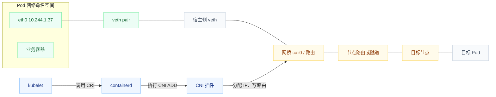
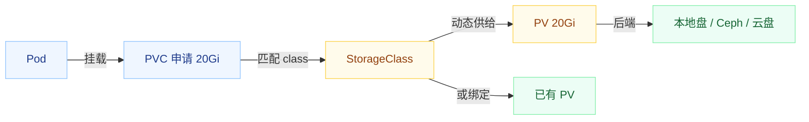

# Kubernetes网络存储与调度

> 这篇从 Pod 网络模型和 CNI 讲起，经过 Calico 与 Cilium 的落地、NetworkPolicy 的最小放行、PV/PVC 与 StorageClass、亲和性与污点调度、探针与 HPA，最后落到按现象查命令的现场手册和一次多租户集群加固。
>
> 学完能规划集群网段与 MTU，用 NetworkPolicy 做命名空间隔离，为有状态应用提供可扩容的持久卷，把 Pod 约束到正确的节点，并用探针与 HPA 让服务在负载变化下保持可用。

## 一、Pod 网络模型与 CNI

Kubernetes 对网络只提四条要求：每个 Pod 有独立 IP；所有 Pod 之间可以直接通信，不做 NAT；节点与 Pod 之间可以直接通信；Pod 看到的自己的 IP 和别人看到的同一个 IP。满足这四条，应用就不需要关心自己跑在哪。

把这四条翻成运维语言：集群需要一个扁平的、可路由的 Pod 网段，跨节点转发由 CNI 负责，Service 的虚拟 IP 由 kube-proxy 或 eBPF 负责，二者互不替代。

### 1.1 三类地址与网段规划

集群里有三种地址，规划阶段必须一次定好，上线后改任何一种都要重建集群。

| 地址类型 | 示例 | 作用 | 规划要点 |
|---|---|---|---|
| 节点网段 | 10.0.0.0/24 | 主机互通、apiserver 访问 | 与办公网、云 VPC 不重叠 |
| Pod 网段 | 10.244.0.0/16 | 每个 Pod 一个 IP | 与节点网段、Service 网段不重叠 |
| Service 网段 | 10.96.0.0/12 | 虚拟 IP，不落到网卡 | 不与前两者重叠 |

容量估算按“节点数 × 每节点最大 Pod 数”算。Calico 默认给每个节点分一个 `/26` 的 block（62 个地址），`/16` 的池最多容纳 1024 个 block；节点多、Pod 密度低时把 `blockSize` 调到 27（每块 30 个地址）更省地址，节点少、Pod 密度高时调到 25 减少路由条目。

```bash
# 核对 kubeadm 写进控制面的网段，改 CNI 前先确认三者一致
kubectl -n kube-system get cm kubeadm-config -o yaml | grep -A3 networking
kubectl -n kube-system get cm kube-proxy -o yaml | grep clusterCIDR
kubectl get nodes -o jsonpath='{range .items[*]}{.metadata.name}{"\t"}{.spec.podCIDR}{"\n"}{end}'
```

预期输出：

```text
cp-01   10.244.0.0/24
node-01 10.244.1.0/24
node-02 10.244.2.0/24
```

> 边界：Pod 网段和 Service 网段一旦有重叠，kube-proxy 的 DNAT 规则会把去 Pod 的流量误判成去 Service，表现为“某些 Pod 永远连不上”。这类故障排查成本极高，规划时用脚本比对 CIDR，不要靠肉眼。

### 1.2 CNI 的工作方式

CNI 是一个二进制插件规范，不是守护进程。kubelet 创建 Pod 沙箱时通过 CRI 调 containerd，containerd 再调用 `/opt/cni/bin` 下的插件，插件读 `/etc/cni/net.d` 里的配置，完成 veth 创建、IP 分配和路由写入。



几个直接影响排障的点：

- Pod 内的 `eth0` 与宿主侧的 veth 是一对，抓包要抓宿主侧才能看到完整帧；
- 跨节点转发靠路由（BGP）或隧道（VXLAN/IPIP），两种方式的 MTU 和故障表现不同；
- CNI 只在 Pod 创建/删除时被调用，网络规则运行期由 CNI 的守护进程维护，`calico-node` 或 `cilium-agent` 挂了，新 Pod 起不来、旧 Pod 间可能还能通。

```bash
# 看节点上装了哪些 CNI 插件与当前生效配置
ls /opt/cni/bin
ls /etc/cni/net.d/
sudo cat /etc/cni/net.d/10-calico.conflist | head -40
```

### 1.3 MTU：最隐蔽的网络故障源

Pod 的 MTU 必须等于底层网络 MTU 减去封装开销，配大了会出现“小请求正常、大响应卡死”的经典现象。

| 封装方式 | 额外开销 | 底层 1500 时的 Pod MTU |
|---|---|---|
| 无封装（BGP 直路由） | 0 | 1500 |
| IPIP | 20 字节 | 1480 |
| VXLAN | 50 字节 | 1450 |
| WireGuard | 60 字节 | 1440 |

故障表现很有辨识度：`curl` 能建立连接、`ping` 小包正常，但 HTTPS 握手或返回大 JSON 时挂住，服务端日志没有请求记录。原因是中间设备丢弃了不分片的超 MTU 包，而 Path MTU Discovery 被防火墙 ICMP 屏蔽。

```bash
# 1422 + 28 字节 ICMP/IP 头 = 1450，正好等于 VXLAN 下的 Pod MTU，能通说明配置正确
kubectl exec -it web-abc -- ping -M do -s 1422 -c 2 10.244.2.19
# 再加 1 字节应返回 Frag needed，这个分界点就是路径可用的最大载荷
kubectl exec -it web-abc -- ping -M do -s 1423 -c 2 10.244.2.19
```

Calico 的 MTU 由 operator 自动按节点网卡推断，跨云或隧道叠加时会算错，需要显式指定：

```yaml
apiVersion: operator.tigera.io/v1
kind: Installation
metadata:
  name: default
spec:
  calicoNetwork:
    mtu: 1400            # 显式覆盖，避免自动探测在多云链路上偏大
```

> 边界：不要为了“能通”把 MTU 一路调小到 1200，分片增多会显著降低吞吐。正确做法是找到路径真实 MTU，只减封装开销；跨公网或跨云专线时按最小链路算。

### 1.4 Calico、Cilium 与 Flannel 的取舍

| 方案 | 数据面 | NetworkPolicy | 适用规模 |
|---|---|---|---|
| Flannel | VXLAN/host-gw | 不支持 | 小集群、只需连通 |
| Calico | BGP/IPIP/VXLAN | 支持，含全局策略 | 中大集群、混合云 |
| Cilium | eBPF | 支持，可到七层 | 大集群、要可观测性 |

选型的判断顺序：需要网络策略就不能选 Flannel；底层网络能与交换机做 BGP 就选 Calico 无封装，性能最好；需要七层策略、Hubble 可观测、替代 kube-proxy 就选 Cilium，但要接受内核版本与排障门槛。

## 二、CNI 落地：Calico 与 Cilium

装 CNI 不是“apply 一个 yaml 就完事”，要确认 IPPool 与 kubeadm 一致、每个节点都有 agent、跨节点真的能通。

### 2.1 Calico 安装与 IPPool

```bash
kubectl create -f https://raw.githubusercontent.com/projectcalico/calico/v3.30.3/manifests/tigera-operator.yaml
kubectl -n tigera-operator rollout status deploy/tigera-operator --timeout=180s
```

```yaml
# custom-resources.yaml
apiVersion: operator.tigera.io/v1
kind: Installation
metadata:
  name: default
spec:
  variant: Calico
  calicoNetwork:
    ipPools:
      - name: default-ipv4-ippool
        cidr: 10.244.0.0/16        # 必须等于 kubeadm 的 podSubnet
        blockSize: 26              # 默认值：每节点 62 个地址；节点多时可调到 27 省地址
        encapsulation: VXLAN       # 底层不支持 BGP 时的通用选择
        natOutgoing: Enabled
        nodeSelector: all()
```

```bash
kubectl apply -f custom-resources.yaml
kubectl get tigerastatus
kubectl -n calico-system get pod -o wide
```

预期输出：

```text
NAME                          STATUS   AGE
apiserver                     True     4m
calico                        True     4m
ippools                       True     4m
...

NAME                                       READY   STATUS    NODE
calico-kube-controllers-6b7f9c8d5b-4xk2p   1/1     Running   cp-01
calico-node-2m9qt                          1/1     Running   cp-01
calico-node-7p4lw                          1/1     Running   node-01
calico-node-x8d3n                          1/1     Running   node-02
```

跨节点连通性验证，先让两个 Pod 落在不同节点（未加调度约束时可能同节点，可删掉一个等它重建）：

```bash
kubectl create deploy netcheck --image=nicolaka/netshoot --replicas=2 -- sleep 3600
kubectl get pod -l app=netcheck -o wide
kubectl exec -it netcheck-xxx -- ping -c 2 <另一个 Pod IP>
```

预期输出：

```text
PING 10.244.2.19 (10.244.2.19) 56(84) bytes of data.
64 bytes from 10.244.2.19: icmp_seq=1 ttl=62 time=0.412 ms
64 bytes from 10.244.2.19: icmp_seq=2 ttl=62 time=0.398 ms
2 packets transmitted, 2 received, 0% packet loss
```

看 IPAM 与路由，确认地址分配没有跨节点重复：

```bash
calicoctl ipam show --show-blocks
calicoctl get ippool -o wide
ip route | grep 10.244
```

### 2.2 BGP 模式：去掉封装开销

底层是同一广播域或交换机支持 BGP 时，用无封装直路由，Pod 流量不额外加 50 字节头，吞吐更高。

```yaml
apiVersion: operator.tigera.io/v1
kind: Installation
metadata:
  name: default
spec:
  calicoNetwork:
    ipPools:
      - name: default-ipv4-ippool
        cidr: 10.244.0.0/16
        encapsulation: None        # 依赖底层路由，配错就直接不通
        natOutgoing: Enabled
        nodeSelector: all()
```

与交换机建 BGP 邻居：

```yaml
apiVersion: projectcalico.org/v3
kind: BGPPeer
metadata:
  name: tor-switch
spec:
  peerIP: 10.0.0.1
  asNumber: 64512
  nodeSelector: all()
```

> 边界：`encapsulation: None` 要求节点网段与 Pod 网段在底层可路由，跨网段或跨云必须用隧道。切模式会重建路由，已有连接短暂中断，变更窗口内先摘流量。

### 2.3 Cilium：eBPF 数据面

Cilium 用 eBPF 替代 iptables，可同时替代 kube-proxy，并提供 Hubble 做流量可观测。

```bash
helm repo add cilium https://helm.cilium.io
helm repo update
helm install cilium cilium/cilium --version 1.18.3 \
  --namespace kube-system \
  --set kubeProxyReplacement=true \
  --set k8sServiceHost=10.0.0.10 \
  --set k8sServicePort=6443 \
  --set ipam.mode=kubernetes \
  --set routingMode=tunnel \
  --set tunnelProtocol=vxlan \
  --set hubble.enabled=true \
  --set hubble.relay.enabled=true \
  --set hubble.ui.enabled=true
```

`k8sServiceHost` 必须是 apiserver 地址，写错会导致 agent 起不来——此时 kube-proxy 已经被替代，集群 DNS 和 Service 全部不可用，只能改 Helm values 重新升级。替代模式装好后要删掉 kube-proxy，两套数据面不能并存：

```bash
kubectl -n kube-system delete ds kube-proxy
```

```bash
kubectl -n kube-system rollout status ds/cilium --timeout=300s
cilium status --wait
cilium connectivity test
```

预期输出：

```text
    /¯¯\
 /¯¯\__/¯¯\    Cilium:             OK
 \__/¯¯\__/    Operator:           OK
 /¯¯\__/¯¯\    Envoy DaemonSet:    OK
 \__/¯¯\__/    Hubble Relay:       OK
    \__/       ClusterMesh:        disabled

Deployment             cilium-operator    Desired: 2, Ready: 2/2, Available: 2/2
DaemonSet              cilium             Desired: 3, Ready: 3/3, Available: 3/3
```

> 边界：Cilium 需要内核 5.10 以上，生产建议 5.15+；从 kube-proxy 切到完全替代要一次完成，不能两套并存。先在预发集群跑 `cilium connectivity test` 全绿再动生产。

### 2.4 装完的验收项

- 每个节点一个 CNI agent，`RESTARTS` 为 0；
- 跨节点 Pod 互通，`ping` 丢包为 0；
- IPPool 与 kubeadm 的 `podSubnet` 完全一致；
- Pod 内 `ip addr` 的 MTU 与规划值一致；
- DNS 正常，`nslookup kubernetes.default` 返回 ClusterIP；
- 节点 `NotReady` 已消失，`kubectl get nodes` 全部 Ready。

## 三、NetworkPolicy：默认拒绝与最小放行

NetworkPolicy 是白名单：一旦某个 Pod 被策略选中，只有策略允许的流量能进出。策略是加法的，多条策略取并集，没有“拒绝优先”的概念。

### 3.1 策略语义

```yaml
apiVersion: networking.k8s.io/v1
kind: NetworkPolicy
metadata:
  name: allow-portal
  namespace: demo
spec:
  podSelector:
    matchLabels:
      app.kubernetes.io/name: portal   # 空 selector 表示本 namespace 全部 Pod
  policyTypes: ["Ingress", "Egress"]
  ingress:
    - from:
        - namespaceSelector:           # 按 namespace 标签选，不是按名字
            matchLabels:
              kubernetes.io/metadata.name: ingress-nginx
      ports:
        - protocol: TCP
          port: 8080
  egress:
    - to:
        - namespaceSelector:
            matchLabels:
              kubernetes.io/metadata.name: kube-system
      ports:
        - protocol: UDP
          port: 53                     # 不放行 DNS，Pod 内所有域名解析都会超时
```

关键规则：

- `namespaceSelector` 匹配的是 namespace 的标签，Kubernetes 自动给每个 namespace 打 `kubernetes.io/metadata.name`，可以直接按名字选；
- `from` 里同时写 `namespaceSelector` 和 `podSelector` 是“与”关系，写在两个列表项里是“或”关系；
- 只写 `policyTypes: ["Ingress"]` 不会影响出向流量，默认拒绝必须显式包含 `Egress`；
- 策略只对同 namespace 的 Pod 生效于 `podSelector` 选中的对象，跨 namespace 必须用 `namespaceSelector`。

### 3.2 默认拒绝与最小放行

先全拒，再逐条放行。顺序不能反：先放行后全拒，中间会有一段“看起来正常”的窗口，容易漏掉依赖。

```yaml
# default-deny.yaml
apiVersion: networking.k8s.io/v1
kind: NetworkPolicy
metadata:
  name: default-deny-all
  namespace: demo
spec:
  podSelector: {}          # 选中本 namespace 所有 Pod
  policyTypes: ["Ingress", "Egress"]
---
# 02-allow-dns.yaml
apiVersion: networking.k8s.io/v1
kind: NetworkPolicy
metadata:
  name: allow-dns
  namespace: demo
spec:
  podSelector: {}
  policyTypes: ["Egress"]
  egress:
    - to:
        - namespaceSelector:
            matchLabels:
              kubernetes.io/metadata.name: kube-system
      ports:
        - protocol: UDP
          port: 53
        - protocol: TCP
          port: 53          # 响应超过 512 字节会走 TCP，只放 UDP 会偶发解析失败
---
# 03-allow-ingress.yaml
apiVersion: networking.k8s.io/v1
kind: NetworkPolicy
metadata:
  name: allow-ingress-controller
  namespace: demo
spec:
  podSelector:
    matchLabels:
      app.kubernetes.io/name: portal
  policyTypes: ["Ingress"]
  ingress:
    - from:
        - namespaceSelector:
            matchLabels:
              kubernetes.io/metadata.name: ingress-nginx
      ports:
        - protocol: TCP
          port: 8080
---
# 04-allow-app-to-redis.yaml
apiVersion: networking.k8s.io/v1
kind: NetworkPolicy
metadata:
  name: allow-portal-to-redis
  namespace: demo
spec:
  podSelector:
    matchLabels:
      app: redis
  policyTypes: ["Ingress"]
  ingress:
    - from:
        - podSelector:
            matchLabels:
              app.kubernetes.io/name: portal
      ports:
        - protocol: TCP
          port: 6379
```

验证拒绝与放行，两个方向都要测：

```bash
# 从 staging 命名空间访问 demo 的 portal，应当超时
kubectl -n staging run probe --rm -it --image=nicolaka/netshoot --restart=Never -- \
  curl -s --max-time 3 http://portal.demo.svc.cluster.local/healthz; echo "exit=$?"

# 从 ingress-nginx 控制器访问，应当 200
kubectl -n ingress-nginx exec deploy/ingress-nginx-controller -- \
  curl -s --max-time 3 http://portal.demo.svc.cluster.local/healthz
```

预期输出：

```text
curl: (28) Connection timed out after 3001 milliseconds
exit=28
ok
```

> 边界：NetworkPolicy 需要 CNI 支持，Flannel 会静默忽略策略——`kubectl get netpol` 有对象但完全不生效。排查第一步永远是确认 CNI 类型，而不是怀疑策略写错。

### 3.3 Calico 与 Cilium 的扩展策略

Calico 的 `GlobalNetworkPolicy` 跨 namespace、支持优先级和显式 Deny，适合做集群级基线；Cilium 的 `CiliumNetworkPolicy` 支持七层，可以按 HTTP 方法和路径放行。

```yaml
# Calico：集群级基线，先拒绝所有出公网，再按需放行
apiVersion: projectcalico.org/v3
kind: GlobalNetworkPolicy
metadata:
  name: deny-egress-internet
spec:
  order: 1000                 # 数字小的先匹配，命中即停
  selector: projectcalico.org/namespace != "kube-system"
  types: ["Egress"]
  egress:
    - action: Deny
      destination:
        nets: ["0.0.0.0/0"]
    - action: Allow
```

```yaml
# Cilium：只允许 GET /api/v1/products，其余方法拒绝
apiVersion: cilium.io/v2
kind: CiliumNetworkPolicy
metadata:
  name: portal-l7
  namespace: demo
spec:
  endpointSelector:
    matchLabels:
      app.kubernetes.io/name: portal
  ingress:
    - fromEndpoints:
        - matchLabels:
            k8s:io.kubernetes.pod.namespace: ingress-nginx
      toPorts:
        - ports:
            - port: "8080"
              protocol: TCP
          rules:
            http:
              - method: GET
                path: "^/api/v1/products.*$"
```

> 边界：七层策略把流量导进 Envoy，增加一跳和内存开销，只在确有需要时用；Calico 的 `Deny` 与 Kubernetes 原生策略混用时，原生策略仍按并集计算，不要指望用 Deny 覆盖原生 Allow。

### 3.4 上策略的顺序

生产环境的策略上线分三步，任何一步跳过都会造成事故：

1. 先用 Cilium 的策略审计模式或 Calico 的 `staged` 策略观察流量，拿到真实依赖清单；
2. 在预发按“默认拒绝 + 放行”跑一周，重点看 DNS、监控抓取、健康检查三类流量；
3. 生产先只对无状态服务开启，再扩到有状态服务，最后覆盖 kube-system 以外的全部 namespace。

最容易漏的四类放行：

| 漏掉的流量 | 表现 | 放行对象 |
|---|---|---|
| DNS | 所有域名解析超时，IP 访问正常 | kube-system 53 |
| 监控抓取 | Prometheus target down | monitoring 到业务端口 |
| 探针 | Pod 反复重启，日志无请求 | kubelet 所在节点网段 |
| 同 namespace 调用 | 部分接口 500 | 同 ns 的 podSelector |

## 四、持久化存储

容器文件系统随容器删除而消失，持久化靠 Volume。临时数据用 `emptyDir`，需要跨 Pod 重建保留的数据用 PVC。

### 4.1 Volume 类型与边界

| 类型 | 生命周期 | 适用 |
|---|---|---|
| emptyDir | 随 Pod 删除 | 缓存、临时文件、同 Pod 共享 |
| hostPath | 随节点 | 节点级代理、仅限受控场景 |
| configMap / secret | 随对象 | 配置文件注入 |
| PVC | 独立于 Pod | 数据库、上传文件、消息队列 |

> 边界：`hostPath` 把 Pod 绑死在节点上，且容器逃逸后可直接写宿主文件系统，生产只在 DaemonSet 采集类场景使用，并配 `readOnly`。

### 4.2 PV、PVC 与 StorageClass

PV 是集群级存储资源，PVC 是 namespace 级的申请，StorageClass 决定由谁、怎么供给。



访问模式决定能不能多点挂载：

| 模式 | 含义 | 典型后端 |
|---|---|---|
| ReadWriteOnce | 单节点读写 | 云盘、本地盘 |
| ReadOnlyMany | 多节点只读 | NFS、CephFS |
| ReadWriteMany | 多节点读写 | NFS、CephFS、对象存储 CSI |
| ReadWriteOncePod | 单 Pod 读写 | 1.22+，块存储 |

回收策略决定 PVC 删除后数据怎么办：`Retain` 保留 PV 和数据，需手工清理；`Delete` 连带删除后端卷；`Recycle` 已废弃，不要用。

静态供给示例，本地盘适合做实验和边缘节点：

```yaml
apiVersion: v1
kind: PersistentVolume
metadata:
  name: pv-local-01
spec:
  capacity:
    storage: 50Gi
  accessModes: ["ReadWriteOnce"]
  persistentVolumeReclaimPolicy: Retain   # 误删 PVC 时数据还在，可人工恢复
  storageClassName: local-disk
  local:
    path: /data/k8s/pv01                  # 必须预先在节点上创建
  nodeAffinity:                           # 本地盘与节点绑定，Pod 只能调度到这台
    required:
      nodeSelectorTerms:
        - matchExpressions:
            - key: kubernetes.io/hostname
              operator: In
              values: ["node-01"]
---
apiVersion: v1
kind: PersistentVolumeClaim
metadata:
  name: data-redis-0
  namespace: demo
spec:
  accessModes: ["ReadWriteOnce"]
  storageClassName: local-disk
  resources:
    requests:
      storage: 20Gi
```

### 4.3 动态供给与 StorageClass

生产用 CSI 驱动动态供给，不再手写 PV。下面是本地盘供给器，适合单机或实验环境：

```bash
kubectl apply -f https://raw.githubusercontent.com/rancher/local-path-provisioner/v0.0.31/deploy/local-path-storage.yaml
kubectl -n local-path-storage rollout status deploy/local-path-provisioner
```

```yaml
apiVersion: storage.k8s.io/v1
kind: StorageClass
metadata:
  name: local-path
  annotations:
    storageclass.kubernetes.io/is-default-class: "true"   # 不写 storageClassName 的 PVC 用它
provisioner: rancher.io/local-path
reclaimPolicy: Delete
volumeBindingMode: WaitForFirstConsumer   # 等 Pod 调度后再建卷，避免卷和节点对不上
allowVolumeExpansion: true
```

`volumeBindingMode` 是最容易配错的一项：

- `Immediate`：PVC 一创建就建卷，适合云盘这类与节点无关的后端；
- `WaitForFirstConsumer`：Pod 调度后才建卷，本地盘和可用区云盘必须用它，否则 Pod 可能被调度到没有卷的节点。

验证供给链路：

```bash
kubectl -n demo apply -f - <<'EOF'
apiVersion: v1
kind: PersistentVolumeClaim
metadata:
  name: data-redis-0
spec:
  accessModes: ["ReadWriteOnce"]
  storageClassName: local-path
  resources:
    requests:
      storage: 1Gi
EOF

kubectl -n demo get pvc
kubectl -n demo get pv | grep demo
```

预期输出（`WaitForFirstConsumer` 下 PVC 先 Pending，是正常的）：

```text
NAME           STATUS    VOLUME   CAPACITY   ACCESS MODES   STORAGECLASS
data-redis-0   Pending                                      local-path
```

起一个 Pod 挂载后变 Bound：

```bash
kubectl -n demo run writer --image=busybox:1.36 --restart=Never \
  --overrides='{"spec":{"containers":[{"name":"writer","image":"busybox:1.36","command":["sh","-c","echo hello > /data/probe.txt; sleep 3600"],"volumeMounts":[{"name":"d","mountPath":"/data"}]}],"volumes":[{"name":"d","persistentVolumeClaim":{"claimName":"data-redis-0"}}]}}'
kubectl -n demo get pvc data-redis-0
kubectl -n demo exec writer -- cat /data/probe.txt
```

预期输出：

```text
NAME           STATUS   VOLUME                                     CAPACITY
data-redis-0   Bound    pvc-3f1a9c2e-8b7d-4f21-9a3c-5d6e7f8a9b0c   1Gi

hello
```

扩容要 StorageClass 允许，且文件系统支持在线扩容：

```bash
kubectl -n demo patch pvc data-redis-0 -p '{"spec":{"resources":{"requests":{"storage":"5Gi"}}}}'
kubectl -n demo get pvc data-redis-0 -o jsonpath='{.status.capacity.storage}{"\n"}'
```

> 边界：扩容只能增不能减；`allowVolumeExpansion` 为 false 时 patch 会被拒绝；本地盘的文件系统扩容要在 Pod 重建后由 kubelet 完成，不是立即生效。

### 4.4 StatefulSet 的数据生命周期

StatefulSet 用 `volumeClaimTemplates` 给每个副本生成独立 PVC，命名规则是 `<模板名>-<pod名>`，重建 Pod 会挂回同一块。

```yaml
apiVersion: apps/v1
kind: StatefulSet
metadata:
  name: redis
  namespace: demo
spec:
  serviceName: redis-headless
  replicas: 3
  podManagementPolicy: OrderedReady
  template:
    metadata:
      labels:
        app: redis
    spec:
      containers:
        - name: redis
          image: redis:7.4-alpine
          command: ["redis-server", "--appendonly", "yes"]
          ports:
            - name: redis
              containerPort: 6379
          volumeMounts:
            - name: data
              mountPath: /data
  volumeClaimTemplates:
    - metadata:
        name: data
      spec:
        accessModes: ["ReadWriteOnce"]
        storageClassName: local-path
        resources:
          requests:
            storage: 5Gi
```

删除 StatefulSet 不会删 PVC，这是保护数据的默认行为。缩容时也只删编号最大的副本，PVC 保留，扩容回来还能接上。

```bash
kubectl -n demo get pvc -l app=redis
kubectl -n demo delete sts redis --cascade=orphan   # 只删控制器，保留 Pod 与 PVC
```

快照与备份用 VolumeSnapshot，依赖 CSI 驱动支持：

```yaml
apiVersion: snapshot.storage.k8s.io/v1
kind: VolumeSnapshot
metadata:
  name: redis-0-20261113
  namespace: demo
spec:
  volumeSnapshotClassName: csi-snapclass
  source:
    persistentVolumeClaimName: data-redis-0
```

> 边界：快照不等于备份。快照与源卷通常在同一存储系统，存储故障时一起丢；数据库要在快照前做一致性动作（如 `BGSAVE` 或锁表），否则恢复出来是崩溃一致性状态。

## 五、调度：把 Pod 放到正确节点

调度分两步：过滤掉不满足硬条件的节点，再给剩下的节点打分。requests、污点、亲和性属于硬条件，打分区属于软偏好。

### 5.1 节点容量与 requests

调度只看 `requests`，不看实际使用。节点“CPU 很闲”但 requests 已满时，新 Pod 必然 Pending。

```bash
kubectl describe node node-01 | sed -n '/Allocated resources/,/Events/p'
```

预期输出：

```text
Allocated resources:
  Resource           Requests      Limits
  cpu                2350m (58%)   4000m (100%)
  memory             3Gi (38%)     6Gi (75%)
```

`Allocated resources` 是已分配的 requests，不等于调度可用量。真正的上限看 `Allocatable`：

```bash
kubectl describe node node-01 | sed -n '/^Capacity:/,/^System Info/p'
```

```text
Capacity:
  cpu:                4
  memory:             8123456Ki
Allocatable:
  cpu:                3920m
  memory:             7745024Ki
```

`Allocatable` 才是调度可用量，差额来自 `kubeReserved` 与 `systemReserved`。这两个值不设，系统进程会和业务抢资源，节点容易失联。

### 5.2 nodeSelector 与节点亲和

`nodeSelector` 只支持等值匹配，节点亲和支持集合运算和软偏好。

```yaml
spec:
  nodeSelector:
    disktype: ssd                  # 简单等值，节点必须有这个标签
  affinity:
    nodeAffinity:
      requiredDuringSchedulingIgnoredDuringExecution:   # 硬条件，不满足就 Pending
        nodeSelectorTerms:
          - matchExpressions:
              - key: topology.kubernetes.io/zone
                operator: In
                values: ["az-a", "az-b"]
      preferredDuringSchedulingIgnoredDuringExecution:  # 软偏好，尽量满足
        - weight: 80
          preference:
            matchExpressions:
              - key: node-type
                operator: In
                values: ["memory-optimized"]
```

```bash
kubectl label node node-01 disktype=ssd
kubectl label node node-02 topology.kubernetes.io/zone=az-b
kubectl get nodes -L disktype -L topology.kubernetes.io/zone
```

> 边界：`IgnoredDuringExecution` 意味着标签在 Pod 运行后被改掉，Pod 不会被驱逐。要强制迁移必须配合污点或主动 drain。

### 5.3 污点与容忍

污点打在节点上，表示“不欢迎某类 Pod”；容忍写在 Pod 上，表示“我能接受”。这是节点专用的标准做法。

| effect | 含义 | 典型用途 |
|---|---|---|
| NoSchedule | 新 Pod 不调度 | 专用节点、维护 |
| PreferNoSchedule | 尽量不调度 | 软隔离 |
| NoExecute | 驱逐不容忍的存量 Pod | 节点下线、故障隔离 |

```bash
# 给节点打专用污点
kubectl taint node node-02 dedicated=cache:NoSchedule
kubectl describe node node-02 | grep Taints

# 去掉污点（末尾减号）
kubectl taint node node-02 dedicated=cache:NoSchedule-
```

```yaml
spec:
  tolerations:
    - key: dedicated
      operator: Equal
      value: cache
      effect: NoSchedule
  nodeSelector:
    kubernetes.io/hostname: node-02    # 容忍只是“允许”，还要选过去才会落在这台
```

> 边界：容忍不等于绑定。只写容忍，Pod 仍可能被调度到别的节点；专用节点要“污点 + 容忍 + nodeSelector 或亲和”三件套。`NoExecute` 的 `tolerationSeconds` 控制被驱逐前的宽限时间。

### 5.4 Pod 亲和与反亲和

反亲和用于把副本打散，亲和用于把有调用关系的服务放近。

```yaml
spec:
  affinity:
    podAntiAffinity:
      requiredDuringSchedulingIgnoredDuringExecution:   # 硬反亲和：每节点最多一个
        - labelSelector:
            matchLabels:
              app.kubernetes.io/name: portal
          topologyKey: kubernetes.io/hostname
```

硬反亲和的坑：副本数大于可用节点数时，多出来的 Pod 永远 Pending。3 副本、2 个 worker 的集群会稳定挂一个。

```bash
kubectl get events -A --field-selector reason=FailedScheduling --sort-by=.lastTimestamp | tail -5
```

软反亲和更安全，但只是“尽量”：

```yaml
    podAntiAffinity:
      preferredDuringSchedulingIgnoredDuringExecution:
        - weight: 100
          podAffinityTerm:
            labelSelector:
              matchLabels:
                app.kubernetes.io/name: portal
            topologyKey: kubernetes.io/hostname
```

> 边界：`topologyKey` 写 `kubernetes.io/hostname` 是跨节点，写 `topology.kubernetes.io/zone` 是跨可用区。跨可用区反亲和需要节点真的有 zone 标签，否则所有 Pod 都被视为同一拓扑域，反亲和失效。

### 5.5 拓扑分布约束

`topologySpreadConstraints` 是反亲和的升级版，能控制“不均匀程度”，比硬反亲和更适合多副本服务。

```yaml
spec:
  topologySpreadConstraints:
    - maxSkew: 1                       # 任意两个拓扑域的数量差不超过 1
      topologyKey: kubernetes.io/hostname
      whenUnsatisfiable: DoNotSchedule # 硬约束；ScheduleAnyway 是软约束
      labelSelector:
        matchLabels:
          app.kubernetes.io/name: portal
      minDomains: 2                    # 可用域少于 2 时不调度，避免全挤一台
```

对比三种打散方式：

| 方式 | 控制粒度 | 副本多于节点时 |
|---|---|---|
| 硬反亲和 | 每域最多一个 | 多余副本 Pending |
| 软反亲和 | 尽量打散 | 允许堆叠 |
| 拓扑分布 | 数量差不超过 maxSkew | 自动均衡，可容忍堆叠 |

### 5.6 优先级与抢占

资源紧张时，高优先级 Pod 可以驱逐低优先级 Pod 获得位置。

```yaml
apiVersion: scheduling.k8s.io/v1
kind: PriorityClass
metadata:
  name: critical-api
value: 1000000            # 越大越优先，超过 10 亿是系统保留
globalDefault: false
preemptionPolicy: PreemptLowerPriority
description: "核心 API，资源紧张时允许抢占批处理任务"
```

```yaml
spec:
  priorityClassName: critical-api
```

> 边界：抢占会直接删除低优先级 Pod，且不遵守 PDB；批处理任务要用低优先级并设置 `preemptionPolicy: Never`，避免互相踩踏。抢占只解决调度，不解决容量，长期靠扩容。

### 5.7 调度结果验证

```bash
kubectl -n demo get pod -o wide
kubectl -n demo describe pod web-abc | sed -n '/Node-Selectors/,/Events/p'
kubectl -n kube-system logs deploy/kube-scheduler --tail=50 | grep -i "web-abc"
```

判断顺序：Pending 先看 Events 里的 `FailedScheduling`，它会直接写出是资源、污点还是亲和性；已调度但起不来，问题在 kubelet 和镜像，不在调度器。

## 六、探针与健康检查

探针决定三件事：什么时候接流量、什么时候重启、什么时候算启动完成。配错探针造成的故障，比不配探针更多。

### 6.1 三种探针的职责

| 探针 | 失败后果 | 检查内容 |
|---|---|---|
| startupProbe | 重启容器 | 启动是否完成 |
| readinessProbe | 从 Service 端点摘除 | 能否处理请求 |
| livenessProbe | 重启容器 | 进程是否还活着 |

启动慢的应用必须配 `startupProbe`，否则 `livenessProbe` 会在启动阶段把容器反复杀掉，表现为“永远起不来”。

```yaml
containers:
  - name: api
    image: registry.example.com/api:1.4.2
    startupProbe:
      httpGet:
        path: /healthz
        port: 8080
      failureThreshold: 30        # 30 × 2s = 最多等 60 秒启动
      periodSeconds: 2
    readinessProbe:
      httpGet:
        path: /readyz             # 只检查“能否接流量”，不要查下游依赖
        port: 8080
      periodSeconds: 5
      failureThreshold: 2
    livenessProbe:
      httpGet:
        path: /healthz            # 只检查进程自身，不要查数据库
        port: 8080
      periodSeconds: 10
      failureThreshold: 5         # 50 秒才判定死亡，避免抖动误杀
      timeoutSeconds: 3
```

### 6.2 参数与典型错误

| 参数 | 含义 | 常见错误 |
|---|---|---|
| periodSeconds | 检查间隔 | 设 1 秒，开销大且抖动 |
| timeoutSeconds | 单次超时 | 小于应用 P99，正常慢请求被判失败 |
| failureThreshold | 连续失败次数 | 1 次就重启，流量抖动导致雪崩 |
| successThreshold | 连续成功次数 | 就绪探针设大于 1，恢复变慢 |

四类高频错误：

- **liveness 查数据库**：数据库抖动时全部 Pod 同时重启，故障放大成雪崩；
- **readiness 查下游**：下游一慢，整条链路被摘流量，容量瞬间归零；
- **没有 startupProbe**：JVM 应用启动 40 秒，liveness 5 秒就杀，无限重启；
- **exec 探针太频繁**：每次 fork 一个进程，节点 CPU 被探针吃掉，改用 httpGet。

### 6.3 gRPC 与 exec 探针

gRPC 服务用原生 gRPC 探针，要求服务实现标准健康检查协议：

```yaml
    livenessProbe:
      grpc:
        port: 9090
        service: ""        # 空表示整体健康，也可指定子服务名
      periodSeconds: 10
```

没有 HTTP 接口的命令行工具只能用 exec，代价是每次检查都 fork：

```yaml
    readinessProbe:
      exec:
        command: ["/bin/sh", "-c", "test -f /tmp/ready"]
      periodSeconds: 10
      timeoutSeconds: 2
```

> 边界：exec 探针在容器资源吃紧时可能超时，被判失败后重启，形成“越忙越重启”的循环。能用 HTTP 就不要用 exec；必须用时把 `timeoutSeconds` 放大到 5 秒以上。

### 6.4 与滚动更新、PDB 的联动

`minReadySeconds` 要求新 Pod 就绪后稳定一段时间才算可用，防止“起来了但马上崩”的版本一路滚完。

```yaml
spec:
  minReadySeconds: 10
  strategy:
    rollingUpdate:
      maxUnavailable: 0
      maxSurge: 1
```

PDB 保证自愿中断（drain、升级）时仍有足够副本：

```yaml
apiVersion: policy/v1
kind: PodDisruptionBudget
metadata:
  name: portal-pdb
  namespace: demo
spec:
  minAvailable: 2          # 3 副本至少留 2 个可用，或改用 maxUnavailable: 1
  selector:
    matchLabels:
      app.kubernetes.io/name: portal
```

```bash
kubectl -n demo get pdb
kubectl -n demo describe pdb portal-pdb | grep -A2 Disruptions
```

预期输出：

```text
NAME         MIN AVAILABLE   ALLOWED DISRUPTIONS   AGE
portal-pdb   2               1                     5m

Disruptions:  Allowed disruptions: 1
```

> 边界：PDB 只约束 `drain` 这类自愿中断，不阻止节点宕机和 OOM 驱逐；`minAvailable` 等于副本数会让 drain 永久阻塞，升级前先核对。

## 七、HPA 与弹性伸缩

HPA 按指标调整副本数，前提是 Pod 设了 requests、metrics-server 正常、指标能被采集到。

### 7.1 metrics-server

```bash
helm repo add metrics-server https://kubernetes-sigs.github.io/metrics-server/
helm install metrics-server metrics-server/metrics-server \
  -n kube-system --set args={--kubelet-insecure-tls}
kubectl -n kube-system rollout status deploy/metrics-server
kubectl top nodes
kubectl top pods -n demo
```

预期输出：

```text
NAME      CPU(cores)   CPU%   MEMORY(bytes)   MEMORY%
cp-01     312m         7%     2140Mi          27%
node-01   180m         4%     1520Mi          19%

NAME                      CPU(cores)   MEMORY(bytes)
portal-6b8c7f9d4b-4m2xk   8m           22Mi
portal-6b8c7f9d4b-9pq7t   7m           21Mi
```

`--kubelet-insecure-tls` 只用于自签证书的实验集群，生产要给 kubelet 配可信证书。

### 7.2 HPA v2 配置

```yaml
apiVersion: autoscaling/v2
kind: HorizontalPodAutoscaler
metadata:
  name: portal
  namespace: demo
spec:
  scaleTargetRef:
    apiVersion: apps/v1
    kind: Deployment
    name: portal
  minReplicas: 3
  maxReplicas: 12
  metrics:
    - type: Resource
      resource:
        name: cpu
        target:
          type: Utilization
          averageUtilization: 60     # 按 requests 的百分比算，不是节点使用率
  behavior:
    scaleUp:
      stabilizationWindowSeconds: 0   # 扩容要快，立刻响应
      policies:
        - type: Percent
          value: 100                  # 一次最多翻倍，防止瞬间打满
          periodSeconds: 60
    scaleDown:
      stabilizationWindowSeconds: 300 # 缩容要慢，5 分钟内取最大值，避免抖动
      policies:
        - type: Pods
          value: 1
          periodSeconds: 60
```

副本数公式：`期望副本 = ceil(当前副本 × 当前指标 / 目标指标)`。3 副本、CPU 90%、目标 60%，期望为 `ceil(3 × 90/60) = 5`。

```bash
kubectl -n demo get hpa
kubectl -n demo describe hpa portal
```

预期输出：

```text
NAME     REFERENCE           TARGETS         MINPODS   MAXPODS   REPLICAS
portal   Deployment/portal   42%/60%         3         12        3
```

### 7.3 常见失效与边界

| 现象 | 原因 | 处理 |
|---|---|---|
| TARGETS 显示 unknown | 没设 requests 或 metrics 缺失 | 补 requests，查 metrics-server |
| 扩容后仍过载 | 瓶颈在数据库或外部依赖 | 应用层优化，HPA 无效 |
| 副本反复抖动 | 缩容窗口太短 | 调大 stabilizationWindowSeconds |
| 到 maxReplicas 不再涨 | 节点容量不足 | 接 Cluster Autoscaler 或 Karpenter |
| 内存指标降不下来 | 内存不随负载回落 | 改用 CPU 或自定义 QPS 指标 |

> 边界：HPA 与 VPA 同时作用于同一指标会互相打架，至少不要同时用 CPU；基于内存的 HPA 基本不可用，除非应用会主动释放；缩到 0 需要 KEDA，原生 HPA 最小是 1。

### 7.4 压测验证

```bash
# 集群内压测，避免外网带宽成为瓶颈
kubectl -n demo run load --image=williamyeh/hey --restart=Never -- \
  -z 3m -c 50 http://portal.demo.svc.cluster.local/healthz

# 另开一窗观察扩缩容
kubectl -n demo get hpa portal -w
```

预期输出（示例）：

```text
NAME     REFERENCE           TARGETS    MINPODS   MAXPODS   REPLICAS
portal   Deployment/portal   42%/60%    3         12        3
portal   Deployment/portal   78%/60%    3         12        3
portal   Deployment/portal   76%/60%    3         12        5
portal   Deployment/portal   64%/60%    3         12        6
```

压测结束后不要立刻看副本数，缩容有 5 分钟稳定窗口，完全回落通常要 10 分钟以上。

## 八、现场手册

先归类，再查命令：网络看端点与策略，存储看 PVC 事件，调度看 FailedScheduling，探针看 describe 里的 Unhealthy 事件。

| 现象 | 最可能原因 | 第一条命令 |
|---|---|---|
| Pod 间不通 | NetworkPolicy、CNI agent 异常 | `kubectl get netpol -n demo` |
| 大响应卡住 | MTU 不匹配 | `kubectl exec ... ping -M do -s 1422` |
| DNS 解析超时 | 出向策略未放行 53 | `kubectl get netpol -o yaml` |
| PVC 一直 Pending | 无可用 PV、SC 不存在 | `kubectl describe pvc` |
| Pod 挂载失败 | 卷在别的节点、RWO 冲突 | `kubectl describe pod` 看 FailedMount |
| Pod Pending | 资源、污点、亲和性 | `kubectl get events --field-selector reason=FailedScheduling` |
| 容器反复重启 | 探针误杀、OOM | `kubectl describe pod` 看 Unhealthy |
| HPA 不扩容 | 缺 requests、指标缺失 | `kubectl top pod`、`describe hpa` |

### 8.1 Pod 访问 Service 的完整链路

按“同 Pod → 同节点 Pod → 跨节点 Pod → Service → Ingress”的顺序逐段验证，每段只测一件事。

```bash
# 1. 应用自身
kubectl -n demo exec deploy/portal -- wget -qO- http://127.0.0.1:8080/healthz

# 2. 直接打另一个 Pod 的 IP，绕过 Service 与策略
kubectl -n demo exec deploy/portal -- curl -s --max-time 3 http://10.244.2.19:8080/healthz

# 3. 走 Service DNS
kubectl -n demo exec deploy/portal -- curl -s --max-time 3 http://portal/healthz

# 4. 走 Ingress
curl -sk --resolve portal.example.com:30443:10.0.0.11 https://portal.example.com:30443/healthz
```

哪一步断，问题就在哪一层：第 2 步不通查 CNI 与 NetworkPolicy；第 3 步不通查 Service 端点与 DNS；第 4 步不通查 Ingress 控制器与后端端口。

### 8.2 DNS 解析慢 5 秒

现象：接口偶发多 5 秒，日志里没有慢查询，抓包看到 DNS 查询先走 UDP 超时再重试。

原因通常是 `ndots:5` 加上搜索域过多，或者出向策略只放行 UDP 53 没放行 TCP 53。前者用 `dnsConfig` 降 `ndots`，后者补策略。

```bash
kubectl exec -it deploy/portal -- cat /etc/resolv.conf
kubectl exec -it deploy/portal -- nslookup -debug portal.demo.svc.cluster.local
kubectl -n kube-system logs deploy/coredns --tail=100 | grep -i timeout
```

## 九、最佳实践案例

### 9.1 案例背景

一个 4 节点的自建集群（1 控制面、3 工作节点）承载两个团队的应用，`demo` 与 `staging` 两个 namespace。上线前安全评审提出四个问题：任意 Pod 可以访问任意 Pod；数据库没有持久卷，重建即丢数据；三个副本经常全落在同一节点；大促前无法评估扩容能力。

目标：默认拒绝跨 namespace 访问，数据库数据落到持久卷，副本跨节点分布，探针与 HPA 可验证。约束：底层没有共享存储，只能用本地盘；不能改节点网段；变更要在一次维护窗口内完成。

当前 CNI 为 Calico 3.30 VXLAN 模式，`kube-proxy` 为 iptables 模式，集群已装 ingress-nginx 与 metrics-server。

### 9.2 案例实操

第一步，核对现状，确认策略真的会被执行。

```bash
kubectl get nodes -o wide
calicoctl version
kubectl get ds -A | grep calico-node
kubectl get netpol -A
kubectl top nodes | head -4
```

预期输出：

```text
NAME      STATUS   ROLES           VERSION   INTERNAL-IP
cp-01     Ready    control-plane   v1.33.4   10.0.0.10
node-01   Ready    <none>          v1.33.4   10.0.0.11
node-02   Ready    <none>          v1.33.4   10.0.0.12
node-03   Ready    <none>          v1.33.4   10.0.0.13

Client Version:    v3.30.3
DaemonSet calico-node 4/4

# 之前没有任何策略，默认全通
No resources found
```

第二步，给数据库加持久卷。`WaitForFirstConsumer` 保证卷建在 Pod 实际落地的节点。

```yaml
# 10-redis.yaml
apiVersion: v1
kind: Service
metadata:
  name: redis-headless
  namespace: demo
spec:
  clusterIP: None            # headless，StatefulSet 需要稳定 DNS
  selector:
    app: redis
  ports:
    - name: redis
      port: 6379
      targetPort: redis
---
apiVersion: apps/v1
kind: StatefulSet
metadata:
  name: redis
  namespace: demo
spec:
  serviceName: redis-headless
  replicas: 3
  template:
    metadata:
      labels:
        app: redis
    spec:
      affinity:
        podAntiAffinity:
          preferredDuringSchedulingIgnoredDuringExecution:
            - weight: 100
              podAffinityTerm:
                labelSelector:
                  matchLabels:
                    app: redis
                topologyKey: kubernetes.io/hostname   # 三副本尽量分到三台
      containers:
        - name: redis
          image: redis:7.4-alpine
          command: ["redis-server", "--appendonly", "yes"]
          ports:
            - name: redis
              containerPort: 6379
          readinessProbe:
            tcpSocket:
              port: redis
            periodSeconds: 5
          livenessProbe:
            tcpSocket:
              port: redis
            initialDelaySeconds: 20
            periodSeconds: 10
            failureThreshold: 5
          resources:
            requests:
              cpu: 200m
              memory: 512Mi
            limits:
              memory: 1Gi
          volumeMounts:
            - name: data
              mountPath: /data
  volumeClaimTemplates:
    - metadata:
        name: data
      spec:
        accessModes: ["ReadWriteOnce"]
        storageClassName: local-path
        resources:
          requests:
            storage: 10Gi
```

```bash
kubectl apply -f 10-redis.yaml
kubectl -n demo rollout status sts/redis --timeout=300s
kubectl -n demo get pvc -l app=redis
kubectl -n demo get pod -l app=redis -o wide
```

预期输出：

```text
statefulset rolling update complete 3 pods...
NAME           STATUS   VOLUME                                     CAPACITY
data-redis-0   Bound    pvc-1a2b3c4d-...                            10Gi
data-redis-1   Bound    pvc-5e6f7a8b-...                            10Gi
data-redis-2   Bound    pvc-9c0d1e2f-...                            10Gi

NAME      READY   STATUS    NODE
redis-0   1/1     Running   node-01
redis-1   1/1     Running   node-02
redis-2   1/1     Running   node-03
```

第三步，加网络策略。默认拒绝全部进出，再按依赖放行。

```yaml
# 20-netpol.yaml
apiVersion: networking.k8s.io/v1
kind: NetworkPolicy
metadata:
  name: default-deny
  namespace: demo
spec:
  podSelector: {}
  policyTypes: ["Ingress", "Egress"]
---
apiVersion: networking.k8s.io/v1
kind: NetworkPolicy
metadata:
  name: allow-dns-egress
  namespace: demo
spec:
  podSelector: {}
  policyTypes: ["Egress"]
  egress:
    - to:
        - namespaceSelector:
            matchLabels:
              kubernetes.io/metadata.name: kube-system
      ports:
        - protocol: UDP
          port: 53
        - protocol: TCP
          port: 53
---
apiVersion: networking.k8s.io/v1
kind: NetworkPolicy
metadata:
  name: allow-portal-ingress
  namespace: demo
spec:
  podSelector:
    matchLabels:
      app.kubernetes.io/name: portal
  policyTypes: ["Ingress"]
  ingress:
    - from:
        - namespaceSelector:
            matchLabels:
              kubernetes.io/metadata.name: ingress-nginx
      ports:
        - protocol: TCP
          port: 8080
---
apiVersion: networking.k8s.io/v1
kind: NetworkPolicy
metadata:
  name: allow-portal-egress
  namespace: demo
spec:
  podSelector:
    matchLabels:
      app.kubernetes.io/name: portal
  policyTypes: ["Egress"]
  egress:
    - to:
        - podSelector:
            matchLabels:
              app: redis
      ports:
        - protocol: TCP
          port: 6379
---
apiVersion: networking.k8s.io/v1
kind: NetworkPolicy
metadata:
  name: allow-redis-ingress
  namespace: demo
spec:
  podSelector:
    matchLabels:
      app: redis
  policyTypes: ["Ingress"]
  ingress:
    - from:
        - podSelector:
            matchLabels:
              app.kubernetes.io/name: portal
      ports:
        - protocol: TCP
          port: 6379
```

```bash
kubectl apply -f 20-netpol.yaml
kubectl -n demo get netpol
```

预期输出：

```text
NAME                    POD-SELECTOR              AGE
allow-dns-egress        <none>                    5s
allow-portal-egress     app.kubernetes.io/name=portal   5s
allow-portal-ingress    app.kubernetes.io/name=portal   5s
allow-redis-ingress     app=redis                 5s
default-deny            <none>                    5s
```

逐条验证，拒绝和放行都要测到：

```bash
# 跨 namespace 应超时
kubectl -n staging run p1 --rm -it --image=nicolaka/netshoot --restart=Never -- \
  curl -s --max-time 3 http://redis-0.redis-headless.demo.svc.cluster.local:6379; echo "exit=$?"

# 同 namespace 的应用应能连上
kubectl -n demo exec redis-0 -- redis-cli PING

# DNS 必须仍然可用
kubectl -n demo exec deploy/portal -- getent hosts redis-0.redis-headless
```

预期输出：

```text
curl: (28) Connection timed out after 3001 milliseconds
exit=28
PONG
10.244.2.41   redis-0.redis-headless.demo.svc.cluster.local
```

第四步，把副本打散并加固探针。门户服务从“随便放”改成拓扑分布约束，同时补 startupProbe 解决冷启动被杀。

```yaml
# 30-portal.yaml（strategic merge patch，只列改动部分）
apiVersion: apps/v1
kind: Deployment
metadata:
  name: portal
spec:
  replicas: 3
  minReadySeconds: 10
  template:
    spec:
      topologySpreadConstraints:
        - maxSkew: 1
          topologyKey: kubernetes.io/hostname
          whenUnsatisfiable: DoNotSchedule
          labelSelector:
            matchLabels:
              app.kubernetes.io/name: portal
      containers:
        - name: web
          image: nginxinc/nginx-unprivileged:1.27-alpine
          ports:
            - name: http
              containerPort: 8080
          startupProbe:
            httpGet:
              path: /healthz
              port: http
            failureThreshold: 30
            periodSeconds: 2
          readinessProbe:
            httpGet:
              path: /healthz
              port: http
            periodSeconds: 5
            failureThreshold: 2
          livenessProbe:
            httpGet:
              path: /healthz
              port: http
            periodSeconds: 10
            failureThreshold: 5
            timeoutSeconds: 3
          resources:
            requests:
              cpu: 100m
              memory: 64Mi
            limits:
              memory: 128Mi
```

```bash
kubectl -n demo patch deploy/portal --type=strategic --patch-file 30-portal.yaml
kubectl -n demo rollout status deploy/portal --timeout=180s
kubectl -n demo get pod -l app.kubernetes.io/name=portal \
  -o custom-columns='NAME:.metadata.name,NODE:.spec.nodeName,READY:.status.containerStatuses[0].ready'
```

预期输出：

```text
portal-8c7d6f5b4-2mkxp   node-01   true
portal-8c7d6f5b4-7tq9r   node-02   true
portal-8c7d6f5b4-w4n8s   node-03   true
```

第五步，配 PDB 与 HPA，再做压测验证。

```yaml
apiVersion: policy/v1
kind: PodDisruptionBudget
metadata:
  name: portal-pdb
  namespace: demo
spec:
  minAvailable: 2
  selector:
    matchLabels:
      app.kubernetes.io/name: portal
---
apiVersion: autoscaling/v2
kind: HorizontalPodAutoscaler
metadata:
  name: portal
  namespace: demo
spec:
  scaleTargetRef:
    apiVersion: apps/v1
    kind: Deployment
    name: portal
  minReplicas: 3
  maxReplicas: 9
  metrics:
    - type: Resource
      resource:
        name: cpu
        target:
          type: Utilization
          averageUtilization: 60
  behavior:
    scaleUp:
      stabilizationWindowSeconds: 0
      policies:
        - type: Percent
          value: 100
          periodSeconds: 60
    scaleDown:
      stabilizationWindowSeconds: 300
      policies:
        - type: Pods
          value: 1
          periodSeconds: 60
```

```bash
kubectl apply -f 40-pdb-hpa.yaml
kubectl -n demo get hpa,pdb

# 只走驱逐 API，不真删 Pod：确认 PDB 会拦住一次性驱逐过多副本
kubectl drain node-03 --ignore-daemonsets --delete-emptydir-data \
  --dry-run=server --timeout=120s

# 压测触发扩容
kubectl -n demo run load --image=williamyeh/hey --restart=Never -- \
  -z 4m -c 60 http://portal.demo.svc.cluster.local/healthz
kubectl -n demo get hpa portal -w
```

预期输出（示例）：

```text
NAME     REFERENCE           TARGETS    MINPODS   MAXPODS   REPLICAS
portal   Deployment/portal   41%/60%    3         9         3
portal   Deployment/portal   83%/60%    3         9         5
portal   Deployment/portal   79%/60%    3         9         7

NAME         MIN AVAILABLE   ALLOWED DISRUPTIONS
portal-pdb   2               1
```

压测结束后观察缩容回收，确认副本数回到最小值：

```bash
sleep 360
kubectl -n demo get hpa portal
kubectl -n demo get pod -l app.kubernetes.io/name=portal \
  -o custom-columns='NAME:.metadata.name,NODE:.spec.nodeName'
```

### 9.3 案例结果

加固后各项指标（示例环境，4 节点、3 个工作节点）：

| 检查项 | 加固前 | 加固后 |
|---|---|---|
| 跨 namespace 访问 | 全部可达 | 超时拒绝 |
| 数据库重建后数据 | 丢失 | 保留 |
| 三副本分布 | 常挤 1 台 | 3 台各 1 个 |
| 冷启动被杀 | 每次发布 1 到 2 次 | 0 次 |
| 大促扩容 | 手工改副本 | 3 到 7 自动 |

第一次上策略时踩了三个坑，都是可复现的：

- 加完 `default-deny` 后所有接口 500，日志里全是 DNS 超时：漏了 53 端口的出向放行，补上 UDP 与 TCP 后恢复；
- 最初给门户配的是硬反亲和（`requiredDuringSchedulingIgnoredDuringExecution`），压测时 HPA 扩到 7 个副本，但 3 个节点最多只能放 3 个，其余 4 个一直 Pending；改成 `topologySpreadConstraints` 后允许同节点堆叠，扩容才真正生效；
- HPA 的 `TARGETS` 长期显示 `unknown`，原因是 Deployment 里只设了内存 request 没设 CPU request，补齐后立刻开始工作。

复盘：网络策略必须“先观测再拒绝”，DNS 与监控是两条最容易被忘掉的依赖；本地盘的 `WaitForFirstConsumer` 决定了 PVC 会跟着 Pod 走，节点故障时数据不会自动漂移，数据库类应用要么用共享存储，要么接受单点并做好备份；探针参数不是越激进越好，`startupProbe` 加宽松的 `livenessProbe` 组合能消掉大部分误杀；HPA 解决的是副本数，节点不够时要提前接自动扩节点，否则扩容只会堆出 Pending。
