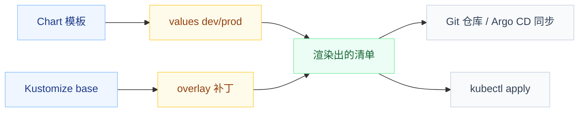

# Helm与Kustomize

> 这篇从 Helm 与 Kustomize 的定位讲起，经过安装与最小验证、Chart 结构与模板渲染、values 多环境覆盖、模板函数与命名模板、Kustomize base/overlay 补丁，最后落到渲染排障与多环境交付案例。
>
> 学完能为一个应用写出可复用的 Chart 和 overlay，在多套环境渲染出一致的清单，并独立完成升级与回滚。

## 一、定位与边界

Kubernetes 原生清单是纯 YAML：副本数、镜像、域名、环境名每换一个环境就要手改一遍，改多了就漂移。Helm 与 Kustomize 都是"一份定义、多份产物"的清单生成器，只是生成方式相反：Helm 用模板 + 参数渲染，Kustomize 用基础 + 补丁覆盖。

| 维度 | Helm | Kustomize |
|---|---|---|
| 生成方式 | Go 模板 + values 渲染 | base 清单 + patch 覆盖 |
| 环境差异 | 每环境一份 values 文件 | 每环境一个 overlay 目录 |
| 分发 | Chart 包、OCI 仓库 | Git 仓库、目录引用 |
| 适用 | 参数多、要分发给多个团队 | 清单已有、差异小、要留在 Git 里 |
| 与 kubectl | 独立 CLI | `kubectl -k` 内置（5.x 内核版本随 kubectl） |

选择规则很简单：

- 清单是自己的、环境差异主要是数值和字符串（副本数、镜像 tag、域名）→ Kustomize 足够，产物留在 Git 里，GitOps 工具直接渲染；
- 要把应用打包给别的团队装（数据库、中间件、平台组件）→ Helm，Chart 是分发单位；
- 两者可以组合：Kustomize 引用 Chart 渲染结果再打补丁，第七章展开。



边界与不写的部分：

- Helm 2（Tiller 架构）已于 2020 年终止支持，本文只写 Helm 3.18+ 与 4.x，两者 CLI 兼容；
- 不写 Chart 生态里的商业发行版；只写开源部分：`helm`、`kustomize`、`kubectl -k`；
- 模板里不做复杂业务逻辑（循环拼 SQL、条件套三层以上），复杂逻辑放前置脚本或 Kustomize 的 transformer。

> 版本基线（2026-11）：Helm 3.18+ / 4.x、Kustomize 5.x、kubectl 1.33+。命令默认 Ubuntu 24.04，RHEL/Rocky 用 `dnf`。

## 二、安装与最小验证

两种工具都是单二进制，安装后在本地就能完成"渲染"这一步，不需要集群；只有 `install/upgrade` 才需要 kubeconfig。

### 2.1 安装 Helm

```bash
# macOS
brew install helm

# Windows（winget，Chocolatey/Scoop 同理）
winget install Helm.Helm

# Ubuntu：官方 apt 源（snap 安装的 helm 无法被 systemd 服务直接调用，CI 里建议 apt 版）
curl -fsSL https://raw.githubusercontent.com/helm/helm/main/scripts/get-helm-3 | sudo bash

# Rocky/RHEL：EPEL 里没有稳定版本，用安装脚本装到 /usr/local/bin
curl -fsSL https://raw.githubusercontent.com/helm/helm/main/scripts/get-helm-3 | sudo bash
```

### 2.2 安装 Kustomize

`kubectl` 自带 Kustomize 内核，但版本随 kubectl 滞后；独立二进制用于本地校验与 CI。

```bash
# macOS
brew install kustomize

# Windows
winget install kustomize.kustomize

# Ubuntu / Rocky：从 GitHub Releases 下载单文件
curl -fsSL -o kustomize.tar.gz \
  https://github.com/kubernetes-sigs/kustomize/releases/download/kustomize%2Fv5.7.1/kustomize_v5.7.1_linux_amd64.tar.gz
tar -xzf kustomize.tar.gz
sudo install -m 0755 kustomize /usr/local/bin/kustomize
```

### 2.3 最小验证：装好、跑通、看到结果

```bash
helm version --short
kustomize version
kubectl version --client=true --output=yaml | head -5
```

预期输出（示例）：

```text
v3.18.4
v5.7.1
gitVersion: v1.33.3
```

再各跑一个最小闭环。Helm 用官方脚手架生成一个可渲染的 Chart：

```bash
helm create demo
helm template demo ./demo --set replicaCount=2 | head -20
```

Kustomize 用两个文件验证 base/overlay 覆盖：

```bash
mkdir -p demo-ks/base demo-ks/overlays/prod
cat > demo-ks/base/deployment.yaml <<'EOF'
apiVersion: apps/v1
kind: Deployment
metadata:
  name: demo
spec:
  replicas: 1
EOF
cat > demo-ks/base/kustomization.yaml <<'EOF'
resources:
  - deployment.yaml
EOF
cat > demo-ks/overlays/prod/kustomization.yaml <<'EOF'
resources:
  - ../../base
patches:
  - path: replicas.yaml
EOF
cat > demo-ks/overlays/prod/replicas.yaml <<'EOF'
apiVersion: apps/v1
kind: Deployment
metadata:
  name: demo
spec:
  replicas: 5
EOF
kustomize build demo-ks/overlays/prod
```

预期输出：

```yaml
apiVersion: apps/v1
kind: Deployment
metadata:
  name: demo
spec:
  replicas: 5
```

> 边界：所有渲染命令（`helm template`、`kustomize build`、`kubectl kustomize`）都不接触集群，可以在 CI 里对每个 PR 跑一遍；只有 `helm install` 和 `kubectl apply -k` 需要真实的 kubeconfig。overlay 引用 `base` 用的是相对路径，目录移动后必须改 `resources`。

## 三、Chart 结构与模板渲染

Chart 是 Helm 的分发单位：一个目录，带版本号，渲染出若干 Kubernetes 清单。理解 Chart 只需要三件事：元数据（Chart.yaml）、默认值（values.yaml）、模板（templates/）。

### 3.1 目录结构

```text
demo/
├── Chart.yaml          # 元数据：名字、版本、依赖，apiVersion 必须是 v2
├── values.yaml         # 默认值，所有可变参数集中在这里
├── values.schema.json  # 可选：values 的 JSON Schema，helm lint/install 时校验
├── .helmignore         # 打包时排除的文件，类似 .gitignore
├── charts/             # 本地依赖的子 Chart（或 charts/ 改为 OCI 依赖）
└── templates/
    ├── _helpers.tpl    # 命名模板，下划线开头的文件不会被渲染成清单
    ├── deployment.yaml
    ├── service.yaml
    ├── ingress.yaml
    └── NOTES.txt       # 安装成功后打印给用户看的提示，不进集群
```

### 3.2 Chart.yaml 与 values.yaml

```yaml
# Chart.yaml
apiVersion: v2
name: web-api
description: Web API 服务
type: application
version: 0.3.0          # Chart 自己的版本，每次改动必须递增
appVersion: "1.42.0"    # 应用版本，只做展示，模板里不直接依赖它
maintainers:
  - name: platform-team
```

```yaml
# values.yaml：默认值面向本地环境，生产值放独立文件覆盖
replicaCount: 1

image:
  repository: registry.example.com/web-api
  tag: "1.42.0"          # 写死默认 tag，禁止 latest 进集群
  pullPolicy: IfNotPresent

service:
  type: ClusterIP
  port: 8080

# required 校验的必填项，每个环境由 values 覆盖
envName: dev

resources:
  requests:
    cpu: 100m
    memory: 128Mi
  limits:
    memory: 512Mi
```

### 3.3 模板：三大数据源

模板本质是 Go template，渲染时能拿到三个对象：`.Values`（values 合并结果）、`.Chart`（Chart.yaml 字段）、`.Release`（本次安装的名字、命名空间、修订号）。

```yaml
# templates/deployment.yaml
apiVersion: apps/v1
kind: Deployment
metadata:
  # include 展开命名模板，保证多个 Chart 同名部署时不冲突
  name: {{ include "web-api.fullname" . }}
  labels:
    {{- include "web-api.labels" . | nindent 4 }}
spec:
  replicas: {{ .Values.replicaCount }}
  selector:
    matchLabels:
      {{- include "web-api.selectorLabels" . | nindent 6 }}
  template:
    metadata:
      labels:
        {{- include "web-api.selectorLabels" . | nindent 8 }}
    spec:
      containers:
        - name: {{ .Chart.Name }}
          image: "{{ .Values.image.repository }}:{{ .Values.image.tag | quote }}"
          # required 让漏配时渲染直接失败，而不是部署到一半才挂
          env:
            - name: APP_ENV
              value: {{ required "env.name is required" .Values.envName | quote }}
          resources: {{- toYaml .Values.resources | nindent 12 }}
```

### 3.4 渲染与校验

```bash
helm lint ./web-api                       # 静态检查 + schema 校验
helm template web-api ./web-api           # 纯本地渲染，不碰集群
helm template web-api ./web-api \
  --values env/prod.yaml | kubeconform -strict -summary
# kubeconform 按 OpenAPI 定义校验字段名与类型，比"能 apply"更早发现拼写错误
```

> 边界：`helm template` 校验语法但不校验字段合法性（比如把 `replicas` 写成 `repilcas` 只会被 kubeconform 这类工具抓出来）；`--validate` 会把清单发给集群做 dry-run 校验，需要集群可达。`latest` 镜像 tag 在滚动历史里无法追溯，默认值里就要禁用。

## 四、values 覆盖与多环境

多环境的全部差异都应该落在 values 层，模板层保持环境无关。优先级规则是覆盖问题的根源，必须背下来。

### 4.1 覆盖优先级

从低到高，后面的覆盖前面的：

1. 子 Chart 的 `values.yaml`；
2. 父 Chart 的 `values.yaml`（及父 values 里以子 Chart 名为键的段落）；
3. `-f` 传入的文件，多个文件从左到右后者覆盖前者；
4. `--set` / `--set-string`，优先级最高，只建议在临时验证时用。

```bash
# 环境差异全部走 -f 文件，diff 能看出环境之间到底差什么
helm template web-api ./web-api -f env/prod.yaml
# --set 只做一次性验证；tag 这类含特殊字符的值用 --set-string
helm template web-api ./web-api --set-string image.tag=1.43.0-rc.1
```

### 4.2 环境文件的组织

```text
env/
├── dev.yaml      # 单副本、低配额、内网域名
├── staging.yaml
└── prod.yaml     # 多副本、配额、正式域名、监控标签
```

```yaml
# env/prod.yaml
replicaCount: 6
image:
  tag: "1.42.0"
service:
  port: 80
ingress:
  host: api.example.com
resources:
  requests:
    cpu: 500m
    memory: 512Mi
```

### 4.3 values 的防护：schema 与查询

```json
{
  "$schema": "http://json-schema.org/draft-07/schema#",
  "type": "object",
  "required": ["image", "envName"],
  "properties": {
    "replicaCount": { "type": "integer", "minimum": 1 }
  }
}
```

```bash
helm lint ./web-api --values env/prod.yaml   # schema 违反时直接 FAIL
helm get values web-api -n web               # 查线上 release 实际生效的自定义值
helm get values web-api -n web --all         # 含默认值的完整合并结果
```

> 边界：`helm upgrade` 不带 `-f` 时默认用 Chart 里的默认值，线上环境会"悄悄"变回单副本；要么每次都带 `-f`，要么用 `--reuse-values` 且明确知道它会把旧值整份带过来（包括已经不该存在的值）。CI 里用 `helm diff`（`helm plugin install https://github.com/databus23/helm-diff`）把两次 upgrade 的差异打印出来再执行，是防止"覆盖丢了"的最后一道闸。

## 五、模板函数与命名模板

模板的可维护性取决于两点：差异点是否都收敛到 values，重复片段是否都收敛到命名模板。这一章列出实际会用到的函数与它们的坑。

### 5.1 常用函数速查

| 函数 | 用途 | 典型坑 |
|---|---|---|
| `default` | 空值兜底 | `0`、`false`、空串都会触发兜底 |
| `required` | 漏配即失败 | 提示信息要写"哪个字段缺了" |
| `quote` / `toYaml` | 类型安全序列化 | 数字 tag 不加 quote 会变浮点、丢掉尾零（`1.20` → `1.2`） |
| `nindent 8` | 换行缩进 | 比 `indent` 多一个前导换行，块级嵌入必用 |
| `b64enc` / `lookup` | Secret、查集群 | `lookup` 渲染期依赖集群，Argo CD 下拿不到值 |
| `tpl` | 渲染字符串里的模板 | 值来自用户输入时等于执行任意模板，慎用 |

```yaml
# image.tag 是字符串但写得像数字，quote 防止 YAML 把 1.20 解析成浮点
image: "{{ .Values.image.repository }}:{{ .Values.image.tag | quote }}"
# 布尔开关渲染成字符串标签时用 toString 避免裸 true 变成空
enabled: {{ .Values.metrics.enabled | toString }}
```

### 5.2 命名模板与 include

`_helpers.tpl` 里的 `define` 是全 Chart 的公共函数库；`include` 可以出现在管道里，`template` 不能，所以统一用 `include`。

```yaml
# templates/_helpers.tpl：命名模板集中定义，3.3 用到的三个模板在这里
{{- define "web-api.name" -}}
{{- default .Chart.Name .Values.nameOverride | trunc 63 | trimSuffix "-" -}}
{{- end -}}

{{- define "web-api.fullname" -}}
{{- printf "%s-%s" .Release.Name (include "web-api.name" .) | trunc 63 | trimSuffix "-" -}}
{{- end -}}

{{- define "web-api.selectorLabels" -}}
app.kubernetes.io/name: {{ include "web-api.name" . }}
app.kubernetes.io/instance: {{ .Release.Name }}
{{- end -}}

{{- define "web-api.labels" -}}
helm.sh/chart: {{ printf "%s-%s" .Chart.Name .Chart.Version | replace "+" "_" }}
{{ include "web-api.selectorLabels" . }}
app.kubernetes.io/version: {{ .Chart.AppVersion | quote }}
{{- end -}}
```

```yaml
# 使用处：labels 整块来自一处定义，改名只改 _helpers.tpl
metadata:
  labels:
    {{- include "web-api.labels" . | nindent 4 }}
```

### 5.3 条件、循环与子 Chart

```yaml
# 条件块：enabled 开关控制整段清单出不出现在产物里
{{- if .Values.ingress.enabled }}
apiVersion: networking.k8s.io/v1
kind: Ingress
{{- end }}

# 循环：列表参数渲染成多个条目，env 顺序来自 values，不来自模板硬编码
{{- range .Values.extraEnv }}
- name: {{ .name }}
  value: {{ .value | quote }}
{{- end }}
```

子 Chart（Subchart）是复用第二个维度：父 Chart 的 values 里以子 Chart 名为键的段落会传给子 Chart。

```yaml
# 父 Chart values.yaml：以子 Chart 名为键，只覆盖想改的值
postgresql:
  auth:
    username: webapi
  primary:
    persistence:
      size: 20Gi
```

> 边界：依赖要锁版本和 digest，`Chart.yaml` 里 `dependencies` 的 `version` 用区间（`^1.0.0`）会拉到没测过的小版本，生产用精确版本并提交 `Chart.lock`；`helm dependency update` 之后 `charts/` 里的内容也要一起进 Git。钩子（`pre-install`/`pre-upgrade` Job）失败会让 release 卡在中间态，见第八章排障。

## 六、Kustomize base 与 overlay

Kustomize 的模型是"一份 base，N 份 overlay"：base 是完整的、可以直接 apply 的清单；overlay 只声明差异。没有模板、没有变量替换，所有魔法都是结构化补丁。

### 6.1 最小结构与渲染

```text
apps/web-api/
├── base/
│   ├── kustomization.yaml
│   ├── deployment.yaml
│   ├── service.yaml
│   └── configmap.yaml
└── overlays/
    ├── dev/
    │   ├── kustomization.yaml
    │   └── replicas.yaml
    └── prod/
        ├── kustomization.yaml
        ├── replicas.yaml
        └── resources-limits.yaml
```

```yaml
# base/kustomization.yaml
apiVersion: kustomize.config.k8s.io/v1beta1
kind: Kustomization
resources:
  - deployment.yaml
  - service.yaml
  - configmap.yaml
```

```yaml
# overlays/prod/kustomization.yaml
apiVersion: kustomize.config.k8s.io/v1beta1
kind: Kustomization
resources:
  - ../../base
# 5.x 统一用 patches 字段，strategic-merge 与 JSON patch 都写在这里
patches:
  - path: replicas.yaml
  - path: resources-limits.yaml
namespace: web-prod        # transformer：改写所有资源的命名空间
nameSuffix: -prod          # 同一 base 部署到同集群不冲突
images:
  - name: registry.example.com/web-api
    newTag: "1.42.0"       # 镜像升级只改这一行，Git 历史即发布历史
```

### 6.2 两类补丁

Strategic-merge patch（SMP）就是一个"残缺的资源清单"，只写要改的字段：

```yaml
# overlays/prod/replicas.yaml
apiVersion: apps/v1
kind: Deployment
metadata:
  name: web-api
spec:
  replicas: 5
```

JSON patch（RFC 6902）适合精确到数组下标或删除字段的场景：

```yaml
# overlays/prod/kustomization.yaml 里的另一种写法
patches:
  - target:
      kind: Deployment
      name: web-api
    patch: |-
      - op: replace
        path: /spec/replicas
        value: 5
      - op: remove
        path: /spec/template/spec/containers/0/env/0
```

> SMP 与 JSON patch 的选择：改"值"用 SMP，可读；增删"结构"（数组元素、字段删除）用 JSON patch，可精确。`target` 选择器在 5.x 里支持 `kind/name/labelSelector/annotationSelector`，补丁作用范围必须写清，否则同名资源多的目录里会误伤。

### 6.3 生成器与 transformer

`configMapGenerator` 是 Kustomize 滚动更新的核心机制：内容变化时生成的新名字（后缀是内容 hash）变化，引用它的 Deployment 自动滚动。

```yaml
# base/kustomization.yaml 增加生成器
configMapGenerator:
  - name: web-api-config          # 最终名字是 web-api-config-<hash>
    files:
      - config.yaml               # 内容进 key=config.yaml
    literals:
      - LOG_LEVEL=info
# 引用处用 name 引用占位符，让 kustomize 重写引用
replacements:
  - source:
      kind: ConfigMap
      name: web-api-config
      fieldPath: metadata.name
    targets:
      - select:
          kind: Deployment
        fieldPaths:
          - spec.template.spec.containers.[name=web-api].env.[name=APP_CONFIG].valueFrom.configMapKeyRef.name
```

其他常用 transformer：

| transformer | 作用 | 典型用途 |
|---|---|---|
| `images` | 改 tag / digest / 换仓 | 版本升级 |
| `replicas` | 批量改副本数 | 一处改多个 Deployment |
| `namespace` | 改命名空间 | 环境隔离 |
| `namePrefix` / `nameSuffix` | 改资源名 | 同集群共存 |
| `commonAnnotations` | 打注解 | 标记 Git commit |
| `components` | 可选功能块 | 按需启用监控边车 |

> 边界：`commonLabels` 在 5.x 已废弃（把标签写进 selector 会导致无法选中 Pod），统一用 `labels`，且加 `includeSelectors: false`。生成器只认文件内容，不认文件名——`config.yaml` 改了但内容恰好 hash 不变（重新生成同内容）不会滚动，属于极小概率，验证以 `kustomize build` 输出为准。

### 6.4 渲染与校验

```bash
kustomize build apps/web-api/overlays/prod       # 独立二进制渲染
kubectl kustomize apps/web-api/overlays/prod    # kubectl 内置内核，版本可能略旧
kubectl apply -k apps/web-api/overlays/prod     # 渲染并一次完成 apply
kubectl diff -k apps/web-api/overlays/prod      # 先看差异再 apply，CI 必备
```

> 边界：独立 `kustomize` 与 `kubectl -k` 的内核版本可能不同，极端情况下（新 transformer 字段）渲染结果不一致；CI 和集群侧固定用同一个，写进文档。

## 七、Helm 与 Kustomize 的组合与 GitOps

组合的标准姿势是"Chart 负责参数化打包，Kustomize 负责本地差异"，两条链在 Git 里汇合。Argo CD（GitOps）对两者都原生支持：应用指向 Chart 目录 + values，或指向 overlay 目录，Argo CD 在集群侧渲染。

```yaml
# kustomization.yaml 内嵌渲染第三方 Chart（inflator）
apiVersion: kustomize.config.k8s.io/v1beta1
kind: Kustomization
helmGlobals:
  chartHome: charts            # Chart 所在目录，name 必须对应其下的子目录
helmCharts:
  - name: grafana
    repo: https://grafana.github.io/helm-charts
    version: 8.16.1            # 精确版本，不写区间
    releaseName: grafana
    namespace: monitoring
    valuesFile: grafana-values.yaml
```

```bash
kustomize build --enable-helm .   # 组合渲染需要显式开启 helm 支持
```

选择与版本锁定：

| 需求 | 做法 |
|---|---|
| 多环境部署自己的应用 | 一份 base + overlay，环境差异全部进 overlay |
| 分发给其他团队安装 | `helm package chart/` 后把生成的 tgz `helm push` 到 OCI 仓库 |
| 引用第三方组件又要改 | OCI 依赖锁版本 + Kustomize patch 覆盖 |
| Argo CD 管理发布 | Git 里只存 values/overlay，渲染交给集群侧，保证所见即所得 |

```yaml
# Chart.yaml：OCI 依赖锁 digest，Renovate 可以自动升级
dependencies:
  - name: grafana
    repository: oci://registry.example.com/charts
    version: 8.16.1
```

> 边界：GitOps 环境里，渲染发生在集群侧，因此模板里禁止 `lookup`（集群可达性导致渲染不可复现）。Argo CD 的 Kustomize 构建默认不带 `--enable-helm`，需要在 `argocd-cm` 里设置 `kustomize.buildOptions: --enable-helm`，否则同步报 "must specify --enable-helm"；这也要求仓库服务端存在 helm 二进制，升级 Argo CD 时要一并验证。CI 里同样用 `helm template + kustomize build + kubeconform` 三连做 PR 校验，保证"合并即正确"。

## 八、渲染排障与现场手册

渲染类故障的共性只有一个：产物和预期不一致。先 `helm template` / `kustomize build` 把产物打出来，再判断是模板、values 还是补丁的问题，不要先怀疑集群。

| 现象 | 最可能原因 | 第一条命令 |
|---|---|---|
| `did not find expected key` | 模板缩进破坏了 YAML 结构 | `helm template ... \| head -40` 看渲染产物断在哪 |
| values 改了不生效 | 覆盖顺序/键名路径错 | `helm get values <rel> -n <ns> --all` 查实际值 |
| 升级后配置回退 | `upgrade` 没带 `-f` 或误用 `--reuse-values` | `helm history <rel> -n <ns>`，对比 revision |
| release 卡 `pending-upgrade` | hook Job 失败未退出 | `kubectl get jobs -n <ns>`，`helm rollback <rel>` |
| Kustomize `no matches for Id` | patch 找不到目标资源 | 确认 `resources` 路径与 `target` 选择器拼写 |
| patch 后字段没变 | 被 transformer 再次覆盖 | `kustomize build` + `kubectl diff -k` 看 diff |
| Pod 没有滚动更新 | ConfigMap 引用没接生成器 hash | 渲染产物里搜 `-<hash>` 后缀 |
| Argo CD 渲染与本地不同 | 工具版本不一致 | 集群侧与本地对齐 `helm` / `kustomize` 版本 |

### 8.1 hook 卡住的处理

钩子 Job（如数据库迁移）失败时，release 停在 `pending-upgrade`，后续所有命令都会被拒绝。

```bash
# 看卡住的 hook 资源和它的日志
kubectl get jobs -n web --show-labels | grep helm.sh/hook
kubectl logs -n web job/web-api-migrate-9x8w
# 危险：手动删 hook Job 让 upgrade 继续，前提是已确认失败原因可跳过
kubectl delete job web-api-migrate-9x8w -n web
# 或者整单回滚到上一个 revision
helm rollback web-api -n web
```

> 上面 `kubectl delete job` 会让 Helm 认为该 hook 已完成，属于绕过保护，必须在确认失败原因之后使用；`helm rollback` 是安全路径。

### 8.2 渲染结果比对

```bash
# 本地渲染 vs 集群实际：先渲染出清单再 diff，比肉眼读 YAML 快
kustomize build overlays/prod > local.yaml
kubectl get deployment web-api-prod -n web-prod -o yaml > live.yaml
diff <(grep -E 'image:|replicas:' local.yaml) <(grep -E 'image:|replicas:' live.yaml)
```

预期输出（示例，无漂移时）：

```text
（无输出，关键字段一致）
```

## 九、最佳实践案例

### 9.1 案例背景

平台组维护一个 web-api 服务，K8s 1.33 集群三套环境（dev / staging / prod），发布由 Argo CD 从 Git 渲染同步。现状是三套环境各有一份手抄 YAML，上次把 staging 的副本数改完忘了同步 prod，导致 prod 流量高峰扩容不及时；另一个痛点是 ConfigMap 改了不重启、配置不生效的事故每季度一次。目标：一份定义渲染三环境、镜像升级只改一行、配置变更自动滚动、回滚只走 Git；约束是不引入额外平台，全部用 Helm + Kustomize + Argo CD 原生能力。

### 9.2 案例实操

方案取舍：应用归自己团队，数据库、域名等可变参数多 → Chart 做参数化；各环境的命名空间、副本、镜像 tag 属于集群本地事实 → overlay 承接；发布动作交给 Argo CD 在集群侧渲染，Git 提交即发布记录，回滚即 `git revert`。

第一步，Chart 骨架与模板（关键文件全量）：

```yaml
# charts/web-api/Chart.yaml
apiVersion: v2
name: web-api
version: 1.4.0
appVersion: "1.42.0"
```

```yaml
# charts/web-api/values.yaml：默认值面向 dev，必填项由各环境 values 提供
replicaCount: 2
image:
  repository: registry.example.com/web-api
  tag: "1.42.0"
  pullPolicy: IfNotPresent
envName: ""
config:
  logLevel: info
  timeoutSeconds: 30
resources:
  requests: { cpu: 100m, memory: 128Mi }
  limits: { memory: 512Mi }
```

```yaml
# charts/web-api/templates/configmap.yaml
apiVersion: v1
kind: ConfigMap
metadata:
  # 用 Chart 名做资源名，环境隔离交给 overlay 的 namespace transformer
  name: {{ .Chart.Name }}-config
data:
  config.yaml: |
    logLevel: {{ .Values.config.logLevel }}
    timeoutSeconds: {{ .Values.config.timeoutSeconds }}
```

```yaml
# charts/web-api/templates/deployment.yaml
apiVersion: apps/v1
kind: Deployment
metadata:
  name: {{ .Chart.Name }}
spec:
  replicas: {{ .Values.replicaCount }}
  selector:
    matchLabels:
      app: {{ .Chart.Name }}
  template:
    metadata:
      labels:
        app: {{ .Chart.Name }}
      annotations:
        # 关键：把 ConfigMap 内容 hash 进 Pod 注解，配置一变 Pod 自动滚动
        checksum/config: {{ include (print $.Template.BasePath "/configmap.yaml") . | sha256sum }}
    spec:
      containers:
        - name: {{ .Chart.Name }}
          # tag 加 quote，防止 1.20 被解析成浮点
          image: "{{ .Values.image.repository }}:{{ .Values.image.tag | quote }}"
          env:
            - name: APP_ENV
              # required：环境名漏配在渲染阶段就失败，不等到 Pod CrashLoop
              value: {{ required "envName is required" .Values.envName | quote }}
          volumeMounts:
            - name: config
              mountPath: /etc/web-api
      volumes:
        - name: config
          configMap:
            name: {{ .Chart.Name }}-config
```

第二步，prod overlay：内嵌渲染 Chart，再叠加环境事实。

```yaml
# overlays/prod/kustomization.yaml
apiVersion: kustomize.config.k8s.io/v1beta1
kind: Kustomization
helmGlobals:
  chartHome: ../../charts       # 仓库内 Chart 目录，随代码一起评审，不依赖本地缓存
helmCharts:
  - name: web-api
    version: 1.4.0
    releaseName: web-api
    valuesFile: helm-values.yaml  # 环境参数覆盖，交给 Chart 渲染
namespace: web-prod              # 集群本地事实，交给 Kustomize
replicas:
  - name: web-api
    count: 6                      # prod 副本走 transformer，一处声明
images:
  - name: registry.example.com/web-api
    newTag: "1.43.0"              # 镜像升级唯一改动点，提交记录即发布记录
```

```yaml
# overlays/prod/helm-values.yaml
envName: prod
replicaCount: 6
config:
  logLevel: warn
  timeoutSeconds: 15
```

第三步，Argo CD 应用指向 overlay：

```yaml
# argocd/web-api-prod.yaml
apiVersion: argoproj.io/v1alpha1
kind: Application
metadata:
  name: web-api-prod
  namespace: argocd
spec:
  project: default
  source:
    repoURL: https://git.example.com/platform/apps.git
    targetRevision: main
    path: overlays/prod
  destination:
    server: https://kubernetes.default.svc
    namespace: web-prod
  syncPolicy:
    automated:
      prune: true               # Git 里删掉的资源在集群里也删掉
    syncOptions:
      - CreateNamespace=true
```

第四步，合并前的 CI 校验（本地同一组命令）：

```bash
helm lint charts/web-api --values overlays/prod/helm-values.yaml
kustomize build --enable-helm overlays/prod > prod.yaml
kubeconform -strict -summary prod.yaml
# 渲染产物里抽查三处：副本数、镜像 tag、配置 hash 是否生成
grep -E 'replicas:|image:|checksum/config' prod.yaml | head -5
```

预期输出（示例）：

```text
==> Linting charts/web-api
[INFO] Chart.yaml: icon is recommended
1 chart(s) linted, 0 chart(s) failed
Summary: 2 resources found in 1 file - Valid: 2, Invalid: 0
    replicas: 6
    image: "registry.example.com/web-api:1.43.0"
    checksum/config: 3f9d2a8c1e...
```

第五步，首次同步与验证：

```bash
git add -A && git commit -m "feat: web-api prod overlay 1.43.0"
git push
argocd app sync web-api-prod
```

预期输出（示例）：

```text
TIMESTAMP                  GROUP        KIND        NAME             STATUS   HEALTH
2026-11-13 10:12:31        apps         Deployment  web-api          Synced   Healthy
2026-11-13 10:12:31                     ConfigMap   web-api-config   Synced
Sync OK: 2/2 resources
```

```bash
# 验证三件套：Pod 就绪、副本数、镜像 tag
kubectl get pods -n web-prod -l app=web-api
kubectl get deployment web-api -n web-prod \
  -o jsonpath='{.spec.replicas}{" "}{.spec.template.spec.containers[0].image}{"\n"}'
kubectl get cm web-api-config -n web-prod -o jsonpath='{.data.config\.yaml}'
```

预期输出（示例）：

```text
NAME                       READY   STATUS    RESTARTS   AGE
web-api-6d9c7b8f5c-2xv9k   1/1     Running   0          90s
web-api-6d9c7b8f5c-7m1p2   1/1     Running   0          90s
web-api-6d9c7b8f5c-9k3lw   1/1     Running   0          89s
web-api-6d9c7b8f5c-r8t4n   1/1     Running   0          88s
web-api-6d9c7b8f5c-t5y2h   1/1     Running   0          88s
web-api-6d9c7b8f5c-w6q7d   1/1     Running   0          87s
6 registry.example.com/web-api:1.43.0
logLevel: warn
timeoutSeconds: 15
```

第六步，升级与回滚演练：镜像 1.44.0 有就绪探针缺陷，上线后 Pod 起不来，走 Git 回滚。

```bash
# 升级：只改一行 tag
sed -i 's/newTag: "1.43.0"/newTag: "1.44.0"/' overlays/prod/kustomization.yaml
git commit -am "feat: web-api 1.44.0" && git push
argocd app sync web-api-prod
kubectl rollout status deployment/web-api -n web-prod --timeout=120s
```

失败输出（示例）：

```text
Waiting for deployment "web-api" rollout to finish: 2 of 6 updated replicas are available...
error: context deadline exceeded
```

> 边界：`--timeout` 到期报 `context deadline exceeded`；只有把 Deployment 的 `progressDeadlineSeconds` 调到比 `--timeout` 短时，才会先看到 `exceeded its progress deadline`。

```bash
# 回滚 = revert 那一次提交 + 重新同步，Argo CD 把集群拉回清单
git revert HEAD --no-edit && git push
argocd app sync web-api-prod
kubectl get deployment web-api -n web-prod \
  -o jsonpath='{.spec.template.spec.containers[0].image}{"\n"}'
kubectl rollout status deployment/web-api -n web-prod --timeout=120s
```

预期输出（示例）：

```text
registry.example.com/web-api:1.43.0
deployment "web-api" successfully rolled out
```

### 9.3 案例结果

三套环境由一份 Chart 加三个 overlay 渲染，`kustomize build --enable-helm` 渲染 prod 的耗时 0.5 秒（示例）；首次同步从 Git 提交到 6 个 Pod 全部 Healthy 共 110 秒（示例）；1.44.0 回滚演练从 `git revert` 到旧版本 Pod 全部就绪 95 秒（示例），全程无 kubectl 修补。配置类事故根因关闭：`checksum/config` 注解使 ConfigMap 内容变化直接触发 Pod 滚动，上线三个月（示例）未再出现"改配置不生效"。

失败模式复盘：一是曾把 prod 副本数写进 Chart 默认 values（应属 overlay），评审时靠"渲染产物 diff 只允许出现预期差异"规则拦下；二是 inflator 渲染要求本地与 Argo CD 的 kustomize 内核版本一致，一次内核差异导致 `checksum/config` 计算不同、Pod 反复滚动，最终在 CI 里固定 `kustomize` 与 Argo CD 同版本解决。团队最终约定：模板只放结构与必填校验，环境事实全部进 overlay，`kubectl diff -k` 无输出与 Argo CD Synced 状态是每次发布的通过标准。

