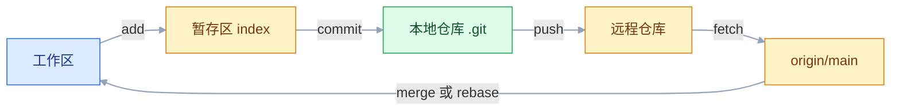
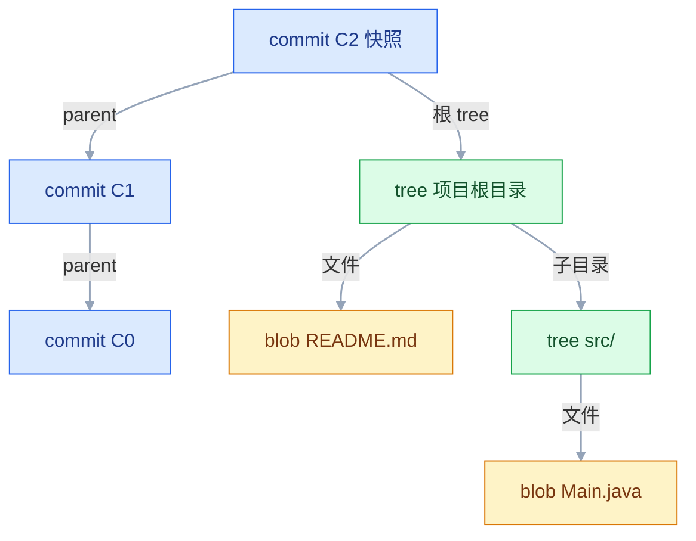
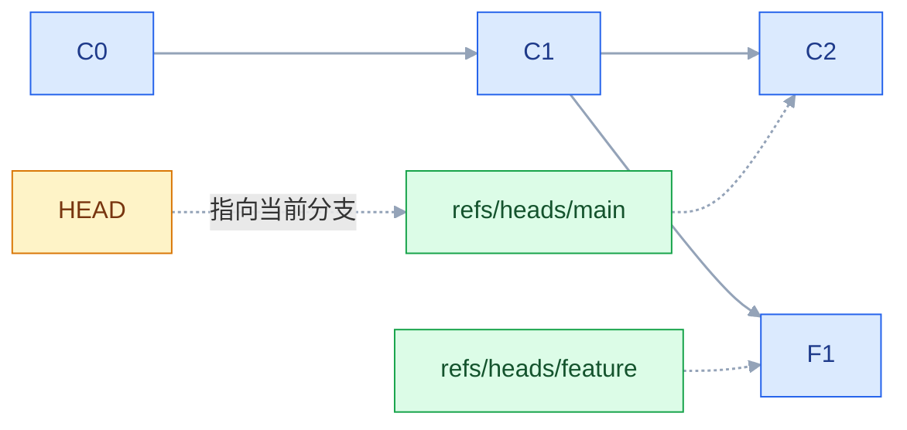
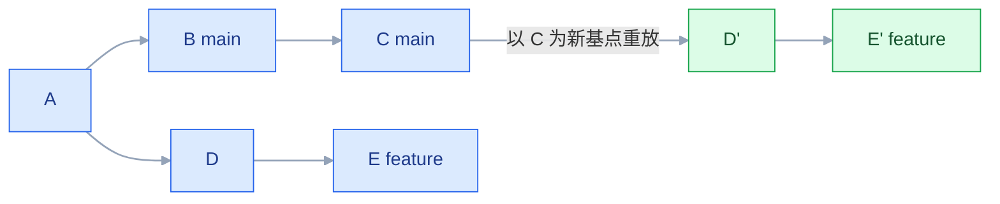

# Git 版本管理

## 一、工程案例：接手一个仓库，从提交 PR 到回滚误操作

**场景**：入职一家 5 人后端团队，接手 `order-service`。远程在 GitHub，`main` 受保护，只能走 Pull Request；发布方式是合并后打 tag。任务是在一周内交付「订单取消」功能，发 `v1.2.0`，然后处理一次线上故障，并救回一次自己造成的误操作。

**起点**：只拿到仓库地址和一张 JIRA 工单，本机没有该项目、没有配 SSH。

### 1.1 克隆与体检

```bash
git clone git@github.com:company/order-service.git
cd order-service

git config user.name "张三"                 # 仓库级配置，不污染其他项目
git config user.email "zhangsan@company.com"
git status -sb                              # ## main...origin/main
git log --oneline --graph -5
git branch -a                               # 本地 main + remotes/origin/*
git remote -v
```

关键输出与含义：

| 输出 | 含义 |
|---|---|
| `## main...origin/main` | 当前在 main，且与远程跟踪分支同步 |
| `remotes/origin/HEAD -> origin/main` | 远程的默认分支是 main |
| `nothing to commit, working tree clean` | 工作区与当前提交一致 |

```bash
git fetch --prune                # 同步远程分支列表，顺手清掉已删除的远程分支引用
git remote show origin           # 看 fetch/push 地址、跟踪关系、哪些分支可被 pull
```

> `clone` 已经配好 `origin`，不要再 `git remote add`。先体检再改代码，能避免在错误的分支或过期的历史上开工。

### 1.2 开分支与小步提交

```bash
git switch main
git pull --ff-only                          # 只接受快进；分叉时直接报错，不会悄悄生成合并提交
git switch -c feature/JIRA-1024-order-cancel

# 写 OrderCancelService 与 Controller 后
git status                                  # 看清哪些是 untracked、哪些是 modified
git add src/main/java/com/company/order/cancel/
git diff --staged --stat                    # 提交前确认范围
git diff --staged                           # 逐行确认内容
git commit -m "feat(order): 新增订单取消服务"

git add src/main/java/com/company/order/cancel/OrderCancelController.java
git commit -m "feat(order): 新增订单取消接口"

git log --oneline main..HEAD                # 只列本分支独有的提交
```

预期输出：

```text
a77d310 feat(order): 新增订单取消接口
3f2a1b9 feat(order): 新增订单取消服务
```

> `git add` 是挑选进下次快照的内容，不是保存文件。两个提交各自完整，出问题时可以只回退其中一个。

### 1.3 同步主干、推送、发起 PR

```bash
git fetch origin
git log --oneline HEAD..origin/main         # 先看主干有没有新提交；有输出才需要同步
git rebase origin/main                      # 未推送的个人分支，重放成直线
git push -u origin feature/JIRA-1024-order-cancel
```

预期输出：

```text
branch 'feature/JIRA-1024-order-cancel' set up to track 'origin/feature/JIRA-1024-order-cancel'.
```

到平台上发起 PR，方向 `base: main ← compare: feature/JIRA-1024-order-cancel`。评审意见要求补「订单状态校验」，回到同一分支继续提交：

```bash
git add src/main/java/com/company/order/cancel/OrderCancelService.java
git commit -m "fix(order): 补充订单状态校验"
git push                                    # 已建立跟踪，直接 push
```

> PR 会自动带上新提交，不要关掉重开。评审期间不要 rebase 已推送的分支，否则评审人看到的 diff 会整体错位。

### 1.4 合并、打 tag、清理

```bash
git switch main
git pull --ff-only
git merge --no-ff feature/JIRA-1024-order-cancel
git push origin main

git tag -a v1.2.0 -m "发布 v1.2.0：新增订单取消功能"
git push origin v1.2.0                       # tag 不会随普通 push 上去
git branch -d feature/JIRA-1024-order-cancel
git push origin --delete feature/JIRA-1024-order-cancel
```

验证 tag 指向的是刚合并的提交：

```bash
git rev-parse HEAD
git rev-list -n 1 v1.2.0                     # 两个哈希必须相同
git show --stat v1.2.0
```

### 1.5 两次误操作的回退

**误操作 A：`reset --hard` 丢了一个刚做完的提交。**

```bash
git reset --hard HEAD~1                      # 本意是丢掉草稿，把接口提交一起丢了
git reflog --date=iso -5
```

```text
3f2a1b9 HEAD@{1}: reset: moving to HEAD~1
a77d310 HEAD@{2}: commit: feat(order): 新增订单取消接口
3f2a1b9 HEAD@{3}: commit: feat(order): 新增订单取消服务
```

```bash
git switch -c rescue a77d310                 # 给丢失的提交重新挂一个分支指针
git log --oneline -3                         # 两条提交都回来了
```

`reset` 只移动分支指针，提交对象还在 `.git` 里，90 天内都能从 reflog 找到。真正的丢失发生在 `git gc` 清理掉不可达对象之后。若只想取回其中一条，用 `git cherry-pick <哈希>` 挑回当前分支。

**误操作 B：调试日志混进了已推送的功能分支。**

```bash
git log --oneline -5                         # 找到那次提交，例如 c34a8d1
git revert c34a8d1                           # 生成一个反向提交，历史只增不减
git push                                    # PR 自动更新，评审人能看到这次回退
```

> 已进入公共分支的提交用 `revert`，不要 `reset` 后强推。强推会让别人的本地历史和远程分叉，且可能抹掉他人提交。只有自己独占、未被他人引用的分支才考虑 `--force-with-lease`。

### 1.6 验收（8 项全过才算交付）

| # | 检查 | 命令 | 通过标准 |
|---|---|---|---|
| 1 | 仓库与身份 | `git config user.email` | 输出团队邮箱，不是默认占位值 |
| 2 | 当前分支 | `git status -sb` | 显示预期分支，无 `behind` |
| 3 | 提交范围 | `git log --oneline origin/main..HEAD` | 只含本功能的提交，无他人提交 |
| 4 | 提交内容 | `git diff --staged --stat` | 为空；非空说明还有东西没提交 |
| 5 | 工作区干净 | `git status --porcelain` | 无输出 |
| 6 | 远程分支存在 | `git ls-remote --heads origin feature/JIRA-1024-order-cancel` | 输出一行哈希与分支名 |
| 7 | tag 指向正确 | `git rev-list -n 1 v1.2.0` | 等于合并提交的 `git rev-parse HEAD` |
| 8 | 误操作已恢复 | `git log --oneline -3 rescue` | 丢失的提交在列，代码可编译 |

```mermaid
flowchart LR
    classDef client fill:#DBEAFE,stroke:#2563EB,color:#1E3A8A
    classDef service fill:#DCFCE7,stroke:#16A34A,color:#14532D
    classDef data fill:#FEF3C7,stroke:#D97706,color:#78350F
    classDef danger fill:#FEE2E2,stroke:#DC2626,color:#7F1D1D

    A["clone 仓库"]:::client --> B["开 feature 分支"]:::client
    B --> C["小步提交"]:::client
    C --> D["rebase 主干"]:::client
    D --> E["push 并发 PR"]:::client
    E --> F["评审补提交"]:::client
    F --> G["合并 main"]:::service
    G --> H["打 tag 发布"]:::data
    H --> I["线上 hotfix"]:::danger
    I --> J["revert 或 reflog 回退"]:::danger
    linkStyle default stroke:#94A3B8,stroke-width:1.5px
```



---

## 二、高频问答：会卡住你的地方，也是面试最常问的

### 2.1 push 被拒：`! [rejected] ... (fetch first)`

**现场**

`git fetch origin` 后看 `git log --oneline HEAD..origin/main`，有输出就是差这些提交。

```bash
git fetch origin
git log --oneline HEAD..origin/main     # 远程有、本地没有
git pull --rebase                       # 把自己的提交搬到远程最新之上
git push
```

> 只有自己独占的分支才允许 `git push --force-with-lease`；它比 `-f` 多一道检查：远程出现未见过的提交时会拒绝。

**要点**

- 普通 push 只允许快进，远程有你没有的提交就会被拒。
- `-f` 会用本地历史覆盖远程，别人的提交直接从分支上消失。
- 正确做法是 fetch 后 rebase 到远程最新，再 push。

**追问**

- 为什么 `--force-with-lease` 比 `-f` 安全？→ 远程出现你没见过的提交时它会拒绝，不会盖掉别人的推送。
- 分叉了但不想 rebase？→ `git pull --no-rebase` 生成合并提交，公共分支更合适。
- 强推之后还能救吗？→ 本地 reflog 里还有强推前的记录，远程能否找回取决于平台，别指望。

### 2.2 `git pull` 之后凭空多出一个 merge commit

**现场**

`git log --oneline --graph -5` 看到分叉后汇合，提交说明是 `Merge branch ...`。

```bash
git config --global pull.rebase true    # 之后 pull 默认变基，历史保持直线
# 或只对当前仓库：git config pull.ff only，分叉时直接报错，逼你显式选择
```

> 已经推送的合并提交不要再改写。`pull.rebase` 只影响本地未推送的提交。

**要点**

- `pull` 默认执行 merge，本地和远程各有新提交时就会生成一个双父提交。
- 这是正常合并，不是历史被搞乱，不用 rebase 掉再强推。
- 想保持直线配 `pull.rebase true`，想强制显式选择配 `pull.ff only`。

**追问**

- 合并提交有什么价值？→ 保留「何时、从哪合并」的记录，公共分支审计需要。
- `pull.ff only` 和 `pull.rebase true` 怎么选？→ 前者分叉就报错逼你决策，后者自动变基成直线。
- 已经推上去的合并提交能 rebase 掉吗？→ 会改写已共享历史，别动。

### 2.3 切分支报 `Your local changes would be overwritten`

**现场**

`git status --porcelain` 看改动文件，`git diff --name-only main..目标分支` 看两边是否重叠。

```bash
git stash -u                    # 连未跟踪文件一起收起
git switch 目标分支
git stash pop                   # 回来再取出，可能冲突
# 或者先提交到当前分支，再切
```

**要点**

- 目标分支与当前未提交改动涉及同一个文件，Git 不敢覆盖工作区。
- 不是所有改动都会被拦，文件不重叠时改动会直接带到新分支。
- 用 `git stash -u` 收起，或先提交，再切。

**追问**

- 为什么有时候能带着改动切过去？→ 目标提交没改同一个文件。
- `stash pop` 冲突了怎么办？→ 手工解，stash 记录还在，可以再 `apply` 一次。
- `stash` 和 `stash -u` 差在哪？→ `-u` 连未跟踪文件一起收。

### 2.4 冲突解完，代码却少了或编译不过

**现场**

`grep -rn '^<<<<<<<\|^=======$\|^>>>>>>>' .` 查标记，`git diff --check` 查空白问题，再直接编译。

```bash
git diff --staged                # 提交前逐行看保留了哪些
grep -rn '^<<<<<<<' .            # 有输出就是没解干净
mvn -q test                      # 文本合并不等于逻辑正确
git merge --abort                # 彻底后悔，回到合并前
```

**要点**

- Git 只负责文本合并，不保证语义正确，冲突解完必须编译和跑测试。
- 常见错法是只留了一边、标记没删干净，或把对方整段改动误删。
- 提交前用 `git diff --staged` 逐行确认保留了哪些。

**追问**

- 怎么快速确认标记没删干净？→ `grep -rn '^<<<<<<<' .` 有输出就是没解完。
- 解到一半想彻底放弃？→ `git merge --abort` 回到合并前。
- rebase 时冲突要解好几次，正常吗？→ 正常，它逐提交重放，每个提交都可能冲突。

### 2.5 `.gitignore` 加了规则却不生效

**现场**

`git check-ignore -v 路径` 看命中了哪条规则，`git ls-files 路径` 有输出说明已被跟踪。

```bash
git ls-files target/ | head              # 有输出 = 已被跟踪
git rm -r --cached target/               # 停止跟踪，本地文件保留
git commit -m "chore: 停止跟踪构建产物"
```

**要点**

- 忽略规则只作用于未跟踪文件，已经被跟踪的文件加了规则也不生效。
- 另外行尾写 `# 注释` 会让整行模式失效。
- 用 `git rm -r --cached` 停止跟踪，本地文件保留。

**追问**

- 为什么 `!keep.log` 不生效？→ 父目录被整体忽略时无法重新包含，且 `!` 必须写在对应规则之后。
- `.gitignore` 和 `.git/info/exclude` 怎么分工？→ 团队规则进 `.gitignore` 并提交，个人临时忽略放 exclude。
- 忽略规则能挡住 `git add -f` 吗？→ 挡不住。

### 2.6 `reset --hard` 之后提交“没了”

**现场**

`git reflog` 找 `reset: moving to ...` 的上一条记录，那就是丢失前的位置。

```bash
git reflog --date=iso -10
git switch -c rescue <丢失前的哈希>
git log --oneline -3
```

> `git gc` 会清理长期不可达的对象。发现丢代码要立刻救，不要隔几天再处理。

**要点**

- `reset` 只移动分支指针，提交对象仍在 `.git/objects` 里，只是没有引用指向它。
- 用 `git reflog` 找到丢失前的哈希，建个分支挂上去就回来了。
- `git gc` 会清理长期不可达的对象，所以发现丢了要立刻救。

**追问**

- reflog 能保留多久？→ 默认 HEAD 90 天、不可达对象 30 天。
- reflog 会随 push 上传吗？→ 不会，只在本机 `.git/logs/` 里。
- 只想取回其中一条提交？→ `git cherry-pick <哈希>` 挑回当前分支。

### 2.7 `commit --amend` 之后推不上去

**现场**

`git log --oneline -3` 和 `git log --oneline origin/分支 -3` 对比，哈希不同。

```bash
git push --force-with-lease      # 仅限个人分支
# 公共分支：不要 amend 已推送提交，改用一个新的修复提交或 git revert
```

**要点**

- `--amend` 生成新提交、新哈希，远程还是旧提交，两条历史分叉。
- 普通 push 只允许快进，所以被拒。
- 个人分支用 `--force-with-lease` 推上去；公共分支改用新的修复提交或 `revert`。

**追问**

- `--amend` 除了改说明还能改什么？→ 把暂存区的内容并进上一个提交。
- 强推后别人会怎样？→ 他们的本地历史和远程分叉，pull 时会撞上。
- amend 之后后悔了？→ `git reflog` 找到 amend 前的提交。

### 2.8 打了 tag，别人却拉不到

**现场**

`git ls-remote --tags origin | grep v1.2.0`，没有输出就是没推上去。

```bash
git push origin v1.2.0           # 推单个
git push origin --tags           # 推全部（会把本地临时标签也带上去）
```

**要点**

- `git push` 默认只推分支，不推标签。
- 单个标签用 `git push origin v1.2.0`，全部用 `--tags`。
- `--tags` 会把本地的临时标签也带上去，发布仓库里慎用。

**追问**

- 轻量标签和附注标签怎么选？→ 发布用附注标签，带打标签人、日期和说明。
- tag 能移动吗？→ 能，但已发布的别动，构建和客户版本会对不上。
- 远程 tag 删了别人本地还有吗？→ 有，要 `fetch --prune --prune-tags` 才清掉。

### 2.9 提交里混进了密码或大文件

**现场**

`git log --all --oneline -- .env` 和 `git rev-list --objects --all | grep 文件名` 确认它在哪些提交里。

```bash
# 先判断：还没 push，改完重提即可
git commit --amend                      # 或 git reset --soft HEAD~1 后重新提交

# 已经 push：密码先去平台轮换，再清理历史
git filter-repo --path .env --invert-paths
# 大文件：确认没有其他分支引用后清理，再让全员重新 clone
```

> 清理历史会改写所有相关提交的哈希，必须强推并通知全员重新克隆。能轮换的密钥优先轮换，历史清理只是补救。

**要点**

- 再提交一次把它删掉，只影响最新快照，旧提交仍能 checkout，仓库体积也不降。
- 还没 push，`--amend` 或 `reset --soft` 后重提就够了。
- 已经 push：先去平台轮换密钥，再用 `filter-repo` 清历史，全员重新 clone。

**追问**

- 为什么轮换密钥比清历史优先？→ 历史可能已被别人克隆或缓存，清理只是补救，不能当作没泄露。
- `filter-repo` 之后为什么要全员重新 clone？→ 所有相关提交的哈希都变了，旧克隆对不上。
- 大文件删了仓库为什么没变小？→ 对象还在，要等清理和 gc 才真正释放。

### 2.10 detached HEAD 下的提交不见了

**现场**

`git status` 显示 `HEAD detached at ...`，`git reflog` 能看到那条 commit。

```bash
git switch -c fix-detached <提交哈希>   # 立刻给提交挂一个分支
```

**要点**

- `git checkout <哈希>` 之后 HEAD 不指向任何分支，新提交没有分支引用。
- 提交并没有丢，切走之后只是没有名字，reflog 里还能找到。
- 立刻 `git switch -c <分支> <哈希>` 给它挂个分支。

**追问**

- detached HEAD 下能提交吗？→ 能，但没人记住，切走就看不见了。
- 什么场景会故意进 detached HEAD？→ 临时看旧版本、演示、CI 里构建某个提交。
- 已经切走了怎么找回？→ `git reflog` 找那条 commit 的哈希。

### 2.11 只改了一行，diff 却是整个文件

**现场**

`git diff --ignore-space-at-eol` 后差异消失，基本就是换行符；`git diff --stat` 看行数比例。

```bash
git config --global core.autocrlf input     # macOS/Linux
git config --global core.autocrlf true      # Windows
# 仓库里统一约束更可靠：.gitattributes 写 * text=auto
git add --renormalize .
```

**要点**

- 换行符不一致：Windows 的 CRLF 与 LF 混用，或两端 `core.autocrlf` 配置不同。
- 用 `--ignore-space-at-eol` 验证，差异消失就说明内容其实没变。
- 长期靠 `.gitattributes` 的 `* text=auto` 统一约束，别依赖每个人的本机配置。

**追问**

- `core.autocrlf true` 和 `input` 分别给谁用？→ Windows 用 true，macOS/Linux 用 input。
- 已经混进去了怎么修？→ `git add --renormalize .` 后单独提交一次。
- 为什么 `.gitattributes` 比个人配置可靠？→ 规则跟仓库走，换机器也一致。

### 2.12 换机器后 SSH 推不了

**现场**

`ssh -vT git@github.com` 看实际用了哪把钥匙、卡在哪一步。

```bash
ssh-keygen -t ed25519 -C "zhangsan@company.com"
cat ~/.ssh/id_ed25519.pub          # 公钥登记到平台，私钥不出本机
ssh -T git@github.com              # Hi zhangsan! You've successfully authenticated...
```

> 公司网络封 22 时，在 `~/.ssh/config` 里把 `github.com` 指向 `ssh.github.com:443`。

**要点**

- 新机器推不了，先怀疑没有私钥、ssh-agent 没加载，或网络拦了 22 端口。
- `ssh -vT` 能看到用了哪把钥匙、卡在认证还是连接。
- 公钥登记到平台，私钥不出本机。

**追问**

- 公司封了 22 端口怎么办？→ `~/.ssh/config` 里把 `github.com` 指向 `ssh.github.com:443`。
- `ssh -T` 提示成功但 push 还是 403？→ 认证过了，是仓库权限或组织授权没给。
- 一台机器多个 Git 账号怎么配？→ 不同 Host 别名配各自的 `IdentityFile`。

---

## 三、核心知识：从零开始要建立的东西

### 3.1 工作区、暂存区与本地仓库

Git 把一次改动拆成三段路：工作区是磁盘上看得见的文件；暂存区（index）是一份待提交清单；本地仓库是 `.git` 里已经成形的历史。

Git最简单使用三板斧：add、commit、push（其他用的就比较少了，基本即用即查）



| 区域 | 存什么 | 对应命令 |
|---|---|---|
| 工作区 | 当前磁盘文件 | 编辑、编译、运行 |
| 暂存区 | 下次提交要包含的内容 | `git add`、`git restore --staged` |
| 本地仓库 | 提交对象、分支、tag | `git commit`、`git log` |
| 远程跟踪分支 | 远程分支在本地的快照 | `git fetch` 更新 |

`git status` 的三段输出正好对应这三层：`Changes to be committed` 是暂存区与上次提交的差，`Changes not staged` 是工作区与暂存区的差，`Untracked files` 是仓库从未见过的文件。

**边界**：`git commit -a` 能跳过手动 add，但只对已跟踪文件生效，新文件仍要 `git add`。暂存区的意义是让一个提交只包含一件事，跳过它就失去了拆分提交的能力。

### 3.2 提交对象与父子链

一次提交不是一个 diff，而是一个完整快照加一个父指针。Git 用四类对象拼出历史：

| 对象 | 内容 |
|---|---|
| blob | 文件内容，不含文件名 |
| tree | 目录结构：文件名、权限、指向 blob 或子 tree |
| commit | 根 tree、父 commit、作者、提交者、说明 |
| tag | 附注标签的元数据，指向某个 commit |



每层只存「指向下一层」的引用，文件内容在 blob 里按内容寻址。相同内容的文件天然只存一份。

```bash
git cat-file -p HEAD
# tree 4b825dc...
# parent 3f2a1b9...
# author 张三 <zhangsan@company.com> 1750000000 +0800
# committer 张三 <zhangsan@company.com> 1750000000 +0800
# feat(order): 新增订单取消服务
```

哈希由内容算出：文件内容、父提交、说明、时间任一变化，哈希就变。这解释了 `--amend`、`rebase`、`cherry-pick` 为什么都会产生新哈希——它们生成的是新对象，不是原地修改旧对象。

**边界**：快照模型让切分支和回退很快，代价是仓库体积随文件总大小增长；大二进制文件应交给 LFS 或制品库。

> **面试**：常问「Git 的提交里存的是 diff 还是完整快照？」答：完整快照加父指针，diff 是展示时临时算出来的。

### 3.3 分支指针与 HEAD

分支只是一个存放在 `.git/refs/heads/` 下、内容为 40 位哈希的小文件。`HEAD` 通常是一个符号引用，指向当前分支：

```bash
cat .git/HEAD                  # ref: refs/heads/main
git rev-parse --abbrev-ref HEAD
git branch -v                  # 每个分支指向哪个提交
```

| 操作 | 实际发生的事 |
|---|---|
| `git branch new` | 新建一个指针，指向当前提交 |
| `git switch new` | HEAD 改指向 new，工作区换成该提交的快照 |
| `git commit` | 生成新提交，当前分支指针前移 |
| `git branch -d old` | 删除指针；提交本身还在，直到被 gc |



分支指针前移只改那一行哈希，提交对象本身不动；`HEAD` 再指向分支，所以一次 `commit` 只移动一个指针。

切换分支时，如果工作区有未提交改动且目标提交也改了同一文件，Git 会拒绝切换；不重叠时会把改动带到新分支。这是“改动跟着人走”的来源，不是 bug。

**边界**：HEAD 不指向分支时称为 detached HEAD，此时提交可以产生但没有分支记住它。演示、临时看旧版本可以用，改代码前先建分支。

### 3.4 远程跟踪分支

`origin/main` 不是远程仓库里的分支，而是“上次 fetch 时远程 main 的样子”在本地的只读副本。它不会自动更新，也不会自动合并进本地 `main`。

| 名称 | 位置 | 谁能改 |
|---|---|---|
| `main` | 本地分支 | 本地 commit、reset、merge |
| `origin/main` | 远程跟踪分支 | 只能由 `fetch` / `push` 更新 |
| 远程仓库的 `main` | 服务器 | 别人的 push、你的 push |

```bash
git branch -vv                 # 本地分支跟踪谁、领先/落后多少
git status -sb                 # ## main...origin/main [ahead 2]
git remote show origin         # 跟踪关系与可 pull 的分支
```

**边界**：`git branch -a` 里的 `remotes/origin/*` 可能过期，看到的分支不代表服务器此刻的状态。判断远程真实状态用 `git ls-remote`，或先 `git fetch --prune`。

### 3.5 fetch 与 pull 的分层

`fetch` 只做两件事：下载缺失对象、更新远程跟踪分支；它不动工作区，也不动本地分支。`pull` 等于 `fetch` 加一次合并动作，合并方式由配置决定。

| 配置 | `git pull` 的行为 |
|---|---|
| 默认（未配置，历史分叉） | **直接报错**，提示需要显式指定 merge 或 rebase 策略 |
| `pull.rebase true` | fetch 后 rebase，本地提交重放到远程最新之上 |
| `pull.ff only` | 只允许快进，分叉直接报错 |
| `pull.rebase false` | fetch 后 merge，可能生成合并提交 |

> 新版 Git 的默认值是「分叉就报错」，这是刻意设计：逼你选择合并策略，而不是默默生成一个没人想要的 merge 提交。看到报错不要慌，`git pull --rebase` 或 `git pull --no-rebase` 明确选一个。

```bash
git fetch origin
git log --oneline HEAD..origin/main      # 远程多了什么
git log --oneline origin/main..HEAD      # 本地多了什么
git merge origin/main                    # 或 git rebase origin/main
```

**边界**：工作区不干净时 `pull` 可能失败，因为合并要改文件。先提交或 stash，再做同步，比事后处理冲突省事。

### 3.6 merge 的快进与三方合并

合并时 Git 先找两个分支的**合并基点**（共同祖先），再决定形态：

| 情形 | 结果 |
|---|---|
| 目标分支是当前分支的祖先 | 快进：当前分支指针直接前移，不产生提交 |
| 两边都有新提交 | 三方合并：以基点为参照合并改动，生成双父提交 |
| 同一文件的同一处被两边改 | 冲突，暂停等人处理 |

```bash
git merge-base main feature      # 合并基点
git merge --no-ff feature        # 即使能快进也生成合并提交，保留分支痕迹
git merge --squash feature       # 改动进暂存区，不自动提交，历史里只有一个新提交
```

**边界**：快进不留下“何时合并”的记录，团队若需要审计功能分支的完整边界，用 `--no-ff`。合并提交有两个父，撤销它要用 `git revert -m 1 <合并提交>`，`-m 1` 表示保留第一父所在的主线。

### 3.7 rebase 的提交重放

rebase 找到合并基点，把当前分支独有的提交逐个“重放”到目标分支最新提交之上。重放不是移动原提交，而是用新基点重新生成提交，因此哈希全变。



旧的 D、E 不会立刻消失，而是变成不可达对象，仍能在 `reflog` 里找回，直到被 gc 回收。


```bash
git switch feature/login
git rebase main

# 冲突时
git add 冲突文件
git rebase --continue
git rebase --skip          # 放弃当前这个提交
git rebase --abort         # 整个 rebase 回滚
```

交互式 rebase 用来整理本地历史：

```bash
git rebase -i HEAD~3
# pick   保留
# reword 改说明
# squash 合并进上一个提交
# drop   删除
```

**边界**：rebase 逐提交解决冲突，长分支可能连续冲突多次；merge 只解决一次。rebase 还会丢掉合并拓扑，看不出曾经并行开发。历史真实性要求高的公共分支不适合 rebase。

> **面试**：常问「rebase 和 merge 的本质区别是什么？」答：merge 保留分叉生成双父提交，rebase 把提交逐个重放到新基点，哈希全变。

### 3.8 merge 与 rebase 的取舍

| 维度 | merge | rebase |
|---|---|---|
| 历史形状 | 保留分叉与汇合 | 一条直线 |
| 提交哈希 | 不变 | 被重放的提交全变 |
| 冲突处理 | 一次解决 | 可能每个提交一次 |
| 适用对象 | 公共分支、发布合并 | 个人未推送分支同步主干 |
| 主要风险 | 历史图形复杂 | 改写已共享历史，别人对不上 |

一条可执行的团队规则：**公共分支只 merge，个人分支在推送前 rebase；推送后有人协作，就改用 merge。** `git pull --rebase` 只应作用于自己的提交，不能把别人的提交一起改写。

**边界**：rebase 后推送需要 `--force-with-lease`，因为远程历史与本地分叉。force 不是常规操作，只在确认分支归自己所有时使用。

### 3.9 冲突标记与解决流程

冲突只发生在两边改了同一文件的同一区域。Git 把两边内容都写进文件，用标记隔开：

```text
<<<<<<< HEAD
timeout = 60
=======
timeout = 120
>>>>>>> feature/login
```

| 标记 | 含义 |
|---|---|
| `<<<<<<< HEAD` 到 `=======` | 当前分支（合并目标）的内容 |
| `=======` 到 `>>>>>>>` | 被合入分支的内容 |

```bash
git status                     # 看 Unmerged paths
git diff                       # 看冲突块的上下文
# 手工编辑，删掉三行标记，留下最终内容
git add 冲突文件
git commit                     # merge 场景
git rebase --continue          # rebase 场景
git merge --abort              # 放弃
```

| 场景 | 取当前分支 | 取对方 |
|---|---|---|
| merge | `git checkout --ours 文件` | `git checkout --theirs 文件` |
| rebase | `--ours` 是目标分支（上游） | `--theirs` 是正在重放的提交 |

**记不住的判断方法**：冲突时 `git status` 会列出 `both modified` 的文件，同时打印 `ours` 与 `theirs` 分别对应哪一侧；或者直接看文件里的标记，`<<<<<<<` 到 `=======` 之间永远是当前 HEAD 那一侧。

**边界**：rebase 时 `ours` / `theirs` 的语义与 merge 相反，这是最容易取反的一处。冲突解决后必须编译和跑测试，Git 只保证文本合上了，不保证逻辑对。

### 3.10 reset、revert、restore 的边界

三个命令常被混用，实际作用对象不同：

| 命令 | 动什么 | 是否改写历史 | 典型用途 |
|---|---|---|---|
| `git restore 文件` | 工作区文件 | 否 | 丢弃未提交修改 |
| `git restore --staged 文件` | 暂存区 | 否 | 取消 add，改动仍在工作区 |
| `git reset <提交>` | 当前分支指针 + 暂存区 | 是（本地） | 撤销本地提交 |
| `git revert <提交>` | 追加一个反向提交 | 否 | 撤销已推送提交 |

`reset` 的三种模式：

| 模式 | 分支指针 | 暂存区 | 工作区 |
|---|---|---|---|
| `--soft` | 后退 | 保留 | 保留 |
| `--mixed`（默认） | 后退 | 清空 | 保留 |
| `--hard` | 后退 | 清空 | **覆盖** |

```bash
git reset --soft HEAD~1        # 撤销提交，改动还在暂存区
git reset HEAD~1               # 撤销提交，改动回到工作区
git reset --hard HEAD~1        # 提交和改动一起丢，需 reflog 救
git revert --no-edit <哈希>    # 公共分支的标准回退
```

**边界**：`reset --hard` 不删除未跟踪文件，那些要 `git clean -fd`；`clean` 没有回收站，执行前先用 `git clean -nd` 预览。`restore` 覆盖工作区后无法用 reflog 找回，因为那些内容从未成为提交。

> **面试**：常问「已经推送到公共分支的提交怎么撤销？」答：用 revert 追加一个反向提交，reset 会改写历史、影响别人。

### 3.11 reflog 与对象可达性

refLog 记录本地引用（HEAD、分支）的每次移动：commit、reset、rebase、merge、checkout。它只存在于本地 `.git/logs/`，不随 push 上传。

```bash
git reflog                     # HEAD 的移动历史
git reflog show main           # 某个分支的移动历史
git show HEAD@{2}              # 两步之前 HEAD 指向的提交
git reset --hard HEAD@{1}      # 回到上一个位置
```

| 误操作 | 恢复方式 |
|---|---|
| `reset --hard` 丢提交 | reflog 找旧哈希，建分支 |
| 删除未合并分支 | reflog 找分支最后一次提交 |
| rebase 结果不对 | `git reflog` 或 `ORIG_HEAD` 回到 rebase 前 |
| detached HEAD 提交丢失 | reflog 找 commit，建分支 |

**边界**：reflog 不是备份，不跨机器，也有过期时间（默认 HEAD 90 天，不可达对象 30 天）。关键节点打 tag、推远程，才是真正的冗余。

> **面试**：常问「`reset --hard` 之后还能救回来吗？」答：能，提交对象还在，reflog 里找旧哈希建分支，直到被 gc 回收。

### 3.12 tag 与发布锚点

tag 是指向某个提交的固定别名，不随新提交移动。分支会前移，tag 不会，所以发布版本用 tag 定位。

| 类型 | 命令 | 特点 |
|---|---|---|
| 轻量标签 | `git tag v1.0.0` | 只是一个引用，无额外元数据 |
| 附注标签 | `git tag -a v1.0.0 -m "说明"` | 含打标签人、日期、说明，发布应使用 |

```bash
git tag -a v1.2.0 -m "发布 v1.2.0" <提交>
git show v1.2.0
git push origin v1.2.0
git tag -d v1.2.0                     # 本地删除
git push origin --delete v1.2.0       # 远程删除，谨慎
git describe --tags                   # v1.2.0-5-g3f2a1b9
```

**边界**：tag 默认不随 push 上传；删除或移动已发布的 tag 会让依赖它的构建、制品、客户版本对不上。语义化版本约定：不兼容改主版本，向后兼容的新功能改次版本，修 bug 改修订号。

### 3.13 cherry-pick 与补丁搬运

cherry-pick 把某个提交的改动应用到当前分支，生成一个新提交。它复制的是改动，不是提交身份。

```bash
git cherry-pick c34a8d1
git cherry-pick A..B            # 不含 A、含 B 的连续区间
git cherry-pick -n c34a8d1      # 只进暂存区，不提交
git cherry-pick --continue / --abort
```

典型用途是把主干的紧急修复搬到旧版本维护分支。**边界**：同一改动会在两条历史里各有一份，未来合并时容易重复或冲突；它适合少量补丁，不适合日常同步。批量搬运优先考虑 merge 或 rebase。

### 3.14 stash 的栈式暂存

stash 把工作区和暂存区的改动打包成提交，存进一个栈，然后把工作区恢复干净。

```bash
git stash                      # 已跟踪文件的改动
git stash -u                   # 连未跟踪文件一起
git stash list                 # stash@{0} 是最新
git stash show -p stash@{1}
git stash pop                  # 取出并删除记录
git stash apply stash@{1}      # 取出但保留记录
git stash drop stash@{0}
git stash clear                # 清空，无法恢复
```

**边界**：stash 不是备份，不随仓库共享，长期堆着会忘。取回时如果与当前改动冲突，需要手工解决。重要工作应落到分支提交上，而不是留在 stash 里。

### 3.15 忽略规则与跟踪状态

`.gitignore` 只对未跟踪文件生效，规则按行匹配，后面的规则可以覆盖前面的。

| 写法 | 含义 |
|---|---|
| `*.log` | 任意层级的 .log 文件 |
| `/build` | 只忽略仓库根目录的 build |
| `build/` | 任意层级的 build 目录 |
| `**/temp` | 任意深度 |
| `!keep.log` | 取消忽略，必须写在对应规则之后 |

```bash
git check-ignore -v target/    # 哪条规则命中了它
git ls-files target/           # 已被跟踪的文件，忽略规则管不到
git rm -r --cached target/     # 停止跟踪，本地保留
```

**边界**：父目录被整体忽略后，`!` 无法把其中的文件重新包含进来；`.gitignore` 本身应提交，个人临时忽略放 `.git/info/exclude`。忽略规则挡不住 `git add -f`，敏感文件最终要靠评审和钩子拦截。

### 3.16 分支模型与提交规范

| 模型 | 分支 | 适用 |
|---|---|---|
| 主干开发 | 只有 main 加短命 feature | 持续部署、小团队 |
| GitHub Flow | main 加 feature，PR 合并即发布 | 大多数 Web 服务 |
| Git Flow | main、develop、feature、release、hotfix | 有明确版本发布周期的产品 |

提交信息用 `类型(范围): 描述`，常见类型 `feat`、`fix`、`docs`、`refactor`、`test`、`chore`、`perf`。它让 `git log --oneline` 可读、`git log --grep` 可查，也能让工具生成 CHANGELOG 和版本号。

**边界**：Git Flow 的分支多、合并路径长，持续部署团队用它会增加空转；主干开发要求测试和开关能力强。模型服从发布节奏，不为流程图好看。

---

## 四、冷门知识汇总

| 知识点 | 为什么冷门 | 用到时的关键词 |
|---|---|---|
| `git worktree` | 多数人靠 stash 和反复切分支，没到需要多目录并行的程度 | `git worktree add ../hotfix v1.2.0` |
| `git bisect` | 只在“知道旧版好、新版坏但找不到哪次”时用 | `git bisect start`、`good`、`bad`、`run` |
| `git range-diff` | 只有 rebase 后重新评审才需要对比两版补丁 | `git range-diff main..old main..new` |
| `git rerere` | 长期分支反复解同一个冲突才划算 | `rerere.enabled true` |
| `git archive` | 有 CI 制品库后很少手工导出源码 | `git archive --format=zip HEAD` |
| `git describe` | 版本号由 CI 生成，手工拼版本描述的场景少 | `git describe --tags --always` |
| 子模块与子树 | 现代项目多用包管理器替代仓库嵌套 | `git submodule add`、`git subtree` |
| 稀疏检出与部分克隆 | 只有超大单体仓库需要缩短克隆时间 | `--filter=blob:none`、`sparse-checkout` |
| 提交签名 | 多数团队靠平台账号权限，不做逐提交验签 | `git commit -S`、`log --show-signature` |
| Git LFS | 设计稿、模型、视频才会遇到 | `git lfs track "*.psd"` |
| 合并策略参数 | 默认合并够用，特殊取舍才查 | `merge -s ours`、`merge -X theirs` |
| 配置来源排查 | 配置冲突时才会问“这条从哪来的” | `git config --show-origin --list` |
| 提交备注 | 需要给提交附加 CI 结果、评审链接时才用 | `git notes add`、`git log --notes` |
| 仓库维护 | 大仓库克隆慢、`gc` 耗时才处理 | `git maintenance start`、`commit-graph` |
| 历史内容检索 | 找“某段代码什么时候消失”时才发现 | `git log -S"关键字"`、`git grep 词 <提交>` |
| 清理预览 | `clean` 不可逆，养成先看后删的习惯 | `git clean -nd`、`git clean -fd` |
