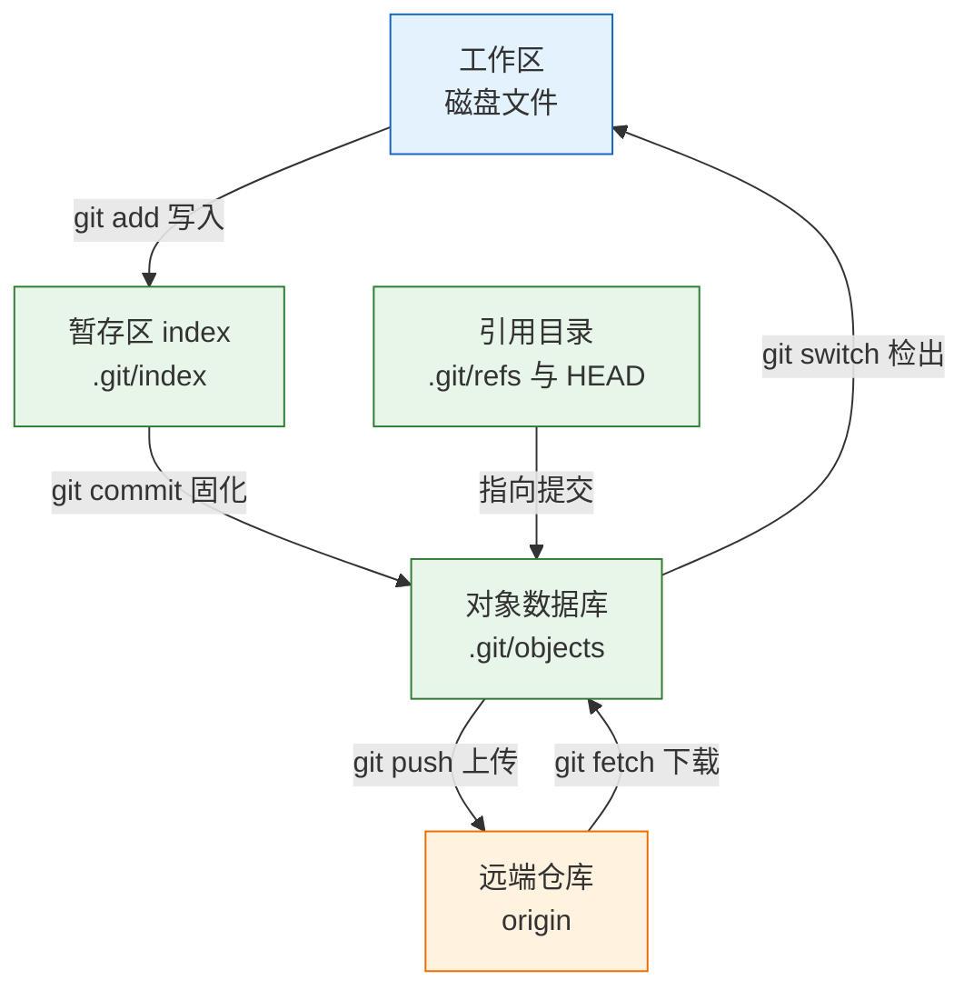
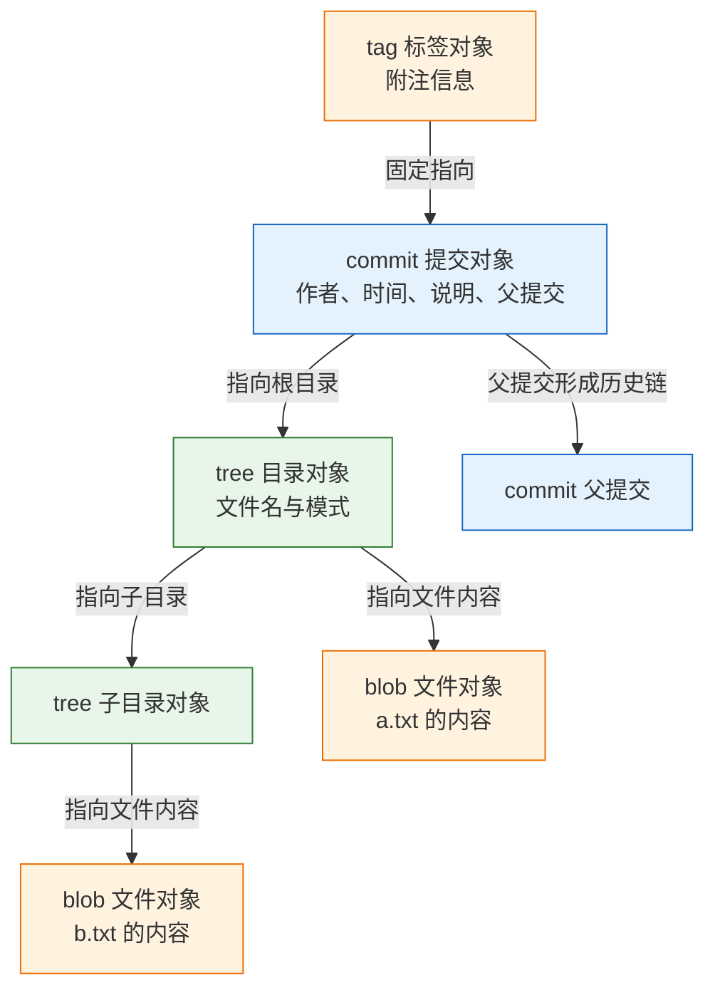
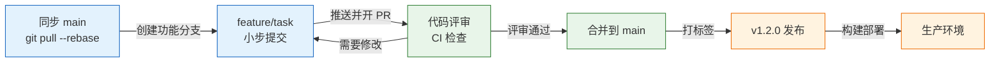
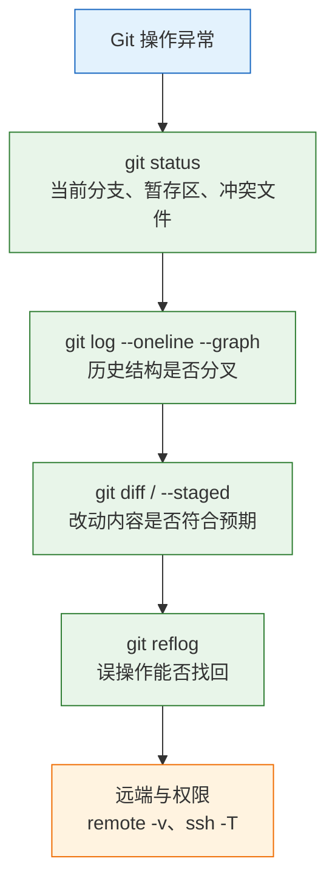

# Git 版本控制

---

## 一、Git 是什么

Git 是一个分布式版本控制系统，用内容寻址的对象数据库保存每一次完整快照，用可移动的指针表示分支。它解决三件事：改坏了能退、多人改能合、每次改动能说清为什么。

从运维与研发协作的视角看，Git 承担四项职责：

- **版本回溯**：任意历史提交都能完整还原，且不依赖服务器在线。
- **并行开发**：分支之间互不干扰，按需合并，功能可以独立交付。
- **协作审计**：作者、时间、说明、差异全部留痕，可追到某一行由谁引入。
- **发布管理**：标签固定交付版本，配合流水线完成构建与回滚。

它不解决的问题同样要提前划清：远端仓库不是备份系统，强推和误删照样丢数据；Git 不擅长存储大二进制文件；提交规范也不能代替测试与代码评审。

### 1.1 核心概念

Git 的核心不是"文件差异"，而是**快照加指针**。每次提交保存的是当时整个目录树的状态，未变化的文件通过对象复用指向同一份内容，因此快照并不臃肿。

| 概念 | 本质 | 常见操作 |
|---|---|---|
| 工作区 | 磁盘上可见的文件 | 编辑、编译、删除 |
| 暂存区 index | 下一次提交的内容清单 | `git add`、`git restore --staged` |
| 本地仓库 | `.git` 下的对象与引用 | `git commit`、`git log` |
| 分支 | 指向某个提交的可移动指针 | `git switch`、`git branch` |
| HEAD | 当前所在位置的指针 | 随切换与提交移动 |
| 标签 | 固定在某个提交上的名字 | `git tag` |

理解"分支只是一个指针"之后，很多命令就不再神秘：新建分支只是写一个只含提交哈希的引用文件，切换分支只是移动 HEAD 并替换工作区内容，删除分支只是删掉这个引用。提交对象本身一个都不会少，这也是误删分支后仍能用 reflog 找回的原因。

### 1.2 与相邻技术的关系

Git 不是版本控制的唯一形态。集中式的 SVN 只有服务器一份历史，提交必须联网；Git 每个克隆都是完整仓库，离线也能提交、看历史、开分支。托管平台 GitHub、GitLab、Gitee 只是建立在 Git 之上的协作层，提供权限、评审、流水线，本身不改变 Git 的对象模型。

| 技术 | 历史存放 | 分支成本 | 典型定位 |
|---|---|---|---|
| Git | 每个克隆各一份 | 极低，一个指针 | 现代研发主流 |
| SVN | 仅服务器 | 高，复制目录 | 老系统、二进制资产 |
| Git LFS | 指针入库，内容入对象存储 | 低 | 大文件版本管理 |
| GitHub / GitLab | 托管 Git 仓库 | 低 | 协作、评审、CI |

> **运维提示**：把 Git 当"网盘"用是事故起点。仓库里放构建产物、数据库备份、安装包，会让克隆越来越慢，且这些内容无法有效合并。

### 1.3 架构组成



`.git` 目录中真正需要认识的四部分：

- **objects**：所有 blob、tree、commit、tag 对象，按内容哈希分目录存放。
- **refs**：`heads` 存本地分支，`remotes` 存远端跟踪分支，`tags` 存标签。
- **index**：二进制暂存区，记录路径、模式、对象哈希与时间戳。
- **config**：仓库级配置，优先级高于全局配置。

`git gc` 会把松散对象打包成 packfile 并清理不可达对象；`git fsck` 用于校验对象完整性。日常不需要手工干预，但磁盘异常或强制关机后应检查一次。

---

## 二、安装与配置

> **版本现状（2026）**：Git 2.x 系列持续演进，具体小版本以官方发布和发行版仓库为准，用 `git --version` 确认。本文命令以 2.23 及以上为基线，`switch`、`restore` 两个子命令正是从 2.23 开始提供，更早版本需用 `checkout` 替代。

### 2.1 Linux 环境安装

```bash
# ========== 检查与安装 ==========
# 查看是否已安装及版本
git --version

# RHEL / CentOS / Rocky 系安装
sudo dnf install -y git

# Debian / Ubuntu 系安装
sudo apt update && sudo apt install -y git

# ========== 验证 ==========
# 确认可执行文件位置与版本
which git
git --version

# 查看编译期特性，确认支持 HTTPS 与 SSH 传输
git --exec-path
git help --config | head -5
```

发行版仓库的版本通常偏旧但稳定。需要新特性时，RHEL 系可用 `dnf module` 或官方 IUS 仓库，Debian 系可加官方 PPA；生产环境优先跟随发行版，避免自行编译带来的依赖问题。

### 2.2 macOS 与 Windows 环境安装

```bash
# ========== macOS ==========
# 安装命令行开发者工具，会附带 Git
xcode-select --install

# 或使用 Homebrew 安装较新版本
brew install git

# 确认实际调用的 Git 来源
which -a git
git --version

# ========== Windows（PowerShell） ==========
# 使用 winget 安装 Git for Windows
winget install --id Git.Git -e --source winget

# 验证，Git Bash 会一并安装
git --version
```

Git for Windows 自带 MinTTY 终端和 `git-bash`，换行符处理默认开启 `core.autocrlf=true`；macOS 与 Linux 应设为 `input`。三者混用时，靠 `.gitattributes` 统一比靠客户端配置可靠。

### 2.3 全局配置项

配置分三层，优先级从高到低为：仓库级 `.git/config`、全局 `~/.gitconfig`、系统级 `/etc/gitconfig`。用 `git config --list --show-origin` 可以看到每一项来自哪个文件。

```bash
# ========== 身份信息（提交必填） ==========
# 提交记录里的作者名与邮箱，必须与托管平台账号一致
git config --global user.name "Zhang San"
git config --global user.email "zhangsan@example.com"

# ========== 默认行为 ==========
# 新仓库默认分支名，避免出现 master/main 混用
git config --global init.defaultBranch main

# 拉取时默认变基，减少无意义的合并提交
git config --global pull.rebase true

# 仅允许快进合并，历史分叉时直接报错（与 pull.rebase 二选一）
git config --global pull.ff only

# 让 git push 默认只推当前分支
git config --global push.default simple

# ========== 编辑器与显示 ==========
# 指定提交信息编辑器
git config --global core.editor "vim"

# 中文路径不被转义成八进制
git config --global core.quotepath false

# 输出带颜色，便于区分状态
git config --global color.ui auto

# ========== 常用别名 ==========
# 用短命令替代高频组合
git config --global alias.st status
git config --global alias.lg "log --oneline --graph --decorate --all"
git config --global alias.last "log -1 --stat"

# ========== 核对配置来源 ==========
# 逐项列出并标注来自哪个配置文件
git config --list --show-origin
```

| 配置项 | 作用 | 建议值 |
|---|---|---|
| `user.name` / `user.email` | 提交作者身份 | 与平台账号一致 |
| `init.defaultBranch` | 新仓库默认分支 | `main` |
| `pull.rebase` | 拉取时是否变基 | `true` |
| `pull.ff` | 是否允许非快进合并 | `only` |
| `core.autocrlf` | 换行符自动转换 | Linux/macOS `input`，Windows `true` |
| `core.quotepath` | 中文路径显示 | `false` |
| `credential.helper` | 凭据缓存方式 | `cache` 或 `store` |

> **注意**：`pull.rebase` 与 `pull.ff` 是两种拉取策略，按团队规范选一种。同时配置时以变基为准，快进限制不会生效。

> **注意**：`credential.helper store` 会把账号密码或令牌明文写入 `~/.git-credentials`。多人共用的跳板机上不要使用，改用 `cache --timeout=3600` 或 SSH 密钥。

### 2.4 SSH 密钥与访问凭据

```bash
# ========== 生成密钥 ==========
# ed25519 更短更安全，GitHub/GitLab 均已支持
ssh-keygen -t ed25519 -C "zhangsan@example.com"

# 指定保存路径（默认 ~/.ssh/id_ed25519）
# 生成过程中可设置口令，进一步保护私钥

# ========== 加载与验证 ==========
# 启动代理并加入私钥
eval "$(ssh-agent -s)"
ssh-add ~/.ssh/id_ed25519

# 复制公钥内容，粘贴到平台的 SSH Keys 页面
cat ~/.ssh/id_ed25519.pub

# 测试连通性，首次会提示确认主机指纹
ssh -T git@github.com
ssh -T git@gitlab.com

# ========== 多账号场景 ==========
# 在 ~/.ssh/config 中为不同平台指定不同密钥
# Host github-work
#   HostName github.com
#   User git
#   IdentityFile ~/.ssh/id_ed25519_work
```

| 凭据方式 | 安全性 | 适用场景 |
|---|---|---|
| SSH 密钥 | 高，私钥不出本机 | 日常开发、服务器拉取 |
| HTTPS + 个人令牌 | 中，令牌可细粒度授权 | 脚本、CI 临时任务 |
| HTTPS + 账号密码 | 低，已被多数平台停用 | 不推荐 |
| 凭据明文存储 | 低，文件即密码 | 仅限个人独占机器 |

> **安全警告**：私钥 `id_ed25519` 绝不能提交到仓库、贴进工单或放进镜像。公钥可以公开，私钥泄露等同于账号被接管，必须立即在平台删除对应公钥并重新生成。

---

## 三、核心对象与基础命令

### 3.1 对象模型原理

Git 把一切内容都存成对象，用内容的 SHA 值寻址。四类对象构成一棵可递归的树：



内容相同则哈希相同，因此同一份文件在多个提交、多个分支里只存一份。这带来两个直接结果：分支和标签几乎不占空间；改动一个字节就会产生新对象，历史无法被悄悄篡改。

```bash
# ========== 观察对象 ==========
# 查看某次提交的对象类型
git cat-file -t HEAD

# 查看提交对象的完整内容：tree、parent、author、committer
git cat-file -p HEAD

# 递归查看根目录树
git cat-file -p HEAD^{tree}

# 计算一段内容的哈希，验证内容寻址
printf 'hello\n' | git hash-object --stdin

# ========== 查看仓库体积 ==========
# 统计对象数量与打包情况
git count-objects -vH
```

### 3.2 仓库初始化与提交

```bash
# ========== 创建仓库 ==========
# 在空目录初始化，生成 .git
mkdir git-demo && cd git-demo
git init

# 或从远端完整克隆，包含全部历史
git clone git@github.com:example/demo.git

# 只拉最近一次提交，适合只读构建
git clone --depth 1 git@github.com:example/demo.git

# ========== 提交闭环 ==========
# 新建文件并查看状态
printf 'hello\n' > a.txt
git status

# 加入暂存区
git add a.txt

# 提交并写清原因
git commit -m "feat: 新增示例文件 a.txt"

# 查看简略历史
git log --oneline

# ========== 一次提交多个文件 ==========
# 按路径添加，避免 git add . 误收临时文件
git add src/ docs/
git commit -m "docs: 补充接口说明"

# 交互式选择要暂存的片段
git add -p
```

```text
$ git status
On branch main
No commits yet
Untracked files:
  a.txt
```

`git add` 的确切含义是"把工作区当前内容写入对象库，并更新暂存区条目"。因此 `add` 之后继续改文件，再 `commit` 提交的仍是 `add` 那一刻的内容，这是新手最常见的误解。

### 3.3 查看与差异分析

| 命令 | 比较对象 | 典型用途 |
|---|---|---|
| `git diff` | 工作区 vs 暂存区 | 看还没暂存的改动 |
| `git diff --staged` | 暂存区 vs 最后一次提交 | 提交前复核 |
| `git diff HEAD` | 工作区 vs 最后一次提交 | 看本次全部改动 |
| `git diff main...feature` | 两分支分叉点 vs feature | 评审 PR 实际改动 |
| `git show <commit>` | 该提交 vs 其父提交 | 看单次提交内容 |
| `git blame <file>` | 逐行标注最后修改者 | 定位问题引入点 |

```bash
# ========== 差异对比 ==========
# 工作区与暂存区
git diff

# 暂存区与最新提交，提交前必看
git diff --staged

# 与指定提交比较某个文件
git diff HEAD~2 -- src/main.java

# 只看统计，不看具体行
git diff --stat

# ========== 历史检索 ==========
# 图形化查看所有分支
git log --oneline --graph --decorate --all

# 按作者与时间过滤
git log --author="zhangsan" --since="2026-01-01" --oneline

# 搜索提交说明
git log --grep="修复" --oneline

# 搜索代码内容变更
git log -S "connectTimeout" --oneline

# 查看某文件的修改历史，含重命名跟踪
git log --follow -p -- src/main.java

# ========== 二分定位 ==========
# 启动二分查找，标记当前为坏版本
git bisect start
git bisect bad
git bisect good v1.2.0
# 按提示检出中间提交并验证，直至定位
git bisect reset
```

`git log -S` 按"某字符串出现次数发生变化"筛选提交，比逐条看 diff 快得多。`git bisect` 在几十上百个提交里定位回归点时，人工排查通常要半天，二分只需 log₂N 次验证。

### 3.4 忽略规则与文件属性

`.gitignore` 只对**未跟踪文件**生效。已经提交过的文件，即使写进忽略规则仍会继续被跟踪，必须先 `git rm --cached` 移出索引。

```text
# ========== 依赖与构建产物 ==========
node_modules/
target/
dist/
*.class
*.jar

# ========== 日志与临时文件 ==========
*.log
*.tmp
.DS_Store

# ========== 密钥与环境配置 ==========
.env
.env.*
*.pem
*.key

# ========== IDE ==========
.idea/
.vscode/
*.iml

# ========== 例外规则 ==========
# 感叹号表示不忽略，可用于放行模板文件
!.env.example
```

```bash
# ========== 忽略规则排查 ==========
# 查看某文件为何被忽略，逐条列出命中的规则
git check-ignore -v .env

# 把已跟踪文件移出索引但保留磁盘文件
git rm --cached .env

# 提交忽略规则
git add .gitignore && git commit -m "chore: 补充忽略规则"
```

`.gitattributes` 解决的是另一类问题：换行符、二进制识别、合并策略、LFS 跟踪。

```text
# 自动识别文本文件并统一为 LF 入库
* text=auto eol=lf

# 二进制文件不参与行尾转换与文本合并
*.png binary
*.jar binary
*.xlsx binary

# 指定某类文件的合并驱动，避免锁文件冲突
package-lock.json merge=binary
```

> **注意**：换行符问题要在仓库建立初期解决。等几十个文件都提交后再加 `.gitattributes`，会触发一次全仓库的"虚假改动"，评审和 blame 都会被打乱。

---

## 四、分支与合并

### 4.1 分支引用模型

分支是 `.git/refs/heads/` 下的一个文本文件，内容是一个提交哈希。`HEAD` 则是一个指向分支名的符号引用。

```bash
# ========== 查看与创建 ==========
# 列出本地分支并显示上游与最后提交
git branch -vv

# 列出远端跟踪分支
git branch -r

# 新建并切换到功能分支
git switch -c feature/login

# 等价的老写法
git checkout -b feature/login

# ========== 切换与删除 ==========
# 切回主分支
git switch main

# 删除已合并分支
git branch -d feature/login

# 强制删除未合并分支
git branch -D feature/abandoned

# ========== 分离头指针 ==========
# 直接检出某个提交会进入 detached HEAD
git switch --detach v1.2.0

# 此时新建分支保存工作，避免提交丢失
git switch -c hotfix/from-tag
```

在 detached HEAD 状态下提交，提交对象真实存在，但没有任何分支指向它，切走后只能通过 reflog 找回。临时查看历史可以这样用，要改代码就必须先建分支。

### 4.2 合并策略

| 策略 | 触发条件 | 历史形态 | 适用场景 |
|---|---|---|---|
| fast-forward | 目标分支无新提交 | 线性，无合并提交 | 短生命周期功能分支 |
| three-way | 双方都有新提交 | 产生合并提交 | 公共分支集成 |
| `--no-ff` | 强制生成合并提交 | 保留功能分支边界 | 需要按功能回溯 |
| squash merge | 平台侧压缩 | 一个提交对应一个功能 | 提交较碎的功能分支 |

```bash
# ========== 常规合并 ==========
# 切到接收方分支
git switch main

# 合并功能分支，默认允许快进
git merge feature/login

# 强制保留合并提交，便于按功能回退
git merge --no-ff feature/login

# 压缩为一个提交再合并
git merge --squash feature/login
git commit -m "feat: 完成登录模块"

# ========== 合并前预演 ==========
# 查看将要合入的提交清单
git log --oneline main..feature/login

# 检查是否存在冲突，不实际改动
git merge --no-commit --no-ff feature/login
git merge --abort
```

`--squash` 不会记录父子关系，合并后 `git branch --merged` 认不出该分支已合并，删除时要用 `-D`。团队应统一策略，不要在同一个仓库里混用。

### 4.3 变基与历史整理

变基把当前分支独有的提交逐个"摘下来"，重新应用到目标分支的最新提交之后。历史因此变成一条直线，代价是提交哈希全部改变。

```bash
# ========== 常规变基 ==========
# 把功能分支接到最新 main 之后
git switch feature/login
git fetch origin
git rebase origin/main

# 冲突时解决后继续
git add <冲突文件>
git rebase --continue

# 放弃变基，回到操作前状态
git rebase --abort

# ========== 交互式整理 ==========
# 整理最近 3 个提交
git rebase -i HEAD~3

# 交互界面中的动作：
# pick   保留
# reword 修改提交说明
# edit   停下来修改内容
# squash 合并到上一个提交并编辑说明
# fixup  合并到上一个提交并丢弃说明
# drop   删除该提交
```

```text
pick 1a2b3c4 feat: 新增登录接口
squash 5d6e7f8 fix: 修正参数校验
reword 9a0b1c2 feat: 补充登录日志
```

> **运维红线**：不要对已经推送并被他人使用的分支执行 `rebase`，也不要随后 `push --force`。哈希改变会让所有人的本地历史与远端分叉，他人的提交可能被覆盖。只在自己的功能分支上整理历史。

变基的冲突可能按提交逐个出现，比一次性合并更磨人。分支存活时间越长、改动越集中，变基成本越高，这也是"小步提交、频繁同步"的现实理由。

### 4.4 冲突解决流程

冲突的本质是同一文件的同一区域被两边以不同方式修改，Git 无法判断取舍，于是把三方内容都写进文件。

```text
<<<<<<< HEAD
当前分支的内容
=======
要合并进来的内容
>>>>>>> feature/login
```

```bash
# ========== 定位冲突 ==========
# 列出冲突文件
git status

# 只看冲突文件清单
git diff --name-only --diff-filter=U

# ========== 选择一侧 ==========
# 整体采用当前分支版本
git checkout --ours src/config.yml

# 整体采用被合并分支版本
git checkout --theirs src/config.yml

# 显示共同祖先、双方版本，辅助人工判断
git checkout --conflict=diff3 src/config.yml

# ========== 完成合并 ==========
# 手工编辑去掉标记后标记为已解决
git add src/config.yml
git commit

# 变基场景用 continue 而不是 commit
git rebase --continue

# 放弃本次合并
git merge --abort
```

冲突解决后必须确认文件里不再残留 `<<<<<<<`、`=======`、`>>>>>>>` 三种标记。用 `grep -rn "<<<<<<<" .` 扫一遍，比肉眼检查可靠。

> **运维提示**：开启 `git config --global rerere.enabled true` 后，Git 会记住同一冲突的解法，重复变基或反复合并时自动套用，长期维护的分支收益明显。

---

## 五、远端协作

### 5.1 远端仓库配置

```bash
# ========== 添加与查看 ==========
# 添加名为 origin 的远端
git remote add origin git@github.com:example/demo.git

# 查看远端地址
git remote -v

# 查看远端分支、HEAD 与跟踪关系
git remote show origin

# ========== 修改与清理 ==========
# 仓库迁移后改写地址
git remote set-url origin git@gitlab.com:example/demo.git

# 重命名远端
git remote rename origin upstream

# 删除远端配置，不影响服务器
git remote remove upstream

# 清理远端已删除分支对应的本地跟踪引用
git fetch --prune
```

| 场景 | 命令 | 说明 |
|---|---|---|
| 首次关联 | `git remote add origin <url>` | 只写配置，不传数据 |
| 地址变更 | `git remote set-url origin <url>` | 保留跟踪关系 |
| 分支已删 | `git fetch --prune` | 清掉 `origin/xxx` 残留 |
| 查看详情 | `git remote show origin` | 显示跟踪与过期分支 |
| 多远端 | `git remote add upstream <url>` | fork 场景同步原仓库 |

### 5.2 推送与拉取

```bash
# ========== 首次推送 ==========
# -u 建立跟踪关系，之后可直接 git push
git push -u origin main

# 推送功能分支
git push -u origin feature/login

# ========== 日常同步 ==========
# 只下载不合并，最安全的查看方式
git fetch origin

# 查看本地与远端的差距
git log --oneline HEAD..origin/main

# 拉取并变基，保持线性历史
git pull --rebase

# 只允许快进，分叉时报错而非自动合并
git pull --ff-only

# ========== 删除远端分支 ==========
# 删除已合并的功能分支
git push origin --delete feature/login

# ========== 强制推送（危险） ==========
# 仅在确认分支无人使用、且已备份时执行
git push --force-with-lease
```

> **运维红线**：`git push --force` 会覆盖远端历史，他人的提交可能直接消失。确需改写时只用 `--force-with-lease`，它会在远端比本地预期更新时拒绝推送，留出一次人工确认的机会。

`fetch` 与 `pull` 的区别是排障时的关键：`fetch` 只更新 `origin/*` 引用，不动工作区；`pull` 等于 `fetch` 加合并或变基。怀疑拉错东西时，先 `fetch` 再看 `log`，比直接 `pull` 安全。

### 5.3 标签与版本发布

| 类型 | 命令 | 是否含元数据 | 用途 |
|---|---|---|---|
| 轻量标签 | `git tag v1.0.0` | 否，仅指针 | 临时标记 |
| 附注标签 | `git tag -a v1.0.0 -m "..."` | 是，含作者与说明 | 正式发布 |
| 签名标签 | `git tag -s v1.0.0 -m "..."` | 是，含 GPG 签名 | 高可信交付 |

```bash
# ========== 创建标签 ==========
# 在当前提交打附注标签
git tag -a v1.2.0 -m "release v1.2.0"

# 给历史提交补打标签
git tag -a v1.1.1 3f2a1b0 -m "release v1.1.1"

# 查看标签及说明
git tag -l "v1.*"
git show v1.2.0

# ========== 推送标签 ==========
# 推送单个标签
git push origin v1.2.0

# 推送全部本地标签
git push origin --tags

# ========== 删除标签 ==========
# 删除本地标签
git tag -d v1.2.0

# 删除远端标签
git push origin --delete v1.2.0
```

`git push` 默认不推送标签，这是常见遗漏：代码已经上线，远端却查不到版本标记。发布流水线应显式推送标签，并用 `git describe --tags` 生成构建号。

### 5.4 分支协作流程



```bash
# ========== 完整功能分支流程 ==========
# 1. 同步主干
git switch main
git pull --rebase

# 2. 建分支
git switch -c feature/task-list

# 3. 小步提交
git add src/task/
git commit -m "feat: 新增任务列表接口"

# 4. 同步主干改动
git fetch origin
git rebase origin/main

# 5. 推送并开 PR
git push -u origin feature/task-list
```

合并前检查清单：

- CI 是否全绿，测试是否覆盖本次改动。
- diff 是否只包含本功能，有没有混入格式化改动。
- 是否误带密钥、日志、构建产物、本地配置。
- 提交信息是否说明"为什么"，而不只是"改了什么"。
- 冲突是否真正解决，有没有残留标记。

---

## 六、回退与恢复

### 6.1 工作区与暂存区撤销

```bash
# ========== 撤销工作区修改 ==========
# 用暂存区内容覆盖工作区，未暂存的修改会丢
git restore a.txt

# 从指定提交恢复文件内容
git restore --source=HEAD~2 a.txt

# ========== 撤销暂存 ==========
# 把文件移出暂存区，工作区内容保留
git restore --staged a.txt

# 等价的老写法
git reset HEAD a.txt

# ========== 清理未跟踪文件 ==========
# 预演将删除哪些文件，不实际删除
git clean -nd

# 删除未跟踪文件与目录
git clean -fd
```

> **运维红线**：`git clean -fdx` 会删除所有未跟踪文件，包括 `-x` 忽略规则里的 `.env`、本地数据库、编译产物，且不进回收站、没有 reflog 可救。执行前必须先跑 `git clean -ndx` 逐条核对。

### 6.2 提交修正与指针移动

`reset` 移动当前分支指针，并按模式决定是否同步暂存区与工作区。

| 模式 | 分支指针 | 暂存区 | 工作区 | 用途 |
|---|---|---|---|---|
| `--soft` | 移动 | 保留 | 保留 | 重新组织提交 |
| `--mixed`（默认） | 移动 | 重置 | 保留 | 撤销提交并重新暂存 |
| `--hard` | 移动 | 重置 | 重置 | 彻底丢弃 |

```bash
# ========== 修正最近一次提交 ==========
# 补充遗漏文件，不新增提交
git add forgotten.java
git commit --amend --no-edit

# 同时修改提交说明
git commit --amend -m "feat: 完整描述本次改动"

# ========== 撤销提交但保留改动 ==========
# 改动回到暂存区
git reset --soft HEAD~1

# 改动回到工作区
git reset HEAD~1

# 彻底丢弃最近一次提交及其改动
git reset --hard HEAD~1
```

> **运维红线**：`git reset --hard` 会同时丢弃暂存区和工作区的未提交内容，且不可通过 reflog 恢复未提交部分。执行前先 `git status` 确认，必要时 `git stash` 留一份。

### 6.3 公共历史回退

已经推送的提交不能靠 reset 回退，否则必须强推并改写他人历史。正确做法是 `revert`：生成一个内容相反的新提交，历史只增不改。

```bash
# ========== 回退单个提交 ==========
# 生成反向提交，撤销指定提交的改动
git revert <commit>

# 只生成改动不自动提交，便于合并多个回退
git revert -n <commit-a> <commit-b>
git commit -m "revert: 撤销两次问题提交"

# ========== 回退合并提交 ==========
# 合并提交有两个父，-m 1 表示保留主线一侧
git revert -m 1 <merge-commit>

# ========== 冲突处理 ==========
# 解决后继续
git revert --continue

# 放弃回退
git revert --abort
```

回退合并提交后，被回退分支的提交仍被视为"已合并"，再次合并不会带入改动，需要先 revert 那次 revert，或重新提交。这个坑在生产回滚时经常出现，操作前应确认后续合入计划。

### 6.4 丢失提交找回

reflog 记录 HEAD 与分支引用的每次移动，默认保留 90 天，是误操作后的第一道保险。

```bash
# ========== 查看移动历史 ==========
# 列出 HEAD 的移动记录
git reflog

# 查看指定分支的移动记录
git reflog show feature/login

# 带时间与操作类型，便于定位
git reflog --date=iso

# ========== 恢复 ==========
# 用找到的哈希新建分支，先保住提交再说
git switch -c rescue <sha>

# ========== 对象级找回 ==========
# 扫描悬空对象，找回无引用的提交
git fsck --lost-found

# 查看悬空提交内容
git show <dangling-commit>
```

> **注意**：reflog 是本地的、非共享的。换一台机器克隆不会带上别人的 reflog；超过保留期或执行 `git gc --prune=now` 后，悬空对象会被真正删除。找回提交后先在新分支上验证，确认无误再合并回原分支，不要直接用 `reset --hard` 覆盖现有工作。

### 6.5 临时保存与恢复

切换分支、临时修线上问题时，未提交的改动需要一个不产生提交的去处，这就是 stash。

```bash
# ========== 保存现场 ==========
# 保存已跟踪文件的改动，带说明便于识别
git stash push -m "wip: 登录接口调试"

# 连同未跟踪文件一起保存
git stash push -u -m "wip: 含新增文件"

# ========== 查看与恢复 ==========
# 列出所有 stash
git stash list

# 恢复最近一条并从列表移除
git stash pop

# 恢复指定条目但保留记录
git stash apply stash@{1}

# 查看某条 stash 的内容
git stash show -p stash@{0}

# ========== 清理 ==========
# 删除指定条目
git stash drop stash@{0}
```

> **注意**：stash 不是长期存储，也不进入远端。它只存在于本地 `.git` 中，重装系统或删除仓库即消失。超过一周的改动应转成提交放到临时分支。

### 6.6 历史清理与大文件治理

密钥误提交、大文件拖慢仓库，都需要重写历史。`git filter-branch` 已被官方标记为不推荐，应使用 `git filter-repo`。

```bash
# ========== 安装工具 ==========
# pip 安装 git-filter-repo
pip install git-filter-repo

# ========== 清理指定文件 ==========
# 从全部历史中移除某个文件
git filter-repo --path config/secret.yml --invert-paths
```

> **安全警告**：`git filter-repo` 会重写全部提交哈希，等同于换了一个仓库。执行前必须完整备份，通知所有协作者重新克隆，并立即吊销已泄露的密钥——清理历史不能替代吊销，密钥一旦推送就应视为已泄露。

```bash
# ========== 迁移大文件到 LFS ==========
# 安装 LFS 并声明跟踪规则
git lfs install
git lfs track "*.psd"
git add .gitattributes

# 把历史中的大文件转成 LFS 指针
git lfs migrate import --include="*.psd" --everything

# ========== 清理后核对 ==========
# 检查仓库体积
git count-objects -vH

# 校验对象完整性
git fsck --full
```

---

## 七、常见排障

| 现象 | 最可能原因 | 处理 |
|---|---|---|
| `detached HEAD` | 检出了提交或标签而非分支 | `git switch -c <新分支>` 保存，或切回分支 |
| 合并冲突 | 两边改了同一区域 | 手工融合，`git add` 后 `git commit` |
| `push rejected` / `non-fast-forward` | 远端有新提交 | `git fetch` 后 `rebase origin/main` 再推 |
| 提交了密钥 | 密钥进入历史 | 立即吊销，再用 `git filter-repo` 清理 |
| 提交信息写错 | 最近一次未推送 | `git commit --amend` |
| 误 `reset --hard` | 分支指针被移动 | `git reflog` 找哈希，建 rescue 分支 |
| 换行符满屏 diff | 跨平台换行不一致 | 配 `.gitattributes`，统一 `text=auto eol=lf` |
| 仓库体积异常 | 历史中有大二进制 | `git count-objects -vH` 定位，`filter-repo` 或 LFS 治理 |
| 拉取后大量冲突 | 长期未同步 | 缩短分支寿命，频繁 `fetch` 与 `rebase` |
| `fatal: refusing to merge unrelated histories` | 两个独立仓库强行合并 | 确认无共同历史后加 `--allow-unrelated-histories` |
| `Permission denied (publickey)` | SSH 密钥未加载或未登记 | `ssh-add`，`ssh -T` 验证，检查 `~/.ssh/config` |
| 文件名中文显示为八进制 | `core.quotepath` 默认开启 | `git config --global core.quotepath false` |



排障顺序按"先看状态、再看历史、最后才动手"推进：

1. `git status` 确认当前分支、暂存内容、是否存在冲突。
2. `git log --oneline --graph --all` 看清历史是否分叉、HEAD 在哪。
3. `git diff` 与 `git diff --staged` 核对实际改动，避免带着意外内容提交。
4. `git reflog` 在误 reset、误删分支后定位原提交。
5. 确认无未提交改动后，才使用 `reset`、`revert`、`clean` 等破坏性命令。
6. 涉及远端时检查 `git remote -v` 与 `ssh -T`，区分网络、权限、历史三类问题。

> **运维提示**：破坏性操作前统一执行 `git stash push -m "before-reset"` 或 `git branch backup/$(date +%s)`，成本几秒，恢复时省几小时。

> **运维提示**：三句话收束全篇——Git 存的是快照，分支是指针，HEAD 是当前位置；公共历史不改写，自己的功能分支才可以变基；先看 `status`、`diff`、`reflog`，再考虑 `reset`。
