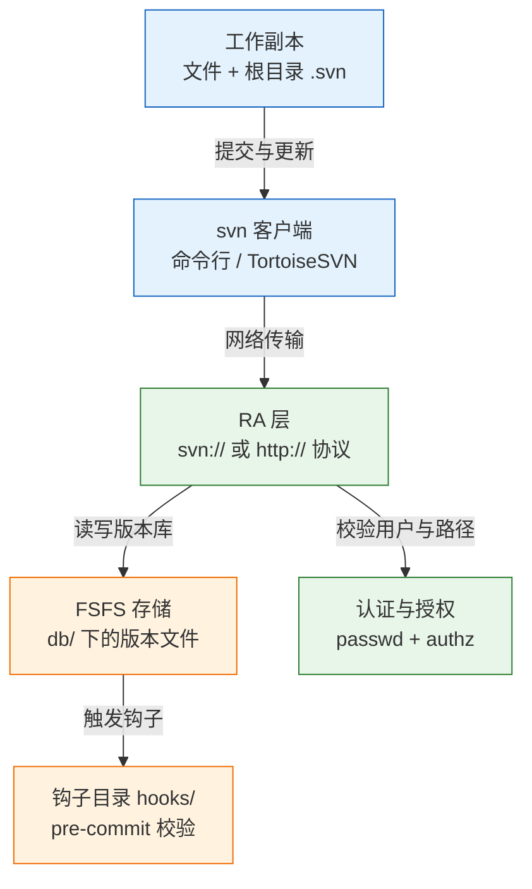
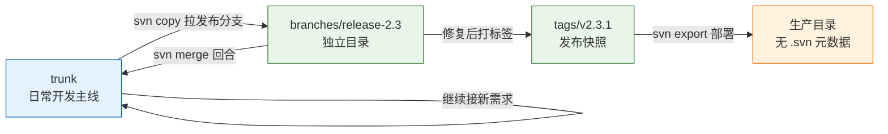
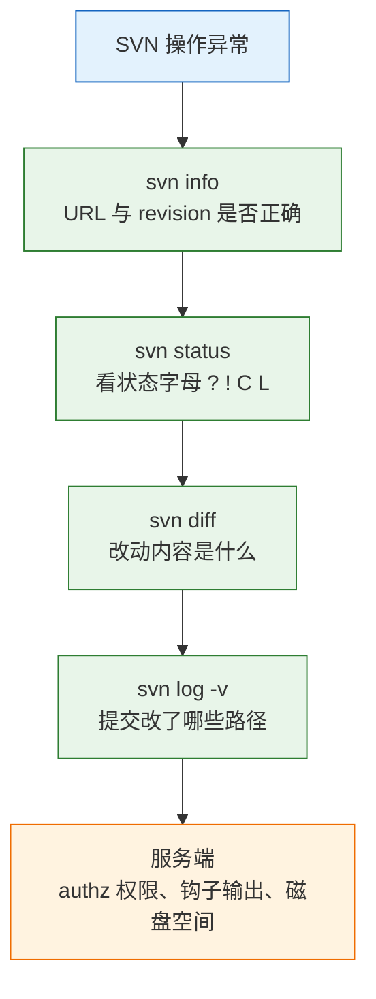

# SVN 版本管理

---

## 一、SVN 是什么

Subversion（简称 SVN）是集中式版本控制系统：历史只有服务器上一份，每个开发者持有一份工作副本，提交直接写服务器。它用全局递增的整数标识版本，用目录复制表示分支。理解这三句话，就不会拿 Git 的手感去用它。

2026 年新开项目基本不会选 SVN，但运维仍会大量遇到它：

- 电力、烟草、制造、政务的老系统维护多年，改一个需求就要进 SVN。
- 甲方机房部署 VisualSVN Server，外包只能连上去干活。
- 仓库里全是 Excel、Word、CAD 图纸和几百兆安装包，团队需要能锁文件的中央仓库。
- 合规要求"谁在什么时候改了哪个目录"，SVN 的目录级授权与全局版本号恰好对得上审计口径。

所以学 SVN 的目的不是选型，而是**能接手、能发布、能排障**。重点在检出、更新、提交这个闭环，冲突处理，分支与标签的目录约定，以及服务端权限和钩子。

它不解决的问题也要提前划清：服务器不可用则全队停摆；没有本地提交，误操作找不回来；分支是复制目录，开多了服务器上到处是副本。这些不是缺陷，是集中式的代价。

### 1.1 核心概念

| 概念 | 所在位置 | 作用 |
|---|---|---|
| repository | 服务器 | 保存全部版本与历史 |
| working copy | 本地 | 开发者编辑的那份文件树 |
| `.svn/` | 工作副本根目录 | 记录基准版本、URL、属性、原始副本 |
| revision | 服务器 | 每次提交产生的全局递增整数 |
| trunk / branches / tags | 仓库目录 | 约定俗成的开发主线、分支、标签 |

`.svn/` 自 1.7 起只在工作副本根目录存在一个，早期版本每层目录各有一个。它保存"上次更新时的原始内容"，因此 `svn diff` 不联网也能算出差异。**删掉它，工作副本就失去基准，只能重新检出。**

另一个必须建立的概念是**混合版本工作副本**：一次 `svn update` 只更新到某个 revision，之后服务器又有新提交，本地各文件可能停留在不同 revision。`svn status -u` 才能看到与服务器最新版的差距。

### 1.2 与相邻技术的关系

| 维度 | SVN | Git |
|---|---|---|
| 历史存放 | 仅服务器 | 每个克隆完整一份 |
| 本地提交 | 没有这一层 | 有 |
| 断网 | 不能提交，看不到新历史 | 照常提交与查看 |
| 版本标识 | 全局递增整数 `r1524` | 内容哈希 |
| 分支 | 服务器上的目录副本 | 一个指针 |
| 权限 | 原生目录级授权 | 依赖平台与分支保护 |
| 大二进制 | 天然适合，可加锁 | 需 LFS，合并仍痛苦 |
| 撤销已提交 | 反向合并再提交 | `git revert` |

SVN 与 Git 的差异不在命令拼写，而在**历史归属**。Git 的提交先落本地，推送才同步；SVN 的提交必须直达服务器，因此网络、权限、锁、钩子都会直接影响一次提交能否成功。

### 1.3 架构组成



服务端由三层构成：

- **RA（Repository Access）层**：处理 `svn://`、`svn+ssh://`、`http://` 三种访问方式，负责协议解析与会话。
- **FSFS 存储层**：默认后端，每次提交写一个增量版本文件，崩溃后不易整体损坏；另一后端 BDB 已不推荐。
- **钩子与授权**：`hooks/` 下的脚本在提交前后执行，`conf/authz` 控制路径级读写权限。

客户端只做两件事：把工作副本的改动打包上传，或把服务器的新版本下载合并。所有版本计算都在服务器完成。

---

## 二、安装与配置

> **版本现状（2026）**：Subversion 1.x 系列仍在维护，长期存在的 1.14 分支仍有大量部署，具体小版本以 `svn --version` 与官方发布为准。客户端版本不应低于工作副本格式要求，服务端与客户端尽量保持同一小版本系列。

### 2.1 服务端安装

```bash
# ========== Linux 安装 ==========
# RHEL / CentOS 系，同时安装服务端与 Apache 模块
sudo dnf install -y subversion mod_dav_svn

# Debian / Ubuntu 系
sudo apt update && sudo apt install -y subversion libapache2-mod-svn

# 查看版本与支持的协议
svn --version
svnserve --version

# ========== 创建仓库 ==========
# 建立仓库目录
sudo mkdir -p /data/svn

# 创建仓库，生成 conf、db、hooks、locks 等目录
sudo svnadmin create /data/svn/power-ems

# 查看仓库结构
ls /data/svn/power-ems

# ========== 启动 svnserve ==========
# 前台运行，便于观察日志与验证配置，确认后按 Ctrl+C 退出
sudo svnserve --foreground -r /data/svn

# 验证端口监听（svn 默认 3690）
ss -lntp | grep 3690

# ========== 设为系统服务 ==========
# 写入 systemd 单元后启用
sudo systemctl enable --now svnserve
```

| 组件 | 作用 | 备注 |
|---|---|---|
| `svnadmin` | 创建、备份、恢复、校验仓库 | 只在服务器执行 |
| `svnserve` | 轻量服务进程，走 `svn://` | 配置简单，适合内网 |
| `mod_dav_svn` | Apache 模块，走 `http(s)://` | 便于统一认证与反向代理 |
| `svnsync` | 仓库镜像同步 | 异地容灾 |

### 2.2 客户端安装

```bash
# ========== Linux 客户端 ==========
# 只装命令行客户端，不装服务端
sudo dnf install -y subversion
# 或
sudo apt install -y subversion

# ========== macOS ==========
# 安装命令行客户端
brew install subversion

# ========== Windows ==========
# 使用 winget 安装 TortoiseSVN（含命令行工具）
winget install --id TortoiseSVN.TortoiseSVN -e

# 验证
svn --version --quiet
```

Windows 上 TortoiseSVN 的图形操作与命令行等价，但排障时应优先用命令行，输出更完整、可复制、可对照日志。图形客户端留下的锁与缓存问题，也往往要靠 `svn cleanup` 解决。

### 2.3 仓库创建与目录布局

标准布局不是 SVN 强制要求，而是全行业的约定。没有它，分支、标签、迁移工具都无从识别。

```bash
# ========== 建立标准布局 ==========
# 在仓库根下创建三个顶层目录，一次提交产生一个 revision
svn mkdir -m "init: 建立 trunk/branches/tags 布局" \
  svn://svn.example.com/repos/power-ems/trunk \
  svn://svn.example.com/repos/power-ems/branches \
  svn://svn.example.com/repos/power-ems/tags

# 查看仓库根目录
svn list svn://svn.example.com/repos/power-ems

# ========== 导入初始代码 ==========
# 把本地已有项目导入 trunk，注意不要导入 .svn 与编译产物
svn import ./power-ems-init svn://svn.example.com/repos/power-ems/trunk \
  -m "init: 导入初始代码" \
  --username zhangsan
```

```text
/repos/power-ems
├── trunk/                    日常开发主线
├── branches/
│   ├── release-2.3/          发布维护
│   └── feature-station/      功能分支
└── tags/
    ├── v2.3.0/
    └── v2.3.1/               发布快照，约定不再修改
```

`svn import` 只上传，不会在本地生成工作副本，导入后仍需 `checkout` 才能编辑。导入前应清理 `target/`、`node_modules/`、`*.log`，否则这些内容会永久留在历史里。

### 2.4 访问权限配置

```bash
# ========== 编辑 svnserve.conf ==========
# 关闭匿名访问，指定认证与授权文件
sudo vim /data/svn/power-ems/conf/svnserve.conf
```

```ini
[general]
# 匿名用户无任何权限
anon-access = none
# 认证用户可读
auth-access = write
# 密码文件与授权文件
password-db = passwd
authz-db = authz
# 认证域，影响客户端凭据缓存
realm = power-ems
```

```bash
# ========== 添加账号 ==========
# 格式：用户名 = 明文密码（建议配合 HTTPS 或 SSH 隧道）
sudo vim /data/svn/power-ems/conf/passwd

# ========== 配置路径级授权 ==========
sudo vim /data/svn/power-ems/conf/authz

# 改完重启服务
sudo systemctl restart svnserve

# 用指定账号验证读取权限
svn list svn://svn.example.com/repos/power-ems/trunk --username zhangsan
```

```ini
[groups]
dev = zhangsan,lisi
outsource = wangwu

# 开发组可读写主干与分支
[/trunk]
@dev = rw
@outsource = r

# 发布标签只读，任何人不得修改
[/tags]
@dev = r
@outsource =
* =

# 外包只能读核心模块
[/trunk/src/core]
@outsource = r
```

> **安全警告**：`passwd` 中的密码是明文存储，`svn://` 协议本身也不加密。跨公网必须走 `svn+ssh://` 或 Apache 的 HTTPS，否则密码与源码都可能被抓包。生产仓库还应禁止匿名读，避免目录结构外泄。

---

## 三、核心对象与日常命令

### 3.1 工作副本原理

工作副本不是"一份文件"，而是"文件 + 一份基准数据库"。`.svn/wc.db` 是 SQLite 数据库，记录每个路径的基准 revision、原始校验和、属性、锁信息。

```bash
# ========== 查看工作副本信息 ==========
# 当前路径、URL、相对 URL、仓库根、revision
svn info

# 只看某个字段，便于脚本取值
svn info --show-item revision
svn info --show-item url

# ========== 查看元数据目录 ==========
# 根目录只有一个 .svn
ls -a | grep svn
ls .svn

# 检查工作副本完整性并修复中断的操作
svn cleanup
```

因为这个基准库存在，`svn status`、`svn diff` 都不需要联网就能给出结果；也因为它存在，工作副本不能像普通目录一样随意复制、改名、用 `rsync` 同步。复制出来的工作副本会带着旧 URL 和旧锁记录。

### 3.2 检出与更新

```bash
# ========== 检出 ==========
# 检出主干到本地目录
svn checkout svn://svn.example.com/repos/power-ems/trunk power-ems \
  --username zhangsan

# 只检出某个子目录，减少数据量
svn checkout svn://svn.example.com/repos/power-ems/trunk/src/core core \
  --username zhangsan

# 检出指定历史版本（只读排查用）
svn checkout -r 1500 svn://svn.example.com/repos/power-ems/trunk power-ems-r1500

# ========== 更新 ==========
# 更新到最新版
svn update

# 更新到指定版本
svn update -r 1520

# 预演更新，只看会改动哪些文件
svn status -u

# 遇到冲突先挂起，留待人工处理
svn update --accept postpone
```

`svn update` 的输出字母需要能读：`U` 表示文件被更新，`G` 表示自动合并成功，`C` 表示冲突，`D` 表示被删除，`A` 表示新增，`E` 表示目录被替换。

### 3.3 状态与差异

| 字母 | 含义 | 处理方式 |
|---|---|---|
| `M` | 内容被修改 | 正常提交 |
| `A` | 已 add，待提交 | 正常提交 |
| `D` | 已标记删除 | 正常提交 |
| `?` | 未纳入版本控制 | 需要则 `svn add`，否则配忽略 |
| `!` | 文件丢失（被系统命令删除） | `svn update` 拉回或 `svn delete` |
| `C` | 冲突 | 解决后 `svn resolve` |
| `G` / `U` | 自动合并成功 / 已更新 | 无需处理 |
| `L` | 本地持有锁 | 提交后 `svn unlock` |

```bash
# ========== 查看状态 ==========
# 列出本地改动
svn status

# 同时显示与服务器最新版的差距，* 表示有新版本
svn status -u

# 显示未跟踪文件（默认也会显示 ?）
svn status --no-ignore

# ========== 查看差异 ==========
# 工作副本与基准版本的差异
svn diff

# 指定文件
svn diff src/main/java/com/power/report/ReportController.java

# 两个 revision 之间
svn diff -r 1523:1524

# 两个分支之间
svn diff ^/trunk ^/branches/release-2.3

# 只列出有变动的路径与变更类型
svn diff --summarize
```

`svn diff` 不带参数比较的是"工作副本 vs 基准版本"，也就是本地尚未提交的改动。要比较已提交的两个版本必须显式给 `-r`。

### 3.4 提交与属性管理

```bash
# ========== 提交闭环 ==========
# 1. 看清自己改了什么
svn status

# 2. 确认内容无误
svn diff

# 3. 拉取别人的改动，避免 out of date
svn update

# 4. 再确认一次没有冲突
svn status

# 5. 提交并写明原因
svn commit -m "feat: 新增按台区统计导出功能"

# ========== 新增与删除 ==========
# 新文件必须先 add，否则 commit 会静默跳过
svn add src/main/java/com/power/report/StationReportService.java

# 递归添加整个目录
svn add src/main/java/com/power/report/

# 删除文件必须用 svn delete，不要直接 rm
svn delete src/main/java/com/power/report/OldService.java

# 删除但保留本地文件
svn delete --keep-local config/local.properties

# ========== 属性管理 ==========
# 设置忽略规则，只对当前目录下的未跟踪项生效
svn propset svn:ignore "target
*.log
.idea" .

# 查看属性
svn propget svn:ignore .
svn proplist -v .

# 提交属性变更
svn commit -m "chore: 配置忽略规则"

# 递归设置可执行位
svn propset svn:executable on bin/start.sh
```

> **注意**：`svn:ignore` 只对**未跟踪**文件生效，且默认不递归。已经被提交的 `target/` 目录，必须先 `svn delete --keep-local target` 再提交，忽略规则才会起作用。

`svn commit` 是原子的：一次提交里的所有文件要么全部成功，要么全部失败。只要有一个文件冲突、被锁或权限不足，整次提交都不会产生 revision，不会出现"一半新一半旧"。

### 3.5 完整提交流程示例

以"修复报表导出中文乱码"为例，从同步到提交走一遍完整闭环。

```bash
# ========== 1. 同步到最新 ==========
# 提交前先更新，减少 out of date 的概率
svn update

# ========== 2. 确认起点干净 ==========
# 正常应无输出；有 M 说明本地已有未提交改动
svn status

# ========== 3. 修改文件 ==========
# 只改需要改的部分，避免整文件格式化
vim src/main/java/com/power/report/ReportController.java

# ========== 4. 复核改动 ==========
# 确认差异只包含编码相关行
svn diff src/main/java/com/power/report/ReportController.java

# ========== 5. 再次同步 ==========
# 若有人在此期间提交同一文件，此处会合并或产生冲突
svn update

# ========== 6. 提交 ==========
# 说明写清现象与修法，便于日后追溯
svn commit -m "fix: 导出文件强制 UTF-8，修复中文乱码"

# ========== 7. 验证结果 ==========
# 确认提交落在正确路径与 revision
svn log -v -l 1

# 确认服务器内容就是修复后的版本
svn cat -r HEAD src/main/java/com/power/report/ReportController.java | head -20

# 确认工作副本干净且与服务器同步
svn status -u
```

```text
Sending        src/main/java/com/power/report/ReportController.java
Transmitting file data .done
Committed revision 1526.
```

七个步骤中，第 4 步和第 5 步最容易被跳过。跳过 `diff` 会把调试代码、本地路径、临时日志一起提交；跳过 `update` 则会在提交时被服务器拒绝，白改一次说明。`svn status -u` 无 `*` 且 `svn status` 无输出，才算真正收尾。

---

## 四、分支、标签与合并

### 4.1 目录式分支模型

SVN 没有内置分支对象。`trunk / branches / tags` 只是约定，靠人遵守。`svn copy` 在服务端做链接式存储，不占双倍空间，但语义上是独立目录，各有完整文件树。



tag 也不是只读的。想真正只读，只能在服务器 `authz` 里限制写权限；否则任何人都能往 `tags/v2.3.1` 里继续提交，版本号就失去意义。

### 4.2 分支创建与检出

```bash
# ========== 创建分支 ==========
# ^/ 表示仓库根，避免写全 URL
svn copy ^/trunk ^/branches/release-2.3 \
  -m "create branch release-2.3 for v2.3.1"

# 查看分支列表
svn list ^/branches/

# ========== 检出分支 ==========
# 在另一个目录检出，不要用同一个工作副本切来切去
svn checkout svn://svn.example.com/repos/power-ems/branches/release-2.3 \
  ems-release-2.3

# 确认所在分支
svn info | grep URL
```

同一工作副本用 `svn switch` 切分支虽然可行，但会把未提交改动一起带过去，且容易忘记自己在哪条线上。发布维护应使用独立目录，路径名与分支名对应。

```bash
# ========== 切换（仅在明确后果时使用） ==========
# 把当前工作副本切到另一分支
svn switch ^/branches/release-2.3

# 切回主干
svn switch ^/trunk

# 切换前先确认没有未提交改动
svn status
```

### 4.3 合并与 mergeinfo

```bash
# ========== 合并分支到主干 ==========
# 切到接收方的工作副本
cd ../power-ems
svn update

# 合并指定分支的全部未合并改动
svn merge ^/branches/release-2.3

# 只合并指定 revision
svn merge -c 1526 ^/branches/release-2.3

# 合并一个 revision 区间
svn merge -r 1526:1530 ^/branches/release-2.3

# ========== 查看与提交 ==========
# 合并只改工作副本，先看差异
svn diff | head -30

# 再提交，mergeinfo 才会记录
svn commit -m "merge: 合并 release-2.3 的乱码修复到 trunk"

# 核对合并账本
svn propget svn:mergeinfo .
```

`svn:mergeinfo` 是合并账本，记录"这个路径合并过哪些 revision"。它不理解语义，只做记账。上次合并后不提交，账就没记上，下一次 merge 会把同一批改动再合一遍，产生重复修改甚至冲突。

> **运维红线**：不要手工编辑 `svn:mergeinfo`。它一旦错乱，后续合并会漏合或重合，修复成本远高于重新检出。确需修正时先备份工作副本，并用 `svn propget` 逐条核对。

### 4.4 标签发布与导出

```bash
# ========== 打标签 ==========
# 从发布分支复制出标签，产生新 revision
svn copy ^/branches/release-2.3 ^/tags/v2.3.1 -m "tag v2.3.1"

# 确认标签指向
svn info ^/tags/v2.3.1

# ========== 导出部署 ==========
# 导出干净目录，不含 .svn，适合直接上线
svn export -r 1527 ^/tags/v2.3.1 /opt/app/releases/v2.3.1 --force

# 导出后核对文件清单
ls /opt/app/releases/v2.3.1

# ========== 查看发布历史 ==========
# 查看标签目录的提交记录
svn log -v ^/tags/v2.3.1

# 查看某文件最近两次修改
svn log -l 2 src/main/java/com/power/report/ReportController.java
```

部署时不要用 `checkout`：工作副本带着 `.svn/` 元数据，还可能残留未提交改动。`svn export` 输出的是纯文件树，指定 `-r` 或用 tag 路径，能保证发布的就是打标签那一刻的代码。

顺序必须是：**改完 → 验证通过 → 打 tag → export 部署**。发布后再往 tag 里提交，等于让版本号失去意义。

| 检查项 | 命令 | 通过标准 |
|---|---|---|
| 工作副本干净 | `svn status` | 无输出 |
| 与服务器同步 | `svn status -u` | 没有 `*` 标记 |
| 新文件已跟踪 | `svn status` | 没有 `?` |
| 标签存在 | `svn list ^/tags/` | 有 `v2.3.1/` |
| 标签版本正确 | `svn info ^/tags/v2.3.1` | Revision 为打标时的编号 |
| 修复已回主干 | `svn log -l 2 <文件>` | 能看到 fix 与 merge 两条 |
| 合并账已记 | `svn propget svn:mergeinfo .` | 含 `/branches/release-2.3:1526` |

---

## 五、远程访问与协作管理

### 5.1 访问协议

| 协议 | 地址形式 | 加密 | 适用场景 |
|---|---|---|---|
| `svn://` | `svn://host/repos/name` | 否 | 内网、临时环境 |
| `svn+ssh://` | `svn+ssh://user@host/repos/name` | 是，走 SSH | 跨公网、无 Apache |
| `http://` | `http://host/svn/name` | 否 | 内网 Apache |
| `https://` | `https://host/svn/name` | 是，TLS | 生产标准 |

```bash
# ========== 切换协议 ==========
# 工作副本记录的是绝对 URL，换协议要 relocate
svn relocate svn://svn.example.com/repos/power-ems \
  https://svn.example.com/svn/power-ems

# 确认新地址
svn info | grep URL
svn update

# ========== 凭据管理 ==========
# 首次访问缓存凭据（保存在 ~/.subversion/auth）
svn checkout https://svn.example.com/svn/power-ems/trunk power-ems \
  --username zhangsan

# 清除已缓存凭据，用于换账号
rm -rf ~/.subversion/auth/svn.simple

# 非交互场景传入凭据（注意不要写进脚本历史）
svn update --username zhangsan --password '********' --non-interactive
```

> **安全警告**：命令行传 `--password` 会留在 shell history 与进程列表中。自动化场景应使用 `--password-from-stdin` 或预先配置只读账号，并限制脚本文件权限为 600。

### 5.2 文件锁机制

SVN 的锁是**排他锁**，用于二进制文件、图纸、Office 文档这类无法合并的内容。锁只阻止他人提交同一路径，不阻止他人编辑本地副本。

```bash
# ========== 加锁 ==========
# 锁定文件并写明原因
svn lock -m "修改第三章图纸" docs/design/chapter3.dwg

# 查看某路径的锁信息
svn info docs/design/chapter3.dwg
svn status -u

# ========== 解锁 ==========
# 提交后释放自己的锁
svn unlock docs/design/chapter3.dwg

# ========== 抢锁（危险） ==========
# 强制解除他人的锁
svn unlock --force docs/design/chapter3.dwg
```

> **运维红线**：`svn unlock --force` 会直接剥夺他人的锁，对方后续提交将被拒绝，正在编辑的内容可能白做。执行前必须联系持锁人确认，并在提交说明里记录解锁原因。

锁不是版本控制，只是协作约定的技术保障。真正需要审计的场景，应配合 `pre-commit` 钩子检查锁状态与文件类型。

### 5.3 钩子脚本

| 钩子 | 触发时机 | 典型用途 |
|---|---|---|
| `pre-commit` | 提交事务完成前 | 校验提交说明、禁提交大文件、检查密钥 |
| `post-commit` | 提交成功后 | 发通知、触发构建 |
| `pre-revprop-change` | 修改版本属性前 | 允许编辑 log，需显式放行 |
| `post-revprop-change` | 版本属性修改后 | 审计记录 |

```bash
# ========== 启用提交说明校验 ==========
# 复制模板并赋予执行权限
cd /data/svn/power-ems/hooks
cp pre-commit.tmpl pre-commit
chmod +x pre-commit

# 编辑脚本，要求提交说明非空
vim pre-commit
```

```bash
#!/bin/sh
# 从命令行参数取得仓库路径与事务号
REPOS="$1"
TXN="$2"

# 读取本次提交的说明
LOGMSG=$(svnlook log -t "$TXN" "$REPOS" | tr -d '\n')

# 说明为空则拒绝提交，输出会返回给客户端
if [ -z "$LOGMSG" ]; then
  echo "提交说明不能为空" >&2
  exit 1
fi
exit 0
```

钩子脚本的 `stdout` 会返回给客户端，`stderr` 也会显示，但退出码非 0 才是拒绝提交的唯一依据。脚本里的路径必须用绝对路径，因为服务进程的工作目录并不确定。

### 5.4 仓库备份与恢复

```bash
# ========== 热备份 ==========
# 在线复制仓库，包含全部版本与钩子
svnadmin hotcopy /data/svn/power-ems /backup/svn/power-ems-$(date +%F)

# ========== 导出与导入 ==========
# 导出全部版本为可移植的 dump 流
svnadmin dump /data/svn/power-ems > /backup/power-ems.dump

# 只导出某个 revision 区间，便于增量迁移
svnadmin dump /data/svn/power-ems -r 1500:1600 --incremental > /backup/inc.dump

# 导入到新仓库
svnadmin create /data/svn/power-ems-new
svnadmin load /data/svn/power-ems-new < /backup/power-ems.dump

# ========== 校验 ==========
# 检查仓库完整性
svnadmin verify /data/svn/power-ems
```

`svnadmin hotcopy` 可以在线执行，是日常备份首选；`dump/load` 适合跨版本迁移与过滤历史，但大仓库耗时长。恢复演练必须定期做，只备份不验证等于没有备份。

### 5.5 迁移 Git 的条件与操作

需要频繁开分支、做代码评审、跑 CI、离线工作，或要接入现代研发平台时，迁移才有收益。这几件事在 SVN 上不是不能做，而是每一步都要多付一次代价。

```bash
# ========== 转换仓库 ==========
# 按标准布局识别 trunk/branches/tags
git svn clone --stdlayout --authors-file=authors.txt \
  svn://svn.example.com/repos/power-ems power-ems-git

# 作者映射文件格式：SVN 用户名 = 姓名 <邮箱>
# zhangsan = Zhang San <zhangsan@example.com>

# 校验转换结果
cd power-ems-git
git log --oneline | head -20
git branch -a

# 清理历史中的大文件
git filter-repo --strip-blobs-bigger-than 10M

# ========== 只迁移部分路径 ==========
# 仓库只用到 trunk 时，可跳过分支与标签
git svn clone --trunk=/trunk --authors-file=authors.txt \
  svn://svn.example.com/repos/power-ems power-ems-git
```

| 约束 | 影响 | 应对 |
|---|---|---|
| mergeinfo 无法完整映射 | 跨分支合并历史被压平 | 评审时注明历史不精确 |
| 历史含大二进制 | 转换后仓库体积巨大 | `filter-repo` 按大小清理 |
| 转换期间仍有人提交 | 两边数据不一致 | 设冻结窗口，SVN 转只读 |
| 作者名缺失 | 得到一堆 `user@localhost` | 提前准备 `authors.txt` |

> **注意**：不要在工作副本里执行 `git init`。两套元数据会互相干扰，`git status` 会把 `.svn` 当作未跟踪目录，稍不注意就提交进新仓库。

迁移只能一次性切换，不能双写。冻结窗口内完成转换、校验、切换，旧仓库保留只读一段时间作为回退路径。

---

## 六、回退与恢复

### 6.1 本地修改撤销

```bash
# ========== 撤销单个文件 ==========
# 用基准版本覆盖工作副本，未提交改动会丢
svn revert src/main/java/com/power/report/ReportController.java

# ========== 撤销新增 ==========
# 取消 add，文件留在磁盘但变为未跟踪
svn revert src/main/java/com/power/report/StationReportService.java

# ========== 递归撤销 ==========
# 撤销整个目录下所有未提交改动
svn revert -R src/main/java/com/power/report/
```

> **运维红线**：`svn revert -R .` 会递归丢弃整个工作副本的所有未提交改动，SVN 没有 reflog，也没有本地对象库，删掉即永久丢失。执行前先 `svn status` 看清范围，重要改动先 `svn diff > wip.patch` 留存。

### 6.2 已提交版本回退

SVN 没有 `revert` 提交的概念，回退已提交内容靠**反向合并再提交**。

```bash
# ========== 撤销某次提交的改动 ==========
# 反向合并 r1524，工作副本回到该提交之前的状态
svn merge -c -1524 .

# 查看反向改动
svn diff

# 提交这次反向修改，历史只增不改
svn commit -m "revert: 撤销 r1524 的导出改动"

# ========== 恢复被删除的文件 ==========
# 从旧版本复制回当前路径；URL 之间的 copy 会直接产生 revision
svn copy ^/trunk/src/core@1520 ^/trunk/src/core \
  -m "restore: 恢复 r1521 误删的 core 目录"

# ========== 查看历史定位版本 ==========
# 查看某文件的变更历史
svn log -v src/main/java/com/power/report/ReportController.java

# 查看某版本的完整内容
svn cat -r 1523 src/main/java/com/power/report/ReportController.java
```

反向合并同样要提交，否则只是本地改动。URL 到 URL 的 `copy`、`mkdir`、`delete` 会立即生成 revision，工作副本内的同类操作才需要再 `commit`；两者不要混用同一条命令。回退后若需重新合入，必须再次 cherry-pick 原 revision，因为 mergeinfo 已经记录了"合并过"。

### 6.3 工作副本修复

```bash
# ========== 清理中断操作 ==========
# 释放工作副本锁、恢复未完成的事务
svn cleanup

# ========== 处理丢失文件 ==========
# 文件被 rm 删除后状态变为 !
svn status

# 从基准版本拉回
svn update

# 或确认删除，转为正常删除状态
svn delete --force src/main/java/com/power/report/OldService.java
```

```bash
# ========== 清理未跟踪与被忽略文件（危险） ==========
# 删除所有未纳入版本控制的文件
svn cleanup --remove-unversioned

# 连同被忽略的文件一起删除
svn cleanup --remove-ignored
```

> **运维红线**：`svn cleanup --remove-unversioned` 会删除所有未纳入版本控制的文件，包括刚写好还没 `add` 的代码、本地配置、日志；`--remove-ignored` 还会删掉忽略规则命中的 `.env` 与编译产物。执行前必须 `svn status` 逐项确认，或先整目录备份。

```bash
# ========== 更换服务器地址 ==========
# 仓库迁移后改写工作副本记录的 URL
svn relocate https://new-svn.example.com/svn/power-ems

# 确认并同步
svn info && svn update
```

### 6.4 冲突处理与验收

冲突时 SVN 会保留三份内容：文件本体被写入冲突标记，`.mine` 是本地改动后的版本，`.r<revision>` 是服务器上那个 revision 的版本。辅助文件还在，说明冲突尚未 resolve。

```bash
# ========== 定位冲突 ==========
# 列出冲突文件
svn status | grep '^C'

# 查看冲突标记
grep -n '<<<<<<<\|=======\|>>>>>>>' src/main/java/com/power/report/ReportController.java

# ========== 解决冲突 ==========
# 手工融合后，声明以当前工作副本为准
svn resolve --accept working src/main/java/com/power/report/ReportController.java

# 或整体采用某一侧
svn resolve --accept mine-full src/main/java/com/power/report/ReportController.java
svn resolve --accept theirs-full src/main/java/com/power/report/ReportController.java

# ========== 提交 ==========
svn commit -m "fix: 解决导出模块冲突"
```

| `--accept` 取值 | 结果 |
|---|---|
| `working` | 以当前工作副本为准，用于手工融合后 |
| `mine-full` | 全用自己的，丢弃服务器改动 |
| `theirs-full` | 全用服务器的，丢弃自己的改动 |
| `postpone` | 保持冲突，稍后处理 |

未 resolve 直接 commit 会被拒绝，报 `remains in conflict`。resolve 之后必须确认文件里没有残留标记，再提交。

---

## 七、常见排障

| 现象 | 最可能原因 | 处理 |
|---|---|---|
| commit 报 `is out of date` | 检出后别人提交过 | `svn update`，解决冲突后再提交 |
| 新文件提交后服务器没有 | 状态是 `?`，没 `add` | `svn add` 后重提，`svn log -v` 确认路径 |
| `revert` 后一天的工作没了 | 用服务器版本覆盖了工作副本 | 只能靠事先 `svn diff > wip.patch` |
| 删了本地文件，服务器还在 | 用了 `rm`，状态变 `!` | `svn update` 拉回，再 `svn delete` |
| `working copy locked` | 上次操作中断，留下锁或 SQLite 锁 | 关闭 IDE / TortoiseSVN，再 `svn cleanup` |
| update 出现 `C`，文件里全是标记 | 两边改了同一处 | 手工融合，`svn resolve --accept working` 后提交 |
| 配了 `svn:ignore` 仍被提交 | 属性只对未跟踪项生效且不递归 | `svn delete --keep-local target`，再设属性 |
| 分支改完 trunk 看不到 | 提交只影响分支 | 在 trunk 工作副本里 `svn merge` 再 commit |
| 下一次 merge 又合一遍 | 上次 merge 没提交，mergeinfo 未记录 | 先提交，再 `svn propget svn:mergeinfo .` |
| 提交成功但线上没变 | 提到了错分支，或部署脚本拉错路径 | `svn info` 看 URL，`svn log -v -l 1` 看路径 |
| 检出到一半失败，目录残缺 | 网络中断或权限不足 | `svn cleanup` 后 `svn update`，不行重新检出 |
| 换服务器地址后提交失败 | 工作副本记录的还是旧 URL | `svn relocate <新地址>` 再 `svn update` |



排障顺序按"先看自己、再看历史、最后看服务器"推进：

1. `svn info` 确认当前 URL 与 revision，回答"我在哪条分支、基于哪版"。
2. `svn status` 看状态字母，`?` 未跟踪、`!` 丢失、`C` 冲突、`L` 持锁。
3. `svn diff` 确认改动内容，排除误改与编码问题。
4. `svn log -v` 确认提交落在哪个路径、哪个 revision。
5. `svn propget svn:mergeinfo .` 核对合并是否记账。
6. 服务端检查 `authz` 权限、钩子退出码、仓库磁盘与 `svnadmin verify`。
7. 工作副本异常先 `svn cleanup`，仍不行就重新检出，不要在损坏的副本上继续提交。

> **运维提示**：前两步能覆盖大半问题。`info` 回答位置与基准，`status` 回答工作副本状态；这两个都不看就去搜报错原文，通常只是在猜。

> **运维提示**：三句话收束全篇——历史只在服务器，commit 直达服务器，分支与标签都是目录复制；`?` 不会提交，`!` 不是删除，`C` 必须 resolve；merge 之后必须再 commit，`revert` 没有后悔药。
