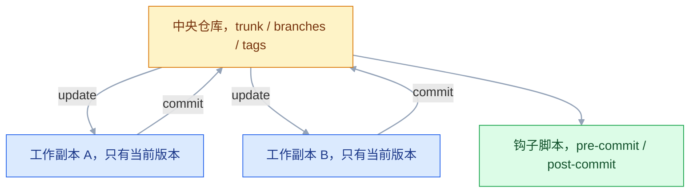

# SVN 版本管理

## 一、工程案例：接手一个 SVN 老项目并发布一个补丁版本

**场景**：入职一家做电力系统的公司，接手已维护 6 年的「电费核算系统」。代码在 `svn://192.168.10.20/repos/power-ems`，采用标准的 `trunk/branches/tags` 布局。任务分两段：在 trunk 上开发「按台区统计」的导出功能；再把线上报出的中文乱码修掉，发布 `v2.3.1`。

**动手前确认**：拿到 SVN 账号、仓库地址、以及「谁能提交到哪个目录」的授权说明。SVN 的权限是目录级的，没权限的目录能读不代表能写。

### 1.1 检出与体检

```bash
svn --version --quiet                  # 确认客户端可用
svn checkout svn://192.168.10.20/repos/power-ems/trunk power-ems --username zhangsan
cd power-ems

svn info                               # URL、Revision、Last Changed
svn status                             # 干净的工作副本不输出任何内容
svn log -l 3                           # 最近三次提交，确认历史可读
svn list svn://192.168.10.20/repos/power-ems
```

预期输出：

```text
URL: svn://192.168.10.20/repos/power-ems/trunk
Revision: 1523
Last Changed Rev: 1523
```

```text
branches/
tags/
trunk/
```

> 只检出 trunk：日常开发都在主干，分支要动时再单独检出。每个工作副本都带一个 `.svn/` 目录存元数据，删掉它就只能重新检出。

### 1.2 在 trunk 上开发功能

```bash
svn update                              # At revision 1523.

cat > src/main/java/com/power/report/StationReportService.java <<'EOF'
package com.power.report;

public class StationReportService {
    public byte[] exportByStation(String month) {
        return new byte[0];
    }
}
EOF

svn status                              # ?  src/main/java/com/power/report/StationReportService.java
svn add src/main/java/com/power/report/StationReportService.java
svn status                              # A  src/main/java/com/power/report/StationReportService.java
svn diff src/main/java/com/power/report/StationReportService.java | head -20
svn update                              # 提交前再拉一次，避免 out of date
svn commit -m "feat: 新增按台区统计导出功能"
```

预期输出：

```text
Adding         src/main/java/com/power/report/StationReportService.java
Transmitting file data .
Committed revision 1524.
```

> `?` 表示文件存在但未纳入版本控制，此时 commit 会**静默跳过**它，不报错。`svn add` 之后变成 `A`，才会被提交。

### 1.3 建发布分支并冻结

```bash
svn copy svn://192.168.10.20/repos/power-ems/trunk \
         svn://192.168.10.20/repos/power-ems/branches/release-2.3 \
         -m "create branch release-2.3 for v2.3.1"
# Committed revision 1525.

svn list svn://192.168.10.20/repos/power-ems/branches/
```

分支就是在服务器上复制一份目录，复制本身也占一个 revision。之后 trunk 继续接新需求，只有必修问题才落到 `release-2.3`。

```bash
svn checkout svn://192.168.10.20/repos/power-ems/branches/release-2.3 ems-release-2.3
cd ems-release-2.3
svn info | grep URL                     # URL: .../branches/release-2.3
```

### 1.4 分支上修 bug 并打 tag

```bash
svn status
svn diff src/main/java/com/power/report/ReportController.java
svn commit -m "fix: 修复导出文件中文乱码，强制 UTF-8 编码"
# Committed revision 1526.

svn update && svn status                # At revision 1526.，status 无输出
```

打标签是把分支当前状态复制到 `tags/` 下：

```bash
svn copy svn://192.168.10.20/repos/power-ems/branches/release-2.3 \
         svn://192.168.10.20/repos/power-ems/tags/v2.3.1 \
         -m "tag v2.3.1 release"
# Committed revision 1527.

svn list svn://192.168.10.20/repos/power-ems/tags/
svn info svn://192.168.10.20/repos/power-ems/tags/v2.3.1 | head -4
```

> 顺序必须是：改完、验证通过、再打 tag。tag 一旦发布就不该再改，它对应的是交付出去的那份代码。

### 1.5 把修复合并回 trunk

```bash
cd ../power-ems
svn update
svn merge svn://192.168.10.20/repos/power-ems/branches/release-2.3
```

预期输出：

```text
--- Merging r1526 through r1526 into '.':
U    src/main/java/com/power/report/ReportController.java
--- Recording mergeinfo for merge of r1526 through r1526 into '.'.
```

```bash
svn diff | head -30
svn commit -m "merge: 合并 release-2.3 的乱码修复到 trunk"
# Committed revision 1528.

svn log -l 2 src/main/java/com/power/report/ReportController.java
```

> `merge` 只改工作副本，必须再 commit 一次。这次提交会记录 mergeinfo（合并过哪些 revision），不提交就会在下次 merge 时重复合并同一批改动。

### 1.6 验收（8 项全过才算交付）

| # | 检查 | 命令 | 通过标准 |
|---|---|---|---|
| 1 | 工作副本干净 | `svn status` | 无输出 |
| 2 | 与服务器同步 | `svn status -u` | 没有 `*` 标记，或已全部 update |
| 3 | 功能已入库 | `svn log -l 1` | 看到 `feat: 新增按台区统计导出功能` |
| 4 | 新文件已跟踪 | `svn status` | 不出现 `?` |
| 5 | 分支存在 | `svn list .../branches/` | 有 `release-2.3/` |
| 6 | tag 存在且正确 | `svn info .../tags/v2.3.1` | URL 指向 tags，Revision 为打标签那次 |
| 7 | 修复已回主干 | `svn log -l 2 文件路径` | 能看到 fix 与 merge 两条记录 |
| 8 | 合并记录已提交 | `svn propget svn:mergeinfo .` | 含 `branches/release-2.3:1526` |


---

## 二、高频问答：会卡住你的地方，也是面试最常问的

### 2.1 commit 报 `is out of date`

**现场**

`svn status -u` 看带 `*` 的文件，那就是服务器上有更新。

```bash
svn update                    # 拉到最新，可能有冲突
svn commit -m "feat: xxx"     # 再提交
```

> SVN 没有 `push -f`，也不存在覆盖服务器的做法。这个“死板”正是集中式的安全边界。

**要点**

- 你检出的版本之后别人提交过同一个文件，SVN 要求基于最新版本提交。
- 它不做自动合并，所以不是服务器坏了或账号降权，别反复重试 commit。
- `svn update` 拉到最新、有冲突先解，再提交。

**追问**

- SVN 有 `push -f` 吗？→ 没有，也不存在覆盖服务器的做法，这是集中式的安全边界。
- 为什么不像 Git 那样自动合并？→ SVN 把合并放在 update 阶段，commit 只接受快进。
- update 之后冲突了怎么办？→ 解完 `svn resolve`，再提交。

### 2.2 新文件提交后服务器上没有

**现场**

`svn status` 里该文件前面是 `?` 而不是 `A`，就是没 add。

```bash
svn add src/main/java/com/power/report/NewService.java
svn status                                  # A 开头才算纳入
svn commit -m "feat: 新增报表服务"
```

**要点**

- commit 只提交「已纳入版本控制」的改动，未跟踪文件被静默跳过。
- 新文件必须先 `svn add`，状态从 `?` 变成 `A`。
- 提交后用 `svn log -v` 确认路径真的进去了。

**追问**

- 为什么 commit 不报错也不提示？→ 设计如此，`?` 的文件不在提交范围里。
- add 错了想撤？→ `svn revert 文件` 取消 add，文件还在本地。
- 能直接 add 整个目录吗？→ 能递归加入，但先确认里面没有构建产物。

### 2.3 `svn revert` 之后一天的活没了

**现场**

执行前 `svn diff` 看要丢掉什么，执行后 `svn status` 已无该文件。

```bash
svn diff src/main/java/User.java      # 先看
svn revert src/main/java/User.java    # 再撤，不可逆
svn revert -R src/                    # 递归撤销整个目录，风险更大
```

> 想留一手：`svn diff > /tmp/wip.patch` 先存补丁，或复制一份文件再 revert。

**要点**

- `revert` 用服务器上的版本直接覆盖工作副本，未提交的修改永久丢失。
- SVN 没有 reflog，也没有本地提交层，撤了就没有回头路。
- 想留一手先 `svn diff > /tmp/wip.patch`，或复制一份文件。

**追问**

- `revert` 和 `update` 差在哪？→ revert 是丢掉本地改动回到基准，update 是把服务器改动合进来。
- `revert -R src/` 为什么更危险？→ 递归撤销整个目录，可能一天的活一起没。
- 撤完能恢复吗？→ 不能，只能靠事先存的补丁。

### 2.4 删掉本地文件后，commit 没有删掉服务器上的

**现场**

`svn status` 显示 `!`，说明工作副本缺文件但服务器仍有。

```bash
svn delete src/main/java/OldUtil.java       # 正确删法，状态变 D
svn commit -m "chore: 移除废弃的 OldUtil"
# 已经用 rm 删了：svn update 拉回来，再 svn delete
```

**要点**

- 直接用系统命令删除只会让文件变成 `!`（丢失），SVN 不会把它当作删除动作。
- 正确做法是 `svn delete`，状态变 `D` 再 commit。
- 已经 `rm` 了就 `svn update` 拉回来，再 `svn delete`。

**追问**

- `!` 和 `D` 差在哪？→ `!` 是工作副本缺文件但服务器还有，`D` 是显式标记删除。
- `svn delete --keep-local` 干什么用？→ 移出版本控制但保留本地文件，常配 `svn:ignore`。
- 误删了还没提交能救吗？→ 能，`svn update` 拉回来。

### 2.5 工作副本被锁，什么操作都做不了

**现场**

报 `E155004: working copy locked` 或 `E200030: sqlite database is locked`。

```bash
# 先关掉 IDE、TortoiseSVN 等可能占用工作副本的程序
svn cleanup
svn status
```

> `.svn` 删掉就无法与服务器对账，只能重新 checkout。cleanup 能解决绝大多数锁问题。

**要点**

- 上次操作被中断（断网、Ctrl+C、IDE 崩溃），留下了工作副本锁或 SQLite 锁。
- 先关掉占用工作副本的程序，再 `svn cleanup`。
- 不要删 `.svn`，删了就只能重新 checkout。

**追问**

- `svn cleanup` 做了什么？→ 清理未完成的操作日志、释放锁、把中断的事务收尾。
- 删掉 `.svn` 会怎样？→ 失去基准版本和元数据，无法与服务器对账。
- cleanup 也解不开？→ 确认没有进程占用，重启客户端，最后才考虑重新检出。

### 2.6 update 时出现 `C`，文件里全是箭头标记

**现场**

`svn status` 里是 `C`，目录下多出 `.mine`、`.rXXXX` 辅助文件。

```bash
vim src/main/java/Login.java                        # 融合两边，删掉标记
svn resolve --accept working src/main/java/Login.java
svn commit -m "fix: 合并登录超时配置冲突"
```

> 直接 commit 会报 `E155015: remains in conflict`。必须显式 resolve。

**要点**

- 你和别人改了同一文件的同一处，SVN 无法自动合并，标记为冲突。
- 冲突未 resolve 前 commit 会被拒绝。
- 手工融合后必须 `svn resolve --accept working` 显式收尾。

**追问**

- `.mine` 和 `.r1523` 分别是什么？→ 自己的版本和冲突前的基准版本，`.r` 后面是 revision 号。
- 直接 commit 会怎样？→ 报 `E155015: remains in conflict`。
- 什么时候用 `--accept theirs-full`？→ 确定全用服务器版本时，但自己的改动会丢。

### 2.7 `svn:ignore` 配了，target 还是被提交

**现场**

`svn status --no-ignore` 看它是否仍被列出，`svn propget svn:ignore .` 看属性是否存在。

```bash
svn delete --keep-local target          # 先移出版本控制，本地保留
svn propset svn:ignore "target" .
svn commit -m "chore: 忽略构建产物"
```

> `svn:ignore` 只作用于当前目录的直接子项，不递归；属性本身也要 commit 才能让同事生效。

**要点**

- 属性只对未跟踪项生效，已经被版本控制的文件忽略不了。
- 规则没提交只在本机生效，同事那边照样看到。
- 先 `svn delete --keep-local` 移出版本控制，再配 `svn:ignore` 并提交。

**追问**

- `svn:ignore` 递归吗？→ 不递归，只作用于当前目录的直接子项，每层要单独设。
- 和 `svn:global-ignores` 差在哪？→ 后者对当前目录及所有子目录生效。
- 属性值能写成一行吗？→ 不能，按行分隔，一行多项不生效。

### 2.8 分支上改完，trunk 上看不到

**现场**

`svn info` 看当前工作副本的 URL 是 `/branches/...` 还是 `/trunk`。

```bash
# 在 trunk 的工作副本里执行
svn update
svn merge ^/branches/release-2.3
svn commit -m "merge: 合并 release-2.3 到 trunk"
```

**要点**

- 分支是服务器上独立的目录副本，在分支里 commit 只影响分支。
- 改动不会自动回流 trunk，必须在 trunk 的工作副本里 merge。
- merge 只改工作副本，还要再 commit 一次。

**追问**

- 分支和 trunk 是同一个目录吗？→ 不是，copy 出来就是独立目录，各有完整文件树。
- `svn switch` 是干什么的？→ 同一个工作副本换到另一个分支 URL，省磁盘但容易搞混。
- 为什么 merge 完还要 commit？→ merge 只改本地工作副本，不产生 revision。

### 2.9 merge 之后，下一次又合了一遍同样的改动

**现场**

`svn propget svn:mergeinfo .` 看不到对应分支的区间。

```bash
svn status                       # 是否有未提交的 merge 改动
svn commit -m "merge: 合并 release-2.3"
svn propget svn:mergeinfo .
```

**要点**

- 上次 merge 只改了工作副本没 commit，mergeinfo 没记上。
- SVN 认为那批 revision 从未合并过，下次就再合一遍。
- mergeinfo 是记账，提交才算数。

**追问**

- mergeinfo 记的是什么？→ 合并过哪些 revision 区间。
- 不提交会怎样？→ 下次 merge 重复合一遍同样的改动。
- 能手工改 mergeinfo 吗？→ 能但不建议，很容易把账改乱。

### 2.10 提交成功但代码没生效

**现场**

`svn info` 看工作副本 URL，`svn log -v -l 1` 看这次提交改了哪些路径。

```bash
svn log -v -l 1
svn list svn://192.168.10.20/repos/power-ems/trunk/src/main/java/com/power/report/
```

**要点**

- 提交本身成功了，问题在提交到了错误的分支或目录。
- 也可能是部署脚本拉的是另一个路径。
- 先看 URL，再看这次提交实际改了哪些路径。

**追问**

- 怎么确认部署拉的是哪个路径？→ 看部署脚本里的 checkout / export URL。
- 提交错分支怎么补救？→ 在正确分支上 merge 或重新提交，别直接改服务器。
- `svn log -v` 和 `svn log` 差在哪？→ `-v` 会列出改动的路径。

### 2.11 checkout 到一半失败，目录残缺

**现场**

`svn status` 出现大量 `!`，`svn info` 的 Revision 异常。

```bash
svn cleanup
svn update                     # 补齐剩余内容
# 仍然不行：换目录重新 checkout
```

**要点**

- 网络中断或权限不足，检出没完成，工作副本处于不完整状态。
- 先 `svn cleanup`，再 `svn update` 补齐剩余内容。
- 仍然不行就换目录重新 checkout，别在残缺目录里手工补文件。

**追问**

- 为什么不能手工补文件？→ 元数据对不上，后续 update / commit 还会报错。
- `svn cleanup` 能补齐内容吗？→ 它只清中断的事务，补齐靠 `update`。
- 权限不足怎么确认？→ 看报错路径和 403，找管理员要目录权限。

### 2.12 换服务器地址后，旧工作副本无法提交

**现场**

`svn info` 的 URL 仍是旧地址，提交报 `E170013` 或连接失败。

```bash
svn switch --relocate svn://旧地址 svn://新地址
svn info | grep URL
svn update
```

> 先提交或导出本地改动再迁移。`--relocate` 只改地址，不做内容比对。

**要点**

- 工作副本里记录的仓库地址变了，旧地址已经不可达。
- `svn switch --relocate 旧 新` 只改地址，不做内容比对。
- 迁移前先提交或导出本地改动，别让未提交的活跟着丢。

**追问**

- `--relocate` 和 `svn switch` 差在哪？→ relocate 只换地址，switch 换分支路径并比对内容。
- 为什么不直接重新 checkout？→ 会丢掉本地未提交的改动。
- 换的是另一台服务器怎么办？→ UUID 不同，relocate 不适用，只能重新检出再搬改动。

---

## 三、核心知识：从零开始要建立的东西

### 3.1 集中式版本控制的模型

SVN 只有一份权威仓库，放在服务器上。每个开发者本地是**工作副本**：当前版本的文件，加上 `.svn/` 里的元数据。提交直接写到服务器，历史不在本地。



| 对比项 | SVN | Git |
|---|---|---|
| 历史位置 | 只在服务器 | 每个克隆都有完整历史 |
| 本地提交 | 没有这一层 | 有 |
| 断网 | 不能提交、不能看新历史 | 照常提交与查看 |
| 版本标识 | 全局递增整数 r1524 | 内容哈希 |
| 分支 | 服务器上的目录副本 | 一个指针 |

**边界**：集中式让权限和审计简单，代价是单点依赖。服务器不可用，全队停摆；没有异地镜像时，磁盘损坏就是历史丢失。

> **面试**：常问「SVN 和 Git 最本质的区别是什么？」答：SVN 只有服务器一份历史、提交直连服务器，Git 每个克隆都有完整历史、可以本地提交。

### 3.2 仓库、工作副本与元数据

| 概念 | 位置 | 作用 |
|---|---|---|
| repository | 服务器 | 存放所有版本与历史 |
| working copy | 本地目录 | 你编辑的文件 |
| `.svn/` | 工作副本每层目录 | 记录基准版本、URL、属性、原始副本 |
| revision | 服务器 | 每次提交产生一个全局递增号 |

```bash
svn info                        # 工作副本的 URL 与基准 revision
svn status                      # 工作副本与基准版本的差异
svn status -u                   # 再对比一次服务器
```

`.svn/` 里保存了“上次 update 时的原始内容”，所以 `svn diff` 不需要联网也能给出差异。删掉它，工作副本就失去基准，只能重新检出。

**边界**：工作副本不是仓库的完整拷贝，不能用它恢复服务器。备份要靠 `svnadmin dump` 或 `hotcopy`。

### 3.3 trunk、branches、tags 的目录约定

SVN 没有内置的分支概念，三个目录是**约定**，由人来遵守：

```text
/repos/power-ems
├── trunk/                     日常开发主线
├── branches/
│   ├── release-2.3/           发布维护分支
│   └── feature-station/       功能分支
└── tags/
    ├── v2.3.0/
    └── v2.3.1/
```

| 目录 | 约定用途 | 实际本质 |
|---|---|---|
| trunk | 主干，持续开发 | 普通目录 |
| branches | 每个分支一个子目录 | 从某路径 copy 出来的副本 |
| tags | 每个发布版本一个子目录 | 同样是副本，只是约定不改 |

```bash
svn copy ^/trunk ^/branches/release-2.3 -m "create branch"
svn copy ^/branches/release-2.3 ^/tags/v2.3.1 -m "tag v2.3.1"
```

`^/` 是仓库根路径的简写，比写全 URL 短，也不怕服务器地址变化。

**边界**：约定不是强制。有人往 `tags/` 里提交，SVN 不会拦；要真正只读，只能在服务器 `authz` 里限制写权限。

### 3.4 全局递增的 revision

SVN 的版本号是**整个仓库**共享的整数，不是单个文件的版本。一次提交改动十个文件，它们一起进入 r1524；建分支、改属性、甚至只改目录属性，也各占一个号。

| 操作 | 是否产生新 revision |
|---|---|
| 提交文件改动 | 是 |
| `svn copy` 建分支或 tag | 是 |
| `svn mkdir` 建目录 | 是 |
| `svn propset` 并提交属性 | 是 |
| 本地 `svn update` | 否 |
| 本地 `svn revert` | 否 |

```bash
svn log -r 1524                # 某个 revision 的说明
svn log -r 1520:1526           # 区间
svn diff -c 1524               # 这一次改了什么
svn update -r 1520             # 把工作副本切到历史版本
```

**边界**：`update -r` 会让工作副本处于“混合版本”状态，适合查看和比对，不适合直接在上面提交。看完用 `svn update` 回到 HEAD。

> **面试**：常问「为什么 SVN 的版本号是整个仓库共享的？」答：revision 是全局递增整数，一次提交改十个文件也只占一个号，建分支、改属性也各占一个。

### 3.5 checkout、update 与 commit

三个动作构成 SVN 的日常闭环：

| 命令 | 方向 | 作用 |
|---|---|---|
| `svn checkout` | 服务器 → 本地 | 首次拉取，建立工作副本 |
| `svn update` | 服务器 → 本地 | 把别人的提交合进工作副本 |
| `svn commit` | 本地 → 服务器 | 把本地改动写成新 revision |

```bash
svn checkout svn://host/repos/proj/trunk proj
cd proj
svn update
# 编辑
svn status
svn diff
svn commit -m "feat: 新增导出功能"
```

**边界**：commit 是原子的：一个提交里的文件要么全部成功，要么全部失败。只要有一个文件冲突或权限不足，整次提交都不会产生 revision。

### 3.6 状态字母与提交前检查

`svn status` 第一列是本地状态，第二列是属性或远程状态：

| 字母 | 含义 | 处理 |
|---|---|---|
| `M` | 内容被修改 | 正常提交 |
| `A` | 已 add，待提交 | 正常提交 |
| `D` | 已标记删除 | 正常提交 |
| `?` | 未跟踪 | 需要就 `svn add`，不需要就忽略 |
| `!` | 文件丢失 | `svn update` 拉回，或 `svn delete` 确认删除 |
| `C` | 冲突 | 解决后 `svn resolve` |
| `G` | 自动合并成功 | 无需处理 |
| `U` | 已从服务器更新 | 无需处理 |

```bash
svn status
svn diff
svn update
svn commit -m "fix: 修复报表分页越界"
```

这四步是固定动作，顺序不要换：先看清自己改了什么，再拉别人的改动，最后提交。

**边界**：`svn status` 不带 `-u` 只对比本地基准，不联网；想知道服务器有没有更新，加 `-u`。

### 3.7 属性与 svn:ignore

SVN 的“忽略”不是文件，而是**目录属性**。属性跟随版本控制，提交后对所有人生效。

```bash
svn propset svn:ignore "target
*.log
.idea" .
svn propget svn:ignore .
svn propedit svn:ignore .
svn commit -m "chore: 配置忽略规则"
```

| 配置位置 | 生效范围 | 是否共享 |
|---|---|---|
| `svn:ignore` 属性 | 当前目录的直接子项 | 提交后共享 |
| `~/.subversion/config` 的 `global-ignores` | 本机所有工作副本 | 不共享 |
| `svn:global-ignores` | 当前目录及所有子目录 | 提交后共享 |

**边界**：`svn:ignore` 不递归，每层目录要单独设；已跟踪文件不受影响，必须先 `svn delete --keep-local` 移出。属性值按行分隔，写成一行多项不会生效。

### 3.8 分支的本质是目录复制

SVN 的分支和 tag 都是服务端 `copy`，不是指针。复制很轻（服务端做的是链接式存储），但语义上是独立目录，各自有完整文件树。

```bash
svn copy ^/trunk ^/branches/release-2.3 -m "create branch"
svn checkout svn://host/repos/proj/branches/release-2.3 release-2.3
```

| 操作 | Git 对应物 | SVN 实际动作 |
|---|---|---|
| 建分支 | `git branch` / `switch -c` | 服务端复制目录，产生 revision |
| 切分支 | `git switch` | 检出另一个目录，或 `svn switch` |
| 删分支 | `git branch -d` | `svn delete` 分支目录并提交 |
| 打 tag | `git tag` | 复制到 `tags/` 下 |

**边界**：分支多了会在服务器上占目录、占 revision 号，规范要求合并后及时删除。`svn switch` 可以让同一个工作副本换到另一个分支 URL，省磁盘但容易搞混当前在哪。

### 3.9 合并与 mergeinfo

`svn merge` 把另一个路径的改动应用到当前工作副本，并把“合并过哪些 revision”记录在 `svn:mergeinfo` 属性里。

```bash
cd trunk-wc
svn update
svn merge ^/branches/release-2.3
svn status
svn commit -m "merge: 合并 release-2.3 到 trunk"
svn propget svn:mergeinfo .
```

| 用法 | 含义 |
|---|---|
| `svn merge ^/branches/x` | 合并该分支尚未合并过的改动 |
| `svn merge -r 1530:1535 ^/branches/x` | 显式指定区间 |
| `svn merge -c 1531 ^/branches/x` | 只合并一次提交 |
| `svn merge -c -1531 .` | 反向合并，撤销该次提交 |
| `--dry-run` | 只显示会发生什么 |

**边界**：mergeinfo 是“记账”，不是自动理解语义。手工 `svn merge` 后不提交，账没记上；跨分支 cherry-pick 太多，mergeinfo 会变得难以解释。老版本 SVN 还需要手工维护区间，现代版本以官方当前稳定版行为为准。

> **面试**：常问「mergeinfo 是干什么的？」答：记录某个路径合并过哪些 revision，不提交就不记账，下次会重复合并同一批改动。

### 3.10 冲突的三种版本

冲突时 SVN 会留下三份参照，理解它们才能正确取舍：

| 文件 | 内容 |
|---|---|
| `文件.mine` | 你 update 前的本地版本（带着你未提交的修改） |
| `文件.r1523` | 冲突前的**工作副本基准版本**（`.r` 后跟 revision 号） |
| `文件.r1526` | 服务器上的最新版本 |
| `文件` 本体 | 已被 SVN 写入冲突标记，等你去改 |

```bash
svn update
# C  src/main/java/Login.java
# Summary of conflicts: Text conflicts: 1

svn resolve --accept working src/main/java/Login.java
```

| `--accept` | 结果 |
|---|---|
| `working` | 以当前工作副本内容为准，用于手工融合后 |
| `mine-full` | 全用自己的，丢弃服务器改动 |
| `theirs-full` | 全用服务器的，丢弃自己的改动 |
| `base` | 回到分叉前的版本 |
| `postpone` | 保持冲突，稍后处理 |

**边界**：`mine-full` 会覆盖别人刚提交的内容，用了就要承担沟通成本。resolve 会删掉辅助文件；辅助文件还在，说明还没 resolve。

> **面试**：常问「冲突时 `.mine` 和 `.r1526` 分别是什么？」答：自己的版本和服务器最新版本，`.r` 后面跟的是 revision 号。

### 3.11 锁与二进制文件

SVN 用 `svn lock` 做**排他锁**，主要给无法合并的文件用：Excel、Word、设计图、二进制资源。

```bash
svn lock report.xlsx -m "正在改报表模板"
svn unlock report.xlsx
svn status                     # 该文件出现 L，表示本地持有锁
svn info report.xlsx           # 看锁的持有者
```

| 机制 | 作用 |
|---|---|
| `svn lock` | 显式加锁，别人提交该文件会被拒 |
| `svn:needs-lock` 属性 | 文件默认只读，想改必须先加锁 |
| `svn unlock --force` | 管理员强制解锁，慎用 |

**边界**：锁不能替代沟通，只防并发覆盖。锁会因客户端崩溃变成“僵尸锁”，需要管理员清理。文本文件不要用锁，冲突合并比排队高效。

### 3.12 撤销本地修改与撤销已提交改动

| 目标 | 命令 | 是否可恢复 |
|---|---|---|
| 丢弃未提交修改 | `svn revert 文件` | 不可恢复 |
| 取消 `svn add` | `svn revert 文件` | 文件仍在本地 |
| 撤销某次已提交 | `svn merge -c -1524 .` 再 commit | 历史保留，新增反向改动 |
| 回看历史版本 | `svn update -r 1524` | 只改工作副本 |

```bash
svn revert src/main/java/User.java
svn revert -R src/

svn merge -c -1524 .
svn commit -m "revert: 撤销 r1524 的错误改动"
```

**边界**：SVN 没有本地提交层，`revert` 直接覆盖，没有 reflog 可救。撤销已提交的改动只能用反向合并，它会留下两条记录，这是审计上正确的做法。

### 3.13 目录级权限与钩子

集中式的一大优势是权限能细到目录，这在传统行业项目里是刚需：

```text
[groups]
dev = zhangsan, lisi
outsource = wangwu

[/]
@dev = rw

[/trunk/src/core]
@dev = rw
@outsource = r

[/tags]
@dev = r
* =
```

| 能力 | 配置位置 |
|---|---|
| 认证（谁能登录） | `conf/passwd` 或 LDAP |
| 授权（能读写哪些路径） | `conf/authz` |
| 提交前校验 | `hooks/pre-commit` |
| 提交后触发 | `hooks/post-commit` |

**边界**：`authz` 按最具体路径优先匹配，写错一条可能把整个目录开放或锁死。改完先用只读账号实测，再放开。钩子脚本失败会让提交直接失败，排错时先看服务器端输出。

### 3.14 与 Git 的心智模型对照

从 Git 转到 SVN，最容易错的是把 Git 的动作直接套过来：

| 你想做的事 | Git 习惯 | SVN 做法 |
|---|---|---|
| 保存一次进度 | `git commit` | 没有本地提交，只能 commit 到服务器 |
| 拉别人的改动 | `git pull` | `svn update` |
| 发布到远程 | `git push` | 不存在，commit 已经到服务器 |
| 暂存部分改动 | `git add -p` | 没有暂存区，只能按路径提交 |
| 开分支 | `git switch -c` | `svn copy` 目录，再检出 |
| 撤销已推送提交 | `git revert` | `svn merge -c -N` **再 commit**（历史里多一条正常提交，不是反向提交） |
| 找回误删提交 | `git reflog` | 没有对应能力，只能靠备份 |

**边界**：不要在工作副本里再 `git init`，两套元数据会互相干扰。迁移用 `git svn clone`，迁移前先冻结 SVN 写入。

### 3.15 从 SVN 迁移到 Git 的边界

```bash
git svn clone svn://host/repos/proj --stdlayout --authors-file=authors.txt proj-git
```

| 参数 | 作用 |
|---|---|
| `--stdlayout` | 按 trunk/branches/tags 识别 |
| `--authors-file` | SVN 用户名映射为 `名字 <邮箱>` |
| `-r 1000:HEAD` | 只迁移指定区间，缩短大仓库耗时 |

迁移的现实约束：

| 问题 | 处理 |
|---|---|
| 历史里有 jar、exe 等大文件 | 迁完用 `git filter-repo` 清理，否则仓库巨大 |
| mergeinfo 无法完整映射 | 跨分支历史可能变平，评审时要知道 |
| 空提交、只改属性的提交 | 会变成空 Git 提交，可保留也可跳过 |
| 迁移窗口 | 冻结 SVN 只读，迁完一次性切换，避免双写 |

**边界**：很多团队只导入当前代码、不留历史，这在新项目起步时更划算；但审计要求高的行业项目通常必须保留完整历史。

### 3.16 存量项目的现实定位

SVN 现在的位置很明确：**新项目默认 Git，存量项目继续用 SVN 维护**。

| 场景 | 现实 |
|---|---|
| 电力、烟草、制造、政务的老系统 | 仍在 SVN 上跑，改需求就得用 |
| 外包驻场 | 甲方服务器装什么就用什么 |
| 需要目录级精细权限 | SVN 原生支持，迁移要额外设计 |
| 新项目、频繁分支、CI/CD | 用 Git，不要新上 SVN |

**边界**：会 SVN 的价值在“能接手”，不在“能选型”。学习重点应放在 update/commit 闭环、冲突处理、分支与 tag 的目录约定，而不是服务端调优。

---

## 四、冷门知识汇总

| 知识点 | 为什么冷门 | 用到时的关键词 |
|---|---|---|
| `svn switch` 换分支 | 多数人习惯重新检出，不知道同一工作副本可切 URL | `svn switch ^/branches/x` |
| `svn switch --relocate` | 只有服务器换地址时才用 | `--relocate 旧URL 新URL` |
| `svn export` | 有 CI 打包后很少手工导出干净目录 | `svn export URL 目录 --force` |
| `svn patch` | 离线协作、邮件传补丁的场景才用 | `svn patch x.patch` |
| `svn blame -g` | 跨分支追责才需要 | `svn blame -g 文件` |
| `svn:externals` | 共享公共模块的老做法，新项目多用包管理 | `svn propset svn:externals` |
| `svnadmin dump` / `load` | 只有迁移和备份时才碰服务端 | `svnadmin dump /opt/svn/demo > demo.dump` |
| `svnadmin hotcopy` | 在线备份仓库，频率低 | `svnadmin hotcopy 源 目标` |
| `svnlook` | 写钩子脚本时调试用 | `svnlook changed -r 1524 仓库` |
| `svnversion` | 构建时打版本号才需要 | `svnversion -n` |
| `--non-interactive` | 脚本自动化里避免卡在密码提示 | `--non-interactive --trust-server-cert` |
| `svn cleanup --remove-unversioned` | 清理未跟踪文件，容易误删 | `svn cleanup --remove-unversioned` |
| 混合版本工作副本 | `update -r` 后才出现，平时不关注 | `svn info` 里的 Revision 与 Last Changed Rev 不一致 |
| 关键字替换 | 老项目在文件里嵌 `$Id$`，现代项目基本不用 | `svn:keywords`、`$Revision$` |
| 文件锁的僵尸锁 | 客户端崩溃后留下，需管理员清理 | `svn unlock --force`、`svn status` 的 `L` |
| 仓库 UUID | 迁移或重建仓库后工作副本对不上 | `svn info` 的 Repository UUID |
