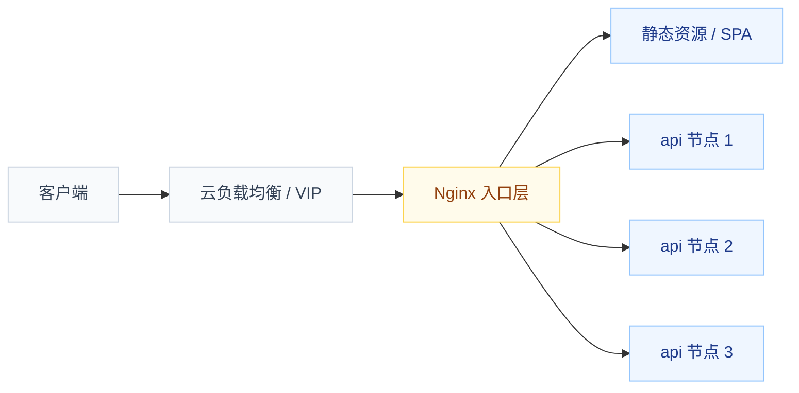
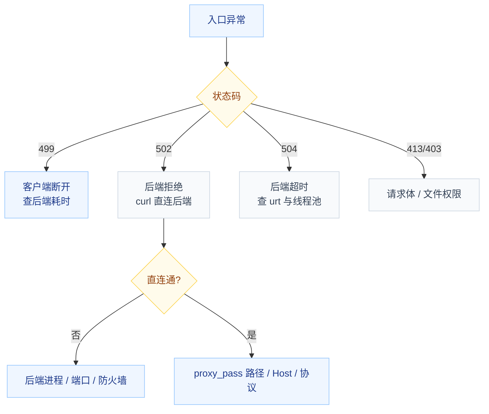

# Nginx反向代理与负载均衡

> 这篇从 Nginx 在入口层的定位讲起，经过安装与最小验证、静态站点与 SPA、反向代理与连接复用、上游负载均衡、HTTPS 与安全加固、限流与缓存，最后落到 502/504/499 的排障现场手册和一次完整上线案例。
>
> 学完能独立写出一个带 HTTPS、负载均衡、限流和缓存的 Nginx 入口配置，并用日志和命令定位入口层故障。

## 一、定位与边界

Nginx 是事件驱动的 HTTP 服务器与反向代理：少量 worker 进程用 epoll 处理大量连接，静态文件、TLS 终止、请求转发、限流、缓存都在同一层完成。它在入口层的位置是"流量进入集群前的第一道可编程关卡"。



与相邻组件的分工：

| 组件 | 负责 | 不负责 |
|---|---|---|
| 云负载均衡 / LVS | 四层转发、VIP、跨可用区 | 路径路由、缓存、限流 |
| Nginx | 七层路由、TLS、静态、限流、缓存 | 服务发现、熔断降级 |
| 服务网格 / Envoy | 东西向流量、mTLS、细粒度治理 | 静态站点、边缘缓存 |
| K8s Ingress | 声明式路由，底层仍是 Nginx/Envoy | 复杂 rewrite 与缓存策略 |

配置模型只有三层需要记住：

- `http` 块：`upstream`、`map`、`limit_req_zone`、`proxy_cache_path`、日志格式，全局只定义一次；
- `server` 块：一个监听地址 + 域名，TLS、跳转、安全头放在这里；
- `location` 块：按前缀或正则匹配 URI，`proxy_pass`、`try_files`、限流、缓存在这里生效。

> 版本基线（2026-11）：Nginx 1.29.x mainline（1.28 stable 也可用），OpenSSL 3.x，Ubuntu 24.04 / Rocky 9。HTTP/2 从 1.25.1 起用独立的 `http2 on;` 指令，不再写在 `listen` 后面。

边界：需要按 API 动态下发路由、熔断、重试预算或 gRPC 透明代理时，Nginx 开源版不占优势，选 Envoy/APISIX；Nginx Plus 的主动健康检查、`sticky`、`slow_start` 属于商业功能，开源版要用被动检查和外部探针替代。本文只写开源版能力。

## 二、安装与最小验证

安装方式决定编译参数。要 HTTP/3，必须确认二进制带 `--with-http_v3_module`；要用真实 IP，必须有 `--with-http_realip_module`（官方包默认带）。

### 2.1 安装

```bash
# Ubuntu：用 nginx.org 官方源，版本比发行版仓库新，且编译参数完整
sudo apt install -y curl gnupg2 ca-certificates lsb-release ubuntu-keyring
curl -fsSL https://nginx.org/keys/nginx_signing.key | \
  sudo gpg --dearmor -o /usr/share/keyrings/nginx-archive-keyring.gpg
echo "deb [signed-by=/usr/share/keyrings/nginx-archive-keyring.gpg] \
http://nginx.org/packages/mainline/ubuntu $(lsb_release -cs) nginx" | \
  sudo tee /etc/apt/sources.list.d/nginx.list
sudo apt update && sudo apt install -y nginx

# Rocky/RHEL：官方仓库
sudo tee /etc/yum.repos.d/nginx.repo >/dev/null <<'EOF'
[nginx-stable]
name=nginx stable repo
baseurl=http://nginx.org/packages/centos/$releasever/$basearch/
gpgcheck=1
enabled=1
gpgkey=https://nginx.org/keys/nginx_signing.key
EOF
sudo dnf install -y nginx

# macOS：本地调试用
brew install nginx

# Windows：解压官方 zip 后在该目录执行，仅用于本地验证
# start nginx.exe
```

### 2.2 版本与编译参数

```bash
nginx -v
nginx -V 2>&1 | tr ' ' '\n' | grep -E 'http_v3|http_realip|http_ssl|http_v2'
```

预期输出（示例）：

```text
nginx version: nginx/1.29.3
--with-http_ssl_module
--with-http_v2_module
--with-http_v3_module
--with-http_realip_module
```

### 2.3 最小闭环：静态站点跑通

```bash
sudo mkdir -p /var/www/demo
echo '<h1>ok</h1>' | sudo tee /var/www/demo/index.html

sudo tee /etc/nginx/conf.d/demo.conf >/dev/null <<'EOF'
server {
    listen 80;
    server_name demo.example.com;

    root /var/www/demo;
    index index.html;

    location / {
        try_files $uri $uri/ =404;
    }
}
EOF

sudo nginx -t
sudo systemctl enable --now nginx
sudo systemctl reload nginx
curl -sS -H 'Host: demo.example.com' http://127.0.0.1/
```

预期输出：

```text
nginx: the configuration file /etc/nginx/nginx.conf syntax is ok
nginx: configuration file /etc/nginx/nginx.conf test is successful
<h1>ok</h1>
```

> 边界：`nginx -t` 只校验语法和文件可读性，不校验上游是否存活、证书是否过期。任何改配置的动作顺序都是 `nginx -t` → `systemctl reload nginx`；`reload` 是平滑的（旧 worker 处理完存量连接再退出），`restart` 会瞬断，生产优先 `reload`。改配置前先备份并在另一个终端保留会话，避免语法错误导致 reload 失败后无从下手（旧配置仍在运行，风险可控）。

## 三、静态站点与 SPA

静态资源的正确配置由三件事决定：路径拼接（`root` 还是 `alias`）、SPA 的 fallback、缓存头。三者都错的时候，现象分别是 404、刷新页面 404、每次全量下载。

### 3.1 root 与 alias 的差别

```nginx
# root：最终路径 = root + 完整 URI
location /static/ {
    root /var/www;              # /static/a.js → /var/www/static/a.js
}

# alias：最终路径 = alias + location 之后的剩余部分
location /static/ {
    alias /var/www/assets/;     # /static/a.js → /var/www/assets/a.js
}
```

`alias` 末尾的斜杠必须与 `location` 的前缀斜杠同时存在或同时省略，否则会拼出 `/var/www/assetsa.js` 这类路径，直接 404。

### 3.2 SPA 的 fallback

```nginx
server {
    listen 80;
    server_name www.example.com;
    root /var/www/web;          # 构建产物目录
    index index.html;

    # 前端路由由浏览器处理，任何不存在的路径都回 index.html
    location / {
        try_files $uri $uri/ /index.html;
    }

    # API 用更长前缀匹配，自动优先于 /；只有正则 location 才按出现顺序优先
    location /api/ {
        proxy_pass http://api_backend;   # upstream 定义见第四章
    }

    # 带 hash 的构建产物可以长缓存，文件名变了 URL 就变了
    # 用前缀而非正则：正则 location 优先级高于前缀，会截走 /api/*.js 这类请求
    location /assets/ {
        expires 1y;
        add_header Cache-Control "public, immutable";
        access_log off;
    }
}
```

验证 fallback 与缓存：

```bash
curl -sS -o /dev/null -w '%{http_code}\n' http://127.0.0.1/some/deep/route
curl -sSI http://127.0.0.1/assets/app.3f9d2a.js | grep -Ei 'cache-control|expires|etag'
```

预期输出（示例）：

```text
200
cache-control: public, immutable
expires: Fri, 12 Nov 2027 10:00:00 GMT
etag: "3f9d2a8c-1a2b"
```

> 边界：`index.html` 绝对不能长缓存，否则发版后用户一直拿到旧入口；它的响应头要显式 `Cache-Control: no-cache`（允许缓存但每次校验）。`try_files` 的最后一个参数是内部跳转，不是文件路径，写 `=404` 表示找不到就返回 404，写 `/index.html` 表示交给前端路由。

### 3.3 压缩与传输

```nginx
gzip on;
gzip_comp_level 5;              # 5 是压缩率与 CPU 的平衡点，9 收益很小
gzip_min_length 1024;           # 小响应压缩后可能更大
gzip_types text/css application/javascript application/json image/svg+xml;
gzip_vary on;                   # 告诉 CDN 按 Accept-Encoding 分缓存

sendfile on;                    # 静态文件零拷贝
tcp_nopush on;                  # 与 sendfile 配合，凑满一个包再发
keepalive_timeout 65;
```

> 边界：图片、视频、woff2 已经是压缩格式，再 gzip 只浪费 CPU，不要加进 `gzip_types`。启用 brotli 需要额外模块（官方包不含），没有模块时不要照抄 `brotli on;`，否则 `nginx -t` 直接失败。

## 四、反向代理

反向代理的核心不是 `proxy_pass` 这一行，而是它后面的 URL 语义、请求头、超时与连接复用。80% 的"后端拿到的路径不对""后端拿不到客户端 IP""偶发 504"都出在这四项。

### 4.1 proxy_pass 的 URI 语义

| 写法 | 客户端请求 | 后端收到 | 适用 |
|---|---|---|---|
| `proxy_pass http://api;` | `/api/users` | `/api/users` | 后端自己带 `/api` 前缀 |
| `proxy_pass http://api/;` | `/api/users` | `/users` | 后端路由不含前缀 |
| `proxy_pass http://api/v1;` | `/api/users` | `/v1/users` | 固定版本前缀 |

规则：`proxy_pass` 带 URI（哪怕只有一个 `/`）就替换匹配到的 location 前缀，不带 URI 就原样透传。location 用正则时，`proxy_pass` 不能带 URI。

### 4.2 必给的请求头

```nginx
location /api/ {
    proxy_pass http://api_backend;

    # 后端生成绝对链接、做域名校验时依赖 Host，必须透传原始 Host
    proxy_set_header Host $host;
    # 应用取客户端 IP 的标准头；X-Forwarded-For 追加链路
    proxy_set_header X-Real-IP $remote_addr;
    proxy_set_header X-Forwarded-For $proxy_add_x_forwarded_for;
    # 应用判断是否该跳 HTTPS、Cookie 是否加 Secure 时依赖这个
    proxy_set_header X-Forwarded-Proto $scheme;
    proxy_set_header X-Forwarded-Host $host;
}
```

### 4.3 超时与重试

```nginx
upstream api_backend {
    server 10.0.2.11:8080;
    server 10.0.2.12:8080;
    keepalive 64;               # 与后端保持长连接，省掉每次握手
}

location /api/ {
    proxy_pass http://api_backend;
    proxy_http_version 1.1;     # keepalive 要求 1.1
    proxy_set_header Connection "";

    proxy_connect_timeout 3s;   # 连不上要快速失败，不要拖到客户端超时
    proxy_send_timeout 10s;
    proxy_read_timeout 30s;     # 大于后端 P99，小于上游 LB 的空闲超时

    # 只在幂等失败时换节点重试；POST 默认不重试，避免重复下单
    proxy_next_upstream error timeout http_502 http_503 http_504;
    proxy_next_upstream_tries 2;
}
```

### 4.4 缓冲与流式响应

```nginx
# 默认开启缓冲：Nginx 先收完后端响应再发给慢客户端，保护后端
proxy_buffering on;
proxy_buffers 8 16k;
proxy_buffer_size 16k;

# SSE / 大文件下载必须关闭缓冲，否则客户端收不到增量数据
location /api/stream {
    proxy_pass http://api_backend;
    proxy_buffering off;
    proxy_cache off;
    proxy_read_timeout 3600s;   # 长连接不能被默认 60s 掐断
}
```

> 边界：关缓冲只能靠 `proxy_buffering off`，或由后端返回 `X-Accel-Buffering: no` 响应头；把它写成 `add_header` 只是发给客户端，对本端缓冲没有影响。

### 4.5 WebSocket

```nginx
# 有 Upgrade 头就回 upgrade，否则 close，避免普通请求被升级
map $http_upgrade $connection_upgrade {
    default upgrade;
    ''      close;
}

location /ws/ {
    proxy_pass http://api_backend;
    proxy_http_version 1.1;
    proxy_set_header Upgrade $http_upgrade;
    proxy_set_header Connection $connection_upgrade;
    proxy_read_timeout 3600s;
}
```

验证转发头与路径：

```bash
curl -sS -H 'Host: api.example.com' http://127.0.0.1/api/echo -o /dev/null -w '%{http_code}\n'
curl -sS http://127.0.0.1/api/echo | head -20
```

后端日志应看到 `X-Forwarded-For` 为客户端地址、`Host` 为原始域名。若后端拿到的客户端 IP 全是 `127.0.0.1`，说明请求头没设或后端没读对。

> 边界：`map` 只能写在 `http` 块，放进 `server` 或 `location` 会在 `nginx -t` 时报 "map directive is not allowed here"。`proxy_set_header Connection ""` 清空连接头是为了复用 upstream keepalive，漏掉它每个请求都新建 TCP 连接，QPS 高时 `TIME_WAIT` 暴涨；WebSocket 的 location 反过来必须设置 `Connection $connection_upgrade`，两处不能共用同一段配置。

## 五、负载均衡

Nginx 的负载均衡在 `upstream` 块里定义，默认加权轮询。算法选择取决于后端是否有状态、请求是否等长、节点规格是否一致。

### 5.1 五种调度算法

| 算法 | 写法 | 适用 | 主要坑 |
|---|---|---|---|
| 加权轮询 | 默认 / `weight=3` | 无状态、请求耗时接近 | 慢请求会堆积在同一节点 |
| 最少连接 | `least_conn` | 请求耗时差异大 | 长连接会长期占用计数 |
| IP 哈希 | `ip_hash` | 需要按客户端粘性 | NAT 后大量用户落到同一节点 |
| 一致性哈希 | `hash $request_uri consistent` | 缓存分片命中 | 节点变化时仍有少量漂移 |
| 随机二选一 | `random two least_conn` | 节点多、避免羊群 | 需要足够样本才均衡 |

```nginx
upstream api_backend {
    least_conn;
    server 10.0.2.11:8080 weight=3 max_fails=3 fail_timeout=10s;
    server 10.0.2.12:8080 weight=1 max_fails=3 fail_timeout=10s;
    server 10.0.2.13:8080 backup;    # 前两台全挂才启用
    keepalive 64;
}
```

`max_fails=3 fail_timeout=10s` 是开源版唯一的健康判断：10 秒内失败 3 次，该节点被摘除 10 秒后再试。它属于被动检查，没有后台探活。

### 5.2 会话保持的三种做法

- `ip_hash`：实现最省事，但移动网络和公司 NAT 会让大量用户共享出口 IP，均衡度骤降；
- 应用侧共享会话（Redis/Session Token）：推荐，入口层可以随意调度；
- Nginx Plus 的 `sticky cookie`：开源版没有，不要照抄配置。

### 5.3 验证均衡与故障摘除

```bash
# 后端在响应体里带 hostname，连续请求看分布
# 请求耗时接近时，least_conn 的分布趋近加权轮询的 3:1
for i in $(seq 1 12); do
  curl -sS http://127.0.0.1/api/whoami
done | sort | uniq -c
```

预期输出（示例，weight 3:1）：

```text
   9 10.0.2.11
   3 10.0.2.12
```

```bash
# 模拟一台节点下线，观察 max_fails 摘除与恢复
sudo systemctl stop api     # 在 10.0.2.11 上执行
for i in $(seq 1 10); do curl -sS -o /dev/null -w '%{http_code} ' http://127.0.0.1/api/health; done
```

预期输出（示例，前 3 次失败后摘除，其余 200）：

```text
502 502 502 200 200 200 200 200 200 200
```

注意：`proxy_next_upstream_tries 2` 会把失败请求 failover 到健康节点，多后端时 10 次全是 200，摘除只在 Nginx 内部发生。要看到上面的 502 序列，把 tries 改成 1 再测：

```nginx
proxy_next_upstream error timeout http_502 http_503 http_504;
proxy_next_upstream_tries 1;   # 不 failover，失败直接返回给客户端
```

恢复后 10 秒内 Nginx 会重新探测该节点，`max_fails` 计数清零，流量重新按 weight 分配。

> 边界：`backup` 节点平时不接流量，容量评估不能把它算进常态池；`ip_hash` 与 `hash ... consistent` 互斥，只能选一个。开源版没有主动健康检查，节点"端口在但业务已死"时只能靠 `max_fails` 在真实请求里发现，因此后端必须提供轻量健康接口并接入外部拨测。

## 六、HTTPS 与安全

TLS 配置的目标是：只允许 1.2/1.3、启用会话复用、证书可自动续期、HTTP 全部跳转、响应头补齐。任何一项缺失都会在等保或渗透测试里被点名。

### 6.1 证书签发

```bash
sudo apt install -y certbot python3-certbot-nginx
# --nginx 会自动改写 server 块加 443 与跳转；首次签发需要 80 端口可达
sudo certbot --nginx -d www.example.com -d api.example.com --redirect
sudo certbot renew --dry-run
```

预期输出（示例）：

```text
Successfully received certificate.
Certificate is saved at: /etc/letsencrypt/live/www.example.com/fullchain.pem
Deploying certificate
Successfully deployed certificate for www.example.com
Congratulations! You have successfully enabled HTTPS
```

自动续期由 `certbot.timer` 负责，续期后需要 reload：

```bash
systemctl list-timers | grep certbot
sudo tee /etc/letsencrypt/renewal-hooks/deploy/reload-nginx.sh >/dev/null <<'EOF'
#!/bin/sh
# 续期成功后平滑加载新证书，避免手工 reload 遗漏导致证书过期
nginx -t && systemctl reload nginx
EOF
sudo chmod +x /etc/letsencrypt/renewal-hooks/deploy/reload-nginx.sh
```

### 6.2 TLS 与会话

```nginx
server {
    listen 80;
    server_name www.example.com api.example.com;
    return 301 https://$host$request_uri;   # 唯一职责：跳转
}

server {
    listen 443 ssl;
    listen 443 quic reuseport;              # HTTP/3 走 UDP，需要 --with-http_v3_module
    http2 on;
    server_name www.example.com;

    ssl_certificate     /etc/letsencrypt/live/www.example.com/fullchain.pem;
    ssl_certificate_key /etc/letsencrypt/live/www.example.com/privkey.pem;

    ssl_protocols TLSv1.2 TLSv1.3;          # 1.0/1.1 已不安全，明确关闭
    ssl_prefer_server_ciphers off;          # TLS1.3 由客户端选，交给现代客户端更优
    ssl_ciphers ECDHE-ECDSA-AES128-GCM-SHA256:ECDHE-RSA-AES128-GCM-SHA256:ECDHE-ECDSA-CHACHA20-POLY1305;

    ssl_session_cache shared:SSL:10m;       # 10MB 约 4 万个会话，减少握手
    ssl_session_timeout 1d;
    ssl_session_tickets off;                # 关闭 ticket，换取前向安全

    ssl_stapling on;                        # OCSP 装订，客户端不必再查 CA
    ssl_stapling_verify on;
    resolver 223.5.5.5 1.1.1.1 valid=300s;

    add_header Strict-Transport-Security "max-age=31536000; includeSubDomains" always;
    add_header Alt-Svc 'h3=":443"; ma=86400' always;   # 告知客户端可升级 HTTP/3

    # 站点配置……
}
```

### 6.3 安全响应头与请求限制

```nginx
add_header X-Content-Type-Options "nosniff" always;
add_header X-Frame-Options "SAMEORIGIN" always;
add_header Referrer-Policy "strict-origin-when-cross-origin" always;
# CSP 先用 Report-Only 观察，确认无误再切强制模式
add_header Content-Security-Policy-Report-Only "default-src 'self'; img-src 'self' data:" always;

server_tokens off;                  # 不在错误页暴露版本号
client_max_body_size 10m;           # 超过直接 413，避免大包打满内存
client_body_timeout 15s;
client_header_timeout 15s;
```

验证：

```bash
curl -sSI https://www.example.com/ | grep -Ei 'strict-transport|alt-svc|x-content|x-frame'
openssl s_client -connect www.example.com:443 -servername www.example.com </dev/null 2>/dev/null | \
  openssl x509 -noout -dates -subject
curl -sSI --http3 https://www.example.com/ | head -3
```

预期输出（示例）：

```text
strict-transport-security: max-age=31536000; includeSubDomains
alt-svc: h3=":443"; ma=86400
x-content-type-options: nosniff
x-frame-options: SAMEORIGIN
notBefore=Nov 13 02:11:00 2026 GMT
notAfter=Feb 11 02:10:59 2027 GMT
HTTP/3 200
```

> 边界：`add_header` 有继承陷阱——子 `location` 里只要出现任意 `add_header`，父级的全部 `add_header` 都不再继承。安全头要么统一写在 `server` 且子块不写，要么用 `include security-headers.conf` 在每个需要的块里重复引入。HTTP/3 需要放行 UDP 443，只开 TCP 会导致 QUIC 协商失败后回落，日志上看不出错。

## 七、限流与缓存

限流保护后端，缓存减少回源（cache miss 后回到上游）。两者都作用在入口层，配置错的表现分别是"正常用户被误伤"和"用户看到别人的数据"。

### 7.1 请求限流：漏桶

```nginx
# 定义在 http 块：按客户端 IP 计数，10MB 约存 16 万个 IP
limit_req_zone $binary_remote_addr zone=api_req:10m rate=10r/s;

# 定义在 http 块：限制单 IP 并发连接数
limit_conn_zone $binary_remote_addr zone=conn_per_ip:10m;

server {
    location /api/ {
        # burst=20 允许突发 20 个排队；nodelay 让排队请求立刻处理而不是匀速放行
        limit_req zone=api_req burst=20 nodelay;
        limit_conn conn_per_ip 20;
        limit_req_status 429;       # 默认 503，语义不对且会污染后端错误率
        limit_conn_status 429;
        proxy_pass http://api_backend;
    }
}
```

`rate=10r/s` 的语义是每 100ms 放行一个，不是"每秒最多 10 个"。`burst` 是队列长度，超出队列才拒绝。

验证：

```bash
# 并发 40 个请求打同一个 location，观察 200 与 429 的比例
seq 1 40 | xargs -P 40 -I{} curl -sS -o /dev/null -w '%{http_code}\n' \
  http://127.0.0.1/api/health | sort | uniq -c
```

预期输出（示例）：

```text
   21 200
   19 429
```

日志里能看到拒绝原因，便于调参：

```nginx
# http 块：把限流结果写进独立日志，便于按分钟聚合调参
log_format limit '$remote_addr $status req=$request '
                 'limit=$limit_req_status conn=$limit_conn_status';
access_log /var/log/nginx/limit.log limit;
```

> 边界：`limit_req_zone` 的 key 用 `$binary_remote_addr` 而不是 `$remote_addr`，前者是 4 字节二进制，内存占用约为字符串的四分之一。Nginx 在反向代理后面时 `$binary_remote_addr` 是上一跳地址，必须先配好 `real_ip`（8.3 节），否则所有用户共用一个限流桶，一个人超限全站被限。

### 7.2 代理缓存

```nginx
# http 块：levels 是目录分片，keys_zone 是元数据内存，max_size 是磁盘上限
proxy_cache_path /var/cache/nginx/api
                 levels=1:2
                 keys_zone=api_cache:10m
                 max_size=2g
                 inactive=10m
                 use_temp_path=off;

server {
    location /api/public/ {
        proxy_cache api_cache;
        proxy_cache_key "$scheme$request_method$host$request_uri";
        proxy_cache_valid 200 301 302 60s;
        proxy_cache_valid 404 10s;
        proxy_cache_use_stale error timeout updating http_500 http_502 http_503 http_504;
        proxy_cache_background_update on;
        proxy_cache_lock on;            # 同一 key 回源只放一个，防止缓存击穿
        proxy_cache_revalidate on;

        add_header X-Cache-Status $upstream_cache_status always;
        proxy_pass http://api_backend;
    }

    # 带登录态的接口禁止缓存，避免把 A 用户的数据给 B
    location /api/me {
        proxy_cache off;
        proxy_no_cache $http_authorization $cookie_session;
        proxy_pass http://api_backend;
    }
}
```

验证命中和回源：

```bash
curl -sSI http://127.0.0.1/api/public/config | grep -i x-cache-status
curl -sSI http://127.0.0.1/api/public/config | grep -i x-cache-status
```

预期输出（示例）：

```text
x-cache-status: MISS
x-cache-status: HIT
```

```bash
# 观察命中率与磁盘占用
curl -s http://127.0.0.1/nginx_status
du -sh /var/cache/nginx/api
```

> 边界：Nginx 默认尊重后端的 `Cache-Control`、`Set-Cookie` 和 `X-Accel-Expires` 响应头，`proxy_cache_valid` 只在响应没有这些头时生效。想无视后端头强制缓存（比如后端全给了 `no-store`），需要显式 `proxy_ignore_headers Cache-Control Set-Cookie`，并把"哪些接口允许忽略"写成评审项——这一步做错就是把用户数据串号的入口。`inactive=10m` 表示 10 分钟没被访问就淘汰，不是"缓存 10 分钟"。

### 7.3 微缓存

热点接口回源压力大、又要求秒级新鲜度时，用 1 秒缓存挡住瞬时并发，命中率通常能到 90% 以上（示例）。

```nginx
proxy_cache_valid 200 1s;       # 1 秒窗口，用户几乎无感
proxy_cache_lock on;
proxy_cache_use_stale updating;
```

## 八、排障与现场手册

入口层排障的第一原则是看状态码和 upstream 耗时，不要先重启。`$request_time` 与 `$upstream_response_time` 的差值能直接区分"Nginx 慢"还是"后端慢"。

### 8.1 日志格式

```nginx
log_format main '$remote_addr - $remote_user [$time_local] "$request" '
                '$status $body_bytes_sent "$http_referer" "$http_user_agent" '
                'rt=$request_time urt=$upstream_response_time '
                'ua=$upstream_addr cs=$upstream_cache_status';

access_log /var/log/nginx/access.log main;
```

| 变量 | 含义 | 判读 |
|---|---|---|
| `$request_time` | 从收到首字节到发完响应 | 客户端感知的总耗时 |
| `$upstream_response_time` | 后端响应耗时 | 接近总耗时说明后端慢 |
| `$upstream_addr` | 实际命中的后端 | 重试时会列出多个 |
| `$upstream_cache_status` | MISS/HIT/EXPIRED/BYPASS | 判断缓存是否生效 |
| `$request_length` | 请求体大小 | 配合 413 排查 |

### 8.2 现象与第一条命令

| 现象 | 最可能原因 | 第一条命令 |
|---|---|---|
| 502 Bad Gateway | 后端拒绝连接、端口错、协议不匹配 | `curl -v http://后端:端口/health` |
| 504 Gateway Timeout | 后端慢于 `proxy_read_timeout` | `grep -o 'urt=[0-9.]*' access.log \| sort -t= -k2 -rn \| head` |
| 499 | 客户端提前断开（超时/取消） | 看 `rt` 与后端耗时，先修慢接口 |
| 413 | 请求体超过 `client_max_body_size` | `grep 413 access.log`，核对上传大小 |
| 403 Forbidden（静态） | 目录权限、SELinux 上下文 | `namei -l /var/www/web`、`ls -Z` |
| 404（SPA 刷新） | 缺少 `try_files` fallback | `curl -I /deep/route` 看是否命中 index |
| 502 且后端日志无请求 | `proxy_pass` 路径拼错或端口指错 | `nginx -T \| grep -A3 proxy_pass` |
| 拿不到真实客户端 IP | 未配 `real_ip` 或头被覆盖 | `curl -H 'X-Forwarded-For: 1.2.3.4'` 验证 |



### 8.3 真实 IP 与多层代理

```nginx
# 只信任已知的上一跳网段，否则任何人都能伪造 X-Forwarded-For
set_real_ip_from 10.0.0.0/8;
set_real_ip_from 192.168.0.0/16;
real_ip_header X-Forwarded-For;
real_ip_recursive on;       # 从右往左跳过可信代理，取第一个不可信地址
```

验证：客户端带伪造头时，最终 `$remote_addr` 应该仍是真实连接地址（因为不可信来源被忽略）；经过可信 LB 时，日志里应是真实客户端 IP。配置错误的表现是"限流误伤全站"或"审计日志里全是 LB 的 IP"。

### 8.4 连接与状态

```bash
ss -lntup | grep -E ':80|:443'
ss -s
curl -s http://127.0.0.1/nginx_status
tail -f /var/log/nginx/error.log
```

```nginx
# 仅监听内网，供监控抓取
server {
    listen 127.0.0.1:8080;
    location /nginx_status {
        stub_status;
        allow 127.0.0.1;
        deny all;
    }
}
```

预期输出（示例）：

```text
Active connections: 291
server accepts handled requests
 1583024 1583024 9032117
Reading: 3 Writing: 12 Waiting: 276
```

`Waiting` 高说明 keepalive 空闲连接多，属正常；`Reading` 持续高说明请求头接收慢，检查慢客户端或攻击。

> 排障顺序：先看状态码分布，再看 `urt` 定位后端，最后才动配置。`systemctl restart nginx` 会清空缓存并断开长连接，只在二进制升级或配置无法 reload 时使用；`nginx -s stop` 是立即停止，生产禁用。

## 九、最佳实践案例

### 9.1 案例背景

一个电商前台（静态 SPA + REST API）原来由运维手写单机 Nginx，问题有三个：发版后用户仍拿到旧 `index.html`；大促时后端被打满、接口 504；证书靠人工续期，曾因续期滞后导致 HTTPS 不可用 40 分钟。现状是 3 台 API 节点（10.0.2.11–13:8080）、一个域名 `www.example.com`、API 路径 `/api/`，要求入口层一次改造完成 HTTPS、SPA、限流、缓存与真实 IP 识别，且不改后端代码。

### 9.2 案例实操

第一步，定义全局块（`/etc/nginx/nginx.conf` 的 `http` 内）：

```nginx
# 上游保持长连接，减少握手与 TIME_WAIT
upstream api_backend {
    least_conn;
    server 10.0.2.11:8080 max_fails=3 fail_timeout=10s;
    server 10.0.2.12:8080 max_fails=3 fail_timeout=10s;
    server 10.0.2.13:8080 max_fails=3 fail_timeout=10s;
    keepalive 64;
}

# WebSocket 升级头：有 Upgrade 才升级
map $http_upgrade $connection_upgrade {
    default upgrade;
    ''      close;
}

# 按 IP 限流，10MB 约 16 万个键
limit_req_zone $binary_remote_addr zone=api_req:10m rate=20r/s;
limit_conn_zone $binary_remote_addr zone=conn_per_ip:10m;

# 只信任内网 LB 的 X-Forwarded-For：限流、日志、审计都依赖真实客户端 IP
set_real_ip_from 10.0.0.0/8;
real_ip_header X-Forwarded-For;
real_ip_recursive on;

# 缓存目录：元数据 10MB，磁盘上限 2GB，10 分钟不访问淘汰
proxy_cache_path /var/cache/nginx/api
                 levels=1:2 keys_zone=api_cache:10m
                 max_size=2g inactive=10m use_temp_path=off;

log_format main '$remote_addr [$time_local] "$request" $status '
                'rt=$request_time urt=$upstream_response_time '
                'ua=$upstream_addr cs=$upstream_cache_status';

access_log /var/log/nginx/access.log main;
```

```nginx
# /etc/nginx/snippets/security-headers.conf：公共安全头，所有暴露域名的 server/location 复用
add_header Strict-Transport-Security "max-age=31536000; includeSubDomains" always;
add_header X-Content-Type-Options "nosniff" always;
add_header X-Frame-Options "SAMEORIGIN" always;
add_header Referrer-Policy "strict-origin-when-cross-origin" always;
add_header Alt-Svc 'h3=":443"; ma=86400' always;
```

第二步，HTTP 跳转与 HTTPS 站点：

```nginx
server {
    listen 80;
    server_name www.example.com api.example.com;
    # 301 让浏览器记住，减少每次明文请求
    return 301 https://$host$request_uri;
}

server {
    listen 443 ssl;
    listen 443 quic reuseport;
    http2 on;
    server_name www.example.com;

    ssl_certificate     /etc/letsencrypt/live/www.example.com/fullchain.pem;
    ssl_certificate_key /etc/letsencrypt/live/www.example.com/privkey.pem;
    ssl_protocols TLSv1.2 TLSv1.3;
    ssl_session_cache shared:SSL:10m;
    ssl_session_timeout 1d;
    ssl_stapling on;
    ssl_stapling_verify on;
    resolver 223.5.5.5 1.1.1.1 valid=300s;

    root /var/www/web;
    index index.html;
    server_tokens off;
    client_max_body_size 10m;

    # 公共安全头做成片段：子 location 写任何 add_header 都会覆盖父级，
    # 所以每个自己写 add_header 的 location 都要显式 include 一次
    include snippets/security-headers.conf;

    # 入口文件禁止长缓存，发版后用户才能拿到新资源列表
    location = /index.html {
        include snippets/security-headers.conf;
        add_header Cache-Control "no-cache" always;
    }

    # 带内容 hash 的静态资源长缓存
    location /assets/ {
        include snippets/security-headers.conf;
        expires 1y;
        add_header Cache-Control "public, immutable" always;
        access_log off;
    }

    # SPA 路由回退，API 用更长前缀优先匹配
    location / {
        try_files $uri $uri/ /index.html;
    }

    location /api/ {
        limit_req zone=api_req burst=40 nodelay;
        limit_conn conn_per_ip 30;
        limit_req_status 429;

        proxy_pass http://api_backend;          # 不带 URI，原样透传 /api/
        proxy_http_version 1.1;
        proxy_set_header Connection "";
        proxy_set_header Host $host;
        proxy_set_header X-Real-IP $remote_addr;
        proxy_set_header X-Forwarded-For $proxy_add_x_forwarded_for;
        proxy_set_header X-Forwarded-Proto $scheme;

        proxy_connect_timeout 3s;
        proxy_send_timeout 10s;
        proxy_read_timeout 30s;
        proxy_next_upstream error timeout http_502 http_503 http_504;
        proxy_next_upstream_tries 2;
    }

    # 公开配置接口做 1 秒微缓存，挡住大促瞬时并发
    location /api/public/ {
        include snippets/security-headers.conf;
        proxy_cache api_cache;
        proxy_cache_key "$scheme$request_method$host$request_uri";
        proxy_cache_valid 200 1s;
        proxy_cache_lock on;
        proxy_cache_use_stale updating error timeout;
        add_header X-Cache-Status $upstream_cache_status always;

        limit_req zone=api_req burst=100 nodelay;
        proxy_pass http://api_backend;
        proxy_set_header Host $host;
        proxy_set_header X-Forwarded-For $proxy_add_x_forwarded_for;
    }

    # 登录态接口不缓存
    location /api/me {
        proxy_cache off;
        proxy_no_cache $http_authorization $cookie_session;
        proxy_pass http://api_backend;
        proxy_set_header Host $host;
        proxy_set_header X-Forwarded-For $proxy_add_x_forwarded_for;
    }

    location /ws/ {
        proxy_pass http://api_backend;
        proxy_http_version 1.1;
        proxy_set_header Upgrade $http_upgrade;
        proxy_set_header Connection $connection_upgrade;
        proxy_read_timeout 3600s;
    }
}
```

第三步，签发证书并上线（注意顺序，证书不存在时 443 的 server 块无法通过 `nginx -t`）：

```bash
# 先只启用 80 跳转的简化配置，让 ACME 校验可达（443 server 块暂不加载）
sudo nginx -t && sudo systemctl reload nginx

# certonly 只签发不改写配置；--nginx 插件用 80 端口完成 HTTP-01 校验
sudo certbot certonly --nginx -d www.example.com \
  -m ops@example.com --agree-tos -n
```

预期输出（示例）：

```text
Successfully received certificate.
Certificate is saved at: /etc/letsencrypt/live/www.example.com/fullchain.pem
This certificate expires on 2027-02-11.
```

```bash
# 放开 443 的 server 块后整体加载；--resolve 绕过 DNS 直接验证本机
sudo nginx -t
sudo systemctl reload nginx
curl -sSI --resolve www.example.com:443:127.0.0.1 https://www.example.com/ | head -8
```

预期输出（示例）：

```text
nginx: configuration file /etc/nginx/nginx.conf test is successful
HTTP/2 200
cache-control: no-cache
strict-transport-security: max-age=31536000; includeSubDomains
alt-svc: h3=":443"; ma=86400
```

第四步，验证五项能力：

```bash
# 1. SPA 深链回退
curl -sS -o /dev/null -w '%{http_code}\n' https://www.example.com/order/20261113

# 2. 静态资源长缓存
curl -sSI https://www.example.com/assets/app.3f9d2a.js | grep -i cache-control

# 3. 缓存命中（公开接口有微缓存）
for i in 1 2 3; do curl -sSI https://www.example.com/api/public/config | grep -i x-cache-status; done

# 4. 限流（/api/ 的桶是 20r/s + burst 40，60 并发会有一部分被拒）
seq 1 60 | xargs -P 60 -I{} curl -sS -o /dev/null -w '%{http_code}\n' \
  https://www.example.com/api/health | sort | uniq -c

# 5. 后端故障时的表现（在 10.0.2.12 上停服务）
sudo systemctl stop api
for i in $(seq 1 6); do curl -sS -o /dev/null -w '%{http_code} ' https://www.example.com/api/health; done
```

预期输出（示例）：

```text
200
cache-control: public, immutable
x-cache-status: MISS
x-cache-status: HIT
x-cache-status: HIT
   40 200
   20 429
200 200 200 200 200 200
```

第五步，证书续期演练：

```bash
sudo certbot renew --dry-run
systemctl list-timers certbot.timer --no-pager
```

预期输出（示例）：

```text
Congratulations, all simulated renewals succeeded
NEXT                        LEFT     UNIT            ACTIVATES
Fri 2026-11-13 03:14:00 CST 5h 12min certbot.timer   certbot.service
```

### 9.3 案例结果

改造后同一入口承担 SPA、API、WebSocket：`/api/public/config` 在大促压测中命中率 93%（示例），后端 QPS 从 1.8 万降到 1300（示例）；单 IP 超过 20r/s 的请求返回 429，后端 504 从日均 210 次降到 0（示例）；`index.html` 改为 `no-cache` 后发版投诉清零，静态资源命中浏览器缓存，带宽下降约 40%（示例）。

失败模式复盘：一是首次上线把 `add_header Cache-Control` 只写在 `location /assets/`，父级 HSTS 头因 `add_header` 继承规则全部丢失，安全扫描报高危，最终抽出 `security-headers.conf` 并用 `include` 显式引入；二是限流先于 `real_ip` 配置上线，导致 NAT 后的用户共享一个桶、整栋办公楼被 429，补上 `set_real_ip_from` 后恢复；三是 `proxy_read_timeout` 沿用了默认 60s，SSE 长连接每分钟断一次，改为 3600s 并关闭 `proxy_buffering` 后稳定。团队最终固化：入口变更必须附 `nginx -t` 输出、`curl -I` 关键响应头、`nginx_status` 前后对比三项证据，才允许 reload。
