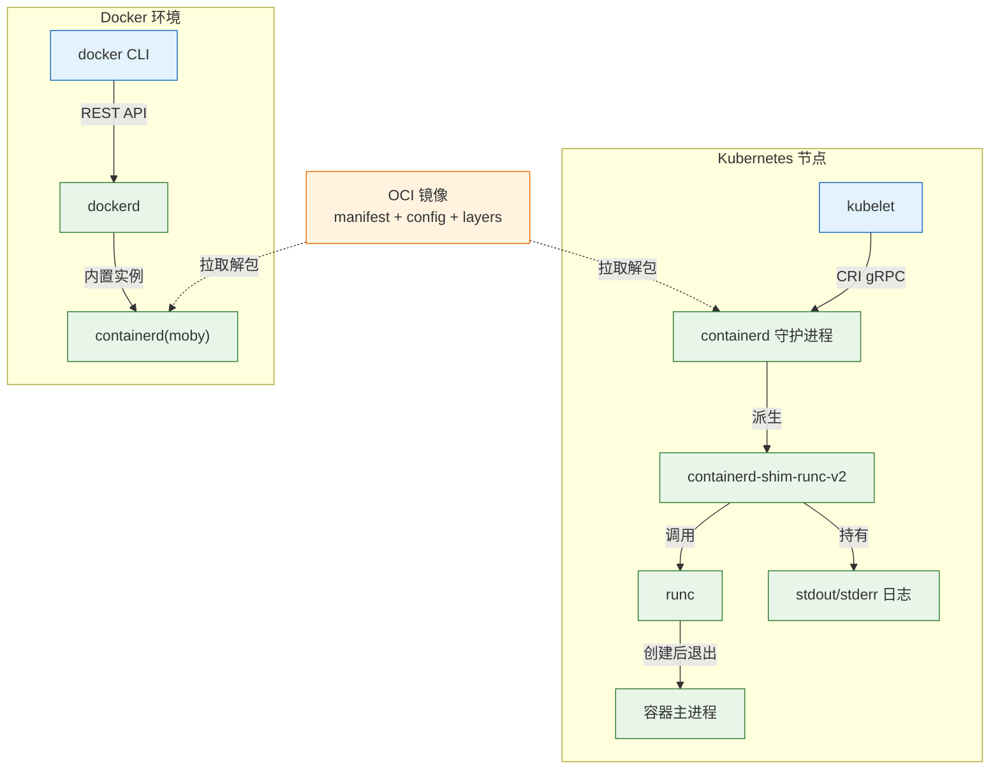
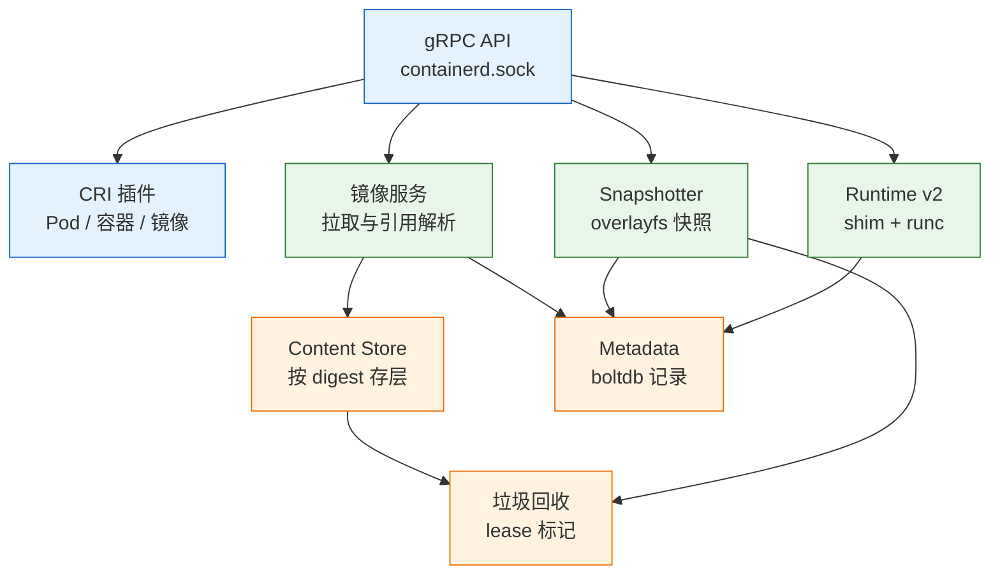
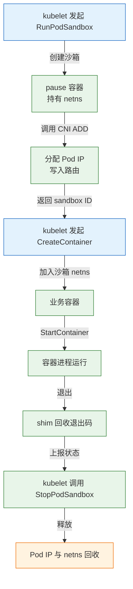

# Containerd 容器运行时

---

## 一、Containerd 是什么

Containerd 是一个开源的容器运行时，最初从 Docker Engine 中拆分，2017 年捐赠给 CNCF，现在是 Kubernetes 默认的节点运行时。它在单机范围内完成四件事：拉取并校验镜像、把镜像层解包成可挂载的快照、按 OCI 规范创建隔离进程、通过 CRI 向 kubelet 汇报状态。

它解决的是“容器进程怎么被可靠地创建和回收”，不解决“容器应该跑在哪台机器”“副本数应该是几个”“服务怎么被发现”。把调度、网络方案、发布策略都期待成运行时能力，排障方向从一开始就会错。

**版本现状（2026-10）**：containerd 2.3 为 LTS，2.4 为当前稳定线；Kubernetes 1.37 通过 CRI v1 调用运行时。containerd 1.7 已于 2026-09 结束支持，新节点不应继续使用发行版自带的 1.7。Kubernetes 1.35 起只支持 cgroup v2，Ubuntu 22.04/24.04 默认满足，CentOS 7 这类老内核需要先升级。

### 1.1 核心概念

| 概念 | 含义 | 观察方式 |
|---|---|---|
| Image | manifest、config 与若干只读层的集合 | `ctr images ls` |
| Snapshot | 层的可挂载视图，含容器可写层 | `ctr snapshots ls` |
| Container | 元数据定义，描述用什么镜像、什么配置 | `ctr containers ls` |
| Task | 已创建的容器进程，是“正在运行”的标志 | `ctr tasks ls` |
| Sandbox | 持有 Pod 网络命名空间的 pause 容器 | `crictl pods` |
| Namespace | containerd 内部的逻辑分区，不是内核命名空间 | `ctr namespaces ls` |
| Content | 按 digest 存放的镜像层原始字节 | `ctr content ls` |

镜像（Image）是只读模板，由 manifest 指向 config 和各层 tar 包。容器（Container）只是一份元数据，创建容器不会启动进程；只有创建 task，进程才真正存在。删除容器定义与杀掉进程是两件事，这解释了为什么 `ctr containers ls` 有记录而 `ctr tasks ls` 为空。

快照（Snapshot）是 overlayfs 提供的可写视图。镜像层保持只读，容器写入落在自己的可写层；容器删除时只删可写层，镜像层仍然被其他容器共享。内容存储（Content Store）按 digest 寻址，同一份基础层无论被多少个镜像引用都只存一份，这是磁盘去重的根源。

沙箱（Sandbox）是 CRI 引入的概念，对应一个 pause 容器。它不跑业务逻辑，只持有 Pod 的网络命名空间。业务容器加入这个命名空间，因此 Pod 内容器共享 IP 和端口空间，可以用 `localhost` 互访。

### 1.2 与相邻技术的关系

| 技术 | 与 Containerd 的关系 | 边界 |
|---|---|---|
| Docker Engine | 内置一个 containerd 实例，dockerd 在其上封装镜像构建与网络 | 两者的镜像、容器默认不共享 |
| runc | 低层运行时，被 shim 调用，按 OCI 配置创建进程 | 创建完即退出，不守护容器 |
| CRI-O | 另一套 CRI 实现，只服务 Kubernetes | 与 containerd 二选一 |
| kubelet | CRI 客户端，通过 gRPC 调用 containerd | 不直接操作 runc |
| CNI | 被 containerd 调用的网络插件规范 | 只配网络，不管镜像 |
| BuildKit | 镜像构建器，可独立于 containerd 使用 | containerd 只运行，不构建 |

Kubernetes 1.24 移除了 dockershim，kubelet 不再通过 Docker 管理容器。节点上即使装了 Docker，`docker ps` 也看不到 Kubernetes 的 Pod，因为那是两套独立的运行时实例。镜像格式由 OCI 统一，Docker 构建的镜像可以被 containerd 直接运行，但运行时的元数据互不相通。



OCI 把“造镜像”和“跑容器”拆成两份契约。Image Spec 规定分层 tar 包、config JSON 和 manifest；Runtime Spec 规定一个摊开的 rootfs 加一份 `config.json` 如何变成进程。runc 只认后者，完全不知道“镜像”是什么，这正是镜像可以跨运行时复用的原因。

### 1.3 架构组成

| 组件 | 职责 | 对应位置 |
|---|---|---|
| gRPC API | 对外提供全部操作入口 | `/run/containerd/containerd.sock` |
| CRI 插件 | 实现 Pod、容器、镜像三组接口 | `io.containerd.cri.v1.*` |
| Content Store | 按 digest 保存镜像层 | `/var/lib/containerd/io.containerd.content.v1.content` |
| Snapshotter | 叠层、挂载、管理可写层 | `.../snapshotter.v1.overlayfs` |
| Metadata | 镜像、容器、任务记录 | `.../metadata.v1.bolt/meta.db` |
| Runtime v2 | 启动 shim 与 runc | `io.containerd.runtime.v2` |
| GC | 按 lease 回收无引用内容 | 后台周期执行 |



守护进程启动时读取 `config.toml`，按插件名加载各项服务，再监听 socket。配置文件里的插件路径随大版本变化，2.x 把 CRI 的镜像配置放在 `io.containerd.cri.v1.images` 下，照抄旧版本的 `io.containerd.grpc.v1.cri` 会导致配置不生效。判断最终生效值，用 `containerd config dump` 而不是只看文件。

插件化设计还决定了排障的切入点。镜像相关的问题落在 images 与 content 插件，容器起不来的问题落在 runtime v2 与 CRI 插件，磁盘增长的问题落在 snapshotter 与 GC。每一类插件都有自己的日志前缀，`journalctl -u containerd` 里按前缀过滤，比通读整段日志快得多。守护进程本身不保存业务状态，全部对象记录在 boltdb 中，因此它可以随时重启，代价只是短暂的 API 不可用。

---

## 二、安装与配置

| 版本 | 状态 | 适用场景 |
|---|---|---|
| 2.4.x | 当前稳定线 | 新建节点首选 |
| 2.3.x | LTS | 需要长期维护的生产集群 |
| 1.7.x | 已 EOL（2026-09） | 仅存量节点，应尽快升级 |

> **运维提示**：升级运行时前先在测试节点验证 CRI 版本、cgroup 驱动与 pause 镜像，三者在升级后必须同时匹配；只升级 containerd 而不同步 kubelet，节点可能直接 NotReady。

### 2.1 系统准备与内核检查

containerd 依赖 overlayfs、cgroup 和网络内核模块。先确认 cgroup 版本，Kubernetes 1.35 起 kubelet 在 cgroup v1 上直接拒绝启动。

```bash
# ========== 内核与 cgroup 检查 ==========
# 查看 cgroup 版本，输出 cgroup2fs 表示 v2
stat -fc %T /sys/fs/cgroup

# 查看内核版本，overlayfs 需要 4.x 以上
uname -r

# 加载 overlay 与网桥过滤模块
sudo modprobe overlay
sudo modprobe br_netfilter

# 确认模块已加载
lsmod | grep -E 'overlay|br_netfilter'
```

```bash
# ========== 内核参数 ==========
# 写入网桥与转发参数，Kubernetes 网络的前提
sudo tee /etc/modules-load.d/containerd.conf >/dev/null <<'EOF'
overlay
br_netfilter
EOF

sudo tee /etc/sysctl.d/99-kubernetes-cri.conf >/dev/null <<'EOF'
net.bridge.bridge-nf-call-iptables  = 1
net.bridge.bridge-nf-call-ip6tables = 1
net.ipv4.ip_forward                 = 1
EOF

# 立即生效
sudo sysctl --system
```

```bash
# ========== Swap 处理 ==========
# 查看当前 swap，kubelet 默认要求关闭
swapon --show

# 临时关闭
sudo swapoff -a

# 永久关闭：注释 /etc/fstab 中的 swap 行
sudo sed -i '/\sswap\s/s/^/#/' /etc/fstab
```

> **注意**：`swapoff -a` 会立即回收交换空间，内存紧张的机器可能触发 OOM。生产环境先在维护窗口评估内存余量，或改用 kubelet 的 `failSwapOn: false` 并接受调度语义变化。

内核检查不通过的机器，后面所有步骤都会以奇怪的方式失败。overlay 模块缺失时，snapshotter 创建快照会报 `no such device`；`br_netfilter` 未加载时，Service 的 iptables 规则不会对网桥流量生效，表现为集群内部分节点互通、部分节点超时。先把这些前置条件固定下来，再谈运行时配置。

### 2.2 使用 apt 安装

发行版仓库自带的 containerd 版本通常落后，使用 Docker 官方仓库获取 `containerd.io`，但不要顺手安装 Docker Engine。

```bash
# ========== 添加 Docker 官方仓库 ==========
# 安装基础依赖
sudo apt update
sudo apt install -y ca-certificates curl gnupg

# 创建密钥目录
sudo install -m 0755 -d /etc/apt/keyrings

# 导入 GPG 密钥
curl -fsSL https://download.docker.com/linux/ubuntu/gpg \
  | sudo gpg --dearmor -o /etc/apt/keyrings/docker.gpg
sudo chmod a+r /etc/apt/keyrings/docker.gpg

# 写入软件源
echo "deb [arch=$(dpkg --print-architecture) signed-by=/etc/apt/keyrings/docker.gpg] https://download.docker.com/linux/ubuntu $(lsb_release -cs) stable" \
  | sudo tee /etc/apt/sources.list.d/docker.list >/dev/null

# ========== 安装 containerd ==========
# 只装运行时，不装 docker-ce
sudo apt update
sudo apt install -y containerd.io

# 查看版本
containerd --version
```

```bash
# ========== CentOS / Rocky 安装 ==========
# 添加 Docker CE 仓库
sudo dnf install -y dnf-plugins-core
sudo dnf config-manager --add-repo https://download.docker.com/linux/centos/docker-ce.repo

# 只安装 containerd.io
sudo dnf install -y containerd.io

# 启动并设置开机自启
sudo systemctl enable --now containerd
```

### 2.3 生成与修改 config.toml

不要手写整份 TOML。不同大版本的插件路径不同，先用自带命令生成默认配置，再做定点修改。

```bash
# ========== 生成默认配置 ==========
# 创建配置目录
sudo mkdir -p /etc/containerd

# 导出默认配置，2.x 生成的版本号为 3
containerd config default | sudo tee /etc/containerd/config.toml >/dev/null

# ========== 关键项修改 ==========
# systemd 系统必须使用 systemd cgroup 驱动，否则资源统计和限制会错位
sudo sed -i 's/SystemdCgroup = false/SystemdCgroup = true/' /etc/containerd/config.toml

# 2.x 的仓库配置位于 io.containerd.cri.v1.images，默认是空串
sudo sed -i "s|config_path = ''|config_path = '/etc/containerd/certs.d'|" /etc/containerd/config.toml

# ========== 校验修改结果 ==========
# 确认两个关键项都已写入
grep -nE 'SystemdCgroup|config_path' /etc/containerd/config.toml

# 查看合并默认值后的最终配置，比只看文件可靠
sudo containerd config dump | grep -E 'SystemdCgroup|config_path|sandbox'
```

| 配置项 | 作用 | 建议值 |
|---|---|---|
| `version` | 配置格式版本 | 2.x 用 3 |
| `root` | 持久化数据目录 | `/var/lib/containerd` |
| `state` | 运行时状态目录 | `/run/containerd` |
| `SystemdCgroup` | cgroup 驱动与 systemd 对齐 | `true` |
| `config_path` | 仓库主机配置目录 | `/etc/containerd/certs.d` |
| `pinned_images.sandbox` | pause 镜像地址 | 与集群版本匹配 |
| `max_concurrent_downloads` | 并发下载层数 | 默认 3，带宽充足可调高 |

pause 镜像在 2.x 中由 `pinned_images.sandbox` 指定，1.x 叫 `sandbox_image`。集群升级时 pause 镜像版本要与 kubelet 预期一致，否则沙箱反复拉取失败。改完配置必须重启 containerd；只改 `certs.d` 下的 `hosts.toml` 不需要重启。

配置修改遵循“改一项、验一项”的原则。改完 cgroup 驱动，用 `containerd config dump` 确认新值，再重启服务；改完仓库目录，用一次实际拉取验证；改完 sandbox 镜像，先手工 `crictl pull` 一次，确认节点能访问对应仓库。把所有修改堆在一起再重启，出问题时无法判断是哪一项引起的。`config.toml` 只写与默认值不同的项也可以，但生成完整默认文件更利于版本对比和回滚。

### 2.4 镜像加速与仓库证书

镜像加速按仓库域名建目录，一个域名一份 `hosts.toml`。`server` 写仓库身份，`[host]` 才是候选站点，写反会导致推送打到错误的仓库。

```bash
# ========== 配置 docker.io 加速 ==========
# 按域名创建目录
sudo mkdir -p /etc/containerd/certs.d/docker.io

# 写入候选站点，capabilities 决定允许的动作
sudo tee /etc/containerd/certs.d/docker.io/hosts.toml >/dev/null <<'EOF'
server = "https://docker.io"

[host."https://<mirror-a>"]
  capabilities = ["pull", "resolve"]

[host."https://<mirror-b>"]
  capabilities = ["pull", "resolve"]
EOF
```

```bash
# ========== 配置私有仓库 ==========
# 为私有域名建目录
sudo mkdir -p /etc/containerd/certs.d/registry.example.com

# HTTPS 仓库：放置 CA 证书，hosts.toml 保持默认即可
sudo cp registry-ca.crt /etc/containerd/certs.d/registry.example.com/ca.crt

# HTTP 仓库：显式声明 skip_verify，仅限内网测试
sudo tee /etc/containerd/certs.d/registry.example.com/hosts.toml >/dev/null <<'EOF'
server = "https://registry.example.com"

[host."http://registry.example.com"]
  capabilities = ["pull", "resolve", "push"]
  skip_verify = true
EOF
```

| 字段 | 含义 | 风险 |
|---|---|---|
| `server` | 仓库的规范身份 | 写错会导致引用解析失败 |
| `[host]` | 实际连接的候选地址 | 可配多个做容灾 |
| `capabilities` | 允许 pull/resolve/push | 缺少 push 时推送被拒 |
| `skip_verify` | 跳过 TLS 校验 | 仅限内网，生产禁用 |
| `ca.crt` | 私有 CA 证书 | 证书过期会导致拉取中断 |

> **安全警告**：公共加速器可以看到拉取记录，也可能随时失效。生产环境优先自建 registry 或镜像代理；`skip_verify = true` 会失去中间人防护，不得用于跨公网仓库。

加速配置是否生效，不要靠猜。改完后在节点上执行一次 `crictl pull`，观察耗时与日志中的实际请求地址；`hosts.toml` 语法错误时 containerd 可能静默回落到 `server`，表现为“配置了还是慢”。多个候选站点按顺序尝试，第一个可用即返回，因此把稳定的自建代理放在前面，公共站点只作兜底。

### 2.5 安装 nerdctl 与 CNI 插件

containerd 只提供运行时，日常操作需要客户端工具。`nerdctl` 提供接近 Docker 的体验，端口映射和容器名解析依赖 CNI 插件。

```bash
# ========== 安装 nerdctl ==========
# 版本以官方 Releases 为准，下列为示例版本
NERDCTL_VER=2.4.1

# 下载并解压到 /usr/local/bin
curl -fLO https://github.com/containerd/nerdctl/releases/download/v${NERDCTL_VER}/nerdctl-${NERDCTL_VER}-linux-amd64.tar.gz
sudo tar -C /usr/local/bin -xzf nerdctl-${NERDCTL_VER}-linux-amd64.tar.gz

# 验证
nerdctl version

# ========== 安装 CNI 插件 ==========
# 插件版本与 nerdctl 配套，示例值
CNI_VER=1.9.1

# 下载并解压到 /opt/cni/bin
curl -fLO https://github.com/containernetworking/plugins/releases/download/v${CNI_VER}/cni-plugins-linux-amd64-v${CNI_VER}.tgz
sudo mkdir -p /opt/cni/bin
sudo tar -C /opt/cni/bin -xzf cni-plugins-linux-amd64-v${CNI_VER}.tgz

# 确认关键插件存在
ls /opt/cni/bin | grep -E 'bridge|portmap|host-local'
```

```bash
# ========== 启动并验证 ==========
# 设置开机自启并立即启动
sudo systemctl enable --now containerd

# 修改配置后重启
sudo systemctl restart containerd

# 查看服务状态
systemctl is-active containerd

# 查看客户端与服务端版本
sudo ctr version
```

预期输出形状（版本号会不同）：

```text
Client:
  Version:  v2.4.x
  Go version: go1.25.x

Server:
  Version:  v2.4.x
```

只有 Client 没有 Server，说明 containerd 没起来或 socket 路径不对，此时不要再去查镜像。重启 containerd 不会杀死业务容器，因为容器进程由 shim 照看，containerd 恢复后通过 shim 重新接管。

---

## 三、核心对象管理

### 3.1 镜像与引用解析

镜像引用由四段组成：`仓库域名/命名空间/名字:标签`。省略域名默认 `docker.io`，省略命名空间默认 `library`。

| 写法 | 实际解析 | 说明 |
|---|---|---|
| `nginx:1.30` | `docker.io/library/nginx:1.30` | 官方镜像 |
| `bitnami/postgresql:18` | `docker.io/bitnami/postgresql:18` | 第三方命名空间 |
| `registry.example.com/app/api:v3` | 原样 | 私有仓库 |
| `nginx@sha256:...` | 按 digest 拉取 | 内容不可变 |

```bash
# ========== 拉取镜像 ==========
# 按当前平台拉取
sudo ctr images pull docker.io/library/nginx:1.30-alpine

# 指定平台，跨架构节点必须显式指定
sudo ctr images pull --platform linux/amd64 docker.io/library/nginx:1.30-alpine

# 通过 CRI 拉取，走 k8s.io 分区
sudo crictl pull nginx:1.30-alpine

# ========== 查看镜像 ==========
# 默认分区
sudo ctr images ls

# Kubernetes 分区
sudo ctr -n k8s.io images ls

# 检查镜像内容完整性，层缺失会报错
sudo ctr -n k8s.io images check

# 查看 repoDigests，发布清单应记录 digest
sudo crictl inspecti nginx:1.30-alpine | jq '.status.repoDigests'
```

拉取链路是：解析引用、取 manifest、多架构时先取 manifest list 再按当前平台选一个、逐层下载到 Content Store、解包成快照。排障时对应三个检查点：manifest 能否取到、层是否下完、平台是否匹配。

Tag 可变，digest 不可变。同一个 `api:1.42.0` 可能今天和明天指向不同的层；审计和回滚要认 digest。发布清单写 digest，节点拉到的才是确定的那一份。

私有仓库需要认证时，凭证配置在 CRI 插件的 registry 段，而不是 `hosts.toml`。配置项按仓库域名分组，写入用户名、密码或 token，重启后由 kubelet 的 imagePullSecrets 与节点凭证共同决定用哪一份。凭证过期或权限不足时，报错通常只写 `unauthorized`，需要用 `crictl pull` 在节点上复现，才能排除是 Pod 清单写错还是节点配置缺失。

```bash
# ========== 私有仓库认证 ==========
# 查看 CRI 镜像段当前配置
sudo containerd config dump | sed -n '/io.containerd.cri.v1.images/,/^\[/p' | head -40

# 节点上直接拉取，验证凭证是否有效
sudo crictl pull registry.example.com/app/api:v3

# 查看拉取失败的具体原因
sudo journalctl -u containerd -n 50 --no-pager | grep -i -E 'pull|auth|manifest'
```

### 3.2 快照与内容存储

| 对象 | 存什么 | 删除影响 |
|---|---|---|
| Content | 按 digest 存的层原始内容 | 被引用时不能删 |
| Snapshot | 层的可挂载视图与可写层 | 删容器只删可写层 |
| Metadata | 对象索引与引用关系 | 损坏会导致运行时起不来 |

```bash
# ========== 查看占用 ==========
# 数据目录总大小
sudo du -sh /var/lib/containerd

# 内容对象数量
sudo ctr -n k8s.io content ls | wc -l

# 快照数量
sudo ctr -n k8s.io snapshots ls | wc -l

# 查看快照详情，关注 Kind 与 Parent
sudo ctr -n k8s.io snapshots ls | head
```

十个镜像都基于 `alpine`，底层只存一份，这是 digest 去重。每个容器有自己的可写层，删除容器只删可写层，镜像层仍在。快照分 active 与 committed 两种状态：active 对应当前可写层，committed 对应已固化的只读层。

快照的生命周期与容器强绑定。创建容器时新建 active 快照，容器删除后快照进入待回收状态，由 GC 按 lease 判断是否还有引用。手工删除快照会让容器 rootfs 缺层，进程可能继续运行但文件系统报错，因此不要在容器运行时执行 `ctr snapshots rm`。需要释放空间时，先删容器与镜像，再让 GC 自然回收。

### 3.3 容器、任务与沙箱

| 对象 | 含义 | 命令 |
|---|---|---|
| Container | 元数据定义 | `ctr containers ls` |
| Task | 运行中的进程 | `ctr tasks ls` |
| Sandbox | Pod 网络命名空间载体 | `crictl pods` |

```bash
# ========== ctr 创建并启动 ==========
# 创建容器定义，此时进程还不存在
sudo ctr containers create docker.io/library/nginx:1.30-alpine web

# 启动任务，进程真正运行
sudo ctr tasks start -d web

# 查看任务，PIDS 列非零表示进程在
sudo ctr tasks ls

# 在容器内执行命令
sudo ctr tasks exec --exec-id shell1 -t web sh

# 停止并删除
sudo ctr tasks kill web
sudo ctr tasks delete web
sudo ctr containers delete web
```

```bash
# ========== crictl 查看沙箱 ==========
# 列出所有沙箱
sudo crictl pods

# 列出容器，-a 包含已退出
sudo crictl ps -a

# 按 Pod 过滤
sudo crictl ps -a --pod <pod-id>

# 查看沙箱状态与网络信息
sudo crictl inspectp <pod-id> | jq '.status.state, .status.network'
```

`containers ls` 有、`tasks ls` 没有，说明容器定义还在，但进程已经停了。ctr 的 task 才是“正在跑的进程”。沙箱与容器要分开看：`crictl pods` 是沙箱，`crictl ps` 是业务容器。

### 3.4 命名空间隔离

| 分区 | 使用者 | 内容 |
|---|---|---|
| `default` | `ctr`、`nerdctl` 默认 | 手工调试的镜像 |
| `k8s.io` | kubelet 与 CRI | pause、CNI、业务镜像 |
| `moby` | Docker 内置实例 | Docker 的镜像 |

```bash
# ========== 分区操作 ==========
# 查看所有分区
sudo ctr namespaces ls

# 查看 Kubernetes 分区的镜像
sudo ctr -n k8s.io images ls

# 查看默认分区
sudo ctr images ls

# nerdctl 指定分区
sudo nerdctl --namespace k8s.io ps
```

`ctr images ls` 是空的、但 Kubernetes 明明在跑，通常就是没带 `-n k8s.io`。这里的分区与 Linux 内核的 pid/net/mnt namespace 没有关系，只是 containerd 内部用来隔离对象集合的逻辑命名空间。

分区的价值在于隔离不同来源的对象。Docker 的镜像属于 moby 分区，Kubernetes 的镜像属于 k8s.io，手工调试的对象属于 default。三个分区同名镜像可以各自存在不同版本，互不覆盖。清理磁盘时要按分区判断，只清 default 往往释放不了多少空间，真正占空间的是 k8s.io 里长期积累的历史镜像。

Docker 自带一个 containerd 子进程，socket 在 `/var/run/docker/containerd/containerd.sock`；系统安装的实例使用 `/run/containerd/containerd.sock`。两个实例的镜像、容器、快照完全隔离。

```bash
# ========== 区分运行时实例 ==========
# 查看进程与各自 socket
ps -ef | grep -E 'containerd|dockerd' | grep -v grep

# 系统实例
sudo ctr -a /run/containerd/containerd.sock images ls

# Docker 内置实例
sudo ctr -a /var/run/docker/containerd/containerd.sock -n moby images ls
```

`ctr -a` 指定 socket，`-n` 指定逻辑分区。排查“镜像明明拉了却看不到”时，先确认连的是哪个实例、哪个分区。不要为了省事卸载系统 containerd，Docker 与 Kubernetes 可能都依赖它。

---

## 四、常用命令

### 4.1 ctr 命令

`ctr` 直接调用 containerd 原始 API，不涉及 CNI，不提供端口映射，也不支持容器名互访。它适合查看运行时真实记录。

```bash
# ========== 镜像 ==========
# 拉取并指定平台
sudo ctr images pull --platform linux/amd64 docker.io/library/nginx:1.30-alpine

# 列出镜像
sudo ctr -n k8s.io images ls

# 给镜像打额外标签
sudo ctr -n k8s.io images tag docker.io/library/nginx:1.30-alpine registry.example.com/demo/nginx:v1

# 删除镜像
sudo ctr -n k8s.io images rm registry.example.com/demo/nginx:v1

# ========== 容器与任务 ==========
# 创建容器定义
sudo ctr containers create docker.io/library/nginx:1.30-alpine web

# 启动任务
sudo ctr tasks start -d web

# 查看任务与资源占用
sudo ctr tasks ls
sudo ctr tasks metrics web

# 暂停与恢复
sudo ctr tasks pause web
sudo ctr tasks resume web

# ========== 存储 ==========
# 查看内容对象
sudo ctr -n k8s.io content ls

# 查看快照
sudo ctr -n k8s.io snapshots ls

# 查看某层内容详情
sudo ctr -n k8s.io content get sha256:<digest> | tar -tvf -
```

### 4.2 crictl 命令

`crictl` 面向 Kubernetes，走 CRI 接口，节点排障首选。配置好 endpoint 后可以直接连 containerd 的 CRI socket。

```bash
# ========== 安装 crictl ==========
# 版本与集群小版本保持接近
CRICTL_VER=v1.37.0

# 下载并解压到 /usr/local/bin
curl -fLO https://github.com/kubernetes-sigs/cri-tools/releases/download/${CRICTL_VER}/crictl-${CRICTL_VER}-linux-amd64.tar.gz
sudo tar -C /usr/local/bin -xzf crictl-${CRICTL_VER}-linux-amd64.tar.gz

# ========== 配置 ==========
# 安装 jq，便于解析 JSON
sudo apt install -y jq

# 写入 crictl 配置
sudo tee /etc/crictl.yaml >/dev/null <<'EOF'
runtime-endpoint: unix:///run/containerd/containerd.sock
image-endpoint: unix:///run/containerd/containerd.sock
timeout: 10
debug: false
EOF

# 验证 CRI 是否连通
sudo crictl info | head -5
sudo crictl version
```

```bash
# ========== 排障常用 ==========
# 查看沙箱
sudo crictl pods

# 查看容器，含已退出
sudo crictl ps -a

# 查看容器日志
sudo crictl logs <container-id>

# 查看容器退出码与原因
sudo crictl inspect <container-id> | jq '.status.exitCode, .status.reason'

# 查看沙箱状态
sudo crictl inspectp <pod-id> | jq '.status.state'

# 查看资源占用
sudo crictl stats

# 手动拉取镜像验证仓库连通性
sudo crictl pull nginx:1.30-alpine

# 列出镜像
sudo crictl images
```

### 4.3 nerdctl 命令

`nerdctl` 是命令行工具，不是守护进程。它补齐了端口映射、容器名解析、Compose 和构建能力，适合单机日常使用。

```bash
# ========== 运行与查看 ==========
# 准备静态页面
sudo mkdir -p /srv/www
echo "hello from containerd" | sudo tee /srv/www/index.html

# 运行容器，挂载页面并映射端口
sudo nerdctl run -d --name web -p 8080:80 \
  -v /srv/www:/usr/share/nginx/html:ro \
  nginx:1.30-alpine

# 访问验证
curl -s http://127.0.0.1:8080

# 查看容器
sudo nerdctl ps
sudo nerdctl ps -a

# 查看日志
sudo nerdctl logs -f web

# 进入容器
sudo nerdctl exec -it web sh

# ========== 镜像与构建 ==========
# 拉取镜像
sudo nerdctl pull nginx:1.30-alpine

# 构建镜像，默认使用 BuildKit
sudo nerdctl build -t myapp:v1 .

# 清理未使用镜像
sudo nerdctl image prune
```

> **注意**：nerdctl 的 `--restart` 不能等价替代 Docker 的重启策略，整机重启后不会自动恢复。需要开机自启就交给 systemd 管理，或把节点加入 Kubernetes 让 kubelet 管。

### 4.4 三套命令对照

| 操作 | ctr | crictl | nerdctl |
|---|---|---|---|
| 拉镜像 | `ctr images pull` | `crictl pull` | `nerdctl pull` |
| 列容器 | `ctr containers ls` | `crictl ps -a` | `nerdctl ps -a` |
| 看日志 | 不支持 | `crictl logs` | `nerdctl logs` |
| 端口映射 | 不支持 | 不涉及 | `-p` |
| 容器名互访 | 不支持 | 不涉及 | 自定义网络 |
| 典型用途 | 查原始记录 | 节点排障 | 单机日常 |

日常用 nerdctl，节点排障用 crictl，怀疑运行时本身时用 ctr。三者的对象集合默认不在同一个分区，跨工具看不到对方创建的容器属于正常现象。

选型可以按一个问题判断：这次操作是给 Kubernetes 看的，还是给人看的。给 Kubernetes 看，用 crictl，它返回的状态与 kubelet 看到的一致；给人做单机调试，用 nerdctl，它补齐了端口、名称解析和构建；要确认运行时内部到底记录了什么，用 ctr，它绕过 CRI 直接读原始对象。混用工具会导致判断偏差，例如用 ctr 在 default 分区查不到 Pod，并不代表镜像没拉下来。

---

## 五、运行时管理

### 5.1 CRI 接口与 Pod 沙箱

kubelet 不直接调 containerd 的私有 API，而是走 CRI。CRI 只有三组核心操作。

| 组 | 操作 | 作用 |
|---|---|---|
| Pod 沙箱 | RunPodSandbox / StopPodSandbox | 创建 pause 容器，持有 Pod 网络命名空间 |
| 容器 | Create / Start / Stop / Remove | 在沙箱里起业务容器 |
| 镜像 | Pull / List / Remove | 拉取、列出、删除镜像 |



pause 容器不执行业务逻辑，作用就是持有网络命名空间。业务容器重启时沙箱还在，Pod IP 不变；沙箱重建，Pod 才会换 IP。CRI 是 kubelet 与运行时之间的合同，合同断了，节点能启动、能上报，但任何 Pod 都起不来，状态停在 NotReady。

CRI 的版本协商也值得注意。kubelet 启动时先调用 `Version` 接口，确认双方都支持 CRI v1；不支持时直接放弃该运行时，节点进入 NotReady。containerd 1.7 之后的版本都实现了 v1，更老的版本只提供 v1alpha2，会在新版本 Kubernetes 上被拒绝。因此“节点升级后所有 Pod 消失”有时不是镜像问题，而是运行时版本太旧，CRI 握手失败。

沙箱创建失败与容器创建失败要分开处理。前者查 pause 镜像、CNI 和 netns，后者查镜像、命令、挂载与权限。`kubectl describe pod` 只给一句 `failed to create pod sandbox`，具体原因在 `crictl inspectp` 的 status 里，事件时间、网络配置和错误信息都在那里。

### 5.2 shim 与进程生命周期

| 进程 | 父进程 | 职责 | 生命周期 |
|---|---|---|---|
| containerd | systemd | 镜像、快照、元数据、CRI | 常驻 |
| shim | containerd | 照看容器、持有日志、回收退出码 | 与容器同寿命 |
| runc | shim | 建 namespace、cgroup、rootfs 后 exec | 一次性 |
| 容器进程 | shim（托管） | 运行业务 | 与容器同寿命 |

关键结论：runc 退出不代表容器退出。容器进程被交给 shim 照看，所以重启 containerd 不会杀死业务容器；containerd 恢复后通过 shim 重新接管。反过来说，shim 数量等于容器数量，几千个容器就是几千个 shim，这是真实的内存开销。

shim 的存在还解释了日志为什么不会丢。容器进程的 stdout/stderr 由 shim 持有并写入 CRI 日志文件，即使 containerd 短暂不可用，写入也不中断。停止 containerd 服务时，systemd 只结束主进程，不会级联杀掉 shim；如果手工 `pkill` 掉 shim，容器进程会随之失去托管，通常表现为容器立即退出。

```bash
# ========== 查看进程树 ==========
# 确认 containerd、shim、runc 的进程关系
ps -ef | grep -E 'containerd|shim|runc' | grep -v grep

# 统计 shim 数量，接近容器数
pgrep -c containerd-shim

# 查看某个容器的完整状态
sudo crictl inspect <container-id> | jq '.status.pid, .status.startedAt'
```

### 5.3 容器重启后的状态

机器重启时，所有 shim 和容器进程都会消失，containerd 自己不会“记住并拉起”它们。区别在于谁保存期望状态。

| 启动方式 | 整机重启后 | 原因 |
|---|---|---|
| Kubernetes Pod | 自动恢复 | 期望状态在 etcd，kubelet 重建 |
| nerdctl 容器 | 不恢复 | 没有守护进程保存期望状态 |
| ctr 容器 | 不恢复 | ctr 是调试工具，不是服务管理器 |

```bash
# ========== 重启后确认 ==========
# 确认 containerd 开机自启
systemctl is-enabled containerd

# 查看 nerdctl 容器是否还在
sudo nerdctl ps -a

# 查看 Kubernetes 容器
sudo crictl ps -a
```

Kubernetes 的 Pod 会回来，因为期望状态在 etcd 里，kubelet 启动后按 spec 重建沙箱和容器；业务数据在卷里，不在容器可写层。nerdctl 单独跑的容器不会自动回来，`--restart` 也扛不住整机重启。把“容器没自启”当成 containerd 故障，是最常见的误判之一。数据持久化同样不归 containerd：卷由 kubelet 挂载，删了 Pod 数据在不在，取决于 PV、PVC 与 StorageClass。

### 5.4 rootless 与安全边界

容器里的 root 默认就是宿主机的 root。要降低风险，需要逐项收紧，而不是只加一个参数。

| 手段 | 作用 | 代价 |
|---|---|---|
| rootless | 整个运行时以普通用户运行 | 需要 user namespace 与 cgroup v2 委托 |
| user namespace 映射 | 容器内 root 映射为宿主机普通 UID | 挂载宿主机文件时 UID 对不上 |
| `--cap-drop ALL` | 去掉不需要的内核能力 | 要按需补回 `NET_BIND_SERVICE` |
| seccomp | 限制可用系统调用 | 误拦会让应用莫名失败 |
| 只读根文件系统 | 禁止写镜像层 | 应用要写的目录必须挂卷 |

```bash
# ========== rootless 安装 ==========
# 安装 rootless 工具集
containerd-rootless-setuptool.sh install

# 以普通用户运行容器
nerdctl run --rm busybox:1.37 id

# 查看 rootless 状态
systemctl --user status containerd
```

rootless 依赖 rootlesskit、user namespace 和 cgroup v2 委托，内核或发行版不支持时会在启动阶段就报错。rootless 解决的是“运行时不以 root 跑”，不等于多租户隔离；运行不可信代码仍然要用 Kata、gVisor 这类强隔离方案。

> **运维红线**：不要用 `--privileged` 作为解决权限问题的通用手段。它几乎关闭全部隔离，容器内进程可以直接操作宿主设备与内核接口。

---

## 六、网络与存储

### 6.1 CNI 网络模型

| 插件 | 作用 | 缺失表现 |
|---|---|---|
| `bridge` | 创建网桥并接入容器 | 容器只有 loopback |
| `host-local` | 从地址段分配 IP | 无 IP 或地址冲突 |
| `portmap` | 实现端口映射 | `-p` 不生效 |
| `firewall` | 维护 iptables 规则 | 跨网段访问异常 |

```bash
# ========== 检查 CNI 配置 ==========
# 查看网络配置，Kubernetes 节点通常由 CNI 方案写入
ls /etc/cni/net.d/

# 查看插件二进制
ls /opt/cni/bin/ | head

# 查看容器网络命名空间
sudo crictl inspect <container-id> | jq '.status.network'

# 进入网络命名空间观察网卡与路由
sudo nsenter -t <pid> -n ip addr
sudo nsenter -t <pid> -n ip route
```

containerd 只负责调用 CNI 插件，不提供跨节点网络方案。Calico、Cilium、Flannel 负责地址分配与路由，插件二进制和配置由它们安装。`ctr` 启动的容器不调用 CNI，只有 loopback；需要完整网络能力时用 nerdctl 或交给 Kubernetes。

### 6.2 端口映射与容器名解析

| 能力 | ctr | nerdctl | Kubernetes |
|---|---|---|---|
| 端口映射 | 不支持 | `-p` | Service / hostPort |
| 名称解析 | 不支持 | 自定义网络内生效 | CoreDNS |
| 网络策略 | 不支持 | 依赖 CNI | NetworkPolicy |

```bash
# ========== nerdctl 网络 ==========
# 创建自定义网络
sudo nerdctl network create myapp

# 启动两个容器加入同一网络
sudo nerdctl run -d --name db --network myapp postgres:18
sudo nerdctl run -d --name app --network myapp -e DB_HOST=db myapp:v1

# 在 app 内直接用容器名访问 db
sudo nerdctl exec -it app sh -c 'getent hosts db'
```

自定义网络内，容器直接用名称互相访问，这是 nerdctl 内置 DNS 的能力，不是 containerd 本身提供的。默认 bridge 网络不具备名称解析，跨网络也不通。

端口映射的实现依赖 `portmap` 插件与 iptables 规则。`-p 8080:80` 会在宿主机 DNAT 表和 filter 表各写一条规则，容器停止后规则由插件清理。映射不生效时，先确认插件存在，再确认宿主机防火墙没有覆盖这些链，最后才怀疑容器内应用没有监听正确地址。绑定 `127.0.0.1` 的服务在容器内只能被自己访问，必须监听 `0.0.0.0`。

### 6.3 内容存储与磁盘回收

| 占用来源 | 位置 | 清理方式 |
|---|---|---|
| 镜像层 | Content Store | `crictl rmi` |
| 容器可写层 | Snapshotter | 删容器后由 GC 回收 |
| 容器日志 | `/var/log/pods` | kubelet 轮转 |
| 元数据 | `meta.db` | 不手工删除 |

```bash
# ========== 定位占用 ==========
# 数据目录总量
sudo du -sh /var/lib/containerd

# 按子目录看谁在涨
sudo du -sh /var/lib/containerd/*

# 内容对象与快照数量
sudo ctr -n k8s.io content ls | wc -l
sudo ctr -n k8s.io snapshots ls | wc -l

# ========== 回收 ==========
# 删除未被容器使用的镜像
sudo crictl rmi --prune

# nerdctl 清理未使用镜像
sudo nerdctl image prune

# 查看可回收空间，先确认再执行
sudo nerdctl system df
```

> **运维红线**：`crictl rmi --prune` 会删除所有未被容器使用的镜像，节点上可能把 pause 镜像一起删掉。节点频繁创建 Pod 时不要手工清理，交给 kubelet 的镜像回收策略。

> **运维红线**：不要手工 `rm -rf /var/lib/containerd`。里面是 boltdb 元数据和按 digest 存放的层，直接删会让元数据与内容不一致，containerd 可能起不来；清理走 `crictl rmi` 或 `nerdctl image prune`。

节点上的镜像回收由 kubelet 控制，默认按磁盘使用率触发：达到 `imagefs.available` 的高水位后先删未使用镜像，持续紧张再删更旧的。因此节点磁盘长期高位时，应调整 kubelet 的 `evictionHard` 与 `imageGCHighThresholdPercent`，而不是每天手工 prune。手工清理只能解决当下，回收策略才决定长期稳定。

### 6.4 日志与轮转

日志由 shim 写进 CRI 日志文件，轮转归 kubelet 管。文件在 `/var/log/pods/`，上层还有 `/var/log/containers/` 的符号链接。

```bash
# ========== 查看日志 ==========
# 通过 CRI 看容器日志
sudo crictl logs --tail 100 <container-id>

# 直接看节点日志文件
sudo ls /var/log/pods/
sudo tail -n 100 /var/log/pods/<namespace>_<pod>_<uid>/<container>/0.log

# 查看 kubelet 与 containerd 日志
sudo journalctl -u kubelet -n 100 --no-pager
sudo journalctl -u containerd -n 100 --no-pager
```

```yaml
# /var/lib/kubelet/config.yaml 片段
# 单个日志文件上限
containerLogMaxSize: 50Mi
# 每个容器保留的文件数
containerLogMaxFiles: 5
```

不配这两个值，一个死循环日志能把节点磁盘写满，表现是 `DiskPressure`、Pod 被驱逐，而不是 containerd 报错。日志采集器读取的是这些文件，应用应把日志写到 stdout/stderr，而不是容器内的独立文件。

日志量还受应用自身影响。同一个异常在循环里每秒打印几十行，一天就能写出几十 GB，轮转参数只能限制单文件与保留份数，不能降低写入速率。发现某个 Pod 日志异常增长时，先看应用是否在重试循环里打日志，再谈调大磁盘。日志统一写 stdout/stderr，由运行时落盘并交给采集器，不要在容器内再写一份到挂载卷，否则同一份日志占两遍空间。

---

## 七、常见排障

### 7.1 故障速查表

| 现象 | 最可能原因 | 处理 |
|---|---|---|
| `ctr version` 只有 Client | containerd 未启动或 socket 不对 | `systemctl status containerd`，核对 socket 路径 |
| `ctr images ls` 为空但 Pod 在跑 | 看的是 default 分区 | 加 `-n k8s.io` |
| `nerdctl run -p` 报网络创建失败 | 未安装 CNI 插件 | 检查 `/opt/cni/bin` 下的 `bridge`、`portmap` |
| 拉镜像长时间卡住 | `config_path` 为空，加速配置未加载 | 改为目录路径并重启 containerd |
| 改完配置 containerd 起不来 | TOML 引号、层级或插件名写错 | `journalctl -u containerd -n 30`，重新生成默认配置 |
| 节点 NotReady，日志提示 cgroup 不一致 | `SystemdCgroup` 仍为 false | 改 true，重启 containerd 与 kubelet |
| `crictl` 报连接拒绝 | endpoint 写错，或连到 Docker 的实例 | 核对 `/etc/crictl.yaml` 与进程 socket |
| Pod 卡在 ContainerCreating | pause 镜像拉不到或 CNI 未就绪 | `crictl inspectp` 看沙箱原因，查 CNI 配置 |
| 容器退出码 137 | 内存超限被 OOM Killer 杀 | 查 limit 与 cgroup 事件，不要先改代码 |
| 磁盘满、Pod 被驱逐 | 镜像层、快照或日志堆积 | `du` 定位，清无用镜像，配日志轮转 |
| 镜像明明拉了却看不到 | 连错实例或分区 | `ctr -a` 指定 socket，`-n` 指定分区 |

### 7.2 排查顺序

1. `systemctl status containerd` 与 `journalctl -u containerd`，先确认运行时活着。

2. `crictl info` 或 `crictl version`，确认 CRI 通道畅通。

3. `crictl pods`、`crictl ps -a`，确认沙箱和容器处于哪个状态。

4. `crictl logs`、`crictl inspect`，拿到退出码与原因。

5. `ctr -n k8s.io images ls`，确认镜像存在且架构匹配。

6. 检查 `/etc/cni/net.d/` 与 `/opt/cni/bin/`，确认网络插件就绪。

7. 最后看 kubelet 日志与节点资源，不要一上来就重装 containerd。

```bash
# ========== 一次完整的现场采集 ==========
# 运行时状态
systemctl status containerd --no-pager
sudo journalctl -u containerd -n 50 --no-pager

# CRI 通道
sudo crictl info | head -5
sudo crictl version

# 沙箱与容器
sudo crictl pods
sudo crictl ps -a

# 具体容器
sudo crictl inspect <container-id> | jq '.status.exitCode, .status.reason'
sudo crictl logs --tail 100 <container-id>

# 镜像与网络
sudo ctr -n k8s.io images ls | head
ls /etc/cni/net.d/
ls /opt/cni/bin/ | head
```

几个判据：`crictl pull` 成功但 Pod 仍拉不到镜像，检查 `imagePullSecrets` 与镜像名，不是运行时坏了；沙箱报 `failed to setup network`，查 CNI 配置与插件二进制；沙箱报 `no such image` 且镜像是 pause，改镜像源或预拉；容器 `Exited` 且退出码 137，先看内存 limit，不要先改启动命令。

排障的核心是分清层次：containerd 负责“镜像变进程”，kubelet 负责“期望状态下发”，CNI 负责“跨节点连通”，调度器负责“Pod 放哪”。层次分清，日志才看得懂。
