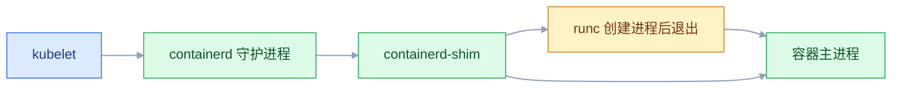
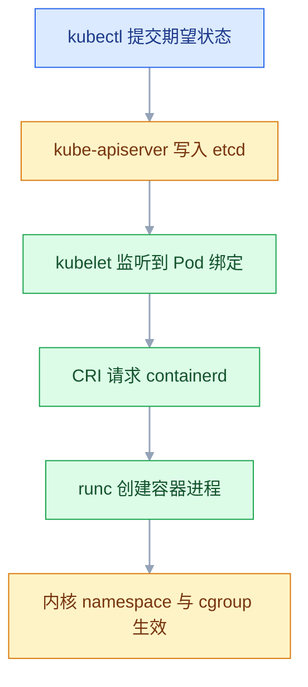

# Containerd 容器运行时

## 一、工程案例：只用 containerd + nerdctl 交付一台 Nginx 静态站

**场景**：一台新买的 Ubuntu 24.04（2C4G，内网 `192.168.1.21`）要交给运维组当文件下载站用。约束有三条：**不装 Docker**（这台机器半年后要加进 K8s 集群，运行环境保持干净）；页面目录由运营直接在宿主机改，改完立刻生效；服务器在国内，拉 Docker Hub 镜像必须走加速。

**为什么不用 Docker**：Docker 自带一套 dockerd + 自己的 containerd 实例，K8s 用不上这一层。直接装 containerd，装完就是 K8s 节点要的那个运行时，后面加集群不用重装。

**动手前确认**：`systemctl status docker` 应为不存在或 inactive；如果机器上已经有 Docker，先想清楚它自带的 containerd 实例（socket 在 `/var/run/docker/containerd/containerd.sock`）和系统装的 containerd（`/run/containerd/containerd.sock`）是两个东西，混用会查不到镜像。

### 1.1 主线（按顺序执行）

```bash
# ① 装 containerd（Docker 官方源，比发行版自带的版本新）
sudo apt update && sudo apt install -y ca-certificates curl gnupg
sudo install -m 0755 -d /etc/apt/keyrings

curl -fsSL https://download.docker.com/linux/ubuntu/gpg \
  | sudo gpg --dearmor -o /etc/apt/keyrings/docker.gpg
echo "deb [arch=$(dpkg --print-architecture) signed-by=/etc/apt/keyrings/docker.gpg] \
https://download.docker.com/linux/ubuntu $(lsb_release -cs) stable" \
  | sudo tee /etc/apt/sources.list.d/docker.list >/dev/null
  
sudo apt update && sudo apt install -y containerd.io

# ② 生成默认配置。不要手写 config.toml，版本间字段差异很大
sudo mkdir -p /etc/containerd
containerd config default | sudo tee /etc/containerd/config.toml >/dev/null

# ③ 改 cgroup 驱动：systemd 系统必须用 systemd，否则资源统计和限制全乱
sudo sed -i 's/SystemdCgroup = false/SystemdCgroup = true/' /etc/containerd/config.toml
grep -n 'SystemdCgroup' /etc/containerd/config.toml   # 必须看到 true

# ④ 确认 registry 插件的真实路径，并打开 certs.d
#    1.7 是 plugins."io.containerd.grpc.v1.cri".registry
#    2.x 拆成 io.containerd.cri.v1.images / io.containerd.cri.v1.runtime
containerd config default | grep -n 'registry'
grep -n 'config_path' /etc/containerd/config.toml     # 空字符串就是没启用加速目录
# 把 config_path 改成目录（默认是空串，两种引号都兼容）
sudo sed -i -E 's#^([[:space:]]*config_path[[:space:]]*=[[:space:]]*).*#\1"/etc/containerd/certs.d"#' /etc/containerd/config.toml
grep -n 'config_path' /etc/containerd/config.toml

# ⑤ 配镜像加速：一个仓库一个目录，目录名就是仓库域名
sudo mkdir -p /etc/containerd/certs.d/docker.io
sudo tee /etc/containerd/certs.d/docker.io/hosts.toml >/dev/null <<'EOF'
server = "https://docker.io"

[host."https://docker.1ms.run"]
  capabilities = ["pull", "resolve"]

[host."https://docker.xuanyuan.me"]
  capabilities = ["pull", "resolve"]
EOF

sudo systemctl enable --now containerd
sudo systemctl restart containerd
systemctl is-active containerd

# ⑥ 装 nerdctl（命令行）和 CNI 插件（容器网络与端口映射）
NERDCTL_VER=2.0.0     # 以官方 Releases 当前稳定版为准
CNI_VER=1.6.0         # 同上
wget https://github.com/containerd/nerdctl/releases/download/v${NERDCTL_VER}/nerdctl-${NERDCTL_VER}-linux-amd64.tar.gz
sudo tar -C /usr/local/bin -xzf nerdctl-${NERDCTL_VER}-linux-amd64.tar.gz
sudo mkdir -p /opt/cni/bin
wget https://github.com/containernetworking/plugins/releases/download/v${CNI_VER}/cni-plugins-linux-amd64-v${CNI_VER}.tgz
sudo tar -C /opt/cni/bin -xzf cni-plugins-linux-amd64-v${CNI_VER}.tgz

# ⑦ 起容器：页面目录只读挂进去
#    注意：--restart=always 需要额外机制才在重启后生效（见 1.2 第 9 项）
sudo mkdir -p /data/www
echo "ops download page" | sudo tee /data/www/index.html
sudo nerdctl run -d --name web \
  -p 8080:80 \
  -v /data/www:/usr/share/nginx/html:ro \
  --restart=always \
  nginx:alpine

# ⑧ 验收
curl -s http://127.0.0.1:8080
sudo nerdctl ps
```

**关键输出**（版本号会变，形状不变）：

```text
$ ctr version
Client:
  Version:  v2.x
Server:
  Version:  v2.x

$ sudo nerdctl ps
CONTAINER ID    IMAGE                             COMMAND                   CREATED          STATUS    PORTS                   NAMES
4c1f0a9e2b7d    docker.io/library/nginx:alpine    "/docker-entrypoint.…"    12 seconds ago   Up        0.0.0.0:8080->80/tcp    web
```

> `ctr version` 只有 Client 没有 Server，就是 containerd 没起来，别去查镜像。
> `nerdctl` 的镜像名带 `docker.io/library/` 前缀，这是 containerd 的完整引用格式，不是拉错了。

**用 ctr 看同一件事**（排障时要会）：

```bash
sudo ctr images list | grep nginx
sudo ctr containers list
sudo ctr tasks list                     # task 才是"正在跑的进程"
sudo ctr -n k8s.io images list          # K8s 的镜像在另一个逻辑分区
```

### 1.2 验收（9 项全过才算交付）

| # | 检查 | 命令 | 通过标准 |
|---|---|---|---|
| 1 | 服务在跑且开机自启 | `systemctl is-active containerd; systemctl is-enabled containerd` | `active` + `enabled` |
| 2 | 客户端与服务端都通 | `ctr version` | Client 与 Server 两段都有版本号 |
| 3 | cgroup 驱动对齐 | `grep SystemdCgroup /etc/containerd/config.toml` | `true` |
| 4 | 加速目录被加载 | `grep config_path /etc/containerd/config.toml` | 值为 `/etc/containerd/certs.d` |
| 5 | 拉镜像走加速 | `sudo ctr images pull docker.io/library/nginx:alpine` | 各层 `done`，无长时间卡住 |
| 6 | 容器在跑 | `sudo nerdctl ps` | STATUS `Up`，PORTS 有 `8080->80` |
| 7 | 页面可访问 | `curl -s http://127.0.0.1:8080` | 输出 `ops download page` |
| 8 | 宿主机改文件立即生效 | 改 `/data/www/index.html` 后再 curl | 返回新内容，不用重启容器 |
| 9 | 重启后自动恢复 | `sudo reboot` 后 `nerdctl ps` | 容器自己回来 |

> 第 9 项必须真重启一次。**`--restart=always` 在 containerd + nerdctl 下不等于 Docker 的行为**：Docker 由 dockerd 自己保证重启后拉起容器，而 nerdctl 的 `--restart` 需要额外机制（宿主机上跑一个 systemd 单元或 nerdctl 的 restart watcher）才会生效。要可靠自启，正确做法是把容器交给 systemd 管，或者这台机器后续加进 K8s 集群由 kubelet 管。验收时如果容器没回来，先确认这个前提。
> 页面改完不生效，先确认挂载的是**目录**而不是单个文件（单文件挂载在编辑器替换 inode 后会失效）。

### 1.3 交付时一起做的两件事

| 事项 | 命令 | 不做的后果 |
|---|---|---|
| 日志限额 | `sudo nerdctl run ... --log-driver json-file --log-opt max-size=50m --log-opt max-file=3` | 访问日志写满 `/var/lib/containerd`，整机写不进去 |
| 资源上限 | `--cpus=1 --memory=512m` | 容器可以吃光宿主内存，被内核 OOM 时连累别的服务 |

---

## 二、高频问答：会卡住你的地方，也是面试最常问的

### 2.1 `ctr images ls` 是空的，但 K8s 明明在跑

**现场**

`sudo ctr namespaces list` 看有几个分区，再分别列镜像。

```bash
sudo ctr namespaces list
sudo ctr -n k8s.io images list | head
sudo ctr -n k8s.io containers list | head
```

> 同理，`nerdctl` 默认也是 `default`，看 K8s 的要 `nerdctl -n k8s.io images`。用之前先想清楚"我要看哪个分区"。

**要点**

- `ctr` 默认在 `default` 逻辑分区，K8s 的镜像在 `k8s.io`，两边列表互不可见。
- 这里说的 namespace 是 containerd 内部的分区表，不是 Linux 内核 namespace。
- 看 K8s 的镜像必须带 `-n k8s.io`。

**追问**

- 为什么要有多个分区？→ K8s、Docker、人工调试各自隔离，删镜像互不影响。
- `nerdctl` 默认在哪个分区？→ 也是 `default`。
- 镜像真的被删了吗？→ 先按分区确认，别急着重装 containerd。

### 2.2 `ctr run` 起来的容器没有网络，外面也访问不到

**现场**

进容器 `ip addr`，只有 `lo` 就是它。

```bash
sudo ctr run -d --net-host docker.io/library/nginx:alpine web-host
# --net-host 直接用宿主机网络栈，最快验证；要独立网络就用 nerdctl
```

**要点**

- `ctr` 只管创建进程，默认只有 loopback，连 CNI 都不调用。
- 不是防火墙挡了，也不是端口映射配错。
- 要独立网络用 nerdctl；临时验证可以 `--net-host` 直接用宿主机网络栈。

**追问**

- 为什么 `--net-host` 能用？→ 它直接用宿主机的 net namespace，压根不需要建网络。
- `ctr` 能做端口映射吗？→ 不能，这是 nerdctl 的能力。
- 想给容器独立网段怎么办？→ 走 nerdctl，由 CNI 插件建网络。

### 2.3 `nerdctl run -p` 报网络创建失败

**现场**

`ls /opt/cni/bin`，看不到 `bridge`、`portmap` 就是没装。

```bash
ls /opt/cni/bin | head
# 没装插件时，这条命令会直接报 failed to create network / cni plugin not found
sudo nerdctl run --rm busybox:1.36 ip addr
```

**要点**

- 只装了 nerdctl，没装 CNI 插件。
- 端口映射靠 `portmap`，容器网络靠 `bridge`，两者都在 `/opt/cni/bin` 下。
- 不是版本旧或内核不支持，报错会明确说找不到插件。

**追问**

- CNI 插件是怎么被调用的？→ 运行时传入一份 JSON（网段、网桥名、netns 路径），插件负责插网卡、配 IP、写路由。
- 单机容器互通要哪几个？→ `bridge` + `host-local`，再加端口映射就是 `portmap`。
- 跨节点 Pod 互通呢？→ 换 Calico、Flannel、Cilium 这类网络方案。

### 2.4 配了 `hosts.toml`，拉镜像还是超时

**现场**

`grep config_path /etc/containerd/config.toml`，必须是目录路径而不是 `""`。

```bash
grep -n 'config_path' /etc/containerd/config.toml
sudo systemctl restart containerd        # 改完必须重启
sudo ctr images pull docker.io/library/nginx:alpine
```

**要点**

- `config_path` 为空时整个 `certs.d` 目录被忽略，加速静默失效，不报任何错。
- 不是加速站挂了，所以换地址继续试也没用。
- 改成 `/etc/containerd/certs.d` 后必须重启 containerd。

**追问**

- 为什么是静默失效？→ 目录压根没被加载，配置等于不存在。
- `server` 和 `[host]` 怎么分工？→ `server` 是身份，`host` 才是候选镜像站。
- 写反了会怎样？→ push 会打到错误的仓库。

### 2.5 改完 `config.toml`，containerd 起不来了

**现场**

`journalctl -u containerd -n 30 --no-pager` 会直接指出哪一行。

```bash
sudo journalctl -u containerd -n 30 --no-pager
# 兜底：重新生成默认配置，只改必须改的两处
containerd config default | sudo tee /etc/containerd/config.toml >/dev/null
```

**要点**

- 直接编辑整份 TOML 很容易出错：少一个引号、插件路径写错、缩进层级错，都会解析失败。
- 默认配置里插件名带点号，必须整体加引号。
- 兜底是重新生成默认配置，只改必须改的那两处。

**追问**

- 为什么不手写 config.toml？→ 版本间字段差异很大，默认配置最稳。
- 解析错误在哪看？→ `journalctl -u containerd` 会指到具体行。
- 重新生成后要改哪几处？→ 至少 `SystemdCgroup = true` 和 registry 的 `config_path`。

### 2.6 机器上既有 Docker 又有 containerd，镜像对不上

**现场**

看进程与 socket 路径，别只看 `ps` 里的名字。

```bash
ps -ef | grep -E 'containerd|dockerd' | grep -v grep
sudo ctr -a /run/containerd/containerd.sock images list
```

**要点**

- Docker 自带独立 containerd，socket 是 `/var/run/docker/containerd/containerd.sock`。
- 系统 containerd 的 socket 是 `/run/containerd/containerd.sock`，两个实例完全隔离。
- 镜像对不上先确认连的是哪个实例。

**追问**

- 为什么 Docker 要自带一个？→ dockerd 自己管容器的生命周期，不依赖系统 containerd。
- 怎么指定连哪个？→ `ctr -a <socket>` 指定地址，`-n` 指定分区。
- 两边能共用镜像吗？→ 默认不能，存储和元数据各自独立。

### 2.7 K8s 节点反复 NotReady，kubelet 日志提示 cgroup 不一致

**现场**

对比容器内 cgroup 路径与 kubelet 的 `--cgroup-driver`。

```bash
grep SystemdCgroup /etc/containerd/config.toml
sudo systemctl restart containerd && sudo systemctl restart kubelet
```

**要点**

- 漏了 `SystemdCgroup = true`，containerd 默认用自己的 cgroupfs 驱动。
- systemd 和 containerd 各管一套 cgroup，容器起得来但状态和限制全乱。
- 改完 containerd 和 kubelet 都要重启。

**追问**

- 为什么 systemd 系统必须用 systemd 驱动？→ 两套驱动管同一批 cgroup，统计和限制会对不上。
- 怎么确认当前用的哪种？→ 看 `config.toml` 的 `SystemdCgroup` 和 kubelet 的 `--cgroup-driver`。
- 只重启 containerd 够吗？→ 不够，kubelet 也要重启才能对齐。

### 2.8 `ctr run` 前台一退出，容器就没了

**现场**

`ctr containers list` 有、`ctr tasks list` 没有，就是「定义还在、进程已停」。

```bash
sudo ctr run -d docker.io/library/nginx:alpine web-bg
sudo ctr tasks list
sudo ctr tasks kill web-bg && sudo ctr containers rm web-bg
```

**要点**

- container 是定义（镜像、配置），task 是运行中的进程，两者不是一回事。
- 前台 run 退出即 task 结束；加 `--rm` 连 container 定义一起删。
- 要后台跑就加 `-d`。

**追问**

- 为什么 `ctr ps` 看不到？→ 它列的是 task，不是 container 定义。
- 定义还在怎么再启动？→ 用 `ctr task start` 基于已有 container 起。
- `--rm` 删的是什么？→ task 结束后连 container 定义一起删。

### 2.9 `/var/lib/containerd` 把磁盘写满

**现场**

`nerdctl system df` 看各部分占用，再用命令清理。

```bash
sudo du -sh /var/lib/containerd
sudo nerdctl system df
sudo nerdctl image prune          # 悬空镜像
sudo nerdctl container prune      # 已停止容器
# 绝不要手工删 /var/lib/containerd 下的文件
```

**要点**

- 里面是 boltdb 元数据和按 digest 存放的层，不是普通缓存。
- 手工删会让元数据与内容不一致，containerd 可能起不来。
- 用 `prune` 系列清理，绝不手工删 `/var/lib/containerd` 下的文件。

**追问**

- 为什么删了文件空间没释放？→ 还有引用计数和快照，要按镜像、快照清。
- 日志占的空间怎么算？→ 在容器日志目录，靠 `max-size` / `max-file` 限额。
- `image prune` 和 `image prune -a` 差在哪？→ 前者只清悬空镜像，后者清所有未被容器使用的。

### 2.10 多架构镜像拉下来跑不了

**现场**

`ctr images list` 看 PLATFORMS 列，或 `uname -m` 对比。

```bash
sudo ctr images pull --platform linux/amd64 docker.io/library/nginx:alpine
sudo ctr images list | grep nginx
```

**要点**

- `nginx:latest` 是多架构索引，pull 时按当前平台选。
- 交叉构建或在苹果本上拉 amd64 镜像，跑起来就是 `exec format error`。
- 用 `--platform linux/amd64` 显式指定，拉完看 PLATFORMS 列确认。

**追问**

- manifest list 是什么？→ 一个索引，指向各架构的具体镜像。
- 为什么本地能跑服务器不能跑？→ 两边 CPU 架构不同。
- 怎么确认拉的是哪个架构？→ `ctr images list` 的 PLATFORMS 列。

### 2.11 普通用户执行 nerdctl 报权限不足

**现场**

`ls -l /run/containerd/containerd.sock` 看属主与权限位。

```bash
ls -l /run/containerd/containerd.sock
# 临时：sudo nerdctl ...
# 长期：按 rootless 文档装 rootlesskit + containerd-rootless-setuptool.sh install
```

**要点**

- containerd 的 socket 属于 root，非 root 访问不了。
- 要么用 sudo，要么完整配置 rootless（user namespace + `containerd-rootless-setuptool.sh`）。
- 只加组权限是不够的。

**追问**

- rootless 就是加个 sudo 吗？→ 不是，是整套运行时以普通用户跑。
- rootless 有什么代价？→ 不支持部分网络和存储特性。
- 为什么只加组权限不行？→ socket 权限和 rootless 是两套机制，改权限不等于隔离。

---

## 三、核心知识：从零开始要建立的东西

### 3.1 容器与虚拟机的隔离边界

容器**不是轻量虚拟机**，它是一个普通 Linux 进程，只是被两套内核机制改造过：namespace 让它"看不见"别的进程和网络，cgroup 让它"用不了"超过配额的资源。

| | 虚拟机 | 容器 |
|---|---|---|
| 隔离单位 | 硬件 + 完整操作系统 | 进程 |
| 内核 | 每个虚拟机一套 | 共享宿主机内核 |
| 启动 | 几十秒 | 毫秒到秒 |
| 隔离强度 | 强（Hypervisor 层） | 弱（内核漏洞可逃逸） |
| 密度 | 一台机器几个到几十个 | 几百个 |

**边界**：容器共享内核，所以内核版本、内核参数、内核漏洞是全体容器共同的。需要强隔离（多租户、跑不可信代码）时用 Kata、gVisor 这类"安全容器"，它们把容器套进一个轻量虚拟机里，代价是启动慢、开销大。

### 3.2 namespace 的六种隔离

| namespace | 隔离内容 | 直观表现 |
|---|---|---|
| `pid` | 进程号 | 容器内主进程是 PID 1，看不到宿主机进程 |
| `net` | 网卡、IP、端口、路由 | 容器有自己的 eth0 和独立端口空间 |
| `mnt` | 挂载点 | 容器看到的是镜像的根文件系统 |
| `uts` | 主机名与域名 | 容器内 `hostname` 是自己的 ID |
| `ipc` | 共享内存、信号量 | 跨容器共享内存不可见 |
| `user` | UID/GID 映射 | 容器内 root 可映射为宿主机普通用户 |

**关键结论**：隔离是"视野"而不是"存在"。宿主机 `ps -ef` 能看到容器里的 nginx，`top` 里它的 CPU 也算在宿主机账上。所以"容器占了多少资源"要看 cgroup，不要看容器里的 `free`——容器里的 `free` 显示的是宿主机的内存。

> **面试**：常问「namespace 隔离了什么？为什么宿主机还能看到容器进程？」答：隔离的是视野不是存在，宿主机 `ps` 照样看得见，资源占用要按 cgroup 算。

### 3.3 cgroup 与资源限制

namespace 管"看不见"，cgroup 管"用多少"。cgroup v2 下每个容器一个目录，限制就是往文件里写值。

| 资源 | 限制什么 | 对应文件 | 超限行为 |
|---|---|---|---|
| CPU | 核数 / 权重 | `cpu.max`、`cpu.weight` | 被限流，变慢但不死 |
| 内存 | 上限 | `memory.max` | **被 OOM Killer 杀掉** |
| 进程数 | 进程/线程总数 | `pids.max` | fork 失败 |
| 块设备 IO | 读写速率 | `io.max` | 排队变慢 |

CPU 超限是"throttling"，表现为延迟抖动；内存超限是"直接死"，表现为容器突然退出、`OOMKilled`。**这两者的排障方向完全相反**：CPU 抖动查限流，内存突然退出查 limit 和堆设置。

### 3.4 OCI 镜像规范与运行时规范

OCI 定义了两份契约，把"造镜像"和"跑容器"解耦：

| 规范 | 规定的内容 | 产物 |
|---|---|---|
| Image Spec | 分层 tar 包 + config JSON + manifest | 任何运行时都能读的镜像 |
| Runtime Spec | 给一个 `config.json` 和 `rootfs/`，怎么建进程 | 任何运行时都能执行的容器配置 |

`config.json` 里写的是：用哪些 namespace、cgroup 限制多少、根文件系统在哪、执行什么命令、带哪些环境变量。runc 拿到它就能起进程——**它完全不知道"镜像"是什么**，只认一个摊开的目录。

这套标准的实际价值：Docker 构建的镜像可以直接被 containerd 运行，CI 里用 BuildKit 构建、生产用 CRI-O 运行，都不需要转换。

### 3.5 高层运行时与低层运行时的分工

| | 低层运行时（runc） | 高层运行时（containerd） |
|---|---|---|
| 生命周期 | 一次性命令，创建完进程就退出 | 常驻守护进程 |
| 职责 | 按 OCI spec 建 namespace/cgroup/rootfs | 拉镜像、管快照、管网络、管生命周期 |
| 是否懂镜像 | 不懂，只要 rootfs 目录 | 懂，负责镜像的解析与缓存 |
| 调用者 | containerd / CRI-O | kubelet / 用户 |

**runc 退出后容器还在跑**，因为容器进程已经被交给 `containerd-shim-runc-v2` 照看。这就是为什么升级或重启 containerd 不会杀死业务容器——shim 是独立进程，containerd 只是它的管理者。

### 3.6 shim 进程与容器生命周期



shim 的存在解决三个问题：containerd 重启不影响容器；每个容器的 stdout/stderr 由 shim 持有，日志不丢；容器退出码由 shim 回收，不会留下僵尸进程。

**取舍**：shim 是"每容器一个进程"，几千个容器就是几千个 shim，内存开销真实存在（每个几 MB）。这是用进程换稳定性的设计，不是 bug。

> **面试**：常问「重启 containerd 会不会杀掉业务容器？」答：不会，容器由独立的 shim 进程照看，containerd 只是它的管理者。

### 3.7 containerd 的内部组件

| 组件 | 职责 | 落盘位置 |
|---|---|---|
| Content Store | 按 digest 存镜像层原始内容，天然去重 | `io.containerd.content.v1.content/` |
| Snapshotter | 把层叠成可用文件系统，管容器可写层 | `io.containerd.snapshotter.v1.overlayfs/` |
| Metadata Store | 镜像、容器、任务记录（boltdb） | `io.containerd.metadata.v1.bolt/meta.db` |
| Runtime Plugin | 调 runc/crun 真正建进程 | 无状态 |

去重发生在 Content Store：十个镜像都基于 `alpine:3.20`，这一层只存一份。快照发生在 Snapshotter：每个容器有自己的可写层，读时按 overlayfs 的下层顺序找文件。

### 3.8 containerd 的逻辑命名空间

这里的 namespace 和 3.2 的内核 namespace 完全是两回事，它只是 containerd 内部的一张"分区表"，用来隔离镜像和容器列表。

| 分区 | 使用者 | 典型内容 |
|---|---|---|
| `default` | ctr / nerdctl 默认 | 手工调试的镜像 |
| `k8s.io` | kubelet | pause、Calico、业务镜像 |
| `moby` | Docker 自带实例 | Docker 的镜像 |

**为什么需要它**：同一台机器上 K8s、Docker、人工调试可能同时存在，各自删镜像不应该互相影响。代价是所有命令都要记得带 `-n`，这是最高频的"镜像不见了"来源。

### 3.9 CRI 与 kubelet 的调用链

kubelet 自己不创建容器，它通过 CRI（gRPC 接口）把活交给运行时。CRI 定义了三组核心操作：Pod 沙箱（RunPodSandbox）、容器（Create/Start/Stop/Remove）、镜像（Pull/List/Remove）。



**没有 CRI 运行时，节点就是死的**：kubelet 能启动、能汇报，但任何 Pod 都起不来，节点状态停在 NotReady。这就是装集群必须先装 containerd 的原因。

> **面试**：常问「kubelet 是怎么创建容器的？」答：通过 CRI 把活交给 containerd，再由 runc 建 namespace 和 cgroup，kubelet 自己不起进程。

### 3.10 镜像引用与 registry 配置

一个完整的镜像引用是四段：`仓库域名/命名空间/名字:标签`。省略域名时默认 `docker.io`，省略命名空间时默认 `library`。

| 写法 | 实际解析 |
|---|---|
| `nginx:1.27` | `docker.io/library/nginx:1.27` |
| `bitnami/mysql:8.0` | `docker.io/bitnami/mysql:8.0` |
| `harbor.company.com/app/api:v3` | 原样，走私有仓库 |

containerd 的仓库配置按"域名目录 + hosts.toml"组织：`/etc/containerd/certs.d/docker.io/hosts.toml`。`server` 是原始地址，`[host."..."]` 是候选镜像站，按顺序尝试，`capabilities` 声明这个站支持 pull、resolve 还是 push。

**常见的错误配置**：把加速站写进 `server` 而不是 `host`。`server` 是身份，`host` 才是备用地址；写反了会导致 push 到错误的仓库。

### 3.11 容器网络与 CNI

CNI 是一个约定：运行时在创建容器网络时，调用 `/opt/cni/bin` 下的插件，传入一份 JSON（网段、网桥名、容器 netns 路径），插件负责插网卡、配 IP、写路由。

| 场景 | 需要的能力 | 用哪个插件 |
|---|---|---|
| 单机容器互通 | 网桥 + 子网 | `bridge` + `host-local` |
| 端口映射 | iptables DNAT | `portmap` |
| 跨节点 Pod 互通 | 覆盖网络或路由 | Calico / Flannel / Cilium |

`ctr` **不调用 CNI**，所以它起的容器只有 loopback；`nerdctl` 会调用，所以 `-p` 和容器名互访都能用。这是两者最本质的差别，不是"命令长得不一样"。

> 那 `ctr run --net-host` 为什么能用？`--net-host` 是让容器直接用宿主机的 net namespace，压根不需要建网络，所以不经过 CNI。一旦想给容器独立网段（`--net bridge` 之类），就必须走 nerdctl。

> **面试**：常问「`ctr` 和 `nerdctl` 最本质的差别是什么？」答：ctr 不调 CNI，容器只有 loopback；nerdctl 会调，所以有端口映射和容器名互访。

### 3.12 存储驱动与快照器

containerd 用 snapshotter 管理文件系统。默认 `overlayfs`：镜像层作为 lowerdir 只读，容器层作为 upperdir 可写，合并后挂给容器。

| snapshotter | 原理 | 适用 |
|---|---|---|
| `overlayfs` | 联合挂载，内核原生 | 默认，绝大多数场景 |
| `native` | 每层完整复制 | 调试，占空间极大 |
| `btrfs` / `zfs` | 文件系统快照 | 宿主机已用这些文件系统时 |
| `devmapper` | 块设备快照 | 需要块级隔离的场景 |

**取舍**：overlayfs 要求内核支持，且多层镜像的第一次读会有轻微开销；`native` 兼容性最好但磁盘翻倍。生产默认 overlayfs，不要随意改。

### 3.13 ctr 与 nerdctl 的能力边界

| 能力 | ctr | nerdctl |
|---|---|---|
| 拉/删镜像 | ✅ | ✅ |
| 运行容器 | ✅ 必须给容器 ID | ✅ |
| 端口映射 | ❌ | ✅ |
| 容器名互访 | ❌ | ✅ |
| 构建镜像 | ❌ | ✅（依赖 BuildKit） |
| Compose | ❌ | ✅ |
| 日志跟随 | 有限 | ✅ `nerdctl logs -f` |
| 贴近 K8s 排障 | ✅ 直接看 k8s.io 分区 | 一般 |

**结论**：日常用 nerdctl，排障用 ctr + crictl。ctr 的价值是"最接近 containerd 原始状态"，不经过任何封装，看到的就是运行时真实记录。

### 3.14 安全边界：rootless、user namespace 与 seccomp

容器默认以 root 运行，而容器里的 root 就是宿主机的 root（除非开了 user namespace 映射）。这是"容器不安全"说法的真正来源。

| 手段 | 作用 | 代价 |
|---|---|---|
| rootless | 整个运行时以普通用户跑 | 不支持部分网络/存储特性 |
| user namespace 映射 | 容器内 root 映射为宿主机普通 UID | 挂载宿主机文件时 UID 对不上 |
| `--cap-drop ALL` | 去掉不需要的内核能力 | 需要逐个补回（如 `NET_BIND_SERVICE`） |
| seccomp 配置 | 限制可用的系统调用 | 误拦会导致应用莫名失败 |
| 只读根文件系统 | 禁止写镜像层 | 应用要写的目录必须挂卷 |

**取舍**：安全加固每一项都可能让应用起不来。正确顺序是先跑起来，再按"最小必要"逐项收紧，每加一项都回归一次。

### 3.15 磁盘占用与垃圾回收

containerd 的磁盘增长来自三处：镜像层（Content Store）、快照（Snapshotter）、容器日志。前两者有引用计数，被删镜像引用的层不会立刻释放。

```bash
sudo nerdctl system df
sudo nerdctl image prune -a        # 删除所有未被容器使用的镜像
sudo nerdctl system prune          # 容器 + 网络 + 悬空镜像
sudo du -sh /var/lib/containerd/io.containerd.snapshotter.v1.overlayfs
```

**边界**：`prune -a` 会把 K8s 节点上的 pause 镜像也删掉（如果它没被运行中容器引用），下次创建 Pod 要重新拉。节点上清理前先确认没有正在拉起的 Pod。

---

## 四、冷门知识汇总

| 知识点 | 为什么冷门 | 用到时的关键词 |
|---|---|---|
| `crictl` 与 ctr 的分工 | 只在 K8s 节点排障时用，日常不碰 | `crictl ps -a`、`crictl logs`、`/etc/crictl.yaml` |
| pause 沙箱镜像 | 每个 Pod 都有但从不执行业务逻辑，容易被忽略 | `pause:3.9`、`sandbox_image`、持有 net namespace |
| `containerd config dump` | 大家只看 config.toml，不知道要看合并后的生效值 | `config dump`、默认值覆盖 |
| `ctr plugins ls` | 插件没加载时命令不报错，只是行为不对 | `io.containerd.snapshotter.v1.overlayfs`、`cri` |
| rootless 模式 | 云主机默认 root，很少主动启用 | `containerd-rootless-setuptool.sh`、`rootlesskit` |
| Kata / gVisor | 强隔离场景才用，普通业务用不上 | `runtimeclass`、`io.containerd.kata.v2` |
| devmapper snapshotter | 默认 overlayfs 够用，块设备场景才切 | `thin-pool`、`dm.thinpooldev` |
| 镜像 GC 的引用计数 | 删了镜像磁盘没降，容易误判为故障 | `content prune`、`leases`、`snapshot gc` |
| `ctr oci` 与 `--with-ns` | 调 OCI spec 属于运行时开发范畴 | `ctr oci spec`、`runc --debug` |
| seccomp 默认 profile | 默认已启用，出问题时才想起它 | `securityContext.seccompProfile`、`Unconfined` |
