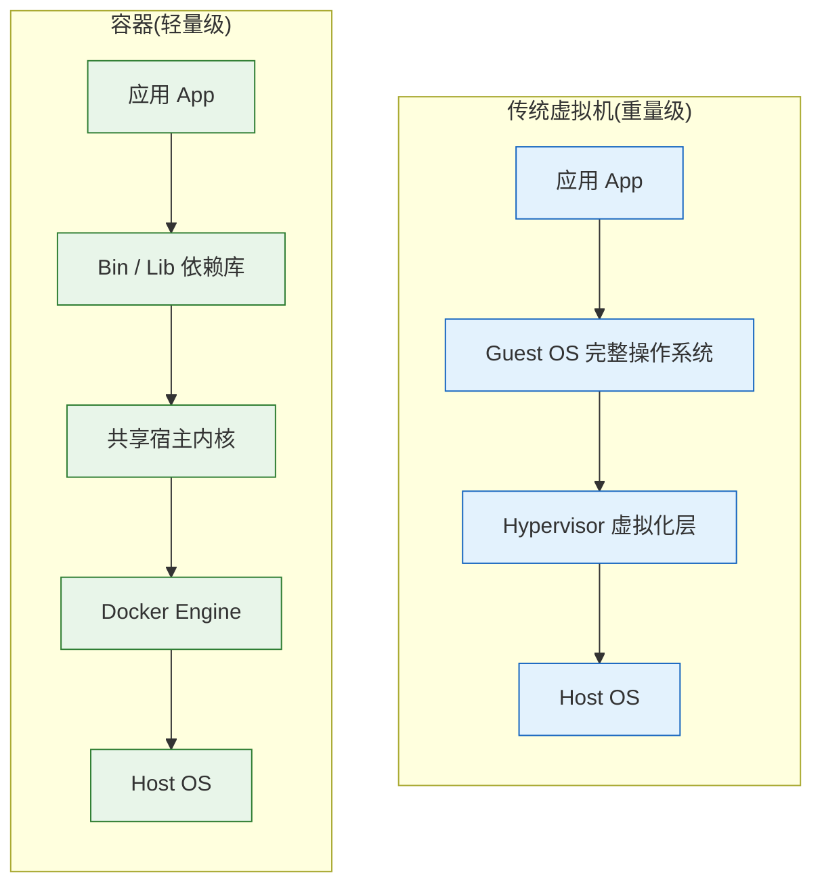
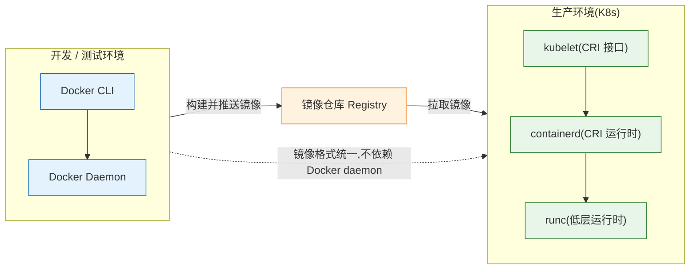
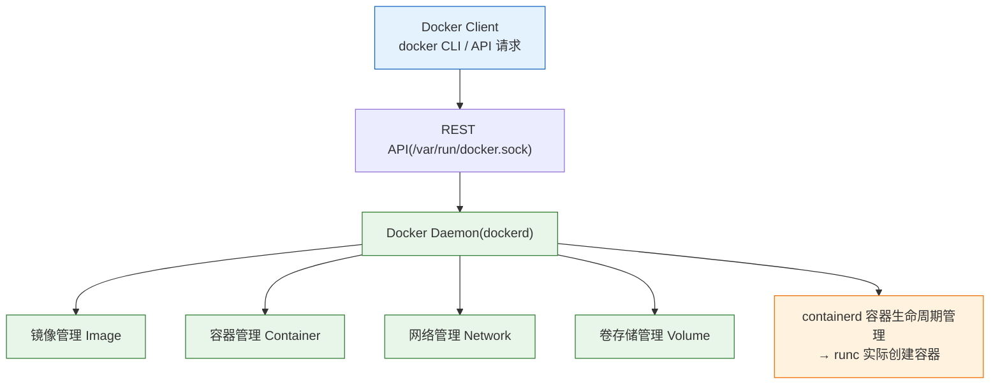
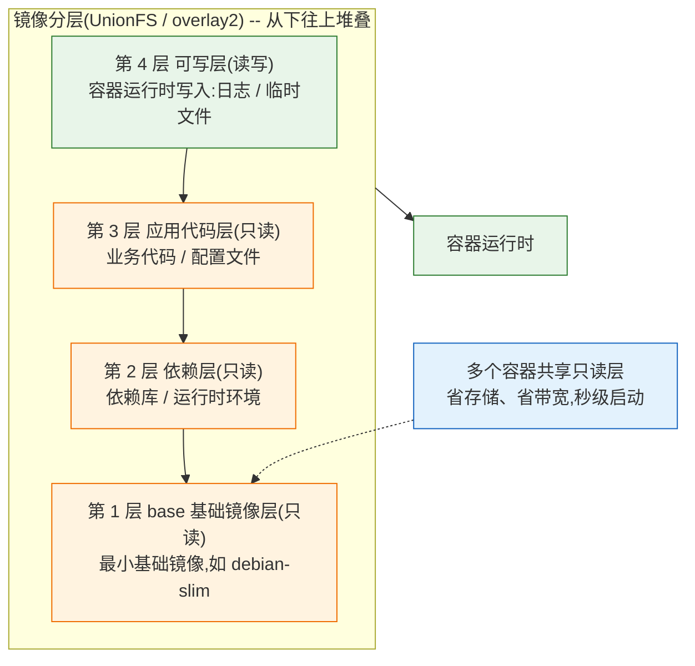
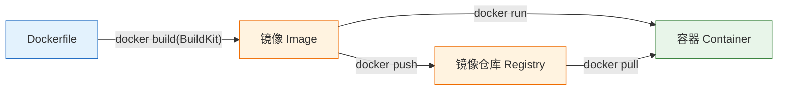
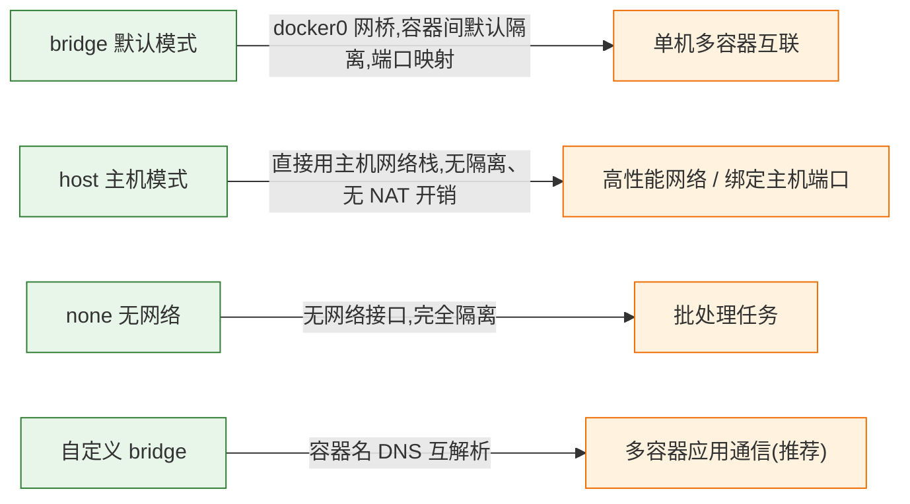

# Docker 容器引擎

---

## 一、Docker 是什么

### 1.1 核心概念

Docker 是一个**应用容器引擎**，把应用和它的全部依赖打包进一个可移植的容器里，实现一次构建、到处运行。

从运维视角看，Docker 解决三个问题：

- **环境一致**：开发、测试、生产用同一个镜像，消灭"在我机器上能跑"
- **资源隔离**：通过 namespace 和 cgroup 实现进程级隔离和资源限制，比虚拟机轻得多
- **交付标准化**：镜像成为软件交付的最小单元，配合 CI/CD 流水线完成自动化部署



> 每个虚拟机自带完整操作系统（重量级）；容器共享宿主内核，秒级启动。

**关键特性：**

| 特性 | 说明 |
|---|---|
| 秒级启动 | 容器共享宿主内核，没有完整的 OS 启动过程 |
| 镜像分层 | 只读层 + 可写层，复用基础层，节省存储和带宽 |
| 可移植 | 镜像可在任意装有 Docker 的机器上运行 |
| 隔离性 | 进程、文件系统、网络、用户隔离（namespace + cgroup） |
| 易扩展 | 配合编排平台（K8s）可以水平伸缩 |

### 1.2 Docker 与 Containerd、K8s 的关系

这是运维必须建立的第一张认知图。**Docker 不是容器运行的唯一方式，生产环境 K8s 直接使用 containerd，不经过 Docker。**



**必须记住的三句话：**

- **K8s 1.24+ 不再内置 Docker**，kubelet 通过 CRI 接口直接对接 containerd

- Docker 的价值在**开发环境**和**镜像构建**，不在生产容器运行

- 镜像在 Docker 构建、在 containerd 运行，镜像格式统一，互不冲突

> **运维提示**：在 K8s 节点上调试容器要用 `crictl` 而不是 `docker` 命令，详见《Containerd 容器运行时》笔记。

### 1.3 Docker 架构组成



- **Client**：用户敲的 `docker` 命令，本质是 REST API 客户端

- **Daemon（dockerd）**：核心守护进程，以 root 运行，负责镜像、容器、网络、卷的全部管理

- **containerd / runc**：daemon 之下的运行时层，负责真正创建和运行容器

---

## 二、Docker 安装与配置

> **版本现状（2026）**：Docker Engine 当前稳定系列为 28.x，最新已到 29.x，`docker-ce` 安装即为最新版，无需手动指定。安装会自动附带 docker-ce-cli、containerd.io、docker-buildx-plugin、docker-compose-plugin 四个组件，BuildKit 构建能力由 buildx 插件提供并默认开启。

**镜像加速器**：国内访问 Docker Hub 不稳定，安装后先配好 2.3 节的镜像加速，否则后续所有拉取操作都会卡住。

### 2.1 使用 yum/dnf 安装（CentOS/RHEL）

```bash
# 1. 卸载旧版本（如果有）
sudo dnf remove docker docker-ce docker-ce-cli

# 2. 添加阿里云 Docker 仓库（国内访问官方源不稳定，推荐阿里云镜像源）
wget https://mirrors.aliyun.com/docker-ce/linux/centos/docker-ce.repo \
  -O /etc/yum.repos.d/docker-ce.repo

# 3. 安装 Docker
# 安装 docker-ce 会附带安装：docker-ce-cli、containerd.io、docker-buildx-plugin、docker-compose-plugin
sudo dnf install -y docker-ce

# 4. 启动并设置开机自启
sudo systemctl enable --now docker

# 5. 验证安装
sudo docker --version

# 6. 测试拉取镜像（使用国内加速前缀，详见 2.3）
sudo docker run docker.1ms.run/library/hello-world:latest
```

### 2.2 使用 apt 安装（Ubuntu/Debian）

```bash
# 1. 卸载旧版本
sudo apt remove docker docker-engine docker-ce

# 2. 添加 Docker 官方 GPG 密钥
# Ubuntu 没有官方 GPG 密钥不允许安装外部软件源，必须先导入
sudo install -m 0755 -d /etc/apt/keyrings

curl -fsSL https://download.docker.com/linux/ubuntu/gpg | \
  sudo gpg --dearmor -o /etc/apt/keyrings/docker.gpg

sudo chmod a+r /etc/apt/keyrings/docker.gpg

# 3. 添加仓库（使用阿里云镜像源加速）
echo \
  "deb [arch=$(dpkg --print-architecture) signed-by=/etc/apt/keyrings/docker.gpg] \
  https://mirrors.aliyun.com/docker-ce/linux/ubuntu $(lsb_release -cs) stable" | \
  sudo tee /etc/apt/sources.list.d/docker.list > /dev/null

# 4. 安装 Docker
sudo apt update
sudo apt install -y docker-ce

# 5. 启动并设置开机自启
sudo systemctl enable --now docker
```

### 2.3 配置镜像加速与私有仓库信任

```bash
# 创建或编辑 /etc/docker/daemon.json
sudo mkdir -p /etc/docker

sudo cat > /etc/docker/daemon.json << EOF
{
  "registry-mirrors": [
    "https://docker.1ms.run/",
    "https://docker.xuanyuan.me/"
  ],
  "exec-opts": ["native.cgroupdriver=systemd"],
  "log-driver": "json-file",
  "log-opts": {
    "max-size": "100m",
    "max-file": "3"
  },
  "storage-driver": "overlay2",
  "insecure-registries": ["10.211.55.200:80"]
}
EOF

# 重启 Docker 生效
sudo systemctl daemon-reload && sudo systemctl restart docker
```

**配置项说明（重点记忆）：**

| 配置项 | 作用 |
|---|---|
| `registry-mirrors` | 镜像加速地址，国内访问 Docker Hub 的必备配置，多个加速器轮询 |
| `exec-opts` | 设置 cgroup 驱动为 systemd，与 K8s 的 kubelet 保持一致 |
| `log-driver` / `log-opts` | 日志驱动和大小限制，防止容器日志把磁盘写满 |
| `storage-driver` | 存储驱动，overlay2 是当前最稳定、性能最好的选择 |
| `insecure-registries` | 允许访问 HTTP 私有仓库（如本地 Harbor）。**末尾一定要带端口**，显式指定端口；生产环境强烈建议用 HTTPS 而不是它 |

> **阿里云镜像加速提示**：登录阿里云容器镜像服务控制台，在"镜像加速器"页面获取专属加速地址（格式 `https://xxxx.mirror.aliyuncs.com`），比公共加速器更稳定。2024 年起大量公共加速器已停止服务，2026 年仍建议以阿里云专属域名或自建 registry 代理为主，使用前先验证可用性。

### 2.4 非 root 用户使用 Docker

**为什么 Docker 默认需要 root？**

dockerd 以 root 身份运行，因为它要做特权操作：

- 创建 namespace 和 cgroup（进程隔离与资源限制）

- 挂载文件系统（volume、镜像层）

- 配置网络（创建网桥、iptables 规则）

- 与 containerd / runc 通信

**配置普通用户免 sudo 使用：**

```bash
# 1. 创建 docker 用户组（安装时通常已自动创建，不存在才执行）
sudo groupadd docker

# 2. 将当前普通用户加入 docker 组
sudo usermod -aG docker $USER

# 3. 刷新组权限（或重新登录终端）
newgrp docker

# 4. 验证（不需要 sudo 即可执行 docker 命令）
docker run docker.1ms.run/library/hello-world:latest
```

> **安全警告**：加入 docker 组等同于授予 root 权限，因为可以通过挂载 `/var/run/docker.sock` 逃逸。生产服务器不要随便加人，只给可信运维账号。

---

## 三、Docker 镜像管理

### 3.1 镜像分层原理（overlay2）

镜像不是一个大文件，而是一层一层堆叠的只读层。Docker 用 UnionFS / overlay2 把各层合并成统一视图，容器启动时在最上层加一个可写层。



> **排障关联**：`docker inspect <镜像>` 查看分层信息；`docker history <镜像>` 查看每层对应的 Dockerfile 指令。删除镜像只是删引用，孤儿层靠 `docker image prune` 清理。

### 3.2 镜像基本命令

```bash
# ========== 拉取和查看 ==========
# 拉取镜像（国内环境记得加加速前缀或走镜像加速器）
docker pull docker.1ms.run/library/nginx:stable-alpine3.23

# 查看本地镜像
docker images

# 查看镜像详情（分层信息）
docker inspect docker.1ms.run/library/nginx:stable-alpine3.23

# 删除镜像
docker rmi nginx:1.24.0
docker rmi -f nginx:1.24.0   # 强制删除

# 清理悬空镜像（无标签、无容器引用的镜像）
docker image prune
# 清理所有未使用镜像
docker image prune -a

# ========== 打标签和推送 ==========
# 打标签：IP:端口/项目名/镜像名:版本
docker tag nginx:1.24.0 10.211.55.200:80/daily/nginx:v1.0

# 登录私有仓库
docker login 10.211.55.200:80        # 私有 Harbor，HTTP 需先配置 insecure-registries
docker login harbor.example.com      # HTTPS 仓库，输入用户名密码

# 推送镜像
docker push 10.211.55.200:80/daily/nginx:v1.0

# ========== 导入导出（离线环境传输） ==========
# 导出镜像为 tar 包
docker save -o nginx.tar nginx:1.24.0
# 导入镜像
docker load -i nginx.tar
```

### 3.3 Dockerfile 核心指令详解

> 最常用组合：**FROM、WORKDIR、COPY、RUN、EXPOSE、CMD**

```dockerfile
# ========== 基础指令 ==========
# FROM - 指定基础镜像，必须是第一个指令，尽量选官方精简镜像
FROM node:18-alpine

# ========== 环境准备 ==========
# WORKDIR - 设置工作目录，目录不存在会自动创建，后续指令都在此目录执行
WORKDIR /app

# ENV - 设置环境变量，会保留在镜像里
ENV NODE_ENV=production
ENV PORT=3000

# ARG - 构建参数，只在构建时可用，不会保留在镜像里，常用于传版本号
ARG BUILD_VERSION=1.0.0

# ========== 依赖安装 ==========
# COPY - 从构建上下文复制文件到镜像（复制本地文件推荐用 COPY）
# 语法：COPY <源路径> <目标路径>
COPY package*.json ./

# ADD - 类似 COPY，但支持自动解压 tar 和下载 URL
# 有解压需求才用 ADD，否则一律 COPY（ADD 行为隐式，不推荐）
# ADD https://example.com/file.tar.gz /app/

# RUN - 执行命令并创建新的镜像层
# 每个 RUN 都会产生一层，建议用 && 合并命令减少层数
RUN npm ci --only=production

# ========== 应用部署 ==========
# 复制应用代码
COPY . .

# VOLUME - 声明挂载点，容器数据持久化
# 声明后由 Docker 管理匿名卷，实际存储位置：/var/lib/docker/volumes/<随机ID>/_data/
VOLUME ["/app/data"]

# EXPOSE - 声明容器监听端口（仅声明，不映射宿主机端口，映射用 -p）
EXPOSE 3000

# ========== 运行配置 ==========
# USER - 切换运行用户（安全最佳实践，避免 root 运行）
USER node

# HEALTHCHECK - 健康检查
HEALTHCHECK --interval=30s --timeout=3s --start-period=5s --retries=3 \
  CMD curl -f http://localhost:3000/health || exit 1

# CMD - 容器启动默认命令，可被 docker run 后的参数覆盖
CMD ["node", "server.js"]

# ENTRYPOINT - 启动命令，不可被覆盖，docker run 的参数会追加到它后面
# ENTRYPOINT ["node"]
# CMD ["server.js"]
```

**CMD vs ENTRYPOINT 区别：**

| 场景 | CMD | ENTRYPOINT |
|---|---|---|
| 可被 `docker run` 覆盖 | 可以 | 不可以 |
| 典型用法 | 提供默认参数 | 定义固定命令 |
| 组合使用 | `ENTRYPOINT ["node"]` + `CMD ["server.js"]` | |

```bash
# 验证两者区别：
# Dockerfile: CMD ["echo", "hello"]
docker run myimage            # 输出: hello
docker run myimage world      # 输出: world（world 覆盖了默认参数 hello）

# Dockerfile: ENTRYPOINT ["echo", "hello"]
docker run myimage            # 输出: hello
docker run myimage world      # 输出: hello world（world 追加到 ENTRYPOINT 后面）
```

**多阶段构建（大幅减少最终镜像体积）：**

```dockerfile
# 阶段 1：构建阶段，使用带构建工具的大镜像
# AS builder 给阶段命名，供后续阶段引用
FROM maven:3.8.8-eclipse-temurin-17 AS builder
WORKDIR /app

# 先只复制 pom.xml 和 src，利用缓存：依赖没变时跳过 RUN 层
COPY pom.xml ./
COPY src ./src

# 构建应用，跳过测试加快速度
RUN mvn clean package -DskipTests

# 阶段 2：运行阶段，只用轻量级 JRE 镜像
FROM eclipse-temurin:17-jre-alpine
WORKDIR /app

# 只从构建阶段复制编译产物，构建工具和中间产物全部丢弃
COPY --from=builder /app/target/myapp-1.0.0.jar ./app.jar

EXPOSE 8080
CMD ["java", "-jar", "app.jar"]
```

**构建流程全景：**



**构建命令：**

```bash
# 基本构建，默认走 BuildKit（Docker 23+ 起由 buildx 插件提供，2026 年为标准）
docker build -t my-java-app:v1.0 .

# 指定 Dockerfile 文件名
docker build -f Dockerfile.prod -t my-java-app:v1.0 .

# 不用缓存，确保拉取最新依赖
docker build --no-cache -t my-java-app:v1.0 .

# 多平台构建（BuildKit 标准能力）：一条命令产出 amd64 + arm64 镜像
docker buildx build --platform linux/amd64,linux/arm64 -t my-java-app:v1.0 .

# 已淘汰：legacy builder（经典构建器）自 Docker 23.0 起弃用，
# 不要再设 DOCKER_BUILDKIT=0 切回旧构建器；旧式 --cache-from 缓存参数用法已废弃
```

### 3.4 镜像构建最佳实践

1. **使用多阶段构建**：构建阶段用完整工具链镜像，运行阶段只保留产物，最终镜像能小一个数量级

2. **合并 RUN 命令**：`RUN apk add --no-cache curl && rm -rf /var/cache/apk/*`，减少镜像层数

3. **利用构建缓存**：先复制依赖清单文件（pom.xml、package.json），再复制源码，依赖不变时命中缓存层

4. **使用非 root 用户运行**：`RUN addgroup -S appgroup && adduser -S appuser -G appgroup` + `USER appuser`

5. **配置 .dockerignore**：排除 .git、构建产物、日志、IDE 文件，避免打入镜像、拖慢构建

**`.dockerignore` 示例：**

```text
# Git 相关
.git
.gitignore

# 构建产物
target/
*.jar
dist/
node_modules/

# 日志文件
*.log

# 环境配置（绝不让密钥进镜像）
.env
*.properties

# IDE 文件
.idea/
.vscode/
*.iml

# 操作系统文件
.DS_Store
Thumbs.db
```

> **镜像体积检查**：构建完用 `docker images` 看 SIZE，使用 alpine / distroless / scratch 基础镜像可大幅瘦身。生产环境镜像应控制在百 MB 量级，Java 应用常用 jre-alpine 或更小的 distroless。

---

## 四、Docker 容器管理

### 4.1 常用命令

```bash
# ========== 运行容器 ==========
docker run -d \
  --name web \
  -p 80:80 \
  -v /host/nginx/conf:/etc/nginx/conf.d:ro \        # 只读挂载配置文件
  -v /host/nginx/html:/usr/share/nginx/html \       # 挂载网页文件
  -e NGINX_PORT=80 \                                # 环境变量
  --restart=unless-stopped \                        # 重启策略
  docker.1ms.run/library/nginx:stable-alpine3.23

# 常用参数速记：
# -d          后台运行
# --name      容器名称
# -p          端口映射（宿主机端口:容器端口）
# -v          挂载卷（宿主机路径:容器路径）
# -e          环境变量（按官方镜像文档的标准变量设置）
# --restart   重启策略：no 从不 / always 总是 / unless-stopped 除非手动停止

# ========== 查看容器 ==========
docker ps                    # 查看运行中的容器
docker ps -a                 # 查看所有容器（含已停止）
docker logs -f web           # 实时查看日志（排查问题第一命令）
docker stats                 # 查看容器实时资源占用
docker top web               # 查看容器内进程

# ========== 进入容器 ==========
docker exec -it web /bin/bash
docker exec -it web sh       # alpine 镜像只有 sh，没有 bash

# ========== 停止 / 删除 ==========
docker stop web              # 优雅停止
docker rm web                # 删除已停止的容器
docker rm -f web             # 强制删除运行中的容器
docker rm $(docker ps -aq)   # 删除所有容器（慎用）

# ========== 复制文件 ==========
docker cp web:/etc/nginx/nginx.conf ./nginx.conf   # 容器 → 主机
docker cp ./config.ini web:/app/                   # 主机 → 容器
```

### 4.2 数据持久化

```bash
# ========== 数据卷 Volume（推荐用于数据库等核心数据） ==========
# 创建命名卷
docker volume create mydata

# 运行容器挂载命名卷
docker run -d -v mydata:/data nginx

# 查看卷列表和详情
docker volume ls
docker volume inspect mydata

# 删除卷（必须先停止使用它的容器）
docker volume rm mydata

# ========== 绑定挂载 Bind Mount（适合配置文件、开发环境） ==========
docker run -d -v /host/data:/container/data nginx

# 只读挂载，防止容器内修改宿主机配置
docker run -d -v /host/config:/etc/nginx:ro nginx
```

**数据卷 vs 绑定挂载的区别：**

| 特性 | 数据卷（Volume） | 绑定挂载（Bind Mount） |
|---|---|---|
| 存储位置 | Docker 管理：`/var/lib/docker/volumes/` | 主机任意指定路径 |
| 管理方式 | Docker 管理（`docker volume` 命令） | 自己管理 |
| 移植性 | 好，与主机路径解耦 | 差，依赖主机特定路径 |
| 性能 | 好（Docker 优化过） | 依赖主机文件系统 |
| 适用场景 | 数据库数据、日志 | 配置文件、开发时代码 |
| 语法 | `-v 卷名:/容器路径` | `-v /主机路径:/容器路径` |

> **运维红线**：数据库容器必须挂命名卷，否则容器一删数据全没。日志建议同时配合 daemon.json 的 `log-opts` 限制大小，防止日志卷撑爆磁盘。

---

## 五、Docker 网络

### 5.1 Docker 网络的适用场景

生产环境网络由 K8s 管理，但以下场景绕不开 Docker 网络：

- 本地多容器应用（应用 + 数据库 + 缓存）需要互相通信

- 理解容器网络有助于排查 K8s 的 CNI 网络问题

- 某些压测场景需要 host 模式

### 5.2 网络模式详解

| 模式 | 说明 | 使用场景 |
|---|---|---|
| **bridge** | 默认模式，容器通过 docker0 网桥通信，容器间默认隔离 | 单机多容器互联，最常用 |
| **host** | 容器直接用主机网络栈，无隔离、无 NAT 开销 | 高性能网络、需要绑定主机端口的场景 |
| **none** | 无网络接口，完全隔离 | 不需要网络的批处理任务 |
| **自定义 bridge** | 用户创建的 bridge 网络，支持容器名 DNS 解析 | 多容器应用通信（推荐） |



### 5.3 常用网络操作

```bash
# 查看网络列表
docker network ls

# 创建自定义网络
docker network create myapp-network

# ========== 实际场景：应用 + 数据库互联 ==========
# 数据库只连自定义网络，应用也连同一网络
docker run -d \
  --network myapp-network \
  --name db \
  -e POSTGRES_PASSWORD=secret \
  postgres:15

docker run -d \
  --network myapp-network \
  --name myapp \
  -e DB_HOST=db \
  myapp:latest

# 关键点：自定义网络内，容器直接用名称互相访问
# myapp 容器内可以直接：psql -h db -U postgres

# ========== 端口映射 ==========
# 基本映射：宿主机 8080 → 容器 80
docker run -d -p 8080:80 docker.1ms.run/library/nginx:stable-alpine3.23

# 映射多个端口
docker run -d -p 80:80 -p 443:443 docker.1ms.run/library/nginx:stable-alpine3.23

# 随机分配宿主机端口
docker run -d -p 80 nginx
docker port <container>      # 查看实际分配的端口
```

---

## 六、Docker Compose 多容器管理

### 6.1 什么是 Compose

Compose 用一份 YAML 定义多容器应用的全部服务，一条命令启动整个应用栈。

**使用场景：**

- **本地开发**：一键启动应用 + 数据库 + 缓存，环境一致性

- **集成测试**：快速拉起测试依赖（MySQL、Redis、Kafka）

- **单机部署**：中小项目单机场景可直接用 Compose 上线

- **不用 Compose 的场景**：多节点生产环境用 K8s，Compose 没有高可用和扩缩容

### 6.2 安装 Compose

```bash
# ========== 方式一：包管理器安装 V2 插件（推荐） ==========
# CentOS/RHEL
sudo dnf install -y docker-compose-plugin

# Ubuntu/Debian
sudo apt install -y docker-compose-plugin

docker compose version

# ========== 方式二：手动下载（非包管理系统的兜底） ==========
sudo curl -L "https://github.com/docker/compose/releases/latest/download/docker-compose-$(uname -s)-$(uname -m)" \
  -o /usr/local/bin/docker-compose
sudo chmod +x /usr/local/bin/docker-compose
docker compose version
```

> **注意**：Compose V2 是 Docker CLI 插件，命令从 `docker-compose` 变为 `docker compose`（带空格）。新版 YAML 里的 `version` 字段已废弃，不要写。

### 6.3 docker-compose.yml 核心结构

三大核心部分：**services、networks、volumes**（version 字段新版已废弃）。

| 顶层字段 | 作用 | 常用子字段 |
|---|---|---|
| `services` | 定义每个容器 | `image`、`build`、`ports`、`environment`、`volumes`、`depends_on` |
| `networks` | 定义容器网络 | `driver`、`internal` |
| `volumes` | 定义命名卷 | `driver`、`name`、`external` |
| `configs` / `secrets` | 挂载配置与敏感文件 | `file`、`external` |

```yaml
services:
  # ---------- Web 应用服务 ----------
  web:
    # image 和 build 二选一：
    # image: 直接用现成镜像，推荐固定标签，避免 latest
    image: myapp:1.2.3
    # build: 用本地 Dockerfile 构建（开发常用）
    # build:
    #   context: .
    #   dockerfile: Dockerfile

    container_name: myapp-web          # 容器名，便于识别

    ports:                             # 宿主机端口:容器端口
      - "80:8080"

    environment:                       # 非敏感配置直接写
      NODE_ENV: production
      DB_HOST: db                      # 服务名 db 就是容器内主机名

    env_file:                          # 敏感信息放 .env，不进 Git
      - .env.production

    volumes:
      - web-logs:/app/logs             # 命名卷，生产推荐
      # - ./html:/usr/share/nginx/html  # 绑定挂载，开发常用

    networks:
      - frontend
      - backend

    depends_on:                        # 只控制启动顺序，不等待服务就绪
      - db                             # MySQL 未初始化完 web 可能连不上，应用要自己重试

    restart: unless-stopped

  # ---------- 数据库服务 ----------
  db:
    image: mysql:8.0.35                # 固定版本，生产必须指定具体版本号
    container_name: myapp-db
    environment:
      MYSQL_ROOT_PASSWORD: ${DB_PASSWORD}   # 从 .env 或 shell 环境变量读取
      MYSQL_DATABASE: myapp
    volumes:
      - db-data:/var/lib/mysql         # 数据库数据必须持久化！
    networks:
      - backend                        # 数据库不暴露到外部，只连内部网络
    restart: unless-stopped

networks:
  frontend:
    driver: bridge
  backend:
    driver: bridge
    internal: true                     # 内部网络，外部无法访问，安全隔离

volumes:
  web-logs:
  db-data:                             # 重要：数据库卷需要定期备份
```

### 6.4 Compose 常用命令

```bash
# ========== 启动 / 停止 ==========
docker compose up -d            # 后台启动所有服务
docker compose up -d web        # 只启动 web 服务
docker compose stop             # 停止服务（保留容器和数据）
docker compose down             # 停止并删除容器、网络
docker compose down -v          # 连命名卷一起删（数据会丢，慎用！）

# ========== 查看状态 ==========
docker compose ps               # 查看运行中的服务
docker compose logs -f          # 实时查看所有服务日志
docker compose logs -f web      # 查看特定服务日志
docker compose top              # 查看资源占用

# ========== 执行命令 ==========
docker compose exec -it web /bin/bash
docker compose exec -it db mysql -u root -p

# ========== 其他 ==========
docker compose config           # 校验配置文件语法
docker compose restart web      # 重启某服务
docker compose pull             # 拉取所有镜像更新
```

---

## 七、常见排障

| 现象 | 最可能原因 | 处理 |
|---|---|---|
| 容器一直 `Restarting` | 启动命令退出、健康检查失败 | `docker inspect <容器>` 看 State.ExitCode 和报错，`docker logs` 看应用错误 |
| `docker logs -f` 没有输出 | 应用把日志写到文件而非 stdout/stderr | 让应用写 stdout，由 `log-driver`（json-file）统一采集 |
| `port is already allocated` | 端口被其他容器或进程占用 | `ss -lntp` 查占用进程，改 `-p` 映射或停掉占用方 |
| `no space left on device` | 镜像/日志把磁盘写满 | `docker system df` 看空间去向，`docker system prune -a` 清理，并核对 daemon.json 的 log-opts 大小限制 |
| `permission denied while trying to connect to the Docker daemon socket` | 当前用户不在 docker 组 | 加入 docker 组（见 2.4），或改用 sudo |
| 拉取镜像 `timeout` / `TLS handshake timeout` | 加速器失效或网络不通 | 换阿里云专属加速地址（见 2.3）或自建 registry 代理，先验证加速器可用性 |

> **排障顺序**：先 `docker logs -f` 看日志，再 `docker inspect` 看配置与状态，最后才考虑删容器重建
