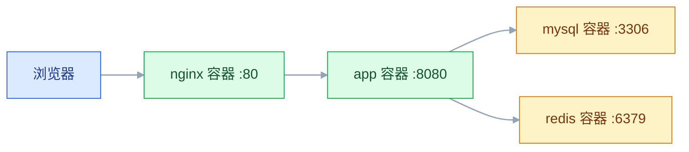
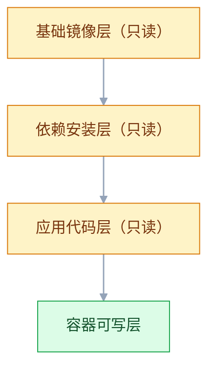
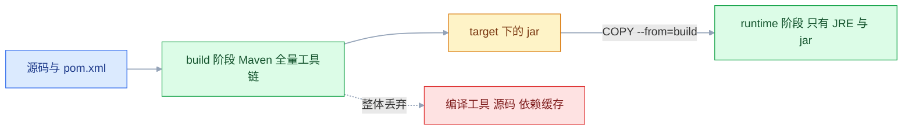

# Docker 容器引擎

## 一、工程案例：用 Compose 交付一套 Spring Boot + MySQL + Redis + Nginx

**场景**：一台新买的云服务器（Ubuntu 24.04，2C4G），要上线一套小型业务系统。要求：宿主机上**不装** JDK、MySQL、Redis、Nginx，全部用容器跑；用户通过域名访问，Nginx 做反向代理；数据库和缓存的数据重启后不能丢；服务器重启后整套服务自动恢复。

**为什么用 Compose 而不是一堆 `docker run`**：四个容器之间有启动顺序、网络、卷、环境变量的关联。`docker run` 把这四件事散落在四条长命令里，改一个密码要改三处；Compose 把它们写进一个文件，进 Git，一条命令起停。

**最终形态**：一条 `docker compose up -d` 拉起四个容器，只有 Nginx 映射 80 端口，其余全在内网。



### 1.1 主线（按顺序执行）

```bash
# ① 装 Docker（官方脚本会装 engine + compose 插件 + buildx）
curl -fsSL https://get.docker.com | sudo sh
sudo systemctl enable --now docker
docker version          # Client 和 Server 两段都要有

# ② 配镜像加速（国内不配基本拉不动）
sudo mkdir -p /etc/docker
sudo tee /etc/docker/daemon.json >/dev/null <<'EOF'
{
  "registry-mirrors": ["https://docker.1ms.run", "https://docker.xuanyuan.me"],
  "log-driver": "json-file",
  "log-opts": { "max-size": "50m", "max-file": "3" }
}
EOF
sudo systemctl daemon-reload && sudo systemctl restart docker
docker info | grep -A 3 "Registry Mirrors"

# ③ 建目录结构
sudo mkdir -p /opt/app/{source,mysql-init,nginx,redis,backup}
sudo chown -R $USER:$USER /opt/app

# ④ 写数据库初始化脚本（只在数据目录为空时执行一次）
cat > /opt/app/mysql-init/init.sql <<'EOF'
CREATE DATABASE IF NOT EXISTS appdb DEFAULT CHARACTER SET utf8mb4;
USE appdb;
CREATE TABLE IF NOT EXISTS t_user (
  id BIGINT PRIMARY KEY AUTO_INCREMENT,
  username VARCHAR(64) NOT NULL UNIQUE,
  created_at DATETIME NOT NULL DEFAULT CURRENT_TIMESTAMP
);
EOF

# ⑤ 写 Redis 配置（密码通过 compose 的 --requirepass 传入，不落在文件里）
cat > /opt/app/redis/redis.conf <<'EOF'
appendonly yes
EOF

# ⑥ 写 Nginx 反向代理
cat > /opt/app/nginx/default.conf <<'EOF'
server {
    listen 80;
    server_name _;
    location / {
        proxy_pass http://app:8080;
        proxy_set_header Host $host;
        proxy_set_header X-Real-IP $remote_addr;
        proxy_set_header X-Forwarded-For $proxy_add_x_forwarded_for;
    }
}
EOF

# ⑦ 写 compose.yaml（内容见 1.2）

# ⑧ 先建密码文件，再起服务（.env 只在本机，不进 Git）
cat > /opt/app/.env <<'EOF'
MYSQL_ROOT_PASSWORD=Root@2026#Strong
DB_PASSWORD=AppUser@2026
REDIS_PASSWORD=Redis@2026
EOF
chmod 600 /opt/app/.env

cd /opt/app && docker compose up -d
docker compose ps
```

### 1.2 compose.yaml

```yaml
services:
  mysql:
    image: mysql:8.0
    restart: always
    environment:
      MYSQL_ROOT_PASSWORD: ${MYSQL_ROOT_PASSWORD}
      MYSQL_DATABASE: appdb
      MYSQL_USER: appuser
      MYSQL_PASSWORD: ${DB_PASSWORD}
      TZ: Asia/Shanghai
    volumes:
      - mysql-data:/var/lib/mysql
      - ./mysql-init:/docker-entrypoint-initdb.d:ro
    command:
      - --character-set-server=utf8mb4
      - --collation-server=utf8mb4_unicode_ci
    healthcheck:
      test: ["CMD-SHELL", "mysqladmin ping -h 127.0.0.1 -uroot -p\"$$MYSQL_ROOT_PASSWORD\""]
      interval: 10s
      timeout: 5s
      retries: 10
      start_period: 30s

  redis:
    image: redis:7
    restart: always
    environment:
      REDIS_PASSWORD: ${REDIS_PASSWORD}
    command: ["sh", "-c", "exec redis-server /usr/local/etc/redis/redis.conf --requirepass \"$$REDIS_PASSWORD\""]
    volumes:
      - redis-data:/data
      - ./redis/redis.conf:/usr/local/etc/redis/redis.conf:ro
    healthcheck:
      test: ["CMD-SHELL", "redis-cli -a \"$$REDIS_PASSWORD\" ping | grep -q PONG"]
      interval: 10s
      timeout: 3s
      retries: 5

  app:
    build:
      context: ./source
      dockerfile: Dockerfile
    image: app:v1.0.0
    restart: always
    environment:
      DB_URL: jdbc:mysql://mysql:3306/appdb?useUnicode=true&characterEncoding=utf8&serverTimezone=Asia/Shanghai
      DB_USERNAME: appuser
      DB_PASSWORD: ${DB_PASSWORD}
      REDIS_HOST: redis
      REDIS_PASSWORD: ${REDIS_PASSWORD}
      JAVA_OPTS: -Xms256m -Xmx512m
      TZ: Asia/Shanghai
    depends_on:
      mysql:
        condition: service_healthy
      redis:
        condition: service_healthy
    healthcheck:
      test: ["CMD", "sh", "-c", "wget -qO- http://127.0.0.1:8080/actuator/health | grep UP"]
      interval: 15s
      timeout: 5s
      retries: 5
      start_period: 60s

  nginx:
    image: nginx:1.27
    restart: always
    ports:
      - "80:80"
    volumes:
      - ./nginx/default.conf:/etc/nginx/conf.d/default.conf:ro
    depends_on:
      - app

volumes:
  mysql-data:
  redis-data:
```

> `$$MYSQL_ROOT_PASSWORD` 里的双美元是 Compose 的转义：写成 `$` 会被 Compose 在解析文件时替换掉，写成 `$$` 才会把 `$MYSQL_ROOT_PASSWORD` 原样交给容器内的 shell 展开。所以这类带变量的健康检查要用 `CMD-SHELL` 而不是 `CMD`——`CMD` 是直接 exec，没有 shell 帮你展开变量。

### 1.3 多阶段 Dockerfile

```dockerfile
# ---------- 构建阶段 ----------
FROM maven:3.9-eclipse-temurin-17 AS build
WORKDIR /build
COPY pom.xml .
RUN mvn -B dependency:go-offline
COPY src ./src
RUN mvn -B package -DskipTests

# ---------- 运行阶段 ----------
FROM eclipse-temurin:17-jre
WORKDIR /app
ENV TZ=Asia/Shanghai \
    JAVA_OPTS="-Xms256m -Xmx512m"
COPY --from=build /build/target/*.jar app.jar
RUN useradd -r -u 10001 appuser
USER 10001
EXPOSE 8080
ENTRYPOINT ["sh", "-c", "exec java $JAVA_OPTS -jar app.jar"]
```

`.dockerignore` 必须写，否则 `target/`、`.git/` 全进构建上下文：

```text
target/
.git/
.idea/
*.log
.env
```

### 1.4 验收（8 项）

| # | 检查 | 命令 | 通过标准 |
|---|---|---|---|
| 1 | 四个容器都在跑 | `docker compose ps` | 四个 `Up`，mysql/app 显示 `(healthy)` |
| 2 | 只有 nginx 对宿主机开端口 | `docker compose ps --format '{{.Name}} {{.Ports}}'` | 只有 nginx 有 `0.0.0.0:80->80` |
| 3 | 应用通 | `curl -s localhost/actuator/health` | `{"status":"UP"}` |
| 4 | 应用连上数据库 | `curl -s -X POST localhost/api/users -H 'Content-Type: application/json' -d '{"username":"demo"}'` | 返回 2xx |
| 5 | 数据真的落库 | `docker compose exec mysql sh -c 'mysql -uappuser -p"$MYSQL_PASSWORD" appdb -e "select * from t_user"'` | 有 `demo` 这行 |
| 6 | 数据卷独立于容器 | `docker compose down && docker compose up -d` 后再查 | 数据还在 |
| 7 | 配置改了不用重建镜像 | 改 `nginx/default.conf` 后 `docker compose exec nginx nginx -s reload` | 新规则生效 |
| 8 | 重启整机自动恢复 | `sudo reboot` 后 `docker compose ps` | 四个都是 `Up` |

> 第 6 项是这套方案的核心验证：`docker compose down` 删容器但保留卷，起来后数据还在；`down -v` 会连卷一起删，数据永久丢失。
> 第 8 项要求 `docker` 服务本身 `enabled`，否则容器配了 `restart: always` 也不会自己回来。

### 1.5 镜像瘦身的三条实际收益

| 手段 | 典型效果 | 代价 |
|---|---|---|
| 多阶段构建 | 700MB → 280MB | Dockerfile 变长 |
| 换 slim/alpine 基础镜像 | 再省 100MB 左右 | 缺少 glibc 兼容层，部分二进制跑不了 |
| 合并 `RUN` 并清缓存 | 每条少几十 MB | 可读性下降，缓存命中率变差 |

```bash
docker images app:v1.0.0
docker history app:v1.0.0 --no-trunc | head -15   # 看每一层多大、来自哪条指令
```

---

## 二、高频问答：会卡住你的地方，也是面试最常问的

### 2.1 容器起来几秒就 `Exited (1)`，`docker ps` 里看不到

**现场**

```bash
docker ps -a
docker logs --tail 50 <容器名>
docker inspect -f '{{.State.ExitCode}} {{.State.Error}}' <容器名>
```

**要点**

- 容器退出不是启动失败，主进程结束容器就结束。
- 先看退出码：0 多半是前台命令跑完，非 0 是应用自己报错。
- 再看日志最后 50 行，原因基本直接写着。

**追问**

- 退出码 137 是什么？→ 被 SIGKILL，先查 OOM 和 `-m` 限制。
- 退出码 0 但服务没起来？→ 主进程不是常驻进程，可能被写成了后台运行。
- 配了 `restart: always` 怎么没救回来？→ 它只负责重启，配置错了会无限重启。

### 2.2 `docker run -p 8080:80` 后访问不到

**现场**

```bash
docker port <容器名>
docker exec <容器名> ss -tlnp
# 监听 127.0.0.1:8080 的进程，必须改成 0.0.0.0
```

**要点**

- 访问不到先分两种：端口映射方向错，或应用监听地址错。
- `-p 宿主:容器` 记反是最常见的低级错。
- 容器里的 `127.0.0.1` 是容器自己，必须监听 `0.0.0.0` 才能被映射进来。

**追问**

- `docker port` 显示对了还是不通？→ 应用监听地址不对，或宿主机防火墙拦了。
- `host` 网络下还要 `-p` 吗？→ 不需要，也不生效。
- 端口映射是谁做的？→ docker-proxy 或 iptables DNAT。

### 2.3 `docker build` 每次都重新下载依赖

**现场**

```dockerfile
# ✔ 依赖声明在前，源码在后
COPY pom.xml .
RUN mvn -B dependency:go-offline
COPY src ./src
RUN mvn -B package -DskipTests
```

**要点**

- 缓存判断的是「指令文本 + 父层内容」，父层一变，后面全失效。
- `COPY . .` 放在装依赖之前，改任何源码都会重下依赖。
- 正确顺序是先 COPY 依赖声明并安装，再 COPY 源码。

**追问**

- 为什么改一行代码要重下依赖？→ 上层变了，下层缓存全失效。
- CI 里为什么没有缓存？→ 每次都是干净环境，要配 buildx 的 `cache-to` / `cache-from`。
- `--no-cache` 什么时候用？→ 怀疑缓存脏了，不是常规操作。

### 2.4 改了配置文件，容器里没变

**现场**

```bash
docker inspect -f '{{range .Mounts}}{{.Source}} -> {{.Destination}}{{"\n"}}{{end}}' <容器名>
# 单文件配置最稳的做法：改完重启容器，或挂目录
docker restart <容器名>
```

**要点**

- 单文件挂载改配置不生效，是 inode 变了。
- 编辑器保存是「写新文件再替换」，容器里还指着旧 inode。
- 改完重启容器最稳，或者干脆挂目录。

**追问**

- 挂目录和挂文件有什么区别？→ 目录跟着 inode 走，文件不跟。
- 挂载会覆盖镜像里的原文件吗？→ 会，空目录挂上去，原配置就没了。
- 为什么重启就好了？→ 重新做一次挂载，指向新 inode。

### 2.5 `docker compose up` 报端口已被占用

**现场**

先别改端口号，先查是谁占的：`ss -tlnp` 找到 PID，再用 `docker ps --filter publish=80` 对一下。多半是上一次没停干净的容器，或宿主机上已有同端口的 Nginx。

```bash
sudo ss -tlnp | grep ':80 '
docker ps --filter "publish=80"
```

### 2.6 应用日志报 `Communications link failure`

**现场**

```bash
docker compose exec app getent hosts mysql
docker compose exec app bash -c 'exec 3<>/dev/tcp/mysql/3306 && echo port-open'
docker compose ps        # 看 mysql 是否 healthy
```

**要点**

- 别只怀疑密码，先查网络和 DNS。
- 三个更常见的原因：不在同一网络、用了 IP 而不是容器名、数据库还没初始化完。
- 排查顺序：容器名解析 → 端口连通 → 最后才是密码。

**追问**

- 为什么不能用 IP？→ 容器重建 IP 会变，容器名才稳定。
- 默认 bridge 能用容器名吗？→ 不能，必须自定义网络。
- `Up` 和 `Up (healthy)` 有什么区别？→ 前者只代表进程在，后者才代表服务可用。

### 2.7 `depends_on` 写了，应用还是启动太快连不上库

**现场**

```yaml
depends_on:
  mysql:
    condition: service_healthy
```

**要点**

- `depends_on` 短写法只保证启动顺序，不保证服务可用。
- 要等就绪必须用长写法配 `condition: service_healthy`，且目标要有 healthcheck。
- 顺序保证替代不了重试，网络抖动还是要应用侧兜住。

**追问**

- 没有 healthcheck 怎么办？→ 在 entrypoint 里轮询，或用 wait-for-it 之类的小脚本。
- 为什么 K8s 用 readinessProbe 而不是 depends_on？→ 编排层是持续判断，不是一次性。
- 启动顺序能保证请求不失败吗？→ 不能，只能降低概率。

### 2.8 磁盘满了，`docker system df` 显示镜像占几十 G

**现场**

```bash
docker system df -v
docker image prune -a          # 未被容器使用的镜像
docker builder prune           # 构建缓存
# 卷要单独确认，不要随手 --volumes
```

**要点**

- 先别 `rm -rf /var/lib/docker`，里面还有卷和正在用的镜像层。
- 用 `docker system df -v` 分成镜像、停止的容器、构建缓存、卷四类清。
- 卷要单独确认，`--volumes` 不要顺手加。

**追问**

- 为什么卷不能随便删？→ 数据库数据在里面，删了没有恢复途径。
- prune 和 rm 的区别？→ prune 只清未被使用的。
- `df` 显示满但 `du` 对不上？→ 有已删除文件被进程持有。

### 2.9 容器内存被 OOM Kill，日志里没有应用报错

**现场**

```bash
docker inspect -f '{{.State.OOMKilled}}' <容器名>
docker stats --no-stream
# JVM 要显式设 -Xmx，并留出 25% 左右给堆外
```

**要点**

- 应用没报错就被杀，多半是内核 OOM，不是代码问题。
- JVM 看得到容器 limit，但堆外内存、元空间、线程栈都不在堆里。
- `-m 512m` 配 `-Xmx512m` 必然被杀，`-Xmx` 取 limit 的 70%~75%。

**追问**

- 怎么确认是 OOM 不是应用崩？→ `OOMKilled=true`，退出码 137。
- 老版本 JDK 为什么识别不了容器限制？→ 早期读的是宿主机内存，要加 `-XX:+UseContainerSupport`。
- swap 开不开？→ 生产一般关，延迟不可控。

### 2.10 拉私有仓库镜像报 `unauthorized`

**现场**

先确认凭据的作用域：`cat ~/.docker/config.json` 看 auths，再在目标机器上重新 `docker login`。这个凭据只对当前用户生效，换机器、换用户、CI 里都要重新提供，不是密码错了。

```bash
docker login registry.example.com
cat ~/.docker/config.json | head -20
docker pull registry.example.com/app/api:v3
```

### 2.11 `docker compose down` 之后数据没了

**现场**

```bash
docker volume ls
docker volume inspect <项目名>_mysql-data
# 恢复只能靠之前的 mysqldump 备份
```

**要点**

- `down` 删容器保卷，`down -v` 连卷一起删，这是设计行为。
- 卷删了没有回收站，只能靠之前的备份。

**追问**

- 还能恢复吗？→ 不能，卷没有回收站。
- 生产怎么防？→ 备份放独立磁盘或对象存储，别和卷同盘。
- 具名卷和绑定挂载哪个更稳？→ 具名卷由 Docker 管理，权限和迁移更省心。

### 2.12 构建出来的镜像在别人机器上跑不了

**现场**

```bash
# 在构建机上明确指定目标平台并推送
docker buildx build --platform linux/amd64 -t app:v1.0.0 --push .

# 验证：本地镜像架构、仓库里的清单
docker image inspect -f '{{.Architecture}}' app:v1.0.0
docker buildx imagetools inspect registry.example.com/app:v1.0.0
# 服务器上直接验证：拉下来跑一次，报 exec format error 就是架构不符
docker run --rm registry.example.com/app:v1.0.0 --version
```

**要点**

- 本地能跑服务器不能跑，先看 CPU 架构。
- 苹果本默认构建 arm64，推到 amd64 上就是 `exec format error`。
- 构建时用 buildx 显式指定 `--platform linux/amd64`，推完用 `imagetools inspect` 确认。

**追问**

- 为什么本地能跑服务器不能跑？→ 架构不同。
- 多平台镜像怎么构建？→ buildx + QEMU，或用 CI 的原生 runner。
- 怎么预防？→ CI 固定平台，标签里带架构。

### 2.13 让你设计一套小公司的容器化交付方案

**要点**

- 先问约束：几台机器、要不要高可用、团队会不会 K8s。
- 两三台以内用 Compose + 私有仓库 + CI + 部署脚本，成本最低。
- 多机、要自愈和滚动更新才上 K8s，否则是给自己找活。
- 不管哪种，三件事必须做：镜像固定版本、配置走环境变量、数据放卷并定期备份。

**追问**

- 为什么不上 K8s？→ 机器少、没人维护，收益抵不过成本。
- Compose 的短板在哪？→ 不能跨机器、不能自愈到别的节点、没有滚动更新。
- 数据库也放容器里吗？→ 小规模可以，但备份和 IO 要单独考虑，很多团队最后会挪到托管服务。

---

## 三、核心知识：从零开始要建立的东西

### 3.1 镜像、容器与仓库的关系

| 概念 | 是什么 | 生命周期 |
|---|---|---|
| Dockerfile | 构建镜像的文本描述 | 跟代码一起版本化 |
| 镜像 Image | 只读模板，由若干层组成 | 长期存在，可复制分发 |
| 容器 Container | 镜像跑起来的实例，多一个可写层 | 随时创建销毁 |
| 仓库 Registry | 存放和分发镜像的服务 | 独立于集群 |

一个镜像可以起无数个容器，它们共享只读层，各自有独立可写层。**容器删掉，可写层就没了**——这是所有数据持久化方案的出发点。

> **面试**：常问「镜像、容器、仓库三者的关系是什么？」答：镜像是只读模板，容器是运行实例多一层可写，仓库负责分发。

### 3.2 镜像分层与联合文件系统

镜像的每一层是一组文件变更，运行时用 overlayfs 把它们叠起来：底层只读，最上面一层可写。



**只有会改文件系统的指令才产生新层**：`RUN`、`COPY`、`ADD`。`ENV`、`WORKDIR`、`CMD`、`LABEL` 只改元数据，不新增层——但它们改动元数据也会让后续缓存失效。

**写时复制**：容器要改一个只读层里的文件，内核先把整个文件复制到可写层，再改副本。所以"在容器里改大文件"是昂贵的，且改完只对这一容器可见。

**层复用**：多个镜像共用基础层时只存一份，拉取时显示 `Already exists`。这也是为什么基础镜像选型要统一——一个团队用三种基础镜像，磁盘会多花三倍。

> **面试**：常问「为什么容器删了数据就没了？镜像层为什么能复用？」答：只读层叠加 + 顶层可写，写时复制。

### 3.3 构建缓存与指令顺序

构建时 Docker 逐条执行指令，每条指令对应一层。判断能否复用缓存的方式是：**指令文本 + 父层内容**都没变，就用缓存。

| 顺序 | 缓存行为 |
|---|---|
| 依赖声明在前、源码在后 | 改代码只重跑编译，依赖层命中 |
| 源码在前、依赖在后 | 每次改代码都重新下载依赖 |
| `RUN apt install` 和 `RUN apt clean` 分开写 | 清理不减少层大小，白做 |
| 把 `RUN` 用 `&&` 串起来并在同层清理 | 真正减小体积 |

**边界**：缓存只对本地构建有效，CI 里每次都是干净环境。要在 CI 里用缓存，得配 `buildx` 的 cache-to/cache-from 或 registry 缓存。

### 3.4 多阶段构建

一个 Dockerfile 里可以有多个 `FROM`，后面的阶段可以用 `COPY --from=` 拿前面阶段的产物。最终镜像只包含最后一个阶段。

```dockerfile
FROM maven:3.9-eclipse-temurin-17 AS build
WORKDIR /build
COPY pom.xml .
RUN mvn -B dependency:go-offline
COPY src ./src
RUN mvn -B package -DskipTests

FROM eclipse-temurin:17-jre
COPY --from=build /build/target/*.jar /app/app.jar
ENTRYPOINT ["java", "-jar", "/app/app.jar"]
```



| 做法 | 体积 | 攻击面 |
|---|---|---|
| 单阶段（含 Maven + 源码） | 700MB+ | 编译工具、源码全在镜像里 |
| 多阶段（只留 JRE + jar） | 280MB 左右 | 只有运行时 |

**取舍**：多阶段构建的镜像里没有 shell、没有包管理器，排障时进不去（`docker exec` 只能跑应用本身）。需要排障就在最后阶段装一个 busybox，或者用 `docker debug` 类工具。

### 3.5 Dockerfile 关键指令的语义差异

| 指令 | 执行时机 | 是否进镜像 | 能否被覆盖 |
|---|---|---|---|
| `RUN` | 构建时 | 结果固化进层 | 不能 |
| `CMD` | 容器启动时 | 只存元数据 | 能（`docker run 镜像 新命令`） |
| `ENTRYPOINT` | 容器启动时 | 只存元数据 | 能（`--entrypoint`），但参数会追加 |
| `ENV` | 构建 + 运行 | 元数据，运行时可读 | 能（`-e`） |
| `ARG` | 仅构建时 | 不进最终镜像 | — |

**`CMD` + `ENTRYPOINT` 组合**：`ENTRYPOINT` 定"跑什么"，`CMD` 定"默认参数"。`docker run 镜像 --help` 时，`--help` 替换的是 `CMD`，`ENTRYPOINT` 不变，于是变成 `entrypoint --help`——这就是为什么 `kubectl` 类镜像能接受子命令。用 `--entrypoint` 才会替换入口程序，此时镜像里的 `CMD` 不再生效，需要自己把参数补全。

> **面试**：常问「CMD 和 ENTRYPOINT 有什么区别？`docker run 镜像 命令` 替换的是哪个？」答：一个定义默认参数、一个定义入口，额外命令是追加不是替换。

### 3.6 网络模式与容器名解析

| 模式 | 隔离程度 | 用途 |
|---|---|---|
| `bridge`（默认） | 独立 netns + NAT | 绝大多数场景 |
| `host` | 共享宿主机网络栈 | 性能敏感、需要绑宿主端口 |
| `none` | 只有 loopback | 纯计算任务、强隔离 |
| `container:<id>` | 共享另一个容器的网络 | sidecar 代理 |

自定义 bridge 网络内嵌 DNS，容器可以用**容器名**互访；默认 bridge 不支持名字解析，只能用 IP（且 IP 会变）。这是"为什么必须建自定义网络"的唯一理由。

**边界**：容器名解析只在同一网络内有效。跨网络要 `docker network connect` 把容器接进去，或者走宿主机端口。

> **面试**：常问「容器之间怎么互相访问？为什么默认 bridge 不能用容器名？」答：自定义网络内嵌 DNS。

### 3.7 数据卷、绑定挂载与 tmpfs

| 类型 | 存储位置 | 谁管理 | 适合 |
|---|---|---|---|
| 具名卷 | `/var/lib/docker/volumes/` | Docker | 数据库、上传文件 |
| 绑定挂载 | 你指定的宿主机路径 | 你 | 配置文件、代码目录 |
| tmpfs | 内存 | 内核 | 临时缓存、敏感数据 |

**判断原则**：数据用具名卷（备份、迁移、权限都由 Docker 处理）；配置用绑定挂载（要在宿主机直接编辑）。

**边界**：绑定挂载会**覆盖**容器内原目录的内容。挂一个空目录到 `/etc/nginx/conf.d`，镜像里自带的配置就没了——这是"Nginx 起不来找不到配置"的常见原因。

> **面试**：常问「具名卷和绑定挂载怎么选？」答：数据用具名卷、配置用绑定挂载，绑定挂载会覆盖镜像内原目录。

### 3.8 容器生命周期与重启策略

| 状态 | 含义 | 怎么到这 |
|---|---|---|
| created | 已创建未启动 | `docker create` |
| running | 主进程在跑 | `docker start` / `run` |
| paused | 进程被冻结 | `docker pause` |
| exited | 主进程已结束 | 正常退出或崩溃 |
| dead | 无法删除的异常态 | 存储驱动故障 |

| 重启策略 | 行为 |
|---|---|
| `no`（默认） | 不重启 |
| `on-failure` | 非零退出才重启 |
| `always` | 容器退出就重启；**前提是 dockerd 自己被拉起**（服务 enabled 或机器没重启） |
| `unless-stopped` | 总是重启，除非你手工 stop 过 |

**注意**：`restart: always` 救的是「容器进程崩了」。宿主机重启后它能不能回来，取决于 `systemctl is-enabled docker`；整机故障则要靠编排层把容器调度到别的机器。

### 3.9 健康检查与就绪判断

`HEALTHCHECK` 让 Docker 周期性执行一个命令，结果写进容器状态（`healthy` / `unhealthy`），但它**不会**自动重启容器，也**不会**自动把流量摘走——它只是把状态暴露出来。

```dockerfile
HEALTHCHECK --interval=30s --timeout=3s --start-period=60s --retries=3 \
  CMD wget -qO- http://127.0.0.1:8080/actuator/health || exit 1
```

| 参数 | 作用 |
|---|---|
| `start-period` | 启动宽限期，这期间失败不算失败 |
| `interval` | 检查间隔 |
| `retries` | 连续失败几次标记 unhealthy |

**边界**：健康检查的价值在 Compose 的 `depends_on: condition: service_healthy` 和负载均衡器的健康探测。单机 Docker 里它只影响 `docker ps` 的显示。

### 3.10 资源限制与 OOM

| 参数 | 作用 | 超限后果 |
|---|---|---|
| `--cpus=1.5` | CPU 配额 | 被限流，延迟升高 |
| `-m 512m` | 内存硬限制 | 被 OOM Killer 杀 |
| `--memory-swap` | 内存 + swap 总量 | 设成与 `-m` 相同即禁用 swap |
| `--pids-limit` | 进程数上限 | fork 失败 |
| `--blkio-weight` | IO 权重 | 相对变慢 |

**JVM 的坑**：容器里 `Runtime.maxMemory()` 在现代 JDK 上能识别 cgroup 限制，但堆外内存、元空间、线程栈、直接缓冲区不在堆里。`-m 512m` 配 `-Xmx512m` 必被 OOM——堆就要 512M，加上其他必然超。经验值是 `-Xmx` 取 limit 的 70%~75%。

> **面试**：常问「`-m 512m` 配 `-Xmx512m` 为什么会被杀？」答：堆外内存不在堆里，`-Xmx` 取 limit 的 70%~75%。

### 3.11 镜像仓库与标签策略

| 标签写法 | 含义 | 生产可用 |
|---|---|---|
| `latest` | 浮动，每次 pull 可能不同 | ❌ |
| `1.27` | 次版本浮动，补丁自动更新 | ⚠️ 看场景 |
| `1.27.3` | 精确版本 | ✅ |
| `1.27.3-alpine` | 版本 + 基础镜像变体 | ✅ |
| `sha-abc1234` | 绑定到某次提交 | ✅ 最严格 |

**结论**：生产写精确版本或 digest。`latest` 的唯一合理用途是本地开发，且必须配 `pull_policy: always`，否则永远用本地旧镜像。

### 3.12 Compose 的编排语义

Compose 不是编排平台，它是"一组容器的启动清单"。它做四件事：建网络、按依赖顺序启动、注入环境变量、管理卷。

| 字段 | 作用 | 容易误解的地方 |
|---|---|---|
| `depends_on`（短写法） | 只保证启动顺序 | 不等服务就绪 |
| `depends_on`（长写法 + healthcheck） | 等健康 | 需要目标有 healthcheck |
| `restart` | 单个容器的重启策略 | 与 `deploy.restart_policy` 不是一回事 |
| `deploy.replicas` | 副本数 | 非 swarm 模式下部分生效 |
| `profiles` | 按需启用的服务组 | 默认不启动 |

**边界**：Compose 管不了跨机器、管不了自愈到别的机器、管不了滚动更新。这些是 K8s 的领域。单机多容器用 Compose，多机用编排平台。

> **面试**：常问「Compose 和 K8s 有什么区别？什么时候该上 K8s？」答：单机清单 vs 跨机编排，看机器数和是否要自愈、滚动更新。

### 3.13 构建上下文与 .dockerignore

`docker build .` 的第一个参数是**构建上下文**，Docker 会把这个目录整体打包发给 daemon（或 BuildKit）。上下文大，构建就慢，哪怕 Dockerfile 里没用到。

| 常见误打包 | 体积 | 后果 |
|---|---|---|
| `.git/` | 几十到几百 MB | 每次构建都传 |
| `node_modules/` | 几百 MB | 覆盖镜像内安装的依赖 |
| `target/` | 几十 MB | 旧产物混进镜像 |
| `.env` | 几 KB | **密钥泄露进镜像层** |

`.dockerignore` 的语法和 `.gitignore` 类似，但它是独立文件，不会自动继承。**没有它，安全和体积两件事都做不对。**

### 3.14 容器安全的最小实践

| 措施 | 命令/写法 | 防的是什么 |
|---|---|---|
| 非 root 运行 | `USER 10001` | 容器内提权后仍是普通用户 |
| 只读根文件系统 | `--read-only` + 挂 tmpfs | 篡改镜像内容、写 webshell |
| 去掉能力 | `--cap-drop ALL --cap-add NET_BIND_SERVICE` | 内核级操作 |
| 禁止提权 | `--security-opt=no-new-privileges` | setuid 提权 |
| 不挂 docker.sock | 绝不 `-v /var/run/docker.sock` | 挂上就等于给了宿主机 root |

**取舍**：`--read-only` 会让很多应用起不来（要写 `/tmp`、写日志），需要逐个挂 tmpfs。这是"能跑"和"安全"之间必须 explicit 做的选择，不是默认就能两全。

### 3.15 日志驱动与磁盘

默认 `json-file` 驱动把容器 stdout 写成 JSON 文件，**不限制就会无限增长**，最终写满 `/var/lib/docker`，整机故障。

```json
{
  "log-driver": "json-file",
  "log-opts": { "max-size": "50m", "max-file": "3" }
}
```

| 驱动 | 去向 | 适用 |
|---|---|---|
| `json-file` | 本地文件 | 默认，适合小规模 |
| `local` | 本地二进制格式 | 更省空间，推荐替代 json-file |
| `syslog` / `journald` | 系统日志 | 已有日志平台 |
| `fluentd` / `awslogs` | 远程收集 | 生产集中式日志 |

**注意**：`daemon.json` 里的日志配置只对**新建**容器生效，已有容器要重建。

---

## 四、冷门知识汇总

| 知识点 | 为什么冷门 | 用到时的关键词 |
|---|---|---|
| BuildKit 与 buildx | 默认已启用，只有多平台构建时才显式用它 | `--platform`、`cache-to`、`docker buildx create` |
| `docker save` / `load` | 有 registry 后很少离线搬运 | `docker save -o x.tar`、内网交付 |
| `docker export` / `import` | 导出的是文件系统，丢分层和历史 | 与 `save` 的区别常被搞混 |
| `docker context` | 本机只连一个 daemon 时用不上 | 远程 daemon、`DOCKER_HOST` |
| rootless Docker | 服务器默认 root，很少启用 | `dockerd-rootless-setuptool.sh` |
| cgroup v2 差异 | 新内核默认 v2，老教程按 v1 写 | `--cgroupns`、`stat -fc %T /sys/fs/cgroup` |
| macvlan 网络 | 需要二层网络配合，云上多不支持 | 容器要拿同网段真实 IP |
| `docker diff` / `commit` | 把容器固化成镜像不推荐用于生产 | 排障看可写层改了什么 |
| `--init` 与僵尸进程 | 应用自己会 reap 子进程时不需要 | PID 1 不回收子进程、`tini` |
| 镜像 digest 固定 | 团队多用 tag，digest 更严格 | `nginx@sha256:...` |
