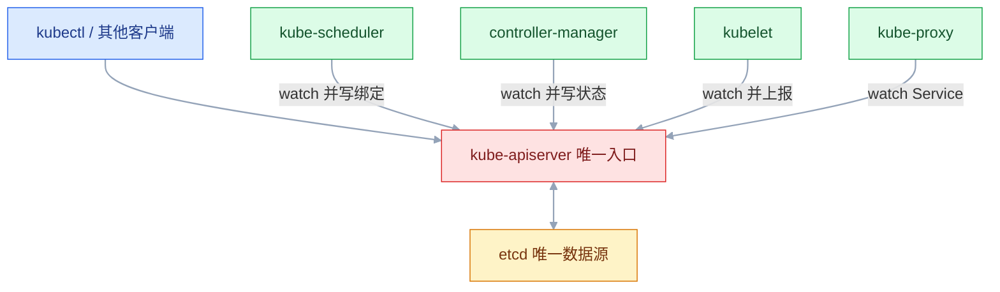
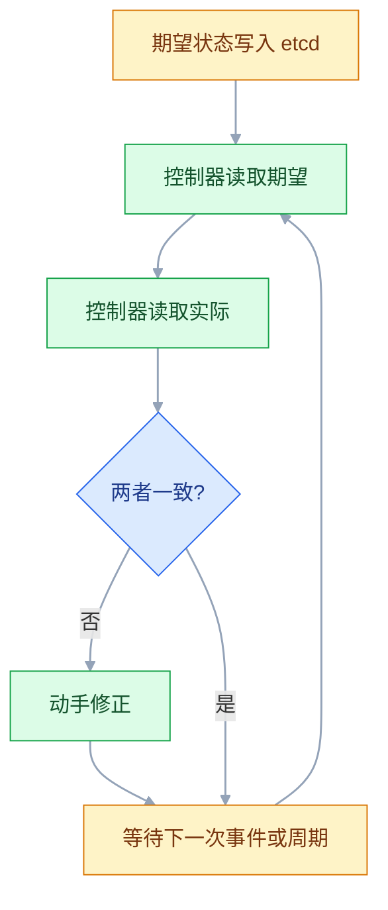
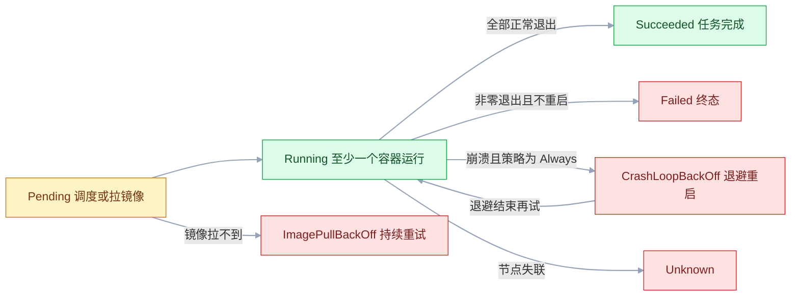
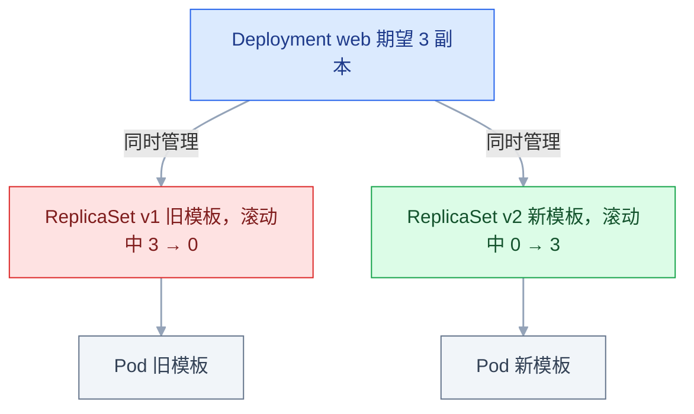
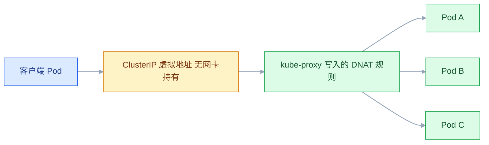

# Kubernetes 核心概念

## 一、工程案例：在本机集群上走完「部署 → 暴露 → 自愈 → 回滚」

**场景**：你接手了一个 3 副本的 Nginx 前端，需要先在自己电脑上把 K8s 的完整闭环跑通：声明式部署、服务发现、从浏览器访问、手工删 Pod 观察自愈、改镜像版本再回滚。做完这一节，你就有了判断"集群里现在发生了什么"的手感。

**为什么必须亲手做一遍**：K8s 的概念都能背，但"删掉一个 Pod 它自己回来"这件事，只有亲眼看着 `--watch` 输出滚动，才会真正相信控制器循环在跑。后面遇到 `CrashLoopBackOff`、`Endpoints` 为空，脑子里才有画面。

**环境**：macOS 或 Linux 上的 Docker，用 kind 起一个单节点集群（比 minikube 快，且贴近真实节点结构）。

### 1.1 主线（按顺序执行）

```bash
# ① 装工具（macOS 用 brew；Linux 用官方二进制，版本要跟集群小版本对齐）
brew install kind kubectl
kind version && kubectl version --client

# ② 起集群，显式指定 API 版本，避免默认值随版本漂移
cat > /tmp/kind.yaml <<'EOF'
kind: Cluster
apiVersion: kind.x-k8s.io/v1alpha4
name: demo
nodes:
  - role: control-plane
    extraPortMappings:
      - containerPort: 30080
        hostPort: 30080
        protocol: TCP
EOF
kind create cluster --config /tmp/kind.yaml
kubectl get nodes              # STATUS 必须是 Ready

# ③ 用 YAML 声明 Deployment（不要用 kubectl create，先把声明式走通）
mkdir -p ~/k8s-demo && cd ~/k8s-demo
cat > web.yaml <<'EOF'
apiVersion: apps/v1
kind: Deployment
metadata:
  name: web
  labels:
    app: web
spec:
  replicas: 3
  revisionHistoryLimit: 5
  strategy:
    type: RollingUpdate
    rollingUpdate:
      maxSurge: 1
      maxUnavailable: 0
  selector:
    matchLabels:
      app: web
  template:
    metadata:
      labels:
        app: web
    spec:
      containers:
        - name: nginx
          image: nginx:1.27
          ports:
            - name: http
              containerPort: 80
          resources:
            requests:
              cpu: 50m
              memory: 64Mi
            limits:
              cpu: 200m
              memory: 128Mi
          readinessProbe:
            httpGet:
              path: /
              port: http
            initialDelaySeconds: 2
            periodSeconds: 5
---
apiVersion: v1
kind: Service
metadata:
  name: web-svc
spec:
  type: ClusterIP
  selector:
    app: web
  ports:
    - name: http
      port: 80
      targetPort: http
---
apiVersion: v1
kind: Service
metadata:
  name: web-nodeport
spec:
  type: NodePort
  selector:
    app: web
  ports:
    - name: http
      port: 80
      targetPort: http
      nodePort: 30080
EOF

kubectl apply -f web.yaml
kubectl get deploy,rs,pods -o wide
```

**关键输出**：

```text
$ kubectl get deploy,rs,pods
NAME                  READY   UP-TO-DATE   AVAILABLE   AGE
deployment.apps/web   3/3     3            3           40s

NAME                             DESIRED   CURRENT   READY   AGE
replicaset.apps/web-6f9c8d7b5    3         3         3       40s

NAME                       READY   STATUS    RESTARTS   AGE
pod/web-6f9c8d7b5-4k2mn    1/1     Running   0          40s
pod/web-6f9c8d7b5-8p7qw    1/1     Running   0          40s
pod/web-6f9c8d7b5-t9x4z    1/1     Running   0          40s
```

> 注意中间那层 ReplicaSet：Deployment 不直接管 Pod，它创建 RS，RS 再管 Pod。这个三层结构是滚动更新和回滚能工作的前提。

```bash
# ④ 验证服务发现：Service 靠 selector 找到 Pod，Endpoints 是真实后端列表
kubectl get svc web-svc
kubectl get endpoints web-svc
# NAME      ENDPOINTS                               AGE
# web-svc   10.244.0.5:80,10.244.0.6:80,10.244.0.7:80   1m

# ⑤ 从集群内部访问（用服务名，不用 IP）
kubectl run curl-test --image=curlimages/curl:8.5.0 --rm -it --restart=Never -- \
  curl -s -o /dev/null -w "%{http_code}\n" http://web-svc
# 200

# ⑥ 从宿主机访问（kind 把 30080 映射出来了）
curl -s -o /dev/null -w "%{http_code}\n" http://127.0.0.1:30080
# 200

# ⑦ 自愈实验：删掉一个 Pod，看它自己回来
kubectl get pods -l app=web -w &
VICTIM=$(kubectl get pods -l app=web -o jsonpath='{.items[0].metadata.name}')
kubectl delete pod "$VICTIM"
# 输出会看到 Terminating → 新 Pod Pending → ContainerCreating → Running
kill %1

# ⑧ 升级与回滚（change-cause 要在改镜像之前打，否则历史里那一版看不到原因）
kubectl annotate deployment/web kubernetes.io/change-cause="升级到 nginx 1.28"
kubectl set image deployment/web nginx=nginx:1.28
kubectl rollout status deployment/web
kubectl rollout history deployment/web

kubectl rollout undo deployment/web
kubectl rollout status deployment/web
kubectl get deploy web -o jsonpath='{.spec.template.spec.containers[0].image}'; echo
# nginx:1.27
```

### 1.2 验收（9 项）

| # | 检查 | 命令 | 通过标准 |
|---|---|---|---|
| 1 | 节点就绪 | `kubectl get nodes` | `Ready` |
| 2 | 副本数达标 | `kubectl get deploy web` | `READY 3/3`、`AVAILABLE 3` |
| 3 | 三层结构成立 | `kubectl get rs,pods -l app=web` | RS 的 DESIRED/CURRENT/READY 都是 3 |
| 4 | 服务有后端 | `kubectl get endpoints web-svc` | 三个 `IP:80`，不是 `<none>` |
| 5 | 集群内可访问 | 上面的 `curl-test` | `200` |
| 6 | 集群外可访问 | `curl 127.0.0.1:30080` | `200` |
| 7 | 自愈生效 | 删 Pod 后 `get pods -l app=web` | 几秒内回到 3 个，新 Pod 名字不同 |
| 8 | 滚动更新不中断 | 更新期间持续 curl | 全程 200，无 5xx |
| 9 | 回滚成功 | `kubectl rollout undo` 后查镜像 | 回到 `nginx:1.27` |

> 第 8 项要真的在更新期间打请求，只跑 `rollout status` 看不出有没有掉流量。`maxUnavailable: 0` 配 readinessProbe 才有这个效果。
> 自愈后 Pod 名字变了、IP 也变了，Service 的 ClusterIP 和名字不变——这正是"应用之间只能用服务名"的原因。

### 1.3 清理

```bash
kubectl delete -f web.yaml
kind delete cluster --name demo     # ⚠️ 整个集群和其中的镜像、数据一起删
```

---

## 二、高频问答：会卡住你的地方，也是面试最常问的

### 2.1 Pod 一直是 `Pending`，没有任何日志

**现场**

Events 里会有 `FailedScheduling` 和具体理由。

```bash
kubectl describe pod <pod名> | tail -15
# 0/1 nodes are available: 1 Insufficient cpu.
kubectl describe node | grep -A 5 "Allocated resources"
```

**要点**

- `Pending` 是「还没被调度」，根本还没到拉镜像那一步，所以没有日志。
- 常见三类：资源不足、节点有污点、亲和性无处可放。
- 判断依据是 Events 里的 `FailedScheduling`，它会把理由直接写出来。

**追问**

- 为什么没有容器日志可看？→ 容器还没创建，没有可打日志的对象。
- `Insufficient cpu` 怎么确认？→ 对比节点上所有 Pod 的 requests 之和与可分配量。
- 污点导致的怎么处理？→ 加对应的 tolerations，或把 Pod 放到别的节点池。

### 2.2 Pod `ContainerCreating` 卡很久

**现场**

```bash
kubectl describe pod <pod名> | grep -A 10 Events
kubectl get pvc
kubectl get events --sort-by=.lastTimestamp | tail -20
```

**要点**

- 先区分「创建中」和「卡住」：多数是在拉镜像（大镜像 + 慢网络），或在挂卷。
- 挂卷这一类往往是 PVC 还没绑定，或 CSI 还在 attach。
- 判断依据是 Events 里的 `Pulling image` 或 `FailedMount`。

**追问**

- 怎么区分拉得慢和真卡住？→ 看 Events 有没有新条目、镜像多大、节点带宽够不够。
- `FailedMount` 一般查什么？→ PVC 是否 Bound、CSI 插件是否正常、节点上挂载点是否残留。
- 卡住会自己好吗？→ 会重试，但 PVC 没绑这类问题不会自愈。

### 2.3 `ImagePullBackOff` / `ErrImagePull`

**现场**

```bash
kubectl describe pod <pod名> | grep -A 5 "Failed"
# 在节点上直接试拉，绕开 K8s 排除变量
crictl pull nginx:1.27
```

**要点**

- 别只怀疑仓库挂了，这个状态的含义是「拉不到」，原因按概率排：镜像名或 tag 拼错、私有仓库没配 `imagePullSecrets`、节点上的运行时没配加速、tag 根本不存在。
- Events 的措辞直接给答案：`manifest unknown` 是 tag 不存在，`unauthorized` 是凭据问题。
- 在节点上 `crictl pull` 能绕开 K8s，把变量缩小到运行时和网络。

**追问**

- 它和 `ErrImagePull` 什么关系？→ 同一次失败的两个阶段，先 `ErrImagePull`，退避重试后显示 `ImagePullBackOff`。
- 配了凭据还是 `unauthorized`？→ secret 要在 Pod 所在的 namespace，`imagePullSecrets` 引用的名字要对。
- 节点上能拉、Pod 拉不到？→ 节点手工拉和 K8s 用的不是同一套凭据。

### 2.4 `CrashLoopBackOff`

**现场**

```bash
kubectl logs <pod名> --previous
kubectl describe pod <pod名> | grep -A 3 "Last State"
kubectl get pod <pod名> -o jsonpath='{.status.containerStatuses[0].lastState.terminated.exitCode}'; echo
```

**要点**

- 这个状态的含义是「容器启动后自己退出了，kubelet 按策略重启，间隔越来越长」，问题一定在应用或配置里。
- 删掉重建没用，新 Pod 会以同样的方式再退一次。
- 要看**上一个**容器的日志，当前容器可能还没输出就挂了。

**追问**

- 退避间隔怎么变？→ 从 10 秒起翻倍，上限 5 分钟。
- 上一个容器日志是空的？→ 看 `Last State` 的退出码，判断是启动报错还是直接被信号杀掉。
- 为什么不能靠 `restartPolicy: Always` 硬扛？→ 它只会无限重启，配置错就一直起不来。

### 2.5 Service 访问不通，但 Pod 是 Running

**现场**

```bash
kubectl get endpoints web-svc
kubectl get pods -l app=web --show-labels
kubectl get svc web-svc -o jsonpath='{.spec.selector}'; echo
# 标签大小写不匹配是最常见的一种：Service 写 app=Web，Pod 上是 app=web
```

**要点**

- 先看 Endpoints 是不是空的，空就说明 selector 没匹配上任何 Pod，转发规则自然没有目标。
- Pod `Running` 不代表被 Service 选中，两边只靠 label 连接。
- 所以排查顺序是 Endpoints → selector → 标签值，而不是先怀疑 kube-proxy。

**追问**

- Endpoints 有值还是不通？→ 再查 kube-proxy 规则、NetworkPolicy 和目标端口。
- 为什么 `get endpoints` 显示 `<none>`？→ 匹配到 0 个**就绪**的 Pod，Pod 没 Ready 也算空。
- 改了 selector 为什么没立刻生效？→ Endpoints 由控制器异步更新。

### 2.6 改了 ConfigMap，应用读到的还是旧值

**现场**

进容器 `cat` 一下，先分清是「文件旧」还是「进程没重读」。

```bash
kubectl exec <pod名> -- cat /etc/app/application.yml
kubectl rollout restart deployment/<名字>   # 环境变量方式必须重启
```

**要点**

- 环境变量是容器启动时读一次的，永不自动更新，反复 `apply` 也没用。
- 只有挂载成文件才会同步，大约 1 分钟；用 `subPath` 挂的也不更新。
- 所以环境变量方式必须 `rollout restart`，重建 Pod 才会重新读。

**追问**

- 为什么 `subPath` 不更新？→ 它挂的是单个文件，绕过了 ConfigMap 的符号链接更新机制。
- 挂载文件同步了为什么应用还是旧值？→ 进程自己缓存了配置，需要它重读或重启。
- 应用能自己监听配置变化吗？→ 有的框架支持，但要应用实现，不能指望所有服务。

### 2.7 `kubectl apply` 报 `no matches for kind`

**现场**

```bash
kubectl api-resources | grep -i ingress
# ingresses  ingress  networking.k8s.io/v1  true  Ingress
```

**要点**

- 不是集群太老要升级，多半是抄了旧 YAML：`extensions/v1beta1` 的 Deployment、`networking.k8s.io/v1beta1` 的 Ingress 早已从集群里删除。
- 报错的意思是「这个 API 组里没有这个 kind」，跟集群版本新旧无关。
- 用 `kubectl api-resources` 查它现在属于哪个组。

**追问**

- 换了 `apiVersion` 就够了吗？→ 不够，旧组里的字段常常跟着改名，要一起改。
- 怎么查新字段？→ `kubectl explain` 比翻文档可靠。
- 为什么别人能 apply？→ 他的集群版本老，旧 API 还没被删。

### 2.8 `kubectl` 连不上集群，报 `connection refused`

**现场**

```bash
kubectl config current-context
kubectl config view --minify -o jsonpath='{.clusters[0].cluster.server}'; echo
kind get clusters
```

**要点**

- 先看自己连的是哪，集群多半没挂。
- 三种常见：`KUBECONFIG` 指向了已删除的 kind 集群、context 切错、代理环境变量把流量拦了。
- 判断顺序：当前 context → apiserver 地址 → 集群是否还存在。

**追问**

- `connection refused` 和 `no such host` 差在哪？→ 前者端口不通，后者 DNS 根本解析不到。
- 代理变量怎么会影响 kubectl？→ `HTTPS_PROXY` 会把发往 apiserver 的流量也送进代理。
- 多个 kubeconfig 怎么合并？→ `KUBECONFIG=a:b`，或 `kubectl config view --flatten`。

### 2.9 滚动更新卡住，`rollout status` 一直不结束

**现场**

```bash
kubectl get pods -l app=web
kubectl describe pod <新Pod> | grep -A 5 "Readiness"
kubectl rollout undo deployment/web      # 先恢复服务，再查探针
```

**要点**

- 卡住的原因不是网络慢，是 readinessProbe 一直不过。
- 新 Pod 起不来但没崩溃，就永远不 Ready，`maxUnavailable: 0` 下旧 Pod 也不敢杀，整个发布停住。
- 判断依据：新 RS 的 Pod 是 `Running`，但 `READY 0/1`。

**追问**

- 为什么它会一直等而不是失败？→ Deployment 等的是可用副本数，没有超时机制。
- 先恢复还是先查？→ 先 `rollout undo` 把服务拿回来，再离线查探针。
- readinessProbe 配太严有什么后果？→ 依赖抖一下就把所有副本摘掉，流量全丢。

### 2.10 删了 Namespace，一直 `Terminating`

**现场**

```bash
kubectl get namespace <名字> -o json | jq '.status'
kubectl api-resources --verbs=list --namespaced -o name \
  | xargs -n1 kubectl get -n <名字> --ignore-not-found 2>/dev/null | head
```

**要点**

- namespace 删除要先清空内部所有资源，有资源带 finalizer 卡住，它就停在 `Terminating`。
- 再删一次不会更快，重启 apiserver 也不会替你清 finalizer。
- 要查的是「里面还剩什么」，不是「为什么删不掉」。

**追问**

- finalizer 是干什么的？→ 给控制器一个清理机会，清完才真正删除对象。
- 能强删吗？→ 能，改 `spec.finalizers` 或走 `/finalize` 子资源，代价是可能留下孤儿资源。
- 一般是什么卡住？→ CRD、PVC 保护、某些 operator 管理的资源。

### 2.11 `kubectl exec` 报 `container not found`

**现场**

```bash
kubectl get pod <pod名> -o jsonpath='{.spec.containers[*].name}'; echo
kubectl exec -it <pod名> -c <容器名> -- sh
```

**要点**

- 多容器 Pod 不写 `-c` 时，kubectl 选第一个容器；第一个是 sidecar 且已退出，就会报这个。
- Pod 没挂，问题在「没指定到正确的容器」。
- 先看 Pod 里有几个容器，再用 `-c` 明确指定。

**追问**

- 怎么知道该进哪个？→ 先列出容器名，按职责选业务容器。
- sidecar 为什么先退了？→ 看它的日志和退出码，sidecar 通常不该比主容器先结束。
- 容器里连 shell 都没有怎么办？→ 用 `kubectl debug` 挂临时容器。

### 2.12 `kubectl top` 报 `metrics not available`

**现场**

```bash
kubectl get apiservice v1beta1.metrics.k8s.io
kubectl get pods -n kube-system | grep metrics-server
```

**要点**

- `kubectl top` 只依赖 metrics-server，和 Prometheus 那套监控体系不是一回事。
- metrics-server 得先装上，并被 apiserver 注册成 APIService。
- 判断依据是 `kubectl get apiservice v1beta1.metrics.k8s.io` 的可用状态。

**追问**

- 装了 Prometheus 为什么 top 还是不行？→ 两套东西，top 不读 Prometheus。
- metrics-server 装了还报错？→ 看 APIService 是否 Available，以及它能不能连上 kubelet。
- 生产上看哪个？→ top 看即时快照，长期监控和告警用 Prometheus。

---

## 三、核心知识：从零开始要建立的东西

### 3.1 控制平面与数据面的职责划分

| 面 | 组件 | 职责 | 挂了会怎样 |
|---|---|---|---|
| 控制平面 | kube-apiserver | 唯一入口，认证鉴权校验 | kubectl 不可用，已有 Pod 继续跑 |
| 控制平面 | etcd | 唯一数据源，存全部对象 | 集群失忆，无法读写任何状态 |
| 控制平面 | kube-scheduler | 决定新 Pod 去哪个节点 | 新 Pod 永远 Pending |
| 控制平面 | kube-controller-manager | 各类控制器，做状态收敛 | 自愈、扩缩容失效 |
| 数据面 | kubelet | 节点的监工，管 Pod 生命周期 | 该节点 Pod 失去管理 |
| 数据面 | kube-proxy | 把 Service 翻译成转发规则 | Service 访问不通 |
| 数据面 | 容器运行时 | 真正创建容器 | 节点无法运行任何容器 |



**所有组件只跟 apiserver 说话**，彼此不直连。这是 K8s 的星型结构，也是它容易扩展的原因：想加一个控制器，只要会读写 apiserver 就行。

> **面试**：常问「apiserver 挂了，集群里已有业务还能跑吗？」答：已有 Pod 继续跑，但 kubectl 不可用，也不能新建或变更任何对象。

### 3.2 声明式 API 与期望状态

| | 命令式 | 声明式 |
|---|---|---|
| 表达 | 做什么动作 | 要什么结果 |
| 例子 | `kubectl create deployment` | `kubectl apply -f x.yaml` |
| 重复执行 | 可能创建多份 | 结果不变 |
| 状态漂移 | 不会自动修正 | 自动收敛 |

`apply` 提交的是"期望"，不是"指令"。你写 `replicas: 3`，之后无论是 Pod 崩了、被手工删了、还是节点挂了，控制器都会想办法补回 3 个。

**推论**：想真正减少副本，必须改 YAML 里的数字。手工删 Pod 只是触发一次重建。

> **面试**：常问「声明式和命令式有什么区别？为什么手工删 Pod 减不了副本？」答：声明式提交期望状态、重复执行结果不变、漂移会自动收敛。

### 3.3 控制器循环的收敛过程



这个循环没有"结束"状态，它一直在跑。所谓"自愈"不是某个特殊功能，就是这个循环发现实际值偏了，又调回来。

**边界**：循环只保证"数量"和"配置"收敛，不保证"业务正确"。Pod 数量对但应用全返回 500，控制器不会做任何事——那是探针和监控的职责。

### 3.4 Pod 作为最小调度单元

Pod 是"一个或多个共享网络与存储的容器组合"，是能被调度、能拥有 IP 的最小单位。

| 特性 | 含义 |
|---|---|
| 共享网络 | 同 Pod 容器共用一个 IP 和端口空间，不能监听同一端口 |
| 共享存储 | 挂同一个 Volume，可以互传文件 |
| 同生共死 | 一起调度到同一节点，一起销毁 |
| 原子性 | 不会只重启其中一个（除非容器级重启） |

那个隐形的 `pause` 容器持有网络命名空间，业务容器加入它。所以 Pod 重建时，网络命名空间也重建，IP 会变。

**为什么不用"单容器"作为调度单位**：真实应用经常有必须同机部署的辅助进程（日志收集、代理、初始化）。用 Pod 把它们绑在一起，调度器只需处理一个单位。

### 3.5 Pod 生命周期与状态机

| Phase | 含义 | 下一步 |
|---|---|---|
| Pending | 已接受，未运行 | 调度中或拉镜像中 |
| Running | 已绑定节点，至少一个容器在跑 | 正常 |
| Succeeded | 全部容器正常退出 | 一次性任务终态 |
| Failed | 至少一个容器非零退出 | 终态，需排查 |
| Unknown | 联系不上节点 | 通常节点失联 |

日常判断更依赖 `kubectl get pods` 的 STATUS 列，它比 Phase 更细：`ContainerCreating`、`CrashLoopBackOff`、`ImagePullBackOff`、`Terminating`、`Completed`。



**restartPolicy** 决定容器退出后怎么办：`Always`（默认，长期服务）、`OnFailure`（任务）、`Never`（跑完就算）。**它是 Pod 级字段，不是容器级**，一个 Pod 里所有容器共用。

### 3.6 Deployment 与 ReplicaSet 的两层管理

| 层 | 管什么 | 变更时 |
|---|---|---|
| Deployment | 版本、副本数、更新策略 | 改模板 → 建新 RS |
| ReplicaSet | 保证 N 个 Pod 活着 | 扩缩自己的副本数 |
| Pod | 实际运行的实例 | 被创建/删除 |



滚动更新的本质：新 RS 从 0 涨到 3，旧 RS 从 3 降到 0，两边同时进行，按 `maxSurge` / `maxUnavailable` 控制节奏。

**回滚的本质**：把旧 RS 的 Pod 模板复制回 Deployment，再触发一次正向滚动更新。所以回滚也是一次发布，也需要时间，也受探针影响。

> **面试**：常问「Deployment、ReplicaSet、Pod 三层各管什么？回滚是怎么实现的？」答：Deployment 管版本、RS 管数量、Pod 是实例，回滚是把旧模板复制回来再滚一次。

### 3.7 Service 的虚拟 IP 与负载均衡

Service 给一组 Pod 一个固定入口：固定的 ClusterIP + 固定的 DNS 名，后端是动态的 Pod 列表。

| 类型 | 谁能访问 | 依赖 |
|---|---|---|
| ClusterIP | 集群内 | 无 |
| NodePort | 集群外，经节点 IP + 30000-32767 | 无 |
| LoadBalancer | 公网 | 云 LB 或 MetalLB |
| ExternalName | 集群内，DNS 别名 | 无 |
| Headless（`clusterIP: None`） | 集群内，返回全部 Pod IP | 无 |



ClusterIP 是**虚拟的**，没有任何网卡持有它。kube-proxy 在节点上写 iptables/IPVS 规则，把发往这个 IP 的包 DNAT 到某个 Pod。所以 `ping ClusterIP` 通常不通——它是四层转发规则，不是可 ping 的地址。

### 3.8 服务发现与 DNS 命名规则

CoreDNS 给每个 Service 建一条 A 记录，命名规则固定：

```text
<服务名>.<命名空间>.svc.cluster.local
```

同命名空间内可以只写服务名；跨命名空间至少写 `<服务名>.<命名空间>`。

| 写法 | 何时可用 |
|---|---|
| `web-svc` | 同命名空间 |
| `web-svc.prod` | 跨命名空间 |
| `web-svc.prod.svc.cluster.local` | 完整写法，最稳 |

**Headless Service** 的 A 记录返回所有 Pod IP，客户端自己选。这是 StatefulSet 做成员发现的基础：`mysql-0.mysql-headless` 能精确指向某个 Pod。

### 3.9 Label 与 Selector 的胶水作用

Label 是 `key=value` 的标识，Selector 是筛选条件。K8s 里几乎所有"谁管谁""谁连谁"都靠它。

| 关系 | 靠什么匹配 |
|---|---|
| Deployment → Pod | `spec.selector.matchLabels` |
| Service → Pod | `spec.selector` |
| NetworkPolicy → Pod | `spec.podSelector` |
| ReplicaSet 认领 Pod | 标签 + ownerReferences |

**硬约束**：Deployment 的 `spec.selector` 必须与 `template.metadata.labels` 一致，且**创建后不可修改**。改了会导致已有 Pod 脱离管理，API 直接拒绝。

### 3.10 命名空间的隔离边界

Namespace 是逻辑分区，用来分组对象、划分 RBAC 和配额范围。

| 隔离什么 | 不隔离什么 |
|---|---|
| 对象名字（可重名） | 网络（默认全通） |
| RBAC 作用域 | 节点资源 |
| ResourceQuota 作用域 | 存储后端 |
| 默认 DNS 后缀 | 内核参数 |

**最常见的误解**：以为不同 namespace 的 Pod 网络隔离。默认完全互通，要隔离必须写 NetworkPolicy，且 CNI 得支持。

### 3.11 kubectl 的请求链路与 kubeconfig

kubectl 自己不干活，它读 kubeconfig、组装 HTTPS 请求、发给 apiserver、把 JSON 渲染成表格。

| kubeconfig 块 | 内容 |
|---|---|
| clusters | API 地址 + CA 证书 |
| users | 客户端证书或 token |
| contexts | 集群 + 用户 + 默认 namespace 的组合 |
| current-context | 当前用哪套 |

**context 是事故高发点**：同时连着本地、测试、生产三个集群时，`kubectl delete` 打在生产上是最经典的事故。执行破坏性命令前先 `kubectl config current-context`。

### 3.12 常用命令的分类记忆

| 类别 | 命令 | 用途 |
|---|---|---|
| 查 | `get`、`describe`、`logs`、`top` | 看状态 |
| 改 | `apply`、`patch`、`edit`、`scale`、`set image` | 改期望 |
| 进 | `exec`、`port-forward`、`cp`、`debug` | 进容器 |
| 发布 | `rollout status/history/undo/restart` | 管版本 |
| 上下文 | `config current-context/use-context` | 防打错集群 |

排查顺序永远是：`get` 看状态 → `describe` 看 Events → `logs` 看应用输出。跳过前两步直接看日志，会漏掉调度和挂载问题。

### 3.13 YAML 的四段骨架

```yaml
apiVersion: apps/v1     # 哪个 API 组
kind: Deployment        # 什么对象
metadata:               # 身份：名字、命名空间、标签
  name: web
spec:                   # 期望状态，你写
  replicas: 3
```

`status` 是系统填的实际状态，写 YAML 时永远不用写。所有 K8s 对象都是这四段的组合，字段细节用 `kubectl explain` 查，比背文档可靠。

**边界**：`apiVersion` 写错会直接报 `no matches for kind`；`kind` 大小写敏感；`metadata.name` 要符合 DNS-1123（小写字母、数字、`-`）。**Service 的名字更严**，要求符合 DNS-1035：不能含下划线，不能以数字开头——`my_svc`、`2api` 会被 API 直接拒绝。

### 3.14 资源请求、限制与调度依据

| | requests | limits |
|---|---|---|
| 作用 | 调度器找节点的依据 | 运行时上限 |
| CPU 超限 | — | 被限流，变慢 |
| 内存超限 | — | 被 OOM Kill |
| 不写的后果 | 按 0 处理，可能挤爆节点 | 可无限占用 |

调度器只看 requests。节点上所有 Pod 的 requests 之和不能超过节点可分配资源，而实际使用可以超过——这就是"requests 决定能不能调度，limits 决定会不会被杀"。

### 3.15 探针的三种语义

| 探针 | 回答的问题 | 失败后果 |
|---|---|---|
| startupProbe | 启动完成了吗 | 继续等，期间禁用另两个 |
| readinessProbe | 能接流量吗 | 从 Endpoints 摘除，不重启 |
| livenessProbe | 进程还活着吗 | 重启容器 |

**分工原则**：startup 保护慢启动（Java 必备）；readiness 检查依赖（数据库、缓存）；liveness 只检查进程自身，**绝不能查外部依赖**——否则依赖一抖，所有副本被同时重启，雪崩。

> **面试**：常问「readiness 和 liveness 有什么区别？liveness 能查数据库吗？」答：readiness 失败只摘流量，liveness 失败重启容器，所以 liveness 绝不能查外部依赖。

### 3.16 扩缩容的两种路径

| 方式 | 命令 | 是否写回 Deployment 的 replicas |
|---|---|---|
| 命令式 | `kubectl scale deploy web --replicas=5` | 是，直接改 spec |
| 声明式 | 改 YAML 的 `replicas` 再 apply | 是 |
| 自动 | HPA 按指标调整 | 是，它改的就是同一个字段 |

**边界**：有 HPA 在管时，手工 `scale` 会在下一次计算时被覆盖。想固定副本数，先调 HPA 的 `minReplicas` 或临时停掉 HPA。三者最终都落在 Deployment 的 `spec.replicas` 上，区别只是"谁写进去的"。

---

## 四、冷门知识汇总

| 知识点 | 为什么冷门 | 用到时的关键词 |
|---|---|---|
| `kubectl diff` | 大家习惯直接 apply，很少先看差异 | `kubectl diff -f x.yaml` |
| `kubectl wait` | 脚本里等就绪比 sleep 可靠，但少有人用 | `--for=condition=Available` |
| `--field-selector` | 按标签筛选用得多，按字段筛选很少 | `status.phase=Running` |
| `kubectl debug` | 临时容器调试，镜像里没 shell 时的救命手段 | `--image=busybox --target=` |
| `kubectl auth can-i` | 排查 RBAC 时最直接，但要先想到 | `--as=system:serviceaccount:x:y` |
| 静态 Pod | 控制平面组件用它跑，不走调度器 | `/etc/kubernetes/manifests/` |
| Pod 的 `ownerReferences` | 级联删除的底层机制，平时看不见 | `kubectl get pod -o jsonpath` |
| `terminationGracePeriodSeconds` | 优雅关闭相关，出问题时才想起 | preStop + 探针配合 |
| `kubectl proxy` | 本地访问 apiserver 的隧道，被 port-forward 取代 | `kubectl proxy --port=8001` |
| `kubectl api-resources` | 查 kind 属于哪个 API 组的最快方式 | `--namespaced=false` |
