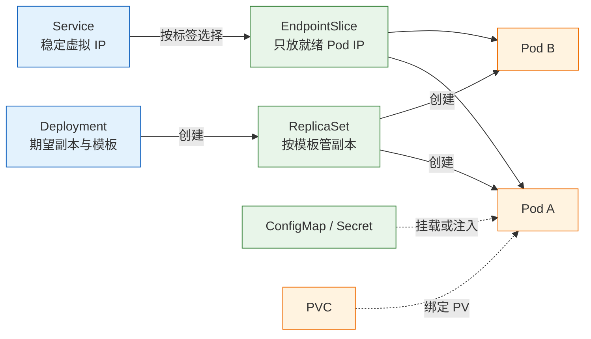
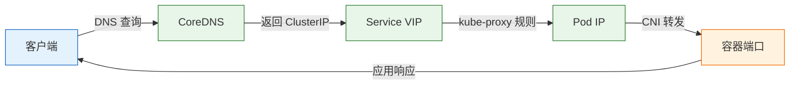

# Kubernetes 核心概念

---

## 一、Kubernetes 是什么

Kubernetes 是一个容器编排平台，把一组机器抽象成统一的计算资源池。用户提交“要什么”，平台负责“放在哪、起几个、挂了怎么办”。它的核心不是容器，而是**声明式 API 加控制循环**：对象里写期望状态，控制器持续观察实际状态并补齐差异。

它解决四类问题：声明式部署、跨节点调度、故障自愈、服务发现与滚动发布。它不解决应用为什么崩、数据库怎么备份、镜像怎么构建、发布流程怎么审批。把这些期待塞给 Kubernetes，最后都会变成“平台不好用”。

**版本现状（2026-10）**：Kubernetes 当前稳定线为 1.37，1.35 起仅支持 cgroup v2。小版本每四个月发布一次，生产集群应选择仍在维护窗口内的版本，不要跨多个小版本一次性升级。

### 1.1 核心概念

| 概念 | 含义 | 观察方式 |
|---|---|---|
| 对象 Object | 期望状态的持久化记录 | `kubectl get` |
| spec | 期望状态，由用户或控制器写入 | `kubectl get -o yaml` |
| status | 实际状态，由控制器写入 | `.status.conditions` |
| 控制循环 | 比较 spec 与 status 并采取动作 | 控制器日志 |
| 标签 Label | 键值对，用于选择与分组 | `kubectl get --show-labels` |
| 注解 Annotation | 不参与选择的元数据 | `kubectl describe` |

对象是 Kubernetes 的基本单位，每个对象都有 `apiVersion`、`kind`、`metadata`、`spec` 和 `status`。`spec` 描述想要的结果，`status` 描述系统看到的结果，两者不一致时由控制器推动收敛。标签用于对象之间的选择关系，注解用于记录工具链信息，不参与选择。Deployment 用 `selector.matchLabels` 找自己的 Pod，Service 用 `selector` 找后端，NetworkPolicy、PDB、HPA 也都靠标签选目标；标签写错，对象本身正常，它们之间的连线却断了。

控制循环是这套系统的发动机。控制器先 list 全量对象，再用 watch 接收增量事件，把对象放进本地队列，逐个比较期望与实际。比较结果只有三种：一致则什么都不做，实际不足则创建，实际多余则删除。因为它每次都从当前状态重新计算，而不是重放历史命令，所以重复执行安全，也能从任意中间状态恢复。

命名空间（Namespace）是对象名字的作用域，也是 RBAC 与配额的边界。它不是网络边界，默认情况下所有 Pod 可以互访。集群级对象如 Node、PersistentVolume、ClusterRole 不属于任何命名空间。

### 1.2 与相邻技术的关系

| 技术 | 关系 | 边界 |
|---|---|---|
| Docker / containerd | 节点上的容器运行时 | 不参与调度与副本管理 |
| etcd | 唯一持久化存储 | 只有 apiserver 直接访问 |
| CNI | Pod 网络方案 | 不负责 Service 虚拟 IP |
| CSI | 存储卷插件 | 不决定 Pod 放哪 |
| Helm | 模板与打包工具 | 不替代控制器 |
| Argo CD / Flux | GitOps 同步工具 | 不替代 apiserver |

Kubernetes 通过 CRI 调用运行时，通过 CNI 配置 Pod 网络，通过 CSI 挂载存储。三者都是接口规范，具体实现可以替换。Helm 解决“怎么生成一堆 YAML”，GitOps 解决“以仓库为准持续同步”，它们都建立在 Kubernetes 的声明式 API 之上，不是替代品。

### 1.3 架构组成

| 组件 | 只做什么 | 不做什么 |
|---|---|---|
| kube-apiserver | 认证、鉴权、校验、读写 etcd | 不调度、不起容器 |
| etcd | 持久化对象 | 不执行业务逻辑 |
| kube-scheduler | 给未绑定的 Pod 选节点 | 不拉镜像、不启动容器 |
| kube-controller-manager | 运行控制器，补齐副本、处理节点失联 | 不直接操作容器 |
| kubelet | 让本节点 Pod 的实际状态接近 spec | 不决定 Pod 放哪 |
| kube-proxy | 维护 Service 转发规则 | 不转发应用层请求 |
| containerd | 拉镜像、建容器进程 | 不调度、不提供服务发现 |

```mermaid
flowchart TD
    subgraph CP["控制平面"]
        API["kube-apiserver"]
        ETCD["etcd"]
        SCH["kube-scheduler"]
        CM["kube-controller-manager"]
        API <-->|"读写对象"| ETCD
        SCH -->|"watch 未绑定 Pod"| API
        CM -->|"watch 并写 status"| API
    end
    subgraph NODE["工作节点"]
        KL["kubelet"] -->|"CRI 调用"| RT["containerd"]
        KP["kube-proxy"] -->|"维护转发规则"| API
        KL -->|"上报节点与 Pod 状态"| API
        RT -->|"创建"| P["Pod 进程"]
    end
    U["kubectl / GitOps"] -->|"REST 请求"| API
    classDef client fill:#e3f2fd,stroke:#1565c0;
    classDef engine fill:#e8f5e9,stroke:#2e7d32;
    classDef image fill:#fff3e0,stroke:#ef6c00;
    class U client
    class API,ETCD,SCH,CM,KL,KP engine
    class RT,P image
```



几条必须建立的直觉：etcd 是唯一事实来源，但只有 apiserver 直接读写它；每个对象都有 spec 与 status，控制器只做比较与动作；控制是电平触发而非一次性事件，所以能从任意中间状态恢复；集群里没有“总控”，任何一环停了只影响它那一段。

kube-apiserver 本身无状态，所有状态都在 etcd，因此可以横向扩多个实例，前面挂负载均衡。调度器与控制器管理器通过选主保证同一时刻只有一个实例在工作，其余实例待命。kubelet 不注册到某个固定 apiserver，而是通过本地的 kubeconfig 或引导令牌连接；apiserver 地址变化时，节点会在一段时间后失联，表现为 NotReady。

---

## 二、安装与配置

| 工具 | 用途 | 安装方式 |
|---|---|---|
| kind | 本机起多节点集群 | 包管理器或二进制 |
| kubectl | 集群命令行客户端 | 包管理器或二进制 |
| helm | 模板化部署 | 包管理器或脚本 |
| k9s | 终端可视化 | 包管理器或二进制 |

> **运维提示**：本地集群只用于验证对象行为，不要把它当作生产预演环境。网络、存储、证书与真实集群差异很大，结论要回到目标环境复核。

### 2.1 本地集群环境准备

本地验证对象模型用 kind 足够。它把节点跑在容器里，创建和销毁都在秒级，适合反复实验。Linux 环境从官方 Releases 下载对应架构的二进制，放入 `/usr/local/bin` 即可，不需要额外依赖。

```bash
# ========== 安装客户端 ==========
# macOS 使用 Homebrew
brew install kind kubectl

# 验证版本
kind version
kubectl version --client

# ========== Linux 安装 kubectl ==========
# 下载稳定版二进制
curl -fLO "https://dl.k8s.io/release/$(curl -Ls https://dl.k8s.io/release/stable.txt)/bin/linux/amd64/kubectl"

# 安装到系统路径
sudo install -m 0755 kubectl /usr/local/bin/kubectl
```

```bash
# ========== 检查容器运行时 ==========
# kind 依赖 Docker 或 Podman
docker info --format '{{.ServerVersion}}'

# 确认内核支持 cgroup v2
stat -fc %T /sys/fs/cgroup
```

> **注意**：kind 的节点是容器，容器内再跑容器需要特权与 cgroup 支持。Docker Desktop 或 Podman 的默认配置通常可用；远程 Linux 主机上若禁用了 user namespace 或 cgroup 委托，集群会卡在节点启动阶段。

### 2.2 创建与销毁集群

```bash
# ========== 创建集群 ==========
# 创建名为 demo 的单节点集群
kind create cluster --name demo

# 查看节点
kubectl get nodes

# 查看集群信息
kubectl cluster-info

# ========== 多节点集群 ==========
# 用配置文件声明控制平面与工作节点
cat > kind-multi.yaml <<'EOF'
kind: Cluster
apiVersion: kind.x-k8s.io/v1alpha4
nodes:
  - role: control-plane
  - role: worker
  - role: worker
EOF

kind create cluster --name demo-multi --config kind-multi.yaml
```

预期输出（版本号会不同）：

```text
NAME                 STATUS   ROLES           AGE   VERSION
demo-control-plane   Ready    control-plane   45s   v1.3x.x
```

kind 只适合本地验证。它的节点是容器，网络经过一层 NAT，LoadBalancer 类型需要额外组件，存储默认是本地路径。用它验证对象关系、探针行为、发布流程足够；用它压测网络或模拟生产存储，结论不可迁移。多节点集群能验证调度与反亲和，但节点故障演练仍要回到真实环境。

```bash
# ========== 销毁 ==========
# 删除指定集群
kind delete cluster --name demo
```

> **运维红线**：`kind delete cluster` 会删除该集群的全部工作负载与本地存储，且不可恢复。执行前用 `kubectl config current-context` 确认当前上下文，避免在同名 context 指向真实集群时误删。

### 2.3 kubeconfig 与上下文

kubeconfig 由 clusters、users、contexts 三段组成，context 把集群与用户绑定在一起。多集群环境下，切错 context 是最常见的事故来源。

| 字段 | 作用 | 风险 |
|---|---|---|
| `clusters[].server` | apiserver 地址 | 指向错误集群 |
| `users[].client-certificate-data` | 客户端证书 | 泄露等同泄露权限 |
| `contexts[].namespace` | 默认命名空间 | 误在 default 操作 |
| `current-context` | 当前使用的上下文 | 切错导致误删 |

```bash
# ========== 上下文管理 ==========
# 查看所有上下文
kubectl config get-contexts

# 查看当前上下文
kubectl config current-context

# 切换上下文
kubectl config use-context kind-demo

# 设置默认命名空间
kubectl config set-context --current --namespace=demo

# 查看合并后的完整配置
kubectl config view --minify
```

> **安全警告**：kubeconfig 里的客户端证书等同于账号密码。不要提交到 Git，不要放在共享目录；CI 中使用短期令牌或独立 ServiceAccount，权限按命名空间收敛。

多份 kubeconfig 通过 `KUBECONFIG` 环境变量合并，同名 context 以先出现的为准。排查“命令打到了错误的集群”时，先看 `kubectl config view` 的合并结果，而不是逐个文件猜。云厂商的 kubeconfig 常用 exec 插件动态换取令牌，令牌过期表现为 401，重新登录即可，不需要改配置。

### 2.4 命名空间与资源配额

```bash
# ========== 命名空间 ==========
# 创建命名空间
kubectl create namespace demo

# 查看命名空间及其标签
kubectl get namespaces --show-labels

# 在指定命名空间操作
kubectl -n demo get pods

# ========== 资源配额 ==========
# 限制命名空间的总资源与对象数量
cat > quota.yaml <<'EOF'
apiVersion: v1
kind: ResourceQuota
metadata:
  name: demo-quota
  namespace: demo
spec:
  hard:
    requests.cpu: "4"
    requests.memory: 8Gi
    limits.cpu: "8"
    limits.memory: 16Gi
    pods: "20"
EOF

kubectl apply -f quota.yaml
kubectl -n demo describe quota demo-quota
```

| 配额类型 | 作用 | 超限表现 |
|---|---|---|
| `requests.cpu` | 命名空间 CPU 请求总量 | Pod 创建被拒 |
| `limits.memory` | 内存上限总量 | Pod 创建被拒 |
| `pods` | Pod 数量 | 新 Pod 无法创建 |
| `persistentvolumeclaims` | 存储卷数量 | PVC 创建被拒 |

配额只约束新建对象，不会驱逐已存在的 Pod。命名空间删除会级联删除其中所有对象，包括 PVC；如果 PVC 背后是重要数据，删除前先确认回收策略。

> **运维红线**：`kubectl delete namespace <name>` 会删除该命名空间下的全部对象，且不可恢复。执行前用 `kubectl -n <name> get all,pvc,configmap,secret` 核对内容。

---

## 三、核心对象管理

### 3.1 Pod 与容器组

Pod 是最小调度单元，一个 Pod 可以有一个或多个容器，它们共享网络命名空间、IP 和挂载卷。Pod 内容器用 `localhost` 互访，这是共享 net namespace 的直接结果。

| 字段 | 作用 | 常见错误 |
|---|---|---|
| `containers[].image` | 容器镜像 | 使用可变标签 |
| `restartPolicy` | 容器重启策略 | Job 用了 Always |
| `volumes` | Pod 级卷定义 | 路径写错导致覆盖 |
| `nodeSelector` | 简单节点选择 | 标签不存在导致 Pending |

Pod 的设计前提是**可丢弃**：没有稳定 IP、没有稳定名字、节点挂了就没了。生产环境不直接创建裸 Pod，而是让控制器管理。`restartPolicy` 只作用于 Pod 内容器，取值 `Always`、`OnFailure`、`Never`；Deployment 管理的 Pod 必须是 `Always`，Job 用 `OnFailure` 或 `Never`，否则任务失败后会被无限重启，永远到不了完成状态。

Pod 有五个阶段：Pending、Running、Succeeded、Failed、Unknown。阶段只描述 Pod 整体，不描述容器；容器还有 Waiting、Running、Terminated 三种状态。`kubectl get pods` 的 STATUS 列是阶段与容器状态的组合，`Completed` 对应 Succeeded，`CrashLoopBackOff` 则是 Waiting 的原因。看清这一层，才不会把“容器在重启”误读成“Pod 在运行”。

```bash
# ========== 查看 Pod ==========
# 查看状态、重启次数与所在节点
kubectl get pods -o wide

# 查看 Pod 完整定义与事件
kubectl describe pod <pod-name>

# 查看容器上一次退出前的日志
kubectl logs <pod-name> --previous

# 查看 Pod 的 IP 与节点
kubectl get pod <pod-name> -o jsonpath='{.status.podIP}{"\n"}{.spec.nodeName}{"\n"}'
```

### 3.2 工作负载控制器

| 对象 | 保证什么 | 典型场景 | 不保证 |
|---|---|---|---|
| Deployment | 副本数、滚动更新、回滚 | 无状态 Web/API | 稳定身份、顺序 |
| StatefulSet | 固定序号、稳定 DNS、每 Pod 的 PVC | 数据库、消息队列 | 数据复制、备份 |
| DaemonSet | 每个符合条件的节点一个 Pod | 日志采集、CNI、监控 | 副本数由用户控制 |
| Job | 跑到成功为止 | 迁移、批处理 | 定时 |
| CronJob | 按 cron 创建 Job | 备份、清理 | 错过时间的补偿 |

Deployment 不直接管理 Pod，它创建 ReplicaSet，ReplicaSet 再创建 Pod。`ownerReferences` 把这条链固定下来：删除 Deployment 会级联删除 RS 与 Pod；直接删 Pod，RS 发现副本不足会补一个。这条链解释了大多数“为什么它自己回来了”和“为什么它没被删掉”。

StatefulSet 的每个 Pod 有固定序号和稳定 DNS，缩容时从高序号开始，扩容时按顺序创建。它适合需要成员身份的系统，但不提供数据复制与选主，这些仍由数据库自身完成。

Deployment 的滚动策略由 `maxSurge` 与 `maxUnavailable` 控制。默认两者都是 25%，三副本时 `maxUnavailable` 向下取整为 0，所以先起新 Pod 再停旧 Pod；副本数少时比例可能算出 0 或 1，行为与预期不同。生产上显式写 `maxUnavailable: 0`、`maxSurge: 1`，语义清楚，也不会因为副本数变化而改变发布节奏。

CRD 与 Operator 是扩展路径。CRD 只扩展 API，让用户可以创建 `kind: PostgreSQL` 这样的对象，本身不做任何事；Operator 是跑在集群里的控制器，watch 这些自定义对象并按领域知识执行备份、故障转移、扩缩。没有控制器的 CRD 只是一个存进 etcd 的 YAML。

```bash
# ========== 扩展对象 ==========
# 查看已安装的 CRD
kubectl get crd

# 查看自定义资源是否注册
kubectl api-resources | grep postgres

# 查看自定义对象的字段定义
kubectl explain postgresql.spec
```

判断标准：一件事需要持续观察、按状态决策、有领域顺序，才值得 Operator；只是部署无状态服务，Deployment 加 Helm 就够了。自定义对象如果只有 spec、status 为空，通常说明没有控制器在处理它，看 `.status.conditions` 比看名字可靠。

### 3.3 Service 与 EndpointSlice



| 类型 | 可从哪访问 | 用途 | 代价 |
|---|---|---|---|
| `ClusterIP` | 集群内 | 内部服务互调，默认类型 | 集群外不可达 |
| `NodePort` | 任意节点的 30000–32767 | 临时暴露、测试 | 端口有限，无内置路由 |
| `LoadBalancer` | 云负载均衡 | 生产入口 | 依赖云厂商，按量计费 |
| `ExternalName` | 集群内 | 把外部域名映射成集群内名字 | 只是 CNAME，不做代理 |
| `clusterIP: None` | 集群内 | Headless，直接返回 Pod IP | 没有负载均衡 |

Service 不启动 Pod，只做两件事：给一组 Pod 一个稳定虚拟 IP 与 DNS 名；把请求转发到其中某个就绪的 Pod。默认只有 readiness 通过的 Pod 才会进入 EndpointSlice，Pod Running 不等于在服务后面。

Deployment 的 `selector.matchLabels`、Pod 模板的 `metadata.labels`、Service 的 `selector` 必须指向同一组标签。任意一处写错，Pod 可能正常跑，但 Service 后面是空的；这类问题不会在执行 `apply` 时暴露，只会在访问时表现为连接超时。

Endpoints 已被 EndpointSlice 取代，一个 Service 可以对应多个切片，每个切片最多保存 100 个地址。这样大规模服务更新时不需要重写一个巨大的对象，apiserver 与 kube-proxy 的压力都更小。排查时看切片而不是旧 Endpoints，标签 `kubernetes.io/service-name` 是关联依据。

Service 是 L4，只认 TCP/UDP 和端口，不认 HTTP 路径。按域名或路径分流是 Ingress 或 Gateway 的职责。ClusterIP 是 iptables/IPVS/nftables 规则造出来的虚拟地址，没有网卡，`ping` 不通很正常，用 `curl` 或 `nc` 测。

### 3.4 配置与存储对象

| 对象 | 用途 | 更新后是否自动生效 |
|---|---|---|
| ConfigMap | 非敏感配置 | 挂载卷最终会同步，环境变量不会 |
| Secret | 凭证、证书 | 同上，且默认 base64 不是加密 |
| PVC | 申请存储 | 绑定后不可随意改容量 |
| StorageClass | 动态供给模板 | 影响新建 PVC |

```bash
# ========== 配置对象 ==========
# 从字面值创建 ConfigMap
kubectl -n demo create configmap app-config --from-literal=LOG_LEVEL=info

# 从文件创建，键名默认为文件名
kubectl -n demo create configmap nginx-conf --from-file=nginx.conf

# 创建 Secret，避免明文进入 shell 历史
kubectl -n demo create secret generic db-secret --from-literal=password='<password>'

# 查看 Secret 的键，不显示值
kubectl -n demo get secret db-secret -o jsonpath='{.data}'

# ========== 存储对象 ==========
# 查看 StorageClass
kubectl get storageclass

# 查看 PVC 与绑定状态
kubectl -n demo get pvc

# 查看 PV 的回收策略
kubectl get pv -o custom-columns=NAME:.metadata.name,POLICY:.spec.persistentVolumeReclaimPolicy
```

环境变量方式注入的 ConfigMap 不会随对象更新而变化，必须重启 Pod 才能读到新值；挂载卷方式最终会同步，但应用是否重新加载仍取决于自身。Secret 默认只是 base64 编码，启用静态加密前，etcd 备份泄露等同于凭证泄露。

---

## 四、常用命令

### 4.1 查询与描述

| 目的 | 命令 | 说明 |
|---|---|---|
| 看状态与节点 | `get pods -o wide` | 排障第一步 |
| 看事件 | `describe pod` | 大多数原因在这里 |
| 看字段 | `get -o jsonpath` | 脚本化取值 |
| 看 API 定义 | `explain` | 不查文档也能确认字段 |

```bash
# ========== 查询 ==========
# 查看所有命名空间的 Pod
kubectl get pods -A

# 按标签筛选
kubectl get pods -l app=web

# 查看资源使用，需要 metrics-server
kubectl top pods
kubectl top nodes

# 查看对象字段定义
kubectl explain deployment.spec.strategy

# 查看 API 资源与短名
kubectl api-resources | grep -E 'deploy|service'

# 查看事件，按时间排序
kubectl get events --sort-by=.lastTimestamp
```

字段选择器适合按状态过滤，例如只看失败或未调度的 Pod。`--field-selector status.phase!=Running` 比在输出里人工筛选可靠，也能配合 `-A` 做全局巡检。自定义列可以把关心的字段压成一行，避免频繁打开完整 YAML。

### 4.2 创建与变更

`kubectl run`、`create`、`scale`、`edit` 是命令式：告诉集群“做这个动作”。`kubectl apply -f` 是声明式：提交完整期望，集群负责收敛。

| 方式 | 典型命令 | 适合 | 风险 |
|---|---|---|---|
| 命令式 | `run`、`create`、`scale`、`edit` | 临时调试 | 无法复现，容易漂移 |
| 客户端 apply | `kubectl apply -f` | 简单清单、CI | 依赖 last-applied 注解 |
| Server-Side Apply | `apply --server-side` | 多团队共同管理 | 字段所有权冲突 |
| GitOps | Argo CD / Flux | 生产环境 | 需要仓库与同步策略 |

```bash
# ========== 声明式创建 ==========
# 应用清单，不存在则创建、存在则更新
kubectl apply -f web.yaml

# 预演，只显示将发生的变更
kubectl apply -f web.yaml --dry-run=server

# 查看与集群的差异
kubectl diff -f web.yaml

# ========== 命令式操作 ==========
# 临时起一个调试 Pod，退出即删除
kubectl run tmp --rm -it --image=busybox:1.37 --restart=Never -- sh

# 扩缩容
kubectl scale deployment/web --replicas=5

# 修改镜像，会触发滚动发布
kubectl set image deployment/web nginx=nginx:1.30-alpine

# 编辑对象，保存后立即生效
kubectl edit deployment/web
```

生产环境选一种作为事实来源。不要在 Git 里放一份，又用 `kubectl edit` 改另一份；下一次 reconcile 会覆盖手工修改，或者留下一个没人知道来源的字段。

### 4.3 日志与进入容器

```bash
# ========== 日志 ==========
# 查看日志
kubectl logs <pod-name>

# 实时跟随
kubectl logs -f <pod-name>

# 多容器 Pod 指定容器
kubectl logs <pod-name> -c <container-name>

# 查看上一次崩溃前的日志
kubectl logs <pod-name> --previous

# 按时间过滤
kubectl logs <pod-name> --since=10m

# ========== 进入容器 ==========
# 交互式 shell
kubectl exec -it <pod-name> -- sh

# 执行单条命令
kubectl exec <pod-name> -- wget -qO- http://127.0.0.1:80

# 复制文件
kubectl cp <pod-name>:/etc/nginx/nginx.conf ./nginx.conf
```

> **注意**：`kubectl exec` 进入的是容器，不是节点。容器内没有 `curl`、`ss`、`ps` 很常见，Alpine 镜像连 `bash` 都没有；排障前先确认镜像里有哪些工具，或改用临时调试容器。

### 4.4 发布与回滚

```bash
# ========== 发布 ==========
# 查看发布进度
kubectl rollout status deployment/web

# 查看历史版本
kubectl rollout history deployment/web

# 暂停与恢复，便于批量修改
kubectl rollout pause deployment/web
kubectl rollout resume deployment/web

# ========== 回滚 ==========
# 回滚到上一个版本
kubectl rollout undo deployment/web

# 回滚到指定 revision
kubectl rollout undo deployment/web --to-revision=2

# 查看 ReplicaSet，确认新旧副本
kubectl get rs -l app=web
```

`rollout undo` 不是“删掉新 Pod 再手工起旧的”，而是把旧 ReplicaSet 重新放大、新 ReplicaSet 缩到 0，并新增一条 revision 记录。默认保留 10 个历史版本，由 `revisionHistoryLimit` 控制；设得太小会让回滚失去目标。

发布卡住时不要急着重试 `set image`。先看 `rollout status` 停在哪一步：等待新 Pod 就绪说明镜像或探针有问题，等待旧 Pod 退出说明优雅终止超时或 PDB 阻止驱逐。`kubectl describe deployment` 的 Conditions 会给出 `Progressing` 的原因，比反复执行命令更快定位。

完整的发布验证从一个三副本的 Web 服务开始。清单同时包含 Deployment 与 Service，三个标签位置必须保持一致。

```yaml
apiVersion: apps/v1
kind: Deployment
metadata:
  name: web
spec:
  replicas: 3
  selector:
    matchLabels:
      app: web
  template:
    metadata:
      labels:
        app: web
    spec:
      containers:
        - name: nginx
          image: nginx:1.30-alpine
          ports:
            - containerPort: 80
          resources:
            requests:
              cpu: 50m
              memory: 64Mi
            limits:
              cpu: 200m
              memory: 128Mi
          readinessProbe:
            httpGet:
              path: /
              port: 80
            periodSeconds: 5
---
apiVersion: v1
kind: Service
metadata:
  name: web
spec:
  selector:
    app: web
  ports:
    - port: 80
      targetPort: 80
```

```bash
# ========== 部署与访问 ==========
# 应用清单
kubectl apply -f web.yaml

# 查看三层对象，确认副本与就绪数
kubectl get deploy,rs,pods

# 本地端口转发，无需 NodePort
kubectl port-forward svc/web 8080:80
```

另开终端验证：

```bash
# ========== 访问验证 ==========
# 请求转发到 Service，再由 kube-proxy 转到某个 Pod
curl -I http://127.0.0.1:8080
```

预期输出形状：

```text
HTTP/1.1 200 OK
Server: nginx/1.30.x
```

```bash
# ========== 自愈验证 ==========
# 取一个 Pod 名
POD=$(kubectl get pod -l app=web -o jsonpath='{.items[0].metadata.name}')

# 删除它，ReplicaSet 会补一个新副本
kubectl delete pod "$POD"

# 持续观察，旧 Pod Terminating，新 Pod 出现
kubectl get pods -w
```

删除后应看到一个 Pod 进入 Terminating，随后出现 AGE 为 `0s` 的新 Pod，最终仍是三个 Running。删除动作只删掉一个实例，副本数由 ReplicaSet 控制器补回；如果删的是没有控制器的裸 Pod，就真的没了。

```bash
# ========== 故障发布与回滚 ==========
# 故意使用不存在的标签，制造 ImagePullBackOff
kubectl set image deployment/web nginx=nginx:1.30-alpine-missing

# 观察发布卡住
kubectl rollout status deployment/web --timeout=30s

# 新 Pod 拉取失败，旧 Pod 仍在服务
kubectl get pods

# 回滚到上一个可用版本
kubectl rollout undo deployment/web
kubectl rollout status deployment/web

# 确认 Service 后端恢复
kubectl get endpointslices -l kubernetes.io/service-name=web

# 从集群内验证访问
kubectl run tmp --rm -it --image=busybox:1.37 --restart=Never -- wget -qO- http://web
```

发布卡住时，`rollout status` 会停在等待新副本就绪，`get pods` 里能看到一个 `ImagePullBackOff` 的新 Pod，旧 Pod 继续服务。三副本、默认 `maxUnavailable` 为 25% 时向下取整为 0，所以不会先停旧 Pod；副本更少或比例不同时仍可能减容，生产上显式配置更稳妥。

---

## 五、调度与资源管理

### 5.1 资源请求与限制

调度器只看 `requests`，不看 `limits`。节点上所有 Pod 的 requests 之和超过可分配资源，新 Pod 就 Pending。

| 资源 | 超限行为 | 表现 |
|---|---|---|
| CPU | 被限流 | 延迟抖动、吞吐下降，进程不死 |
| 内存 | 被 OOM Killer 杀 | 容器突然退出，退出码 137 |
| 临时存储 | 被驱逐 | Pod 状态 Evicted |
| PID | 创建进程失败 | 报错 `resource temporarily unavailable` |

```bash
# ========== 查看资源 ==========
# 节点可分配资源与已分配量
kubectl describe node <node-name> | sed -n '/Allocated resources/,/Events/p'

# Pod 实际用量
kubectl top pod <pod-name> --containers

# 查看是否发生过 OOM
kubectl get pod <pod-name> -o jsonpath='{.status.containerStatuses[*].lastState}'
```

```yaml
# 资源声明片段
resources:
  requests:
    cpu: 50m
    memory: 64Mi
  limits:
    cpu: 200m
    memory: 128Mi
```

CPU 单位 `m` 表示千分之一核，`50m` 是 0.05 核。内存单位 `Mi` 是 1024 进制，`M` 是 1000 进制，写错会让限制偏离预期。Java 应用要同时设置堆上限，否则 JVM 按宿主机内存推算堆大小，容易在容器内被 OOM。

requests 是调度承诺，limits 是运行上限，两者之间允许超卖。节点把所有 Pod 的 requests 相加作为已分配量，实际使用量可以超过这个和，只要不超过各自 limits。超卖提高利用率，也意味着节点资源耗尽时更容易触发驱逐与 OOM。生产集群按 workload 类型分别设定比例，不要给所有服务套同一组数值。

### 5.2 调度约束

| 机制 | 作用 | 失败表现 |
|---|---|---|
| `nodeSelector` | 按节点标签硬匹配 | Pod Pending |
| `affinity` | 亲和与反亲和，支持软硬约束 | 软约束可能不满足 |
| `tolerations` | 容忍节点污点 | 未配置时无法调度到对应节点 |
| `topologySpreadConstraints` | 按拓扑域打散 | 副本集中在少数节点 |

```bash
# ========== 节点调度 ==========
# 给节点打标签
kubectl label node <node-name> disktype=ssd

# 查看节点标签与污点
kubectl get nodes --show-labels
kubectl describe node <node-name> | grep -A3 Taints

# 标记节点不可调度，保留已有 Pod
kubectl cordon <node-name>

# 驱逐节点上的 Pod，维护前使用
kubectl drain <node-name> --ignore-daemonsets --delete-emptydir-data

# 维护完成后恢复调度
kubectl uncordon <node-name>
```

> **运维红线**：`kubectl drain` 会驱逐节点上的 Pod，`--delete-emptydir-data` 会删除使用 emptyDir 的数据。执行前确认副本数足够、PDB 允许、StatefulSet 有迁移方案。

### 5.3 QoS 与驱逐

| QoS | 条件 | 节点资源紧张时 |
|---|---|---|
| Guaranteed | 每个容器的 CPU/内存 requests 等于 limits | 最后被驱逐 |
| Burstable | 设了 requests，但不全等于 limits | 中间 |
| BestEffort | 完全没设 | 最先被驱逐 |

QoS 由 requests 与 limits 的组合自动决定，不能直接指定。它影响节点压力下的驱逐顺序，也影响 CPU 的分配权重。关键服务设为 Guaranteed，批处理任务设为 Burstable，临时任务才用 BestEffort。

驱逐与 OOM 是两种机制：驱逐由 kubelet 根据节点压力触发，按 QoS 排序；OOM 由内核在 cgroup 内存超限时触发，只杀越界的容器。看到 `Evicted` 查节点压力，看到 `OOMKilled` 查容器 limit。

### 5.4 探针与健康检查

| 探针 | 失败后发生什么 | 该检查什么 |
|---|---|---|
| `readinessProbe` | 从 EndpointSlice 移除，不再接流量 | 依赖是否就绪 |
| `livenessProbe` | 重启容器 | 进程是否死锁 |
| `startupProbe` | 重启容器，成功前禁用另外两个 | 慢启动是否完成 |

```yaml
# 三类探针的典型配置
readinessProbe:
  httpGet:
    path: /healthz
    port: 8080
  periodSeconds: 5
  failureThreshold: 3

livenessProbe:
  httpGet:
    path: /livez
    port: 8080
  initialDelaySeconds: 20
  periodSeconds: 10
  failureThreshold: 3

startupProbe:
  httpGet:
    path: /healthz
    port: 8080
  failureThreshold: 30
  periodSeconds: 2
```

最常见的错误是把数据库检查写进 liveness：数据库一慢，所有 Pod 被重启，故障被放大。liveness 只判断“这个进程还有没有救”；依赖不可用时，用 readiness 摘流量更安全。startupProbe 给慢启动应用留出时间，成功前不执行 liveness，避免启动阶段被误杀。

探针参数要与应用启动时间匹配。`initialDelaySeconds` 太短，容器还没监听就被判死；`timeoutSeconds` 太长，真正卡死时收敛很慢。先用 `kubectl exec` 手工请求健康端点，确认返回码与耗时，再据此设置阈值。探针只回答“能不能接流量”和“要不要重启”，不负责判断业务是否正确。

---

## 六、网络与存储

### 6.1 Service 转发路径



```text
客户端 → DNS 解析 → Service ClusterIP → kube-proxy 规则 → Pod IP → CNI → 容器
```

| 卡在哪 | 现象 | 先查什么 |
|---|---|---|
| DNS | `bad address`、解析超时 | CoreDNS Pod、Service 的 `kube-dns` |
| Service VIP | 能解析但连接超时 | `kubectl get endpointslices` |
| kube-proxy | ClusterIP 不通，Pod IP 直连通 | kube-proxy 日志、规则表 |
| CNI | 跨节点 Pod IP 不通 | CNI Pod 日志、路由、MTU |
| 容器 | 端口拒绝 | 应用是否监听 `0.0.0.0` |

kube-proxy 默认不做进程级转发，它把 Service 与 EndpointSlice 翻译成节点上的 iptables/IPVS/nftables 规则。所以 ClusterIP 是虚拟地址，没有网卡，`ping` 不通不代表服务坏了。

```bash
# ========== 分段验证 ==========
# 从集群内解析服务名
kubectl run tmp --rm -it --image=busybox:1.37 --restart=Never -- nslookup web

# 直接访问 Service
kubectl run tmp --rm -it --image=busybox:1.37 --restart=Never -- wget -qO- http://web

# 查看后端就绪 IP
kubectl get endpointslices -l kubernetes.io/service-name=web -o wide

# 查看 kube-proxy 规则，节点上执行
sudo iptables -t nat -L KUBE-SERVICES -n | head
```

### 6.2 DNS 解析

| 记录 | 解析结果 | 使用场景 |
|---|---|---|
| `web` | 同命名空间的 Service | 最常用 |
| `web.demo` | 指定命名空间的 Service | 跨命名空间 |
| `web.demo.svc.cluster.local` | 完整 FQDN | 排除搜索域干扰 |
| `pod-name.web.demo.svc.cluster.local` | Headless 的 Pod 记录 | StatefulSet |

```bash
# ========== DNS 排查 ==========
# 查看 CoreDNS 是否运行
kubectl -n kube-system get pods -l k8s-app=kube-dns

# 查看 Pod 的 resolv.conf
kubectl exec <pod-name> -- cat /etc/resolv.conf

# 用完整域名测试，排除 search 域干扰
kubectl exec <pod-name> -- nslookup web.demo.svc.cluster.local

# 查看 CoreDNS 日志
kubectl -n kube-system logs -l k8s-app=kube-dns --tail=50
```

Pod 的 `/etc/resolv.conf` 默认 `ndots:5`，解析 `api.example.com` 时会先尝试 `api.example.com.<namespace>.svc.cluster.local` 等一串后缀，产生多余查询。跨集群访问外部域名多时，可以调低 `ndots` 或用带尾点的 FQDN。

CoreDNS 的配置在 `kube-system/coredns` 的 ConfigMap 里，修改后需要滚动重启。上游 DNS 不可达时，集群内域名仍能解析，外部域名全部超时；这类问题先测外部域名，再测集群内域名，能快速区分是 CoreDNS 本身还是上游转发。

### 6.3 网络策略

Namespace 是逻辑隔离，用来分环境、分团队、配 RBAC 和配额；它不是网络隔离。默认所有 Pod 可以互访，要隔离得靠 NetworkPolicy，而且 CNI 必须支持。

```yaml
# 只允许同命名空间的 web 访问 db 的 5432 端口
apiVersion: networking.k8s.io/v1
kind: NetworkPolicy
metadata:
  name: db-allow-web
  namespace: demo
spec:
  podSelector:
    matchLabels:
      app: db
  policyTypes:
    - Ingress
  ingress:
    - from:
        - podSelector:
            matchLabels:
              app: web
      ports:
        - protocol: TCP
          port: 5432
```

| 方向 | 默认行为 | 策略生效后 |
|---|---|---|
| Ingress | 全部允许 | 只允许显式列出的来源 |
| Egress | 全部允许 | 只允许显式列出的目标 |
| 未匹配 Pod | 不受影响 | 仍按默认行为 |

策略是白名单语义，一旦某个 Pod 被 Ingress 策略选中，未列出的来源全部拒绝。DNS 走 UDP/TCP 53，限制 Egress 时容易把 DNS 一起挡掉，表现为所有域名解析失败。

NetworkPolicy 只是规范，是否生效取决于 CNI。Calico、Cilium 支持完整语义，Flannel 默认不执行策略，写了也不会拦。排查“策略没生效”时先确认 CNI 类型，再看策略是否选中了目标 Pod，最后才怀疑规则写错。策略与 Pod 在同一命名空间时才能用 `podSelector` 直接选择，跨命名空间要配 `namespaceSelector`。

### 6.4 持久化存储

| 对象 | 角色 | 生命周期 |
|---|---|---|
| PV | 集群级存储资源 | 独立于 Pod |
| PVC | 命名空间内的申请 | 随命名空间删除 |
| StorageClass | 动态供给模板 | 集群级 |
| CSI Driver | 实际挂载实现 | 由插件管理 |

```bash
# ========== 存储操作 ==========
# 查看 StorageClass 与默认标记
kubectl get storageclass

# 查看 PVC 绑定情况
kubectl -n demo get pvc -o wide

# 查看 PV 回收策略
kubectl get pv

# 查看 Pod 挂载了哪些卷
kubectl get pod <pod-name> -o jsonpath='{.spec.volumes}'
```

```yaml
# 动态供给的 PVC
apiVersion: v1
kind: PersistentVolumeClaim
metadata:
  name: data
  namespace: demo
spec:
  accessModes:
    - ReadWriteOnce
  storageClassName: standard
  resources:
    requests:
      storage: 10Gi
```

> **运维红线**：删除 PVC 是否连带删除后端数据，取决于 PV 的 `persistentVolumeReclaimPolicy`。`Delete` 会真正删除存储，`Retain` 只保留 PV 但需要手工回收。删 PVC 前先确认策略与备份。

StatefulSet 用 `volumeClaimTemplates` 为每个 Pod 生成独立 PVC，缩容不会自动删除 PVC，这是为了保护数据。需要彻底清理时，先确认数据已备份，再手工删除对应 PVC。

访问模式是能力声明，不是并发控制。`ReadWriteOnce` 表示同一时刻只能被一个节点挂载，同一节点上的多个 Pod 仍可共用；`ReadOnlyMany` 与 `ReadWriteMany` 依赖具体 CSI 驱动，很多块存储并不支持多节点读写。申请前先确认驱动能力，否则 PVC 会一直 Pending，事件里写 `no matching volume plugin`。

---

## 七、常见排障

### 7.1 故障速查表

| 现象 | 最可能原因 | 处理 |
|---|---|---|
| Pod `Pending` | requests 太大、污点、PVC 未绑定、配额不足 | `describe pod` 看 Events，`describe node` 看可分配资源 |
| `ImagePullBackOff` | 镜像名错、私有仓库未登录、网络故障 | 看 Events，节点上 `crictl pull` 验证 |
| `CrashLoopBackOff` | 启动即退出、配置错、权限错 | `logs --previous` 看上一次日志 |
| Running 但 `0/1` | readiness 失败 | 看探针错误，进容器手工请求 |
| `OOMKilled` | 内存 limit 太小或堆未按限制设置 | 看 `lastState`，调整 limit 与堆参数 |
| `Evicted` | 节点磁盘或内存压力 | 看 Node Conditions，清理或扩容 |
| Service 不通且 EndpointSlice 为空 | selector 不匹配、Pod 未 Ready | 对比标签，查 readiness |
| 连接被拒 | 端口写错、只监听 127.0.0.1 | 进容器用 `wget`/`nc` 测端口 |
| DNS 解析失败 | CoreDNS 异常、NetworkPolicy 拦 53 | 查 kube-system，用 `nslookup` 测 |
| 滚动发布卡住 | 新 Pod 起不来，旧副本被保留 | `rollout status`、`get pods`、`describe` |
| 节点 `NotReady` | kubelet、运行时、CNI、磁盘、证书 | 上节点看 `systemctl status kubelet` |
| `rollout undo` 无可用版本 | `revisionHistoryLimit` 太小 | 调大保留数，重新发布 |

### 7.2 排查顺序

1. `kubectl get pods -o wide`：状态、重启次数、所在节点。

2. `kubectl describe pod`：直接看 Events，多数原因在这里。

3. `kubectl logs`，崩溃过的加 `--previous`。

4. `kubectl get deploy,rs` 与 `rollout status`：确认是应用问题还是发布卡住。

5. `kubectl get endpointslices`：确认 Service 到底有没有后端。

6. `kubectl exec` 进容器测 DNS、端口、依赖。

7. 最后看节点 Conditions、kubelet 日志、CNI。

```bash
# ========== 一次完整的现场采集 ==========
# 对象状态
kubectl get pods -o wide
kubectl get deploy,rs,svc -o wide

# 事件与详情
kubectl describe pod <pod-name>
kubectl get events --sort-by=.lastTimestamp | tail -20

# 日志
kubectl logs <pod-name> --tail=100
kubectl logs <pod-name> --previous --tail=100

# 服务后端
kubectl get endpointslices -l kubernetes.io/service-name=<service-name>

# 节点侧
kubectl describe node <node-name> | sed -n '/Conditions/,$p'
```

判断顺序遵循“从对象到进程”的原则：先确认对象状态与事件，再看应用日志，最后才上节点查运行时与网络。`kubectl get` 显示的是对象，不是实际进程；Deployment 显示 `READY 3/3` 只说明控制器认为三个副本就绪，不说明请求一定能打通。

事件默认只保留一小时，故障发生后再查可能已经消失。定位偶发问题时先 `kubectl get events -w` 挂着观察，或把事件接入集中采集。日志与指标同理，节点本地数据会轮转，长期证据要在集群外保存。

排查也需要认清平台边界。Kubernetes 不是 PaaS：不构建镜像、不提供数据库、不写业务重试。自愈不等于修 bug，它只会重启或重建，`CrashLoopBackOff` 的根因仍在应用或配置里。Service 不做超时、重试、熔断，这些在应用、网关或服务网格里。StatefulSet 不做复制和备份，只给稳定身份与存储。Namespace 不做网络隔离，默认互通。PVC 保留数据不代表数据不丢，快照、备份与恢复演练属于存储层和数据库的职责。

小团队、单机、低流量场景，Compose 加 systemd 或托管服务可能更便宜。Kubernetes 的升级、证书、监控、值班都是长期成本，集群规模越小，单位成本越高。选型时先算清这些固定投入，再决定是否引入编排层。
