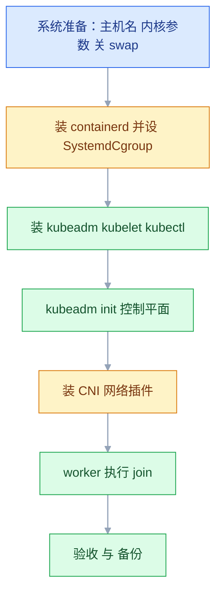
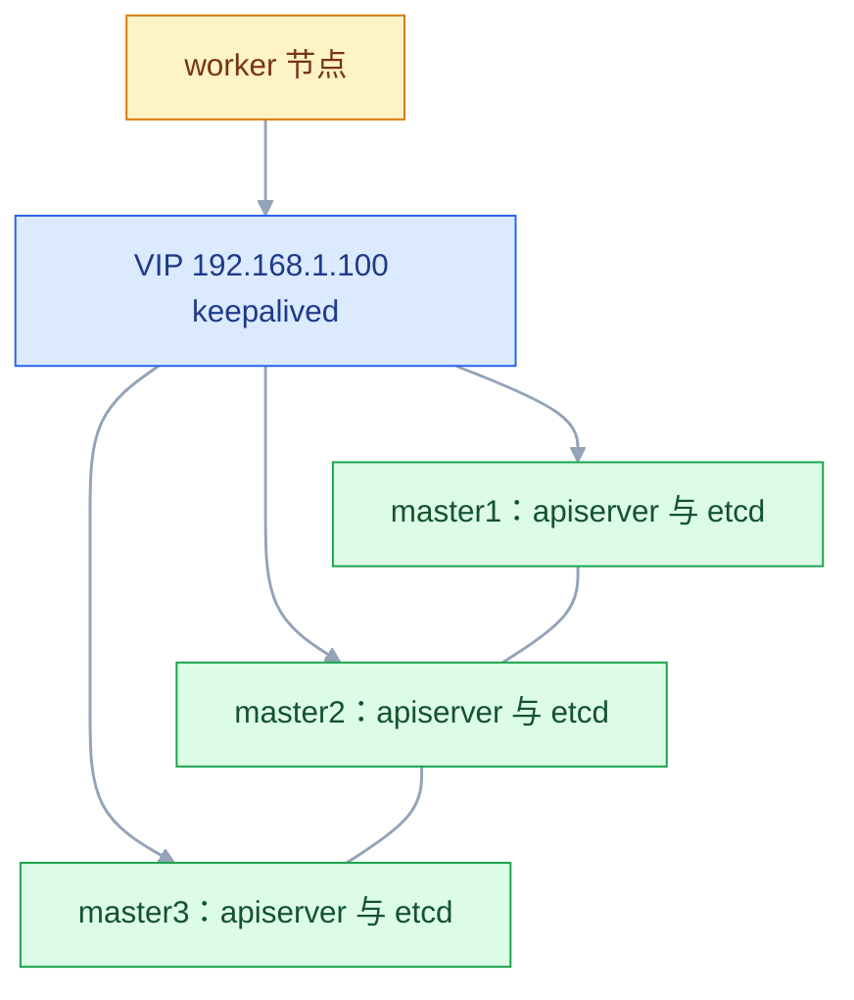

# Kubernetes 集群搭建

## 一、工程案例：用 kubeadm 搭出 1 master + 2 worker 并能扛住一次节点宕机

**场景**：不买托管集群，用三台云服务器（Ubuntu 24.04，2C4G，40G SSD，内网互通）自建一套生产集群。验收标准不是"能起来"，而是：任意一台 worker 重启，业务自动迁到另一台继续服务；etcd 有每日备份且能验证；证书到期前能续。

**为什么不用 minikube**：单机集群里"节点失联"和"整机重启"是同一件事，永远练不出排障手感。真实集群里的 NotReady、CNI 不通、join 失败，只有在多节点环境才会遇到。

| 角色 | 主机名 | IP（示例） | 配置 |
|---|---|---|---|
| 控制平面 | k8s-master | 192.168.1.10 | 2C4G / 40G SSD |
| 工作节点 | k8s-node1 | 192.168.1.11 | 2C4G / 40G SSD |
| 工作节点 | k8s-node2 | 192.168.1.12 | 2C4G / 40G SSD |

**版本口径**：本文以 v1.28 系列为基线演示，命令与流程和版本无关。**实际安装时一律先 `apt-cache madison kubeadm` 查源里真实可装的版本，不要凭记忆写版本号。**containerd 用当前稳定版，Calico 同理。

**单 master 集群的取舍**：master 默认带 `control-plane:NoSchedule` 污点，业务不会落上去，等于白白少一台机器的算力。如果三台都想干活，要么去掉污点（生产不推荐，控制平面被业务拖垮会全集群瘫痪），要么把可分配资源调大让控制平面只占一小部分。本案例按生产口径保留污点，验收第 3、4 项就是验证这一点。



### 1.1 主线（三台机器都要执行 ①②）

```bash
# ============ ① 系统准备（三台都做，主机名各自不同）============
sudo hostnamectl set-hostname k8s-master      # node1/node2 按需改
sudo tee -a /etc/hosts >/dev/null <<'EOF'
192.168.1.10 k8s-master
192.168.1.11 k8s-node1
192.168.1.12 k8s-node2
EOF

# 关 swap：kubelet 默认拒绝在开启 swap 的机器上运行
sudo swapoff -a
sudo sed -i '/\sswap\s/s/^/#/' /etc/fstab

# 内核模块：overlay 给 overlayfs，br_netfilter 让 iptables 处理网桥流量
sudo tee /etc/modules-load.d/k8s.conf >/dev/null <<'EOF'
overlay
br_netfilter
EOF
sudo modprobe overlay && sudo modprobe br_netfilter

# 内核参数：ip_forward 让 Pod 出网，bridge-nf-call-iptables 让 Service 转发生效
sudo tee /etc/sysctl.d/k8s.conf >/dev/null <<'EOF'
net.bridge.bridge-nf-call-iptables  = 1
net.bridge.bridge-nf-call-ip6tables = 1
net.ipv4.ip_forward                 = 1
EOF
sudo sysctl --system >/dev/null

# 时间同步：证书校验、etcd 选举都依赖准确时钟
sudo timedatectl set-timezone Asia/Shanghai
sudo apt update -qq && sudo apt install -y -qq chrony
sudo systemctl enable --now chrony

# ============ ② containerd（三台都做）============
sudo apt install -y ca-certificates curl gnupg
sudo install -m 0755 -d /etc/apt/keyrings
curl -fsSL https://download.docker.com/linux/ubuntu/gpg \
  | sudo gpg --dearmor -o /etc/apt/keyrings/docker.gpg
echo "deb [arch=$(dpkg --print-architecture) signed-by=/etc/apt/keyrings/docker.gpg] \
https://download.docker.com/linux/ubuntu $(lsb_release -cs) stable" \
  | sudo tee /etc/apt/sources.list.d/docker.list >/dev/null
sudo apt update && sudo apt install -y containerd.io

sudo mkdir -p /etc/containerd
containerd config default | sudo tee /etc/containerd/config.toml >/dev/null
# ★ 最关键的一行：cgroup 驱动必须和 systemd 对齐
sudo sed -i 's/SystemdCgroup = false/SystemdCgroup = true/' /etc/containerd/config.toml
# pause 镜像走国内源，否则 init 会卡在拉沙箱镜像
sudo sed -i 's#sandbox_image = ".*"#sandbox_image = "registry.aliyuncs.com/google_containers/pause:3.9"#' /etc/containerd/config.toml

sudo systemctl enable --now containerd
sudo systemctl restart containerd

# ============ ③ kubeadm / kubelet / kubectl（三台都做）============
sudo apt install -y apt-transport-https ca-certificates curl
curl -fsSL https://mirrors.aliyun.com/kubernetes/apt/doc/apt-key.gpg \
  | sudo gpg --dearmor -o /etc/apt/keyrings/kubernetes-apt-keyring.gpg
echo "deb [signed-by=/etc/apt/keyrings/kubernetes-apt-keyring.gpg] \
https://mirrors.aliyun.com/kubernetes/apt/ kubernetes-xenial main" \
  | sudo tee /etc/apt/sources.list.d/kubernetes.list >/dev/null
sudo apt update

K8S_MINOR=1.28                                                       # 想装哪个小版本就改这里
K8S_VER=$(apt-cache madison kubeadm | awk -v m="$K8S_MINOR" '$3 ~ "^"m"\\." {print $3; exit}')
K8S_PATCH="v${K8S_VER%-*}"                                           # 1.28.2-00 → v1.28.2
echo "准备安装: ${K8S_VER} → ${K8S_PATCH}"
sudo apt install -y kubelet=${K8S_VER} kubeadm=${K8S_VER} kubectl=${K8S_VER}
sudo apt-mark hold kubelet kubeadm kubectl
```

```bash
# ============ ④ 只在 master 上：初始化控制平面 ============
# 版本号必须和 apt 装的一致，否则 init 会去拉另一个版本
K8S_PATCH=v1.28.2        # ★ 换成第 ③ 步 ${K8S_PATCH} 打印出来的值
sudo kubeadm config images pull \
  --image-repository=registry.aliyuncs.com/google_containers \
  --kubernetes-version=${K8S_PATCH}

sudo kubeadm init \
  --apiserver-advertise-address=192.168.1.10 \
  --image-repository=registry.aliyuncs.com/google_containers \
  --kubernetes-version=${K8S_PATCH} \
  --pod-network-cidr=10.244.0.0/16 \
  --service-cidr=10.96.0.0/12 \
  --cri-socket=unix:///run/containerd/containerd.sock

mkdir -p $HOME/.kube
sudo cp -i /etc/kubernetes/admin.conf $HOME/.kube/config
sudo chown $(id -u):$(id -g) $HOME/.kube/config
kubectl get nodes     # 此时 NotReady 是预期的，因为还没装 CNI
```

```bash
# ============ ⑤ 只在 master 上：装 CNI ============
# ★ 先查 Calico 官方支持矩阵，选与 K8s 版本匹配的那个，不要凭记忆写
CALICO_VER="${CALICO_VER:?先按官方支持矩阵设置 Calico 版本，如 v3.28.x}"
curl -O https://raw.githubusercontent.com/projectcalico/calico/${CALICO_VER}/manifests/tigera-operator.yaml
curl -O https://raw.githubusercontent.com/projectcalico/calico/${CALICO_VER}/manifests/custom-resources.yaml
# ★ Calico 默认 192.168.0.0/16，必须和 init 的 --pod-network-cidr 一致
sed -i 's#cidr: 192.168.0.0/16#cidr: 10.244.0.0/16#' custom-resources.yaml
grep cidr custom-resources.yaml

kubectl create -f tigera-operator.yaml
kubectl create -f custom-resources.yaml
kubectl get pods -n calico-system -w     # 等到 calico-node Ready
```

```bash
# ============ ⑥ 两个 worker 上：加入集群 ============
# 在 master 上取命令（token 24 小时过期，过期就重新生成）
kubeadm token create --print-join-command

# 在 node1 / node2 上执行（命令最后补上 cri-socket）
sudo kubeadm join 192.168.1.10:6443 --token <token> \
  --discovery-token-ca-cert-hash sha256:<hash> \
  --cri-socket=unix:///run/containerd/containerd.sock
```

**关键输出**：

```text
$ kubectl get nodes -o wide
NAME         STATUS   ROLES           AGE   VERSION   INTERNAL-IP
k8s-master   Ready    control-plane   15m   v1.28.2   192.168.1.10
k8s-node1    Ready    <none>          3m    v1.28.2   192.168.1.11
k8s-node2    Ready    <none>          2m    v1.28.2   192.168.1.12
```

> 三个都 `Ready` 才算通。节点 `NotReady` 时先看 `describe node` 的 Conditions，`NetworkReady=false` 就是 CNI 没起来，别去查 CNI 之外的组件。

### 1.2 验收（9 项）

| # | 检查 | 命令 | 通过标准 |
|---|---|---|---|
| 1 | 三节点就绪 | `kubectl get nodes` | 三个 `Ready` |
| 2 | 系统组件全 Running | `kubectl get pods -A \| grep -v Running` | 只剩 `Completed` 的 Job |
| 3 | 控制平面有污点 | `kubectl describe node k8s-master \| grep Taints` | `control-plane:NoSchedule` |
| 4 | 业务不落 master | 部署 4 副本后 `get pods -o wide` | 全在 node1/node2 |
| 5 | 跨节点网络 | 从 node1 的 Pod curl node2 的 Pod IP | 返回 200 |
| 6 | 集群 DNS | `nslookup kubernetes.default` | 解析到 `10.96.0.1` |
| 7 | containerd 驱动对齐 | `grep SystemdCgroup /etc/containerd/config.toml` | `true` |
| 8 | 节点自愈 | 重启 node1 后 `get nodes -w` | NotReady → Ready，Pod 迁走 |
| 9 | etcd 备份可用 | `etcdctl snapshot status <文件>` | 有 REVISION 和 TOTAL KEYS |

```bash
# 第 4~6 项的具体命令
kubectl create deployment verify --image=nginx:1.27 --replicas=4
kubectl get pods -o wide -l app=verify

# nginx 官方镜像没有 ping，用 curl 测连通
kubectl exec <verify的Pod名> -- curl -s -o /dev/null -w "%{http_code}\n" http://<对端PodIP>

kubectl run dnstest --image=busybox:1.36 --rm -it --restart=Never -- nslookup kubernetes.default
kubectl delete deployment verify
```

> 第 5 项必须**跨节点**测。同节点 Pod 互通只能证明网桥通，证明不了 CNI 的跨节点路由。
> 每个节点会分到一个 Pod 子网（`10.244.1.x`、`10.244.2.x`），这个规律能在 `-o wide` 里直接看出来。

### 1.3 搭完立刻做的两件事

```bash
# ① etcd 每日备份（丢了就彻底没救，不能"以后再说"）
sudo apt install -y etcd-client
sudo tee /etc/cron.daily/etcd-backup >/dev/null <<'EOF'
#!/bin/bash
export ETCDCTL_API=3
DIR=/opt/backup/etcd; mkdir -p "$DIR"
etcdctl snapshot save "$DIR/etcd-$(date +%F).db" \
  --endpoints=https://127.0.0.1:2379 \
  --cacert=/etc/kubernetes/pki/etcd/ca.crt \
  --cert=/etc/kubernetes/pki/etcd/server.crt \
  --key=/etc/kubernetes/pki/etcd/server.key
chmod 600 "$DIR"/etcd-*.db
find "$DIR" -name 'etcd-*.db' -mtime +7 -delete
EOF
sudo chmod 700 /etc/cron.daily/etcd-backup

# ② 证书到期检查（默认 1 年，过期当天整个集群不可用）
sudo kubeadm certs check-expiration
```

> 备份文件里有全部 Secret，必须 `chmod 600` 并放到另一台机器。备份和原数据在同一块盘上等于没备份。

---

## 二、高频问答：会卡住你的地方，也是面试最常问的

### 2.1 节点 `NotReady`，`describe node` 显示 `NetworkReady=false`

**现场**

看 Condition 的 Reason 字段，再看 calico-system 里的 Pod 状态。

```bash
kubectl describe node k8s-node1 | grep -A 10 Conditions
kubectl get pods -n calico-system -o wide
kubectl logs -n calico-system <calico-node-pod> --tail=50
```

**要点**

- `NetworkReady=false` 明确表示容器网络未就绪，跟 kubelet 进程没关系。
- 常见原因是 CNI 没装或 calico-node 起不来，先把 CNI 自己查清楚，别去重启 kubelet。
- 判断入口是 Condition 的 Reason 字段，它才指出是哪一层没就绪。

**追问**

- 为什么不能只看 `NotReady` 一个状态？→ 磁盘、网络、运行时都会让它变红，Reason 才是分流点。
- calico-node 起来了节点还不 Ready？→ 看它是不是每个节点都有一份，缺节点等于那段网络没人管。

### 2.2 `kubeadm init` 卡在拉镜像，最后超时

**现场**

看 init 输出里卡在哪个镜像，再分别试拉。

```bash
sudo kubeadm config images list --image-repository=registry.aliyuncs.com/google_containers
grep sandbox_image /etc/containerd/config.toml
sudo crictl pull registry.aliyuncs.com/google_containers/pause:3.9
```

**要点**

- 默认从 `registry.k8s.io` 拉，国内基本拉不动，不是网络断了。
- 即使换了 `--image-repository`，`sandbox_image` 仍指向原地址，pause 镜像照样卡住。
- 两处都要改：镜像清单归 kubeadm 参数，沙箱镜像归 containerd 配置。

**追问**

- 换了 repository 为什么还卡在 pause？→ 沙箱镜像由 containerd 拉，kubeadm 的参数管不到它。
- 怎么提前确认都拉得下来？→ 用 `config images list` 列出全部，逐个 `crictl pull` 试。
- init 超时后能直接重跑吗？→ 先 `kubeadm reset` 清掉半成品状态再 init。

### 2.3 `kubeadm join` 报 token 无效

**现场**

在 master 上看 token 列表里的 TTL。

```bash
kubeadm token list
kubeadm token create --print-join-command    # 直接生成一条完整的
```

**要点**

- bootstrap token 默认 24 小时过期，隔天再 join 必然失败，报错是 `could not find a JWS signature`。
- 这不是命令抄错，字符一个不差也一样失败。
- 重新生成时用 `--print-join-command` 拿整条命令，不用手工拼 token 和 hash。

**追问**

- 为什么隔天就失效？→ token 带 TTL，不是永久凭据。
- 换了 token，CA 证书的 hash 要跟着换吗？→ 不用，hash 校验的是 master 的 CA。
- 过期的 token 能续期吗？→ 不能，只能新建一条，旧的自然失效。

### 2.4 join 成功但节点一直 NotReady

**现场**

看节点上的 `journalctl -u kubelet`，以及 `crictl ps -a` 有没有 pause 容器。

```bash
sudo journalctl -u kubelet -n 50 --no-pager | grep -iE 'error|failed'
sudo crictl ps -a | head
```

**要点**

- 注册成功不等于就绪：join 只把节点信息写进集群。
- CNI 没装、pause 镜像拉不下来、cgroup 不一致，都会让节点停在 NotReady。
- 先看 pause 容器在不在，沙箱起不来，后面的组件都无从谈起。

**追问**

- 怎么区分注册失败和没就绪？→ `get nodes` 里能看到这台机器，就是注册成功了。
- 一个 pause 容器都没有说明什么？→ 运行时这一层就没起来，先查镜像和 containerd。
- cgroup 不一致会有什么表现？→ kubelet 和运行时驱动不同，Pod 起不来，日志里直接写。

### 2.5 Pod 跨节点 ping 不通

**现场**

三个 sysctl 值逐个看，再确认重启后是否还在（`/etc/sysctl.d` 有没有写）。

```bash
sysctl net.ipv4.ip_forward
sysctl net.bridge.bridge-nf-call-iptables
kubectl get pods -n calico-system -o wide    # calico-node 是否每个节点都有
```

**要点**

- 跨节点不通先查内核参数，不要一上来就重装 CNI。
- `ip_forward=0` 或 `bridge-nf-call-iptables=0` 时，同节点可能通、跨节点一定不通。
- `sysctl -w` 只改运行时，必须写进 `/etc/sysctl.d` 才扛得住重启。

**追问**

- 为什么同节点通、跨节点就不通？→ 跨节点要经宿主机转发，转发关了就在那一跳断掉。
- 重装 Calico 有用吗？→ 参数不对时重装完照样不通。
- 怎么确认三台都生效？→ 逐台打印这三个值，别只查 master。

### 2.6 Pod 一直 `Pending`，Events 说 `Insufficient cpu`

**现场**

看 `describe node` 的 Allocated resources 段，对比 Requests 与 Allocatable。

```bash
kubectl describe node k8s-node1 | grep -A 10 "Allocated resources"
kubectl get pods -A -o json | jq '[.items[] | {n:.metadata.name, r:.spec.containers[].resources.requests.cpu}]' | head -30
```

**要点**

- 调度器只看 requests 之和，不看 `top` 里的真实占用。
- 节点上已有 Pod 的 requests 把它占满了，CPU 实际闲着也调度不上。
- 判断依据是 Allocated resources 里 Requests 与 Allocatable 的差值。

**追问**

- 明明很闲为什么调度不上？→ requests 是预留给调度用的账，不是实际用量。
- 怎么快速找出是谁占的？→ 把所有 Pod 的 `requests.cpu` 列出来求和。
- 把 requests 调小就能调度上去吗？→ 能，但 requests 同时是 QoS 和驱逐的依据，等于超卖。

### 2.7 `kubectl` 报 `x509: certificate has expired`

**现场**

`kubeadm certs check-expiration` 看 RESIDUAL TIME。

```bash
sudo kubeadm certs check-expiration
sudo kubeadm certs renew all
sudo systemctl restart kubelet
kubectl get nodes
```

**要点**

- kubeadm 签的客户端证书默认 1 年，到期当天所有命令一起失败。
- 现象是"昨天还好好的"，所以很容易误判成系统时钟问题。
- `renew all` 之后重启 kubelet，再用 `get nodes` 验证。

**追问**

- 为什么所有 kubectl 命令一起挂？→ 挂的是 admin.conf 里的客户端证书，不是某条命令。
- 续期后还要动什么？→ 重启 kubelet，然后确认能正常连上 apiserver。
- 怎么避免下一次？→ 设日历提醒；`kubeadm upgrade` 时也会顺带续期。

### 2.8 重启机器后 swap 又回来了，kubelet 起不来

**现场**

查 fstab 里还有没有未注释的 swap 行。

```bash
grep -n swap /etc/fstab
sudo sed -i '/\sswap\s/s/^/#/' /etc/fstab
sudo swapoff -a && free -h | grep -i swap
```

**要点**

- `swapoff -a` 是运行时操作，重启后 fstab 里的条目会把 swap 重新挂上。
- 必须在 fstab 里注释掉，才算真的关掉。
- kubelet 默认拒绝在开 swap 的机器上运行，所以现象是服务起不来。

**追问**

- `free -h` 里 swap 变 0 就够了吗？→ 不够，还要确认 fstab 改过，否则重启就回来。
- 为什么 kubelet 要求关 swap？→ 默认不支持，开着会破坏它的内存核算。
- 关掉 swap 有代价吗？→ 少了兜底，内存打满直接 OOM。

### 2.9 防火墙开了，节点之间通信失败

**现场**

按端口表逐项对照，或临时抓包看哪个方向被拒。

```bash
sudo ss -tlnp | grep -E '6443|10250|2379|2380'
# Calico VXLAN 是 UDP 4789，很多防火墙只配了 TCP
sudo ufw status verbose
```

**要点**

- 只放行 6443 不够：kubelet 10250、etcd 2379/2380、VXLAN 4789/UDP、BGP 179 都要通。
- Pod 网段之间要求整体放行，不能按单个端口配。
- 全关防火墙能最快恢复，但生产等于放弃了边界。

**追问**

- 最容易漏的是哪个？→ 4789/UDP，很多防火墙只配了 TCP。
- 为什么 Pod 网段要整体放行？→ 跨节点 Pod 直通，源和目的都是 Pod IP。
- 怎么快速定位方向？→ 两侧同时抓包比对，看包在哪一跳消失。

### 2.10 `drain` 报错说有 DaemonSet 的 Pod

**现场**

`get ds -A` 看哪些是每节点一个的。

```bash
kubectl drain k8s-node1 --ignore-daemonsets --delete-emptydir-data
kubectl uncordon k8s-node1        # 维护完必须恢复，否则节点永远空着
```

**要点**

- DaemonSet 的 Pod 删了立刻重建，手工删没有意义。
- `drain` 本来就有 `--ignore-daemonsets` 开关，不需要先删。
- 维护完必须 `uncordon`，否则节点一直空着。

**追问**

- 为什么要加 `--delete-emptydir-data`？→ 节点上有用 emptyDir 的 Pod 时 drain 会拒绝，加它表示接受数据丢失。
- 忘了 uncordon 会怎样？→ 节点永久不可调度，白少一台算力。
- 驱逐会中断服务吗？→ 单副本会，执行前先看副本分布和 PDB。

### 2.11 `metrics-server` 装上了，`kubectl top` 还是报错

**现场**

看 metrics-server 日志里的 `x509` 或 `dial tcp` 错误。

```bash
kubectl logs -n kube-system deploy/metrics-server --tail=30
# 给启动参数加 --kubelet-insecure-tls
kubectl get apiservice v1beta1.metrics.k8s.io
```

**要点**

- 报错不是版本不兼容，是漏了 `--kubelet-insecure-tls`。
- kubeadm 集群的 kubelet 用自签证书，metrics-server 默认校验会失败，采集不到数据。
- 补上参数后，`v1beta1.metrics.k8s.io` 才会变成可用。

**追问**

- 为什么要跳过校验？→ 它走 kubelet 的 HTTPS，自签证书不在信任链里。
- 这样安全吗？→ 内网可接受，等于放弃对 kubelet 证书的校验。
- 加了参数还是没数据？→ 看 apiservice 状态和 Pod 是否 Ready。

### 2.12 etcd 备份文件生成了，但不知道能不能用

**现场**

`snapshot status` 看 revision 和 key 数量是否合理。

```bash
sudo etcdctl --write-out=table snapshot status /opt/backup/etcd/etcd-2026-10-20.db
# TOTAL KEYS 为 0 或文件只有几 KB，就是空备份
```

**要点**

- 命令没报错不等于备份可用，不验证的备份等于没有备份。
- 快照可能不完整，或者根本没包含数据。
- `TOTAL KEYS` 为 0 或文件只有几 KB，就是空备份。

**追问**

- 怎么判断一份备份可用？→ `snapshot status` 里 REVISION 和 TOTAL KEYS 都要在合理量级。
- 恢复的代价是什么？→ 整个集群回滚到备份时刻，之后创建的对象全部消失。
- 备份文件能随便放吗？→ 里面有全部 Secret，必须 600 并且放在另一台机器上。

---

## 三、核心知识：从零开始要建立的东西

### 3.1 集群由哪些独立组件组成

K8s 不是一个软件，而是一组各自独立、靠证书互信连接的进程。

| 位置 | 组件 | 形态 |
|---|---|---|
| 控制平面 | etcd | 静态 Pod |
| 控制平面 | kube-apiserver | 静态 Pod |
| 控制平面 | kube-controller-manager | 静态 Pod |
| 控制平面 | kube-scheduler | 静态 Pod |
| 每个节点 | kubelet | systemd 服务 |
| 每个节点 | kube-proxy | DaemonSet Pod |
| 每个节点 | containerd | systemd 服务 |
| 集群级 | CNI 插件 | DaemonSet + CRD |

**静态 Pod** 的 YAML 放在 `/etc/kubernetes/manifests/`，kubelet 直接监视并运行，不走调度器。所以 `kubectl delete` 控制平面 Pod 后它会被 kubelet 重新拉起。

### 3.2 控制平面的奇数原则

etcd 用 Raft 协议，写操作需要多数派确认，多数派 = N/2 + 1。

| master 数 | 可容忍故障 | 结论 |
|---|---|---|
| 1 | 0 | 学习/测试 |
| 2 | 0 | 最差选择，还不如 1 台 |
| 3 | 1 | 生产最小规模 |
| 5 | 2 | 大规模 |

**为什么 2 台最差**：挂一台就只剩 1 台，1 < 2（多数派），集群直接失去写能力。而单台至少还知道自己挂了。

> **面试**：常问「控制平面为什么必须是奇数台，2 台为什么比 1 台还差？」答：Raft 写操作要多数派，2 台挂 1 台就凑不够 2，反而失去写能力。

### 3.3 端口与防火墙的放行清单

| 组件 | 端口 | 协议 | 谁访问 |
|---|---|---|---|
| kube-apiserver | 6443 | TCP | 所有客户端与节点 |
| etcd | 2379 / 2380 | TCP | apiserver / 其他 etcd |
| kubelet | 10250 | TCP | apiserver（exec、logs） |
| kube-scheduler | 10259 | TCP | apiserver（HA 时） |
| controller-manager | 10257 | TCP | apiserver（HA 时） |
| NodePort | 30000-32767 | TCP | 外部用户 |
| VXLAN | 4789 | **UDP** | 节点之间 |
| BGP | 179 | TCP | 节点之间 |

**边界**：Pod 网段之间要求全通。用 Calico BGP 模式时还要求节点二层可达；跨网段就用 VXLAN 封装。

### 3.4 kubeadm init 的六个动作

| 步骤 | 做了什么 | 失败时的表现 |
|---|---|---|
| preflight | 检查 swap、端口、内核参数、运行时 | 明确报哪项不满足 |
| 生成证书 | 写入 `/etc/kubernetes/pki/` | 证书已存在会询问是否覆盖 |
| 生成 kubeconfig | admin.conf、kubelet.conf 等 | 权限错会导致 kubectl 不可用 |
| 起静态 Pod | 写 manifests 目录，kubelet 接管 | apiserver 起不来则 init 超时 |
| 装插件 | CoreDNS、kube-proxy | CoreDNS 会 Pending 等 CNI |
| 输出 join 命令 | token + 证书 hash | token 24 小时过期 |

**证书是命门**：CA 有效期 10 年，其余证书 1 年，`kubeadm upgrade` 会自动续。生产必须备份 `/etc/kubernetes/pki/`，并且设日历提醒。

> **面试**：常问「集群用了一年后突然所有 kubectl 命令都失败，是什么原因？」答：kubeadm 签的客户端证书默认 1 年到期，renew 后重启 kubelet。

### 3.5 token 与证书哈希的双重作用

```bash
kubeadm join 192.168.1.10:6443 \
  --token abcdef.0123456789abcdef \
  --discovery-token-ca-cert-hash sha256:xxxx
```

| 参数 | 作用 | 不做会怎样 |
|---|---|---|
| `--token` | 证明"我有权加入" | 任何人能把节点加进来 |
| `--discovery-token-ca-cert-hash` | 校验 master 的证书 | 可能被引导加入一个假集群（中间人） |

两个参数缺一不可。只给 token 时 kubeadm 会尝试用不安全的方式拉证书，很多版本直接拒绝。

### 3.6 CNI 要解决的四个问题

| 问题 | 具体要求 |
|---|---|
| Pod 有唯一 IP | 每个 Pod 一个集群内可路由地址 |
| Pod 到 Pod 直通 | 跨节点不需要 NAT |
| 节点到 Pod 直通 | kubelet、健康检查能直连 |
| 配合 Service 转发 | 提供可被 kube-proxy 使用的网卡与路由 |

| 插件 | 数据面 | NetworkPolicy | 适用 |
|---|---|---|---|
| Calico | BGP 或 VXLAN | 支持 | 生产默认 |
| Flannel | VXLAN | 不支持 | 入门、简单环境 |
| Cilium | eBPF | 支持（最强） | 追求性能与可观测 |

**选型结论**：默认 Calico。它同时提供网络和策略，不会在"以后要做隔离"时被迫换插件。

> **面试**：常问「Calico、Flannel、Cilium 怎么选？」答：Flannel 只做连通、不支持 NetworkPolicy，Calico 网络加策略最稳，Cilium 用 eBPF 换性能和可观测。

### 3.7 Pod 网段与 Service 网段的划分

| 网段 | 用途 | 谁分配 | 注意 |
|---|---|---|---|
| `--pod-network-cidr` | Pod IP | CNI | **必须与 CNI 配置一致** |
| `--service-cidr` | ClusterIP | apiserver | 不能与 Pod 网段重叠 |
| 节点网段 | 宿主机 IP | 基础设施 | 三者都不能重叠 |

**最常见的错误**：init 时写 `10.244.0.0/16`，Calico 的 `custom-resources.yaml` 里还是默认 `192.168.0.0/16`。结果节点能 Ready，但 Pod 拿不到 IP 或跨节点不通。

### 3.8 kubeconfig、认证与授权

| 环节 | 机制 | 回答的问题 |
|---|---|---|
| 认证 | 客户端证书 / token / ServiceAccount | 你是谁 |
| 授权 | RBAC | 你能做什么 |
| 准入 | Admission Controller | 这个请求要不要改写/拒绝 |

`admin.conf` 里的证书 CN 是 `kubernetes-admin`，组是 `system:masters`，RBAC 里这个组绑定 cluster-admin。**拿到它就等于拿到集群 root**。

**正确做法**：给每个人签独立证书或建 ServiceAccount，按最小权限绑 Role。永远不要共享 admin.conf，也不要把它塞进 Pod。

### 3.9 节点维护的三段动作

| 动作 | 效果 | 恢复 |
|---|---|---|
| `cordon` | 标记不可调度，已有 Pod 不动 | `uncordon` |
| `drain` | 驱逐可驱逐的 Pod，先在别处重建 | `uncordon` |
| `delete node` | 从集群花名册移除 | 重新 join |

标准序列：cordon → drain → 维护 → uncordon。下线则再补 `delete node` 和节点上的 `kubeadm reset`。

**注意**：`drain` 会中断单副本服务。执行前先 `get pods -o wide` 看清这台机器上有什么，以及 `PodDisruptionBudget` 是否会阻止驱逐。

### 3.10 高可用拓扑与负载均衡入口



三个要素：多 master（3 台起）、etcd 组成 Raft 集群、一个固定入口（VIP 或云 LB）。客户端只连 LB，master 换哪台对外地址都不变。

**代价**：多两台机器、多一套 keepalived 配置、故障排查多一层。小团队自建时，用托管集群通常更划算。

### 3.11 版本偏差与升级顺序

| 规则 | 说明 |
|---|---|
| 只能逐个小版本升 | 1.27 → 1.28 → 1.29，不能跳 |
| 补丁版本可任意 | 1.28.1 → 1.28.5 直接升 |
| 先控制平面后 worker | 反了会出现 kubelet 比 apiserver 新 |
| 一次一个 worker | cordon + drain + 升级 + uncordon |
| **kubelet 不得新于 apiserver** | 且版本差最多 3 个小版本，否则行为不保证 |
| **kubectl 与 apiserver 相差不超过 1 个小版本** | 本地 kubectl 落后一两个版本通常仍可用 |

**升级前必做**：`kubeadm upgrade plan` 看能不能升，`apt-cache madison` 确认源里有目标版本。阿里云旧源更新滞后，升更高版本要切到 `pkgs.k8s.io`，版本后缀格式也会从 `-00` 变成 `-1.1`。

> **面试**：常问「kubelet 能不能比 apiserver 新？」答：不能，kubelet 不得新于 apiserver，版本差最多 3 个小版本，升级顺序是先控制平面后 worker。

### 3.12 etcd 备份与恢复的边界

| 项目 | 说明 |
|---|---|
| 备份内容 | 所有 K8s 对象，含 Secret 明文（加密前） |
| 频率 | 每天至少一次 + 每次变更前 |
| 存放 | 另一台机器，权限 600 |
| 恢复影响 | **回滚整个集群到备份时刻**，之后创建的 object 全部消失 |

恢复不是日常操作，是灾难手段。恢复后所有组件的证书、token、ServiceAccount 都要重新对齐，通常还要重启 apiserver 与 kubelet。

### 3.13 节点规模与集群上限

| 指标 | 官方参考量级 |
|---|---|
| 节点数 | 5000 |
| Pod 总数 | 150000 |
| 单节点 Pod | 默认上限 110（kubelet `--max-pods`），实际推荐远低于此 |

超过这些量级要考虑多集群。节点多不等于稳：每个 kubelet 都和 apiserver 保持长连接，控制平面压力随节点数线性上升。

**边界**：这些数字是"调优后的上限"，不是"推荐值"。`--max-pods` 的 110 还要扣除节点上系统组件占用的名额，业务 Pod 能用的通常只有几十个；实际集群到几百节点就要开始关注 apiserver 的 QPS、etcd 的磁盘 IO、CNI 的收敛时间。

### 3.14 故障排查的分层顺序

```bash
kubectl logs <pod> --previous                        # 1 应用层
kubectl describe pod <pod>                           # 2 调度与事件
sudo journalctl -u kubelet --since "10 min ago"      # 3 节点层
sudo crictl ps -a && sudo crictl logs <id>           # 4 运行时层
sudo crictl ps | grep -E 'apiserver|etcd'            # 5 控制平面
```

**为什么按这个顺序**：上层的问题最常见、查起来最便宜。直接从 apiserver 查起，90% 的时间是浪费。

### 3.15 常用验证命令的分类

| 想确认的事 | 命令 |
|---|---|
| 节点状态 | `kubectl get nodes -o wide` |
| 组件健康 | `kubectl get pods -A` |
| 集群信息 | `kubectl cluster-info` |
| 节点详情与污点 | `kubectl describe node` |
| 最近事件 | `kubectl get events -A --sort-by=.lastTimestamp` |
| 证书有效期 | `kubeadm certs check-expiration` |
| 运行时状态 | `crictl info`、`crictl ps -a` |
| 备份状态 | `etcdctl snapshot status` |

---

## 四、冷门知识汇总

| 知识点 | 为什么冷门 | 用到时的关键词 |
|---|---|---|
| etcd 快照恢复 | 一年可能都用不上一次，步骤繁琐易错 | `snapshot restore`、改 etcd.yaml 的 `--data-dir` |
| kube-proxy IPVS 模式 | 默认 iptables 够用，大集群才切 | `mode: ipvs`、`ip_vs_rr` 预加载 |
| 静态 Pod 目录 | 组件自愈靠它，平时不直接碰 | `/etc/kubernetes/manifests/` |
| `kubeadm reset` 的残留 | 重置后还有 CNI 配置和 iptables 规则要清 | `/etc/cni/net.d`、`iptables -F` |
| 证书手动续期 | 一年一次，容易忘 | `kubeadm certs renew all`、`check-expiration` |
| kubelet 配置位置 | 排查参数时才知道在哪 | `/var/lib/kubelet/config.yaml`、`kubeadm-flags.env` |
| cgroup 版本判断 | v1/v2 差异影响资源限制行为 | `stat -fc %T /sys/fs/cgroup` |
| `--control-plane-endpoint` | 单 master 用不上，HA 才涉及 | `--upload-certs`、`--certificate-key` |
| Node 的 Allocatable | 节点真实可分配量小于容量 | `kube-reserved`、`system-reserved` |
| 集群级组件状态查询 | `componentstatuses` 已部分废弃 | 改用 `get pods -n kube-system` |
