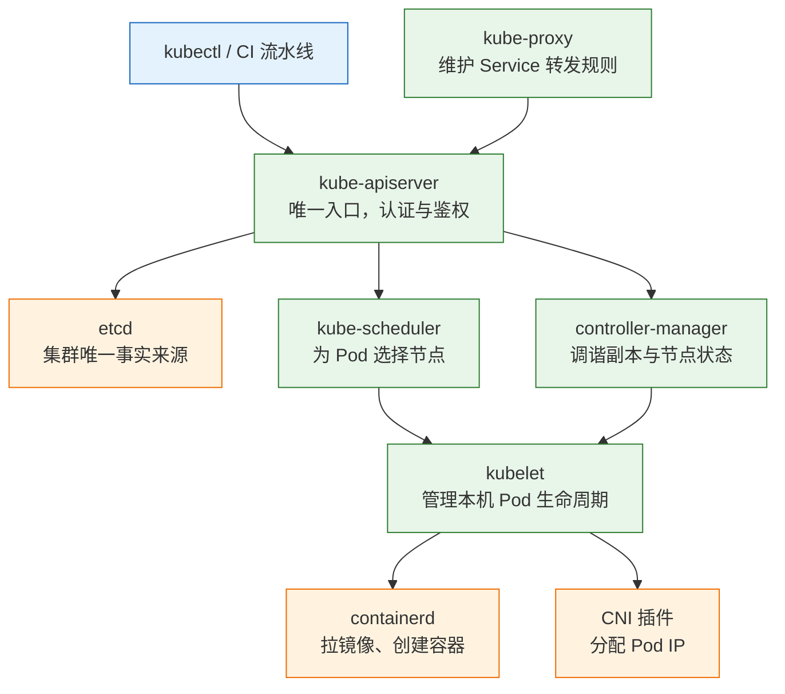
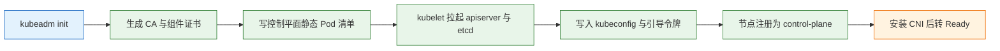
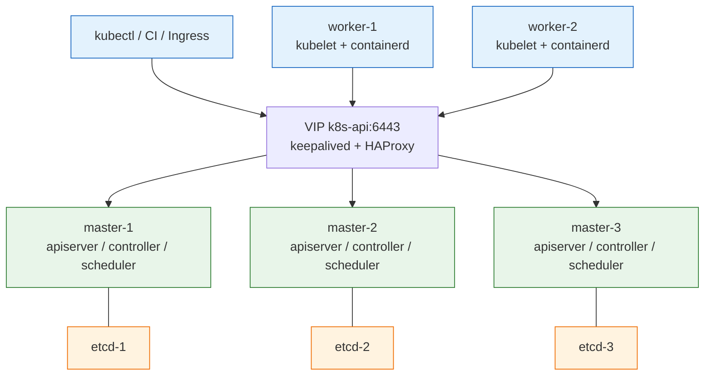
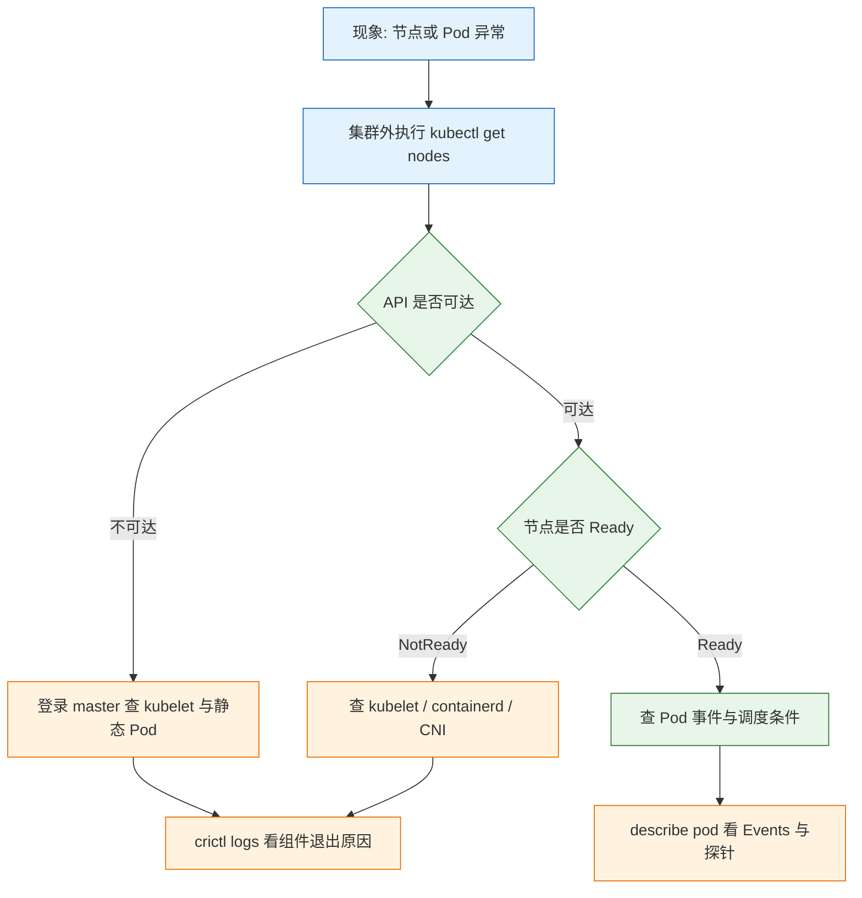

# Kubernetes 集群搭建

---

## 一、Kubernetes 集群是什么

### 1.1 核心概念

Kubernetes 集群是由多台机器组成、对外表现为一个调度单元的容器编排系统。使用者提交描述期望状态的 YAML，控制平面持续把实际状态收敛到期望状态，而不是逐台登录机器执行命令。这种“声明式提交 + 控制循环调谐”的工作方式，决定了集群里几乎所有现象都能用同一句话解释：某个控制器发现实际值不等于期望值，于是采取了动作。

一个具体例子能说明整套机制：提交一个 3 副本的 Deployment 后，controller-manager 创建 ReplicaSet，ReplicaSet 创建 3 个 Pod 对象，scheduler 为没有节点的 Pod 选好节点并写回，目标节点的 kubelet 看到分配给自己的 Pod 就调用运行时创建容器。中途任何一步失败，都会有对应的控制器重新尝试，直到实际副本数等于 3。整个过程没有“执行部署”这个动作，只有对象状态的持续收敛。

集群与单机容器运行时的差别不在命令语法，而在**失败模型**。单机上容器退出就是退出；集群里还要面对节点失联、网络分区、证书过期、etcd 失去多数派。搭建集群的本质，是把这些失败场景提前用冗余和约束兜住，所以验收标准不是“`kubectl` 能连上”，而是“挂掉一台 worker，业务自己回来；证书到期前有人知道；etcd 备份能恢复”。

| 概念 | 含义 | 在搭建中的落点 |
|---|---|---|
| 期望状态 | 用户写入 API 的对象描述 | 各类 YAML 清单 |
| 调谐循环 | 控制器对比实际与期望并纠偏 | 副本补齐、节点重调度 |
| 静态 Pod | 由 kubelet 直接读清单启动的 Pod | 控制平面组件的运行形式 |
| 引导令牌 | 新节点加入时的一次性凭证 | `kubeadm join` 的 token |
| 集群标识 | 集群名、Pod CIDR、Service CIDR、DNS 域名 | 初始化时一次性确定 |

集群里有两种角色。**控制平面**保存集群状态并做全局决策，**工作节点**负责运行实际负载。角色只是标签和组件的差别，同一台机器可以同时承担两者，但生产环境不这样用，因为控制平面被业务负载拖垮会波及整个集群。

### 1.2 与相邻技术的关系

kubeadm 是上游提供的**引导工具**，不是集群管理系统。它负责生成证书、拉起控制平面、签发 join 命令；不负责节点配置、CNI 选型、备份、监控、升级编排。把这四件事当成 kubeadm 的功能，会在第一次故障时发现无人负责。

容器运行时通过 CRI（Container Runtime Interface）接入，kubelet 不直接调用 Docker。K8s 1.24 起不再内置 Docker 支持，节点上装的是 containerd 或 CRI-O，Docker 只在开发机做镜像构建。网络由 CNI 插件实现，存储由 CSI 驱动实现，两者都是可替换的外部组件，集群本身只定义接口。

与单机编排工具相比，Compose 解决的是“一台机器上多个容器怎么一起起”，K8s 解决的是“多台机器上容器怎么调度、怎么自愈、怎么滚动”。前者没有节点概念，也就没有节点失联后的重调度。

| 技术 | 与本篇的关系 | 边界 |
|---|---|---|
| containerd | 节点上的容器运行时，通过 CRI 对接 kubelet | 不负责编排与调度 |
| CNI 插件 | 给 Pod 分配 IP、打通跨节点网络 | 不负责 Service 负载均衡 |
| CSI 驱动 | 为 PVC 提供实际存储 | 不负责应用数据一致性 |
| kubeadm | 引导控制平面、签发加入凭证 | 不做日常运维与备份 |
| 托管 K8s | 云厂商代管控制平面 | 网络模型与权限受平台约束 |

### 1.3 架构组成



所有读写都经过 apiserver，其他组件之间不直接通信，这是集群能保持一致的根源。scheduler 和 controller-manager 都是“监听 API、写回 API”的客户端，它们不保存权威状态，重启后从 apiserver 重新同步即可。etcd 是唯一持久化状态的地方，因此它的磁盘性能和备份策略直接决定集群的可靠性。

| 组件 | 职责 | 异常时的典型表现 |
|---|---|---|
| kube-apiserver | 认证、鉴权、准入、读写 etcd | `kubectl` 全部超时，节点转 NotReady |
| etcd | 保存全部集群状态 | apiserver 报错，写操作失败 |
| kube-scheduler | 为新 Pod 选节点 | Pod 长期 Pending，事件无调度记录 |
| controller-manager | 副本、节点、端点等控制器 | 副本不补齐，节点不驱逐 |
| kubelet | 拉起并监控本机 Pod | 节点 NotReady，`crictl ps` 有残留容器 |
| kube-proxy | 把 Service 规则落到 iptables/IPVS | Service 有 ClusterIP 但连不通 |

控制平面的四个组件以静态 Pod 形式运行，清单放在 `/etc/kubernetes/manifests`，由 kubelet 监视文件变化并重建容器。这意味着 apiserver 挂了不能靠 `kubectl` 修，只能登录节点改文件或看容器日志。

---

## 二、集群规划与主机准备

### 2.1 拓扑与角色规划

学习环境用 1 master + 2 worker 足够跑通全部流程，但必须清楚它的可用性上限就是那台 master。多节点不是为了性能，而是为了能观察到节点失联、Pod 驱逐、跨节点网络这些单机环境永远不会出现的现象。

> **版本现状（2026-10）**：K8s 稳定线为 v1.37，补丁号以官方 Releases 为准；Calico 3.33；节点系统用 Ubuntu 24.04（cgroup v2）。K8s 1.35 起 kubelet 拒绝在 cgroup v1 上启动，老系统先升级内核与 init，不要绕过检查硬装。

| 角色 | 主机名 | IP（示例） | 配置 |
|---|---|---|---|
| 控制平面 | k8s-master | 192.0.2.10 | 2C4G / 40G SSD |
| 工作节点 | k8s-node1 | 192.0.2.11 | 2C4G / 40G SSD |
| 工作节点 | k8s-node2 | 192.0.2.12 | 2C4G / 40G SSD |

表中的 `192.0.2.0/24` 是 RFC 5737 保留的文档示例网段，实际部署换成内网地址。规划阶段要一次性定下三件事：控制平面入口的域名、Pod 网段、Service 网段。这三项在 `init` 时写进证书和组件参数，事后修改代价极高。

规格上最容易被低估的是 etcd。它每次提交都要 fsync 到磁盘，磁盘延迟高会直接拖慢所有写操作，表现为 `kubectl apply` 很慢、apiserver 超时、节点心跳延迟。2C4G 是学习环境的底线，生产控制平面建议 4C8G 起，数据盘用本地 SSD，不要与日志盘混用。

生产环境不要用单 master。控制平面挂了，现有 Pod 还能跑，但不能发布、不能调度、不能改配置。控制平面要 3 台且为奇数，etcd 与控制平面同居（stacked）或独立部署。**2 台 master 比 1 台更糟**，因为 etcd 需要多数派，两台之间任意一台故障都会让整个集群写不进去。

控制平面默认带 `node-role.kubernetes.io/control-plane:NoSchedule` 污点，业务 Pod 不会落上去。学习环境可以为了省机器去掉它，生产环境不要这样做。

### 2.2 主机名与名称解析

```bash
# ========== 主机名 ==========
# 每台机器改成自己的名字，join 时节点名默认取这里
sudo hostnamectl set-hostname k8s-master

# ========== 名称解析 ==========
# 控制平面入口必须能被所有节点解析，学习环境直接写 hosts
sudo tee -a /etc/hosts >/dev/null <<'EOF'
192.0.2.10 k8s-master k8s-api.example.internal
192.0.2.11 k8s-node1
192.0.2.12 k8s-node2
EOF

# 验证解析结果，后面证书 SAN 依赖这个名字
getent hosts k8s-api.example.internal

# ========== 时间同步 ==========
# TLS 证书校验、etcd 选举、token 过期判断都依赖准确时钟
sudo timedatectl set-timezone Asia/Shanghai
# 开启 NTP 自动校时，集群所有节点必须同源
sudo timedatectl set-ntp true
# 确认时区与同步状态，System clock synchronized 应为 yes
timedatectl status
```

`controlPlaneEndpoint` 用一个固定域名而不是 master 的 IP，是为了将来从单 master 扩成高可用时不必重新签发证书。域名指向哪里由 DNS 或 hosts 决定，证书里只认这个名字。

> **注意**：节点时间偏差超过几分钟，join 会直接报 x509 证书尚未生效或已过期，而证书本身完全正常。遇到这类报错先 `date` 对比，不要急着重签证书。

### 2.3 内核模块与转发参数

这几步不是安装仪式，每一个都对应一类具体故障。

```bash
# ========== 关闭 swap ==========
# kubelet 默认拒绝在开启 swap 的节点上启动
sudo swapoff -a
# 注释掉 fstab 里的 swap 行，重启后才不会恢复
sudo sed -i '/\sswap\s/s/^/#/' /etc/fstab
# 确认 Swap 一行全为 0
free -h

# ========== 加载内核模块 ==========
# overlay 供 overlayfs 存储驱动使用，br_netfilter 让 iptables 处理网桥流量
sudo tee /etc/modules-load.d/k8s.conf >/dev/null <<'EOF'
overlay
br_netfilter
EOF
# 立即加载，避免等到重启
sudo modprobe overlay
# 同上，Service 的 DNAT 规则依赖这个模块
sudo modprobe br_netfilter
# 确认两个模块已在内存中
lsmod | grep -E 'overlay|br_netfilter'

# ========== 转发参数 ==========
# Pod 出网、Service 转发都依赖这三个参数
sudo tee /etc/sysctl.d/k8s.conf >/dev/null <<'EOF'
net.bridge.bridge-nf-call-iptables  = 1
net.bridge.bridge-nf-call-ip6tables = 1
net.ipv4.ip_forward                 = 1
EOF
# 重新加载全部 sysctl 配置
sudo sysctl --system
# 单独确认转发已开启，输出应为 1
sysctl net.ipv4.ip_forward

# ========== cgroup 版本 ==========
# K8s 1.35 起 kubelet 拒绝在 cgroup v1 上启动
stat -fc %T /sys/fs/cgroup
```

最后一条预期输出 `cgroup2fs`。输出 `tmpfs` 说明系统仍是 cgroup v1，需要修改内核启动参数开启 unified hierarchy 后重启，不要在这个状态下继续安装。

- **关 swap**：kubelet 默认拒绝在 swap 开启时启动；即使通过 `failSwapOn: false` 强行放开，内存压力和驱逐行为也会变得不可预测，QoS 承诺失效。
- **br_netfilter + bridge-nf-call-iptables**：让 iptables 能处理网桥流量，Service 的 DNAT 规则才会对 Pod 生效。漏了它，ClusterIP 能解析但连不上。
- **ip_forward**：Pod 跨节点访问和出网都依赖转发。关了它，同节点可能通，跨节点必断。

### 2.4 防火墙与端口放行

云主机还要在安全组里放行同样的端口，只改本机防火墙是不够的。

| 组件 | 端口 | 协议 | 来源 |
|---|---|---|---|
| kube-apiserver | 6443 | TCP | 所有节点、运维网段 |
| etcd | 2379–2380 | TCP | 仅控制平面之间 |
| kubelet | 10250 | TCP | 控制平面 |
| controller-manager | 10257 | TCP | 本机、监控 |
| scheduler | 10259 | TCP | 本机、监控 |
| NodePort | 30000–32767 | TCP/UDP | 入口负载均衡 |
| Calico VXLAN | 4789 | UDP | 所有节点 |
| Calico BGP | 179 | TCP | 所有节点（用 BGP 时） |

```bash
# ========== firewalld ==========
# 放行控制平面入口，所有节点和运维机都要能连
sudo firewall-cmd --permanent --add-port=6443/tcp
# 放行 etcd 对等通信，仅控制平面之间需要
sudo firewall-cmd --permanent --add-port=2379-2380/tcp
# 放行 kubelet 指标与 exec 端口，来源限控制平面
sudo firewall-cmd --permanent --add-port=10250/tcp
# 重载规则使永久配置生效
sudo firewall-cmd --reload
# 确认端口已放行
sudo firewall-cmd --list-ports

# ========== ufw ==========
# Ubuntu 若启用了 ufw，同样按上面的端口表放行
sudo ufw allow 6443/tcp
# etcd 端口范围写法与 firewalld 不同，用冒号
sudo ufw allow 2379:2380/tcp
# kubelet 端口
sudo ufw allow 10250/tcp
# 查看带序号的规则，便于后续删除
sudo ufw status numbered
```

> **运维提示**：etcd 的 2379/2380 只对控制平面开放。这两端口暴露到业务网段等于把集群数据库交出去，etcd 里存着全部 Secret 和配置。

---

## 三、容器运行时安装

### 3.1 安装 containerd

节点上只需要容器运行时，不需要 Docker Engine。用 Docker 官方仓库的 `containerd.io` 包，版本与上游同步，也省去自己编译。

> **版本现状（2026-10）**：containerd 当前维护线为 2.3 LTS 与 2.4，`containerd.io` 装到的就是最新稳定版。它与 K8s 1.37 的 CRI 接口兼容，升级时跟随节点一起规划，不要单独跳到未验证的大版本。

```bash
# ========== 准备依赖与密钥 ==========
# ca-certificates 用于 TLS 校验，gnupg 用于导入仓库签名密钥
sudo apt update
# 安装三个基础工具
sudo apt install -y ca-certificates curl gnupg
# 创建存放密钥的目录，权限必须为 0755
sudo install -m 0755 -d /etc/apt/keyrings
# 下载并转换 Docker 仓库签名密钥，gpg 需要二进制格式
curl -fsSL https://download.docker.com/linux/ubuntu/gpg \
  | sudo gpg --dearmor -o /etc/apt/keyrings/docker.gpg
# apt 读取密钥要求可读
sudo chmod a+r /etc/apt/keyrings/docker.gpg

# ========== 添加仓库 ==========
# 只加 docker 仓库，装包时只取 containerd.io
echo "deb [arch=$(dpkg --print-architecture) signed-by=/etc/apt/keyrings/docker.gpg] https://download.docker.com/linux/ubuntu $(lsb_release -cs) stable" \
  | sudo tee /etc/apt/sources.list.d/docker.list >/dev/null
# 刷新索引后才能看到 containerd.io
sudo apt update

# ========== 安装并启动 ==========
# containerd.io 自带 systemd 单元，装完即可托管
sudo apt install -y containerd.io
# 设为开机自启并立即启动
sudo systemctl enable --now containerd
# 确认服务为 active (running)
systemctl status containerd --no-pager
```

### 3.2 生成并修改配置

```bash
# ========== 生成默认配置 ==========
# 先导出默认配置再改，不要手写整个文件，避免漏字段
sudo mkdir -p /etc/containerd
# 默认配置输出到标准输出，重定向写入目标文件
containerd config default | sudo tee /etc/containerd/config.toml >/dev/null

# ========== 关键修改 ==========
# kubelet 与 containerd 的 cgroup 驱动必须一致，统一为 systemd
sudo sed -i 's/SystemdCgroup = false/SystemdCgroup = true/' /etc/containerd/config.toml

# 确认修改生效，输出应为 SystemdCgroup = true
grep -n 'SystemdCgroup' /etc/containerd/config.toml

# ========== 重启并验证 ==========
# 配置改动必须重启才加载
sudo systemctl restart containerd
# 确认重启后服务正常
sudo systemctl status containerd --no-pager

# ctr 是 containerd 自带的调试客户端，Client 与 Server 都要有版本输出
sudo ctr version
```

| 配置项 | 建议值 | 配错的后果 |
|---|---|---|
| `SystemdCgroup` | `true` | kubelet 报 cgroup driver 不一致，节点起不来 |
| `sandbox_image` | 与集群版本匹配的 pause 镜像 | Pod 沙箱创建失败，全部 Pod 卡在 ContainerCreating |
| `[plugins."io.containerd.grpc.v1.cri".registry]` | 走 `certs.d` 目录配置镜像源 | 拉取超时，init 卡在拉镜像 |
| `oom_score` | 保持默认 | 内存压力下容器被误杀 |

`ctr version` 必须同时有 Client 和 Server 两段输出。只有 Client 说明守护进程没起来，先看 `journalctl -u containerd`。

`sandbox_image` 指向 pause 镜像，每个 Pod 启动前都要先跑一个 pause 容器占住网络命名空间，业务容器再加入这个命名空间。它不承载业务逻辑，但 Pod 的所有网络配置都挂在它身上。镜像地址与集群版本不匹配时，kubelet 会一直报沙箱创建失败，Pod 卡在 `ContainerCreating`，事件里能看到镜像拉取错误而不是应用错误。

镜像拉不下来时，按《Containerd 容器运行时》笔记在 `/etc/containerd/certs.d` 下配置镜像加速，不要在这里把 pause 镜像硬编码成第三方地址。硬编码会让升级时沙箱版本与 kubelet 期望不一致。

### 3.3 运行时验证

```bash
# ========== 用 crictl 检查 ==========
# crictl 走 CRI 接口，是节点上排查 Pod 的正确工具
sudo crictl --runtime-endpoint unix:///run/containerd/containerd.sock version

# 写入默认端点，后续命令不必每次带参数
sudo tee /etc/crictl.yaml >/dev/null <<'EOF'
runtime-endpoint: unix:///run/containerd/containerd.sock
image-endpoint: unix:///run/containerd/containerd.sock
timeout: 10
debug: false
EOF

# 查看已有容器，此时应为空
sudo crictl ps -a
# 查看已有镜像，此时应为空
sudo crictl images
```

> **注意**：节点上不要用 `docker ps` 调试 K8s 容器。容器由 containerd 管理，Docker 看不到它们，装了 Docker 反而容易误判为“容器不见了”。

---

## 四、kubeadm 组件安装

### 4.1 添加软件源

```bash
# ========== 导入 Kubernetes 仓库密钥 ==========
# v1.37 是仓库路径的一部分，升级大版本时要换路径
sudo apt install -y apt-transport-https ca-certificates curl gpg
# 创建密钥目录
sudo mkdir -p -m 755 /etc/apt/keyrings
# 下载并转换仓库签名密钥
curl -fsSL https://pkgs.k8s.io/core:/stable:/v1.37/deb/Release.key \
  | sudo gpg --dearmor -o /etc/apt/keyrings/kubernetes-apt-keyring.gpg

# ========== 写入仓库地址 ==========
# 只保留这一个仓库文件，避免与其他版本的源冲突
sudo tee /etc/apt/sources.list.d/kubernetes.list >/dev/null <<'EOF'
deb [signed-by=/etc/apt/keyrings/kubernetes-apt-keyring.gpg] https://pkgs.k8s.io/core:/stable:/v1.37/deb/ /
EOF
# 刷新索引，否则查不到 kubeadm
sudo apt update

# ========== 查看可用版本 ==========
# 输出里能看到 1.37.x 的补丁号，后续升级要用完整版本串
apt-cache madison kubeadm | head
```

### 4.2 安装与版本锁定

```bash
# ========== 安装三个组件 ==========
# kubelet 跑节点上的 Pod，kubeadm 建集群，kubectl 是客户端
sudo apt install -y kubelet kubeadm kubectl

# ========== 锁定版本 ==========
# 防止系统自动升级把节点升到不兼容的小版本
sudo apt-mark hold kubelet kubeadm kubectl
# 确认三个包都在 hold 列表中
apt-mark showhold

# ========== 验证 ==========
# 确认 kubeadm 版本
kubeadm version -o short
# 确认 kubelet 版本与仓库一致
kubelet --version
# 确认客户端版本，不连接集群
kubectl version --client
```

`apt-mark hold` 是集群稳定的第一道防线。不锁版本，一次例行 `apt upgrade` 就可能让某台节点的 kubelet 比 apiserver 高一个小版本，节点注册直接失败。升级必须走独立流程，一台一台来。

kubeadm 的版本偏差策略允许 kubelet 比 apiserver 落后若干个小版本（当前为 3 个），但反过来不行，kubectl 也要求与 apiserver 相差不超过一个小版本。这条规则解释了为什么升级必须“控制平面先、worker 后”：先升 apiserver 仍在容忍范围内，先升 kubelet 则立刻越界。规划升级窗口时，把顺序写进变更单比记住规则更可靠。

| 命令 | 职责 | 安装范围 |
|---|---|---|
| `kubeadm` | 初始化控制平面、签发加入命令、升级编排 | 所有节点 |
| `kubelet` | 接收 Pod 规格、管理容器生命周期 | 所有节点 |
| `kubectl` | 访问 apiserver 的客户端 | 控制平面与运维机 |

### 4.3 安装后前置检查

```bash
# ========== 服务状态 ==========
# 此时 kubelet 会反复重启，因为没有 kubelet.conf，属于正常现象
systemctl is-enabled kubelet
# 查看失败原因，应能看到缺少配置或 CA
systemctl status kubelet --no-pager

# ========== 运行时连通性 ==========
# kubeadm 通过 CRI 找运行时，socket 路径必须存在
ls -l /run/containerd/containerd.sock

# ========== 端口占用 ==========
# 6443、10250 被旧进程占用时 init 会失败
sudo ss -lntp | grep -E '6443|10250|2379'
```

kubelet 在 init 之前反复重启是预期行为，它缺 `/etc/kubernetes/kubelet.conf` 和集群 CA。不要因为这个状态去改 kubelet 配置或重装，初始化完成后它会自己稳定。

---

## 五、控制平面初始化

### 5.1 编写 kubeadm 配置文件

生产环境把参数写进配置文件，而不是堆在命令行。配置文件能进 Git、能 review、能复用，也能明确记录“这套集群当初是怎么定的”。

```yaml
# 节点级配置：本机地址、节点名、运行时 socket
apiVersion: kubeadm.k8s.io/v1beta4
kind: InitConfiguration
localAPIEndpoint:
  advertiseAddress: 192.0.2.10        # 本机内网 IP，必须与其他节点互通
  bindPort: 6443                      # apiserver 监听端口
nodeRegistration:
  name: k8s-master                    # 节点名，集群内唯一
  criSocket: unix:///run/containerd/containerd.sock
  imagePullPolicy: IfNotPresent
---
# 集群级配置：版本、入口、网段、证书 SAN
apiVersion: kubeadm.k8s.io/v1beta4
kind: ClusterConfiguration
clusterName: home-lab
kubernetesVersion: v1.37.2            # 与 apt 中安装的补丁号保持一致
controlPlaneEndpoint: k8s-api.example.internal:6443   # 固定入口，扩 HA 时不换证书
networking:
  podSubnet: 10.244.0.0/16            # 必须与 CNI 地址池一致
  serviceSubnet: 10.96.0.0/12         # Service 虚拟网段，勿与内网重叠
  dnsDomain: cluster.local
apiServer:
  certSANs:                           # 证书里额外认可的名字和地址
    - k8s-api.example.internal
    - 192.0.2.10
etcd:
  local:
    dataDir: /var/lib/etcd            # etcd 数据目录，必须在本地 SSD
---
# kubelet 配置：cgroup 驱动必须与 containerd 一致
apiVersion: kubelet.config.k8s.io/v1beta1
kind: KubeletConfiguration
cgroupDriver: systemd
```

### 5.2 预检与执行初始化

```bash
# ========== 预检 ==========
# 先看会拉哪些镜像，避免 init 卡在拉取阶段才发现仓库不通
sudo kubeadm config images list --config kubeadm.yaml
# 提前拉齐镜像，init 时不再等待网络
sudo kubeadm config images pull --config kubeadm.yaml

# ========== 试运行 ==========
# 只做检查不落盘，能提前暴露端口占用、swap、cgroup 问题
sudo kubeadm init --config kubeadm.yaml --dry-run

# ========== 正式初始化 ==========
# 单 master 也保留 controlPlaneEndpoint，为将来扩 HA 留余地
sudo kubeadm init --config kubeadm.yaml
```



预期输出的关键部分：

```text
Your Kubernetes control-plane has initialized successfully!

To start using your cluster, you need to run the following as a regular user:
  mkdir -p $HOME/.kube
  sudo cp -i /etc/kubernetes/admin.conf $HOME/.kube/config
  sudo chown $(id -u):$(id -g) $HOME/.kube/config

Then you can join any number of worker nodes by running the following:
kubeadm join k8s-api.example.internal:6443 --token <token> \
    --discovery-token-ca-cert-hash sha256:<hash>
```

### 5.3 初始化产物解析

`kubeadm init` 不是黑盒，它主要做四件事，理解这四件事排障就不会乱。

| 路径 | 内容 | 出问题时的表现 |
|---|---|---|
| `/etc/kubernetes/pki` | CA、apiserver、etcd、front-proxy 证书 | 组件互相 TLS 校验失败，报 x509 |
| `/etc/kubernetes/manifests` | apiserver、etcd、scheduler、controller-manager 静态 Pod 清单 | 对应组件容器不存在 |
| `/etc/kubernetes/*.conf` | admin、kubelet、controller-manager、scheduler 的 kubeconfig | kubectl 无权限、kubelet 起不来 |
| `/var/lib/etcd` | etcd 数据目录 | etcd 无法启动或数据丢失 |

- apiserver 起不来，先看静态 Pod 清单和 `/var/log/pods` 里的容器日志。
- 证书问题，看 `/etc/kubernetes/pki` 和 `kubeadm certs check-expiration`。
- etcd 问题，看 `/var/lib/etcd` 和 etcd 容器日志。

```bash
# ========== 确认静态 Pod 已生成 ==========
# 应有 etcd、kube-apiserver、kube-controller-manager、kube-scheduler 四个清单
sudo ls -l /etc/kubernetes/manifests/
# 应有 ca、apiserver、etcd、front-proxy 等证书目录
sudo ls -l /etc/kubernetes/pki/

# ========== 用 crictl 看控制平面容器 ==========
# 容器名带节点名后缀，例如 kube-apiserver-k8s-master
sudo crictl ps | grep -E 'kube-apiserver|etcd|kube-scheduler|kube-controller'
```

### 5.4 kubeconfig 配置

```bash
# ========== 复制管理员配置 ==========
# admin.conf 拥有集群管理员权限，只给可信账号
mkdir -p "$HOME/.kube"
# 复制并保留原文件，-i 会在覆盖时提示
sudo cp -i /etc/kubernetes/admin.conf "$HOME/.kube/config"
# 改回当前用户所有，避免后续命令必须 sudo
sudo chown "$(id -u):$(id -g)" "$HOME/.kube/config"
# 权限收紧，kubeconfig 内含客户端证书
chmod 600 "$HOME/.kube/config"

# ========== 验证连接 ==========
# 确认 apiserver 地址与版本
kubectl cluster-info
# 确认节点已注册，此时通常为 NotReady
kubectl get nodes
# 查看控制平面组件 Pod
kubectl get pods -n kube-system
```

此时 master 通常是 `NotReady`，因为还没有 CNI。这是正常的，不要急着重装。`kubectl get nodes` 能返回节点，说明 apiserver、etcd、kubelet 三者的认证链路已经打通，剩下的只是网络插件。

> **运维提示**：`admin.conf` 等同于 root 凭证，不要复制到开发机长期保存。日常运维应创建受限 ServiceAccount 或对接企业 SSO，而不是分发集群管理员配置。

初始化失败后不要直接重跑。先 `kubeadm reset`，按官方流程清理 CNI 配置和 iptables 残留，再确认 `/etc/kubernetes`、`/var/lib/etcd` 的状态。

> **运维红线**：`kubeadm reset` 会删除本机控制平面配置与 etcd 数据。在带业务数据的机器上执行前，必须确认 etcd 数据已备份且不再需要，否则集群状态无法找回。

---

## 六、网络插件部署

### 6.1 CNI 的职责与选型

CNI 插件负责三件事：给 Pod 分配 IP、在节点间打通 Pod 网络、在有策略需求时执行 NetworkPolicy。它不负责 Service 的虚拟 IP，那部分由 kube-proxy 完成。两者分工不清是排障时最常见的混淆点：Service 不通先看 kube-proxy 和 EndpointSlice，Pod IP 不通才看 CNI。

| 方案 | 数据面 | NetworkPolicy | 适合 | 主要代价 |
|---|---|---|---|---|
| Flannel | VXLAN 覆盖网络 | 不支持（Canal 组合除外） | 小集群、只要通 | 没有隔离，功能少 |
| Calico | BGP 路由或 VXLAN | 支持 | 裸金属、需要策略、可接 BGP | BGP 要网络配合，排障跨层 |
| Cilium | eBPF | 支持，含 L7 | 大规模、可观测、策略复杂 | 内核要求高，概念多 |

### 6.2 安装 Calico

`--pod-network-cidr` 必须和 CNI 的地址池一致。Calico 默认清单写的是 `192.168.0.0/16`，直接 apply 会和配置里的 `10.244.0.0/16` 对不上，表现为节点永远 NotReady、calico-node 反复重启。

```bash
# ========== 安装 operator ==========
# tigera-operator 负责根据 Installation 资源创建 calico-system 下的组件
kubectl create -f https://raw.githubusercontent.com/projectcalico/calico/v3.33.0/manifests/tigera-operator.yaml

# ========== 下载并改地址池 ==========
# 必须与 kubeadm 的 podSubnet 完全一致，否则 Pod 拿不到可路由地址
curl -fsSLO https://raw.githubusercontent.com/projectcalico/calico/v3.33.0/manifests/custom-resources.yaml
# 把默认地址池替换成安装时定的网段
sed -i 's|192.168.0.0/16|10.244.0.0/16|' custom-resources.yaml
# 确认替换结果，输出中应只剩 10.244.0.0/16
grep -n 'cidr' custom-resources.yaml

# ========== 创建 Installation ==========
kubectl create -f custom-resources.yaml
```

预期：

```text
installation.operator.tigera.io/default created
apiserver.operator.tigera.io/default created
goldmane.operator.tigera.io/default created
whisker.operator.tigera.io/default created
```

不同 Calico 版本带的 CR 数量不同，关键是 `Installation` 和 `APIServer` 创建成功。

这里用 operator 而不是一次性清单，是因为 `Installation` 是一个声明式对象：节点增减、地址池调整、封装方式切换都通过修改它完成，operator 负责把变化落到 DaemonSet 和配置上。直接 apply 大清单虽然也能装上，但后续变更没有统一入口，排障时很难判断当前配置来自哪一次 apply。

```bash
# ========== 等待组件就绪 ==========
# operator 自身先就绪，才能创建后续组件
kubectl get pods -n tigera-operator
# calico-node 是 DaemonSet，每个节点一个
kubectl get pods -n calico-system -o wide

# ========== 查看整体状态 ==========
# AVAILABLE 应为 True，DEGRADED 应为 False
kubectl get tigerastatus
```

节点从 `NotReady` 变 `Ready` 通常要等 CNI 初始化完成；CNI 没就绪时还会有 `NetworkUnavailable` 条件和对应的调度限制。所以“节点 NotReady 但 kubelet 是 active”很常见，先看 CNI Pod，不要重装 kubelet。

`calico-node` 一直 CrashLoop 时，先看日志里是不是找不到网卡名，或 Pod CIDR 与 `podSubnet` 不匹配。

```bash
# ========== 定位 calico-node 问题 ==========
# 日志里常见 autodetect 网卡失败、BIRD 未就绪
kubectl -n calico-system logs ds/calico-node --tail=100
# 描述信息里能看到调度状态与最后一次事件
kubectl -n calico-system describe pod -l k8s-app=calico-node | tail -40
```

### 6.3 地址池、封装与 MTU

覆盖网络把 Pod 包在节点 IP 里传，跨网段简单，但每个包多一层封装，MTU 要减掉开销。VXLAN 通常少 50 字节；节点 MTU 1500 时，Pod MTU 应设 1450 左右。

MTU 配错的表现很隐蔽：小请求正常，大响应卡住，TLS 握手偶尔超时。因为握手包小，能通过；证书链和首屏数据大，被分片或丢弃。排查时用 `ping -M do -s 1472` 逐级试探，而不是先怀疑应用。

底层网络（underlay/BGP）让 Pod IP 直接可路由，性能好，但要求机房网络会传路由，IP 规划要提前做。没有网络团队时，Calico 的 VXLAN 模式更省事；要极致性能和 BGP 能力，再考虑 underlay。

```bash
# ========== 验证 Pod 网络 ==========
# 在 master 上直接访问集群 DNS，验证 Service 与 CNI 同时可用
kubectl run nettest --rm -it --image=busybox:1.37 --restart=Never -- \
  nslookup kubernetes.default

# ========== 查看地址池 ==========
kubectl get ippools.crd.projectcalico.org -o wide

# ========== 抓包确认封装 ==========
# vxlan 模式下应能看到 UDP 4789 的封装流量
sudo tcpdump -i any -n udp port 4789 -c 5
```

---

## 七、工作节点加入与节点管理

### 7.1 join 的认证流程

worker 加入集群靠两样东西：引导令牌（token）和 CA 证书指纹（hash）。token 证明“被允许加入”，hash 证明“连的是真 apiserver”，两者缺一不可。token 默认 24 小时过期，过期后 join 报 `401 Unauthorized`；hash 不匹配则报证书校验失败，防止节点被引导到伪造的控制平面。

```bash
# ========== 在 master 上生成加入命令 ==========
# 每次都重新生成，避免使用已过期的 token
sudo kubeadm token create --print-join-command
```

输出形状：

```text
kubeadm join k8s-api.example.internal:6443 --token <token> --discovery-token-ca-cert-hash sha256:<hash>
```

### 7.2 节点扩容

```bash
# ========== 在 worker 上执行 ==========
# 命令来自 master 的输出，必须带 sudo
sudo kubeadm join k8s-api.example.internal:6443 \
  --token <token> \
  --discovery-token-ca-cert-hash sha256:<hash>
```

```bash
# ========== 回 master 验证 ==========
# INTERNAL-IP 应为本机内网地址，ROLES 为 none
kubectl get nodes -o wide

# ========== 查看节点详细条件 ==========
# Conditions 里的 Ready、MemoryPressure、DiskPressure 决定可调度性
kubectl describe node k8s-node1 | sed -n '/Conditions/,/Events/p'
```

预期：

```text
NAME          STATUS   ROLES           AGE   VERSION   INTERNAL-IP
k8s-master    Ready    control-plane   12m   v1.37.x   192.0.2.10
k8s-node1     Ready    <none>          3m    v1.37.x   192.0.2.11
k8s-node2     Ready    <none>          2m    v1.37.x   192.0.2.12
```

### 7.3 节点摘除

```bash
# ========== 第一步：排空节点 ==========
# 让 Pod 优雅迁移，DaemonSet 和 emptyDir 数据需要显式确认
kubectl drain k8s-node1 --ignore-daemonsets --delete-emptydir-data

# ========== 第二步：停止节点组件 ==========
# 在 k8s-node1 上执行，先停 kubelet 避免它继续上报
sudo systemctl stop kubelet
# 清理本机的证书、配置与 etcd 数据
sudo kubeadm reset

# ========== 第三步：删除 API 中的节点记录 ==========
# 回 master 执行，节点对象与关联的 Lease 一起清理
kubectl delete node k8s-node1
```

先 drain 再停 kubelet：drain 让 Pod 优雅迁移；先停 kubelet 再 drain，节点会直接 NotReady，Pod 只能等超时驱逐。`reset` 后还要清理 CNI 配置和 iptables 残留，否则重新加入时网络可能错乱。

> **运维红线**：`kubeadm reset` 会删除本机的证书、kubeconfig 与 etcd 数据，且不可撤销。仅在确认该节点不再提供服务、数据已迁移或备份后执行。

> **注意**：`--delete-emptydir-data` 会删掉 emptyDir 里的临时数据。对有本地缓存或临时文件的负载，先确认可以丢弃。

摘除控制平面更危险：先从 etcd 移除成员，再停组件、删节点。必须在 quorum 健康时做，且一次只动一台；成员数降到偶数不一定立刻坏，但再挂一台就没有多数派。

### 7.4 标签、污点与可调度性

```bash
# ========== 打标签 ==========
# 标签是调度、Service 选择、策略生效的共同基础
kubectl label node k8s-node1 node-role.kubernetes.io/worker=""
# 标记磁盘类型，供 nodeSelector 或亲和规则使用
kubectl label node k8s-node1 disktype=ssd

# ========== 打污点 ==========
# 污点让节点拒绝没有对应 toleration 的 Pod
kubectl taint node k8s-node1 dedicated=batch:NoSchedule

# ========== 查看与恢复 ==========
# LABELS 列表里确认标签已写入
kubectl get nodes --show-labels
# 查看当前污点
kubectl describe node k8s-node1 | grep -A3 Taints
# 末尾加减号表示移除该污点
kubectl taint node k8s-node1 dedicated=batch:NoSchedule-
```

| 操作 | 命令 | 风险 |
|---|---|---|
| 排空节点 | `kubectl drain` | 触发驱逐，受 PDB 限制 |
| 恢复调度 | `kubectl uncordon` | 不会把已迁走的 Pod 迁回 |
| 停止调度 | `kubectl cordon` | 新 Pod 不再落入 |
| 重置节点 | `kubeadm reset` | 删除本机配置与 etcd 数据 |
| 删除节点 | `kubectl delete node` | 只删记录，容器可能残留 |

`uncordon` 只让节点重新可调度，不会把已经迁走的 Pod 迁回来，调度器不做再平衡。长期运行后副本分布会倾斜，需要靠 descheduler 或滚动重启调整。

---

## 八、高可用控制平面

### 8.1 拓扑与 VIP

单 master 的可用性上限就是那台机器。生产至少 3 台控制平面，前面放一个 VIP 或云负载均衡，所有节点的 kubeconfig 和 join 命令都指向这个入口。



VIP 的负载均衡健康检查要看 `/healthz`，不能只检查 TCP 端口。apiserver 进程活着但 etcd 不通时，TCP 仍然能连上，请求却全部失败。

### 8.2 证书分发与其余控制平面加入

```bash
# ========== 首个控制平面 ==========
# --upload-certs 把控制平面证书加密上传到临时 Secret
sudo kubeadm init \
  --control-plane-endpoint=k8s-api.example.internal:6443 \
  --apiserver-advertise-address=192.0.2.10 \
  --upload-certs \
  --pod-network-cidr=10.244.0.0/16

# ========== 证书密钥过期后重新生成 ==========
# 默认有效期 2 小时，超时后加入会报证书密钥无效
sudo kubeadm init phase upload-certs --upload-certs
```

其余控制平面加入：

```bash
# ========== 在 master-2 / master-3 上执行 ==========
# --control-plane 表示加入控制平面，--certificate-key 取回加密证书
sudo kubeadm join k8s-api.example.internal:6443 \
  --token <token> \
  --discovery-token-ca-cert-hash sha256:<hash> \
  --control-plane \
  --certificate-key <certificate-key>
```

HA 的几个硬约束：

- **etcd 必须是奇数个成员**，3 个容忍挂 1 个，5 个容忍挂 2 个。2 个成员没有多数派，写操作直接失败。
- **stacked etcd 与控制平面同机**，省机器，但控制平面故障会同时影响 etcd。
- **etcd 对磁盘延迟敏感**，用本地 SSD，不要放网络盘。fsync 延迟高会拖慢整个集群的写操作。

### 8.3 etcd 部署模式

| 部署方式 | 优点 | 缺点 | 适用 |
|---|---|---|---|
| stacked etcd | 机器少、部署简单 | 控制平面故障同时影响 etcd | 大多数自建集群 |
| external etcd | 故障域分离、可独立扩 | 机器多、证书和运维复杂 | 大规模、强合规 |

external etcd 要单独维护一套证书和成员列表，扩容时两边都要改。它的价值在于控制平面节点可以随意重建而不碰数据，代价是运维复杂度上一个台阶。

### 8.4 集群形态的取舍

kubeadm 是上游标准的引导工具，不是集群管理系统。自己搭集群前先确认：谁负责 etcd 备份恢复、证书续期、版本升级、节点安全补丁、控制平面扩容。没有明确的人，选托管集群更省事。

| 方案 | 适合 | 代价 |
|---|---|---|
| kubeadm 自建 | 机房或私有云、合规要求、需要控制面细节 | 自己管 etcd、证书、升级、备份、HA |
| 托管 K8s | 大多数业务团队 | 控制平面费用、云绑定、网络模型受限 |
| k3s | 边缘、单机、资源紧张 | 默认组件精简，部分特性与上游有差异 |
| 单机 Compose | 小团队、低流量 | 没有多节点调度和自愈 |

自建的成本不在安装，而在长期维护。控制平面能跑起来只要半天，但证书轮换、etcd 备份演练、版本升级、故障复盘需要持续的投入。把这些工作折算成人天，再与托管费用比较，结论通常比凭感觉判断可靠。

> **运维提示**：无论选哪种形态，etcd 备份与恢复演练都必须落到具体的人和固定的周期上。写在文档里但没人执行，等于没有备份。

---

## 九、证书、备份与升级

### 9.1 证书检查与续期

```bash
# ========== 检查有效期 ==========
# 关注 EXPIRES 与 RESIDUAL TIME 两列
sudo kubeadm certs check-expiration
```

CA 默认 10 年，apiserver、etcd、kubelet 等叶子证书默认 1 年；`kubeadm upgrade` 会自动续。到期前手工续：

```bash
# ========== 续期全部证书 ==========
# 逐类重签，输出会列出每一项的续期结果
sudo kubeadm certs renew all

# ========== 再次确认 ==========
# RESIDUAL TIME 应恢复为一年左右
sudo kubeadm certs check-expiration
```

| 证书 | 默认有效期 | 续期方式 |
|---|---|---|
| 集群 CA | 10 年 | 手工重建，需重新分发 |
| apiserver 服务端 | 1 年 | `certs renew` 或升级 |
| etcd 服务端与对等 | 1 年 | `certs renew` |
| kubelet 客户端 | 1 年 | `certs renew` 后重启 kubelet |

续完必须让静态 Pod 重新加载证书。**这一步会短暂中断 apiserver，放在维护窗口做**：

```bash
# ========== 让静态 Pod 重建以加载新证书 ==========
# 先备份清单再移走，kubelet 发现文件消失会停掉对应容器
sudo mkdir -p /tmp/manifests-backup
# 移走全部清单，apiserver 与 etcd 会随之停止
sudo mv /etc/kubernetes/manifests/*.yaml /tmp/manifests-backup/
# 等待容器完全退出，避免新旧进程争抢端口
sleep 30

# 确认静态 Pod 已停止再放回
sudo crictl ps | grep -E 'kube-apiserver|etcd' || true
# 放回清单，kubelet 用新证书重建
sudo mv /tmp/manifests-backup/*.yaml /etc/kubernetes/manifests/

# admin.conf 也换了证书，重新拷贝
sudo cp /etc/kubernetes/admin.conf "$HOME/.kube/config"

# kubelet 的客户端证书也换了，重启让它重新加载
sudo systemctl restart kubelet
# 确认节点仍为 Ready，说明新证书链路可用
kubectl get nodes
```

如果只是续期而不重启静态 Pod，进程仍然用旧证书，`check-expiration` 显示已续期但实际连接仍会过期。HA 集群每台控制平面都要做。

> **运维红线**：移动静态 Pod 清单期间 apiserver 完全不可用，所有写入中断。必须提前通知、确认无发布任务，并在维护窗口内完成。

### 9.2 etcd 备份与恢复

```bash
# ========== 准备工具与目录 ==========
# etcd-client 提供 etcdctl，版本应与集群 etcd 接近
sudo apt install -y etcd-client
# 备份目录放在独立磁盘上更好，至少不要与数据目录同盘
sudo mkdir -p /var/backups/etcd

# ========== 生成快照 ==========
# 用 etcd 自己的证书做双向 TLS，端点走本机回环
BACKUP="/var/backups/etcd/etcd-$(date +%F-%H%M).db"
sudo etcdctl \
  --endpoints=https://127.0.0.1:2379 \
  --cacert=/etc/kubernetes/pki/etcd/ca.crt \
  --cert=/etc/kubernetes/pki/etcd/server.crt \
  --key=/etc/kubernetes/pki/etcd/server.key \
  snapshot save "$BACKUP"

# ========== 校验快照 ==========
# 只保存不校验等于没备份
sudo etcdctl snapshot status "$BACKUP" --write-out=table
```

预期能看到 `HASH`、`REVISION`、`TOTAL KEYS`、`TOTAL SIZE` 四列。`apt` 里的 etcd-client 可能比集群 etcd 旧，生产上直接用与 etcd 大版本一致的二进制。

恢复要停掉所有 etcd 成员，用同一版本的 `etcdctl` 或 `etcdutl` 恢复到一个干净目录，再让 etcd 从该目录启动。务必在隔离环境演练一次，不要在生产上第一次试。

```bash
# ========== 恢复快照（演练环境） ==========
# 恢复到全新目录，不要覆盖正在使用的数据目录
sudo etcdutl snapshot restore /var/backups/etcd/etcd-2026-10-29-0300.db \
  --data-dir=/var/lib/etcd-restore

# 恢复后启动 etcd 前，先确认目录属主与权限
sudo chown -R etcd:etcd /var/lib/etcd-restore
# 目录内应有 member 与 snap 两个子目录
sudo ls -l /var/lib/etcd-restore

# ========== 查看快照元数据 ==========
# 确认哈希、revision 与键数量，判断备份是否完整
sudo etcdutl snapshot status /var/backups/etcd/etcd-2026-10-29-0300.db --write-out=table
```

恢复出来的目录要替换 `/var/lib/etcd` 才会真正生效，这一步必须在所有 etcd 成员停机后统一进行，并保持成员列表与证书一致。单成员恢复后其余成员会因数据版本落后而无法加入，需要按官方流程重建。

> **运维红线**：`etcdctl snapshot restore` 会覆盖目标数据目录。恢复前必须停机并备份现有 `/var/lib/etcd`，否则原始数据与快照同时丢失。

### 9.3 集群升级

一次只升一个小版本，先读 release notes。控制平面先升，worker 逐台升。

```bash
# ========== 控制平面升级 ==========
# 换成 apt-cache madison kubeadm 查到的实际补丁号
K8S_PATCH=1.37.2
# 解锁 kubeadm 才能升级
sudo apt-mark unhold kubeadm
# 刷新仓库索引
sudo apt update
# 只升 kubeadm，补丁号后缀 -1.1 来自仓库命名
sudo apt install -y kubeadm=${K8S_PATCH}-1.1
# 先看升级计划，确认不会跨 minor
sudo kubeadm upgrade plan
# 执行升级，会更新证书与静态 Pod 清单
sudo kubeadm upgrade apply "v${K8S_PATCH}"
# 升级完重新锁定
sudo apt-mark hold kubeadm

# ========== worker 逐台升级 ==========
# 先排空，升级 kubelet 与 kubectl，再恢复调度
kubectl drain k8s-node1 --ignore-daemonsets --delete-emptydir-data
# 解锁两个包
sudo apt-mark unhold kubelet kubectl
# 升到与控制平面一致的补丁号
sudo apt install -y kubelet=${K8S_PATCH}-1.1 kubectl=${K8S_PATCH}-1.1
# systemd 单元可能随包更新，需要重新加载
sudo systemctl daemon-reload
# 重启 kubelet 使新版本生效
sudo systemctl restart kubelet
# 重新锁定
sudo apt-mark hold kubelet kubectl
# 恢复调度，允许新 Pod 落入
kubectl uncordon k8s-node1
```

控制平面节点也要升 kubelet；顺序是 kubeadm → `upgrade apply` → drain → kubelet/kubectl → uncordon。不要先升 worker 的 kubelet，再升 apiserver，版本倒挂会让节点注册失败。

`drain` 会驱逐 Pod，先确认副本数和 PDB 能承受；`--delete-emptydir-data` 会删掉 emptyDir 里的临时数据。

---

## 十、集群验收

### 10.1 基础连通性

```bash
# ========== 系统组件 ==========
# 所有 kube-system Pod 应为 Running
kubectl get pods -A -o wide

# ========== DNS ==========
# 预期返回 kubernetes.default.svc.cluster.local 与 10.96.0.1
kubectl run smoke --rm -it --image=busybox:1.37 --restart=Never -- \
  nslookup kubernetes.default

# ========== 真实负载 ==========
# 用固定版本镜像，避免 latest 带来的不确定性
kubectl create deployment web --image=nginx:1.30-alpine --replicas=2
# 暴露为 NodePort，便于从集群外验证
kubectl expose deployment web --port=80 --type=NodePort
# 记录分配的 NodePort 与服务地址
kubectl get svc web
```

取 NodePort 并访问：

```bash
# ========== 从节点 IP 访问 ==========
# NodePort 在任意节点上都可访问，不要求 Pod 在本节点
NODE_PORT=$(kubectl get svc web -o jsonpath='{.spec.ports[0].nodePort}')
# 用 -I 只取响应头，确认状态码与 Server 字段
curl -I "http://192.0.2.11:${NODE_PORT}"
```

预期 `HTTP/1.1 200 OK` 和 `Server: nginx/1.30.x`。

### 10.2 故障演练

真正的验收是重启一台 worker：

```bash
# ========== 在 k8s-node1 上重启 ==========
sudo reboot
```

回 master 观察：

```bash
# ========== 观察节点与 Pod 状态变化 ==========
# -w 持续输出，Ctrl+C 退出
kubectl get nodes -w
# 同时观察 Pod 的节点归属变化
kubectl get pods -o wide -w
```

预期 node1 先 `NotReady`，约 5 分钟后它上面的 Pod 被驱逐并调度到 node2。这个 5 分钟来自 toleration 的默认 `tolerationSeconds: 300`，不是“K8s 反应慢”。节点回来后变 `Ready`，但已经迁走的 Pod 不会自动迁回。

这 5 分钟是刻意留出的容忍窗口：节点可能只是短暂重启，过早驱逐会让工作负载无谓迁移。窗口内 kubelet 恢复上报，Pod 就原地保留；超过窗口仍失联，node controller 才把 Pod 标记为 `Terminating` 并删除，让 ReplicaSet 在别处补副本。因此观察驱逐时不要用 `kubectl delete pod` 干预，手动删除反而会跳过快照与优雅退出的保护。

节点重启期间，Service 的 EndpointSlice 会先把 NotReady 节点上的端点摘掉，流量不再打过去。这一步依赖 kubelet 上报的 Ready 条件和 EndpointSlice 控制器，与 Pod 驱逐是两条独立链路，所以会出现“Pod 还在、流量已经不通”的过渡状态，属于正常现象。

| 验收项 | 命令 | 通过标准 |
|---|---|---|
| 节点状态 | `kubectl get nodes` | 全部 Ready |
| 系统组件 | `kubectl get pods -A` | 全部 Running 且重启次数稳定 |
| 集群 DNS | `nslookup kubernetes.default` | 返回 ClusterIP |
| Service 访问 | `curl` NodePort | 200 且响应头正确 |
| 节点自愈 | 重启 worker 后观察 | Pod 在另一节点重建 |
| 证书 | `kubeadm certs check-expiration` | 剩余时间大于 90 天 |
| etcd 备份 | `etcdctl snapshot status` | 四列数据完整 |

验收完成后清理测试资源：

```bash
# ========== 清理演练资源 ==========
# 先删工作负载，再删暴露的 Service
kubectl delete deployment web
# 删除后 NodePort 释放，可复用
kubectl delete service web
```

---

## 十一、常见排障

### 11.1 故障对照表

| 现象 | 最可能原因 | 处理 |
|---|---|---|
| `kubeadm init` 卡在拉镜像 | 访问 registry.k8s.io 失败 | 先 `kubeadm config images pull` 验证；配 registry 镜像，不要改错仓库 |
| 端口 6443 被占用 | 之前 init 失败留下的静态 Pod | `kubeadm reset` 后清理 `/etc/kubernetes`、`/var/lib/etcd` |
| worker join 报 x509 | token 过期、CA hash 错、时钟偏 | 重新生成 join 命令，校时 |
| 节点一直 NotReady | kubelet、containerd、CNI、cgroup 任一异常 | `systemctl status kubelet`、`journalctl -u kubelet`、`crictl ps -a` |
| cgroup driver 不一致 | containerd 仍是 cgroupfs | 改 `SystemdCgroup = true`，重启 containerd 与 kubelet |
| CoreDNS 一直 Pending | CNI 未就绪，或控制平面污点 | 先修 CNI；确认 CoreDNS 有 toleration |
| 连 apiserver 报 refused | apiserver 静态 Pod 挂了 | `crictl ps -a` 定位，`crictl logs` 看证书与 etcd 报错 |
| Pod 互通但 DNS 不通 | CoreDNS、kube-proxy 或 NetworkPolicy | 查 CoreDNS 日志、Service 端点、53 端口策略 |
| `DiskPressure` 与驱逐 | 镜像和日志占满磁盘 | 清无用镜像与日志，注意别删 pause 镜像 |
| etcd 报空间超限 | 配额满或长期未 defrag | 按官方流程 defrag，不要直接删成员 |
| kubectl 报 x509 过期 | 叶子证书一年到期 | `certs renew all` 并重启静态 Pod |
| 升级后 kubelet 起不来 | 跨了小版本、字段废弃 | 一次只升一个 minor，核对配置与 release notes |

### 11.2 排查顺序



1. 从集群外 `kubectl get nodes`，API 都不通就直接上 master。
2. `systemctl status kubelet` 加 `journalctl -u kubelet -n 100`。
3. `crictl ps -a` 看 apiserver、etcd、controller-manager 是否在跑，`crictl logs` 看退出原因。
4. `kubectl describe node` 看 Conditions 和 Events。
5. `kubectl get pods -A -o wide`，先确认 CNI 和 CoreDNS。
6. etcd 健康检查：

```bash
# ========== 在集群内执行 etcd 健康检查 ==========
# 预期输出 healthy: successfully committed proposal
kubectl -n kube-system exec etcd-k8s-master -- etcdctl \
  --endpoints=https://127.0.0.1:2379 \
  --cacert=/etc/kubernetes/pki/etcd/ca.crt \
  --cert=/etc/kubernetes/pki/etcd/server.crt \
  --key=/etc/kubernetes/pki/etcd/server.key \
  endpoint health
```

7. 最后查防火墙、安全组、时间同步。

排障顺序的价值在于每一步都能排除一整类原因。跳过前面几步直接重装，通常会把配置问题和环境问题混在一起，越修越乱。
