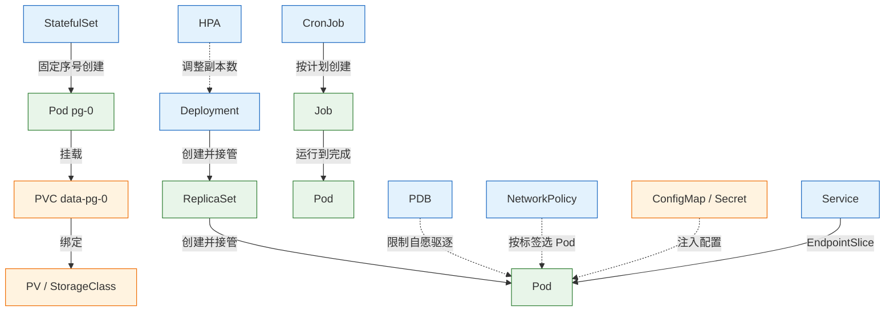
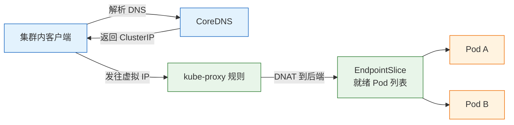
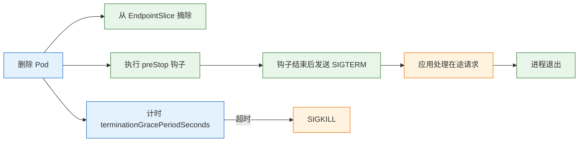
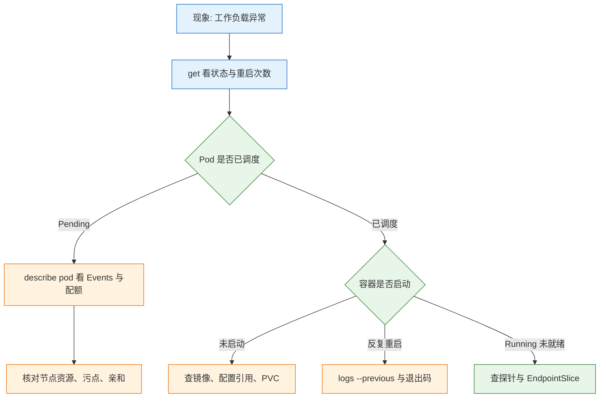

# Kubernetes 资源对象

---

## 一、Kubernetes 资源对象是什么

### 1.1 核心概念

Kubernetes 里的“资源对象”是 API Server 中持久化的一条记录，用 YAML 或 JSON 描述，由控制器负责把它变成现实。对象不是配置文件，而是集群状态的一部分：提交之后它一直存在，直到被删除；它的 `spec` 是期望值，`status` 是控制器回填的实际情况，两者不一致就会触发调谐。

这个模型解释了运维中最常见的困惑。改镜像不生效，是因为改的是 Pod 模板而不是已存在的 Pod；删了 Deployment 但 Pod 还在，是因为级联删除还没走完或对象带了 finalizer；副本数明明是 3 却只跑了 2 个，是因为 `status` 里记录了调度失败的原因。读对象时先分清 `spec` 与 `status`，一半的问题当场就能定位。

| 概念 | 含义 | 观察方式 |
|---|---|---|
| `spec` | 期望状态，由使用者写入 | `kubectl get -o yaml` 上半部分 |
| `status` | 实际状态，由控制器写入 | 同上的下半部分 |
| 控制器 | 监听对象并调谐的进程 | 内置或 Operator 提供 |
| 对象引用 | 通过名字、标签或 UID 建立关联 | `ownerReferences`、selector |
| 终态 | 对象被删除后的清理结果 | `finalizers` 清空 |

对象分两类。**工作负载类**描述“要跑什么”，如 Deployment、StatefulSet、Job；**支撑类**描述“怎么跑”，如 ConfigMap、Secret、Service、PVC、NetworkPolicy、PDB。前者决定进程，后者决定进程所处的环境。只写工作负载不写支撑对象，服务能起来但不具备可运维性。

### 1.2 与相邻技术的关系

资源对象是 K8s 的扩展点。内置对象覆盖通用场景，CRD（Custom Resource Definition）允许把数据库、消息队列、证书等外部资源也建模成对象，Operator 则是“CRD + 控制器”的组合。理解内置对象的字段语义，是读懂任何 Operator 的前提，因为它们的写法遵循同一套约定。

对象与模板工具的关系容易被夸大。Helm 负责参数化和打包，Kustomize 负责叠加与补丁，二者最终都产出对象清单交给 apiserver。它们不改变对象的运行语义，只改变清单的生成方式。排障时应当先看集群里真实存在的对象，而不是看仓库里的模板。

| 技术 | 作用 | 与对象的关系 |
|---|---|---|
| kubectl | 提交与查询对象 | 直接调用 API |
| Helm | 模板渲染与版本管理 | 生成对象清单 |
| Kustomize | 环境叠加与字段补丁 | 生成对象清单 |
| Operator | 用控制器管理复杂对象 | 监听 CRD 并创建内置对象 |
| CRD | 扩展 API 类型 | 与内置对象同等的存储与权限模型 |

与 04 篇搭好的集群配合时，对象是唯一需要关心的层面。节点、证书、CNI 属于集群面，日常变更几乎都发生在对象面。两者的分界线是：能用 `kubectl apply` 解决的属于对象面，需要登录节点改文件的属于集群面。

### 1.3 架构组成



图里三种连线对应三种关联机制。实线是所有权，删除上层会级联删除下层；虚线是选择关系，靠标签匹配，标签一改连线就断；挂载关系则要求对象必须存在于同一命名空间。

| 关联机制 | 字段 | 断开的后果 |
|---|---|---|
| 所有权 | `ownerReferences` | 上层删除后留下孤儿对象 |
| 标签选择 | `selector.matchLabels` | Service 无后端、PDB 失去保护对象 |
| 引用 | `configMapRef`、`secretKeyRef`、`claimName` | Pod 卡在创建阶段，事件报找不到对象 |

命名空间是这些关系的边界。Service 只能选同命名空间的 Pod，Pod 只能引用同命名空间的 ConfigMap 和 Secret，PVC 也只能绑定同命名空间的 PV 申请。跨命名空间只能通过 ExternalName Service 或显式网关，这是有意为之的隔离。

---

## 二、使用前提与环境准备

### 2.1 集群与工具版本

本篇假定已有一套可用的集群，至少一个控制平面加两个工作节点。所有对象操作都在控制平面执行，`kubectl` 的版本要与 apiserver 相差不超过一个小版本，否则部分字段会被静默丢弃。

```bash
# ========== 确认集群可用 ==========
# 节点应全部 Ready，否则后续 Pod 调度会失败
kubectl get nodes -o wide
# 确认 apiserver 地址与 DNS 入口
kubectl cluster-info

# ========== 确认客户端版本 ==========
# 与 apiserver 相差一个小版本以内为佳
kubectl version

# ========== 确认默认命名空间 ==========
# 当前上下文决定后续命令落在哪个命名空间
kubectl config view --minify -o jsonpath='{..namespace}'
# 确认上下文名称，多集群环境尤其重要
kubectl config current-context
```

### 2.2 命名空间与上下文

```bash
# ========== 创建独立命名空间 ==========
# 把演示对象与系统组件隔离，删除时也方便整体清理
kubectl create namespace demo

# ========== 切换默认命名空间 ==========
# 之后不必每条命令都带 -n
kubectl config set-context --current --namespace=demo

# ========== 查看命名空间资源 ==========
kubectl get all -n demo
```

| 命名空间 | 用途 | 说明 |
|---|---|---|
| `default` | 未指定时的落点 | 生产不建议直接使用 |
| `kube-system` | 控制平面与核心插件 | 不要在此创建业务对象 |
| `kube-public` | 公开可读的集群信息 | 一般只读 |
| `demo` | 本篇演示 | 可整体删除 |

> **注意**：`kubectl delete namespace` 会级联删除命名空间内的全部对象，包括 PVC 和 Secret。执行前用 `kubectl get all,pvc,secret -n <命名空间>` 核对，不要把它当成清理目录。

### 2.3 必备的集群插件

两个对象依赖集群级插件才能完整工作：HPA 依赖 metrics-server 提供指标，PVC 依赖 StorageClass 提供动态供给。裸 kubeadm 集群默认两者都没有。

```bash
# ========== 检查指标链路 ==========
# 没有输出或报错说明 metrics-server 未安装
kubectl top nodes
# 确认 metrics API 已注册，Available 应为 True
kubectl get apiservice v1beta1.metrics.k8s.io

# ========== 检查存储供给 ==========
# 没有 (default) 标记时，PVC 必须显式指定 storageClassName
kubectl get storageclass

# ========== 检查 CRD 与 API 版本 ==========
# 不同 K8s 版本的对象 API 组不同，写 YAML 前先确认
kubectl api-resources | grep -E 'deployments|statefulsets|networkpolicies'
```

| 能力 | 依赖组件 | 缺失时的现象 |
|---|---|---|
| 资源指标 | metrics-server | `kubectl top` 报错，HPA 显示 `<unknown>` |
| 动态存储 | CSI 驱动与 StorageClass | PVC 一直 Pending |
| 网络策略 | 支持策略的 CNI | 策略创建成功但不生效 |
| 入口访问 | Ingress Controller | Ingress 对象存在但无地址 |

---

## 三、对象模型与元数据

### 3.1 通用字段

每个对象都有相同的骨架：`apiVersion`、`kind`、`metadata`、`spec`，部分对象还有 `status`。`apiVersion` 决定字段结构，同一 kind 在不同 API 组里的字段可能完全不同，抄 YAML 时最先要核对的就是这一行。

```yaml
# 一个最小对象的完整骨架，字段含义见下方表格
apiVersion: apps/v1                 # API 组与版本，决定 spec 的字段结构
kind: Deployment                    # 资源类型，大小写敏感
metadata:
  name: web                         # 同命名空间内唯一，创建后不可改
  namespace: demo                   # 作用域，省略则用当前上下文
  labels:
    app: web                        # 供 selector 匹配的键值对
  annotations:
    owner: platform-team            # 供工具读取的说明性元数据
spec:
  replicas: 3                       # 期望副本数
  selector:
    matchLabels:
      app: web                      # 与模板标签必须一致
  template:
    metadata:
      labels:
        app: web
    spec:
      containers:
        - name: nginx
          image: nginx:1.30-alpine
```

| 字段 | 作用 | 改动后的后果 |
|---|---|---|
| `metadata.name` | 身份标识 | 不可修改，只能重建 |
| `metadata.namespace` | 作用域 | 不可修改，跨命名空间同名是不同对象 |
| `labels` | 被选择器匹配 | 改 Pod 标签可能让 Service 立刻失去后端 |
| `annotations` | 工具读取的元数据 | 不影响调度，但可能触发控制器行为 |
| `resourceVersion` | 乐观并发控制 | 基于旧版本更新会冲突 |

`kubectl explain` 是最可靠的字段文档，比搜索博客准确，也总能匹配当前集群版本：

```bash
# ========== 查字段文档 ==========
# 逐层展开，输出里带字段类型与是否必填
kubectl explain deployment.spec.strategy
# 复杂字段建议直接看内嵌结构，避免拼错层级
kubectl explain pod.spec.topologySpreadConstraints

# ========== 查资源支持的动词 ==========
# 某些对象不支持 deletecollection，脚本里要区别处理
kubectl api-resources --api-group=apps -o wide
```

### 3.2 标签、选择器与注解

标签是集群里的“索引”，选择器是查询语句。二者分开设计，是因为标签由对象持有者定义，选择器由消费者定义。`matchLabels` 是精确匹配，`matchExpressions` 支持 In、NotIn、Exists、DoesNotExist 四种运算符。

```yaml
# 选择器写法：matchLabels 与 matchExpressions 可以并存，取交集
selector:
  matchLabels:
    app: web
  matchExpressions:
    - key: tier
      operator: In
      values: ["frontend", "edge"]
```

| 用法 | 写法 | 典型场景 |
|---|---|---|
| 精确匹配 | `matchLabels` | Service 选 Pod、Deployment 管 ReplicaSet |
| 集合匹配 | `matchExpressions` + `In` | 一次选中多个环境 |
| 存在性 | `operator: Exists` | 排除带特定标记的 Pod |
| 注解 | `annotations` | 探针参数、Ingress 重写规则、变更原因 |

> **注意**：Deployment 的 `spec.selector` 创建后不可修改。需要换选择器只能新建对象再迁移流量，改标签绕过去会让旧 ReplicaSet 失去管束，留下孤儿 Pod。

注解与标签的区别在于是否参与选择。注解可以放较长的文本、JSON 片段、版本号，不会影响任何选择器，因此适合记录变更原因、告警规则、证书签发者这类信息。

### 3.3 所有权、finalizer 与删除语义

`ownerReferences` 记录“谁创建了我”，级联删除靠它实现。默认的删除传播策略是 Background：先删上层，再异步清理下层；`Foreground` 会等下层全部删除后才移除上层；`Orphan` 则保留下层并清除引用。

`finalizers` 是删除路上的闸门。对象被标记删除后，apiserver 只设置 `deletionTimestamp`，真正消失要等所有 finalizer 被移除。PV、LoadBalancer Service 这类持有外部资源的对象常用它，确保云盘和负载均衡先被回收。

| 机制 | 触发条件 | 卡住时的表现 |
|---|---|---|
| 级联删除 | 删除带 ownerReferences 的上层 | 下层对象残留 |
| finalizer | 对象带 finalizers 列表 | 长时间 `Terminating` |
| 优雅退出 | Pod 删除 | 进程收到 SIGTERM 后延迟退出 |
| 强制删除 | `--force --grace-period=0` | 记录消失但容器可能仍在 |

```bash
# ========== 观察删除过程 ==========
# 带 finalizer 的对象会停在 Terminating
kubectl get pod -w
# 打印 finalizers 列表，非空即表示有控制器未完成清理
kubectl get pod web-6f9c8d7b5-2xj9k -o jsonpath='{.metadata.finalizers}'

# ========== 查看对象的归属链 ==========
# 输出应为 ReplicaSet，再往上才是 Deployment
kubectl get pod web-6f9c8d7b5-2xj9k -o jsonpath='{.metadata.ownerReferences[*].kind}'
```

> **运维红线**：`kubectl delete pod --force --grace-period=0` 只从 API 抹掉记录，不保证容器进程已停。节点失联时可以用，但可能留下孤儿容器和已挂载的卷，确认存储与端口状态后再执行。

### 3.4 声明式管理与常用命令

生产环境统一用 `apply`，因为它记录最后一次应用的配置，能算出三路合并的补丁。`create` 遇到已存在对象直接报错，`replace` 会丢弃未提交的字段，`edit` 依赖人工操作且不留审计。

```bash
# ========== 提交与预览 ==========
# --dry-run=server 会走完整的准入校验，比 client 端更接近真实结果
kubectl apply -f web.yaml --dry-run=server
# 正式提交，返回 created 或 configured
kubectl apply -f web.yaml
# 对比集群现状与文件差异，确认改动范围
kubectl diff -f web.yaml

# ========== 查询 ==========
# 一次看三层对象，确认副本与 Pod 的归属
kubectl get deploy,rs,pod -o wide
# 按标签筛选并显示标签，排查选择器问题
kubectl get pod -l app=web --show-labels
# 导出完整对象，包含 status 与事件之外的全部字段
kubectl get deploy web -o yaml

# ========== 变更与回滚 ==========
# 阻塞等待本次滚动完成，脚本里必须加
kubectl rollout status deployment/web
# 列出历史版本，对应 revision 号
kubectl rollout history deployment/web
# 回滚到指定版本，省略则回上一个
kubectl rollout undo deployment/web --to-revision=2

# ========== 删除 ==========
# 按清单删除，与 apply 对称，避免漏删附属对象
kubectl delete -f web.yaml
```

| 命令 | 语义 | 适用 |
|---|---|---|
| `apply` | 声明式，计算补丁 | 日常变更 |
| `create` | 只创建，已存在则失败 | 初始化、一次性对象 |
| `replace` | 全量替换 | 明确要覆盖全部字段时 |
| `patch` | 局部修改 | 临时调整、脚本操作 |
| `edit` | 交互式修改 | 排障时快速验证 |

---

## 四、工作负载控制器

### 4.1 控制器与副本保证

控制器的工作方式是“比较、行动、再比较”。以 Deployment 为例，它不直接创建 Pod，而是创建 ReplicaSet，由 ReplicaSet 保证副本数。多一层间接是为了滚动更新：新版本对应新 ReplicaSet，旧版本保留下来，出问题可以回滚到旧 ReplicaSet 的模板。

| 对象 | 保证什么 | 适用 | 不适合 |
|---|---|---|---|
| Deployment | 副本数、滚动更新、回滚 | 无状态 API、Web、消费者 | 需要固定身份或独立磁盘 |
| StatefulSet | 固定序号、稳定 DNS、每 Pod 的 PVC | 数据库、Kafka、ZooKeeper | 无状态服务，或指望它做数据复制 |
| DaemonSet | 每个节点一个 Pod | 日志、监控、CNI、节点代理 | 副本数需要手工控制的业务 |
| Job | 至少成功一次 | 迁移、批处理、一次性修复 | 长期运行的服务 |
| CronJob | 按 cron 创建 Job | 备份、清理、报表 | 秒级精度或严格一次 |

选型顺序可以固定成三个问题：需要稳定身份和独立存储吗？需要每节点一个吗？是一次性任务吗？三者都不是，才用 Deployment。

### 4.2 Deployment 与滚动更新

```yaml
apiVersion: apps/v1
kind: Deployment
metadata:
  name: web
  namespace: demo
spec:
  replicas: 3                        # 期望副本数，HPA 会改写它
  revisionHistoryLimit: 5            # 保留的历史 ReplicaSet 数，便于回滚
  strategy:
    type: RollingUpdate
    rollingUpdate:
      maxSurge: 1                    # 更新时最多超出期望副本的 Pod 数
      maxUnavailable: 0              # 更新期间可用副本不得低于期望值
  selector:
    matchLabels:
      app: web                       # 创建后不可修改
  template:
    metadata:
      labels:
        app: web
    spec:
      terminationGracePeriodSeconds: 40
      containers:
        - name: nginx
          image: nginx:1.30-alpine   # 固定版本，避免 latest 带来的不确定性
          ports:
            - containerPort: 80
          resources:
            requests:                # 调度依据，也是 HPA 利用率的分母
              cpu: 100m
              memory: 128Mi
            limits:                  # 超过内存上限会被 OOMKilled
              cpu: 500m
              memory: 256Mi
          readinessProbe:            # 未就绪的 Pod 不会进入 EndpointSlice
            httpGet:
              path: /
              port: 80
            initialDelaySeconds: 3
            periodSeconds: 5
          livenessProbe:             # 探针失败会重启容器，不要设得过于激进
            httpGet:
              path: /
              port: 80
            initialDelaySeconds: 10
            periodSeconds: 10
```

`maxUnavailable: 0` 配合 `maxSurge: 1` 表示更新时先起新 Pod、就绪后再停旧 Pod，任何时刻可用副本都不减少。代价是需要额外一份资源，并且更新期间节点上会短暂出现 4 个副本。

> **注意**：`readinessProbe` 缺失时，Pod 一进入 Running 就被加入端点，应用尚未初始化完成的请求会直接失败。启动慢的应用必须配就绪探针，而不是把 `initialDelaySeconds` 一味调大。

### 4.3 StatefulSet 的身份语义

StatefulSet 与 Deployment 的差别不在副本数，而在身份。Pod 名字固定为 `名字-序号`，重建后名字不变，DNS 不变，绑定的 PVC 也不变。这三条保证让它能承载有状态服务。

```yaml
apiVersion: apps/v1
kind: StatefulSet
metadata:
  name: pg
  namespace: demo
spec:
  serviceName: pg-headless           # 必须指向一个无头 Service
  replicas: 1
  podManagementPolicy: OrderedReady  # 按序号逐个启动，前一个就绪才起下一个
  selector:
    matchLabels:
      app: pg
  template:
    metadata:
      labels:
        app: pg
    spec:
      containers:
        - name: postgres
          image: postgres:18-alpine
          env:
            - name: POSTGRES_PASSWORD
              valueFrom:
                secretKeyRef:
                  name: pg-secret
                  key: password
          ports:
            - containerPort: 5432
          volumeMounts:
            - name: data
              mountPath: /var/lib/postgresql   # PostgreSQL 18 起的卷挂载路径
  volumeClaimTemplates:              # 每个 Pod 一个独立 PVC
    - metadata:
        name: data
      spec:
        accessModes: ["ReadWriteOnce"]
        resources:
          requests:
            storage: 10Gi
```

```bash
# ========== 创建并观察 ==========
# PVC 名字由模板名与 Pod 名拼接而成
kubectl create secret generic pg-secret --from-literal=password='<password>'
# 先建无头 Service 再建 StatefulSet，顺序反了 Pod 无法获得稳定 DNS
kubectl apply -f pg.yaml
# 同时看 Pod 与 PVC，确认已绑定
kubectl get pod,pvc
# 打印 Pod IP，用于对比重建前后的地址变化
kubectl get pod pg-0 -o jsonpath='{.status.podIP}'

# ========== 验证数据留存 ==========
# 删除 Pod 后 StatefulSet 会用同一个 PVC 重建
kubectl delete pod pg-0
# 观察重建过程，NAME 与 PVC 引用应保持不变
kubectl get pod,pvc -w
```

预期 PVC 名为 `data-pg-0`，状态 `Bound`；Pod 名固定 `pg-0`，DNS 为 `pg-0.pg-headless.demo.svc.cluster.local`。删掉 `pg-0` 后重建，数据仍在。

但这**不代表高可用**。把 `replicas` 改成 2，得到的是两个互相独立的 PostgreSQL，不是一个主从集群。复制、选主、备份仍要数据库自身或 Operator 解决。

| 字段 | 默认 | 作用 |
|---|---|---|
| `podManagementPolicy` | `OrderedReady` | 按序号启动与停止；`Parallel` 适合无依赖副本 |
| `updateStrategy` | `RollingUpdate` | 从最大序号往回更新；`OnDelete` 需手工删 Pod |
| `persistentVolumeClaimRetentionPolicy` | `Retain` / `Retain` | 控制删除与缩容时是否连带删 PVC |

`kubectl delete sts pg` 默认不会删 PVC，这是保护数据的默认值，也意味着“删了 StatefulSet 数据还在”。要彻底清理必须单独删 PVC。

> **运维红线**：删除 PVC 会触发底层存储回收，`reclaimPolicy: Delete` 时数据立即不可恢复。删除前确认备份已完成，并核对 PV 的回收策略。

### 4.4 DaemonSet 与批处理对象

DaemonSet 保证每个符合条件的节点上跑一个 Pod，节点加入自动创建，节点移除自动清理。日志采集、监控代理、CNI 本身都用它。`nodeSelector` 和污点容忍决定它覆盖哪些节点，控制平面通常只允许特定的 DaemonSet 进入。

```yaml
apiVersion: apps/v1
kind: DaemonSet
metadata:
  name: node-logger
  namespace: demo
spec:
  selector:
    matchLabels:
      app: node-logger
  template:
    metadata:
      labels:
        app: node-logger
    spec:
      tolerations:                   # 允许进入带污点的节点
        - key: node-role.kubernetes.io/control-plane
          operator: Exists
          effect: NoSchedule
      containers:
        - name: logger
          image: busybox:1.37
          command: ["sh", "-c", "tail -f /var/log/syslog"]
          resources:
            requests:
              cpu: 20m
              memory: 32Mi
          volumeMounts:
            - name: varlog
              mountPath: /var/log
              readOnly: true
      volumes:
        - name: varlog
          hostPath:
            path: /var/log         # 读取宿主机日志，属于特权面
```

Job 保证“至少成功一次”，`backoffLimit` 控制重试次数，`restartPolicy` 只能是 `Never` 或 `OnFailure`，`ttlSecondsAfterFinished` 让完成的 Job 自动清理。CronJob 在其上加了调度，真正的难点是失败与并发策略。

```yaml
apiVersion: batch/v1
kind: CronJob
metadata:
  name: pg-backup
  namespace: demo
spec:
  schedule: "0 3 * * *"              # 每天 03:00，按控制平面时区解释
  concurrencyPolicy: Forbid          # 上一次没结束就不再起新的
  startingDeadlineSeconds: 600       # 错过调度后最多补跑 10 分钟
  successfulJobsHistoryLimit: 3
  failedJobsHistoryLimit: 3
  jobTemplate:
    spec:
      backoffLimit: 2                # 失败重试 2 次后标记 Job 失败
      template:
        spec:
          restartPolicy: Never
          containers:
            - name: dump
              image: postgres:18-alpine
              envFrom:
                - secretRef:
                    name: pg-backup-secret
              command:
                - sh
                - -c
                - pg_dump -h pg-0.pg-headless -U app app > /backup/app.sql
              volumeMounts:
                - name: backup
                  mountPath: /backup
          volumes:
            - name: backup
              persistentVolumeClaim:
                claimName: backup-pvc
```

`concurrencyPolicy: Forbid` 防止上一次备份没跑完又起一个；`startingDeadlineSeconds` 控制错过调度后还等多久。CronJob 不保证“错过的时间一定补跑”，集群停机期间错过的调度恢复后不一定补，对账类任务要能自己判断上次执行到哪。

---

## 五、配置与密钥注入

### 5.1 ConfigMap

ConfigMap 保存非敏感的键值对，可以整份文件、单个键值或整个目录导入。它的价值在于把配置从镜像里剥离，同一镜像在不同环境复用，改配置不必重新构建。

```bash
# ========== 从文件创建 ==========
# 文件名成为键名，适合挂载成配置文件
kubectl create configmap web-conf --from-file=default.conf -n demo

# ========== 从字面值创建 ==========
# 每个 --from-literal 生成一个键，适合少量环境变量
kubectl create configmap web-env \
  --from-literal=LOG_LEVEL=info \
  --from-literal=UPSTREAM=api:8080 -n demo

# ========== 查看与更新 ==========
# 导出完整对象，确认 data 下的键与内容
kubectl get configmap web-conf -o yaml
# 只看键与字节数，不展开长配置
kubectl describe configmap web-conf
```

```yaml
apiVersion: v1
kind: ConfigMap
metadata:
  name: web-conf
  namespace: demo
data:
  default.conf: |
    server {
      listen 80;
      location / {
        proxy_pass http://api:8080;   # 上游用 Service 名，不用 Pod IP
        proxy_set_header Host $host;
      }
    }
```

### 5.2 Secret

Secret 与 ConfigMap 结构相同，区别是值用 base64 编码并可以被 etcd 静态加密。base64 只是编码，不是加密，`kubectl get secret -o yaml` 就能还原明文。

```bash
# ========== 从文件创建 ==========
# 文件名作为键，避免密码进入 shell 历史
kubectl create secret generic db-creds --from-file=password=./password.txt -n demo

# ========== 从字面值创建 ==========
# 仅用于实验，生产用文件或外部密钥管理
kubectl create secret generic db-creds \
  --from-literal=password='<password>' -n demo

# ========== 查看键名而不看值 ==========
# 只输出 data 字段，值仍是 base64
kubectl get secret db-creds -o jsonpath='{.data}'
# 显示键名与总字节数，不展开内容
kubectl describe secret db-creds
```

| 类型 | 用途 | 约束 |
|---|---|---|
| `Opaque` | 通用键值 | 默认类型 |
| `kubernetes.io/tls` | TLS 证书 | 必须含 `tls.crt` 与 `tls.key` |
| `kubernetes.io/dockerconfigjson` | 镜像仓库凭证 | 键名固定为 `.dockerconfigjson` |
| `kubernetes.io/service-account-token` | 服务账号令牌 | 由集群自动管理 |

> **安全警告**：Secret 默认只做 base64，任何有 `get secrets` 权限的账号都能读到明文。必须开启 etcd 静态加密、收紧 RBAC，并优先使用 External Secrets 或云密钥服务，而不是把 Secret 提交进 Git。

### 5.3 注入方式与更新行为

| 方式 | 初始注入 | 配置更新后 | 适用 |
|---|---|---|---|
| `env` / `envFrom` | 启动时读一次 | 不会变，必须重启 Pod | 少量、启动期固定的配置 |
| volume 挂载 | 挂载为文件 | 最终会更新（通常 1 分钟内） | 配置文件、证书 |
| `subPath` 挂载 | 挂载单个文件 | 不会更新 | 很少，除非明确知道代价 |
| `immutable: true` | 禁止修改 | 只能删了重建 | 防止误改 |

```yaml
# 挂载整份 ConfigMap，键名成为目录下的文件名
volumes:
  - name: conf
    configMap:
      name: web-conf
containers:
  - name: nginx
    volumeMounts:
      - name: conf
        mountPath: /etc/nginx/conf.d
        readOnly: true
```

```bash
# ========== 配置更新后重建 Pod ==========
# 只改 ConfigMap 不会触发重启，必须显式滚动
kubectl rollout restart deployment/web -n demo
# 等待滚动完成，确认新 Pod 全部就绪
kubectl rollout status deployment/web -n demo
```

挂载更新后，Nginx 不会自动 reload；要么加 reloader sidecar，要么在配置变更时 `rollout restart`。指望“文件变了应用就生效”，是把 K8s 当成了配置中心。

> **注意**：`subPath` 挂载的文件不会随 ConfigMap 更新，也不会收到符号链接替换。需要热更新的配置必须整目录挂载，不能图省事用 `subPath` 挂单个文件。

---

## 六、存储对象与绑定

### 6.1 PV、PVC 与 StorageClass

PV 是集群级的存储资源，PVC 是命名空间内的使用申请，StorageClass 描述“用哪种存储、怎么创建”。动态供给时，PVC 一创建，供给器就按 StorageClass 创建 PV 并完成绑定，使用者不需要预先准备盘。

这条链路有三段独立的失败点：PVC 找不到可用的 StorageClass 会停在 Pending；PV 创建成功但节点挂载失败会停在 `ContainerCreating`；挂载成功而文件系统损坏则表现为容器启动即退出。三段分别对应存储供给、节点挂载、应用初始化，排障时先看 PVC 状态就能判断卡在哪一段。

| 现象 | 原因 | 判断 |
|---|---|---|
| PVC `Pending`，Pod 也 `Pending` | StorageClass 是 `WaitForFirstConsumer` | 正常，等 Pod 调度后才绑定 |
| PVC `Pending`，事件说 no storage class | 没有默认 StorageClass | `kubectl get sc`，显式指定 |
| PVC `Pending`，事件说 waiting for consumer | 延迟绑定 | 先查 Pod 为什么没调度 |
| PVC `Bound` 但挂载失败 | 节点/区域不匹配、权限、文件系统 | 看 Pod 事件和 CSI 日志 |

04 篇用 kubeadm 搭的裸集群默认没有 CSI，PVC 会一直 `Pending`。先装云厂商 CSI、Ceph/Rook 或 local-path provisioner，再确认 `kubectl get sc` 有 `(default)` 标记。

### 6.2 访问模式与回收策略

访问模式描述的是**挂载约束**，不是文件系统权限：

- `ReadWriteOnce`：一个节点可读写，同一节点上的多个 Pod 可以共用。
- `ReadOnlyMany`：多节点只读。
- `ReadWriteMany`：多节点读写，依赖存储后端支持。
- `ReadWriteOncePod`：整个集群只允许一个 Pod 挂载，适合有状态单实例。

| 模式 | 缩写 | 约束 | 常见后端 |
|---|---|---|---|
| ReadWriteOnce | RWO | 单节点读写 | 云盘、本地盘 |
| ReadOnlyMany | ROX | 多节点只读 | NFS、CephFS |
| ReadWriteMany | RWX | 多节点读写 | NFS、CephFS、对象网关 |
| ReadWriteOncePod | RWOP | 全集群单 Pod | 云盘、本地盘 |

回收策略决定 PV 释放后怎么处理：`Retain` 保留数据和卷，需人工清理；`Delete` 删除后端存储；`Recycle` 已废弃，不要使用。生产默认用 `Retain`，把删除动作留给人工确认。

### 6.3 存储扩容与快照

```bash
# ========== 查看当前容量 ==========
# STATUS 为 Bound 才说明已可用
kubectl get pvc data-pg-0 -n demo
# 只取容量值，便于脚本比较
kubectl get pvc data-pg-0 -n demo -o jsonpath='{.status.capacity.storage}'

# ========== 扩容 ==========
# 前提是 StorageClass 开启 allowVolumeExpansion 且 CSI 支持
kubectl patch pvc data-pg-0 -n demo \
  -p '{"spec":{"resources":{"requests":{"storage":"20Gi"}}}}'
# 观察 CAPACITY 变化，可能需要重启 Pod 触发文件系统扩容
kubectl get pvc data-pg-0 -n demo -w
```

扩容通常只能增大，不能缩小；文件系统在线扩容失败时，可能要重启 Pod 让驱动完成。扩容前先备份，别把“改个数字”当成无风险操作。

快照不是备份。VolumeSnapshot 依赖 CSI 和快照控制器，快照与原卷在同一个存储系统里，存储账号被封或区域故障时会一起丢失。快照适合升级前回退，长期备份仍要落到独立的对象存储，并定期做恢复演练。

---

## 七、服务发现与网络策略

### 7.1 Service 类型

Service 给一组 Pod 提供稳定的虚拟 IP 和 DNS 名。Pod 会重建、IP 会变，Service 不变，这是服务发现的基础。它的后端由 EndpointSlice 维护，只有通过就绪探针的 Pod 才会被加入。

| 类型 | 访问范围 | 实现 | 典型用途 |
|---|---|---|---|
| `ClusterIP` | 集群内 | 虚拟 IP + 转发规则 | 内部服务互调 |
| `NodePort` | 集群外，经节点 IP | 每节点开同一高端口 | 测试、少量入口 |
| `LoadBalancer` | 集群外 | 云负载均衡或 MetalLB | 生产入口 |
| `ExternalName` | 集群内解析到外部域名 | DNS CNAME | 迁移期的外部依赖 |

```yaml
apiVersion: v1
kind: Service
metadata:
  name: web
  namespace: demo
spec:
  type: ClusterIP
  selector:
    app: web                     # 必须与 Pod 标签一致，否则没有后端
  ports:
    - name: http
      port: 80                   # Service 暴露的端口
      targetPort: 80             # 容器实际监听端口
      protocol: TCP
```

```bash
# ========== 验证后端 ==========
# ENDPOINTS 为空说明选择器不匹配或 Pod 未就绪
kubectl get svc web -n demo
# EndpointSlice 里应列出所有就绪 Pod 的地址
kubectl get endpointslice -n demo -l kubernetes.io/service-name=web

# ========== 集群内测试 ==========
# 用完整域名访问，同时验证 DNS 与转发
kubectl run curl --rm -it --image=curlimages/curl --restart=Never -n demo -- \
  curl -sS http://web.demo.svc.cluster.local
```

### 7.2 EndpointSlice 与无头服务



`clusterIP: None` 的 Service 叫无头服务，它不分配虚拟 IP，DNS 直接返回所有就绪 Pod 的地址。StatefulSet 依赖它给每个 Pod 一个可解析的名字，客户端自己做连接管理或选主。

```yaml
apiVersion: v1
kind: Service
metadata:
  name: pg-headless
  namespace: demo
spec:
  clusterIP: None              # 无头服务，DNS 直接返回 Pod 地址
  selector:
    app: pg
  ports:
    - port: 5432
      targetPort: 5432
```

> **注意**：无头服务的 DNS 返回多条 A 记录，客户端若只取第一条就等于放弃了负载均衡。数据库类客户端通常需要完整列表来做拓扑感知，不要假设它自动轮询。

### 7.3 Ingress 与入口

Ingress 是七层路由规则，本身不工作，必须有 Ingress Controller 才有意义。它按域名和路径把请求转发到 Service，TLS 终止也在这一层完成。

```yaml
apiVersion: networking.k8s.io/v1
kind: Ingress
metadata:
  name: web
  namespace: demo
  annotations:
    nginx.ingress.kubernetes.io/proxy-body-size: "10m"   # 按控制器实现而定
spec:
  ingressClassName: nginx        # 必须匹配已安装的 IngressClass
  tls:
    - hosts: ["web.example.com"]
      secretName: web-tls        # 类型为 kubernetes.io/tls 的 Secret
  rules:
    - host: web.example.com
      http:
        paths:
          - path: /
            pathType: Prefix     # Prefix 按路径段匹配，Exact 要求完全一致
            backend:
              service:
                name: web
                port:
                  number: 80
```

### 7.4 NetworkPolicy

NetworkPolicy 是命名空间内默认互通之外的唯一隔离手段，前提是 CNI 支持。它是“允许列表”，没有 deny 规则，多条策略取并集；一旦某个 Pod 被某条策略选中，该方向的流量就变成默认拒绝。

```yaml
apiVersion: networking.k8s.io/v1
kind: NetworkPolicy
metadata:
  name: default-deny
  namespace: demo
spec:
  podSelector: {}                # 空选择器表示本命名空间全部 Pod
  policyTypes: ["Ingress", "Egress"]
---
apiVersion: networking.k8s.io/v1
kind: NetworkPolicy
metadata:
  name: allow-dns
  namespace: demo
spec:
  podSelector: {}
  policyTypes: ["Egress"]
  egress:
    - to:
        - namespaceSelector:
            matchLabels:
              kubernetes.io/metadata.name: kube-system
      ports:
        - protocol: UDP
          port: 53               # 常规 DNS 查询
        - protocol: TCP
          port: 53               # 大响应与区域传送
```

第二条不是可选项。默认拒绝 Egress 后 DNS 也会断，所有域名解析失败，表现为“服务明明在跑却全部超时”。

---

## 八、调度与可用性控制

### 8.1 资源请求与限制

`requests` 决定调度器预留多少资源，`limits` 决定运行时上限。两者共同决定 QoS 等级：都设且相等为 Guaranteed，只设 requests 为 Burstable，都不设为 BestEffort。节点资源紧张时，驱逐顺序按 BestEffort、Burstable、Guaranteed 排列。

| 组合 | QoS | 驱逐优先级 |
|---|---|---|
| requests 与 limits 都设且相等 | Guaranteed | 最低 |
| 只设 requests，或 limits 大于 requests | Burstable | 中等 |
| 都不设 | BestEffort | 最高 |

> **注意**：只设 `limits` 不设 `requests` 时，调度器按 limits 计算占用，节点会被过早填满；而 `requests` 远小于实际用量时，节点会超卖并在压力下集中驱逐。两个值都要基于实测。

### 8.2 节点选择与亲和

| 手段 | 管什么 | 典型误用 |
|---|---|---|
| `nodeSelector` | 只去带指定标签的节点 | 标签打错，Pod 永远 Pending |
| `nodeAffinity` | 表达式化的节点选择 | 用 required 写死机型，扩容时无节点可调度 |
| `podAntiAffinity` | 避免同类 Pod 同节点 | 副本数大于节点数时全部 Pending |
| `topologySpreadConstraints` | 按拓扑域均匀打散 | 只写 maxSkew，不写 topologyKey |
| taints/tolerations | 节点拒绝或允许某类 Pod | 给业务加控制平面容忍，拖垮控制面 |

`nodeAffinity` 的 `preferredDuringSchedulingIgnoredDuringExecution` 是软约束，节点不满足仍会调度；`required` 是硬约束，不满足就 Pending。排障时看到 Pending 且事件是 `node(s) didn't match`，先查是标签写错还是硬约束过严。

### 8.3 拓扑打散

```yaml
topologySpreadConstraints:
  - maxSkew: 1                          # 任意两个拓扑域的数量差不超过 1
    topologyKey: kubernetes.io/hostname # 以节点为打散单位
    whenUnsatisfiable: ScheduleAnyway   # 优先均匀，节点不够时仍允许调度
    labelSelector:
      matchLabels:
        app: web
```

`DoNotSchedule` 更严格，节点不够时直接 Pending；`ScheduleAnyway` 先保证能跑，再尽量均匀。两者都是取舍，不是越严格越好。

### 8.4 PDB 与优雅退出

```yaml
apiVersion: policy/v1
kind: PodDisruptionBudget
metadata:
  name: web-pdb
  namespace: demo
spec:
  minAvailable: 2                # 至少保留 2 个就绪副本才允许驱逐
  selector:
    matchLabels:
      app: web
```

PDB 只在 `kubectl drain`、节点排空、集群升级这类**自愿驱逐**时生效。节点直接断电、kubelet 失联，Pod 该没还是没；这时靠的是副本数、多可用区和快速重建。PDB 也不能让不可用的 Pod 变可用，`ALLOWED DISRUPTIONS` 按当前就绪副本计算。



摘除端点与执行 `preStop` 是并发开始的，网关可能还把请求发给正在退出的 Pod。`preStop` 先等几秒，给端点传播留时间：

```yaml
lifecycle:
  preStop:
    exec:
      command: ["sh", "-c", "sleep 5"]   # 等待端点摘除传播
terminationGracePeriodSeconds: 40        # 必须大于 preStop 加应用退出时间
```

`preStop` 执行完才发 SIGTERM，应用收到信号后停止接新请求、处理完在途请求再退出。钩子里不要写长时间阻塞的清理逻辑，否则会挤占优雅退出预算。

> **注意**：`terminationGracePeriodSeconds` 要覆盖 `preStop` 与应用收尾的总时间，否则进程会在处理请求时被 SIGKILL，表现为发布期间偶发 502。

---

## 九、弹性伸缩与资源治理

### 9.1 HPA

```yaml
apiVersion: autoscaling/v2
kind: HorizontalPodAutoscaler
metadata:
  name: web
  namespace: demo
spec:
  scaleTargetRef:
    apiVersion: apps/v1
    kind: Deployment
    name: web
  minReplicas: 3                 # 下限，低于它会丢失冗余
  maxReplicas: 10                # 上限，受配额与节点容量约束
  metrics:
    - type: Resource
      resource:
        name: cpu
        target:
          type: Utilization
          averageUtilization: 60 # 相对 requests 的平均利用率
  behavior:
    scaleDown:
      stabilizationWindowSeconds: 300   # 缩容前观察 5 分钟，避免抖动
```

```bash
# ========== 观察伸缩 ==========
# TARGETS 显示实际值/目标值，unknown 说明指标链路断了
kubectl get hpa -n demo
# 确认每个 Pod 的实时用量，requests 是利用率分母
kubectl top pods -n demo
# 事件里能看到扩容决策与失败原因
kubectl describe hpa web -n demo
```

显示 `<unknown>` 通常是 metrics-server 没装、Pod 没设 requests，或 kubelet 证书校验失败。裸 kubeadm 集群默认没有 metrics-server，先按官方清单安装；自签证书环境常要加 `--kubelet-insecure-tls`，生产应换成正确的 CA。HPA 扩容有延迟，缩容默认还有 5 分钟稳定窗口，它不适合应对秒级尖峰。

### 9.2 配额与默认值

```yaml
apiVersion: v1
kind: ResourceQuota
metadata:
  name: team-quota
  namespace: demo
spec:
  hard:
    requests.cpu: "8"            # 命名空间内 requests 总和上限
    requests.memory: 16Gi
    limits.cpu: "16"
    limits.memory: 32Gi
    pods: "40"
---
apiVersion: v1
kind: LimitRange
metadata:
  name: default-limits
  namespace: demo
spec:
  limits:
    - type: Container
      defaultRequest:            # 没写 requests 时自动补
        cpu: 100m
        memory: 128Mi
      default:                   # 没写 limits 时自动补
        cpu: 500m
        memory: 512Mi
```

`ResourceQuota` 限制命名空间总量，`LimitRange` 给没写 requests/limits 的容器补默认值。两者都会影响调度和驱逐：配额用满后新 Pod 直接被拒绝；LimitRange 的默认值太大，会让每个 Pod 都占住资源。

| 对象 | 作用范围 | 超限后果 |
|---|---|---|
| ResourceQuota | 整个命名空间 | 创建被拒绝，事件报 exceeded quota |
| LimitRange | 单个容器或 Pod | 自动补默认值，或拒绝超限声明 |
| PDB | 自愿驱逐 | 驱逐阻塞，drain 卡住 |
| HPA | 单个工作负载 | 受配额与节点容量封顶 |

配额是资源治理，不是安全边界。真正隔离租户还要靠 RBAC、NetworkPolicy 和独立的命名空间或集群。

---

## 十、可运维改造完整示例

### 10.1 基础部署与配置挂载

在 04 篇搭好的三节点集群上，把最初的裸 Deployment 补齐成一个可运维的服务。

```yaml
apiVersion: apps/v1
kind: Deployment
metadata:
  name: web
  namespace: demo
spec:
  replicas: 3
  selector:
    matchLabels:
      app: web
  template:
    metadata:
      labels:
        app: web
    spec:
      topologySpreadConstraints:          # 三个副本尽量分散到不同节点
        - maxSkew: 1
          topologyKey: kubernetes.io/hostname
          whenUnsatisfiable: ScheduleAnyway
          labelSelector:
            matchLabels:
              app: web
      containers:
        - name: nginx
          image: nginx:1.30-alpine
          ports:
            - containerPort: 80
          resources:
            requests:
              cpu: 100m
              memory: 128Mi
            limits:
              cpu: 500m
              memory: 256Mi
          readinessProbe:
            httpGet:
              path: /
              port: 80
          volumeMounts:
            - name: conf
              mountPath: /etc/nginx/conf.d
              readOnly: true
          lifecycle:
            preStop:
              exec:
                command: ["sh", "-c", "sleep 5"]
      terminationGracePeriodSeconds: 40
      volumes:
        - name: conf
          configMap:
            name: web-conf
```

```bash
# ========== 先准备配置再部署 ==========
# ConfigMap 必须先存在，否则 Pod 卡在 ContainerCreating
kubectl create configmap web-conf --from-file=default.conf -n demo
# 提交完整 Deployment，包含打散、探针与 preStop
kubectl apply -f web-full.yaml
# 等待三个副本全部就绪，脚本里不能省略
kubectl rollout status deployment/web -n demo
# 确认副本分布在不同节点
kubectl get pods -n demo -o wide
```

### 10.2 打散、PDB 与节点维护演练

```bash
# ========== 创建 PDB ==========
# 三个副本要求至少三个可用，任何驱逐都会被挡住
kubectl apply -f web-pdb.yaml
# ALLOWED DISRUPTIONS 应为 0
kubectl get pdb web-pdb -n demo
```

预期：

```text
NAME      MIN AVAILABLE   MAX UNAVAILABLE   ALLOWED DISRUPTIONS   AGE
web-pdb   3               N/A               0                     8s
```

```bash
# ========== 演练节点维护 ==========
# 应被 PDB 拒绝，服务不会因维护而中断
kubectl drain k8s-node1 --ignore-daemonsets --delete-emptydir-data
```

预期：

```text
evicting pod demo/web-6f9c8d7b5-2xj9k
error when evicting pods/"web-..." -n "demo": Cannot evict pod as it would violate the pod's disruption budget.
```

把 `minAvailable` 调到 2 再 drain，`ALLOWED DISRUPTIONS` 变成 1，驱逐会一次一个地进行，Pod 在 node2 上重建。

```bash
# ========== 放宽 PDB 后重试 ==========
# 把下限降到 2，允许同时中断一个副本
kubectl patch pdb web-pdb -n demo --type=merge -p '{"spec":{"minAvailable":2}}'
# 确认 ALLOWED DISRUPTIONS 变为 1
kubectl get pdb web-pdb -n demo
# 重新排空，驱逐会逐个进行
kubectl drain k8s-node1 --ignore-daemonsets --delete-emptydir-data

# ========== 维护完成后恢复调度 ==========
# uncordon 只恢复可调度，不会把已迁走的 Pod 迁回
kubectl uncordon k8s-node1
# 确认副本分布已经倾斜，便于后续用 descheduler 调整
kubectl get pods -n demo -o wide
```

### 10.3 配置更新链路验证

```bash
# ========== 修改配置并滚动 ==========
# 只改 ConfigMap 不会重启 Pod，必须显式触发
kubectl edit configmap web-conf -n demo
# 滚动重建，新 Pod 会挂载更新后的文件
kubectl rollout restart deployment/web -n demo
# 等待滚动完成，确认无 Pod 卡在未就绪
kubectl rollout status deployment/web -n demo

# ========== 确认新副本生效 ==========
# 查看 Pod 列表与标签，确认全部为新副本
kubectl get pods -n demo --show-labels
# 直接在容器内读取配置文件，验证挂载内容
kubectl exec deploy/web -n demo -- cat /etc/nginx/conf.d/default.conf
```

| 改造项 | 挡住的故障 | 验证方式 |
|---|---|---|
| 拓扑打散 | 单节点故障导致全量副本丢失 | `get pods -o wide` 看分布 |
| PDB | 维护时副本被一次性清空 | drain 被拒绝或逐个驱逐 |
| 就绪探针 | 未初始化完成就接流量 | `get endpointslice` 看就绪地址 |
| preStop | 发布期间偶发 502 | 滚动更新时持续压测 |
| 资源声明 | 节点超卖与集中驱逐 | `describe node` 看分配率 |

---

## 十一、常见排障

### 11.1 故障对照表

| 现象 | 最可能原因 | 处理 |
|---|---|---|
| Pod `Pending` | requests 太大、污点、PVC 未绑定、配额 | `describe pod` 看 Events，`describe node` 看可分配资源 |
| PVC 一直 `Pending` | 无默认 StorageClass，或延迟绑定 | `get sc`，确认 Pod 是否已调度 |
| `CrashLoopBackOff` | 应用退出、配置错、权限错 | `logs --previous`，`describe pod` 看退出码 |
| `OOMKilled` | 内存 limit 太小或堆未限制 | 调 limit，同时调运行时堆参数 |
| Running 但 `0/1` | readiness 失败 | `describe` 看探针，`exec` 手工请求 |
| `Evicted` | 节点磁盘或内存压力 | 清镜像日志、扩容，查 `describe node` |
| 配置改了没生效 | 用 env 或 `subPath`，或没重启 | 改挂载方式，`rollout restart` |
| Secret 读取被拒 | RBAC 无权限，或名字与命名空间错 | `kubectl auth can-i get secret` |
| `drain` 一直卡住 | PDB 的 `minAvailable` 等于副本数 | 扩容或下调 PDB，确认业务可承受 |
| HPA 显示 `<unknown>` | metrics-server、requests、证书 | `kubectl top pods` 先验证指标链路 |
| 默认拒绝后 DNS 全挂 | Egress 没放行 53 | 补 DNS 允许策略 |
| StatefulSet Pod 卡住 | PVC 未绑定，或前序号未终止 | 从序号 0 查，先看 PVC 与终止状态 |
| 删了 StatefulSet 数据还在 | PVC 默认保留 | 确认后再删 PVC，注意回收策略 |

### 11.2 排查顺序



1. `kubectl get` 看状态、重启次数、所在节点。
2. `kubectl describe` 看 Events 和 Conditions。
3. `kubectl logs`，崩溃过的加 `--previous`。
4. `kubectl get pvc,pv,sc` 确认存储链路。
5. `kubectl exec` 进容器测配置、DNS、端口。
6. `kubectl auth can-i` 与 NetworkPolicy 确认权限与连通。
7. 最后看节点压力、kubelet、CSI 与 CNI 日志。

```bash
# ========== 常用定位命令 ==========
# 事件按时间排序，最新问题在最后
kubectl describe pod -n demo -l app=web | sed -n '/Events/,$p'

# 上一次崩溃的日志，容器已重启时唯一有效
kubectl logs -n demo deploy/web --previous --tail=100

# 确认 Service 是否真的没有后端
kubectl get endpointslice -n demo -l kubernetes.io/service-name=web -o wide

# 确认当前账号能否读 Secret
kubectl auth can-i get secrets -n demo
```

排障的关键是不要跳步。先确认对象是否被调度，再确认容器是否启动，最后才看应用日志。顺序颠倒会把调度问题误判成应用问题，改配置只会让现场更乱。
