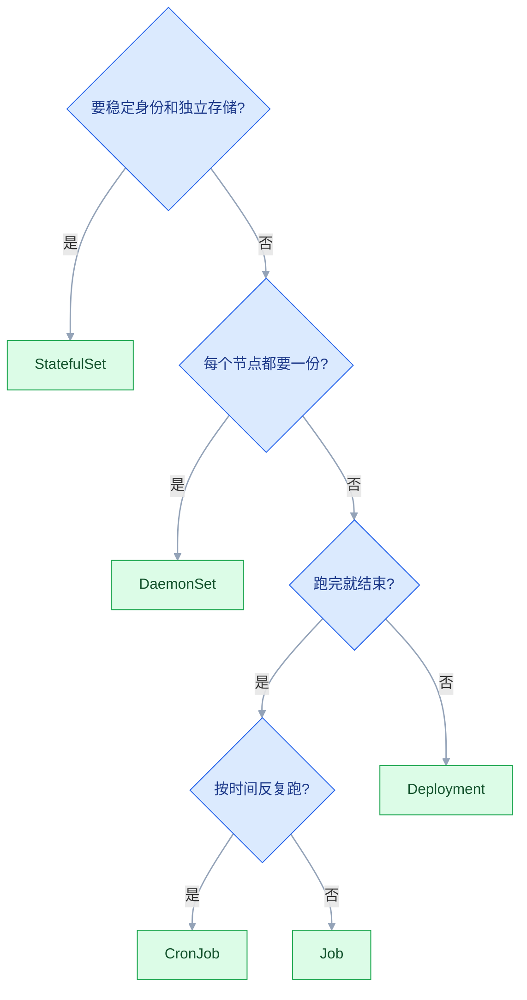
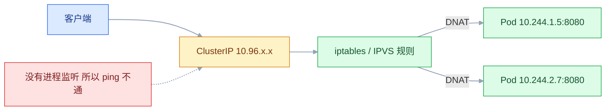
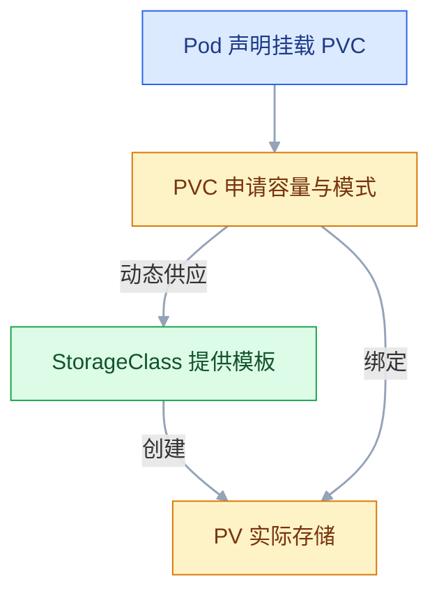

# Kubernetes 资源对象

## 一、工程案例：把「Spring Boot + MySQL + Ingress + HPA」部署成可运维的一套

**场景**：一套 Spring Boot 后端 + MySQL，原来在一台机器上用 `docker run` 跑。现在要迁到 K8s，并且满足六条硬要求：MySQL 数据在 Pod 重建后不能丢；密码不能进 YAML；MySQL 不对外；应用两个副本，滚动更新期间不中断；域名 + HTTPS 访问；流量上来能自动扩容。

**为什么必须用不同的对象**：这六条需求分别命中六类对象。用 Deployment 跑 MySQL 会丢"稳定身份 + 稳定存储"，用 NodePort 做对外会失掉七层路由，用明文 env 会把密码写进 `kubectl describe`。选错对象不是"能跑但不好"，是"一到故障就救不回来"。

| 需求 | 对象 | 不用的后果 |
|---|---|---|
| 多副本、自愈、滚动更新 | Deployment | 手工管 Pod，删了不会回来 |
| 稳定名字 + 独立存储 | StatefulSet + volumeClaimTemplates | Pod 重建后挂到别人的盘 |
| 密码不入 YAML | Secret | 密码进 Git、进 CI 日志 |
| 集群内稳定入口 | Headless Service / ClusterIP | 应用写死 Pod IP，重建即断 |
| 域名 + HTTPS | Ingress + TLS Secret | 每个服务开一个 NodePort |
| 自动扩容 | HPA + requests | 只能手工 scale |

### 1.1 主线（按顺序 apply）

```bash
kubectl create namespace prod-app
kubectl -n prod-app create secret generic mysql-secret \
  --from-literal=root-password='Root@2026#Strong' \
  --from-literal=app-password='AppUser@2026'
```

```yaml
# 01-config.yaml
apiVersion: v1
kind: ConfigMap
metadata:
  name: app-config
  namespace: prod-app
data:
  DB_HOST: "mysql-headless"
  DB_PORT: "3306"
  DB_NAME: "appdb"
  LOG_LEVEL: "info"
  TZ: "Asia/Shanghai"
```

```yaml
# 02-mysql.yaml
apiVersion: v1
kind: Service
metadata:
  name: mysql-headless
  namespace: prod-app
spec:
  clusterIP: None
  selector:
    app: mysql
  ports:
    - name: mysql
      port: 3306
      targetPort: 3306
---
apiVersion: apps/v1
kind: StatefulSet
metadata:
  name: mysql
  namespace: prod-app
spec:
  serviceName: mysql-headless
  replicas: 1
  selector:
    matchLabels:
      app: mysql
  template:
    metadata:
      labels:
        app: mysql
    spec:
      terminationGracePeriodSeconds: 30
      containers:
        - name: mysql
          image: mysql:8.0
          args:
            - --character-set-server=utf8mb4
            - --collation-server=utf8mb4_unicode_ci
          ports:
            - name: mysql
              containerPort: 3306
          env:
            - name: MYSQL_ROOT_PASSWORD
              valueFrom:
                secretKeyRef:
                  name: mysql-secret
                  key: root-password
            - name: MYSQL_DATABASE
              value: appdb
            - name: MYSQL_USER
              value: appuser
            - name: MYSQL_PASSWORD
              valueFrom:
                secretKeyRef:
                  name: mysql-secret
                  key: app-password
            - name: TZ
              value: Asia/Shanghai
          volumeMounts:
            - name: data
              mountPath: /var/lib/mysql
          resources:
            requests:
              cpu: 250m
              memory: 512Mi
            limits:
              cpu: "1"
              memory: 1Gi
          readinessProbe:
            exec:
              command: ["sh", "-c", "mysqladmin ping -h 127.0.0.1 -uroot -p\"$MYSQL_ROOT_PASSWORD\""]
            initialDelaySeconds: 15
            periodSeconds: 10
            failureThreshold: 6
          livenessProbe:
            exec:
              command: ["sh", "-c", "mysqladmin ping -h 127.0.0.1 -uroot -p\"$MYSQL_ROOT_PASSWORD\""]
            initialDelaySeconds: 60
            periodSeconds: 20
            failureThreshold: 5
  volumeClaimTemplates:
    - metadata:
        name: data
      spec:
        accessModes: ["ReadWriteOnce"]
        resources:
          requests:
            storage: 5Gi
```

```yaml
# 03-app.yaml
apiVersion: apps/v1
kind: Deployment
metadata:
  name: springboot-app
  namespace: prod-app
spec:
  replicas: 2
  revisionHistoryLimit: 5
  strategy:
    type: RollingUpdate
    rollingUpdate:
      maxSurge: 1
      maxUnavailable: 0
  selector:
    matchLabels:
      app: springboot
  template:
    metadata:
      labels:
        app: springboot
    spec:
      containers:
        - name: app
          image: registry.example.com/myteam/springboot-app:v1.0.0
          ports:
            - name: http
              containerPort: 8080
          envFrom:
            - configMapRef:
                name: app-config
          env:
            # Kubernetes 会先展开 $(VAR)，这里引用的是上面 ConfigMap 注入的变量
            - name: SPRING_DATASOURCE_URL
              value: "jdbc:mysql://$(DB_HOST):$(DB_PORT)/$(DB_NAME)?useUnicode=true&characterEncoding=utf8&serverTimezone=Asia/Shanghai"
            - name: SPRING_DATASOURCE_USERNAME
              value: appuser
            - name: SPRING_DATASOURCE_PASSWORD
              valueFrom:
                secretKeyRef:
                  name: mysql-secret
                  key: app-password
            - name: MANAGEMENT_ENDPOINT_HEALTH_PROBES_ENABLED
              value: "true"
          resources:
            requests:
              cpu: 250m
              memory: 512Mi
            limits:
              cpu: "1"
              memory: 1Gi
          startupProbe:
            httpGet:
              path: /actuator/health/liveness
              port: http
            periodSeconds: 5
            failureThreshold: 30
          readinessProbe:
            httpGet:
              path: /actuator/health/readiness
              port: http
            periodSeconds: 5
            timeoutSeconds: 3
            failureThreshold: 3
          livenessProbe:
            httpGet:
              path: /actuator/health/liveness
              port: http
            periodSeconds: 10
            timeoutSeconds: 3
            failureThreshold: 3
---
apiVersion: v1
kind: Service
metadata:
  name: springboot-svc
  namespace: prod-app
spec:
  selector:
    app: springboot
  ports:
    - name: http
      port: 80
      targetPort: http
```

```yaml
# 04-ingress.yaml
apiVersion: networking.k8s.io/v1
kind: Ingress
metadata:
  name: app-ingress
  namespace: prod-app
  annotations:
    nginx.ingress.kubernetes.io/proxy-body-size: "20m"
spec:
  ingressClassName: nginx
  tls:
    - hosts: ["app.example.com"]
      secretName: app-tls
  rules:
    - host: app.example.com
      http:
        paths:
          - path: /
            pathType: Prefix
            backend:
              service:
                name: springboot-svc
                port:
                  number: 80
```

```bash
# 自签证书仅用于测试，生产换正式证书
openssl req -x509 -nodes -days 365 -newkey rsa:2048 \
  -keyout /tmp/app.key -out /tmp/app.crt -subj "/CN=app.example.com"
kubectl -n prod-app create secret tls app-tls --cert=/tmp/app.crt --key=/tmp/app.key

kubectl apply -f 01-config.yaml -f 02-mysql.yaml -f 03-app.yaml -f 04-ingress.yaml
kubectl -n prod-app get pods,pvc,svc,ingress
```

**关键输出**：

```text
$ kubectl -n prod-app get pods,pvc
NAME                              READY   STATUS    RESTARTS
pod/springboot-app-7d9f8c6b5-2k4mn   1/1     Running   0
pod/springboot-app-7d9f8c6b5-x8p2q   1/1     Running   0
pod/mysql-0                          1/1     Running   0

NAME                 STATUS   VOLUME     CAPACITY   ACCESS MODES
persistentvolumeclaim/data-mysql-0   Bound   pvc-8f3a...   5Gi   RWO

$ kubectl -n prod-app describe ingress app-ingress
Rules:
  Host             Path  Backends
  ----             ----  --------
  app.example.com
                   /     springboot-svc:80 (10.244.1.9:8080,10.244.2.7:8080)
```

> Ingress 的 Backends 里能看到两个 Pod IP，说明 Service 的两个副本都进了 Endpoints。显示 `<none>` 就是 selector 没匹配上，不用查 Ingress Controller。
>
> ConfigMap 里放的是**键值对**。多行的配置文件要挂载成文件才能用，`envFrom` 会把每个键变成一个环境变量——把一段 YAML 塞进 ConfigMap 再 `envFrom`，得到的是一个含换行符的非法环境变量，应用读不到。本例的 `application.yml` 因此拆成 `SPRING_*` 环境变量注入。

### 1.2 验收（10 项）

| # | 检查 | 命令 | 通过标准 |
|---|---|---|---|
| 1 | 数据库有独立 PVC | `kubectl -n prod-app get pvc` | `data-mysql-0` 为 `Bound` |
| 2 | 数据库有稳定 DNS | 集群内 `nslookup mysql-0.mysql-headless.prod-app` | 解析出 Pod IP |
| 3 | 删 Pod 数据不丢 | 写一行 → `delete pod mysql-0` → 等 Ready 再查 | 数据还在 |
| 4 | 密码不在 YAML 里 | `helm`/`grep` 检查清单 | 只有 `secretKeyRef` |
| 5 | 两个副本都就绪 | `kubectl -n prod-app get deploy` | `READY 2/2` |
| 6 | Service 有后端 | `get endpoints springboot-svc` | 两个 `IP:8080` |
| 7 | 集群内可访问 | `curl http://springboot-svc/actuator/health` | `{"status":"UP"}` |
| 8 | 外部 HTTPS 可访问 | `curl -k https://app.example.com/actuator/health` | `{"status":"UP"}` |
| 9 | 更新不掉流量 | 更新期间持续 curl 200 次 | 无一次失败 |
| 10 | 回滚生效 | `rollout undo` 后查镜像 | 回到 `v1.0.0` |

```bash
# 第 3 项的具体做法
kubectl -n prod-app exec -it mysql-0 -- mysql -uappuser -pAppUser@2026 appdb -e \
  "CREATE TABLE IF NOT EXISTS t(id INT PRIMARY KEY AUTO_INCREMENT, note VARCHAR(32));
   INSERT INTO t(note) VALUES('before-restart');"
kubectl -n prod-app delete pod mysql-0
kubectl -n prod-app wait --for=condition=Ready pod/mysql-0 --timeout=180s
kubectl -n prod-app exec -it mysql-0 -- mysql -uappuser -pAppUser@2026 appdb -e "SELECT * FROM t;"
```

> 第 3 项是整个案例的核心。PVC 名字是 `data-mysql-0`，绑定关系跟着 Pod 名字走，跟 Pod 生命周期无关——这就是 StatefulSet 存在的唯一理由。
> 第 9、10 项对应下面的滚动更新与回滚，必须真的在更新期间打请求，只跑 `rollout status` 只能说明"更新完成了"，说明不了"没掉流量"。

### 1.3 滚动更新与回滚

```bash
# 另开一个终端持续打请求，观察有没有 5xx
kubectl -n prod-app run probe --image=busybox:1.36 --rm -it --restart=Never -- \
  sh -c 'for i in $(seq 1 200); do wget -q -O- http://springboot-svc/actuator/health >/dev/null || echo "FAIL $i"; sleep 0.2; done; echo done'

kubectl -n prod-app set image deployment/springboot-app app=registry.example.com/myteam/springboot-app:v1.1.0
kubectl -n prod-app rollout status deployment/springboot-app

# 发现 v1.1.0 有问题，立刻回滚
kubectl -n prod-app rollout undo deployment/springboot-app
kubectl -n prod-app rollout status deployment/springboot-app
kubectl -n prod-app get deploy springboot-app -o jsonpath='{.spec.template.spec.containers[0].image}'; echo
```

### 1.4 HPA

```yaml
apiVersion: autoscaling/v2
kind: HorizontalPodAutoscaler
metadata:
  name: app-hpa
  namespace: prod-app
spec:
  scaleTargetRef:
    apiVersion: apps/v1
    kind: Deployment
    name: springboot-app
  minReplicas: 2
  maxReplicas: 8
  metrics:
    - type: Resource
      resource:
        name: cpu
        target:
          type: Utilization
          averageUtilization: 60
  behavior:
    scaleDown:
      stabilizationWindowSeconds: 300
```

```bash
kubectl -n prod-app get hpa
# TARGETS 显示 <unknown>/60% 就是 metrics 拿不到，见 2.9
```

> 开了 HPA 之后，Deployment 的 `replicas` 会被 HPA 覆盖。想固定副本数，调 `minReplicas` 或先删 HPA。

---

## 二、高频问答：会卡住你的地方，也是面试最常问的

### 2.1 `kubectl apply` 报 `selector does not match template labels`

**现场**

两段贴出来逐字对比，注意多余的空格和不同的 key。

```bash
kubectl get deploy <名字> -o jsonpath='{.spec.selector.matchLabels}'; echo
kubectl get deploy <名字> -o jsonpath='{.spec.template.metadata.labels}'; echo
```

**要点**

- `spec.selector.matchLabels` 和 `template.metadata.labels` 必须完全一致，错在只改了其中一处。
- selector 创建后不可变，改不回去只能重建。
- 判断依据是逐字对比，多余的空格和不同的 key 都算差异。

**追问**

- 为什么 selector 不可变？→ 它是 Deployment 认领 Pod 的唯一凭据，改了已有 Pod 就脱管。
- 已经写错了怎么修？→ 删掉重建，`edit` 会被拒。
- 多一个 key 也算不一致吗？→ 算，两边必须完全相等，不是包含关系。

### 2.2 Service 访问不通，Endpoints 是 `<none>`

**现场**

`get endpoints` 为空 → 查 Pod 标签 → 查 Service selector。

```bash
kubectl -n prod-app get endpoints springboot-svc
kubectl -n prod-app get pods --show-labels
kubectl -n prod-app get svc springboot-svc -o jsonpath='{.spec.selector}'; echo
```

**要点**

- Endpoints 是 Service 与 Pod 的接线板，为空说明 selector 一个都没选中。
- 最常见的是命名空间不同或标签拼错，不是 Service 本身配错。
- 顺序固定：先看 Endpoints 再决定往哪查，别直接重建 Service。

**追问**

- 为什么要先看 Endpoints？→ 它一眼就能分清"没接上"和"接上了但有别的问题"。
- Endpoints 有值但访问不通？→ 问题在 Pod 或 targetPort，不在 Service。
- 怎么快速对标签？→ `get pods --show-labels` 和 Service 的 selector 并排看。

### 2.3 Pod 卡在 `Pending`，Events 里 `pod has unbound immediate PersistentVolumeClaims`

**现场**

先看 PVC 的 STATUS 和 Events，再看 Pod。

```bash
kubectl -n prod-app get pvc
kubectl -n prod-app describe pvc data-mysql-0 | tail -10
kubectl get storageclass
```

**要点**

- PVC 没绑定，Pod 就永远调度不上去。
- 常见原因是 StorageClass 名字写错、没有默认 SC、或容量超过配额。
- 跳过 PVC 直接查 CSI，等于把该查的三件事都漏掉。

**追问**

- 为什么 Pending 的锅在 PVC？→ 有 unbound 的 PVC 时，调度器直接放弃这个 Pod。
- 没有默认 SC 怎么办？→ 给某个 SC 打默认标记，或在 PVC 里显式写 `storageClassName`。
- 三种原因怎么区分？→ `describe pvc` 的 Events 直接写着是哪一种。

### 2.4 Secret 挂载后应用读到的还是旧密码

**现场**

进容器 `env | grep` 对比 Secret 当前值。

```bash
kubectl -n prod-app get secret mysql-secret -o jsonpath='{.data.app-password}' | base64 -d; echo
kubectl -n prod-app exec deploy/springboot-app -- env | grep DB_PASSWORD
kubectl -n prod-app rollout restart deploy/springboot-app
```

**要点**

- 环境变量是启动时的快照，Secret 更新后容器内不会变。
- `create` 同名会直接报已存在，反复 create 也改不了值。
- 改完要 `rollout restart`，新值才会进容器。

**追问**

- 挂载成文件会更新吗？→ 会，大约 1 分钟；只有环境变量这条路不行。
- 为什么 env 不跟着变？→ 进程的环境在启动那一刻就固定了。
- 怎么避免每次重启？→ 配置走挂载文件，不要走环境变量。

### 2.5 `ImagePullBackOff`，但本机 `docker pull` 是成功的

**现场**

看 Events 里的原因，`unauthorized` 就是凭据问题。

```bash
kubectl -n prod-app describe pod <pod名> | grep -A 5 Failed
kubectl -n prod-app create secret docker-registry regcred \
  --docker-server=registry.example.com \
  --docker-username=deployer --docker-password='***'
# 然后在 Pod spec 里加 imagePullSecrets: [{name: regcred}]
```

**要点**

- 节点的容器运行时是独立的，没有你的 `~/.docker/config.json`。
- 本机 `docker pull` 成功，推不出节点也能拉。
- 私有仓库必须给 Pod 配 `imagePullSecrets`，光建 Secret 不生效。

**追问**

- 为什么本机能拉、节点不能？→ 凭据只对当前用户和那台机器有效。
- 怎么区分凭据问题和网络问题？→ `unauthorized` 是凭据，拉取超时才是网络。
- Secret 建好为什么还失败？→ 还要在 Pod spec 的 `imagePullSecrets` 里引用它。

### 2.6 滚动更新卡住，旧 Pod 一直不删

**现场**

新 RS 的 Pod 是 `Running` 但 `READY 0/1`。

```bash
kubectl -n prod-app get pods -l app=springboot
kubectl -n prod-app describe pod <新Pod> | grep -A 5 Readiness
kubectl -n prod-app rollout undo deploy/springboot-app    # 先恢复服务
```

**要点**

- 滚动更新是"先增后减"：新 Pod 不 Ready，副本数上不去，旧的就不会缩。
- 根因在新 Pod 的 readinessProbe，不在 Deployment 本身。
- 手工 `delete pod` 没用，副本账没变，控制器会补回来。

**追问**

- 为什么服务没挂？→ 旧 Pod 一个没删，流量还在旧版本上。
- 怎么先恢复？→ `rollout undo` 回到上一版，再慢慢查探针。
- `maxUnavailable: 0` 会让卡住更明显吗？→ 会，它必须等新 Pod Ready 才肯删旧的，问题直接暴露在副本数上。

### 2.7 加了 NetworkPolicy 后，所有域名都解析不了

**现场**

从 Pod 里直接解析，看是超时还是 NXDOMAIN。

```bash
kubectl -n prod-app exec deploy/springboot-app -- nslookup kubernetes.default
kubectl -n prod-app get networkpolicy
# 补一条放行 kube-system 的 UDP/TCP 53
```

**要点**

- `policyTypes` 声明了 `Egress` 却没写任何 `egress` 规则时，出站被默认拒绝，53 也不通。
- 错在只堵不疏，CoreDNS 本身没挂。
- 补一条放行 kube-system 的 UDP/TCP 53 就恢复。

**追问**

- 为什么是超时不是 NXDOMAIN？→ 包被丢了，DNS 请求根本没到 CoreDNS。
- 只写 ingress 会影响出站吗？→ 不会，只有声明了 Egress 才管出站。
- NetworkPolicy 的白名单语义是什么？→ 一旦选中 Pod 并声明方向，没放行的流量默认拒绝。

### 2.8 `kubectl exec` 进不去，报 `executable file not found`

**现场**

先试 `sh`，再试 `ls`。

```bash
kubectl -n prod-app exec -it <pod> -- sh
# 完全没有 shell 时用临时容器
kubectl -n prod-app debug -it <pod> --image=busybox:1.36 --target=app
```

**要点**

- 不是容器挂了，是镜像里没有 bash。
- distroless、alpine、scratch 里可能只有 `sh`，甚至什么都没有。
- 完全没有 shell 时用 `kubectl debug` 的临时容器。

**追问**

- 怎么判断镜像里有什么？→ 从 `sh` 到 `ls` 逐个试，报 not found 就换。
- `--target` 是干什么的？→ 共享目标容器的进程命名空间，才能看到它的进程。
- 临时容器会改原 Pod 吗？→ 不写进 Pod 模板，Pod 重建就消失。

### 2.9 HPA 的 TARGETS 显示 `<unknown>`

**现场**

先看 Pod 有没有 requests，再看 metrics APIService。

```bash
kubectl -n prod-app get deploy springboot-app -o jsonpath='{.spec.template.spec.containers[0].resources}'; echo
kubectl get apiservice v1beta1.metrics.k8s.io
kubectl top pods -n prod-app
```

**要点**

- `<unknown>` 表示拿不到指标，改阈值不会有任何作用。
- 最常见是 Pod 没设 `resources.requests`，百分比算不出来。
- 其次才是 metrics-server 没就绪。

**追问**

- 为什么没 requests 就算不出百分比？→ `Utilization` 的基数就是 requests。
- 设了 requests 还是 unknown？→ 查 apiservice 和 metrics-server Pod 的状态。
- 那调阈值能解决吗？→ 不能，分母本来就不存在。

### 2.10 删除 StatefulSet 后数据"没了"

**现场**

先查 PVC 是否还存在，再查 PV 的回收策略。

```bash
kubectl -n prod-app get pvc
kubectl get pv <pv名> -o jsonpath='{.spec.persistentVolumeReclaimPolicy}'; echo
```

**要点**

- 删 StatefulSet 时 PVC 默认保留，数据还在，不是 K8s 把它删了。
- 真正丢数据的是手工删了 PVC 且 reclaimPolicy 是 `Delete`。
- 顺序是先看 PVC 存不存在，再动备份。

**追问**

- 为什么 PVC 不跟着删？→ 数据保护和 Pod 生命周期是分开设计的。
- `Delete` 和 `Retain` 差在哪？→ 前者删 PVC 时连底层存储一起删，后者留着等人处理。
- 怎么确认数据还在？→ PVC 还在且是 `Bound`，数据就还在那块盘上。

### 2.11 ConfigMap 用 `subPath` 挂载，改了不更新

**现场**

看 volumeMounts 里有没有 `subPath`。

```bash
kubectl -n prod-app get deploy springboot-app -o yaml | grep -A 5 volumeMounts
# 要么去掉 subPath 挂目录，要么接受"改完重启"
kubectl -n prod-app rollout restart deploy/springboot-app
```

**要点**

- `subPath` 是一次性绑定，kubelet 不会同步更新。
- 只有挂整个目录才会周期性刷新。
- 要么去掉 `subPath` 挂目录，要么接受"改完重启"。

**追问**

- 为什么挂目录就能更新？→ kubelet 周期性同步整个卷的内容。
- 更新有延迟吗？→ 有，大约 1 分钟。
- 文件更新了应用就生效？→ 不一定，很多应用只在启动时读一次配置。

### 2.12 Ingress 配好了，访问返回 404

**现场**

看 Ingress 的 ADDRESS 是否有值，再看 Controller 日志。

```bash
kubectl -n prod-app get ingress
kubectl -n ingress-nginx logs deploy/ingress-nginx-controller --tail=30
# 确认请求的 Host 头和 rules 里的 host 一致
curl -H 'Host: app.example.com' http://<controller-ip>/
```

**要点**

- 404 通常来自 Controller 本身，不是后端服务。
- 三种原因：`ingressClassName` 不匹配、host 不匹配、path 与实际请求路径不一致。
- 先看 ADDRESS 有没有值，它代表有没有 Controller 接管这份 Ingress。

**追问**

- ADDRESS 为空说明什么？→ 没有任何 Controller 认领它，rules 写得再对也没人执行。
- 为什么要带 `-H 'Host: ...'`？→ 直接打 Controller IP 时不带 Host，命中不了 rules。
- 404 和 503 差在哪？→ 404 是路由没命中，503 是路由命中了但没有可用后端。

---

## 三、核心知识：从零开始要建立的东西

### 3.1 所有对象的统一结构

| 字段 | 作用 | 注意 |
|---|---|---|
| `apiVersion` | 用哪套 API 解析 | 写错报 `no matches for kind` |
| `kind` | 对象类型 | 大小写敏感 |
| `metadata.name` | 同命名空间内唯一 | 必须符合 DNS-1123 |
| `metadata.labels` | 给 Selector 用 | 参与匹配，改动影响关联 |
| `metadata.annotations` | 非标识信息 | 不参与筛选，可放工具配置 |
| `spec` | 你写的期望 | 各对象差异最大 |
| `status` | 系统填的实际 | 只读，写 YAML 时不用写 |

| API 组 | 包含 |
|---|---|
| `v1` | Pod、Service、ConfigMap、Secret、PVC、ServiceAccount |
| `apps/v1` | Deployment、StatefulSet、DaemonSet、ReplicaSet |
| `batch/v1` | Job、CronJob |
| `networking.k8s.io/v1` | Ingress、NetworkPolicy |
| `autoscaling/v2` | HPA |
| `storage.k8s.io/v1` | StorageClass |

### 3.2 工作负载家族的选型依据

| 对象 | 副本语义 | 稳定身份 | 独立存储 | 适用 |
|---|---|---|---|---|
| Pod | 无 | 无 | 手动挂 | 调试，生产不直接用 |
| Deployment | N 个，可滚动 | 无 | 共享 PVC | 无状态服务 |
| StatefulSet | N 个，有序 | 有 | 每副本一套 | 数据库、消息队列 |
| DaemonSet | 每节点一个 | 无 | 节点本地 | 采集、CNI、代理 |
| Job | 成功 N 次 | 无 | 可挂 | 迁移、批处理 |
| CronJob | 按 cron 反复 | 无 | 可挂 | 备份、报表 |



**选型问题三个**：要不要稳定身份？要不要每副本独立存储？跑完就停还是常驻？答案唯一确定对象。90% 的业务是 Deployment。

> **面试**：常问「为什么数据库要用 StatefulSet 而不是 Deployment？」答：Pod 重建后要拿回同一个名字和同一块盘，Deployment 的 Pod 是无状态的，卷也会挂到别人身上。

### 3.3 Pod 的多容器协作模式

| 模式 | 结构 | 用途 |
|---|---|---|
| Sidecar | 主容器 + 辅助容器 | 日志收集、代理 |
| Init | 先跑完再启动主容器 | 等依赖、准备文件、改权限 |
| Ambassador | 主容器连本地代理 | 访问外部服务 |
| Adapter | 转换输出格式 | 统一监控指标 |

同 Pod 容器共享网络与 Volume，所以 sidecar 能读主容器写的日志目录，init 容器能改主容器要用的文件权限。**边界**：共享网络意味着不能监听同一端口；共享生命周期意味着 sidecar 挂了整个 Pod 重启。

### 3.4 Deployment 的滚动更新参数

| 参数 | 含义 | 生产建议 |
|---|---|---|
| `maxSurge` | 更新时最多超出几个 | 1（省资源）或 25% |
| `maxUnavailable` | 更新时最多几个不可用 | **0**（不降容量） |
| `minReadySeconds` | Ready 后观察多久才算可用 | 5~10，防止"刚起来就报错" |
| `progressDeadlineSeconds` | 多久没进展判定失败 | 600 |
| `revisionHistoryLimit` | 保留几个旧 RS | 5 |

`maxSurge: 1` + `maxUnavailable: 0` 的组合：更新时先起一个新 Pod，等它 Ready，再删一个旧的。全程可用副本数不低于期望值，代价是需要额外一份资源。

> **面试**：常问「滚动更新怎么做到不掉流量？`maxSurge` 和 `maxUnavailable` 怎么配？」答：`maxUnavailable: 0` 加 `maxSurge: 1`，先起新的等 Ready 再删旧的，代价是多一份资源。

### 3.5 回滚的机制与边界

回滚不是"反向执行"，而是把旧 ReplicaSet 的 Pod 模板复制回 Deployment，触发一次新的正向滚动更新。

| 操作 | 命令 | 结果 |
|---|---|---|
| 看历史 | `rollout history deploy/x` | 列出 revision |
| 回上一版 | `rollout undo deploy/x` | 新 revision |
| 回指定版 | `rollout undo deploy/x --to-revision=1` | 新 revision |
| 暂停 | `rollout pause deploy/x` | 改模板不生效 |
| 恢复 | `rollout resume deploy/x` | 一次性生效 |

**边界**：回滚只回滚"声明"，不回滚"现实"。StatefulSet 的 `volumeClaimTemplates` 从 8Gi 改成 10Gi 后回滚，声明回到 8Gi，已分配的 PVC 还是 10Gi（存储只能扩不能缩）。

### 3.6 Service 的四种类型与 Headless

| 类型 | 访问来源 | 依赖 |
|---|---|---|
| ClusterIP | 集群内 | 无 |
| NodePort | 节点 IP:30000-32767 | 无 |
| LoadBalancer | 公网 | 云 LB / MetalLB |
| ExternalName | 集群内 DNS 别名 | 无 |
| Headless | 集群内，返回全部 Pod IP | 无 |

`targetPort` 建议写**端口名**而不是数字：容器改端口时，Service 不用跟着改。

```yaml
ports:
  - name: http
    port: 80
    targetPort: http     # 对应 containerPort 的 name
```

### 3.7 kube-proxy 的 ClusterIP 转发实现

ClusterIP 是虚拟地址，没有网卡持有它。kube-proxy 在每个节点写转发规则：

| 模式 | 实现 | 特点 |
|---|---|---|
| iptables | 规则链做 DNAT | 默认，规则多时线性增长 |
| IPVS | 内核哈希表 | 大集群性能好，需加载 `ip_vs` |
| nftables | 新版实现 | 逐步替代 iptables |



**推论**：`ping ClusterIP` 通常不通，因为它只是四层转发目标，不响应 ICMP。测连通要用 `curl` 或 `nc`。

### 3.8 Ingress 与 Ingress Controller 的分工

| 概念 | 是什么 | 有没有它 |
|---|---|---|
| Ingress | 一份路由声明 | 没有 Controller 时只是一段没人执行的 YAML |
| Ingress Controller | 真正监听并生成代理配置的程序 | 必须有 |
| IngressClass | 声明归哪个 Controller 管 | 多 Controller 时必须 |

**边界**：Ingress 只做七层 HTTP 路由。TCP/UDP、gRPC 之外的协议要用 Gateway API 或其他专用 CRD。`ingress-nginx` 的维护状态与后续路线以官方公告为准，新项目建议同时评估 Gateway API。

### 3.9 ConfigMap 与 Secret 的注入差异

| | 环境变量 | 挂载为文件 |
|---|---|---|
| 更新是否生效 | 否，需重启 | 是，约 1 分钟 |
| 用 `subPath` | — | 否，不更新 |
| 适合 | 启动参数、开关 | 配置文件、证书 |
| 排障方式 | `env` | `cat` 文件 |

**Secret 的本质**：API Server 里存的是 base64 编码的字符串，**不是加密**。任何能 `get secret` 的人都能解出明文。真正的加密要开 etcd 静态加密，或者用 External Secrets 把密钥留在外部系统。

> **面试**：常问「Secret 是加密存储的吗？」答：不是，只是 base64，能 get 就能解出明文，要真加密得开 etcd 静态加密或用外部密钥系统。

### 3.10 存储的四层抽象

| 对象 | 视角 | 生命周期 |
|---|---|---|
| Volume | Pod 内挂载点 | 跟 Pod |
| PV | 集群的存储资源 | 独立 |
| PVC | 应用的申请单 | 独立，可被新 Pod 复用 |
| StorageClass | 动态供应的模板 | 集群级 |



| 访问模式 | 简写 | 含义 |
|---|---|---|
| ReadWriteOnce | RWO | 单节点读写 |
| ReadOnlyMany | ROX | 多节点只读 |
| ReadWriteMany | RWX | 多节点读写，需共享存储 |
| ReadWriteOncePod | RWOP | 单 Pod 读写 |

**回收策略**：`Delete`（删 PVC 时删底层存储，云盘默认）、`Retain`（保留，需手工处理）。数据无价，动 PVC 前先看这个字段。

### 3.11 调度约束的四种手段

| 手段 | 表达 | 强制/偏好 |
|---|---|---|
| `nodeSelector` | 按节点标签精确匹配 | 强制 |
| `nodeAffinity` | 标签表达式 | 可强制可偏好 |
| `podAffinity` / `podAntiAffinity` | 与其他 Pod 同置/分散 | 可强制可偏好 |
| `taints` / `tolerations` | 节点排斥，Pod 声明容忍 | 强制 |

**最常用的一条**：用 `podAntiAffinity` 把同一服务的副本分散到不同节点，避免一台机器挂了全灭。

```yaml
affinity:
  podAntiAffinity:
    preferredDuringSchedulingIgnoredDuringExecution:
      - weight: 100
        podAffinityTerm:
          topologyKey: kubernetes.io/hostname
          labelSelector:
            matchLabels:
              app: springboot
```

### 3.12 探针的失败语义

| 探针 | 失败后 | 配置要点 |
|---|---|---|
| startupProbe | 重启容器，直到成功 | 给足 `failureThreshold × periodSeconds` |
| readinessProbe | 从 Endpoints 摘除 | 检查依赖是否就绪 |
| livenessProbe | 重启容器 | **只查进程自身** |

**最常见的错误**：liveness 查数据库。数据库抖一下，所有副本被同时重启，服务从"降级"变成"全挂"。依赖类检查放 readiness。

> **面试**：常问「liveness 和 readiness 到底怎么分工？」答：liveness 只查进程自身、失败重启，readiness 查依赖、失败摘流量，依赖检查绝不能放进 liveness。

### 3.13 requests、limits 与 QoS

| QoS | 条件 | 驱逐顺序 |
|---|---|---|
| Guaranteed | 每个容器 requests == limits | 最后 |
| Burstable | 设了 requests 但不相等 | 中间 |
| BestEffort | 完全没设 | 最先 |

CPU 超 limits 被限流（变慢），内存超 limits 被 OOM Kill（直接死）。这两者的排障方向完全相反，`kubectl describe pod` 的 `OOMKilled` 和 `top` 的 throttling 是分水岭。

### 3.14 HPA 的计算与前提

目标副本数 = `ceil(当前副本 × 当前指标 / 目标指标)`，再夹到 `[min, max]`。

| 前提 | 不满足的后果 |
|---|---|
| Pod 有 `resources.requests` | TARGETS 显示 `<unknown>` |
| metrics-server 就绪 | 同上 |
| 指标是 `Utilization` | 基于 requests 的百分比 |

**边界**：HPA 只扩不缩得快。默认缩容有 5 分钟稳定窗口，这是防抖动，不是故障。扩容受节点容量限制，节点满了新 Pod 会 Pending。

### 3.15 命名空间与配额

| 对象 | 作用范围 | 管什么 |
|---|---|---|
| Namespace | 逻辑分区 | 名字、RBAC、配额边界 |
| ResourceQuota | 一个 namespace | 总量（CPU、内存、Pod 数、PVC 数） |
| LimitRange | 一个 namespace | 单容器的默认值与上下限 |

**关键交互**：namespace 一旦有 quota，新建 Pod 必须声明 requests/limits，否则被拒绝。这时用 LimitRange 给默认值，否则每个团队都要自己记住写。

**边界**：namespace 不是网络隔离。跨 namespace 的 Pod 默认互通，要隔离必须写 NetworkPolicy。

---

## 四、冷门知识汇总

| 知识点 | 为什么冷门 | 用到时的关键词 |
|---|---|---|
| PodDisruptionBudget | 平时不配，`drain` 时才发现会一次干掉所有副本 | `minAvailable`、`maxUnavailable` |
| `topologySpreadConstraints` | 比反亲和更精细，但配置复杂 | `maxSkew`、`topologyKey` |
| preStop 钩子 | 优雅关闭要靠它，默认直接 SIGTERM | `preStop`、`terminationGracePeriodSeconds` |
| `kubectl debug` 临时容器 | 镜像没 shell 时的唯一办法 | `--target`、`--image` |
| Server-Side Apply | 多人协作时的字段所有权，冲突才想起 | `--server-side`、`--field-manager` |
| 字段不可变清单 | 改的时候才报错，事前不会提醒 | `spec.selector`、`volumeClaimTemplates` |
| `ephemeral-storage` | 只配 CPU/内存，日志撑爆磁盘才发现 | `requests.ephemeral-storage` |
| EndpointSlice | Endpoints 的替代品，大规模时才有感知 | `discovery.k8s.io/v1` |
| Secret 静态加密 | 默认不加密，合规审计才要求 | `EncryptionConfiguration` |
| `kubectl explain` 深层路径 | 大家只用第一层 | `deploy.spec.strategy.rollingUpdate` |
