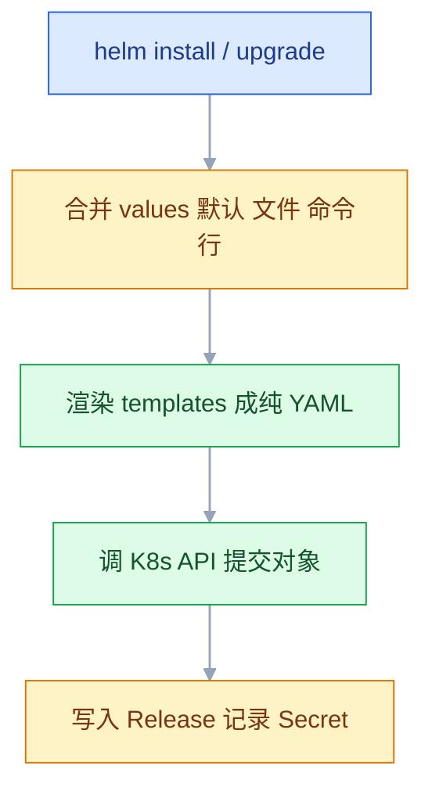
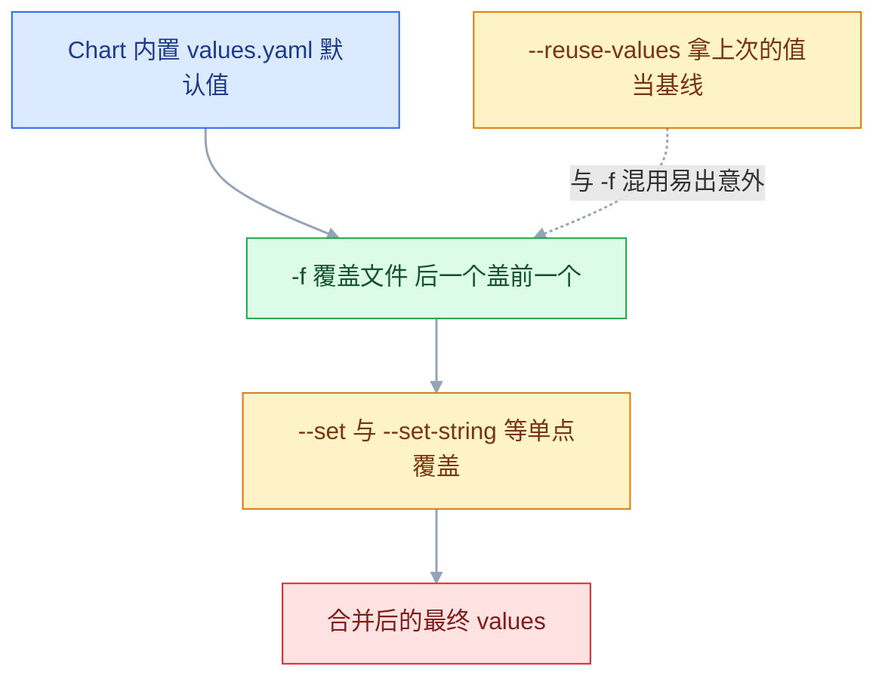
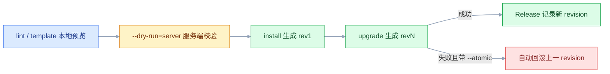

# Kubernetes 包管理器（Helm）

## 一、工程案例：把一个 Spring Boot 应用打成 Chart，管 dev 与 prod 两套环境

**场景**：应用已经有了一套能用的裸 YAML（Deployment、Service、ConfigMap、Ingress、HPA、MySQL StatefulSet）。现在要同时维护 dev 和 prod，差异有九处：副本数、镜像 tag、资源配额、日志级别、MySQL 存储大小、是否开 Ingress、是否开 HPA、TLS、更新策略。用文件夹复制会变成两份 95% 相同的 YAML，改一处公共配置要改两遍、漏一遍就出事。

**目标**：一个 Chart + 三份 values 文件。`helm upgrade --install` 一条命令完成部署，`helm history` 能看见每次变更，`helm rollback` 一条命令回到上一版。

**交付物结构**：

```text
springboot-app/
├── Chart.yaml
├── values.yaml          默认值，所有可配置项都在这里
├── values-dev.yaml      dev 覆盖
├── values-prod.yaml     prod 覆盖
├── .helmignore
└── templates/
    ├── _helpers.tpl
    ├── NOTES.txt
    ├── configmap.yaml
    ├── deployment.yaml
    ├── service.yaml
    ├── ingress.yaml
    ├── hpa.yaml
    └── mysql.yaml
```

### 1.1 主线

```bash
# ① 装 helm 并确认能连集群
curl -fsSL https://raw.githubusercontent.com/helm/helm/main/scripts/get-helm-3 | bash
helm version --short
kubectl cluster-info | head -2

# ② 建骨架，删掉用不上的默认模板
mkdir -p /opt/helm && cd /opt/helm
helm create springboot-app
cd springboot-app
rm -rf templates/serviceaccount.yaml templates/tests
# 保留 helm create 生成的 hpa.yaml，改写成读 autoscaling.* 即可

# ③ 写 Chart.yaml / values.yaml / values-dev.yaml / values-prod.yaml / 模板（内容见 1.2~1.4）

# ④ 建命名空间与 Secret（密码不进 values，也不进 Git）
kubectl create namespace dev
kubectl create namespace prod
kubectl -n dev create secret generic app-db-secret \
  --from-literal=root-password='DevRoot@2026' \
  --from-literal=db-password='DevApp@2026'
kubectl -n prod create secret generic app-db-secret \
  --from-literal=root-password='ProdRoot@2026#Strong' \
  --from-literal=db-password='ProdApp@2026#Strong'

# ⑤ 三件套检查：语法、渲染、服务端校验
helm lint . -f values-prod.yaml
helm template app-prod . -f values-prod.yaml -n prod > /tmp/prod.yaml
kubectl apply --dry-run=server -f /tmp/prod.yaml

# ⑥ 部署两套环境
helm upgrade --install app-dev  . -f values-dev.yaml  -n dev  --create-namespace --wait --timeout 5m
helm upgrade --install app-prod . -f values-prod.yaml -n prod --create-namespace --wait --timeout 5m --atomic

# ⑦ 验收
helm list -A
kubectl -n prod get deploy,svc,ingress,hpa
```

**关键输出**：

```text
$ helm list -A
NAME      NAMESPACE  REVISION  STATUS    CHART                 APP VERSION
app-dev   dev        1         deployed  springboot-app-1.0.0  1.0.0
app-prod  prod       1         deployed  springboot-app-1.0.0  1.0.0

$ kubectl -n prod get deploy
NAME                    READY   UP-TO-DATE   AVAILABLE
app-prod-springboot-app 3/3     3            3
```

> 资源名前缀 `app-prod-springboot-app` 来自 `fullname` 模板：`<Release名>-<Chart名>`。同一套模板装两份，名字天然不冲突。

### 1.2 Chart.yaml 与 values.yaml 的骨架

```yaml
# Chart.yaml
apiVersion: v2
name: springboot-app
description: Spring Boot 应用 + MySQL，支持多环境
type: application
version: 1.0.0            # Chart 版本：改模板就升它
appVersion: "1.0.0"       # 应用版本：仅展示，必须加引号
kubeVersion: ">=1.25.0-0"
```

```yaml
# values.yaml（节选，只列真正会被覆盖的项）
replicaCount: 2

image:
  repository: registry.example.com/myteam/springboot-app
  tag: "v1.0.0"
  pullPolicy: IfNotPresent

imagePullSecrets:
  - name: regcred

config:
  LOG_LEVEL: "info"
  TZ: "Asia/Shanghai"
  JAVA_OPTS: "-Xms256m -Xmx768m"

database:
  host: ""                       # 空则用 Chart 内建的 MySQL
  name: "appdb"
  username: "appuser"
  existingSecret: "app-db-secret" # ★ 只写从哪读，不写密码
  secretKey: "db-password"

service:
  type: ClusterIP
  port: 80
  targetPort: 8080

ingress:
  enabled: false
  className: nginx
  host: app.example.com
  tls:
    enabled: false
    secretName: app-tls

resources:
  requests: { cpu: 250m, memory: 512Mi }
  limits:   { cpu: "1", memory: 1Gi }

autoscaling:
  enabled: false
  minReplicas: 2
  maxReplicas: 8
  targetCPUUtilizationPercentage: 60

mysql:
  enabled: true
  image: mysql:8.0
  persistence:
    size: 5Gi
    storageClassName: ""
```

```yaml
# values-dev.yaml
replicaCount: 1
image:
  tag: "latest"
  pullPolicy: Always
config:
  LOG_LEVEL: "debug"
resources:
  requests: { cpu: 100m, memory: 256Mi }
  limits:   { cpu: 500m, memory: 512Mi }
ingress:
  enabled: false
mysql:
  persistence:
    size: 1Gi
```

```yaml
# values-prod.yaml
replicaCount: 3
image:
  tag: "v1.0.0"
  pullPolicy: IfNotPresent
config:
  LOG_LEVEL: "info"
  JAVA_OPTS: "-Xms512m -Xmx1536m -XX:+UseG1GC"
resources:
  requests: { cpu: 500m, memory: 1Gi }
  limits:   { cpu: "2", memory: 2Gi }
ingress:
  enabled: true
  host: app.example.com
  tls:
    enabled: true
    secretName: app-tls
autoscaling:
  enabled: true
  minReplicas: 3
  maxReplicas: 10
mysql:
  persistence:
    size: 20Gi
```

### 1.3 关键模板片段

```yaml
{{/* templates/_helpers.tpl：selector 标签必须永远稳定 */}}
{{- define "app.selectorLabels" -}}
app.kubernetes.io/name: {{ .Chart.Name }}
app.kubernetes.io/instance: {{ .Release.Name }}
{{- end -}}

{{- define "app.fullname" -}}
{{- printf "%s-%s" .Release.Name .Chart.Name | trunc 63 | trimSuffix "-" -}}
{{- end -}}

{{/* 数据库地址：values 给了就用，否则指向 Chart 内建的 MySQL */}}
{{- define "app.dbHost" -}}
{{- default (printf "%s-mysql" (include "app.fullname" .)) .Values.database.host -}}
{{- end -}}
```

```yaml
{{/* templates/deployment.yaml（节选） */}}
spec:
  {{- if not .Values.autoscaling.enabled }}
  replicas: {{ .Values.replicaCount }}
  {{- end }}
  selector:
    matchLabels:
      {{- include "app.selectorLabels" . | nindent 6 }}
  template:
    metadata:
      annotations:
        checksum/config: {{ include (print $.Template.BasePath "/configmap.yaml") . | sha256sum }}
      labels:
        {{- include "app.selectorLabels" . | nindent 8 }}
    spec:
      containers:
        - name: app
          image: "{{ .Values.image.repository }}:{{ .Values.image.tag }}"
          envFrom:
            - configMapRef:
                name: {{ include "app.fullname" . }}-config
          env:
            - name: DB_HOST
              value: {{ include "app.dbHost" . | quote }}
            - name: DB_PASSWORD
              valueFrom:
                secretKeyRef:
                  name: {{ .Values.database.existingSecret }}
                  key: {{ .Values.database.secretKey }}
          resources:
            {{- toYaml .Values.resources | nindent 12 }}
```

```yaml
{{/* templates/ingress.yaml：整个文件由开关控制 */}}
{{- if .Values.ingress.enabled }}
apiVersion: networking.k8s.io/v1
kind: Ingress
metadata:
  name: {{ include "app.fullname" . }}
spec:
  ingressClassName: {{ .Values.ingress.className }}
  {{- if .Values.ingress.tls.enabled }}
  tls:
    - hosts: ["{{ .Values.ingress.host }}"]
      secretName: {{ .Values.ingress.tls.secretName }}
  {{- end }}
  rules:
    - host: {{ .Values.ingress.host | quote }}
      http:
        paths:
          - path: /
            pathType: Prefix
            backend:
              service:
                name: {{ include "app.fullname" . }}
                port:
                  number: {{ .Values.service.port }}
{{- end }}
```

```yaml
{{/* templates/hpa.yaml：开关控制，且此时 Deployment 不写 replicas */}}
{{- if .Values.autoscaling.enabled }}
apiVersion: autoscaling/v2
kind: HorizontalPodAutoscaler
metadata:
  name: {{ include "app.fullname" . }}
spec:
  scaleTargetRef:
    apiVersion: apps/v1
    kind: Deployment
    name: {{ include "app.fullname" . }}
  minReplicas: {{ .Values.autoscaling.minReplicas }}
  maxReplicas: {{ .Values.autoscaling.maxReplicas }}
  metrics:
    - type: Resource
      resource:
        name: cpu
        target:
          type: Utilization
          averageUtilization: {{ .Values.autoscaling.targetCPUUtilizationPercentage }}
  behavior:
    scaleDown:
      stabilizationWindowSeconds: 300
{{- end }}
```

### 1.4 验收（8 项）

| # | 检查 | 命令 | 通过标准 |
|---|---|---|---|
| 1 | Chart 语法 | `helm lint . -f values-prod.yaml` | `0 chart(s) failed` |
| 2 | dev 没渲染出 Ingress | `helm template app-dev . -f values-dev.yaml \| grep -c "kind: Ingress"` | `0` |
| 3 | prod 渲染出 Ingress 和 HPA | `grep -c "kind: Ingress\|kind: HorizontalPodAutoscaler" /tmp/prod.yaml` | `2` |
| 4 | 字段合法 | `kubectl apply --dry-run=server -f /tmp/prod.yaml` | 全部 `created (server dry run)` |
| 5 | 两套环境并存 | `helm list -A` | 两个 `deployed` |
| 6 | 副本数符合各自 values | `kubectl -n dev get deploy; kubectl -n prod get deploy` | 1 与 3 |
| 7 | 升级产生新 revision | `helm upgrade` 后 `helm history app-prod` | rev 2 |
| 8 | 回滚生效 | `helm rollback app-prod 1` 后查镜像 | 回到 `v1.0.0` |

> 第 2、3 项是 Helm 最直观的价值：同一份模板，不同 values 渲染出不同对象集合。先在本地 `template` 看清，再提交给集群。
> 第 4 项不能省。`--dry-run` 只做客户端渲染，`--dry-run=server` 才会真的调 API 校验字段。

### 1.5 升级与回滚

```bash
# 改 values 里的 tag，再升级
sed -i 's/tag: "v1.0.0"/tag: "v1.1.0"/' values-prod.yaml
helm upgrade app-prod . -f values-prod.yaml -n prod --atomic --wait --timeout 5m

helm history app-prod -n prod
# REVISION 1 superseded / 2 deployed

# 出问题立刻回滚
helm rollback app-prod 1 -n prod
helm history app-prod -n prod
# REVISION 3 deployed  Rollback to 1   ← 回滚本身也是一次新 revision
```

> 回滚只回滚"声明"，不回滚"现实"。PVC 从 8Gi 扩到 20Gi 后回滚，声明回到 8Gi，实际容量还是 20Gi——存储不能缩。

---

## 二、高频问答：会卡住你的地方，也是面试最常问的

### 2.1 `helm upgrade` 报 `another operation (install/upgrade/rollback) is in progress`

**现场**

`helm status` 看 STATUS 是不是 pending-*。

```bash
helm -n prod status app-prod
helm -n prod history app-prod
# 先回滚到最后一个 deployed 版本，解除锁
helm -n prod rollback app-prod <上一个deployed的revision>
```

**要点**

- 上一次 upgrade 卡在 `pending-upgrade`（`--wait` 超时、进程被杀），Release 状态被锁住了。
- 不是这一次失败，重跑只会继续被拒。
- 先回滚到最后一个 deployed 的 revision，状态才回到可用。

**追问**

- 为什么回滚能解锁？→ 它写一条新 revision，把状态带回 deployed。
- 直接再 upgrade 行不行？→ 不行，同一个 Release 不允许并发操作。
- 怎么少踩这个坑？→ 给 `--wait` 配上 `--timeout`，别让进程被外部杀掉。

### 2.2 模板报 `nil pointer evaluating interface {}.xxx`

**现场**

报错信息里有文件名、行号、完整字段路径，顺着路径回 values 里找。

```bash
helm template app-prod . -f values-prod.yaml --debug 2>&1 | tail -20
# 或给关键值加 required，让报错更早更明确
# {{ required "必须提供 image.tag" .Values.image.tag }}
```

**要点**

- 模板里引用了 values 里不存在的路径：`.Values.image.repo`，而 values 里叫 `repository`。
- 整条链从第一个 nil 就断了，所以报错指向 `interface {}`。
- 给关键值加 `required`，让报错更早也更明确。

**追问**

- 为什么报错看不懂？→ 在 nil 上取字段，类型信息已经丢了，只能靠文件名和行号定位。
- `required` 和 `default` 怎么选？→ 必填用 `required`，可选用 `default`。
- 为什么本地渲染得好好的？→ 本地传的 values 里有这个 key，别的环境没有。

### 2.3 values 改了，集群里的对象没变

**现场**

`helm get values --all` 看这次 Release 实际生效的值。

```bash
helm -n prod get values app-prod --all | head -30
helm -n prod get manifest app-prod | grep -A 2 "image:"
```

**要点**

- 不是 Helm 缓存了旧值，是根本没执行 upgrade。
- 或者改的是 `values-prod.yaml`，upgrade 时传的却是 `values-dev.yaml`。
- 判断依据是 `get values --all`，不是你看的那个文件。

**追问**

- 怎么确认集群里到底是什么？→ `helm get manifest` 看渲染后的清单。
- 为什么文件改了 Release 不变？→ 只有 upgrade 才会重新渲染并提交。
- `--reuse-values` 在这里有坑吗？→ 有，它拿上次的值当基线，和 `-f` 混用容易出意外。

### 2.4 `helm install` 报 `namespaces "xxx" not found`

**现场**

`kubectl get ns` 确认目标命名空间在不在。

```bash
kubectl create namespace prod
# 或在安装时加
helm upgrade --install app-prod . -n prod --create-namespace
```

**要点**

- Helm 不会自动建命名空间，`-n prod` 只是指定目标，不负责创建。
- 这不是权限问题：报的是 not found，权限不足会报 forbidden。
- 要么先 `kubectl create namespace`，要么加 `--create-namespace`。

**追问**

- 为什么 `-n` 不够？→ 它只决定装到哪，不改变那个命名空间存不存在。
- `--create-namespace` 会顺手建配额吗？→ 不会，只建一个空命名空间。
- 建好了还报错？→ 查 `kubectl config current-context` 指向的集群对不对。

### 2.5 `helm uninstall` 之后 PVC 还在，磁盘一直占着

**现场**

卸载后把残留列一遍。

```bash
helm -n dev uninstall app-dev
kubectl -n dev get all,pvc,secret
# PVC 默认保留是数据保护，不是卸载失败；确认备份后再手工清理
kubectl -n dev delete pvc --all        # ⚠️ 数据永久丢失，先确认已备份
kubectl delete namespace dev
```

**要点**

- PVC 默认保留，是数据保护的设计，不是卸载失败。
- CRD 也不删，手工创建的 Secret 更不归 Helm 管。
- 确认备份之后再手工清理，`delete pvc --all` 不可逆。

**追问**

- 卸载后哪些会留下？→ PVC/PV、CRD、手工 Secret、Namespace。
- 为什么偏偏留 PVC？→ 数据在里面，删了没有恢复途径。
- 想让某个资源也不被删？→ 加 `helm.sh/resource-policy: keep` 注解。

### 2.6 `--set image.tag=1.10` 之后镜像变成了 `1.1`

**现场**

`helm get values` 看存进去的到底是什么。

```bash
helm -n prod get values app-prod | grep tag
--set-string image.tag=1.10        # ★ 强制字符串
```

**要点**

- `--set` 会做类型推断，`1.10` 被当成浮点数渲染成 `1.1`。
- 同理 `yes`/`no` 会被当成布尔值。
- tag 是数字形状时必须用 `--set-string`。

**追问**

- 同一个坑还在哪？→ `appVersion` 不加引号，也会被 YAML 解析成 `1.1`。
- 已经装错了怎么修？→ 用 `--set-string` 重新 upgrade 一次。
- 怎么从根上避免？→ 值都写进 `-f` 文件，CI 只用 `--set` 传构建号。

### 2.7 `helm upgrade` 成功返回，但 Pod 起不来

**现场**

看 Pod 状态与 rollout 状态。

```bash
kubectl -n prod rollout status deploy/app-prod-springboot-app
helm upgrade --install app-prod . -f values-prod.yaml -n prod --wait --timeout 5m --atomic
```

**要点**

- 不加 `--wait` 时，Helm 提交完对象就返回，Pod 之后崩了它不管。
- "提交成功"不等于"部署成功"，这是两件事。
- CI 里固定用 `--wait --timeout 5m --atomic`。

**追问**

- `--wait` 等到什么程度？→ 等到资源 Ready 才返回。
- `--atomic` 干什么？→ 失败自动回滚上一 revision，不会停在半个坏版本上。
- 为什么 `--wait` 还要配 `--timeout`？→ 不配就卡住不返回。

### 2.8 `helm rollback` 了，但配置没回去

**现场**

对比 `helm get manifest` 的当前值与历史值。

```bash
helm -n prod get manifest app-prod | grep -A 3 "storage:"
helm -n prod get manifest app-prod --revision 1 | grep -A 3 "storage:"
```

**要点**

- 回滚还原的是"这次 Release 提交的清单"，不是集群的现实。
- PVC 容量、CRD、外部创建的 Secret 都不在清单的覆盖范围里。
- 存储只能扩不能缩，声明回去了容量也回不去。

**追问**

- 为什么 PVC 容量回不去？→ 回滚只改声明，底层的卷不会缩。
- 外部 Secret 为什么不跟着回？→ 它不是 Release 创建的资源，Helm 不认领。
- 怎么确认回滚到位？→ 当前 manifest 和 `--revision 1` 并排比。

### 2.9 子 Chart 的 values 覆盖不到

**现场**

`helm show values` 看子 Chart 的 key 结构。

```yaml
# ✔ 正确：mysql 是子 Chart 名
mysql:
  auth:
    database: appdb
  primary:
    persistence:
      size: 20Gi
```

**要点**

- 子 Chart 的 values 必须放在它自己的名字（或 `alias`）下面，形成嵌套。
- 用顶层 key 覆盖不到子 Chart，不是依赖装坏了。
- `alias: db` 之后就用 `.Values.db.*`。

**追问**

- 用名字还是 alias？→ 设了 alias 就用 alias，两个都写只有 alias 生效。
- 怎么知道子 Chart 有哪些 key？→ `helm show values` 看它自己的骨架。
- 想整体不装这个依赖？→ 用 `condition: mysql.enabled`，values 里关掉。

### 2.10 `helm repo update` 之后还是搜不到最新版本

**现场**

分别试 repo 搜索与 OCI 拉取。

```bash
helm search repo bitnami/mysql --versions | head
helm show chart oci://registry-1.docker.io/bitnamicharts/mysql
```

**要点**

- 仓库索引和实际分发位置是两件事。
- 很多 Chart 已迁到 OCI 分发，旧索引里查不到不代表版本不存在。
- 用 `helm show chart oci://...` 直接验证真实版本。

**追问**

- 为什么 repo 搜不到 OCI 里却有？→ 分发渠道换了，索引没跟上。
- OCI 的安装命令怎么写？→ `oci://` 前缀加 registry 路径。
- `repo update` 到底更新了什么？→ 只刷新本地索引缓存，不动实际制品。

### 2.11 两套环境互相把对方的资源改了

**现场**

看两边的 manifest 里 `metadata.name` 是否重复。

```bash
helm -n dev get manifest app-dev | grep -E "^  name:"
helm -n prod get manifest app-prod | grep -E "^  name:"
```

**要点**

- `fullnameOverride` 写死成同一个值，两个 Release 就会抢同一批资源。
- 或者两个 Release 装在同一命名空间，且资源名相同。
- 正常靠 `<Release名>-<Chart名>` 前缀天然隔离。

**追问**

- 默认为什么不会冲突？→ `fullname` 里带了 Release 名。
- 同一命名空间能装两份吗？→ 能，前提是资源名不同。
- 怎么快速查重？→ 两边 `get manifest` 里 grep `metadata.name`。

### 2.12 Chart 加了一个新配置项，旧环境全部渲染失败

**现场**

用最小 values 渲染一次，看哪些环境会炸。

```bash
helm template test . -f /dev/null 2>&1 | tail -5
# 修法：先给默认值，再引用
# {{ .Values.config.FEATURE_FLAG | default "false" }}
```

**要点**

- 模板直接引用 `.Values.newKey`，却没在 `values.yaml` 给默认值。
- 任何没覆盖它的环境都会 nil，本地能跑是因为本地 values 里有。
- 修法是先给默认值再引用，别让模板依赖调用方补全。

**追问**

- 为什么只有旧环境炸？→ 它们的 values 里没有这个新 key。
- 用 `default` 函数够吗？→ 够，但 key 本身还是该在 `values.yaml` 里有一行。
- 怎么防止下次？→ 加 `values.schema.json` 做参数校验。

---

## 三、核心知识：从零开始要建立的东西

### 3.1 Chart、Release、Repository、Values 四个概念

| 概念 | 是什么 | 生命周期 |
|---|---|---|
| Chart | 一个包：模板 + 默认值 + 元数据 | 静态文件，可版本化 |
| Release | Chart 装进集群的一次实例 | 有 revision，可升级回滚 |
| Repository | 存放 Chart 的 HTTP 服务 + index | 可增删 |
| Values | 喂给模板的参数 | 多份，可覆盖 |

**最容易混的一对**：Chart 是模板，Release 是实例。改了 Chart 不会影响已安装的 Release，必须 `helm upgrade` 才生效。同一个 Chart 可以装成多个 Release，各自独立演进。

> **面试**：常问「Chart 和 Release 有什么区别？」答：Chart 是模板加默认值，Release 是它装进集群的一次实例，带 revision，能升级能回滚。

### 3.2 Helm 3 的客户端模型

| | Helm 2 | Helm 3 |
|---|---|---|
| 服务端组件 | Tiller | **没有** |
| 权限 | 走 Tiller 的 cluster-admin | 走你 kubeconfig 的权限 |
| Release 记录 | ConfigMap | Secret（`sh.helm.release.v1.<名字>.v<版本>`） |
| 多租户 | 共享 Tiller，不安全 | RBAC 天然隔离 |

Helm 只做三件事：渲染模板、调 K8s API 提交、写一条 Release 记录。它不常驻、不代理流量、不改变对象语义。**产物就是普通 K8s 对象**，随时可以用 kubectl 查看和修改。

### 3.3 Chart 目录结构

| 路径 | 必需 | 作用 |
|---|---|---|
| `Chart.yaml` | 是 | 名字、版本、依赖 |
| `values.yaml` | 推荐 | 默认参数 |
| `templates/` | 推荐 | 渲染成 K8s 对象的模板 |
| `templates/_helpers.tpl` | 常见 | 命名模板，下划线开头不生成对象 |
| `templates/NOTES.txt` | 常见 | 安装后打印提示，不提交给集群 |
| `charts/` | 可选 | 子 Chart 依赖 |
| `crds/` | 可选 | CRD，安装前应用，卸载不删 |
| `.helmignore` | 可选 | 打包忽略清单 |

**下划线约定**：`_` 开头的文件不会被渲染成对象，只用于定义可复用片段。`.tpl` 后缀是社区惯例，不是强制。

### 3.4 Chart 版本与应用版本的区分

| 字段 | 表示 | 什么时候升 |
|---|---|---|
| `version` | Chart 自身版本 | 改模板、改默认值、加功能 |
| `appVersion` | 里面装的应用版本 | 应用发版 |

例：只修了一个注释，`version` 1.2.0 → 1.2.1，`appVersion` 不动；应用从 1.5.3 升到 1.6.0，`appVersion` 改，同时 `version` 也升。

**格式陷阱**：`appVersion` 不加引号时，`1.10` 会被 YAML 解析成 `1.1`。永远加引号。

### 3.5 模板渲染的三层求值



渲染是**纯文本处理**，不碰集群（`lookup` 例外）。所以 `helm template` 可以在没有集群的机器上跑，这是 CI 里做 diff 的基础。

### 3.6 values 的覆盖优先级

从低到高：Chart 里的 `values.yaml` → `-f` 指定的文件（多个则后面的覆盖前面的）→ `--set` → `--set-string` / `--set-file` / `--set-json`。




```bash
helm upgrade --install app-prod . \
  -f values.yaml -f values-prod.yaml \
  --set image.tag=v1.2.3
```

| 命令 | 用途 | 建议 |
|---|---|---|
| `-f` | 整份覆盖文件 | ★ 首选，能进 Git |
| `--set` | 单点覆盖 | 只在 CI 传构建号时用 |
| `--set-string` | 强制字符串 | tag 是数字形状时必须用 |
| `--set-file` | 从文件读值 | 证书、大段配置 |
| `--reuse-values` | 复用上次的值 | 有坑：它用上次的值做基线，和 `-f` 混用时容易得到意外结果 |

**为什么优先用 `-f`**：`--set` 不能进 Git、复杂结构语法反人类、类型推断容易出错。CI 里除了构建号，其他都应该在文件里。

> **面试**：常问「values 的覆盖优先级是什么？」答：Chart 内置默认值最低，然后是被 `-f` 按顺序覆盖，最后是 `--set` 这类命令行覆盖。

### 3.7 内置对象的用途

| 对象 | 内容 | 常用字段 |
|---|---|---|
| `.Values` | 合并后的参数 | `.Values.image.tag` |
| `.Release` | 本次安装信息 | `Name`、`Namespace`、`Revision`、`Service` |
| `.Chart` | Chart.yaml 的内容 | `Name`、`Version`、`AppVersion` |
| `.Capabilities` | 集群能力 | `KubeVersion`、`APIVersions.Has` |
| `.Files` | Chart 里的非模板文件 | `.Files.Get "conf/app.conf"` |
| `.Template` | 当前模板路径 | `BasePath`、`Name` |

`.Capabilities.APIVersions.Has` 是写"兼容多版本集群" Chart 的关键：能判断某个 API 是否存在，再决定渲染哪个版本的资源。

### 3.8 空白控制与缩进

YAML 对缩进敏感，而模板标签本身会留下空行和空格。`{{-` 去左边空白，`-}}` 去右边空白。

```yaml
  labels:
    {{- include "app.labels" . | nindent 4 }}
```

| 函数 | 行为 |
|---|---|
| `indent N` | 每行加 N 个空格，不加前导换行 |
| `nindent N` | 先加换行再加 N 个空格 |
| `toYaml` | 对象转 YAML 文本 |

`toYaml | nindent` 是写 Chart 最常用的一招：把整个 `resources` 或 `affinity` 对象原样展开，不用逐个字段手写。

### 3.9 命名模板与 include

| 方式 | 语法 | 能否参与管道 |
|---|---|---|
| `define` | `{{- define "app.labels" -}}...{{- end -}}` | 定义 |
| `template` | `{{ template "app.labels" . }}` | 否，直接输出 |
| `include` | `{{ include "app.labels" . }}` | 是，返回字符串 |

**为什么社区统一用 `include`**：它返回字符串，才能接 `nindent` 控制缩进。`template` 直接输出，缩进只能靠模板内部的硬编码。

### 3.10 labels 与 selectorLabels 的分离

| | 包含 | 能否修改 |
|---|---|---|
| `selectorLabels` | 只有 name + instance | **永远不能改** |
| `labels` | 上面两个 + 版本 + Chart 版本 + 管理工具 | 可以改 |

原因：`selectorLabels` 会写进 Deployment 的 `spec.selector`，这个字段创建后不可变。改了会导致 selector 与已有 Pod 不匹配，滚动更新直接失败。

> **面试**：常问「Chart 里的 labels 和 selectorLabels 为什么要分开？」答：selectorLabels 会进不可变的 spec.selector，加了版本号之类的标签就再也改不了。

### 3.11 条件渲染与可选资源

```yaml
{{- if .Values.ingress.enabled }}
apiVersion: networking.k8s.io/v1
kind: Ingress
...
{{- end }}
```

用 `if` 包住整个文件，条件不满足时渲染成空，Helm 就不提交任何对象。这是"可选组件"的标准写法（Ingress、HPA、ServiceMonitor 都这么处理）。

**边界**：条件关闭资源时，Helm 会在 upgrade 时**删除**集群里已存在的那个对象。如果那个对象是手工改过的，改动也会一起没。

### 3.12 checksum 注解触发滚动更新

ConfigMap 改了，Pod 不会自动重启（环境变量是启动时读的）。解法是把 ConfigMap 的内容算成哈希写进 Pod 模板注解：

```yaml
annotations:
  checksum/config: {{ include (print $.Template.BasePath "/configmap.yaml") . | sha256sum }}
```

ConfigMap 内容变 → 哈希变 → Pod 模板变 → Deployment 触发滚动更新。这是 Helm 生态里最常用的一个技巧，`helm create` 生成的模板里就有。

### 3.13 template、install、upgrade 的关系

| 命令 | 提交集群 | 记 Release | 用途 |
|---|---|---|---|
| `helm template` | 否 | 否 | 本地预览、CI diff |
| `helm lint` | 否 | 否 | 语法与规范检查 |
| `--dry-run` | 否（客户端模拟） | 否 | 快速看渲染结果 |
| `--dry-run=server` | 否（服务端校验） | 否 | 提前发现字段非法 |
| `helm install` | 是 | rev 1 | 首次安装 |
| `helm upgrade` | 是 | rev N+1 | 升级 |
| `helm upgrade --install` | 是 | 视情况 | ★ 幂等，CI 标准动作 |



`--dry-run=server` 会真的调 apiserver 做校验但不落盘，能提前发现 `unknown field`、`immutable field` 这类问题。

### 3.14 --wait、--atomic、--timeout 的组合

| 参数 | 作用 | 不加的后果 |
|---|---|---|
| `--wait` | 等所有资源 Ready 才返回 | 命令成功 ≠ 部署成功 |
| `--timeout` | 配 `--wait` 的超时 | 卡住不返回 |
| `--atomic` | 失败自动回滚 | 停在"半个坏版本"上 |

**推荐组合**：`--wait --timeout 5m --atomic`。CI 里这三个一起用，才能保证"命令成功"真的等于"服务可用"。

> **面试**：常问「helm upgrade 成功了就代表服务可用吗？」答：不代表，不加 `--wait` 提交完就返回，要配 `--wait --timeout 5m --atomic` 才算部署成功。

### 3.15 依赖管理与子 Chart

```yaml
# Chart.yaml
dependencies:
  - name: mysql
    version: "14.x.x"          # 按 Chart 仓库实际发布的版本填，x 表示通配
    repository: "oci://<按 Chart 仓库实际地址填>"
    condition: mysql.enabled   # values 里关掉就不装这个依赖
    alias: db                  # 覆盖时用 .Values.db.* 而不是 .Values.mysql.*
```

| 命令 | 作用 |
|---|---|
| `helm dependency update` | 拉依赖、更新 `Chart.lock` |
| `helm dependency build` | 按 lock 文件精确还原 |
| `helm dependency list` | 看依赖状态 |

**覆盖规则**：子 Chart 的 values 放在**它自己的名字或 alias** 下面。`alias: db` 之后就用 `.Values.db.*`。这是"覆盖不到"问题的唯一原因。

### 3.16 打包、分发与卸载边界

```bash
helm package .                       # 生成 springboot-app-1.0.0.tgz
helm push springboot-app-1.0.0.tgz oci://harbor.example.com/charts
helm install app oci://harbor.example.com/charts/springboot-app --version 1.0.0
```

| 方式 | 地址形态 | 适用 |
|---|---|---|
| 传统仓库 | `https://.../chartrepo` | 自建 Harbor、GitHub Pages |
| OCI | `oci://registry/路径` | 现代仓库，Bitnami 已迁移 |

**`.helmignore` 要写**：`values-dev.yaml`、`values-prod.yaml`、`.git/` 不该进交付包。交付物是"模板 + 默认值"，环境值由使用者自己提供。

`helm uninstall` 之后，哪些会留下必须心里有数：

| 对象 | `helm uninstall` 后 |
|---|---|
| Deployment / Service / ConfigMap / Ingress / HPA | 删除 |
| PVC / PV | **保留**（数据保护） |
| CRD | 保留（Helm 3 设计） |
| 手工创建的 Secret | 保留（不归 Release 管） |
| Namespace | 保留 |
| Release 记录 | 删除（除非 `--keep-history`） |

`helm.sh/resource-policy: keep` 注解可以让某个资源在卸载时跳过删除，常见于管密码的 Secret——防止密码被删导致 PVC 里的数据打不开。

---

## 四、冷门知识汇总

| 知识点 | 为什么冷门 | 用到时的关键词 |
|---|---|---|
| `helm diff` 插件 | 原生没有 diff，社区插件才提供 | `helm diff upgrade`、`helm-diff` |
| library Chart | 只在多 Chart 共享 helpers 时才用 | `type: library` |
| `helm test` | 模板里的测试 Pod，装完验证连通 | `templates/tests/`、`helm test` |
| hooks | 迁移、初始化才需要，普通应用不用 | `pre-install`、`post-upgrade`、`hook-delete-policy` |
| `values.schema.json` | 参数校验，团队大了才补 | JSON Schema、`helm lint` |
| `--history-max` | Release 记录堆太多 Secret 才想起 | 默认 10，`helm list` |
| Chart 签名 | 供应链安全场景 | `helm package --sign`、`provenance` |
| Server-Side Apply | 与 kubectl 字段所有权对齐 | `--server-side`、`--force-conflicts` |
| `lookup` 函数 | 渲染时读集群，破坏"渲染不碰集群"的前提 | `lookup "v1" "Secret"` |
| `helm get metadata` | 查 Release 与 Chart 的对应关系 | `helm get metadata`、`--revision` |
