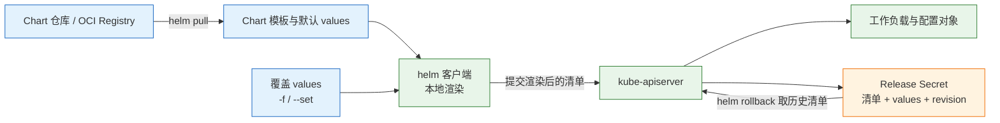
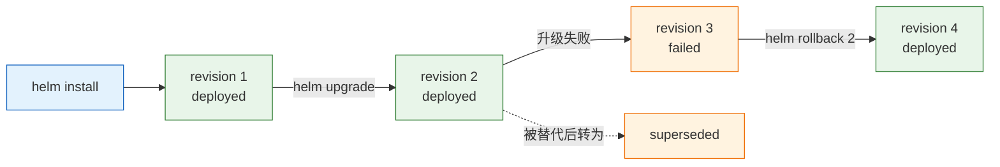
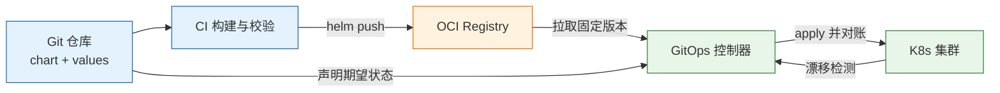

# Kubernetes 包管理器

Helm 是 Kubernetes 的包管理器，把一组 YAML 清单打包成 chart，用 values 参数化，用 release 记录一次安装。它解决的是"一套服务在多个环境、多个集群反复交付"的问题，不解决 Pod 调度、副本维持和故障自愈——那些由 K8s 控制器负责。

---

## 一、Kubernetes 包管理器是什么

### 1.1 核心概念

一个服务通常由 Deployment、Service、ConfigMap、HPA、PDB、ServiceAccount 组成。没有包管理器时，三个环境就是三份几乎一样的 YAML，手工维护会出现四类问题：

- 测试环境改了副本数，生产忘了改。
- 滚动发布到一半失败，不知道上一版清单长什么样。
- 同一个服务在 A 集群叫 `api`，在 B 集群叫 `api-v2`，配置项各写一套。
- 升级 CRD 时发现 Helm 根本没动它。

Helm 把这些收进一个 chart：模板负责结构，values 负责环境差异，release 负责"这次安装是谁、第几版、用什么值、生成了哪些对象"。核心对象只有五个：

| 对象 | 含义 | 生命周期 |
|---|---|---|
| Chart | 模板、默认值、元数据组成的发布包 | 版本化管理，可打包分发 |
| Values | 渲染模板时的输入参数 | 按环境覆盖，可存入 Git |
| Template | Go template 写成的 K8s 清单骨架 | 随 chart 版本变化 |
| Release | 一次安装实例，名字 + 命名空间唯一 | 安装产生，卸载结束 |
| Revision | 同一条 release 的第 N 次变更 | 每次 install/upgrade/rollback 加一 |

需要分清的是"渲染"和"运行"两件事。`helm install` 在本地把模板渲染成具体 YAML，提交给 apiserver 后就不再参与。Pod 挂了由 ReplicaSet 重建，节点挂了由调度器迁移，这些都与 Helm 无关。

### 1.2 与相邻技术的关系

Helm 不是 kubectl 的替代品，也不是 GitOps。它们各自负责一段：

| 工具 | 解决的问题 | 与 Helm 的边界 |
|---|---|---|
| kubectl | 直接操作单个或一批对象 | Helm 最终也通过 apiserver 提交，等价于批量 apply |
| Kustomize | 用 overlay 给纯 YAML 打补丁 | 无模板、无 release 历史，适合自有服务的环境差异 |
| Operator | 封装有状态服务的 Day-2 运维 | 持续 reconcile，Helm 只在发布瞬间动作 |
| Argo CD / Flux | 让集群持续等于 Git 中的期望状态 | 可以渲染 Helm chart，并修复手工漂移 |
| 镜像仓库 | 存放容器镜像 | OCI 仓库也可存放 chart 包，两者共用认证体系 |

一条常见的误解是"装了 Helm 就有 GitOps"。Helm 只在执行命令时提交一次清单，之后有人 `kubectl edit` 改了副本数，Helm 不会发现，也不会改回来。要持续对账，必须在 Helm 之上再加 GitOps 控制器。

> **运维提示**：判断该不该引入 Helm，看是否存在"同一套对象需要重复交付到多个环境"。只有一两个固定对象时，`kubectl apply -k` 更直接。

### 1.3 架构组成

Helm 3 起移除了服务端组件 Tiller，现在是纯客户端工具：读 kubeconfig、连 apiserver、把发布记录写成同命名空间的 Secret。没有常驻进程，也没有需要维护的控制器。



| 组件 | 位置 | 职责 |
|---|---|---|
| helm CLI | 运维机 / CI Runner | 渲染模板、校验、提交请求、维护本地仓库缓存 |
| Chart 仓库 | 外部 HTTP 服务或 OCI Registry | 存放 `index.yaml` 与 chart 包 |
| kube-apiserver | 集群 | 准入校验、持久化对象、鉴权 |
| Release Secret | 目标命名空间 | 保存每次 revision 的清单与 values |
| kubeconfig | 运维机 | 决定 Helm 以什么身份、对哪个集群操作 |

理解"客户端渲染"很关键：模板里的函数、`lookup` 查询、`--set` 合并都发生在本地。因此本地 Helm 版本、本地仓库缓存、本地 values 文件都会影响最终提交的内容。

---

## 二、安装与配置

> **版本现状（2026-10）**：Helm 4.3 是当前稳定线；Helm 3 仍在维护，新项目按 Helm 4 编写。chart 的 `apiVersion: v2` 继续兼容，Helm 3 时代的 chart 不需要改写。

### 2.1 包管理器与二进制安装

Helm 是单文件二进制，没有守护进程和系统依赖，安装本质是把可执行文件放进 `PATH`。

```bash
# ========== 包管理器安装 ==========
# macOS：Homebrew 安装，升级同样走 brew upgrade
brew install helm

# Windows：Chocolatey 安装
choco install kubernetes-helm

# ========== 二进制安装（Linux 通用） ==========
# 从 GitHub Releases 下载对应系统和架构的包，<helm-version> 替换为实际版本号
tar -zxvf helm-<helm-version>-linux-amd64.tar.gz

# 官方同时提供 sha256sum 校验文件，先校验再安装
sha256sum -c helm-<helm-version>-linux-amd64.tar.gz.sha256sum

# 把二进制移动到 PATH，覆盖旧版本前先确认没有正在执行的发布
sudo mv linux-amd64/helm /usr/local/bin/helm

# ========== 验证 ==========
# 查看客户端版本，只关心是否能正常执行
helm version --short

# 查看 Helm 使用的目录和环境变量
helm env
```

> **注意**：不要用 `latest` 标签或"下载最新版"脚本替代固定版本。CI Runner 与运维机的 Helm 大版本应保持一致，否则同一份 chart 在两处渲染结果可能不同。

### 2.2 目录与 Shell 配置

Helm 把缓存、配置、数据分三个目录存放，默认都在用户家目录下。多集群、多租户环境建议显式区分，避免缓存串用。

| 环境变量 | 默认位置 | 用途 |
|---|---|---|
| `HELM_CACHE_HOME` | `~/.cache/helm` | 仓库索引与下载的 chart 缓存 |
| `HELM_CONFIG_HOME` | `~/.config/helm` | 仓库配置、OCI 登录凭据 |
| `HELM_DATA_HOME` | `~/.local/share/helm` | 插件与数据文件 |
| `HELM_NAMESPACE` | 由 kubeconfig 决定 | 省略 `-n` 时的默认命名空间 |
| `KUBECONFIG` | `~/.kube/config` | 目标集群与身份 |

```bash
# ========== 补全与别名 ==========
# 生成 bash 补全脚本到文件，再在 shell 配置中 source 它
helm completion bash > ~/.helm-completion.bash

# zsh 用户生成对应补全
helm completion zsh > "${fpath[1]}/_helm"

# ========== 隔离多套环境 ==========
# 为测试集群单独指定配置目录，避免仓库和凭据互相覆盖
export HELM_CONFIG_HOME="$HOME/.config/helm-staging"
export KUBECONFIG="$HOME/.kube/staging-config"

# 确认当前指向的集群和命名空间
kubectl config current-context
helm list -A
```

> **安全警告**：`helm registry login` 的凭据存放在 `HELM_CONFIG_HOME` 下的配置文件里。共享 Runner 上不要复用个人配置目录，应使用独立目录或短期令牌，任务结束后清理。

### 2.3 仓库与 OCI 配置

Chart 来源分两类：传统 HTTP 仓库提供 `index.yaml` 索引；OCI 仓库把 chart 当成镜像一样的制品存放。Helm 4 对 OCI 是一等支持，不需要额外开关。

| 类型 | 地址形式 | 适用场景 |
|---|---|---|
| HTTP 仓库 | `https://kubernetes.github.io/ingress-nginx` | 社区项目、`helm repo add` 方式 |
| OCI 仓库 | `oci://registry.example.com/charts` | 企业内部分发、与镜像仓库共用权限 |
| 本地目录 | `./demo` | 开发调试、CI 中渲染校验 |
| 打包文件 | `./demo-0.1.0.tgz` | 离线交付、审计留档 |

```bash
# ========== HTTP 仓库 ==========
# 添加社区仓库，名字只是本地别名
helm repo add ingress-nginx https://kubernetes.github.io/ingress-nginx

# 更新索引，search 依赖这份本地缓存
helm repo update

# 查看已配置的仓库
helm repo list

# 移除不再使用的仓库，只删本地配置
helm repo remove ingress-nginx

# ========== OCI 仓库 ==========
# 登录 OCI 仓库，凭据与镜像仓库同源
helm registry login registry.example.com

# 退出登录，换机器或换账号前执行
helm registry logout registry.example.com
```

> **注意**：`helm search repo` 查询的是本地缓存索引，不是实时接口。刚发布的版本查不到时先执行 `helm repo update`，而不是怀疑仓库。

### 2.4 权限与安全配置

Helm 以 kubeconfig 中的身份操作集群，需要目标命名空间内资源的增删改查权限，以及读写 Release Secret 的权限。生产环境不应直接使用 cluster-admin。

```yaml
# 只允许在 demo 命名空间内发布，并读写 release 记录
apiVersion: rbac.authorization.k8s.io/v1
kind: Role
metadata:
  name: helm-deployer
  namespace: demo
rules:
  - apiGroups: ["", "apps", "batch", "networking.k8s.io", "autoscaling", "policy"]
    resources: ["*"]
    verbs: ["get", "list", "watch", "create", "update", "patch", "delete"]
  - apiGroups: [""]
    resources: ["secrets"]
    verbs: ["get", "list", "watch", "create", "update", "patch", "delete"]
```

```bash
# ========== 绑定身份 ==========
# 创建发布专用的 ServiceAccount
kubectl -n demo create serviceaccount deployer

# 把 Role 绑定到发布用的 ServiceAccount
kubectl -n demo create rolebinding helm-deployer \
  --role=helm-deployer \
  --serviceaccount=demo:deployer

# 用该身份验证权限，能创建 Deployment 即说明授权生效
kubectl -n demo auth can-i create deployments \
  --as=system:serviceaccount:demo:deployer
```

chart 本质上是代码：模板能渲染出任意资源，包括特权 Pod、ClusterRole 和 CRD。来源不可信的 chart 等于把集群交给对方。生产环境应固定 chart 版本、校验摘要，必要时验证 provenance。

```bash
# ========== 来源校验 ==========
# 下载 chart 及其签名文件后校验来源
helm verify ./demo-0.1.0.tgz

# 查看 chart 元数据，确认版本和维护者
helm show chart oci://registry.example.com/charts/demo --version 0.1.0
```

> **运维红线**：不要把生产 kubeconfig 的 cluster-admin 凭据交给任意 CI Job。一次恶意 chart 或一次模板注入，就能创建特权容器、读取全部 Secret，影响范围超出单个命名空间。

---

## 三、Chart 核心对象管理

### 3.1 目录结构

`helm create` 生成的骨架已经包含常用对象和辅助模板，理解每个路径的职责比背模板函数更重要。

| 路径 | 作用 | 注意 |
|---|---|---|
| `Chart.yaml` | 名称、版本、`appVersion`、依赖 | `version` 是 chart 版本，`appVersion` 不驱动镜像 tag |
| `values.yaml` | 默认值 | 应能直接跑起来，环境差异放覆盖文件 |
| `templates/` | Go template，渲染成 K8s 清单 | 文件名以 `_` 开头的不会被渲染成对象 |
| `templates/_helpers.tpl` | 命名模板、标签、镜像地址 | 用 `include` 复用 |
| `charts/` | 子 chart 依赖 | 由 `helm dependency update` 拉取 |
| `crds/` | CRD 清单 | 安装前 apply，**升级和删除都不会动它** |
| `.helmignore` | 打包排除 | 别把 `.git`、测试文件打进 chart |
| `Chart.lock` | 依赖版本锁定 | 应提交到 Git，保证可复现 |

模板里可用的内置对象有四组：

- `.Values`：合并后的值。
- `.Release.Name` / `.Release.Namespace` / `.Release.Revision`：本次发布信息。
- `.Chart.Name` / `.Chart.Version` / `.Chart.AppVersion`：chart 自身信息。
- `.Capabilities.KubeVersion`：目标集群版本，用于条件渲染。

### 3.2 Chart.yaml 与版本语义

```yaml
apiVersion: v2
name: demo
description: 演示用 chart
type: application
version: 0.1.0          # chart 版本，SemVer，升级和仓库索引靠它
appVersion: "1.16.0"    # 应用版本，自由字符串，只用于展示
kubeVersion: ">=1.27.0-0"
```

`version` 必须是 SemVer，`helm package` 和仓库索引都靠它排序；`appVersion` 可以写 `1.42.0`、`2026.10` 甚至提交号。升级时锁的是 `version`，不是 `appVersion`。`helm package --version 0.1.0` 会覆盖 `Chart.yaml` 里的版本，只建议在 CI 里按构建号动态打包时使用。

| 字段 | 是否必填 | 实际作用 |
|---|---|---|
| `apiVersion` | 是 | chart 格式版本，v2 对应 Helm 3/4 |
| `version` | 是 | chart 版本，决定升级、依赖与索引 |
| `appVersion` | 否 | 应用版本展示，不参与任何判断 |
| `kubeVersion` | 否 | 集群版本约束，不满足时安装直接失败 |
| `dependencies` | 否 | 子 chart 声明，需配合 lock 文件 |

### 3.3 子 Chart 与依赖

一个 chart 可以依赖其他 chart，例如应用依赖 PostgreSQL。依赖写在 `Chart.yaml`，由 Helm 拉取到 `charts/` 目录：

```yaml
# Chart.yaml
dependencies:
  - name: postgresql
    version: 1.x.x
    repository: oci://registry.example.com/charts
    condition: postgresql.enabled
```

```bash
# ========== 拉取依赖 ==========
# 解析依赖并下载到 charts/，同时生成或更新 Chart.lock
helm dependency update ./demo

# 只按 lock 文件还原依赖，不升级版本，适合 CI
helm dependency build ./demo
```

`helm dependency update` 会生成 `Chart.lock` 和 `charts/` 下的 tgz。`Chart.lock` 要提交，`charts/` 通常不进 Git。子 chart 的值放在父 values 的 `postgresql:` 键下；父 chart 的同名键会覆盖子 chart 默认值。`condition` 指向父 values 里的布尔键，用于按环境开关子 chart；同一个子 chart 需要部署多份时，用 `alias` 区分实例名。

### 3.4 values 的合并与覆盖

值的来源从低到高依次合并，后面的覆盖前面的：

1. chart 自带 `values.yaml`
2. 父 chart 传给子 chart 的值
3. `-f` 指定的文件，按命令行顺序，后面的覆盖前面的
4. `--set` / `--set-string` / `--set-file`

| 写法 | 行为 | 适用 |
|---|---|---|
| `--set replicaCount=3` | 自动推断类型，`true` 会变成布尔 | 临时调试 |
| `--set-string image.tag=1.0` | 强制按字符串处理 | 版本号形如 `1.10` 时防止被转成数字 |
| `--set-file config=./app.conf` | 把文件内容作为值 | 注入配置文件 |
| `-f prod-values.yaml` | 整文件合并 | 环境差异，推荐 |
| `--reuse-values` | 复用上次 release 的值，忽略新默认值 | 仅限明确知道后果时 |

合并规则只对 map 递归：列表整体替换，不会按下标合并；把某个键设为 `null` 可以删除父级默认值。这意味着 chart 默认值里有一个三元素的列表，覆盖文件只写一个元素，最终结果就是那一个元素，而不是四个。改动列表类配置时，必须在覆盖文件里写全。

`--reuse-values` 是例外中的例外：chart 升级新增了配置项时，它会漏掉新默认值，表现为"某些字段莫名其妙还是旧值"。需要可重复的发布，优先把值写进文件，不要堆一长串 `--set`。

> **注意**：`--set` 里的逗号、点号会被当作分隔符。值本身包含这些字符时用 `--set-string` 或直接写 values 文件，不要靠转义硬拼。

### 3.5 模板编写与渲染校验

三个命令按顺序使用，分别覆盖结构、渲染、准入三层：

```bash
# ========== 结构与语法 ==========
# 检查 chart 结构、模板语法和明显错误，不连接集群
helm lint ./demo --strict

# ========== 本地渲染 ==========
# 输出最终 YAML，--debug 会打印合并后的 values 和渲染错误
helm template demo ./demo --set replicaCount=2 --debug

# ========== 服务端预演 ==========
# 把请求发给 apiserver 做准入校验，不真正创建对象
helm install demo ./demo --dry-run=server -n demo --create-namespace
```

模板里最常出问题的三处：

| 写法 | 问题 | 正确做法 |
|---|---|---|
| `{{ .Values.image.tag }}` | 值缺失时渲染成空，镜像变成 `repo:` | `required "image.tag is required" .Values.image.tag` |
| 手工拼 YAML 缩进 | 缩进错、特殊字符没转义 | `toYaml` 配合 `nindent` |
| 标签各写一套 | Service 选不中 Pod | 抽到 `_helpers.tpl`，统一 `include` |

```yaml
apiVersion: apps/v1
kind: Deployment
metadata:
  name: {{ include "demo.fullname" . }}
  labels:
    {{- include "demo.labels" . | nindent 4 }}
spec:
  replicas: {{ .Values.replicaCount }}
  selector:
    matchLabels:
      {{- include "demo.selectorLabels" . | nindent 6 }}
  template:
    metadata:
      labels:
        {{- include "demo.selectorLabels" . | nindent 8 }}
    spec:
      containers:
        - name: {{ .Chart.Name }}
          image: "{{ .Values.image.repository }}:{{ required "image.tag is required" .Values.image.tag }}"
          ports:
            - containerPort: {{ .Values.service.targetPort }}
```

`helm template` 能跑通，不代表集群能接受；`--dry-run=server` 能补上准入这一层，但仍不验证镜像能否拉取、Pod 能否调度、PVC 能否绑定。

### 3.6 Release 与 revision 存储

Release = 名字 + 命名空间 + revision + 状态 + 渲染后的清单 + values，默认存在同命名空间的 Secret 里。

```bash
# 查看某条 release 的全部历史记录
kubectl -n demo get secret -l owner=helm
```

预期能看到：

```text
NAME                         TYPE                 DATA   AGE
sh.helm.release.v1.demo.v1   helm.sh/release.v1   1      2m
sh.helm.release.v1.demo.v2   helm.sh/release.v1   1      30s
```



| 状态 | 含义 | 常见原因 |
|---|---|---|
| `deployed` | 当前生效版本 | 正常 |
| `superseded` | 被更新版本替代 | 发生过 upgrade |
| `failed` | 该次操作失败 | 渲染错误、超时、资源冲突 |
| `pending-install` | 安装进行中 | 进程中断、并发操作 |
| `pending-upgrade` | 升级进行中 | 大 chart 加 `--wait` 时耗时较长 |
| `uninstalled` | 已卸载但保留历史 | `--keep-history` |

这也是"换个命名空间装同名 chart"是两条独立 release 的原因，也是删掉 Secret 就丢历史的原因。ServiceAccount、ClusterRole、CRD、ValidatingWebhookConfiguration 这类集群级资源不随命名空间隔离，多套 release 共存时要特别确认。

Release 记录同时是审计线索：谁在什么时候、用什么 values 发布了什么，都能从 Secret 里还原。但记录存在集群里，不等于 Git 里有评审；生产发布仍需把 values 和 chart 版本纳入版本控制。

### 3.7 Hook 的定位

Hook 是带注解的 K8s 资源，Helm 在特定阶段创建它们：

| 注解值 | 时机 | 典型用途 |
|---|---|---|
| `pre-install` | 资源创建前 | 初始化数据库、检查前置条件 |
| `post-install` | 资源提交后（配 `--wait` 才等就绪） | 注册、发通知 |
| `pre-upgrade` | 升级前 | 备份、schema 预检 |
| `post-upgrade` | 升级提交后（配 `--wait` 才等就绪） | 冒烟测试 |
| `pre-delete` | 删除前 | 清理外部资源 |
| `test` | `helm test` | 集成验证 |

```yaml
metadata:
  annotations:
    "helm.sh/hook": pre-upgrade
    "helm.sh/hook-weight": "-5"
    "helm.sh/hook-delete-policy": before-hook-creation,hook-succeeded
```

hook 失败会让整个 release 失败，但它不是可靠的任务编排：没有重试编排、没有依赖图、没有补偿。复杂流程应交给 Job、Argo Workflows 或 CI，而不是不断堆 hook。hook 创建的资源不被 release 跟踪，清理只能靠 `hook-delete-policy`。

---

## 四、常用命令

### 4.1 仓库与检索

```bash
# ========== 检索 ==========
# 搜索本地索引中的 chart
helm search repo ingress-nginx

# 列出所有可用版本，用于固定版本号
helm search repo ingress-nginx/ingress-nginx --versions | head -5

# 查看 chart 元数据，不下载
helm show chart ingress-nginx/ingress-nginx --version <chart-version>

# 查看默认 values，决定要覆盖哪些键
helm show values ingress-nginx/ingress-nginx --version <chart-version>

# ========== 下载与解包 ==========
# 下载 chart 并解包，便于阅读模板
helm pull ingress-nginx/ingress-nginx --version <chart-version> --untar

# 只下载 tgz，不展开
helm pull oci://registry.example.com/charts/demo --version 0.1.0
```

`search` 输出里的 CHART VERSION 和 APP VERSION 是两列：前者决定模板和默认值，后者只是打包进去的应用版本。升级时锁 CHART VERSION，不要拿 APP VERSION 当版本号。

`helm pull --untar` 展开的是仓库里的原始 chart，与安装时渲染出的结果不是同一份东西：排查默认值看展开目录里的 `values.yaml`，排查最终提交内容看 `helm get manifest`。

### 4.2 安装与升级

```bash
# ========== 安装 ==========
# 安装本地 chart，创建命名空间并等待资源就绪
helm install demo ./demo -n demo --create-namespace --wait --timeout 5m

# 不存在则安装、存在则升级，适合写入脚本
helm upgrade --install demo ./demo -n demo --create-namespace

# ========== 升级 ==========
# 用 values 文件覆盖环境差异，避免命令行堆参数
helm upgrade demo ./demo -n demo -f prod-values.yaml --wait --timeout 10m

# 失败自动回滚，新安装失败会卸载，升级失败回到上一版
helm upgrade demo ./demo -n demo --wait --rollback-on-failure --timeout 10m

# 保留更长的历史，默认只留 10 个 revision
helm upgrade demo ./demo -n demo --history-max 30
```

`--wait` 等待资源就绪再返回，失败时能看到超时，而不是"命令成功、Pod 还在起"。它判断的是 K8s 资源状态，不是业务健康：Deployment 显示可用，不代表接口能返回 200。`--timeout` 要大于镜像拉取加启动的合理耗时，否则会在正常发布上误报失败。

`--rollback-on-failure` 在 Helm 4 中取代了标记为 deprecated 的 `--atomic`；回滚本身也可能失败。

### 4.3 状态与调试

```bash
# ========== 查看状态 ==========
# 查看 release 状态、最后部署时间和备注
helm status demo -n demo

# 查看 revision 列表
helm history demo -n demo

# 查看本次提交的渲染结果，不是模板
helm get manifest demo -n demo

# 查看用户提供的 values
helm get values demo -n demo

# 查看合并后的全部 values，含 chart 默认值
helm get values demo -n demo --all

# ========== 测试 ==========
# 运行 chart 自带的 test hook，并输出日志
helm test demo -n demo --logs

# ========== 回滚 ==========
# 回滚到指定 revision，会生成新的 revision
helm rollback demo 1 -n demo --wait
```

| 命令 | 回答的问题 | 使用时机 |
|---|---|---|
| `helm status` | 这条 release 现在是什么状态 | 接手故障、确认发布结果 |
| `helm history` | 哪一版成功、哪一版失败 | 决定回滚目标 |
| `helm get manifest` | Helm 到底提交了什么 | 集群状态与预期不符 |
| `helm get values --all` | 实际生效的值是什么 | 配置没生效、字段被覆盖 |
| `helm test` | chart 自带检查是否通过 | 安装后验证 |

### 4.4 打包与分发

```bash
# ========== 打包 ==========
# 按 Chart.yaml 的版本打包
helm package ./demo

# 按构建号覆盖版本，仅在 CI 中动态打包时使用
helm package ./demo --version 0.1.0

# ========== 推送到 OCI ==========
# 登录后推送，地址中的 charts 是仓库路径前缀
helm registry login registry.example.com
helm push demo-0.1.0.tgz oci://registry.example.com/charts

# ========== 从 OCI 安装 ==========
# 版本必须显式指定，否则拿最新版，无法复现
helm install demo oci://registry.example.com/charts/demo \
  --version 0.1.0 -n demo --create-namespace
```

`helm package` 输出 `Successfully packaged chart and saved it to: demo-0.1.0.tgz`；`helm push` 输出 `Pushed: registry.example.com/charts/demo:0.1.0`。OCI 仓库的权限、证书和普通镜像仓库一样，`helm registry login` 失败先查认证和 CA，不要怀疑 chart。

### 4.5 卸载与历史保留

```bash
# ========== 卸载 ==========
# 删除 release 清单中的资源，保留历史
helm uninstall demo -n demo --keep-history

# 彻底卸载，历史记录一并删除
helm uninstall demo -n demo

# 确认残留对象
kubectl -n demo get all,pvc,secret
```

> **运维红线**：`helm uninstall` 会删除清单中的全部工作负载与 Service，但不会删除 StatefulSet 的 PVC、`crds/` 中的 CRD、云负载均衡和 DNS 记录。执行前先用 `helm get manifest` 核对资源范围，数据库类 release 必须先确认备份。

使用 `--keep-history` 后，release 名仍被占用，直接重装会报 `cannot re-use a name`；需要沿用原名时先执行 `helm uninstall` 清掉历史，或换一个新名字安装。

---

## 五、本地 Chart 完整发布示例

### 5.1 创建与渲染

```bash
# ========== 创建骨架 ==========
# 生成标准目录结构与示例模板
helm create demo

# 检查结构与模板语法
helm lint ./demo --strict

# ========== 渲染检查 ==========
# 指定副本数渲染，只保留关键字段便于核对
helm template demo ./demo --set replicaCount=2 | grep -E '^(kind:|  replicas:)'
```

预期输出里能看到 `kind: Deployment` 和 `replicas: 2`。`helm template` 不连集群，适合在 CI 里检查渲染结果；要校验准入和已有对象，加 `--dry-run=server`。

```bash
# ========== 核对资源名 ==========
# 确认所有对象的 metadata.name 都带 release 名前缀
helm template demo ./demo | grep -E '^  name:'

# 确认镜像 tag 已填充，没有出现空 tag
helm template demo ./demo | grep 'image:'
```

### 5.2 安装与验证

```bash
# 安装到独立命名空间并等待就绪
helm install demo ./demo --namespace demo --create-namespace --wait
```

预期：

```text
NAME: demo
LAST DEPLOYED: Wed Oct 28 10:00:00 2026
NAMESPACE: demo
STATUS: deployed
REVISION: 1
```

```bash
# 查看 K8s 对象与 release 列表
kubectl -n demo get deploy,svc,pod
helm list -n demo

# 运行 chart 自带的测试
helm test demo -n demo --logs
```

测试通过只说明 chart 作者写的那几条检查过了，不等于业务端到端可用。安装完成后按下面四项逐一核对，缺一项都可能把问题带到升级阶段：

| 验证项 | 命令 | 期望结果 |
|---|---|---|
| release 状态 | `helm status demo -n demo` | STATUS 为 deployed |
| 对象就绪 | `kubectl -n demo get pods` | READY 数与副本数一致 |
| 渲染内容 | `helm get manifest demo -n demo` | 镜像 tag、副本数符合预期 |
| 生效 values | `helm get values demo -n demo --all` | 覆盖项为新值，无空值 |

`--wait` 超时先别删 release。用 `kubectl -n demo describe pod <pod>` 看 Events，区分镜像拉取失败、调度失败、探针失败还是 PVC 未绑定；这四类问题的修法完全不同。修好底层原因后重新 `helm upgrade`，比卸载重装保留的现场更多。

### 5.3 升级与回滚

```bash
# 升级副本数，观察 revision 变化
helm upgrade demo ./demo -n demo --set replicaCount=3 --wait

# 查看历史
helm history demo -n demo
```

预期：

```text
REVISION   STATUS       CHART        APP VERSION   DESCRIPTION
1          superseded   demo-0.1.0   1.16.0        Install complete
2          deployed     demo-0.1.0   1.16.0        Upgrade complete
```

```bash
# 回滚到第 1 版的清单
helm rollback demo 1 -n demo --wait

# 确认生成了第 3 个 revision
helm history demo -n demo

# 核对回滚后的副本数
kubectl -n demo get deploy demo -o jsonpath='{.spec.replicas}'
```

回滚会生成第 3 个 revision，描述是 `Rollback to 1`；它不是把历史擦掉，而是把第 1 版的清单再提交一次。数据迁移、外部系统变更不会被回滚，这是 Helm 的能力边界。

```bash
# 对比回滚前后的清单，确认差异只在副本数
helm get manifest demo -n demo --revision 1 > /tmp/manifest-v1.yaml
helm get manifest demo -n demo --revision 3 > /tmp/manifest-v3.yaml
diff /tmp/manifest-v1.yaml /tmp/manifest-v3.yaml
```

两次输出的清单应完全一致，差异为空才说明回滚真的回到了旧对象定义。若 diff 仍有差异，通常是 chart 本身也被替换过，或者集群里有其他控制器在改字段。

Revision 不是无限的。`helm upgrade` 默认 `--history-max 10`，超过的旧 revision 会被清理；想回滚到更早版本时，可能发现它已经不在了。

```bash
# 提升历史保留数量
helm upgrade demo ./demo -n demo --history-max 30

# 查看更长的历史列表，--max 要与保留策略匹配
helm history demo -n demo --max 30
```

每个 revision 对应一个 Secret，历史越长，etcd 占用越多。保留多少是审计需求与存储成本的取舍。

### 5.4 第三方 Chart 的固定版本安装

```bash
# ========== 查版本 ==========
# 添加仓库，名字只是本地别名
helm repo add ingress-nginx https://kubernetes.github.io/ingress-nginx

# 更新索引，确保能查到最新版本列表
helm repo update

# 查最近几个版本，不要凭记忆写版本号
helm search repo ingress-nginx/ingress-nginx --versions | head -3

# ========== 安装 ==========
# 固定 chart 版本，等待就绪，失败自动回滚
helm upgrade --install ingress-nginx ingress-nginx/ingress-nginx \
  --namespace ingress-nginx --create-namespace \
  --version <chart-version> \
  --set controller.service.type=ClusterIP \
  --wait --timeout 10m --rollback-on-failure

# ========== 核对 ==========
# 查看状态、实际 values 与 Pod
helm status ingress-nginx -n ingress-nginx
helm get values ingress-nginx -n ingress-nginx --all
kubectl -n ingress-nginx get pods
```

升级时用 values 文件承载差异，不要把几十个 `--set` 写进命令行：

```bash
# 升级到新 chart 版本，沿用固定版本的纪律
helm upgrade ingress-nginx ingress-nginx/ingress-nginx \
  -n ingress-nginx \
  --version <new-chart-version> \
  -f prod-values.yaml \
  --wait --timeout 10m --rollback-on-failure

# 失败时查看历史并回到上一个成功 revision
helm history ingress-nginx -n ingress-nginx
helm rollback ingress-nginx <上一个成功revision> -n ingress-nginx --wait
```

> **注意**：不要顺手加 `--reuse-values`。它会让新 chart 的默认值失效，升级后出现旧字段残留，而 `helm get values` 里又看不出来。

---

## 六、最佳实践

### 6.1 版本与制品管理

| 做法 | 原因 | 落地方式 |
|---|---|---|
| 固定 chart 版本 | 不写版本会拿最新版，无法复现 | `--version` 显式指定 |
| values 进文件 | 命令行参数无法评审、无法复用 | `-f env-values.yaml` |
| chart 包进 OCI | 与镜像共用权限和审计 | `helm push` + 固定 tag |
| 提交 `Chart.lock` | 锁定子 chart 版本 | 依赖变更时重新生成 |
| 校验来源 | chart 是代码，可渲染任意资源 | `helm verify`、私有仓库 |

固定版本只解决"拿到哪一版"，不解决"这一版有没有被改过"。企业内部分发时，chart 包上传到 OCI 仓库后应开启不可变标签，禁止覆盖同名同版本；CI 中对下载的包计算摘要并与发布记录比对。缺少这一步时，同一个版本号在不同时间可能对应不同内容，回滚会回到一个从未验证过的对象组合。

values 的评审同样重要。资源限额、副本数、探针参数、Ingress 域名都写在 values 里，它们对生产行为的影响不比代码小。把 values 文件纳入 PR 评审，比在发布当天用 `--set` 临时改参数可靠得多。

### 6.2 多环境组织

`api-dev`、`api-prod` 这种命名看起来清楚，但 Helm 的资源名来自模板，不是 release 名。如果模板里写死 `name: api`，两个 release 装进同一集群会抢同一个对象；跨命名空间也一样，集群级资源不隔离。

正确做法是环境差异进 values 和 namespace，release 名保持一致；确实要同集群多套，就在模板里用 `.Release.Name` 做前缀，并确认所有资源名都带这个前缀。装之前用 `helm template` 检查渲染出的 `metadata.name`，比装完再排冲突便宜。

```bash
# ========== 同集群两套环境 ==========
# 用不同命名空间区分，release 名保持一致
helm upgrade --install api ./api -n api-staging -f values-staging.yaml
helm upgrade --install api ./api -n api-prod -f values-prod.yaml

# 渲染后核对资源名是否带 release 前缀
helm template api ./api -n api-staging | grep -E '^  name:'
```

### 6.3 Helm 与 GitOps 的分工

Helm 负责渲染并记录一次发布，GitOps 负责持续让集群等于 Git。两者不冲突：



- Argo CD / Flux 可以直接渲染 Helm chart，把结果与集群对账，漂移会被修正。
- 也可以在 CI 里 `helm template` 生成清单，提交到环境仓库由 GitOps 应用；代价是丢失 release 历史，只剩 Git 历史。
- 不要在 GitOps 管理的集群里手工 `helm upgrade`，否则下一次同步会覆盖回去，或产生字段冲突。

如果只需要"装第三方软件"，Helm 足够；如果要"任何人改生产都必须经过 Git"，GitOps 才是那层保障。

### 6.4 与 Kustomize、Operator 的选型

| 需求 | Helm | Kustomize | Operator |
|---|---|---|---|
| 参数化、多环境 values | 强 | 中（overlay） | 不适用 |
| 第三方软件分发 | 强（仓库/OCI） | 弱 | 中 |
| 纯 YAML 补丁，无模板 | 弱 | 强 | 不适用 |
| Day-2 运维（备份、扩缩、故障转移） | 不负责 | 不负责 | 强 |
| 学习成本 | 中（模板函数） | 低 | 高 |
| 漂移修复 | 无 | 无（除非配 GitOps） | 有 |

实际项目常常组合：第三方 chart 用 Helm 安装，自有服务用 Kustomize 做环境 overlay，数据库这类有状态服务用 Operator。不要为了统一把三者硬塞进一个工具。

Helm 4 的变化也需要纳入判断：

| 变化 | 实际后果 |
|---|---|
| 新安装默认 Server-Side Apply | 字段冲突由 apiserver 判定，与 `kubectl apply` 语义一致 |
| 从 Helm 3 迁移的 release 仍走三路合并 | 要切换需显式 `--server-side=true` |
| `--force` 改名为 `--force-replace` | 整体替换可能覆盖别人的字段，不可变字段仍会失败 |
| 新增 `--take-ownership` | 接管已存在资源，避免删除重建 |
| 资源状态用 kstatus 判断 | `--wait` 对 Job、CRD 更细，但仍不是业务健康检查 |
| 插件改为 WASM 为主 | Helm 3 原生插件不一定可用，升级前验证 CI |

### 6.5 能力边界

- **Helm 不做 drift 修复**。`kubectl edit` 改过的字段，下一次 `helm upgrade` 可能被覆盖，也可能因冲突报错；要让 Git 成为事实来源，需要 GitOps 控制器。
- **`crds/` 不会升级**。CRD 的 schema 变更要单独 `kubectl apply`，并在升级前确认兼容性。
- **hook 不是工作流引擎**。`pre-upgrade` Job 失败会让 release 失败，但 hook 资源不被 release 跟踪，清理要靠 `hook-delete-policy`。
- **Secret 不加密**。release Secret 里能看到渲染后的 Secret 清单；集群要开 etcd 加密，RBAC 要限制读 Secret。
- **回滚不还原数据**。数据库迁移、对象存储写入、外部 API 副作用都不在 Helm 管理范围。
- **release Secret 有 1MB 限制**。清单过大要拆 chart，不要把整个 CRD 塞进 templates。

---

## 七、常见排障

### 7.1 故障对照表

| 现象 | 最可能原因 | 处理 |
|---|---|---|
| `timed out waiting for the condition` | Pod 未就绪、镜像拉不到、PVC 未绑定 | `kubectl get pods,events`，先修工作负载 |
| `another operation ... is in progress` | 上次 install/upgrade 卡在 pending | `helm history` 看状态，确认无并发后处理 pending Secret |
| `cannot patch ... field is immutable` | 改了 Service `clusterIP`、selector 等不可变字段 | `--force-replace` 整体替换，仍失败则删资源重建 |
| values 不生效 | `--reuse-values`、键名写错、子 chart 路径不对 | `helm get values --all` 对比，`helm template` 看渲染 |
| CRD 没更新 | 放在 `crds/` 里，Helm 不升级 | 单独 apply 新 CRD，确认兼容后再升级工作负载 |
| hook 失败 | hook Job 报错、超时、RBAC 不足 | `kubectl logs job/<hook>`，检查权限与重试策略 |
| release Secret 过大 | 清单或 CRD 超过 1MB | 拆 chart，CRD 独立管理 |
| `unauthorized` 拉 chart | OCI 未登录、CA 不信任 | `helm registry login`，检查证书与仓库权限 |
| `release: not found` | 命名空间不对 | `helm list -A` 找 release 所在命名空间 |
| `cannot re-use a name` | 同名 release 仍在 | 换名字，或确认后 `helm uninstall` |
| SSA 字段冲突 | 其他控制器也管理同一字段 | 定位冲突字段，决定归属，必要时 `--take-ownership` |
| chart 要求更高 K8s 版本 | `kubeVersion` 约束 | 升级集群或换兼容版本，不要改约束糊弄 |

### 7.2 排查顺序

1. `helm status <release> -n <ns>`：先看 release 状态和备注。
2. `helm history`：确认哪个 revision 失败，上一个成功的是谁。
3. `helm get manifest` 与 `helm get values --all`：确认 Helm 以为它提交了什么。
4. `kubectl get/describe` 对比集群实际状态，重点看 Events。
5. hook 失败就看 hook Job/Pod 日志。
6. 需要预演时用 `helm template` 或 `helm upgrade --dry-run=server`，不要直接在生产试。

> **运维提示**：`pending` 状态的 release 会阻塞同名后续操作。确认没有并发执行后，先备份 `helm get manifest` 的输出，再清理对应的 pending Secret，然后重新执行升级。
