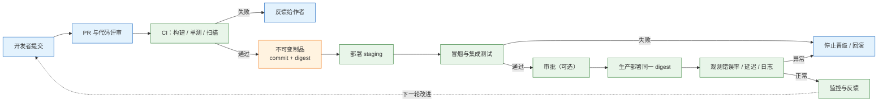
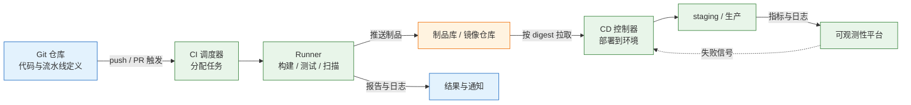
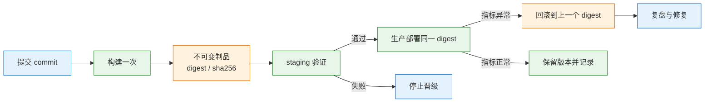

# CI/CD 与 DevOps

CI/CD 不是"装一个 Jenkins"，而是把"代码变成可运行版本"的过程固化成一条可重复、可验证、可回滚的流水线。DevOps 是让开发对运行结果负责的协作方式，流水线只是它的骨架。

---

## 一、CI/CD 与 DevOps 是什么

### 1.1 核心概念

一个典型的手工发布现场：

```text
开发本地 mvn package
  → 微信发给运维
  → 运维 scp 到服务器
  → 备份旧 jar
  → 杀进程、起新进程
  → 页面打不开，翻聊天记录找上一个包
```

这条链上有四个不可控点：构建环境不一致、制品没有唯一标识、部署步骤靠记忆、失败后没有快速回退。发版频率越低，每次变更越大，出错概率越高，回滚也越不敢做。

CI/CD 要解决的是这条链，而不是"让服务器上多一个 8080 页面"。它把构建、测试、制品、部署、验证串成固定动作，让每次发布都走同一条路。第一步不是选平台，而是把现有发布动作逐步写下来，标出哪些步骤可以自动验证、哪些必须人工确认。

四个概念要分清：

| 概念 | 含义 | 关键动作 |
|---|---|---|
| CI（持续集成） | 频繁把代码合入主干，并自动构建、测试 | 每次提交都触发，失败立即修 |
| 持续交付 | 主干始终处于"可发布"状态，但上线由人决定 | 制品可部署，审批后发布 |
| 持续部署 | 每次通过验证的变更自动上生产 | 依赖强自动化、灰度和回滚 |
| DevOps | 开发与运维共担交付和运行责任 | 小批量、自动化、可观测 |

"持续交付"和"持续部署"经常都被缩写为 CD。多数团队需要的是前者：流水线随时能发布，但生产发布仍保留审批窗口。把 CD 默认理解成"每次合并就自动上生产"，是很多事故的来源。

DevOps 的底层是一个反馈环，CI/CD 只是环里"交付"那一段：



它不解决：

- 代码本身的质量：测试没覆盖到的逻辑，流水线也测不出来。
- 架构问题：单体应用不会因为加了流水线就变成可独立部署的服务。
- 组织和权限：谁有权批准上生产，仍然要由流程和制度定义。

### 1.2 与相邻技术的关系

流水线站在多个系统的交叉点上。任何一环缺失，自动化都会退化成"把手工步骤录成脚本"。

| 技术 | 在交付链中的位置 | 缺失后的表现 |
|---|---|---|
| 版本控制（Git） | 触发源与唯一事实来源 | 无法回答"生产跑的是哪份代码" |
| 制品库（Nexus、Harbor） | 存放不可变制品与镜像 | 每次部署重新构建，版本无法复现 |
| 容器运行时 | 提供一致的运行环境 | 测试与生产依赖版本漂移 |
| 基础设施即代码 | 提供可重复的环境 | 环境靠手工配置，无法重建 |
| 可观测性 | 判断发布是否成功 | 进程活着但用户 5xx，无人发现 |
| 密钥管理 | 提供短期、可审计的凭据 | 密钥散落在脚本和日志里 |

这里要区分"部署"和"发布"：部署是把新版本放到环境里，发布是让用户流量真正到达新版本。两者可以分离——代码先部署但被开关关闭，确认无误后再放量。这个区分是灰度、金丝雀和功能开关的基础。

### 1.3 架构组成

一条完整的流水线由"触发、执行、存储、晋级、验证"五段组成，具体平台只是把这五段换成不同产品。



| 组件 | 职责 | 关键约束 |
|---|---|---|
| SCM | 保存代码、触发事件、记录变更 | 主干必须可构建 |
| 调度器 | 解析流水线、排队、分配 Runner | 配置即代码，可评审 |
| Runner | 真正执行构建和测试 | 环境干净、工具链固定、可水平扩展 |
| 缓存 | 加速依赖下载与编译 | 缓存键要包含依赖清单哈希 |
| 制品库 | 存放不可变制品 | 禁止覆盖同名版本 |
| 密钥管理 | 注入短期凭据 | 不落盘、不进日志 |
| 可观测性 | 判断发布是否成功 | 有明确的错误率与延迟阈值 |

调度器不是执行者。把重任务跑在调度节点上，是自建 CI 最常见的容量问题；Runner 无状态、可替换，才能随并发增长扩容。

---

## 二、环境准备与工具配置

### 2.1 工具链安装

先在单机把整条链跑通，再接平台。需要四类工具：版本控制、容器构建、JSON 处理、摘要计算。

```bash
# ========== 版本确认 ==========
# 确认基础工具可用，版本不满足时先升级
git --version
docker --version
jq --version
openssl version

# ========== 缺失工具安装（macOS） ==========
# Homebrew 安装 Git 与 JSON 处理器
brew install git jq
```

> **注意**：流水线里用到的每个命令都要在 Runner 镜像中显式安装。本地能跑、CI 报 `command not found`，绝大多数是工具链没有固化进镜像。

### 2.2 仓库与目录初始化

目录结构决定了"什么进版本库、什么进制品库"。构建产物和密钥绝不能进 Git。

| 路径 | 内容 | 是否进 Git |
|---|---|---|
| `src/` | 应用源码 | 是 |
| `scripts/` | 构建、发布、回滚脚本 | 是 |
| `deploy/` | 部署清单与配置模板 | 是 |
| `dist/` | 构建产物与摘要清单 | 否 |
| `.env` | 本地密钥与连接串 | 否 |

```bash
# ========== 建立工作目录 ==========
# 创建演示目录并进入
mkdir -p ~/cd-demo && cd ~/cd-demo

# 初始化仓库，-q 只输出错误
git init -q

# ========== 配置提交身份 ==========
# CI 中使用机器人账号，便于审计
git config user.name "release-bot"
git config user.email "release-bot@example.com"

# ========== 写入应用与忽略规则 ==========
# 写入最小应用脚本
cat > app.sh <<'EOF'
#!/usr/bin/env bash
echo "app is running"
EOF

# 赋予执行权限，否则容器内无法直接运行
chmod +x app.sh

# 排除构建产物、密钥和日志
cat > .gitignore <<'EOF'
dist/
.env
*.log
EOF

# ========== 首次提交 ==========
git add app.sh .gitignore
git commit -qm "add app"
```

### 2.3 凭据与权限配置

流水线需要写制品库、读集群、拉代码，每一种权限都应单独授予，且有到期时间。

| 凭据类型 | 存放位置 | 适用场景 |
|---|---|---|
| 长期令牌 | CI 变量（掩码） | 平台不支持 OIDC 时的兜底 |
| OIDC 短期凭据 | 运行时换取 | 云厂商、K8s 集群认证 |
| SSH 部署密钥 | CI 凭据库 | 拉取私有仓库 |
| Kubeconfig | CI 凭据库，限定命名空间 | 部署到 K8s |

```bash
# ========== 生成部署密钥 ==========
# ed25519 密钥体积小、安全性好，私钥只放 CI 凭据库
ssh-keygen -t ed25519 -C "ci-deploy" -f ~/.ssh/ci_deploy -N ""

# ========== 验证密钥权限 ==========
# 私钥权限必须是 600，否则 ssh 拒绝使用
chmod 600 ~/.ssh/ci_deploy
```

> **安全警告**：不要在脚本里 `echo` 密钥、不要 `set -x` 包住含密钥的命令、不要把 `.env` 打进镜像。日志一旦进入集中存储，清理成本远高于预防成本。

> **运维红线**：生产部署凭据只授予目标命名空间的最小权限。使用 cluster-admin 的 CI Job 一旦被恶意提交利用，攻击面是整个集群，而不是一个服务。

### 2.4 最小流水线验证

先不接平台，用一段脚本把"构建 → 校验 → 产出唯一制品"跑通。后面 GitHub Actions、GitLab CI、Jenkins 只是把这套动作翻译成各自的流水线配置。

```bash
# ========== 构建脚本 ==========
cat > release.sh <<'EOF'
#!/usr/bin/env bash
set -euo pipefail

VERSION=$(git rev-parse --short HEAD)
ARTIFACT="dist/app-${VERSION}.tar.gz"

# 先从语法层面验证，失败就不产出制品
bash -n app.sh

mkdir -p dist
tar -czf "$ARTIFACT" app.sh
SHA=$(openssl dgst -sha256 "$ARTIFACT" | awk '{print $NF}')

cat > "dist/app-${VERSION}.json" <<JSON
{
  "version": "${VERSION}",
  "artifact": "$(basename "$ARTIFACT")",
  "sha256": "${SHA}",
  "created": "$(date -u +%FT%TZ)"
}
JSON

echo "built ${VERSION} sha256=${SHA:0:12}"
EOF

# ========== 执行构建 ==========
chmod +x release.sh
./release.sh
```

预期输出（提交号和摘要每次不同）：

```text
built 3f2a1b9 sha256=9c1f4d2a8e7b
```

校验制品没有被替换：

```bash
# 重新计算摘要，并与清单中的值比对
VERSION=$(git rev-parse --short HEAD)
SHA=$(openssl dgst -sha256 "dist/app-${VERSION}.tar.gz" | awk '{print $NF}')
grep -q "$SHA" "dist/app-${VERSION}.json" && echo "artifact verified"
```

```text
artifact verified
```

这段脚本有三条纪律，后面所有平台都要遵守：

- **版本来自提交号**，不是手工填的 `v1`、`final`。
- **制品的哈希写进清单**，部署前校验，防止"构建时是 A，部署时变成 B"。
- **任何一步失败立即停止**，`set -euo pipefail` 不是装饰。

---

## 三、核心对象模型

### 3.1 流水线结构

不管平台叫什么，流水线的层级是一致的：流水线包含阶段，阶段包含任务，任务包含步骤，步骤跑在 Runner 上。

| 层级 | 含义 | 设计要点 |
|---|---|---|
| Pipeline | 一次完整的交付过程 | 定义在仓库里，可评审、可回滚 |
| Stage | 逻辑阶段，如构建、测试、部署 | 阶段间有依赖，失败即停 |
| Job | 可并行执行的任务单元 | 无状态，可重试，产物显式传递 |
| Step | 单条命令或动作 | 幂等，失败有明确退出码 |
| Runner | 执行 Job 的环境 | 镜像固定，工具链预装 |
| Workspace | Job 的工作目录 | 不跨 Job 共享状态 |

流水线即代码（pipeline as code）的意义不在于 YAML 好看，而在于变更可评审、历史可追溯、环境可重建。把流水线配在网页表单里，等于把交付能力锁在某个人的记忆中。

### 3.2 制品与版本标识

制品的标识方式决定了可追溯性。四种常见做法强弱分明：

| 标识 | 来源 | 可追溯性 | 问题 |
|---|---|---|---|
| 分支名 | `main`、`develop` | 弱 | 同名内容随时变化 |
| 语义版本 | 手工打 tag | 中 | 可能重复使用同名 tag |
| 提交号 | `git rev-parse` | 强 | 不含构建参数信息 |
| 镜像 digest | 仓库计算 | 最强 | 不可读，需要记录映射 |

镜像 tag 是可变的：同一个 `v1.3.9` 可以被重新推送成不同内容。生产部署应使用 digest，或至少保证 tag 不可覆盖。制品一旦发布就不再修改，需要变更就发新版本。

### 3.3 门禁分层

| 阶段 | 检查 | 失败后 |
|---|---|---|
| 提交前 | 格式化、静态检查 | 本地修，不占 CI 资源 |
| PR | 单测、编译、依赖扫描 | 阻止合并 |
| 构建后 | 镜像扫描、SBOM、签名 | 阻止推送或部署 |
| staging | 冒烟、集成、迁移演练 | 停止晋级 |
| 生产后 | 错误率、延迟、关键业务 | 自动或人工回滚 |

门禁不是越多越好。一个 40 分钟的流水线会让人绕过它；先保证 10 分钟内给出"能不能合"的答案。重检查可以异步跑，但不能阻断开发者拿反馈。

### 3.4 环境与配置分离

| 环境 | 目的 | 数据 | 准入 |
|---|---|---|---|
| 开发 | 快速验证功能 | 假数据或脱敏数据 | 无 |
| staging | 接近生产的验证 | 脱敏数据、独立中间件 | 自动部署 |
| 生产 | 承载真实流量 | 真实数据 | 审批或自动灰度 |

同一份制品在三个环境之间晋级，差异只来自配置和密钥。把环境差异写进流水线分支——`if env == "prod"` 越写越多——最后没人能预测一次发布会发生什么。差异应收敛到配置，流水线只有一条，环境只是参数。

配置也要分类型：普通配置可以进 Git，密钥进密钥管理，运行时开关进配置中心。十二要素应用把配置放在环境变量里，就是为了让同一份构建产物可以在任何环境启动。

### 3.5 发布策略

| 策略 | 做法 | 回滚 | 代价 |
|---|---|---|---|
| 滚动更新 | 逐批替换实例 | 再滚回旧版本 | 最省资源，但新旧版本短暂共存 |
| 蓝绿 | 两套环境切流量 | 切回旧环境 | 双倍资源，数据库要兼容 |
| 金丝雀 | 先放 5% 流量 | 把流量切回 | 需要流量控制和指标 |

无论哪种策略，回滚都应该是"切回上一个已知好的版本"，而不是"在生产上改代码"。蓝绿需要双倍资源；金丝雀需要可靠的错误率和延迟指标；滚动更新最省资源，但要求接口向前兼容。

### 3.6 回滚设计

回滚能力必须在发布前设计，而不是出事时现场想。

| 对象 | 回滚方式 | 注意 |
|---|---|---|
| 应用版本 | 切回上一个 digest | 制品必须仍保留在仓库 |
| 配置 | 切回上一版配置 | 配置也要版本化 |
| 数据库 | 向前兼容，不直接降级 | 迁移需 expand/contract |
| 基础设施 | 用 IaC 回到上一状态 | 手工改动会阻碍回滚 |

数据库是最容易破坏回滚的一环。采用 expand/contract：先加新列并双写，代码切换后再停用旧列，最后删除。这样旧版本代码仍能读新库，回滚不会因缺列而失败。

---

## 四、常用命令

### 4.1 提交与构建

```bash
# ========== 提交 ==========
# 查看改动范围，确认没有把密钥和产物加进来
git status --short

# 提交并推送到远端
git add -A
git commit -m "feat: add health endpoint"
git push origin HEAD

# ========== 打标签 ==========
# 只对通过验证的提交打语义版本标签
git tag -a v1.3.9 -m "release 1.3.9"
git push origin v1.3.9

# ========== 构建镜像 ==========
# 标签用于人读，部署以 digest 为准
docker build -t registry.example.com/demo/api:v1.3.9 .
```

> **注意**：`git push --force` 会覆盖远端历史。受保护的主干分支应禁止强推，确需改写历史时先确认没有其他人的提交基于它。

标签只是索引，不是制品。`git tag -a` 创建带注释的标签，记录了打标签的人和说明；轻量标签只是一个指针，审计价值低。标签还应由 CI 在验证通过后自动创建，避免人工在错误提交上打标。删掉远端标签再重打，会让"v1.3.9 对应哪份代码"这个问题失去唯一答案。

### 4.2 制品校验与晋级

```bash
# ========== 校验压缩包 ==========
# 计算 SHA-256，与发布清单比对
openssl dgst -sha256 dist/app-3f2a1b9.tar.gz

# ========== 推送镜像 ==========
# 推送后立即记录 digest，写入发布记录
docker push registry.example.com/demo/api:v1.3.9

# 读取仓库分配的 digest
docker image inspect registry.example.com/demo/api:v1.3.9 \
  --format '{{index .RepoDigests 0}}'

# ========== 按 digest 拉取 ==========
# digest 不可变，等价于锁定内容
docker pull registry.example.com/demo/api@sha256:<digest>
```

tag 和 digest 的关系类似文件名和 inode：tag 指向某个 digest，但可以被重新指向。发布记录里只写 tag，出事时就无法证明当时拉的是哪一份内容；只写 digest，人又读不懂版本。两者都记，各取所需。

### 4.3 部署与健康验证

```bash
# ========== 部署 ==========
# 用 digest 启动，避免 tag 被覆盖
docker run -d --name api-demo -p 8080:8080 \
  registry.example.com/demo/api@sha256:<digest>

# ========== 验证 ==========
# 健康检查必须返回 0，否则视为发布失败
curl -fsS http://127.0.0.1:8080/healthz

# 查看最近日志，确认没有启动期报错
docker logs --tail 50 api-demo
```

| 任务 | 命令 | 判断标准 |
|---|---|---|
| 拉取制品 | `docker pull ...@sha256:<digest>` | 摘要与发布记录一致 |
| 启动服务 | `docker run -d ...` | 容器状态为 Up |
| 健康检查 | `curl -fsS .../healthz` | 退出码 0、响应符合预期 |
| 日志核对 | `docker logs --tail 50` | 无异常堆栈、无连库失败 |

健康检查要分层：存活探针判断进程是否需要重启，就绪探针判断实例能否接流量，业务冒烟判断关键路径是否可用。只做端口探测，会把"进程活着但接口全错"判成成功；只做业务冒烟，又会在依赖抖动时误杀实例。三层各司其职，缺一层都会留下盲区。

`curl -fsS` 里的 `-f` 让 4xx/5xx 返回非 0 退出码，脚本才能用 `set -e` 捕获失败；只写 `curl` 不检查退出码，健康检查等于没做。

### 4.4 环境一致性核查

```bash
# ========== 核对运行内容 ==========
# 确认容器实际使用的镜像，与发布记录中的 digest 比对
docker inspect api-demo --format '{{.Config.Image}}'

# 查看启动时间、退出码和重启次数，判断是否反复重启
docker inspect api-demo \
  --format '{{.State.StartedAt}} {{.State.ExitCode}} {{.RestartCount}}'

# 查看容器内系统版本，与构建镜像时记录的基线比对
docker exec api-demo sh -c 'head -2 /etc/os-release'
```

环境一致性不是"用了同一个 Dockerfile"就自动成立。基础镜像 tag 漂移、构建参数不同、挂载的配置文件不同，都会让两个环境产生差异。上线前核对 digest、启动参数和关键依赖版本，比事后比对日志便宜得多。

### 4.5 回滚与清理

```bash
# ========== 回滚 ==========
# 停掉当前实例，用上一个 digest 重新启动
docker stop api-demo
docker rm api-demo
docker run -d --name api-demo -p 8080:8080 \
  registry.example.com/demo/api@sha256:<previous-digest>

# ========== 确认 ==========
# 回滚后同样要跑健康检查
curl -fsS http://127.0.0.1:8080/healthz
```

> **运维红线**：不要用 `docker system prune -a` 清理生产构建机。它会删除所有未被容器引用的镜像，包括正在用于回滚的旧版本，事故时无版本可退。

保留策略要按"回滚需要几个版本"倒推。假设每次发布保留当前版加前两个版本，构建机上至少要能同时存在三份镜像；按天清理且只留最新版，等于把回滚窗口压缩到一天以内。清理前先用 `docker image ls` 核对，再按标签或时间过滤，不要用全量 prune。

---

## 五、从提交到回滚的完整链路

### 5.1 基线建立

先把 2.4 的脚本跑通，确认三件事：提交号能作为版本、摘要能复算、清单能追溯。

```bash
# ========== 建立基线 ==========
# 生成制品与清单
./release.sh

# 查看清单内容，确认字段齐全
cat dist/app-$(git rev-parse --short HEAD).json

# 连续构建两次，确认版本一致、摘要一致
./release.sh
```

同一提交连续构建，摘要应完全一致；若不一致，说明构建过程引入了时间戳、随机数或未锁定的依赖。这类不确定性会让"同一版本"失去意义，回滚也无法保证回到相同内容。

| 检查点 | 验证方式 | 通过标准 |
|---|---|---|
| 版本来源 | `git rev-parse --short HEAD` | 与清单中的 version 一致 |
| 制品完整性 | 重新计算 SHA-256 | 与清单中的 sha256 一致 |
| 构建可重复 | 同提交构建两次 | 两次摘要相同 |
| 产物隔离 | `git status` | dist 未被提交 |

### 5.2 镜像构建与推送

应用要跑在容器里，才谈得上环境一致。用一个最小 Dockerfile 把脚本打成镜像：

```dockerfile
# 基础镜像固定到具体版本，生产再锁定 digest
FROM alpine:3.20

# 安装运行所需的最小依赖
RUN apk add --no-cache bash

WORKDIR /app

# 复制应用脚本并赋予执行权限
COPY app.sh /app/app.sh
RUN chmod +x /app/app.sh

# 准备健康检查用的静态文件
RUN mkdir -p /app/www && echo ok > /app/www/healthz

EXPOSE 8080

# 用 busybox httpd 提供最小 HTTP 服务
CMD ["httpd", "-f", "-p", "8080", "-h", "/app/www"]
```

```bash
# ========== 构建并推送 ==========
# 标签带语义版本，便于人读
docker build -t registry.example.com/demo/api:v1.3.9 .

# 推送后记录 digest，后续部署只用 digest
docker push registry.example.com/demo/api:v1.3.9

# 把 digest 写入发布记录
docker image inspect registry.example.com/demo/api:v1.3.9 \
  --format '{{index .RepoDigests 0}}'
```

预期输出形如 `registry.example.com/demo/api@sha256:<64位十六进制>`。把这一整串记进发布记录，它是"这次到底部署了什么"的唯一答案。

构建顺序影响缓存命中率：先复制依赖清单并安装依赖，再复制源码，改业务代码时不必重装依赖。镜像构建同样受 `.dockerignore` 影响，`.git`、`dist`、`.env` 必须排除，否则构建上下文变大、构建变慢，密钥还有被打进镜像的风险。

```bash
# ========== 检查构建上下文 ==========
# 查看镜像层与体积，确认没有把无关文件带进去
docker history registry.example.com/demo/api:v1.3.9

# 确认镜像内没有密钥文件
docker run --rm registry.example.com/demo/api:v1.3.9 ls -a /app
```

### 5.3 按 digest 晋级

一条正常的发布链有八个动作：

1. 开发者从主干拉分支，小步提交，开 PR。
2. PR 触发 CI：编译、单元测试、静态检查、依赖漏洞扫描，不注入生产密钥。
3. 评审通过、检查全绿，合并到主干。
4. 主干流水线构建一次，把制品推到仓库，标签用 commit SHA，并记录 digest。
5. 自动部署到 staging，跑冒烟测试和关键路径集成测试。
6. 需要审批的生产环境，由负责人确认后，把**同一个 digest** 部署到生产，不重新构建。
7. 观察 10–30 分钟的错误率、延迟、日志和业务指标。
8. 异常则回滚到上一个 digest；数据库迁移必须可向前兼容，否则回滚会失败。

```bash
# ========== staging 晋级 ==========
# 把 REPLACE_ME 换成发布记录里的 digest
DIGEST='sha256:REPLACE_ME'

# 拉取与构建时完全一致的制品
docker pull "registry.example.com/demo/api@${DIGEST}"

# 用同一 digest 启动 staging 实例
docker run -d --name api-demo -p 8080:8080 \
  "registry.example.com/demo/api@${DIGEST}"

# 健康检查通过才允许进入生产
curl -fsS http://127.0.0.1:8080/healthz
```

预期健康检查返回：

```text
ok
```

如果只看 `docker run` 返回 0 就认为发布成功，容器可能刚启动就退出，或者健康检查没通过。**部署成功的标准是业务验证通过，不是进程存在。**

### 5.4 生产验证

staging 通过只说明流程能走通，生产还要看真实流量下的表现。

```bash
# ========== 生产部署 ==========
# 使用与 staging 完全相同的 digest
docker pull "registry.example.com/demo/api@${DIGEST}"

# 先停旧实例再起新实例，接受秒级中断
docker stop api-demo || true
docker rm api-demo || true

# 以同一 digest 启动生产实例
docker run -d --name api-demo -p 8080:8080 \
  "registry.example.com/demo/api@${DIGEST}"

# ========== 观察 ==========
# 健康检查、日志、错误率三条线同时看
curl -fsS http://127.0.0.1:8080/healthz
docker logs --since 10m api-demo | grep -i error
```

验证窗口通常取 10–30 分钟：覆盖缓存过期、连接池重建、定时任务触发这些延迟出现的问题。只看启动后 30 秒，等于没验证。

### 5.5 回滚与记录

回滚不需要重新构建，只需要换回上一个 digest：

```bash
# ========== 确认目标版本 ==========
# 生产环境应以发布记录为准，本地镜像仅作辅助
docker image inspect registry.example.com/demo/api:v1.3.8 \
  --format '{{index .RepoDigests 0}}'

# ========== 执行回滚 ==========
docker stop api-demo
docker rm api-demo
docker run -d --name api-demo -p 8080:8080 \
  registry.example.com/demo/api@sha256:<previous-digest>

# ========== 回滚后验证 ==========
curl -fsS http://127.0.0.1:8080/healthz
```



生产环境通常保留最近 N 个版本。回滚脚本要能在 1 分钟内完成，否则团队会倾向于"现场改配置"，把问题越弄越大。回滚完成后必须记录：回滚到哪个 digest、触发原因、影响时长，这些是下一次改进的输入。

---

## 六、最佳实践

### 6.1 制品不可变与构建一次

同一个版本号只能对应一份内容。镜像用 digest，压缩包用 SHA-256。不要用 `latest`，也不要在生产部署时重新 `mvn package`。

| 做法 | 反例 | 后果 |
|---|---|---|
| 构建一次，逐环境晋级 | 每个环境各构建一次 | 环境之间内容不同，问题无法复现 |
| 固定基础镜像 digest | `FROM node:latest` | 上游更新导致构建结果漂移 |
| 锁定依赖版本 | 不提交 lock 文件 | 同一提交装出不同依赖树 |
| 保留历史制品 | 只留最新版本 | 回滚时无包可用 |

### 6.2 分支与合并策略

| 策略 | 做法 | 适用 | 代价 |
|---|---|---|---|
| Trunk-based | 小步提交到主干，未完成功能用开关隐藏 | 持续交付成熟团队 | 要求测试与开关治理 |
| GitHub Flow | 短分支 + PR 合并 | 多数产品团队 | 分支仍需及时回收 |
| GitFlow | 长期 develop、release 分支 | 版本制交付 | 合并冲突与长反馈周期 |

长期存在的 feature 分支会让合并变成一次大爆炸；trunk-based 要求主干随时可发布。开关不是免费的：每个开关都要有 owner、过期时间和清理计划，否则配置会变成新的技术债。

### 6.3 交付度量

| 指标 | 定义 | 优化方向 |
|---|---|---|
| 部署频率 | 单位时间成功上线的次数 | 缩小批次、自动化晋级 |
| 变更前置时间 | 提交到生产运行的时长 | 减少等待与手工环节 |
| 变更失败率 | 需要回滚或热修的发布占比 | 加强门禁与灰度 |
| 故障恢复时间 | 从故障发生到恢复的时长 | 回滚自动化、可观测性 |

先测一个月基线，再决定优化哪一段。不要只看"构建成功率"，那只是流水线自己的健康度，不代表交付能力。

### 6.4 适用边界

- 监管要求人工审批、双人复核的发布，不应该追求"合并即上线"。
- 没有自动化测试的遗留系统，先补关键路径测试，再谈持续部署。
- 单体应用一次发布影响所有功能，先做灰度、开关和回滚，不要只堆流水线阶段。
- 小团队两三个人，先做"构建 + 测试 + 制品"，不要一开始搭十几个 stage 和自建 Runner。

CI/CD 不适合所有场景，也不替代工程判断。流水线只能保证"每次发布走同一条路"，不能保证"这条路通向正确的产品"。

---

## 七、常见排障

### 7.1 故障对照表

| 现象 | 最可能原因 | 处理 |
|---|---|---|
| CI 绿，生产起不来 | 配置、密钥、系统库不一致 | 同一镜像加配置清单，启动后跑冒烟 |
| 同一版本两次构建内容不同 | 依赖未锁、基础镜像漂移、可变 tag | 锁文件、固定基础镜像 digest |
| 回滚后数据库报错 | 迁移不可逆、旧代码不认新列 | expand/contract，先加列后删列 |
| 流水线越来越慢 | 全量测试串行、无缓存、重复构建 | 分层测试、缓存依赖、并行 Job |
| 偶发红灯，重跑就过 | flaky 测试、外部服务不稳定 | 隔离、限制重试、标记 quarantine |
| 密钥出现在日志 | `set -x`、打印环境变量 | 掩码、OIDC 短期凭据、日志扫描 |
| 部署成功但用户 5xx | 只检查进程，没有业务验证 | 健康检查加关键路径 smoke |
| 只有一个人会修流水线 | 平台是黑盒、权限集中 | pipeline as code、评审、runbook |

### 7.2 排查顺序

1. 找到**第一个**失败 stage，不要从最后一条报错看起。
2. 看该 stage 的第一条 error，区分"命令失败"和"后续连锁失败"。
3. 用同一 commit、同一命令在本地复现。
4. 比对环境：运行时版本、配置、密钥、网络、磁盘。
5. 修复后只重跑失败 stage；连续两次同样失败，先停线查原因，不要盲目重试。

> **运维提示**：重跑之前先确认失败是否可复现。对 flaky 测试无限重试，会把真实缺陷掩盖成"偶发红灯"，等到生产再暴露时，排查线索已经被重试记录冲掉。
