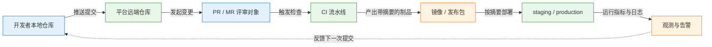
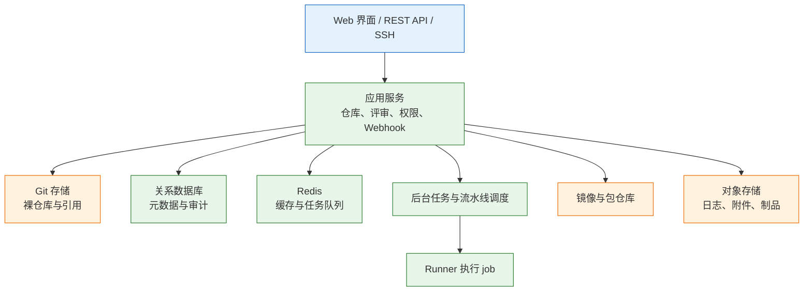
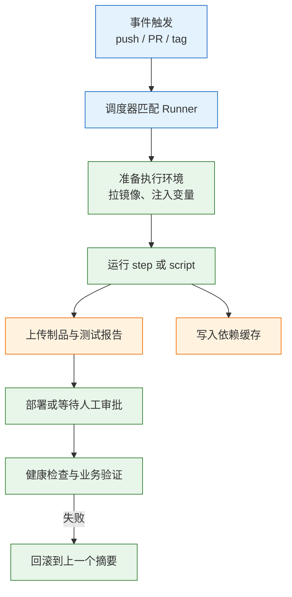
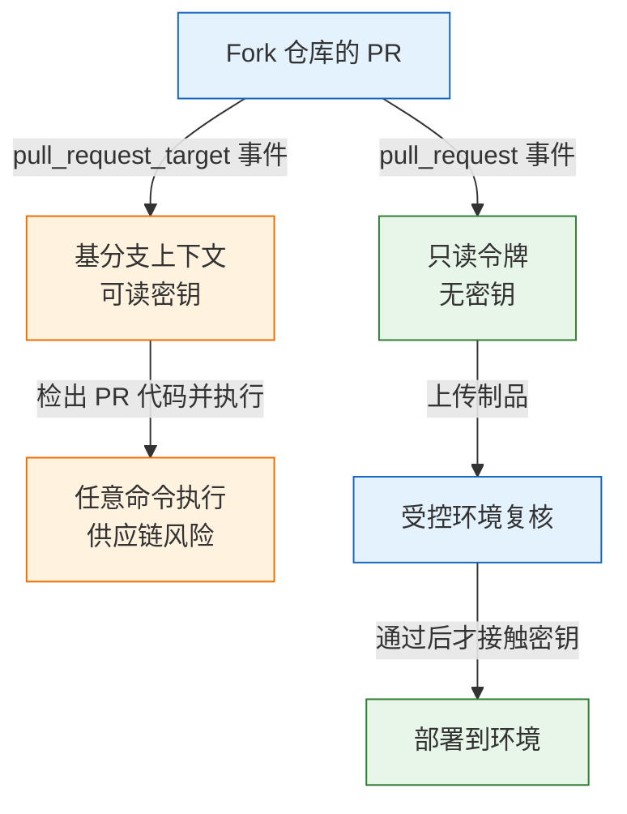

# GitHub 与 GitLab

> GitHub 与 GitLab 都属于代码托管与协作平台，把仓库、评审、权限、流水线与制品收在同一个对象模型里。选型的关键不在功能清单，而在代码放在哪里、谁执行流水线、密钥与发布权限如何收口。

---

## 一、GitHub 与 GitLab 是什么

Git 只解决版本图的存储与合并，一次 `git push` 就能把提交送到远端。但如果平台只提供远端仓库，团队很快会落到同一种状态：所有人直接推主干，评审靠聊天记录，检查在另一台机器上手工执行，发布凭某个人的记忆。平台要补的是协作层，让变更必须经过评审、检查必须绑定到具体提交、权限必须能分级、发布必须留下可追溯记录。

平台不改变 Git 的对象格式。提交、树、标签仍然是 Git 自己的对象，平台在这些对象外面加了一层带状态、带权限、带事件的业务模型。理解这一层，才能解释为什么同一个 `git push` 在本地成功、到平台却被拒绝，以及为什么 PR 上的检查结果与本地命令不完全一致。

它不解决代码质量和部署架构。评审规则能要求“必须有人看过”，但不能保证看得认真；流水线能把坏版本更快推上线，也能把事故放得更快。平台也不能替代组织制度，谁有权批准生产发布，仍然要由流程定义。

### 1.1 核心概念

**托管平台**是围绕 Git 仓库提供账户、权限、评审、自动化和制品的一体化服务。**变更请求**（GitHub 称 Pull Request，GitLab 称 Merge Request）是平台的核心对象：它把一条分支上的提交序列变成一个可评论、可审批、可检查、可合并的状态机。**状态检查**是外部系统回写到某个提交上的结论，分支保护据此决定能否合并。

**分支保护**把“必须满足什么条件才能写入”变成服务端规则，常见条件包括必须走 PR、至少若干人批准、指定检查通过、对话已解决、禁止强制推送。**环境**是部署目标的抽象，携带自己的密钥、审批规则和部署记录；生产密钥只应在声明了该环境的 job 中可见。

| 概念 | 作用 | GitHub | GitLab |
|---|---|---|---|
| 仓库 | 存放 Git 对象与协作元数据 | Repository | Project |
| 变更请求 | 承载 diff、评论、审批与检查 | Pull Request | Merge Request |
| 状态检查 | 把 CI 结论绑定到提交 | Check run / status | Pipeline status |
| 分支保护 | 限制写入与合并条件 | Rulesets | Protected branches |
| 制品 | 保存镜像、包与发布附件 | Packages、Releases | Registry、Releases |
| 环境 | 部署目标与密钥边界 | Environments | Environments |

平台把“谁改了什么、谁批准了、哪条流水线通过、部署了哪个制品”记在同一条时间线上。审计能力来自这条时间线，而不是来自某个单独的日志系统。

### 1.2 与相邻技术的关系

Git 是内容寻址的版本图，负责“代码是什么”；平台负责“这次变更能不能进主干、由谁批准、跑过哪些检查”；CI 负责执行构建与测试；镜像仓库负责保存不可变制品；部署系统按摘要把制品放进环境。五者的边界清楚，排障时才不会把“代码合不进去”误判成“流水线坏了”。



| 组件 | 负责 | 不负责 |
|---|---|---|
| Git | 提交、分支、合并、标签 | 权限、评审、自动化 |
| 协作平台 | 账户、评审、门禁、事件 | 构建环境与运行时 |
| CI 执行器 | 跑命令、产出制品 | 保存长期制品 |
| 镜像仓库 | 存不可变镜像与摘要 | 决定谁能部署 |
| 部署系统 | 把摘要放进环境 | 判断代码是否该合并 |

> **运维提示**：平台上的“绿色”只代表配置的检查通过了，不代表制品被部署过。发布记录要同时保留提交号、流水线编号与镜像摘要，三者缺一，回滚时就说不清该回到哪里。

### 1.3 架构组成

GitHub 以 SaaS 为主，企业版 GitHub Enterprise Server 可以自建；GitLab 同时提供 SaaS 与自建，自建形态在政企和内网环境很常见。两者的逻辑组成相似：接入层处理 HTTP、SSH 与 Webhook，应用层管理仓库、评审、权限，Git 存储层保存裸仓库，后台任务层执行异步作业，CI 调度层把 job 分给 Runner，制品层保存镜像与包。

GitLab 的组件划分更公开：Puma 承载 Rails 应用，Workhorse 处理大文件与 Git 智能 HTTP 代理，Gitaly 提供 Git 存储服务，Sidekiq 执行后台任务，PostgreSQL 保存元数据，Redis 承担缓存与队列，对象存储保存附件、日志与制品，Container Registry 保存镜像。GitHub 的内部实现不公开，但排障时观察到的层次是一致的。



| 层 | 职责 | 故障表现 |
|---|---|---|
| 接入层 | TLS、SSH、反向代理、限流 | 页面 502、`git push` 超时 |
| 应用层 | 仓库、评审、权限、API | 页面报错、API 403 |
| Git 存储 | 保存对象与引用 | 克隆失败、仓库只读 |
| 任务层 | 后台作业、流水线调度 | job 排队、通知延迟 |
| 执行层 | Runner 运行构建 | job 一直 pending |
| 制品层 | 镜像、包、附件 | 推送 403、拉取 404 |

自建 GitLab 的容量瓶颈通常不在应用层，而在 Gitaly 磁盘、PostgreSQL 连接数、Redis 内存和 Registry 存储。把这些组件的磁盘与备份单独监控，比盯着页面是否打开更有意义。

---

## 二、账号、仓库与权限配置

平台配置的起点不是新建仓库，而是确定身份的来源。账户来自本地数据库还是企业 IdP，团队按组织同步还是手工维护，机器人账号归谁管理，这些决定后续权限是否可审计。仓库可以后建，身份体系一旦混乱，清理成本很高。

### 2.1 托管形态与版本现状

> **版本现状（2026）**：GitHub 以 SaaS 持续更新，企业版按季度发布；GitLab 采用月度发布，自建实例应固定在当前稳定 minor，并跟随安全补丁。两者都不建议长期停留在已停止维护的版本。

| 形态 | 数据位置 | 运维责任 | 适用 |
|---|---|---|---|
| GitHub.com | 厂商 | 厂商负责平台，团队管配置 | 开源、广泛生态 |
| GitHub Enterprise Server | 自建机房或云主机 | 升级、备份、Runner 全自负 | 强合规、内网 |
| GitLab.com | 厂商 | 厂商负责平台 | 快速起步、小团队 |
| 自建 GitLab | 自建机房或云主机 | 组件、存储、升级全自负 | 数据不出域、一体化 |
| 自建 Runner | 自建 | 机器、镜像、清理、扩容 | 私有依赖、特殊硬件 |

选型时先看生态与长期成本，而不是功能列表：

| 维度 | GitHub | GitLab |
|---|---|---|
| 生态 | 开源项目多，Actions 市场大 | 一体化 DevOps，自建可控 |
| 主要成本 | 私有仓库分钟数、larger runner | 自建服务器、运维人力、License |

判断可以简单一些：开源项目、需要广域生态选 GitHub；数据必须留在自有房、需要一体化自建选 GitLab；两者都能满足时，看谁能长期维护 Runner 与升级。自建还要长期承担升级、备份、Runner 扩容、对象存储与证书。

托管与自建不是非此即彼。常见组合是代码放在 SaaS，Runner 放在内网，只让 Runner 主动向外建立连接，这样构建能访问内网依赖，代码也不必迁回机房。

### 2.2 命令行环境与认证配置

平台的大多数操作可以在网页完成，但批量检查权限、导出审计记录、在脚本里创建发布，仍然依赖命令行。GitHub CLI 是 `gh`，GitLab CLI 是 `glab`，两者都封装了 REST API，认证信息存放在本地配置目录。

```bash
# ========== 安装命令行工具 ==========
# macOS 使用 Homebrew 安装两个 CLI
brew install gh glab

# Ubuntu/Debian 从发行版仓库安装 GitHub CLI
sudo apt update && sudo apt install -y gh

# 确认版本，过旧的 CLI 可能缺少新接口
gh --version
glab --version

# ========== 身份认证 ==========
# 浏览器 OAuth 登录，Git 协议选 SSH
gh auth login --hostname github.com --git-protocol ssh --web

# 追加工作流文件所需 scope，否则推送 workflow 会被拒绝
gh auth login --hostname github.com --scopes repo,read:org,workflow

# 自建 GitLab 必须显式指定实例地址
glab auth login --hostname gitlab.example.com --git-protocol ssh

# 查看登录状态与 token 权限
gh auth status
glab auth status

# ========== SSH 密钥 ==========
# 生成 ed25519 密钥，注释换成可识别的身份
ssh-keygen -t ed25519 -C "ops@example.com"

# 打印公钥，粘贴到平台的 SSH Keys 页面
cat ~/.ssh/id_ed25519.pub

# 验证连通性，出现成功认证提示即通
ssh -T git@github.com
ssh -T git@gitlab.example.com
```

| 场景 | 命令 | 说明 |
|---|---|---|
| 查看登录状态 | `gh auth status` | 同时显示 token 的 scope |
| 切换账号 | `gh auth switch` | 多账号环境避免推错仓库 |
| 刷新 token | `gh auth refresh -s workflow` | 补 scope 而不重新登录 |
| 读取 API | `gh api repos/{owner}/{repo}` | 输出 JSON，可接 `--jq` |
| GitLab API | `glab api projects/123` | 路径不带前导斜杠 |

> **安全警告**：CLI 的 token 等同于账户权限。不要把 token 写进脚本、镜像或 CI 变量；需要自动化时使用独立的机器人账号，并把 scope 限制到具体仓库与操作。

### 2.3 组织、团队与仓库角色

GitHub 的权限从 Organization 向下传递：组织角色决定能否管理成员与账单，Team 决定一组人对哪些仓库有什么权限，仓库角色决定具体操作。GitLab 用 Group 嵌套 Project，成员继承上级群组权限，访问级别用数字表示。

| 能力 | GitHub 仓库角色 | GitLab 访问级别 | 说明 |
|---|---|---|---|
| 只读与提 issue | Read | Reporter（20） | 外部协作常用 |
| 推送分支 | Write | Developer（30） | 不能改保护分支 |
| 管理保护分支与合并 | Maintain | Maintainer（40） | 可改仓库设置 |
| 管理成员与删除仓库 | Admin | Owner（50） | 只给少数人 |

```bash
# ========== 组织与团队 ==========
# 列出组织下的团队 slug
gh api orgs/acme/teams --jq '.[].slug'

# 给团队授予仓库写权限
gh api -X PUT orgs/acme/teams/platform/repos/acme/demo-api \
  -f permission=push

# 查看仓库协作者及其角色
gh api repos/acme/demo-api/collaborators \
  --jq '.[] | "\(.login) \(.role_name)"'

# ========== GitLab 群组与成员 ==========
# 列出群组成员及访问级别
glab api groups/platform%2Fbackend/members/all

# 将用户加入项目并授予 Developer
glab api -X POST projects/123/members \
  -f user_id=45 -f access_level=30
```

> **运维提示**：团队用 IdP 同步时，平台里的手工授权会在下一次同步被覆盖。排障“权限刚给又没了”时，先看 SCIM 或 LDAP 同步日志，而不是反复点保存。

### 2.4 分支保护与合并门禁配置

分支保护的目标是让主干只能通过评审与检查进入。GitHub 的 Rulesets 支持按分支模式批量套用规则，并可为特定团队设置绕过；GitLab 用 Protected branches 限定谁能推、谁能合，再叠加 Approval rules 与 Push rules。两边的检查项可以对齐。

| 门禁项 | GitHub 配置位置 | GitLab 配置位置 | 建议 |
|---|---|---|---|
| 必须走 PR/MR | Rulesets → Require pull request | Protected branch → Allowed to merge | 主干必开 |
| 最少审批人数 | Required approvals | Approval rules | 1–2 人，不凑数 |
| 检查必须通过 | Required status checks | Pipeline must succeed | 选稳定检查项 |
| 对话必须解决 | Require conversation resolution | Resolve discussion | 防止遗留问题 |
| 禁止强推 | Block force pushes | Allowed to force push 关闭 | 主干必开 |
| 线性历史 | Require linear history | Merge method 限制 | 配合 squash |
| 签名提交 | Require signed commits | Push rules → Reject unsigned | 合规场景 |

代码所有权用 `CODEOWNERS` 声明，平台在 PR 上自动请求对应团队评审。它保证“对的人看到”，不保证评审质量；小 PR 比三个人盖章更有用。

```text
# .github/CODEOWNERS
# 后面的规则覆盖前面的规则，路径模式按 Git 风格匹配
*                       @acme/platform
/.github/workflows/     @acme/release-team
/infra/                 @acme/sre
```

```bash
# ========== 查看保护规则 ==========
# 查看主干分支保护，使用 rulesets 时可能返回 404
gh api repos/acme/demo-api/branches/main/protection

# 列出仓库的 rulesets 及其生效分支
gh api repos/acme/demo-api/rulesets

# 查看 GitLab 受保护分支
glab api projects/123/protected_branches

# ========== 绕过保护的高危操作 ==========
# 仅限事故处理，执行前必须记录原因与审批人
git push --force-with-lease origin main
```

> **运维红线**：对受保护主干执行强制推送会重写他人的提交，并让已合并的 PR 失去对应关系。确需回退时用 `git revert` 生成反向提交，不要用强推覆盖历史。

---

## 三、核心对象管理

平台上的对象不是孤立的：仓库包含分支，分支指向提交，提交关联检查，变更请求引用分支，合并产生新提交，标签固定发布点，制品记录摘要。把这条链走一遍，就能定位大多数“明明推上去了却看不到”的问题。

### 3.1 对象层级与状态流转

变更请求的生命周期是一个受权限约束的状态机。草稿状态表示还没准备好评审，此时通常不请求评审人；打开后检查开始运行；评审人要求修改时进入 Changes requested；全部通过后进入可合并；合并或关闭是终态，分支可以保留也可以删除。

| 状态 | 含义 | 可执行动作 |
|---|---|---|
| Draft | 作者尚未请求评审 | 继续提交、标记 ready |
| Open | 等待检查与评审 | 评论、批准、要求修改 |
| Changes requested | 评审人要求修改 | 继续提交、重新请求评审 |
| Approved | 审批满足且检查通过 | 合并、排队合并 |
| Merged / Closed | 终态 | 回滚需新提交或还原 PR |

状态机之外还有一层可见性：fork 来的 PR 与同仓库分支的 PR 在密钥、令牌、运行环境上待遇不同。这一差异是安全设计的核心，后文单独展开。

### 3.2 仓库、分支与标签操作

日常操作仍然由 Git 完成，平台只负责接收和校验。分支命名建议带类型前缀，标签使用语义化版本，发布说明由平台根据合并记录生成，避免手写出入。

```bash
# ========== 克隆与分支 ==========
# 克隆仓库并查看远端地址
git clone git@github.com:acme/demo-api.git
git remote -v

# 从主干拉短分支，分支名体现变更类型
git switch -c feature/ci

# 推送并建立上游跟踪
git push -u origin feature/ci

# ========== 标签与发布 ==========
# 附注标签记录发布人、时间与说明
git tag -a v1.4.0 -m "release v1.4.0"

# 推送单个标签，不要用 --tags 批量推历史标签
git push origin v1.4.0

# 由平台生成发布记录并上传附件
gh release create v1.4.0 --generate-notes
glab release create v1.4.0 --notes "release v1.4.0"
```

| 操作 | 命令 | 注意 |
|---|---|---|
| 查看远端 | `git remote -v` | 确认推的是目标仓库 |
| 删除远端分支 | `git push origin --delete feature/x` | 合并后清理，保护分支会拒绝 |
| 查看标签 | `git tag -l 'v*'` | 标签不可变，发错要新版本 |
| 查看某标签提交 | `git rev-list -n 1 v1.4.0` | 发布记录应与提交对应 |
| 同步主干 | `git pull --ff-only` | 避免生成无意义合并提交 |

> **注意**：`git push --tags` 会把本地所有标签推到远端，包括实验标签。发布只推明确的版本标签，并给标签也加保护规则。

### 3.3 变更请求与评审操作

PR/MR 的正文应说明改了什么、为什么改、怎么验证、怎么回滚。模板能把这几项固定下来，减少“看 diff 猜意图”的时间。评审意见分“必须修改”和“建议”两类，前者用 request changes，后者用普通评论，避免阻塞。

```bash
# ========== 创建与查看 ==========
# 从当前分支创建 PR，标题和正文用提交信息填充
gh pr create --base main --head feature/ci --fill

# 先建草稿，等自测通过再请求评审
gh pr create --draft --base main --fill

# 查看检查状态并持续等待
gh pr checks --watch

# 在浏览器打开 diff
gh pr view --web

# ========== 评审与合并 ==========
# 批准当前 PR
gh pr review --approve

# 压缩合并并删除远端分支
gh pr merge --squash --delete-branch

# 检查通过后自动合并，避免守着页面
gh pr merge --auto --squash

# GitLab 对应操作
glab mr create --fill --target-branch main
glab mr merge 12 --squash --remove-source-branch
```

| 动作 | GitHub | GitLab | 触发效果 |
|---|---|---|---|
| 创建评审 | `gh pr create` | `glab mr create` | 生成变更对象与流水线 |
| 查看检查 | `gh pr checks` | `glab ci status` | 读取最新 pipeline |
| 批准 | `gh pr review --approve` | `glab mr approve` | 计入审批人数 |
| 合并 | `gh pr merge` | `glab mr merge` | 写入主干并触发后续流水线 |
| 排队合并 | Merge queue | Merge trains | 重新验证合并后的结果 |

GitLab 的 merge trains 属付费能力；两者都会在临时合并序列上重跑检查，代价是排队延迟与额外 CI 消耗。五六人的仓库通常不需要，主干每天合并十几次、经常“单独绿、合起来红”时再上。

> **注意**：用 `GITHUB_TOKEN` 完成的合并不会触发新的 `push` 工作流，这是平台的防递归机制。需要合并后继续发布时，用 tag、`workflow_dispatch` 或独立的部署仓库衔接。

### 3.4 制品、环境与发布记录

制品必须可追溯。镜像用摘要固定，压缩包用 SHA-256 清单，发布附件与标签绑定。环境把部署目标、密钥、审批和历史收在一起，GitHub 的 Environment 与 GitLab 的 Environment 概念一致，区别在审批配置的位置。

| 制品类型 | GitHub 位置 | GitLab 位置 | 标识方式 |
|---|---|---|---|
| 容器镜像 | GHCR | Container Registry | `@sha256:...` |
| 语言包 | GitHub Packages | Package Registry | 版本号 + 校验和 |
| 发布附件 | Release assets | Release assets | 标签 + 文件名 |
| 流水线产物 | Actions artifacts | Job artifacts | 运行编号 + 过期时间 |

```bash
# ========== 推送镜像 ==========
# 登录 GHCR，用户名用账号，密码用 PAT 或 GITHUB_TOKEN
echo "$GH_TOKEN" | docker login ghcr.io -u acme-bot --password-stdin

# 构建并推送带提交号的镜像
docker build -t ghcr.io/acme/demo-api:"$(git rev-parse --short HEAD)" .
docker push ghcr.io/acme/demo-api:"$(git rev-parse --short HEAD)"

# 读取仓库返回的摘要，发布记录以此为准
docker inspect --format '{{index .RepoDigests 0}}' \
  ghcr.io/acme/demo-api:"$(git rev-parse --short HEAD)"

# ========== 校验与清理 ==========
# 查看远端清单，确认平台与架构
docker buildx imagetools inspect ghcr.io/acme/demo-api:v1.4.0

# 删除本地标签不影响远端，远端清理按保留策略执行
docker rmi ghcr.io/acme/demo-api:v1.4.0
```

> **安全警告**：制品仓库的写权限等于发布权限。不要给所有开发者 `packages: write`，也不要让 PR 流水线推送到生产仓库；镜像与包按环境分仓库或分命名空间。

---

## 四、流水线写法

流水线配置是平台里最像代码的部分，也是最容易复制粘贴出错的部分。两个平台的 YAML 表面相似，执行模型却不同：GitHub Actions 以 job 为调度单位，job 之间默认并行；GitLab CI 以 stage 为顺序单位，同 stage 的 job 并行。写法必须服从模型，而不是把对方的配置逐行翻译。

### 4.1 执行模型

GitHub Actions 的结构是 `workflow → job → step`。一次事件触发一个 workflow，每个 job 分配到一台 Runner，step 在同一个 job 内共享工作区。GitHub 托管的 Runner 为每个 job 提供全新环境；自建 Runner 不会自动清理，需要自己保证隔离。job 之间默认并行，用 `needs` 组成有向无环图；`matrix` 把一组参数展开成多个 job；`services` 为 job 启动附属容器。

GitLab CI 的结构是 `stage → job`。`stages` 定义顺序，同 stage 的 job 并行，后一个 stage 等前一个 stage 全部成功；`needs` 可以跳过 stage 顺序，直接依赖某个 job 的产物。使用 Docker 执行器时，每个 job 在新的容器里执行；使用 Shell 执行器时则直接跑在 Runner 主机上，隔离性由自己负责。



| 能力 | GitHub Actions | GitLab CI | 差异点 |
|---|---|---|---|
| 顺序 | `needs` 组成 DAG | `stages` 顺序 + `needs` | GitLab 默认为阶段屏障 |
| 并行 | `matrix` | `parallel`、`parallel:matrix` | 语法不同 |
| 文件传递 | artifacts | artifacts | 都需显式上传 |
| 依赖缓存 | `actions/cache` | `cache` | key 设计决定命中率 |
| 附属服务 | `services` | `services` | 网络别名规则不同 |
| 取消旧运行 | `concurrency` | `interruptible` | 后者需配置自动取消 |

> **注意**：job 之间不要指望工作区还在。上一个 job 的文件不会自动出现在下一个 job，必须用制品显式传递；缓存是加速手段，可能不命中或被清理，不能当制品存储。

### 4.2 GitHub Actions 语法

一个 workflow 由 `name`、`on`、`permissions`、`env`、`concurrency`、`jobs` 组成。`on` 决定触发事件与过滤条件，`permissions` 决定 `GITHUB_TOKEN` 的权限，`jobs.<id>` 下的 `runs-on`、`needs`、`if`、`strategy`、`steps` 决定执行方式。

| 字段 | 作用 | 常见错误 |
|---|---|---|
| `on` | 声明事件、分支、路径过滤 | 文件不在默认分支导致不触发 |
| `permissions` | 限制 `GITHUB_TOKEN` | 默认权限过宽或不足 |
| `concurrency` | 同组运行串行或取消 | group 表达式写错导致不生效 |
| `env` | 工作流级环境变量 | 与 job、step 级同名覆盖 |
| `runs-on` | 选择 Runner 标签 | 标签与自建 Runner 不匹配 |
| `needs` | 声明 job 依赖 | 依赖被跳过导致整条链跳过 |
| `if` | 条件执行 | 表达式与引号混用导致解析失败 |
| `strategy.matrix` | 参数展开 | 组合爆炸拖慢流水线 |
| `environment` | 绑定环境与密钥 | 未声明导致密钥为空 |

表达式用 `${{ }}` 包裹，可访问 `github`、`env`、`secrets`、`needs`、`matrix` 等上下文。`if` 条件在 YAML 里通常不需要外层 `${{ }}`，但混用时容易出错；统一加外层更直观。第三方 action 用 `uses: owner/repo@ref` 引用，`ref` 可以是标签、分支或提交 SHA。

> **安全警告**：第三方 action 能读取 job 的环境变量与令牌，也能写入工作区。生产流水线应固定到完整提交 SHA，并在升级时审查 diff，不要直接跟随可移动的 `@v1`。

### 4.3 GitLab CI 语法

GitLab 的入口文件是仓库根目录的 `.gitlab-ci.yml`。顶层声明 `stages`、`default`、`variables`、`workflow`，每个 job 声明 `stage`、`image`、`script`、`rules`、`cache`、`artifacts`、`needs`。`before_script` 与 `after_script` 可放在 `default` 里统一执行。

| 字段 | 作用 | 常见错误 |
|---|---|---|
| `stages` | 定义阶段顺序 | job 的 stage 未声明被丢弃 |
| `default` | 全局默认值 | 覆盖了 job 的局部配置 |
| `image` | job 运行镜像 | 镜像内缺少工具链 |
| `services` | 附属服务容器 | 别名与连接地址不一致 |
| `rules` | 条件与是否创建 job | 与 `only/except` 混用 |
| `cache` | 跨流水线缓存 | key 随分支变化导致不命中 |
| `artifacts` | job 产物与报告 | 路径相对项目目录 |
| `needs` | 直接依赖 job | 依赖的 job 被 rules 排除 |
| `environment` | 部署环境 | 未配审批导致直上生产 |
| `resource_group` | 同资源串行 | 名字拼写不一致等于没配 |

`rules` 取代了已废弃的 `only/except`，按顺序匹配，第一条命中即生效。`if` 里直接写 `$CI_COMMIT_BRANCH` 这类变量，不需要额外包装；变量未定义时按空字符串处理，判断要写成 `$CI_COMMIT_TAG` 而不是与空串比较。

> **注意**：`rules` 排除掉的 job 如果被下游 `needs` 引用，流水线会创建失败。用 `needs` 的 `optional: true` 或调整规则，让依赖关系在每种事件下都成立。

### 4.4 语法对照与迁移

迁移流水线时，先对齐触发条件和制品边界，再逐段翻译命令。直接复制 YAML 最容易在表达式、变量展开、缓存键和权限模型上出错。

| 语义 | GitHub Actions | GitLab CI |
|---|---|---|
| 触发分支 | `on.push.branches` | `rules: if $CI_COMMIT_BRANCH` |
| 触发标签 | `on.push.tags` | `rules: if $CI_COMMIT_TAG` |
| 条件执行 | `if:` | `rules: if` + `when` |
| 变量引用 | `${{ env.NAME }}` | `$NAME` |
| 密钥 | `secrets.NAME` | 受保护变量或 `id_tokens` |
| 作业依赖 | `needs: [job]` | `needs: ["job"]` |
| 手动触发 | `workflow_dispatch` | `when: manual` |
| 环境审批 | Environment protection | Environment + protected branch |

> **运维提示**：迁移期间让新旧两条流水线并行一段时间，用同一提交比对产物摘要。摘要一致，说明构建可复现；不一致，先查基础镜像、依赖锁和构建参数，不要急着切流量。

---

## 五、完整示例：PR 校验与主干发布

示例使用一个 Maven 工程，目标是：PR 只做编译与测试；主干推送构建镜像并按提交号推送；标签触发生产部署；生产只接受镜像摘要，不接受可变标签。两个平台各给一份完整配置。

### 5.1 示例目标与前置条件

前置条件包括：仓库已有可运行的 `mvn verify`；镜像仓库已创建；生产环境已配置审批与密钥；Runner 能访问镜像仓库与集群。示例中的仓库名、镜像地址、环境地址都是占位值，需要替换。

| 事件 | 执行内容 | 产物 | 密钥 |
|---|---|---|---|
| Pull Request | 编译、单测、上传报告 | 测试报告 | 无 |
| push main | 测试、构建、推送镜像 | 带提交号的镜像 | 仓库写权限 |
| push tag `v*` | 构建、推送、部署 | 镜像摘要 + 部署记录 | 环境密钥 |
| 手动回滚 | 部署上一个摘要 | 回滚记录 | 环境密钥 |

### 5.2 GitHub Actions 完整配置

```yaml
# .github/workflows/ci.yml
name: ci

on:
  pull_request:                        # PR 只校验，不接触发布密钥
  push:
    branches: [main]                   # 主干推送触发构建
    tags: ["v*"]                       # 版本标签触发发布
  merge_group:                         # 启用合并队列后必须声明

permissions:
  contents: read                       # 默认最小权限，按 job 再放开

concurrency:
  group: ci-${{ github.ref }}          # 同一引用只保留一条运行
  cancel-in-progress: ${{ github.event_name == 'pull_request' }}

env:
  IMAGE: ghcr.io/acme/demo-api         # 镜像名必须全小写

jobs:
  test:
    runs-on: ubuntu-24.04
    timeout-minutes: 20
    strategy:
      fail-fast: false                 # 一个版本失败不影响其他版本
      matrix:
        java: ["21"]
    steps:
      - uses: actions/checkout@v7
        with:
          fetch-depth: 1               # 只取当前提交，加快检出
      - uses: actions/setup-java@v6
        with:
          distribution: temurin
          java-version: ${{ matrix.java }}
          cache: maven
      - name: 编译与测试
        run: mvn -B -ntp verify
      - name: 上传测试报告
        if: always()                   # 失败时也保留报告
        uses: actions/upload-artifact@v4
        with:
          name: surefire-${{ matrix.java }}
          path: target/surefire-reports/
          retention-days: 7

  build:
    needs: test
    if: >-
      github.event_name == 'push' &&
      (github.ref == 'refs/heads/main' || startsWith(github.ref, 'refs/tags/v'))
    runs-on: ubuntu-24.04
    permissions:
      contents: read
      packages: write                  # 仅此 job 可推包
    outputs:
      digest: ${{ steps.push.outputs.digest }}
    steps:
      - uses: actions/checkout@v7
      - name: 登录镜像仓库
        run: |
          echo "${{ secrets.GITHUB_TOKEN }}" | \
            docker login ghcr.io -u "${{ github.actor }}" --password-stdin
      - name: 构建并推送
        id: push
        run: |
          docker build -t "$IMAGE:${GITHUB_SHA}" .
          docker push "$IMAGE:${GITHUB_SHA}"
          DIGEST=$(docker inspect --format '{{index .RepoDigests 0}}' \
            "$IMAGE:${GITHUB_SHA}" | cut -d@ -f2)
          echo "digest=$DIGEST" >> "$GITHUB_OUTPUT"

  deploy:
    needs: build
    if: startsWith(github.ref, 'refs/tags/v')
    runs-on: ubuntu-24.04
    environment:
      name: production                 # 环境密钥与审批在此生效
      url: https://app.example.com
    permissions:
      contents: read
      id-token: write                  # 用 OIDC 换短期云凭据
    steps:
      - uses: actions/checkout@v7
      - name: 按摘要部署
        env:
          DIGEST: ${{ needs.build.outputs.digest }}
        run: ./scripts/deploy.sh "$IMAGE@$DIGEST"
```

三个关键点：PR 只跑 `test`，不构建镜像、不拿发布密钥；`build` 只在主干或标签上运行，标签用提交 SHA，不用 `latest`；`permissions` 在顶层收紧，只在 `build` 放开 `packages: write`，只在 `deploy` 放开 `id-token: write`。

### 5.3 GitLab CI 完整配置

```yaml
# .gitlab-ci.yml
stages: [test, build, deploy]

default:
  interruptible: true                  # 新流水线可取消旧 job

workflow:
  rules:
    - if: $CI_PIPELINE_SOURCE == "merge_request_event"
    - if: $CI_COMMIT_BRANCH && $CI_OPEN_MERGE_REQUESTS
      when: never                      # 有 MR 时不再跑分支流水线
    - if: $CI_COMMIT_BRANCH
    - if: $CI_COMMIT_TAG

variables:
  MAVEN_OPTS: "-Dmaven.repo.local=$CI_PROJECT_DIR/.m2/repository"
  IMAGE: "$CI_REGISTRY_IMAGE"
  TOOLS_IMAGE: "registry.example.com/tools/deploy:1.0"   # 预装 kubectl

.maven-cache: &maven-cache
  key:
    files: [pom.xml]                   # 依赖清单变化时换 key
  paths: [.m2/repository]

test:
  stage: test
  image: maven:3.9-eclipse-temurin-21
  script:
    - mvn -B -ntp verify
  cache:
    <<: *maven-cache
    policy: pull-push
  artifacts:
    when: always
    expire_in: 7 days
    paths: [target/surefire-reports/]
    reports:
      junit: target/surefire-reports/TEST-*.xml

build:
  stage: build
  image: docker:29-cli
  services:
    - name: docker:29-dind
      alias: docker
  variables:
    DOCKER_HOST: tcp://docker:2376
    DOCKER_TLS_CERTDIR: "/certs"
    DOCKER_TLS_VERIFY: "1"
    DOCKER_CERT_PATH: "/certs/client"
  rules:
    - if: $CI_COMMIT_BRANCH == $CI_DEFAULT_BRANCH
    - if: $CI_COMMIT_TAG                 # 标签流水线也要产出镜像
  script:
    - echo "$CI_REGISTRY_PASSWORD" | \
        docker login -u "$CI_REGISTRY_USER" --password-stdin "$CI_REGISTRY"
    - docker build -t "$IMAGE:$CI_COMMIT_SHA" .
    - docker push "$IMAGE:$CI_COMMIT_SHA"
    - docker inspect --format '{{index .RepoDigests 0}}' \
        "$IMAGE:$CI_COMMIT_SHA" | tee digest.txt
  artifacts:
    paths: [digest.txt]
    expire_in: 7 days

deploy:prod:
  stage: deploy
  image: "$TOOLS_IMAGE"
  interruptible: false                 # 发布不被新流水线打断
  resource_group: production           # 同一环境串行执行
  environment:
    name: production
    url: https://app.example.com
  rules:
    - if: $CI_COMMIT_TAG
      when: manual                     # 标签上的人工确认
      allow_failure: false
  needs: ["build"]
  script:
    - test -s digest.txt
    - ./scripts/deploy.sh "$CI_REGISTRY_IMAGE@$(cut -d@ -f2 digest.txt)"
```

`build` 在 `docker:29-dind` 里运行，`DOCKER_HOST` 指向服务别名，TLS 证书目录由 `DOCKER_TLS_CERTDIR` 生成。`deploy` 用 `resource_group` 保证同一环境不会并发发布，用 `interruptible: false` 防止新流水线打断发布过程。

> **安全警告**：`dind` 通常要求 Runner 以 privileged 模式运行，等于把宿主权限交给构建任务。共享 Runner 不要开启 privileged；生产构建应使用受控的专用 Runner 或集群内构建服务。

### 5.4 触发验证与回滚

配置提交后，先验证触发条件，再验证制品，最后验证部署与回滚。每一步都要留下可核对的输出，而不是只看页面是否变绿。

```bash
# ========== 推送与发起评审 ==========
# 拉短分支并提交两份流水线配置
git switch -c feature/ci
git add .github/workflows/ci.yml .gitlab-ci.yml
git commit -m "ci: add test, build and deploy"
git push -u origin feature/ci

# 创建 PR 并等待检查结束
gh pr create --base main --head feature/ci --fill
gh pr checks --watch

# 查看主干最近几次运行
gh run list --branch main --limit 5

# 查看 GitLab 当前流水线
glab ci list

# ========== 验证制品 ==========
# 检查标签指向的提交与发布记录一致
git rev-list -n 1 v1.4.0

# 查看远端镜像摘要与平台
docker buildx imagetools inspect ghcr.io/acme/demo-api:v1.4.0

# ========== 部署与回滚 ==========
# 生产只认摘要，不认可变标签
docker pull "ghcr.io/acme/demo-api@${DIGEST}"
kubectl set image deployment/api api="ghcr.io/acme/demo-api@${DIGEST}"
kubectl rollout status deployment/api --timeout=180s

# 回滚到上一版本，不重新构建
kubectl rollout undo deployment/api
kubectl rollout status deployment/api --timeout=180s
```

| 验证点 | 期望结果 | 不符时检查 |
|---|---|---|
| PR 触发 | 只有 test 运行，build 跳过 | `on` 过滤与事件类型 |
| 主干触发 | test 与 build 均成功 | Runner 标签与权限 |
| 标签触发 | deploy 等待审批 | 环境保护规则 |
| 镜像标签 | 等于提交 SHA | 变量展开与大小写 |
| 部署对象 | 使用 `@sha256:` 摘要 | 部署脚本是否重构建 |
| 回滚 | 摘要回到上一版本 | 发布记录是否完整 |

> **运维提示**：`when: manual` 与 GitHub 的环境审批只把决定交给人，不保证发布正确。部署脚本仍要执行健康检查、观察错误率，并在失败时自动回到上一个摘要。

---

## 六、安全与权限

平台的攻击面集中在三处：不可信代码进入执行环境、长期密钥存放在变量里、Runner 权限过大。三处都遵循同一原则：默认不信任，按 job 给最小权限，敏感动作放在受控环境。

### 6.1 Fork PR 信任边界

GitHub 对 `pull_request` 事件的 fork PR 默认不注入 secrets，`GITHUB_TOKEN` 也只读。这是保护，不是缺陷。为了“让 fork PR 也能推镜像”而打开 secrets，等于把仓库写权限交给陌生人。

`pull_request_target` 运行在基分支上下文，能拿到 secrets，默认权限也更高。如果它检出 PR 的代码再执行，攻击者就能在仓库里执行任意命令，这类问题通常称为“pwn request”。规则很简单：`pull_request_target` 里不要运行不可信代码；需要构建 fork PR 时，用无密钥的 `pull_request`，把制品传到受控环境再处理。



| 事件 | 密钥 | 令牌权限 | 可执行代码 |
|---|---|---|---|
| `pull_request`（fork） | 不注入 | 只读 | PR 代码，隔离运行 |
| `pull_request_target` | 注入 | 可写 | 基分支代码，不应跑 PR 代码 |
| `push` | 注入 | 按 `permissions` | 已合并代码 |
| `workflow_run` | 注入 | 按 `permissions` | 需校验上游产物 |

GitLab 的 fork 工作流默认也不会把受保护变量交给外部 MR，但共享 Runner 仍会执行 MR 的脚本。对公网项目，应要求外部贡献者的流水线由维护者手动触发，或使用只读的 MR 流水线。

### 6.2 密钥作用域与 OIDC

两个平台都把密钥分层：组织/组 → 仓库/项目 → 环境。生产密钥只挂在 `production` 环境上，并要求审批；仓库级变量只放非敏感的公共配置。同名变量按更具体的作用域覆盖，排查“生产读到了测试的值”时，先看作用域和优先级，而不是怀疑平台。

| 层级 | GitHub | GitLab | 建议 |
|---|---|---|---|
| 组织/组 | Organization secrets | Group variables | 公共只读配置 |
| 仓库/项目 | Repository secrets | Project variables | 构建用低权限令牌 |
| 环境 | Environment secrets | Environment variables | 生产密钥，必须审批 |
| 短期凭据 | OIDC + 云角色 | `id_tokens` + STS | 优先于长期 AccessKey |

GitLab 的 protected variable 只在受保护分支或标签上可用；masked 只保证日志里不显示，不能阻止代码把变量发到外部。GitHub 的 environment secret 只在 job 声明该 environment 时注入。两者都不能替代“不要执行不可信代码”。

```yaml
# GitHub：申请 OIDC 令牌，云侧按 sub 声明限制仓库与环境
permissions:
  id-token: write
  contents: read
```

```yaml
# GitLab：为 job 申请 ID token，再交给云厂商换短期凭据
deploy:prod:
  id_tokens:
    CLOUD_ID_TOKEN:
      aud: https://cloud.example.com
  script:
    - ./scripts/exchange-token.sh "$CLOUD_ID_TOKEN"
```

> **安全警告**：把云厂商 AccessKey 存成 CI 变量，迟早会随日志、镜像或误操作泄漏。能使用 OIDC 的场景一律使用 OIDC，并把信任策略限定到具体仓库、分支与环境。

### 6.3 Runner 加固

自建 Runner 是平台伸进内网的一只手。它既能访问内网依赖，也能访问内网数据库；一旦执行了不可信代码，攻击者就获得了同样的网络位置。加固的重点是隔离、最小权限和可清理。

| 风险 | 控制措施 | 验证方式 |
|---|---|---|
| 公网仓库挂自建 Runner | 只跑私有仓库或人工批准 | 检查 Runner 可见范围 |
| Runner 挂 Docker socket | 改用无特权构建或独立节点 | 检查挂载与启动参数 |
| 工作区残留源码与密钥 | 每次 job 后清理 | 检查清理钩子与磁盘 |
| 第三方 action 被篡改 | 固定完整提交 SHA | 审查 `uses` 引用 |
| Runner 能访问生产网段 | 单独 VLAN 与出口策略 | 网络策略与连通性测试 |

```bash
# ========== GitLab Runner 注册 ==========
# 使用 Runner 认证令牌，注册到指定项目
sudo gitlab-runner register \
  --url https://gitlab.example.com \
  --token "$RUNNER_AUTH_TOKEN" \
  --executor docker \
  --docker-image alpine:3.22 \
  --tag-list "docker,linux"

# 查看已注册 Runner 与状态
sudo gitlab-runner list
sudo gitlab-runner verify

# ========== 清理与容量 ==========
# 清理未使用的构建产物与悬空镜像
docker image prune -f
docker builder prune -f

# 查看 Runner 磁盘占用，工作区通常增长最快
df -h /var/lib/gitlab-runner
```

> **运维红线**：不要把 `/var/run/docker.sock` 挂进共享 Runner 的构建容器，也不要在公网仓库上开放无审批的 Runner。这等同于把宿主 root 权限交给任何能提交 PR 的人。

### 6.4 审计与供应链控制

审计要回答四个问题：谁改了流水线、谁批准了变更、哪个制品被部署、部署用了什么权限。平台的审计日志能覆盖前三个，权限则需要定期导出比对。供应链控制则要求制品可验证：依赖锁定、镜像扫描、SBOM、签名与摘要固定。

| 控制项 | 实现 | 检查频率 |
|---|---|---|
| 流水线变更评审 | CODEOWNERS 覆盖 workflow 目录 | 每次变更 |
| 提交签名 | 分支保护要求签名提交 | 持续 |
| 依赖锁定 | lockfile 入库，构建用锁定模式 | 每次构建 |
| 镜像扫描 | 构建后扫描，高危阻断推送 | 每次构建 |
| 制品签名 | 签名后写入发布记录 | 每次发布 |
| 权限复核 | 导出组织成员与仓库角色 | 每季度 |

> **运维提示**：Actions 市场不是可信来源，GitLab 的 CI 模板也一样。引入第三方步骤前，读它的脚本、看它申请了哪些权限，并把版本固定到提交 SHA；升级时当成一次代码变更来评审。

---

## 七、常见排障

流水线故障先分清“没触发”“触发了没跑”“跑了失败”“成功但部署不对”四类。四类的检查位置不同，混在一起看日志只会浪费时间。

| 现象 | 最可能原因 | 处理 |
|---|---|---|
| workflow 不触发 | `on` 的分支或路径过滤不匹配，文件不在默认分支 | 看 Actions 事件记录，核对 `on` 与默认分支 |
| `Resource not accessible by integration` | `GITHUB_TOKEN` 权限不足 | 在 job 上补最小 `permissions` |
| PR 里 secrets 为空 | fork PR 默认不注入 | 改用无密钥的 `pull_request` 流程 |
| job 一直 queued | Runner 离线、标签不匹配、并发已满 | 看 Runner 状态与 `runs-on` |
| GitLab job 一直 pending | 没有匹配标签的 Runner，或 Runner 被暂停 | `glab ci list`、Runner 页面、受保护变量 |
| cache 不命中 | key 变化、路径不在项目目录、分支 scope 不同 | 用 lockfile 哈希做 key，核对 `paths` |
| artifact 找不到 | 路径写错、已过期、下游未声明 `needs` | 看 job 日志的上传列表 |
| 推镜像 403 | token 缺少 `packages: write` 或仓库权限 | 检查 token scope 与仓库可见性 |
| MR 流水线不跑 | 未启用 MR 流水线，或 `workflow:rules` 拦截 | 检查 CI/CD 设置与 `rules` |
| Runner 磁盘满 | 镜像、缓存、构建目录堆积 | 清理并限制并发，监控磁盘 |
| 合并后发布没触发 | `GITHUB_TOKEN` 触发的合并不会递归触发 | 用标签或 `workflow_dispatch` 衔接 |
| 部署成功但服务 5xx | 只检查了进程，没有业务验证 | 补健康检查与冒烟测试 |

排障顺序：

1. 先确认事件有没有触发：PR 页面、Actions 运行列表、GitLab pipeline 列表。
2. 看 job 列表，找到第一个失败 job，不要从整条流水线的红色状态猜。
3. 打开失败 step 的原始日志，找第一条 error，区分主因与连锁失败。
4. 检查触发条件、权限、secrets 与环境、Runner 标签这四项。
5. 用同一提交与同一命令在本地复现，比对运行时版本、网络与磁盘。
6. 修复后只重跑失败 job；连续两次同样失败，先停线查原因，不要盲目重试。
