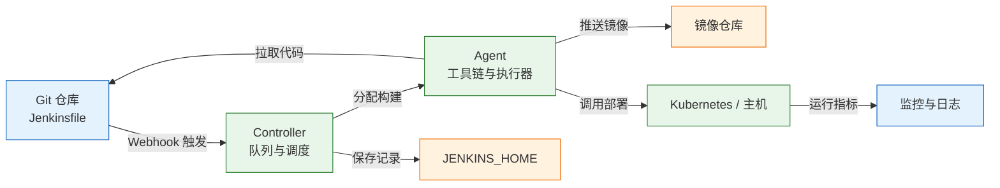
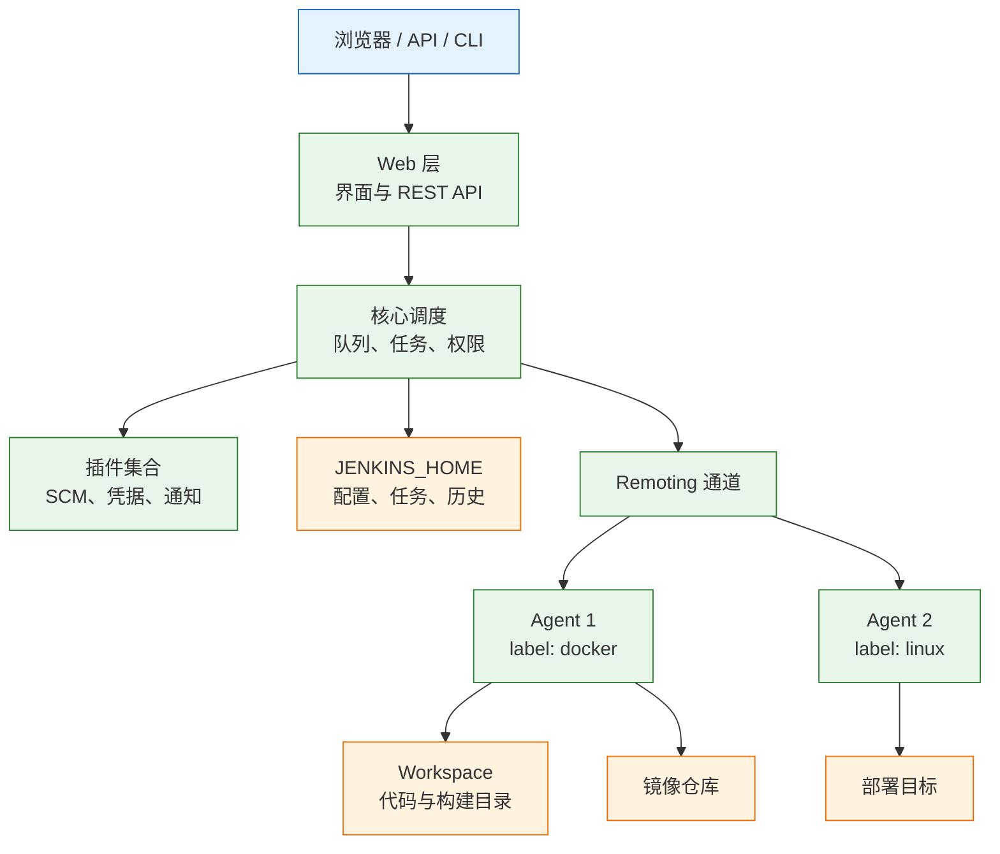
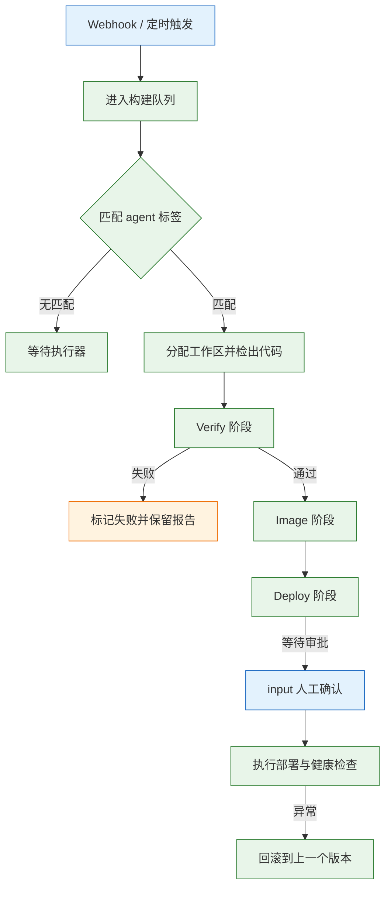
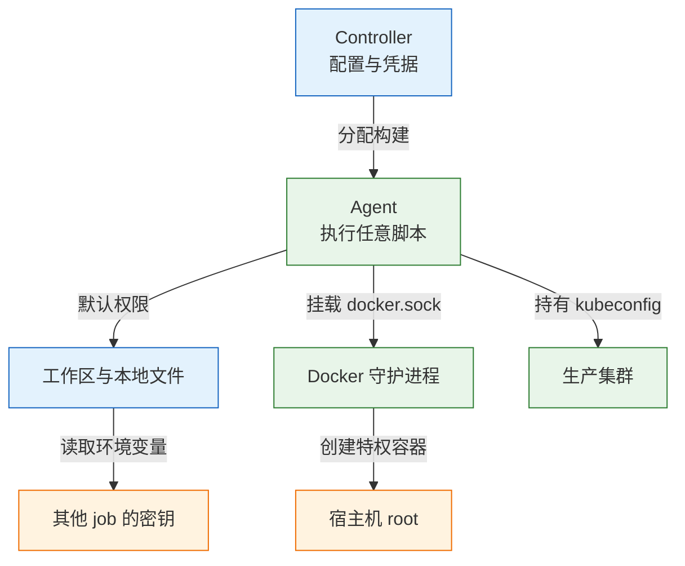

# Jenkins 自动化平台

> Jenkins 是一台需要自己运维的自动化服务器：控制器负责调度与保存配置，代理负责执行构建，Jenkinsfile 把流水线写进仓库。它适合内网、遗留系统和需要深度定制的场景；代价是插件、升级、备份和安全都要自己承担。

---

## 一、Jenkins 是什么

Jenkins 是一个用 Java 编写的开源自动化服务器，核心能力是“监听事件、排队任务、把任务分配到执行节点、收集结果”。它不限定语言和工具链，构建命令最终都是节点上的 shell 或批处理脚本，因此既能跑 Maven、npm，也能调用 Ansible、kubectl、硬件测试程序。

它解决的是**构建与交付动作的集中调度**：把散落在各人电脑上的命令固化成可重复执行的 job，把执行记录、日志、测试报告和制品留在同一个地方，把触发条件交给 Webhook 或定时器。它不解决代码质量、部署架构和测试覆盖，流水线只能执行已经定义好的检查。

### 1.1 核心概念

**控制器**（Controller，旧称 Master）提供 Web 界面、保存所有配置、维护构建队列、调度任务并汇总结果。**代理**（Agent，旧称 Slave）是真正执行构建的机器或容器。**执行器**（Executor）是代理上的并发槽位，一个执行器同时只能跑一个构建。

**工作区**（Workspace）是 job 在节点上的工作目录：内置节点位于 `JENKINS_HOME/workspace/<job 名>`，代理上位于代理自己的 workspace 根目录。同一个 job 的多次构建默认复用同一目录，因此并发构建会互相覆盖。**构建**（Build）是一次执行记录，包含日志、参数、产物和状态。**流水线**（Pipeline）是把多个 stage 串起来的构建定义，通常写在仓库根目录的 `Jenkinsfile` 中。

| 对象 | 作用 | 边界 |
|---|---|---|
| Controller | 界面、配置、队列、调度 | 不该执行重构建 |
| Agent | 提供工具链与算力 | 不该保存长期状态 |
| Executor | 并发槽位 | 数量决定同时构建数 |
| Workspace | 单次构建的工作目录 | 不是制品库 |
| Build | 一次执行记录 | 受保留策略限制 |
| Credential | 加密保存的凭据 | 按作用域授权 |

> **运维提示**：Jenkins 的“配置”分散在界面、`JENKINS_HOME` 里的 XML、插件和 Jenkinsfile 中。排障前先确认问题属于哪一层，否则会在界面里反复改一个其实由代码控制的参数。

### 1.2 与相邻技术的关系

Jenkins 位于“代码仓库”和“运行环境”之间：向上接收 Git 平台的事件，向下调用构建工具、镜像仓库和部署工具。它与托管 CI 的差别不是功能多少，而是**运行责任归谁**：GitHub Actions 与 GitLab CI 通常由平台提供执行环境，Jenkins 由团队自己维护控制器、代理、插件和磁盘。

它也不等同于配置管理或部署编排。Ansible 负责把机器改成期望状态，Terraform 负责声明云资源，Kubernetes 负责维持工作负载，Jenkins 只负责在正确的时机调用它们。把环境状态写进 Jenkins 脚本，短期能跑，长期无法审计和复现。



| 维度 | Jenkins | GitHub Actions / GitLab CI | 自建影响 |
|---|---|---|---|
| 运行位置 | 自己的机器或集群 | 平台托管或自建 Runner | 网络与容量自负 |
| 配置方式 | Jenkinsfile + 界面 + 插件 | YAML + 平台设置 | 配置易分散 |
| 扩展方式 | 插件与共享库 | Action、CI 模板 | 插件兼容性风险 |
| 维护成本 | 升级、备份、安全全自负 | 平台升级由厂商负责 | 需要专职 owner |
| 适用场景 | 内网、遗留系统、特殊硬件 | 标准项目、快速起步 | 按合规与成本判断 |

> **注意**：Jenkins 的插件生态是优势也是风险。核心只提供调度与流水线骨架，Git、凭据绑定、Kubernetes 集成几乎都来自插件；插件停更后，升级 Jenkins 就可能卡住。

小团队、标准 Java 或 Node 项目优先选托管 CI；没有明确的 Jenkins owner 时不要自建，否则升级、安全补丁和备份会长期欠账。

### 1.3 架构组成

控制器由 Web 容器、流水线引擎、插件集合、凭据存储和任务队列组成，全部状态落在 `JENKINS_HOME`。代理通过 Remoting 通道与控制器通信，执行分配到的构建，把日志与结果回传。构建产物可以归档在控制器，也可以推到镜像仓库或对象存储。



| 组件 | 职责 | 故障表现 |
|---|---|---|
| Web 层 | 页面、API、认证入口 | 502、登录循环、CSRF 报错 |
| 核心调度 | 队列、标签匹配、并发控制 | 任务一直排队 |
| 插件 | SCM、凭据、通知、云集成 | 启动失败、DSL 方法缺失 |
| `JENKINS_HOME` | 配置、任务、构建历史 | 配置丢失、磁盘满 |
| Remoting | 控制器与代理通信 | 代理离线、日志中断 |
| Workspace | 存放检出代码与构建输出 | 磁盘满、并发覆盖 |

> **运维红线**：`JENKINS_HOME` 是唯一的状态源，删除它等于删除所有 job、凭据和构建历史。迁移或重建前必须先做可恢复的备份，不能只拷 `jobs/` 目录。

---

## 二、安装与配置

安装方式取决于运行环境：本地验证用容器最快，长期运行用系统服务或编排平台。无论哪种方式，都要先确定 `JENKINS_HOME` 的位置、JDK 版本和对外访问地址，这三项在后文配置中反复出现。

### 2.1 版本现状与部署形态

> **版本现状（2026-10）**：Jenkins 2.580.1 为当前 LTS，周更线为 2.587。生产使用 LTS，插件版本固定；周更线只用于验证插件兼容性，不直接承载生产任务。容器镜像提供 JDK 21 变体，兼容当前 LTS 的运行要求。

| 形态 | 启动方式 | 适用 | 注意 |
|---|---|---|---|
| 容器 | `docker run` / Compose | 本地验证、小团队 | 卷必须持久化 |
| War + systemd | `java -jar jenkins.war` | 单机长期运行 | 自己管 JDK 与日志轮转 |
| 系统包 | deb/rpm 仓库 | 标准 Linux 主机 | 升级受包管理器约束 |
| Kubernetes | Helm 或 Operator | 动态代理、弹性算力 | 存储与备份更复杂 |

部署形态决定升级方式。容器升级是换镜像标签，系统包升级是包管理器操作，Kubernetes 升级是改 StatefulSet 镜像；三者都必须先备份 `JENKINS_HOME`，并确认插件与 JDK 兼容。

### 2.2 Docker 方式启动

容器方式适合快速验证，也适合把 Jenkins 作为单容器服务运行。关键是把 `/var/jenkins_home` 挂到命名卷，否则容器重建后配置全部丢失。

```bash
# ========== 准备数据卷 ==========
# 创建命名卷，保存 job、插件、凭据与构建历史
docker volume create jenkins-home

# 确认卷已创建
docker volume ls | grep jenkins-home

# ========== 启动控制器 ==========
# 8080 是 Web 端口，50000 是入站代理端口
docker run -d --name jenkins \
  --restart unless-stopped \
  -p 8080:8080 -p 50000:50000 \
  -v jenkins-home:/var/jenkins_home \
  jenkins/jenkins:2.580.1-lts-jdk21

# 查看容器状态与端口映射
docker ps --filter name=jenkins

# 跟踪启动日志，首次启动会初始化插件与配置
docker logs -f jenkins

# ========== 读取初始密码 ==========
# 首次启动后该文件保存一次性管理员密码
docker exec jenkins cat /var/jenkins_home/secrets/initialAdminPassword
```

镜像仓库没有精确标签时，可以退回 `jenkins/jenkins:lts-jdk21`，它仍属于 LTS 通道。不要使用 `latest`，否则重建容器时可能跨越大版本。

| 参数 | 作用 | 建议 |
|---|---|---|
| `-p 8080:8080` | Web 与 API | 前面加反向代理与 HTTPS |
| `-p 50000:50000` | 入站代理连接 | 仅内网开放，公网用 WebSocket |
| `-v jenkins-home:...` | 持久化全部状态 | 必须使用命名卷或固定目录 |
| `--restart` | 主机重启后恢复 | 生产用 `unless-stopped` |
| `JAVA_OPTS` | JVM 堆与参数 | 按内存设置 `-Xmx` |

```bash
# ========== 停止与删除 ==========
# 停止容器但保留卷
docker stop jenkins

# 删除容器，卷仍然保留
docker rm jenkins

# 查看卷的实际挂载点，便于备份
docker volume inspect jenkins-home --format '{{.Mountpoint}}'
```

> **运维红线**：不要执行 `docker volume rm jenkins-home` 清理空间。该卷包含全部 job、凭据与构建历史，删除后无法从镜像恢复。清理应针对工作区和旧构建，而不是整个 `JENKINS_HOME`。

### 2.3 系统服务方式安装

长期运行建议使用 systemd 管理 war 包，升级时替换 war 并重启服务。下面以 `/opt/jenkins` 放程序、`/var/lib/jenkins` 放状态为例，路径可按规范调整。

```bash
# ========== 准备运行用户与目录 ==========
# 创建专用用户，避免以 root 运行控制器
sudo useradd --create-home --shell /bin/bash jenkins
sudo mkdir -p /opt/jenkins /var/lib/jenkins
sudo chown -R jenkins:jenkins /opt/jenkins /var/lib/jenkins

# ========== 安装 JDK ==========
# 使用 JDK 21 运行当前 LTS
sudo apt update && sudo apt install -y openjdk-21-jre-headless git

# ========== 下载 LTS war 包 ==========
# 版本号必须与要运行的 LTS 一致，升级时替换该文件
sudo wget -O /opt/jenkins/jenkins.war \
  https://get.jenkins.io/war-stable/2.580.1/jenkins.war

# 校验文件可读且非空
ls -lh /opt/jenkins/jenkins.war

# ========== 写入 systemd 单元 ==========
sudo tee /etc/systemd/system/jenkins.service > /dev/null <<'EOF'
[Unit]
Description=Jenkins Controller
After=network.target

[Service]
Type=simple
User=jenkins
Environment=JENKINS_HOME=/var/lib/jenkins
Environment=JAVA_OPTS=-Xms1g -Xmx2g
ExecStart=/usr/bin/java -jar /opt/jenkins/jenkins.war --httpPort=8080
Restart=on-failure
RestartSec=10

[Install]
WantedBy=multi-user.target
EOF

# ========== 启动与验证 ==========
# 重新加载单元并设置开机自启
sudo systemctl daemon-reload
sudo systemctl enable --now jenkins

# 查看服务状态
sudo systemctl status jenkins --no-pager

# 查看最近日志，确认没有插件或 JDK 报错
sudo journalctl -u jenkins -n 50 --no-pager

# ========== 读取初始密码 ==========
sudo cat /var/lib/jenkins/secrets/initialAdminPassword
```

| 路径 | 内容 | 备份策略 |
|---|---|---|
| `JENKINS_HOME/jobs/` | job 配置与构建历史 | 随整体备份 |
| `JENKINS_HOME/plugins/` | 已安装插件 | 可重建，但版本要对齐 |
| `JENKINS_HOME/secrets/` | 主密钥与初始密钥 | 必须备份 |
| `JENKINS_HOME/credentials.xml` | 加密后的凭据 | 离开主密钥无意义 |
| `JENKINS_HOME/workspace/` | 工作区 | 不需要备份 |
| `JENKINS_HOME/logs/` | 系统日志 | 按保留期归档 |

### 2.4 初始化与全局配置

首次访问会进入解锁页面，粘贴初始密码后安装插件并创建管理员。初始化完成后，先改三处配置：系统地址、执行器数量、代理端口。系统地址错误会导致 Webhook 回调、邮件链接和重定向全部异常。

```bash
# ========== 验证服务可用 ==========
# 返回 200 或 403 都说明 Web 层已启动，403 通常是未登录
curl -s -o /dev/null -w '%{http_code}\n' http://127.0.0.1:8080/login

# 读取实例信息，需要管理员凭据
curl -fsS -u "$USER:$API_TOKEN" http://127.0.0.1:8080/api/json | head -c 300

# ========== 反向代理后的连通性 ==========
# 检查代理是否传递了协议与主机头
curl -sI https://jenkins.example.com/login | grep -i -E 'HTTP/|location'
```

| 配置项 | 位置 | 建议 |
|---|---|---|
| Jenkins URL | 系统设置 → Jenkins URL | 与反向代理对外地址一致 |
| Executors | 节点管理 → 控制器 | 生产设为 0 |
| Agent port | 全局安全 → TCP port | 固定端口，仅内网可达 |
| Quiet period | 系统设置 | 2–5 秒，合并连续提交 |
| SCM checkout retry | 系统设置 | 2 次，抵御网络抖动 |
| 日志轮转 | 日志记录器 | 限制大小，避免撑满磁盘 |

反向代理需要传递 `Host`、`X-Forwarded-Proto`、`X-Forwarded-For`，并允许较大的请求体，否则插件上传和制品归档会失败。代理层还应终止 TLS，Jenkins 只监听内网地址。

> **注意**：修改 Jenkins URL 后，已有的 Webhook 不会自动更新。Git 平台仍向旧地址推送时，构建不会触发；需要到仓库设置里重新填写回调地址。

---

## 三、核心对象管理

Jenkins 的日常管理围绕三个对象：节点、凭据、插件。节点决定构建在哪里跑，凭据决定构建能访问什么，插件决定 Jenkins 能识别哪些工具。三者都通过 `JENKINS_HOME` 持久化，也都可以用配置即代码管理。

### 3.1 控制器、代理与执行器

控制器只做调度，代理承担构建，这是生产环境的基本分工。控制器上跑构建会与界面、调度争抢内存和 CPU，一次大型编译就可能让整个 Jenkins 失去响应。控制器的执行器数量应设为 0，所有 job 通过标签落到代理。

执行器数量决定单个代理的并发构建数。设得过高会让多个构建争抢内存、磁盘和 Docker 守护进程，表现为随机失败与超时；设得过低则任务排队。容量要按单次构建的峰值内存与磁盘估算，而不是按 CPU 核数简单相乘。

| 对象 | 关键参数 | 常见问题 |
|---|---|---|
| Controller | 执行器数、堆大小、URL | 在控制器跑重构建导致卡死 |
| Agent | 标签、并发数、工作目录 | 标签不匹配导致一直排队 |
| Executor | 数量 | 过多导致资源争抢 |
| Workspace | 路径、清理策略 | 并发构建互相覆盖 |
| Build | 保留天数与个数 | 历史过多撑满磁盘 |
| Queue | 静默期、优先级 | 连续提交触发多次构建 |

```groovy
// 只在带 docker 与 linux 标签的代理上执行
agent { label 'docker && linux' }

// 限制单次构建的资源使用与时长
options {
  timeout(time: 30, unit: 'MINUTES')
  disableConcurrentBuilds()
  buildDiscarder(logRotator(numToKeepStr: '30'))
}
```

> **注意**：`disableConcurrentBuilds()` 只阻止同一个 job 并发，不能阻止不同 job 争抢同一代理的资源。多 job 并发要靠执行器数量、节点标签和资源锁控制。

### 3.2 代理节点接入

代理接入有四种常见方式：SSH 由控制器主动登录代理，入站代理由代理主动连接控制器的 50000 端口，WebSocket 通过 HTTP 反向连接，Kubernetes 插件按构建动态创建 Pod。选择取决于网络方向与隔离要求。

| 方式 | 连接方向 | 适用 | 风险 |
|---|---|---|---|
| SSH | 控制器 → 代理 | 固定 Linux 主机 | 私钥与 22 端口管理 |
| 入站 50000 | 代理 → 控制器 | 内网固定代理 | 端口暴露、证书配置 |
| WebSocket | 代理 → 控制器 | NAT、跨网段 | 依赖反向代理长连接 |
| Kubernetes | 控制器 → API Server | 弹性构建 | Pod 模板与权限 |

```bash
# ========== 代理机基础环境 ==========
# 安装运行构建所需的最小工具链
sudo apt update && sudo apt install -y openjdk-21-jre-headless git curl

# 创建独立工作目录
sudo mkdir -p /var/lib/jenkins-agent
sudo chown -R jenkins:jenkins /var/lib/jenkins-agent

# ========== SSH 方式准备密钥 ==========
# 在控制器侧生成密钥
ssh-keygen -t ed25519 -f ~/.ssh/jenkins-agent -N ""

# 把公钥写入代理的 authorized_keys
ssh-copy-id -i ~/.ssh/jenkins-agent.pub jenkins@10.0.1.21

# 测试从控制器到代理的连通性
ssh -i ~/.ssh/jenkins-agent jenkins@10.0.1.21 'java -version'

# ========== 入站代理启动 ==========
# agent.jar 从控制器的节点页面下载，secret 也在该页面生成
java -jar agent.jar \
  -jnlpUrl https://jenkins.example.com/computer/docker-1/jenkins-agent.jnlp \
  -secret "$AGENT_SECRET" \
  -workDir /var/lib/jenkins-agent

# ========== 验证节点状态 ==========
# 节点页面应显示在线，且标签与 job 匹配
curl -fsS -u "$USER:$API_TOKEN" \
  https://jenkins.example.com/computer/api/json | head -c 500
```

代理镜像要预装工具链，而不是在构建时临时安装。临时 `apt install` 会把网络故障带进构建，也会让构建时间不可预测。代理工作区要定期清理，磁盘使用率要单独监控。

> **安全警告**：入站代理的 50000 端口不要直接暴露到公网。需要跨公网时使用 WebSocket over HTTPS，或在前面加 VPN 与访问控制；端口暴露等于给出一个可尝试的认证入口。

### 3.3 凭据管理

Jenkins 的凭据由 `credentials` 插件统一管理，常见类型包括用户名密码、SSH 私钥、Secret text、Secret file 和证书。凭据本身加密保存在 `JENKINS_HOME/credentials.xml`，加密密钥在 `JENKINS_HOME/secrets/`，两者缺一不可。

| 类型 | 用途 | 使用方式 |
|---|---|---|
| Username with password | 镜像仓库、HTTP 接口 | `usernamePassword` 绑定 |
| SSH Username with private key | Git、远程主机 | `sshUserPrivateKey` 绑定 |
| Secret text | Token、Webhook 密钥 | `string` 绑定 |
| Secret file | kubeconfig、证书 | `file` 绑定 |
| Certificate | 双向 TLS | `certificate` 绑定 |

```groovy
// 凭据只在当前步骤内注入，避免全局环境泄漏
withCredentials([usernamePassword(
  credentialsId: 'registry-demo',
  usernameVariable: 'REG_USER',
  passwordVariable: 'REG_PASS'
)]) {
  sh '''
    set +x
    echo "$REG_PASS" | docker login registry.example.com -u "$REG_USER" --password-stdin
  '''
}
```

凭据要按用途分开：镜像仓库、kubeconfig、云密钥、SSH key 各用各的，不要用一个全局凭据覆盖所有 job。folder 级凭据能把可见范围限制在一个目录树内，轮换时才能说清哪些 job 受影响。

> **安全警告**：`sh` 步骤默认不会打印命令，但脚本里一旦写了 `set -x`，变量展开就会进入日志。Jenkins 的掩码只能处理已知格式的字符串，不能阻止脚本主动把凭据发到外部；不要把凭据交给不可信代码。

### 3.4 插件管理

Jenkins 核心很小，Git、Maven、Docker、Kubernetes、凭据绑定几乎都来自插件。插件之间依赖关系复杂，升级一个插件可能带进不兼容的传递依赖；控制器启动失败，往往发生在“只点了一下更新”之后。

可控的做法是把插件清单写进 `plugins.txt`，用 `jenkins-plugin-cli` 在镜像构建时安装。这样每次重建环境都得到同一组插件，升级也变成一次可评审的代码变更。

```bash
# ========== 导出当前插件清单 ==========
# 通过插件管理 API 读取名称与版本，输出 shortName:version
curl -fsS -u "$USER:$API_TOKEN" \
  'https://jenkins.example.com/pluginManager/api/json?depth=1' \
  | jq -r '.plugins[] | "\(.shortName):\(.version)"' > plugins.txt

# 统计插件数量，升级前留档
wc -l plugins.txt

# ========== 检查可更新插件 ==========
# 列出有更新版本的插件，逐项评估兼容性
curl -fsS -u "$USER:$API_TOKEN" \
  'https://jenkins.example.com/pluginManager/api/json?depth=1' \
  | jq -r '.plugins[] | select(.hasUpdate == true) | .shortName'
```

| 插件 | 用途 | 风险点 |
|---|---|---|
| Git / GitLab / GitHub | 拉代码、发现分支与 PR | SCM 接口变化导致扫描失败 |
| Credentials Binding | 把凭据注入步骤 | 绑定过多导致泄漏面扩大 |
| Kubernetes | 动态创建构建 Pod | Pod 模板权限过大 |
| Configuration as Code | 用 YAML 管理系统配置 | 覆盖界面修改 |
| Workspace Cleanup | 构建后清理工作区 | 清理时机影响排障 |
| Docker Pipeline | 在流水线内构建镜像 | 依赖代理的 Docker 权限 |

> **运维提示**：升级前先备份 `JENKINS_HOME`，记录当前插件版本，并在 staging 控制器演练。不要看了更新日志就直接在生产点升级，安全的快速通道并不存在。

---

## 四、流水线写法

Jenkins 流水线有两种语法：声明式（Declarative）和脚本式（Scripted）。声明式结构固定、校验严格，适合大多数交付流水线；脚本式就是 Groovy 脚本，灵活但难以约束。新项目优先声明式，复杂逻辑放进共享库，而不是在 Jenkinsfile 里堆 `script` 块。

### 4.1 声明式与脚本式

声明式以 `pipeline { }` 为根，必须包含 `agent` 和 `stages`，每个 `stage` 包含 `steps`。它提供 `when`、`post`、`options`、`environment` 等结构化指令，Jenkins 会在执行前做语法校验。脚本式直接写 Groovy，用 `node { }` 申请执行器，流程控制自由，但没有统一的结构约束。

| 维度 | 声明式 | 脚本式 |
|---|---|---|
| 根结构 | `pipeline { }` | `node { }` |
| 语法校验 | 执行前校验 | 运行时才报错 |
| 条件与后置 | `when`、`post` | `if`、`try/finally` |
| 并行 | `parallel`、`matrix` | 手动线程 |
| 学习成本 | 低，结构清晰 | 高，依赖 Groovy |
| 适用 | 标准交付流水线 | 高度动态的编排 |



最小可运行示例只验证工具链与提交信息：

```groovy
// 最小 Jenkinsfile：确认代理上的 JDK 与当前提交
pipeline {
  agent any
  stages {
    stage('Check') {
      steps {
        sh 'java -version'
        sh 'echo "commit: ${GIT_COMMIT:-local}"'
      }
    }
  }
}
```

### 4.2 核心指令与字段

声明式的指令不多，但组合方式决定了流水线的可维护性。`agent` 决定在哪跑，`options` 决定跑多久、留多少，`environment` 决定注入哪些变量，`when` 决定是否执行，`post` 决定结束后做什么。

| 指令 | 作用 | 关键参数 |
|---|---|---|
| `agent` | 选择执行节点 | `label`、`docker`、`kubernetes` |
| `options` | 超时、并发、保留 | `timeout`、`buildDiscarder` |
| `environment` | 注入环境变量 | 常量、`credentials()` |
| `tools` | 自动安装工具 | `jdk`、`maven`、`nodejs` |
| `parameters` | 声明构建参数 | `string`、`choice`、`booleanParam` |
| `when` | 条件执行 stage | `branch`、`tag`、`changeRequest` |
| `input` | 人工确认 | `message`、`ok`、`submitter` |
| `post` | 结束动作 | `always`、`success`、`failure` |

`environment` 里可以用 `credentials()` 把凭据注入变量，但更推荐 `withCredentials`，因为作用域更小。`options` 里的 `timeout` 应覆盖整条流水线，`input` 内部再套一层超时，避免审批无限期占用执行器。

`agent any` 表示任意可用节点，单机实验时就是控制器本身；生产环境应改成 `agent { label 'docker' }`，把构建赶到代理。

> **注意**：`input` 会一直占着执行器，等多久占多久。发布窗口长的团队应把审批放在流水线之外，或用 `milestone` 加轻量 job 控制顺序，不要用 `input` 当变更系统。

### 4.3 共享库与配置即代码

共享库把重复的流水线逻辑抽成 Groovy 代码，放在独立仓库，通过 `@Library` 引入。目录结构固定：`vars/` 放全局变量与步骤，`src/` 放类，`resources/` 放静态文件。共享库也要走评审与版本发布，否则一处改动会影响所有流水线。

配置即代码（JCasC）解决另一类问题：系统设置、凭据引用、工具安装原本只存在界面里，重建控制器时无法复现。把配置写进 `jenkins.yaml`，启动时自动加载，界面修改会被覆盖，配置变更可以走 Git 评审。

| 方案 | 管理对象 | 优点 | 代价 |
|---|---|---|---|
| Jenkinsfile | 单条流水线 | 跟代码同仓、可评审 | 无法管理系统设置 |
| Shared Library | 多流水线共用逻辑 | 复用、可版本化 | 需要维护 Groovy 代码 |
| JCasC | 系统设置、凭据引用、工具 | 可重建、可审计 | 覆盖界面修改，需学习 schema |
| Job DSL | 批量生成 job | 适合大量同构任务 | 生成逻辑本身要维护 |

```yaml
# jenkins.yaml：由 Configuration as Code 插件加载
jenkins:
  systemMessage: "配置由 JCasC 管理，界面修改会被覆盖"
  numExecutors: 0                     # 控制器不执行构建
  scmCheckoutRetryCount: 2            # 网络抖动时重试检出
  mode: NORMAL

credentials:
  system:
    domainCredentials:
      - credentials:
          - usernamePassword:
              scope: GLOBAL
              id: registry-demo      # Jenkinsfile 通过该 ID 引用
              username: demo-bot
              password: "${REGISTRY_PASSWORD}"   # 从环境变量注入
```

> **安全警告**：JCasC 文件里不要写明文密码。用环境变量替换，或只声明凭据 ID 并在首次启动后手工录入；把 `jenkins.yaml` 提交到仓库前先做密钥扫描。

### 4.4 多分支与触发器

多分支流水线（Multibranch Pipeline）会扫描仓库的分支与标签，为每个包含 `Jenkinsfile` 的引用创建一个 job。它解决了“每个分支手工建 job”的问题，也让 PR 校验自然绑定到分支。触发方式有 Webhook、定时轮询和手动触发，Webhook 延迟最低，轮询最稳定但会给 Git 服务器增加压力。

| 触发方式 | 延迟 | 配置位置 | 适用 |
|---|---|---|---|
| Webhook | 秒级 | Git 平台仓库设置 | 大多数场景 |
| 定时轮询 | 分钟级 | job 的 `triggers` | 无法出网、内网仓库 |
| 手动 | 即时 | 页面或 API | 发布、回滚 |
| 上游 job | 即时 | `build` 步骤 | job 间串联 |
| 定时构建 | 按计划 | `cron` | 夜间全量测试 |

```bash
# ========== 手动触发带参数构建 ==========
# 使用 API token 认证，避免暴露登录密码
curl -fsS -X POST \
  "https://jenkins.example.com/job/demo-api/job/main/buildWithParameters?ENV=staging" \
  --user "$USER:$API_TOKEN"

# ========== 查看队列与最近构建 ==========
# 队列中堆积说明没有匹配的代理或执行器已满
curl -fsS -u "$USER:$API_TOKEN" \
  https://jenkins.example.com/queue/api/json | jq '.items | length'

# 查看 job 最近一次构建结果
curl -fsS -u "$USER:$API_TOKEN" \
  https://jenkins.example.com/job/demo-api/job/main/lastBuild/api/json \
  | jq '{result, duration, timestamp}'

# ========== 触发多分支扫描 ==========
# 新增分支后立即扫描，不必等定时任务
curl -fsS -X POST -u "$USER:$API_TOKEN" \
  https://jenkins.example.com/job/demo-api/build?delay=0sec
```

> **注意**：PR 流水线默认会检出源分支代码并在代理上执行。公开仓库不要给外部 PR 分配带生产凭据的代理；需要构建外部贡献时，用无凭据的专用节点，产物经人工复核后再进入发布链。

---

## 五、完整示例：构建、测试、推镜像与部署

示例使用一个 Maven 工程，流程是：检出代码、编译测试、主干构建镜像、staging 自动部署、标签发布到生产并等待审批。所有密钥通过凭据注入，镜像标签使用提交号，部署按标签对应的镜像执行。

### 5.1 示例目标与前置条件

前置条件包括：代理已安装 JDK 21、Maven、Docker；镜像仓库凭据已创建；staging 与 production 的 kubeconfig 已作为 Secret file 保存；Git 平台已配置 Webhook。示例中的仓库地址、镜像地址、凭据 ID 都是占位值。

| 阶段 | 触发条件 | 动作 | 产物 |
|---|---|---|---|
| Checkout | 所有构建 | 检出提交 | 工作区代码 |
| Verify | 所有构建 | 编译、单测 | 测试报告 |
| Image | 主干或版本标签 | 构建、推送镜像 | 带提交号的镜像 |
| Deploy staging | 主干 | 部署并等待就绪 | staging 版本 |
| Deploy production | 版本标签 | 人工审批后部署 | 生产版本与记录 |

### 5.2 完整 Jenkinsfile

```groovy
// Jenkinsfile：声明式流水线，放在仓库根目录
pipeline {
  agent { label 'docker && linux' }        // 构建落在代理，不在控制器

  options {
    timeout(time: 30, unit: 'MINUTES')     // 整条流水线的上限
    disableConcurrentBuilds()              // 同 job 不并发，避免工作区覆盖
    buildDiscarder(logRotator(numToKeepStr: '30', artifactNumToKeepStr: '10'))
  }

  parameters {
    booleanParam(name: 'SKIP_TESTS', defaultValue: false, description: '仅紧急回滚使用')
  }

  environment {
    MAVEN_OPTS = '-Dmaven.repo.local=.m2/repository'
  }

  stages {
    stage('Checkout') {
      steps {
        checkout scm                      // 多分支流水线自动带出仓库与分支
        sh 'git rev-parse --short HEAD'    // 记录实际构建的提交
      }
    }

    stage('Verify') {
      when { expression { !params.SKIP_TESTS } }
      steps {
        sh 'mvn -B -ntp clean verify'
      }
      post {
        always {
          junit allowEmptyResults: true,
            testResults: 'target/surefire-reports/*.xml'
        }
      }
    }

    stage('Image') {
      when {
        anyOf {
          branch 'main'
          tag pattern: 'v\\d+\\.\\d+\\.\\d+', comparator: 'REGEXP'
        }
      }
      steps {
        script {
          env.IMAGE = "registry.example.com/demo/api:${env.GIT_COMMIT.take(8)}"
        }
        withCredentials([usernamePassword(
          credentialsId: 'registry-demo',
          usernameVariable: 'REG_USER',
          passwordVariable: 'REG_PASS'
        )]) {
          sh '''
            set -eu
            set +x
            echo "$REG_PASS" | docker login registry.example.com \
              -u "$REG_USER" --password-stdin
            docker build -t "$IMAGE" .
            docker push "$IMAGE"
          '''
        }
      }
    }

    stage('Deploy staging') {
      when { branch 'main' }
      steps {
        withCredentials([file(
          credentialsId: 'kubeconfig-staging',
          variable: 'KUBECONFIG'
        )]) {
          sh './scripts/deploy.sh staging "$IMAGE"'
        }
      }
    }

    stage('Deploy production') {
      when { tag pattern: 'v\\d+\\.\\d+\\.\\d+', comparator: 'REGEXP' }
      steps {
        timeout(time: 30, unit: 'MINUTES') {
          input message: 'Deploy to production?', ok: 'Deploy'
        }
        withCredentials([file(
          credentialsId: 'kubeconfig-prod',
          variable: 'KUBECONFIG'
        )]) {
          sh './scripts/deploy.sh production "$IMAGE"'
        }
      }
    }
  }

  post {
    always {
      sh 'docker image prune -f || true'   // 清理悬空镜像，控制磁盘
      cleanWs()                            // 清理工作区，避免残留源码
    }
    failure {
      echo "failed: ${env.BUILD_URL}"      // 保留失败构建入口
    }
  }
}
```

关键点：`agent` 用标签把构建赶到代理；`checkout scm` 依赖多分支流水线的上下文；`Image` 只在主干与版本标签上运行，PR 只验证；`withCredentials` 把凭据限制在步骤内；`buildDiscarder` 控制历史占用；`junit` 把测试报告归档到构建页面。

> **注意**：`env.GIT_COMMIT` 在多分支流水线中由 SCM 步骤注入。如果 job 不是多分支类型，该变量可能为空，镜像标签会退化成空字符串；应改用 `sh 'git rev-parse --short HEAD'` 的返回值。

### 5.3 构建镜像与 JCasC

把 Jenkins 自身也做成镜像，插件和配置随镜像版本固定。这样重建控制器不依赖记忆，插件升级也能先在测试环境验证。

```dockerfile
# 基础镜像与生产保持同一 LTS 与 JDK
FROM jenkins/jenkins:2.580.1-lts-jdk21

# 安装构建所需的最小工具，构建后清理包缓存
USER root
RUN apt-get update \
 && apt-get install -y --no-install-recommends git curl \
 && rm -rf /var/lib/apt/lists/*

# 预装插件，构建结果可复现
COPY plugins.txt /usr/share/jenkins/ref/plugins.txt
RUN jenkins-plugin-cli --plugin-file /usr/share/jenkins/ref/plugins.txt

# 关闭初始化向导，配置由 JCasC 加载
ENV JAVA_OPTS="-Djenkins.install.runSetupWizard=false"
ENV CASC_JENKINS_CONFIG=/var/jenkins_home/casc_configs

# 复制系统配置
COPY jenkins.yaml /var/jenkins_home/casc_configs/jenkins.yaml

# 回到非 root 用户运行控制器
USER jenkins
```

```text
# plugins.txt：每行一个插件，实际构建时由插件管理器解析版本
# 生产环境应把解析后的完整清单与镜像摘要一起留档
credentials-binding
git
workflow-aggregator
configuration-as-code
kubernetes
ws-cleanup
```

```bash
# ========== 构建自定义镜像 ==========
# 标签使用 Jenkins 版本，便于回退
docker build -t registry.example.com/tools/jenkins:2.580.1 .

# 推送前先在本地验证启动
docker run --rm -d --name jenkins-test \
  -p 18080:8080 \
  -v jenkins-test-home:/var/jenkins_home \
  registry.example.com/tools/jenkins:2.580.1

# 查看初始化日志，确认 JCasC 未报错
docker logs jenkins-test | grep -i -E 'casc|error' | head

# 验证后清理测试容器与卷
docker rm -f jenkins-test
docker volume rm jenkins-test-home
```

> **运维红线**：测试容器的临时卷可以在验证后删除，生产 `JENKINS_HOME` 卷不可以。执行 `docker volume rm` 前先确认卷名与挂载对象，删除后没有回收站。

### 5.4 执行验证与回滚

构建成功后先验证制品，再验证部署，最后验证回滚。回滚不重新构建，直接把上一个已知好的镜像摘要重新部署；重新构建会引入新的依赖和基础镜像，结果不可预测。

```bash
# ========== 验证流水线结果 ==========
# 查看最近一次构建的状态与耗时
curl -fsS -u "$USER:$API_TOKEN" \
  https://jenkins.example.com/job/demo-api/job/main/lastBuild/api/json \
  | jq '{result, duration, building}'

# 读取控制台最后 80 行，定位失败步骤
curl -fsS -u "$USER:$API_TOKEN" \
  https://jenkins.example.com/job/demo-api/job/main/lastBuild/consoleText \
  | tail -n 80

# ========== 验证镜像 ==========
# 确认镜像存在且标签指向预期提交
docker manifest inspect registry.example.com/demo/api:"$GIT_SHA" > /dev/null

# ========== 部署与回滚 ==========
# 滚动更新到指定镜像
kubectl set image deployment/api api="registry.example.com/demo/api:$GIT_SHA"

# 等待滚动完成，超时即视为失败
kubectl rollout status deployment/api --timeout=180s

# 查看历史版本，确认可回退
kubectl rollout history deployment/api

# 回滚到上一个已知好的版本
kubectl rollout undo deployment/api
kubectl rollout status deployment/api --timeout=180s
```

| 验证点 | 命令 | 期望 |
|---|---|---|
| 构建状态 | `lastBuild/api/json` | `result` 为 `SUCCESS` |
| 测试报告 | 构建页面 → Test Result | 失败数为 0 |
| 镜像标签 | `docker manifest inspect` | 标签存在且可拉取 |
| 部署就绪 | `kubectl rollout status` | 在超时内完成 |
| 业务健康 | 冒烟脚本 | 关键接口返回成功 |
| 回滚 | `kubectl rollout undo` | 摘要回到上一版本 |

> **运维提示**：`input` 只把发布决定交给人，不保证发布正确。审批之后仍要执行健康检查和冒烟测试；失败时由脚本自动回滚，而不是等人发现。

---

## 六、安全与权限

Jenkins 的安全模型由四层组成：认证决定“你是谁”，授权决定“你能做什么”，凭据决定“构建能访问什么”，网络暴露面决定“谁能碰到入口”。四层任意一层失守，其他层的配置都会失效。

### 6.1 认证与授权矩阵

认证可以对接 LDAP、OIDC、SAML 或本地用户库；授权常用 Matrix Authorization Strategy 或 Role-based Authorization Strategy。矩阵授权按用户/组和权限项逐条配置，适合小型实例；角色授权按全局、代理、job、凭据分组，适合多团队。

| 领域 | 选项 | 建议 |
|---|---|---|
| 认证 | LDAP、OIDC、SAML、本地库 | 对接企业 IdP，禁用本地散号 |
| 授权 | Matrix、Role-based、项目矩阵 | 按团队与 job 目录授权 |
| 匿名访问 | 允许读、禁止读 | 内网也建议禁止 |
| CSRF | 默认开启 | 不要为脚本方便关闭 |
| 代理端口 | 固定端口或 WebSocket | 仅内网，配访问控制 |
| 脚本控制台 | 仅管理员 | 生产限制到极少数人 |

```bash
# ========== 检查匿名访问 ==========
# 未登录访问 job 页面，期望返回 403 或跳转登录
curl -s -o /dev/null -w '%{http_code}\n' \
  https://jenkins.example.com/job/demo-api/

# ========== 检查安全配置 ==========
# 读取当前身份与权限，确认登录账号不是匿名
curl -fsS -u "$USER:$API_TOKEN" \
  https://jenkins.example.com/whoAmI/api/json | jq '{name, authorities}'
```

> **安全警告**：脚本控制台（Script Console）等同于在控制器上执行任意 Groovy，能读取主密钥和全部凭据。生产环境只对极少数管理员开放，并在审计日志中单独监控。

### 6.2 凭据作用域与使用

凭据按作用域分为系统级、全局级和 folder 级。系统级只给插件自身使用，全局级对所有 job 可见，folder 级只在目录树内可见。能用 folder 级就不要用全局级，能只读就不要给写权限。

| 作用域 | 可见范围 | 适用 |
|---|---|---|
| System | 插件与系统配置 | 连接 IdP、邮件 |
| Global | 所有 job | 公共镜像仓库只读账号 |
| Folder | 指定目录树 | 团队级部署密钥 |

```groovy
// 只把 kubeconfig 注入部署步骤，构建步骤看不到
stage('Deploy production') {
  steps {
    withCredentials([file(
      credentialsId: 'kubeconfig-prod',
      variable: 'KUBECONFIG'
    )]) {
      sh '''
        set +x
        kubectl config current-context
        kubectl rollout status deployment/api --timeout=180s
      '''
    }
  }
}
```

轮换凭据时先确认引用范围：用 `grep` 搜索 Jenkinsfile 与 job 配置中的 `credentialsId`，列出受影响的 job，再按依赖顺序更新。只有一个全局凭据时，轮换等于全站停机。

> **安全警告**：备份 `JENKINS_HOME` 等于备份所有加密凭据。备份文件要放在受控存储并加密，访问权限按密钥管理；只拷贝 `credentials.xml` 而不拷 `secrets/` 无法恢复，拷了 `secrets/` 则等同于拿到明文。

### 6.3 代理与容器权限

代理的权限边界常被低估。构建任务只要能在代理上执行任意命令，就能读取该代理的所有文件、环境变量和网络位置；如果代理还挂了 Docker socket，任务就能创建特权容器并挂载宿主根目录。



| 风险 | 控制措施 | 验证方式 |
|---|---|---|
| 代理挂 Docker socket | 用独立构建节点或 rootless 构建 | 检查容器挂载参数 |
| 所有团队共用一个代理 | 按信任级别拆分节点与标签 | 检查 job 的 label |
| 代理能访问生产网段 | 单独网段与出口策略 | 网络策略与连通性测试 |
| 工作区残留源码与凭据 | `cleanWs()`、独立工作目录 | 检查构建后目录 |
| 代理以 root 运行 | 专用非 root 用户 | 检查进程属主 |

```bash
# ========== 以非 root 用户运行入站代理 ==========
# AGENT_IMAGE 使用与控制器 JDK 匹配的固定标签，不使用 latest
docker run -d --name agent-1 \
  --user 1000:1000 \
  -v /var/lib/jenkins-agent:/home/jenkins/agent \
  -e JENKINS_URL=https://jenkins.example.com \
  -e JENKINS_AGENT_NAME=agent-1 \
  -e JENKINS_SECRET="$AGENT_SECRET" \
  "$AGENT_IMAGE"

# ========== 检查是否误挂 Docker socket ==========
# 输出中不应出现 /var/run/docker.sock
docker inspect agent-1 --format '{{range .Mounts}}{{.Source}} -> {{.Destination}}{{"\n"}}{{end}}'
```

> **运维红线**：不要在共享代理上挂载 `/var/run/docker.sock`，也不要把生产 kubeconfig 放在所有 job 都能读到的路径。前者等于交出宿主 root，后者等于交出集群权限。

### 6.4 暴露面与升级

Jenkins 暴露到公网前至少要完成：HTTPS 终止、关闭匿名访问、限制代理端口、限制脚本控制台、配置 CSRF、启用审计日志。升级则要按“备份 → 读变更日志 → 测试环境演练 → 生产升级 → 验证插件”的顺序执行。

| 暴露面 | 风险 | 处理 |
|---|---|---|
| Web 端口 | 暴力破解、漏洞利用 | HTTPS 反代、限流、强认证 |
| 50000 代理端口 | 未授权代理接入 | 仅内网、证书、访问控制 |
| CLI 端口 | 凭据爆破 | 关闭或限制来源 |
| 脚本控制台 | 任意代码执行 | 仅管理员、审计 |
| Webhook 端点 | 伪造触发 | 密钥校验、来源限制 |
| 插件更新源 | 供应链投毒 | 固定版本、校验签名 |

```bash
# ========== 备份 JENKINS_HOME ==========
# 停控制器保证文件一致性，备份后再启动
sudo systemctl stop jenkins
sudo tar -czf "/backup/jenkins-home-$(date +%F).tar.gz" \
  -C /var/lib jenkins
sudo systemctl start jenkins

# 检查备份包含配置、任务与密钥
tar -tzf "/backup/jenkins-home-$(date +%F).tar.gz" | \
  grep -E 'config.xml|credentials.xml|secrets/' | head

# ========== 升级前记录版本 ==========
# 保存当前 war 与插件清单，便于回退
sudo cp /opt/jenkins/jenkins.war "/opt/jenkins/jenkins.war.bak-$(date +%F)"
```

> **运维提示**：备份必须实际恢复演练一次。只验证压缩包能解开还不够，要在隔离环境启动控制器，确认 job、凭据、插件和构建历史都可用；否则真出事时才发现备份缺了 `secrets/`。

---

## 七、常见排障

Jenkins 的故障可以分为四类：任务没触发、任务排队、任务执行失败、执行成功但结果不对。先定位类别，再看对应层面的日志，比从页面上的红色标记猜起有效得多。

| 现象 | 最可能原因 | 处理 |
|---|---|---|
| 页面 502 / 打不开 | 控制器启动中、反向代理头不对、Jenkins URL 配错 | 看容器日志与系统日志，核对 URL |
| `waiting for next available executor` | 没有匹配标签的代理，或执行器占满 | 看节点页面、label、并发数 |
| 代理离线 | JDK 不兼容、50000 端口不通、时钟或磁盘异常 | 看代理日志，测端口，统一时钟 |
| `No such DSL method` | 插件缺失或版本不匹配 | 安装对应插件，核对 Jenkinsfile 语法 |
| `permission denied ... docker.sock` | 执行用户不在 docker 组 | 加组并重新登录，或改用专用代理 |
| `No space left on device` | 构建记录、工作区、镜像占满磁盘 | 清理，配保留策略，监控磁盘 |
| 构建一直卡住 | `input` 等待、`sh` 读 stdin、资源锁 | 看控制台与线程 dump，加 `timeout` |
| 升级后启动失败 | 插件不兼容 | 停用最近插件，读日志，回退 LTS |
| 凭据读不到 | ID 拼错、作用域不对、凭据被删 | 核对 `credentialsId` 与凭据页面 |
| 403 / CSRF 错误 | 反向代理、上下文路径、URL 配置 | 配 `X-Forwarded-*`，核对 Jenkins URL |
| Webhook 不触发 | 回调地址错、密钥不匹配、分支未索引 | 看 Git 平台投递记录与扫描日志 |
| 测试报告为空 | 路径不匹配或 `junit` 未执行 | 核对 `testResults` 与构建日志 |

排障顺序：

1. 先看构建队列：是没触发、没执行器，还是标签不匹配。
2. 打开 Console Output，找第一条 error，不要只看结尾的 `Finished: FAILURE`。
3. 检查代理是否在线、工具链版本、工作区磁盘。
4. 看控制器日志与插件管理页面，确认最近有没有升级或安装插件。
5. 用同一提交与同一命令在代理上手工复现，区分脚本问题与环境问题。
6. 最后才重启；重启前先备份 `JENKINS_HOME`，否则可能丢配置。

> **运维红线**：不要用“重启一下”作为常规修复手段。重启会中断正在运行的构建，也可能让未落盘的配置丢失；连续两次重启仍不恢复，说明问题在插件、磁盘或 JVM，应该读日志而不是继续重启。
