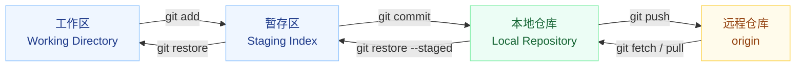
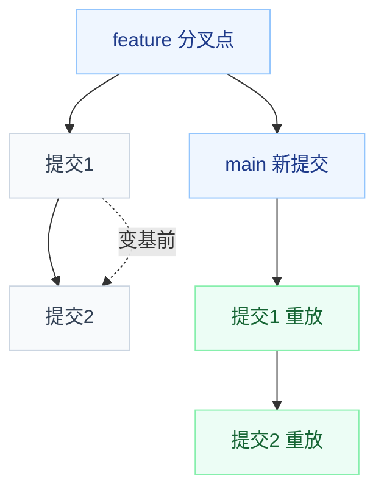

# Git版本控制

> 这篇从 Git 的分布式模型与对象存储讲起，经过安装与首次提交、三区与对象模型、分支合并与变基、远程协作、回滚与救火、提交规范与历史整理，最后落到团队仓库的完整交付案例。
>
> 学完能独立完成分支开发、冲突解决、代码评审流转、发布打 tag，并在误提交、误删除、需要回滚时用正确的命令安全恢复。

## 一、定位与边界

Git 是分布式版本控制系统（Distributed Version Control System）：每个克隆都是完整的仓库，提交、分支、合并全部可以离线完成，远程仓库只是协作时的同步点。这与集中式的 SVN 相比，差异不在命令，而在模型：本地提交不依赖网络，分支只是指向某个提交的指针，创建和销毁几乎零成本。

Git 存的不是"文件差异序列"，而是"一次提交对应一份完整快照"：提交（commit）持有指向根目录树（tree）的指针，目录树持有指向文件内容（blob）的指针，对象以内容的 SHA-1/SHA-256 哈希命名。内容寻址带来两个直接后果：任何文件在仓库里只存一份（相同内容自动去重）；任何提交被哈希锁定，改一个字符就不再是同一个提交。



三个使用边界：

- 二进制大文件（模型、视频、构建产物）不要直接进 Git，提交会随历史永久膨胀；用 Git LFS 存指针，或改用制品仓库；
- Git 管内容不管部署：发布、多环境差异属于 CI/CD 层，不要用一堆环境分支模拟配置管理；
- GitHub / GitLab / Gitee 是托管平台，工作流（Pull Request、保护分支）是平台功能，底层动作仍然是 fetch / merge / rebase / push。

> 版本基线（2026-11）：Git 2.50+（2.5x 系列）；`git switch` / `git restore`（2.23+）为标准命令，不再使用多义的 `git checkout` 分支操作。命令默认 Linux（Ubuntu 为主），Rocky/RHEL 用 `dnf`。

## 二、安装与最小验证

安装本身是一条命令，成本在首次配置：身份、换行符、pull 策略三处不定，后面每次提交都要还债。

### 2.1 安装

```bash
# Ubuntu：发行版仓库版本满足日常；需要新版本时加 git-core PPA
sudo apt update && sudo apt install -y git
sudo add-apt-repository ppa:git-core/ppa && sudo apt install -y git

# Rocky/RHEL
sudo dnf install -y git

# macOS：随 Xcode Command Line Tools，或 Homebrew 取新版本
xcode-select --install
brew install git

# Windows：Git for Windows 官方安装包，含 Git Bash 与凭证管理器
winget install Git.Git
```

### 2.2 首次配置

```bash
# --global 写入 ~/.gitconfig，仓库内配置优先于全局
git config --global user.name "Li Ming"
git config --global user.email "liming@example.com"

git config --global init.defaultBranch main        # 新仓库默认分支名
git config --global pull.rebase true               # pull 时变基，避免无意义的合并提交
git config --global push.autoSetupRemote true      # 首次 push 自动建上游分支，免 -u
git config --global core.autocrlf input            # Linux/macOS 用 input；Windows 用 true
git config --global fetch.prune true               # fetch 时同步删除已消失的远程分支
git config --list --show-origin | head -10
```

跨平台团队不要只靠 `core.autocrlf`，在仓库根放 `.gitattributes` 更可控：

```text
* text=auto eol=lf
*.png binary
*.jar binary
```

> 边界：`.gitattributes` 在文件第一次入库时生效；已入库的文件要 `git add --renormalize .` 后提交一次，换行符才会统一。

### 2.3 SSH 密钥与克隆验证

```bash
ssh-keygen -t ed25519 -C "liming@example.com"
cat ~/.ssh/id_ed25519.pub     # 公钥贴到托管平台的 SSH Keys 页面
ssh -T git@github.com        # 平台换成 gitlab.com / 企业私有域名
```

预期输出（示例）：

```text
Hi liming! You've successfully authenticated, but GitHub does not provide shell access.
```

### 2.4 最小闭环：第一次提交

```bash
mkdir demo && cd demo
git init -b main
echo "# demo" > README.md
git add README.md
git commit -m "feat: init demo"
git log --oneline --graph
```

预期输出：

```text
Initialized empty Git repository in /path/demo/.git/
[main (root-commit) 9e2c8a1] feat: init demo
 1 file changed, 1 insertion(+)
 create mode 100644 README.md
* 9e2c8a1 (HEAD -> main) feat: init demo
```

> 边界：提交身份（user.name / user.email）必须先配置，否则首次 commit 会拒绝或使用系统默认值；公司仓库与开源贡献使用不同邮箱时，在仓库内用不带 `--global` 的命令覆盖。HTTPS 凭证用各平台的 Personal Access Token，密码方式已全部下线。

## 三、三区与对象模型

Git 的一切日常操作都发生在三个区域之间：工作区（改文件）、暂存区（准备提交什么）、本地仓库（已经提交的历史）。理解三区，撤销类命令全部自明。

### 3.1 三种状态与三类 diff

```bash
git status --short        # ?? 未跟踪  M 已改未暂存  M  已暂存待提交
git diff                  # 工作区 vs 暂存区：还没 add 的改动
git diff --cached         # 暂存区 vs 本地仓库：下一次提交的内容
git diff HEAD             # 工作区 vs 本地仓库：全部改动
```

预期输出（示例，改了 app.txt 的一行）：

```text
 M app.txt
diff --git a/app.txt b/app.txt
--- a/app.txt
+++ b/app.txt
@@ -1,2 +1,2 @@
 line1
-line2
+line2-v2
 line3
```

### 3.2 查看对象存储

```bash
git cat-file -p HEAD                 # 打印当前提交对象
git cat-file -p HEAD^{tree}           # 提交指向的根目录树
git rev-parse HEAD                    # 当前提交的完整哈希
```

预期输出（示例）：

```text
tree 3f9d2a8c1e5b7d0a92f1c44b8a3d7e6f5c2b1a09
parent 7b2a1c9d4e8f3a6b5c7d9e1f2a3b4c5d6e7f8a9b
author Li Ming <liming@example.com> 1762999200 +0800
committer Li Ming <liming@example.com> 1762999200 +0800

feat: init demo
```

### 3.3 撤销的三个层次

```bash
git restore app.txt             # 丢弃工作区改动（未 add 的部分）
git restore --staged app.txt    # 把暂存区的改动退回工作区，提交内容不变
git commit --amend               # 修补最近一次提交：追加改动或改信息
```

> 警告：`git restore <file>` 丢弃的是未提交改动，无法用 Git 恢复；执行前先 `git stash` 或确认内容不再需要。

`reset` 移动当前分支的指针，是理解"回退"的核心命令。三个档位的差别：

| 命令 | 移动分支指针 | 清空暂存区 | 改工作区 |
|---|---|---|---|
| `git reset --soft HEAD~1` | 是 | 否 | 否 |
| `git reset HEAD~1`（默认 mixed） | 是 | 是 | 否 |
| `git reset --hard HEAD~1` | 是 | 是 | 是 |

```bash
git reset --soft HEAD~1   # 回退提交，改动完整保留在暂存区，常用于提交后想补充
git reset HEAD~1          # 回退提交，改动退回工作区，重新挑选要提交的内容
```

> 警告：`git reset --hard` 把已提交的内容一并丢弃，是日常命令里破坏力最大的一条；执行前必须确认 `git status` 干净或先建 `git branch backup`。任何 `reset` / `--amend` 只作用于未推送的历史，已推送的回退走第六章的 `revert`。

## 四、分支、合并与变基

分支是指向提交的指针；`main`、`feature/x` 本身没有任何特殊地位，特殊的是 HEAD 指向谁。日常 90% 的分支操作是：开分支、合并、解决冲突、整理提交。

### 4.1 分支操作

```bash
git switch -c feature/login     # 创建并切换（取代 git checkout -b）
git switch main                 # 切回主干
git branch -a                   # 列出本地与远程分支
git branch -d feature/login     # 删除已合并分支
git push origin --delete feature/login   # 删除远程分支
```

### 4.2 合并与冲突解决

```bash
git switch main
git merge feature/login
```

双方改了同一行时产生冲突：

```text
Auto-merging app.txt
CONFLICT (content): Merge conflict in app.txt
Automatic merge failed; fix conflicts and then commit the result.
```

冲突文件里的标记：

```text
<<<<<<< HEAD
line2-main          # 当前分支（main）的版本
=======
line2-login         # 被合并分支（feature/login）的版本
>>>>>>> feature/login
```

解决流程是固定的四步：

```bash
git status --short            # 1. 找出所有 UU 文件，一个都不能漏
git diff                      # 2. 逐个查看冲突块
# 3. 编辑文件：删掉 <<<<<<< ======= >>>>>>> 三组标记，保留正确内容
git add app.txt               # 4. 标记已解决
git commit                    # 完成合并提交
```

预期输出（示例）：

```text
UU app.txt
[main 6f9d4b2] Merge branch 'feature/login'
```

> 边界：`git merge --abort` 可以放弃整个合并回到合并前状态，任何时候解决到一半都可全身而退；解决冲突不是"保留一边"，而是产出双方意图都成立的新代码，测试通过才算解决完成。

### 4.3 变基与合并的取舍

变基（rebase）把一串提交搬到新的基底上，得到没有合并提交的直线历史；合并（merge）保留真实的分叉拓扑。

```bash
git switch feature/login
git fetch origin
git rebase origin/main       # 把本分支的提交逐个重放到 main 最新提交之后
```



| 维度 | merge | rebase |
|---|---|---|
| 历史 | 保留分叉与合并提交 | 一条直线 |
| 冲突 | 解决一次 | 每个提交可能各解决一次 |
| 改写历史 | 否 | 是 |
| 适用 | 公共分支合入 | 同步主干进度、整理特性分支 |

变基遇到冲突时逐提交解决：

```bash
git rebase origin/main
# 冲突时：修复文件后
git add app.txt
git rebase --continue
# 或放弃：git rebase --abort
```

> 红线：已推送到公共分支的提交禁止 `rebase` / `amend` 改写。改写后 `push` 会被拒绝，强推会覆盖协作者的工作。个人特性分支在发起 PR 前变基属于约定内的改写，是安全用法。

### 4.4 交互式变基与 cherry-pick

```bash
git rebase -i origin/main
```

编辑器里把提交列表改成动作序列：

```text
pick 3a9c1d2 feat(login): add form
squash 8b2e4f1 fix typo          # 并入上一条
reword 1d7a3c9 feat(login): api  # 只改提交信息
fixup 9c5b8e2 lint               # 并入上一条且丢弃信息
```

cherry-pick 把某个提交原样复制到当前分支，是从发布分支捞补丁的标准命令：

```bash
git switch release/1.8
git cherry-pick 3a9c1d2       # main 上的修复提交，复制到 1.8
```

### 4.5 reflog：本地操作的后悔药

`.git/logs` 记录 HEAD 的每次移动，90 天内（默认）任何误操作都能定位到之前的提交。

```bash
git reflog -n 5
```

预期输出（示例）：

```text
6f9d4b2 HEAD@{0}: commit (merge): Merge branch 'feature/login'
9e2c8a1 HEAD@{1}: checkout: moving from feature/login to main
3a9c1d2 HEAD@{2}: commit: feat(login): api
```

误删分支的恢复：

```bash
git branch -D feature/login          # 误删
git reflog                           # 找到该分支最后一次指向的哈希
git switch -c feature/login 3a9c1d2  # 用哈希重建分支
```

## 五、远程协作

远程协作的完整闭环：`fetch` 把远程历史取回本地、在本地完成合并或变基、`push` 推送本地提交。远程仓库以短名引用（默认 `origin`），跟踪关系（upstream）决定 `git status` 能否提示领先/落后。

### 5.1 远程分支与跟踪关系

```bash
git remote add origin git@git.example.com:team/web-api.git
git remote -v
git fetch origin                    # 只取回，不改本地分支，先看再合更安全
git switch -c feature/login         # 本地开发
git push                            # push.autoSetupRemote 已免去 -u 首次设置
git status -sb                      # 显示领先/落后计数
```

预期输出（示例）：

```text
## feature/login...origin/feature/login [ahead 1]
```

```bash
git pull                            # = git fetch + git rebase（pull.rebase true）
```

`pull.rebase true` 把主干新提交变基到本地提交之下，历史保持直线，不产生"Merge branch 'main'"噪音提交。

### 5.2 强推的红线与替代品

```bash
git push --force-with-lease         # 远程分支与自己 fetch 到的版本一致才允许覆盖
```

> 警告：`git push --force` 无条件覆盖远程，会静默丢掉协作者的提交，公共分支上禁止使用；`--force-with-lease` 在远程被别人更新过时拒绝推送，是唯一允许出现在文档里的强推形式，且只用于个人分支变基后同步。

### 5.3 Pull Request 工作流

```bash
# 1. 从最新主干开分支
git switch main && git pull
git switch -c feature/payment

# 2. 小步提交，随 push 保底
git commit -m "feat(payment): add order intent api"
git push

# 3. 平台侧开 PR，指定评审人，CI 必须绿
# 4. 评审意见落实：继续提交，评审通过后按平台策略合并
#    squash and merge：分支多个提交压成一个干净提交进主干（推荐默认）

# 5. 合并后清理：squash 合并后 Git 认为该分支"未合并"，-D 强删是安全且必需的
git switch main && git pull
git branch -D feature/payment
git push origin --delete feature/payment
```

### 5.4 标签与发布

```bash
# 附注标签带署名与日期，发布专用；轻量标签只是指针，内部标记用
git tag -a v1.8.0 -m "release 1.8.0"
git push origin v1.8.0
git tag -l 'v1.8.*'
git show v1.8.0 --stat | head -8
```

> 边界（易错点）：`.gitignore` 只对未跟踪文件生效，已被跟踪的文件加进 ignore 后仍会继续变更；先 `git rm --cached build.out` 再提交规则。`git push --tags` 会把所有本地标签一次推上去，发布只推指定标签。

## 六、回滚与救火

回滚的第一判断是"改动是否已推送"：未推送用 `reset`，已推送用 `revert`（生成一个反向提交），两者的安全性完全不同。

### 6.1 revert：安全回滚

```bash
git revert --no-edit 3a9c1d2
```

预期输出（示例）：

```text
[main 8fe9ec9] Revert "feat(login): api"
 1 file changed, 1 insertion(+), 1 deletion(-)
```

回滚一个合并提交必须指明留在哪个父线上：

```bash
git log --oneline --graph        # 找到合并提交哈希
git revert -m 1 6f9d4b2          # -m 1 = 保留父提交 1（合并时所在分支），撤销合入内容
```

> 边界：revert 合并提交后，被撤销的内容再次合入时会因历史里已有相同改动而被跳过；需要重新引入时必须重新 revert 那次 revert，或用 cherry-pick 换上下文重写。

### 6.2 救火命令速查

| 场景 | 命令 | 说明 |
|---|---|---|
| 改动改乱了，全部不要 | `git restore .` | 丢弃未提交改动，不可恢复 |
| 提交后发现还要补一行 | `git commit --amend` | 未推送时使用 |
| 提交到错误分支 | 正确分支 `cherry-pick`，错误分支 `reset` | 已推送则用 `revert` |
| 半路切走，改动还没提交 | `git stash push -u -m wip` | `-u` 连未跟踪文件一起存 |
| 回来继续 | `git stash pop` | pop 后记录即删除 |
| 误 reset --hard | `git reflog` → `git reset --hard HEAD@{n}` | 90 天内可恢复 |
| 误删分支 | `git reflog` → `git switch -c <branch> <hash>` | 见 4.5 |
| 找出引入 bug 的提交 | `git bisect start` | 二分定位，见 6.3 |
| 敏感信息已提交 | `git filter-repo` + 轮换密钥 | 仓库历史与所有克隆都要处理 |

### 6.3 bisect：二分定位坏提交

```bash
git bisect start
git bisect bad                      # 当前版本是坏的
git bisect good v1.7.0              # 这个标签是好的
# Git 自动检出中间提交，逐个测试并标记
git bisect good                     # 或 git bisect bad
```

预期输出（示例）：

```text
6f9d4b2 is the first bad commit
commit 6f9d4b2
Author: Li Ming <liming@example.com>
Date:   Fri Nov 13 09:00:00 2026 +0800
    feat(payment): change line2
```

```bash
git bisect reset                    # 回到起始状态
```

带测试命令时可以全自动：`git bisect run npm test`，二分过程不再需要人工标记。

### 6.4 敏感信息的正确处理

> 警告：密钥、token、密码一旦推送到远程，视为已泄露。第一步去平台吊销并签发新密钥，第二步才清理历史；顺序颠倒等于在泄露窗口内换锁不换钥匙。

```bash
pipx install git-filter-repo
git filter-repo --invert-paths --path config/prod.env   # 从全部历史中移除该文件
# filter-repo 会移除 remote，重新添加后再强推全部分支
git remote add origin git@git.example.com:team/web-api.git
git push --force-with-lease --all
```

## 七、提交规范与历史整理

提交信息是协作界面：评审靠它理解意图，回滚靠它定位提交，发布靠它自动生成变更日志。约定式提交（Conventional Commits）把信息结构化，让机器可读。

### 7.1 格式与正反例

```text
<type>(<scope>): <subject>

<body>

<footer>
```

| type | 含义 | 对版本的影响 |
|---|---|---|
| feat | 新功能 | 次版本号 +1 |
| fix | 缺陷修复 | 修订号 +1 |
| refactor | 重构（不改行为） | 不发版 |
| perf | 性能优化 | 按情况 |
| docs / test / build / ci | 文档 / 测试 / 构建 / 流水线 | 不发版 |

正反例：

```text
# 正例：类型 + 范围 + 祈使句，一行说清"为什么改"
fix(payment): retry idempotency key on timeout

Order creation failed intermittently under gateway
timeouts because the retry used a fresh idempotency
key and was rejected as a duplicate.

Closes #482
```

```text
# 反例：说不出意图，三个月后无人知道它改了什么
update files
fix bug
修改了一下
```

### 7.2 机器校验：commitlint + husky

```bash
npm install --save-dev @commitlint/cli @commitlint/config-conventional husky
npx husky init
```

```javascript
// commitlint.config.js：在通用约定上收紧 scope（CommonJS，无需 type:module）
module.exports = {
  extends: ['@commitlint/config-conventional'],
  rules: {
    'scope-enum': [2, 'always', ['api', 'web', 'payment', 'deploy']],
    'subject-case': [2, 'never', ['start-case', 'pascal-case', 'upper-case']],
  },
};
```

```bash
# .husky/commit-msg 钩子：提交信息不合格直接拒绝
echo 'npx --no -- commitlint --edit "$1"' > .husky/commit-msg
```

验证（先给一条违规信息）：

```bash
git commit -m "update files"
```

预期输出（示例）：

```text
⧗   input: update files
✖   subject may not be empty [subject-empty]
✖   type may not be empty [type-empty]
✖   found 2 problems, 0 warnings
husky - commit-msg hook exited with code 1
```

```bash
git commit -m "fix(api): retry idempotency key on timeout"
```

预期输出（示例）：

```text
[main 9d4a8c1] fix(api): retry idempotency key on timeout
```

### 7.3 团队约定的最小集

- 分支命名 `feature/<ticket>-<slug>`、`fix/<ticket>-<slug>`，主干只有 `main` 与 `release/x.y`；
- PR 采用 squash and merge，主干一个变更一个提交，PR 标题本身是符合规范的提交信息；
- 提交前 `git log --oneline -5` 自查本分支没有调试提交混入；
- 版本号遵循语义化版本（Semantic Versioning），打附注标签、由 CI 发布，不在本机发布。

## 八、排障与现场手册

Git 的"故障"几乎都不是数据丢失，而是位置判断错：先确认 HEAD 在哪、改动在哪一层，再选命令。

| 现象 | 最可能原因 | 第一条命令 |
|---|---|---|
| push 被拒 non-fast-forward | 远程有新提交 | `git pull --rebase` 后再 push |
| rejected（保护分支） | 直接推主干被拦 | 走 PR；临时分支再合入 |
| detached HEAD | checkout 了提交/标签 | `git switch -c rescue` 保住现场 |
| Permission denied (publickey) | SSH 密钥未加载 | `ssh -T git@平台 -v` 看认证链 |
| fatal: unrelated histories | 合并了不同源的仓库 | 确认来源；确需合并加 `--allow-unrelated-histories` |
| 文件名大小写不生效 | macOS/Windows 大小写不敏感 | `git mv README.md README.md.tmp` 两步改 |
| LF/CRLF 混乱 | autocrlf 与编辑器不一致 | `git config core.autocrlf input` + `.gitattributes` |
| push 大文件被拒 | 单文件超平台限额 | `git filter-repo` 移除或改用 LFS |
| 合并后测试挂 | 冲突解决遗漏语义 | `git diff HEAD~1 --stat` 复查合并结果 |
| 仓库越用越慢 | 历史里塞了二进制 | `git count-objects -vH` 评估后 filter-repo |

### 8.1 push 被拒的完整处理

```bash
git push
```

拒绝输出（示例）：

```text
 ! [rejected]        main -> main (fetch first)
error: failed to push some refs to 'git@git.example.com:team/web-api.git'
hint: Updates were rejected because the remote contains work that you do not have locally.
```

```bash
git pull --rebase          # 把本地提交重放到远程最新之上
git rebase --continue      # 如有冲突，逐个解决
git push
```

### 8.2 detached HEAD 的自救

```text
You are in 'detached HEAD' state....
```

```bash
# 在游离点建分支即恢复正常；之后看要回哪里
git switch -c rescue/detached
git log --oneline --graph --all -10
```

> 排障顺序：先 `git status` 和 `git reflog` 看清当前位置，再动手；`reset --hard` 出现在任何救火步骤之前，必须先有一条"当前哈希已记录"的证据（屏幕上的哈希或新建的 backup 分支）。

## 九、最佳实践案例

### 9.1 案例背景

8 人团队维护 web-api（主仓库 `team/web-api`），主干开发 + 每两周一个 release。事故背景有三件：一次 `git push --force` 覆盖了同事刚合入的修复，损失半天工作；一次密钥被提交进仓库，轮换密钥花了一整天；commit 信息全是 "update" 和 "fix bug"，线上出问题后无法定位该 revert 哪条提交。目标：建立分支策略、提交规范与回滚预案，并把校验放进钩子与 CI，不再依赖自觉。

### 9.2 案例实操

第一步，仓库级规范落地（一次性配置）：

```bash
git clone git@git.example.com:team/web-api.git && cd web-api
git config pull.rebase true
git config push.autoSetupRemote true

# 提交信息模板：模板只起提示作用，机器校验交给 commitlint
cat > .gitmessage <<'EOF'
# 格式：<type>(<scope>): <subject>
# type: feat|fix|refactor|perf|docs|test|build|ci
# scope: api|web|payment|deploy
# subject: 祈使句、不加句号、50 字内
EOF
git config commit.template .gitmessage

# 钩子校验 + 范围收紧（7.2 的 commitlint.config.js 与 .husky/commit-msg）
npm install --save-dev @commitlint/cli @commitlint/config-conventional husky
npx husky init
echo 'npx --no -- commitlint --edit "$1"' > .husky/commit-msg
```

```bash
# 平台侧：主干保护（gh CLI 等价于网页设置；-f 传 JSON 串，-F 做布尔/数字转换）
gh api -X PUT repos/team/web-api/branches/main/protection \
  -f required_status_checks='{"strict":true,"contexts":["ci/test"]}' \
  -F enforce_admins=false \
  -f required_pull_request_reviews='{"required_approving_review_count":1}' \
  -F allow_force_pushes=false -F allow_deletions=false
```

第二步，一个标准特性分支的生命周期：

```bash
git switch main && git pull
git switch -c feature/PAY-482-idempotency-retry

# 开发中的小步提交（评审看到的是最终 squash，小步提交不必完美）
git commit -m "feat(payment): add retry helper"
git commit -m "feat(payment): wire idempotency key"
git push
```

同步主干进度时产生冲突，按固定流程解决：

```bash
git fetch origin
git rebase origin/main
```

冲突输出（示例）：

```text
Auto-merging src/payment/order.py
CONFLICT (content): Merge conflict in src/payment/order.py
error: could not apply 8b2e4f1... feat(payment): wire idempotency key
hint: Resolve all conflicts manually, mark them as resolved with "git add"
```

```bash
git status --short
```

预期输出（示例）：

```text
UU src/payment/order.py
```

```bash
# 编辑器解决冲突块后
git add src/payment/order.py
git rebase --continue
git push --force-with-lease      # 个人分支变基后的唯一合法强推形式
```

第三步，PR 合入与发布：

```bash
# 平台侧 PR squash and merge，PR 标题即主干提交信息：
# fix(payment): retry idempotency key on timeout
git switch main && git pull
git log --oneline --graph -6
```

预期输出（示例）：

```text
* 9d4a8c1 (HEAD -> main, origin/main) fix(payment): retry idempotency key on timeout
* 3c7b9f2 feat(web): banner for year-end campaign
* c01ed6e fix(api): nil guard on webhook payload
* ...
```

```bash
git tag -a v1.8.0 -m "release 1.8.0"
git push origin v1.8.0
```

第四步，线上问题：v1.8.0 的 webhook 修复引发回退，在主干 revert 后打补丁标签发布 v1.8.1：

```bash
git switch main
git revert --no-edit c01ed6e
```

预期输出（示例）：

```text
[main 4e8c1a3] Revert "fix(api): nil guard on webhook payload"
 1 file changed, 2 insertions(+), 8 deletions(-)
```

```bash
git push
# 发布补丁版本：revert 提交已在主干，直接打标签即发布 1.8.1
git tag -a v1.8.1 -m "release 1.8.1"
git push origin v1.8.1
```

第五步，一次误操作恢复演练（验证救火预案可用）：

```bash
git branch backup/pre-reset            # 兜底分支：任何 reset 前先建
git reset --hard HEAD~2                # 模拟误退两个提交
git log --oneline -1                   # 发现丢失，走 reflog
git reflog -n 4
```

预期输出（示例）：

```text
3c7b9f2 HEAD@{0}: reset: moving to HEAD~2
4e8c1a3 HEAD@{1}: revert: Revert "fix(api): nil guard on webhook payload"
9d4a8c1 HEAD@{2}: pull: Fast-forward
2a7f8e1 HEAD@{3}: pull: Fast-forward
```

```bash
git reset --hard 4e8c1a3              # 回到误操作（reset）之前的哈希
git log --oneline -1
git branch -D backup/pre-reset
```

预期输出（示例）：

```text
4e8c1a3 (HEAD -> main) Revert "fix(api): nil guard on webhook payload"
```

### 9.3 案例结果

规范落地后连续 6 个迭代（示例）零强推事故：`--force-with-lease` 配合保护分支把不可挽回收的覆盖全部拦在服务器侧；commitlint 上线当周拒绝不合格信息 23 条（示例），主干提交信息合格率从 41% 到 100%（示例）；线上回滚从"翻提交猜范围"变为 `git revert` 单条命令，v1.8.1 从事故确认到发布完成 25 分钟（示例）；误操作恢复演练中 `git reset --hard` 的恢复全程 90 秒（示例），没有数据丢失。

失败模式复盘：一是 squash and merge 之后特性分支禁止再次 rebase 继续开发（主干已有同内容的不同哈希提交），正确做法是删分支、从主干重开；二是 revert 合并提交曾漏了 `-m 1`，Git 报 "is a merge but no -m option was given"，补上后需要明确告知团队"该内容再次合入时会被跳过"；三是密钥治理把清理历史放在第一步、轮换密钥放在第二步，顺序颠倒造成过二次泄露，最终固化为"先吊销、后清史"。团队最终约定：主干保护开着、`--force-with-lease` 是唯一允许的强推、revert 是公共历史唯一的回退方式，三条写进仓库 README，任何新人入职第一天跑一遍本案例的救火演练。
