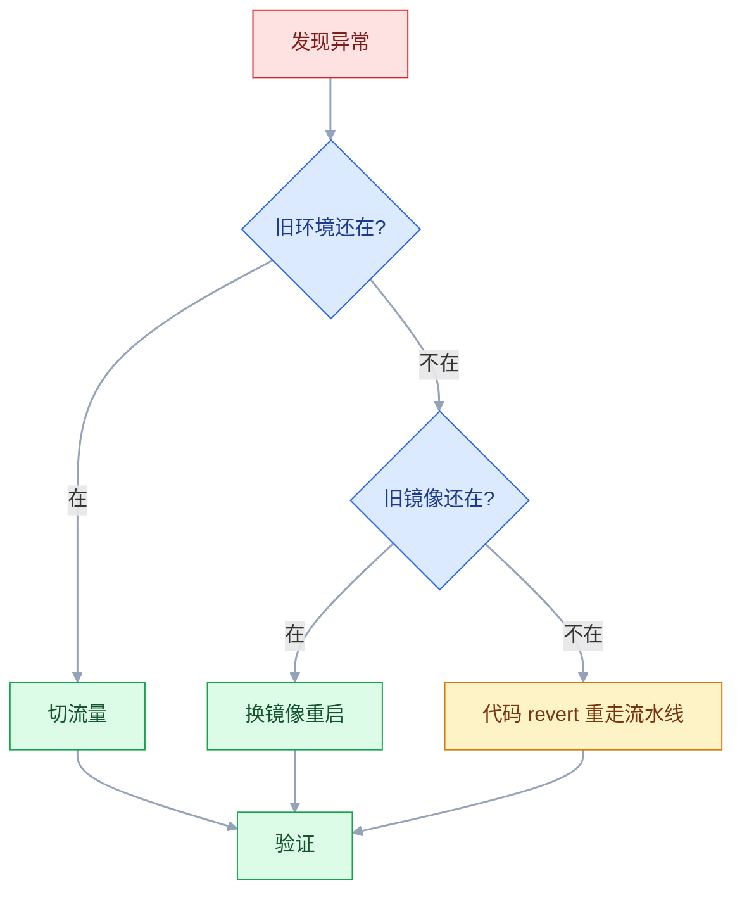

# CI/CD 与 DevOps 概念

## 一、工程案例：用一段脚本跑通能回滚的交付流水线

**场景**：`order-service`（Spring Boot 3 / Java 17），5 人团队。现状是本地 `mvn package` → 微信发给运维 → `scp` 上传 → `nohup java -jar` 重启。每月发版 1~2 次，回滚靠翻备份目录。

**目标**：先不接任何平台，用一段 shell 把「构建 → 测试 → 打包 → 部署 → 验证」跑通，并留下可回滚的版本标签。跑通之后再看 GitLab CI、GitHub Actions、Jenkins，它们只是把这套动作翻译成 YAML。

### 1.1 主线

```bash
mkdir -p ~/pipeline-demo && cd ~/pipeline-demo
# 前提：仓库里已有可 mvn package 的工程和 Dockerfile
# Dockerfile 里要有这两行，验收第 2 项要查 git.commit 标签：
#   ARG GIT_COMMIT=unknown
#   LABEL git.commit=${GIT_COMMIT}

cat > pipeline.sh <<'EOF'
#!/usr/bin/env bash
set -euo pipefail

COMMIT_SHA=$(git rev-parse --short HEAD)
IMAGE="order-service:git-${COMMIT_SHA}"

echo "[start] commit=${COMMIT_SHA} image=${IMAGE}"

mvn -B -q clean package -DskipTests
mvn -B -q test
docker build --build-arg GIT_COMMIT="${COMMIT_SHA}" -t "${IMAGE}" .

docker rm -f order-service >/dev/null 2>&1 || true
docker run -d --name order-service -p 8080:8080 "${IMAGE}" >/dev/null

for i in $(seq 1 30); do
  if curl -sf http://localhost:8080/actuator/health | grep -q '"status":"UP"'; then
    echo "[ok] health UP after ${i} tries"
    docker image inspect "${IMAGE}" --format '{{index .RepoDigests 0}}'
    exit 0
  fi
  sleep 2
done

echo "[fail] health check timeout"
exit 1
EOF

chmod +x pipeline.sh
./pipeline.sh
```

```text
[start] commit=3f2a1b9 image=order-service:git-3f2a1b9
[ok] health UP after 7 tries
order-service@sha256:9c1f4d2a8e7b...
```

三条纪律已经写进脚本：镜像标签用提交号，不用 `latest`；`set -euo pipefail` 让任何一步失败立即停止；部署成功的唯一标准是健康检查通过，不是 `docker run` 返回 0。

### 1.2 打版本与回滚

```bash
git tag -a v1.0.0 -m "release 1.0.0"
docker tag order-service:git-3f2a1b9 order-service:v1.0.0

# 假设 v1.1.0 上线后发现库存计算错误，切回 v1.0.0
docker rm -f order-service
docker run -d --name order-service -p 8080:8080 order-service:v1.0.0
curl -s http://localhost:8080/actuator/health
```

```text
{"status":"UP"}
```

回滚的动作只有一个：把容器指向的标签改回上一版。前提是 `v1.0.0` 这个标签还在仓库里，且没有被后来的构建覆盖。

### 1.3 验收

| # | 检查 | 命令或操作 | 通过标准 |
|---|---|---|---|
| 1 | 失败即停 | 改坏一个单测后执行 `./pipeline.sh; echo $?` | 退出码 1，且旧容器仍在运行 |
| 2 | 版本可追溯 | `docker inspect order-service:v1.0.0 --format '{{.Config.Labels}}'` | 标签里有 `git.commit=3f2a1b9` |
| 3 | 一镜像多标签 | `docker images --digests order-service` | `git-3f2a1b9` 与 `v1.0.0` 的 digest 相同 |
| 4 | 回滚可执行 | 切回上一 tag 并计时 | 5 分钟内恢复，健康检查 `UP` |
| 5 | 探活有牙齿 | 停掉数据库后再部署 | 部署失败、退出码非零，不宣布成功 |
| 6 | 环境无关 | 同一镜像在测试机与生产机各起一次 | 镜像 digest 相同，只有注入的变量不同 |
| 7 | 发布有记录 | `git tag -n` 加发布登记 | 版本、提交、时间、操作人齐全 |
| 8 | 密钥不进镜像 | `docker history --no-trunc order-service:v1.0.0` | 没有明文密码或 token |

## 二、高频问答：会卡住你的地方，也是面试最常问的

### 2.1 流水线显示成功，线上还是旧版本

**现场**

打开这次 Pipeline 数一遍 Job 列表，再到目标机看容器实际用的镜像 digest。

```bash
docker inspect order-service --format '{{.Config.Image}} {{index .Image}}'
docker image inspect order-service:v1.0.0 --format '{{.Id}}'
```

**要点**

- 绿色只代表**已创建**的 Job 都成功，不代表该创建的 Job 被创建了。
- 部署 Job 可能因为 `rules` 不匹配，压根没被创建。
- 手动 Job 是「可选」的，没点也算流水线通过。

**追问**

- 怎么区分「Job 不存在」和「Job 被跳过」？→ 看 Pipeline 的 Job 列表里有没有它。
- 手动 Job 怎么才算真阻塞？→ 写在 `rules` 里，并加 `allow_failure: false`。
- 为什么脚本本身没有任何报错？→ 它根本没运行，当然不会有日志。

### 2.2 测试环境通过，生产重新构建后出问题

**现场**

对比两边镜像的 digest，而不是 tag。

```bash
docker buildx imagetools inspect registry.example.com/apps/order-service:v1.0.0
# 两个环境拉取后比较 RepoDigests，digest 不同就是两次构建
```

**要点**

- 测试和生产各构建了一次，两个产物根本不是同一个东西。
- 依赖版本、基础镜像、构建参数任何一处漂移，digest 就会不同。
- 判断依据是 digest，tag 相同说明不了任何事。

**追问**

- 为什么 tag 一样还会不同？→ tag 只是指针，可以被重新赋值。
- 正确做法是什么？→ 构建一次，用同一个制品逐环境晋级。
- 怎么提前发现漂移？→ CI 里把 RepoDigests 打出来对比。

### 2.3 回滚时找不到上一版镜像

**现场**

按版本号逐个查 manifest，看哪些 tag 还存在。

```bash
docker manifest inspect registry.example.com/apps/order-service:v1.1.9 >/dev/null && echo exists
```

**要点**

- 别以为仓库会「保留历史」：可变标签只保留最后一次推送。
- 只推 `latest` 或分支名，下一次构建直接覆盖。
- 历史必须自己用版本号或 digest 固定。

**追问**

- 什么才算不可变标签？→ 版本号或提交号，最严格是 digest。
- 已经被覆盖了还能救吗？→ 没有别的引用就只能重构建，回滚窗口已经丢了。
- 清理策略要注意什么？→ 排除正在被生产使用的 digest。

### 2.4 发布显示成功，用户却打不开

**现场**

手工调用两个核心业务接口，再看启动日志里的连接错误。

```bash
curl -s -o /dev/null -w '%{http_code}\n' https://shop.example.com/api/products
docker logs --since 5m order-service | grep -iE 'connection refused|timeout|access denied'
```

**要点**

- 探活只查了进程端口，没有验证依赖。
- 应用能响应 `/health`，但数据库连不上、缓存不可用，业务接口全部 500。
- 所以现象是发布显示成功，用户却打不开。

**追问**

- 为什么 health 是 UP 还不可用？→ 它只证明了进程活着。
- 怎么让探活有牙齿？→ 检查依赖，再打两个核心业务接口。
- 依赖检查该放哪？→ readiness；放进 liveness 会在数据库抖动时重启所有副本。

### 2.5 测试偶发失败，重跑一次就过

**现场**

同一台机器连续跑 20 次，看失败是否集中在同一批用例。

```bash
for i in $(seq 1 20); do
  mvn -q -Dtest=OrderServiceTest test || echo "failed at run $i"
done
```

**要点**

- 根因是测试共享数据库、固定端口、依赖执行顺序或系统时间，并发跑时互相踩数据。
- `retry` 只是把不稳定藏起来，重跑通过不等于问题消失。
- 判断依据是失败分布，不是这一次的成败。

**追问**

- 为什么并发跑更容易挂？→ 共享资源互相踩，单跑时根本看不出来。
- 加 retry 什么时候合理？→ 只有幂等的网络请求和拉取镜像。
- 怎么修？→ 每个用例自己造数据、用随机端口，不依赖执行顺序。

### 2.6 数据库变更后，代码回滚失败

**现场**

在预发环境用旧镜像连新库，跑一遍冒烟。

```bash
docker run --rm -e DB_URL="$STAGING_DB_URL" order-service:v1.1.9
```

**要点**

- 新版本做了破坏性变更：删字段、改类型、加非空约束，旧代码不认识新结构。
- 正确做法是拆成两次发布：先加字段让新旧代码都能跑，稳定后再删旧字段。
- 判断标准是旧镜像能不能连新库正常启动并跑完冒烟。

**追问**

- 为什么不能一个发布里做完？→ 回滚时代码回去了，数据库已经变了。
- 三次发布的顺序是什么？→ 加字段、双写、读新字段后再删旧字段。
- 回滚脚本能救吗？→ 救不了，问题在数据结构不在脚本。

### 2.7 流水线从 5 分钟变成 25 分钟

**现场**

看每个 Job 的耗时，再看依赖下载占了多少。

```bash
# Jenkins：安装 timestamper 插件后日志每行带时间，看相邻两步的间隔
# GitLab：Job 日志自带时间戳；CI 调试时可开启 CI_DEBUG_SERVICES 看详细阶段耗时
grep -E '^\[[0-9]{4}-' build.log | head -20
# 更直接的办法：在脚本里给每段计时
SECONDS=0; mvn -B -q test; echo "test ${SECONDS}s"
```

**要点**

- 不是构建机变慢，升配解决不了这件事。
- 缓存失效导致每次全量下载依赖，测试串行，镜像每次从头构建。
- 先量每一段的耗时，再决定改什么。

**追问**

- 优化顺序怎么排？→ 依赖缓存、阶段并行、镜像层缓存、测试分片、只跑受影响模块。
- 升配为什么无效？→ 瓶颈在等下载，不在算力。
- 缓存有什么代价？→ 缓存污染，「本地能过、CI 不能过」更难复现。

### 2.8 密钥出现在构建日志里

**现场**

在日志里搜密钥片段和常见编码形式。

```bash
grep -nE 'password|token|secret|BEGIN .*PRIVATE KEY' build.log
```

**要点**

- 打码是兜底，不是许可证。
- `set -x` 会把展开后的命令打印出来；密钥被拼进 URL 或命令行参数，一样会漏。
- 打码只匹配原始值，base64 或拼接之后就不再匹配。

**追问**

- 命令行参数为什么也算泄露？→ 同机的其他进程能从 `ps` 看到。
- 该用什么方式注入？→ 挂载文件或密钥管理服务，别走命令行。
- 已经进日志了怎么办？→ 轮换密钥，日志里的内容删不干净。

### 2.9 打了 tag，生产发布却没有触发

**现场**

查远端 tag 列表，再对照流水线规则。

```bash
git ls-remote --tags origin | tail -5
git tag --points-at HEAD
```

**要点**

- tag 没有真正推到远端：只 `git tag` 没 `git push`。
- tag 名不符合流水线的正则，Job 根本不会被创建。
- 保护 tag 规则会把 push 直接拦下来。

**追问**

- 本地有 tag 远端为什么没有？→ `git tag` 只写本地，要显式推上去。
- 怎么确认 tag 打在哪个提交上？→ `git tag --points-at HEAD`。
- 正则写错的表现是什么？→ 少了那个 Job，看起来像 webhook 没触发。

### 2.10 生产发布自动化了，出事却没人敢点回滚

**现场**

在预发计时执行一次完整回滚，看能否在 5 分钟内完成。

**要点**

- 审批解决的是「谁批准发布」，不解决「怎么退回来」。
- 没有演练过的回滚脚本，没人知道上一版是哪个，也没人算得清影响范围。
- 回滚能力只能靠演练验证，加一道签字不产生任何回滚能力。

**追问**

- 为什么要计时？→ 「5 分钟内恢复」是能验证的目标，不是口号。
- 回滚要准备什么？→ 上一版的不可变标签，以及当时的配置。
- 加人工审批有用吗？→ 有用，但那是发布授权，不是回滚能力。

### 2.11 合并请求上全绿，合并进主干就红

**现场**

对比 MR 流水线的 commit 与合并后主干的 commit。

```bash
git rev-parse HEAD
git log --oneline -3
```

**要点**

- MR 流水线跑的是源分支的旧基线，没有先与目标分支合并。
- 或者只在 push 时触发，MR 事件根本没跑。
- 合并本身还会引入语义冲突：文本不冲突，代码也可能不过。

**追问**

- 怎么让它在合并后的代码上跑？→ 用合并结果流水线。
- 为什么本地发现不了？→ 本地没跑过合并之后的那份代码。
- 怎么确认跑的是哪个提交？→ `git rev-parse HEAD` 对比两边。

### 2.12 同一份代码，测试镜像不能直接上生产

**现场**

起容器看环境变量，再解包镜像找配置文件。

```bash
docker run --rm --entrypoint env order-service:v1.0.0 | sort
docker save order-service:v1.0.0 | tar -xO --wildcards '*/application*.yml'
```

**要点**

- 环境配置被 `COPY` 进了镜像，或者构建时用 `ARG` 写死了数据库地址。
- 重新构建等于生产拿到一个从未被测过的产物。
- 正确方向是把配置从镜像里赶出去。

**追问**

- 镜像里该有什么？→ 只有应用和运行时，配置靠注入。
- 怎么验证镜像干净？→ `docker history` 加上 `entrypoint env`。
- 一个镜像跑多环境可行吗？→ 可行，前提是差异只在注入的变量上。

## 三、核心知识：从零开始要建立的东西

### 3.1 交付链路的阶段划分

一条最小可用的流水线只有五段，顺序固定，越靠前越便宜：

| 阶段 | 动作 | 失败代价 | 典型耗时 |
|---|---|---|---|
| 构建 | 拉代码、装依赖、编译 | 低，几行报错 | 1~3 分钟 |
| 测试 | 单元测试、静态检查 | 中，定位到用例 | 1~5 分钟 |
| 打包 | 构建镜像、推仓库 | 中，重跑即可 | 1~3 分钟 |
| 部署 | 更新目标环境 | 高，可能影响用户 | 1~5 分钟 |
| 验证 | 健康检查、冒烟 | 最高，决定是否回滚 | 30 秒~2 分钟 |


阶段不是越多越好。每多一段就多一次排队和一次失败点；把「代码扫描」「许可证检查」这类不阻塞上线的动作设为非阻塞，比硬塞进主链路更实际。

### 3.2 触发事件与流水线粒度

| 事件 | 该做什么 | 不该做什么 |
|---|---|---|
| push 到功能分支 | 编译加单元测试，给作者快速反馈 | 推镜像、部署 |
| 合并请求 | 在合并前跑完整测试与检查 | 部署到共享测试环境（多个 MR 会互相覆盖；要预览就起带 MR 编号的临时环境） |
| 合并进主干 | 构建一次、推不可变镜像、部署测试环境 | 直接上生产 |
| 推版本 tag | 用已构建的镜像走生产发布 | 重新构建 |
| 定时 | 全量回归、依赖漏洞扫描 | 发布 |

一条流水线只回答一个问题：「这个提交能不能进下一个环境」。把多个问题塞进同一条流水线，失败时无法判断是哪一关没过。

### 3.3 构建产物的不可变性

制品的身份是 **digest**，不是 tag。tag 只是指向 digest 的指针，可以被重新赋值。

| 标识 | 是否可变 | 用途 |
|---|---|---|
| `v1.2.0` | 约定不可变 | 发布与回滚目标 |
| `git-a1b2c3d` | 不可变 | 追溯某次提交 |
| `latest` | 可变 | 本地开发，生产禁用 |
| `test` / `prod` | 可变 | 环境当前版本，不能作为回滚依据 |

不可变的意思是：同一个版本号永远指向同一个 digest，重新构建也不能覆盖它。要修 bug 就发 `v1.2.1`，不要偷偷重推 `v1.2.0`。

> **面试**：常问「为什么生产要用 digest 而不是 tag？」答：tag 只是指向 digest 的指针，可以被重新赋值，只有 digest 能证明线上跑的是哪个二进制。

### 3.4 制品仓库与标签策略

镜像仓库要回答三个问题：谁能推、谁能拉、旧版本留多久。

| 策略 | 做法 | 代价 |
|---|---|---|
| 全量保留 | 所有版本永久保存 | 存储持续增长 |
| 按数量保留 | 每个仓库保留最近 N 个 | 可能删掉仍在回滚窗口内的版本 |
| 按时间保留 | 保留 90 天 | 合规要求长时需另存 |
| 发布版永久、快照短期 | `v*` 不删，`git-*` 保留 14 天 | 需要清理任务区分标签 |

清理规则必须排除正在被生产使用的 digest。删除镜像前先查部署记录，别只看标签时间。

### 3.5 环境晋级与门禁

环境不是越多越好，但至少要有「和生产同构」的一层。

| 环境 | 数据 | 部署方式 | 门禁 |
|---|---|---|---|
| 本地 | 自己的数据 | 手动 | 无 |
| 测试 | 可随意重置 | 合并主干自动 | 单测通过 |
| 预发 | 脱敏或空库 | 自动 | 集成测试、冒烟 |
| 生产 | 真实数据 | tag 加人工审批 | 审批、变更窗口、验证 |


门禁分四类：**质量门禁**（测试、覆盖率）、**安全门禁**（镜像扫描、密钥扫描）、**流程门禁**（审批、变更单）、**运行门禁**（健康检查、错误率）。门禁必须有明确的通过阈值，否则会退化成「点一下继续」。

### 3.6 发布策略的取舍

| 策略 | 资源 | 回滚速度 | 风险暴露 | 前提 |
|---|---|---|---|---|
| 滚动 | 复用现有机器 | 中 | 逐步扩大 | 实例无状态、可多版本共存 |
| 蓝绿 | 双倍 | 秒级 | 切换瞬间全量 | 两套环境、数据库兼容 |
| 灰度 | 少量额外 | 快 | 按比例 | 有流量切分能力 |

滚动是默认选项，成本最低；蓝绿买的是回滚速度；灰度买的是风险上限。三者可以组合：先 5% 灰度观察，再滚动全量。

数据库是这三种策略的共同约束。只要新旧版本连同一个库，就必须保证两个版本能同时读写。

> **面试**：常问「滚动、蓝绿、灰度怎么选？」答：滚动成本最低，蓝绿买的是秒级回滚，灰度买的是风险上限，三者可以组合使用。

### 3.7 回滚的分层



| 层次 | 耗时 | 前提 | 适用 |
|---|---|---|---|
| 切流量 | 秒级 | 蓝绿或灰度，旧版本仍运行 | 有流量治理 |
| 换镜像 | 分钟级 | 旧镜像在仓库且有不可变标签 | 容器化部署 |
| 代码回滚 | 十几分钟 | 流水线可用 | 前两层都不可行 |
| 数据回滚 | 不可预估 | 有反向脚本和备份 | 最后手段 |

代码可以回滚，数据很难。所以发布纪律是：**每次只做能安全回滚的数据库变更**。

> **面试**：常问「回滚有哪几个层次，最快的是哪个？」答：切流量是秒级，换镜像是分钟级，代码回滚十几分钟，数据回滚不可预估，所以尽量让旧环境先留着。

### 3.8 数据库变更的向前兼容

把一个破坏性变更拆成三次发布：

```text
发布 1：加新字段（可空），代码不读不写        旧代码、新代码都能跑
发布 2：代码双写新旧字段，读旧字段            回滚代码仍然安全
发布 3：读新字段；确认稳定后再删旧字段        删字段必须晚于代码切换
```

反例是一个发布里同时「加非空字段 + 代码依赖它」：回滚代码时数据库已经变了，旧代码插入数据会直接失败。判断标准很简单——**旧版本镜像能不能连新库正常启动并跑完冒烟**。

> **面试**：常问「加字段和删字段为什么要分开发布？」答：要让新旧代码都能读写，先加字段双写，代码切换稳定后再删旧字段，否则代码回滚时数据库已经回不去。

### 3.9 流水线的失败语义

| 情况 | 正确语义 | 常见错误 |
|---|---|---|
| 编译失败 | 立刻失败，不跑后续 | 继续跑测试浪费机器 |
| 单测失败 | 失败，阻塞合并 | 设成允许失败 |
| 扫描发现高危漏洞 | 失败，阻塞发布 | 只发通知 |
| 部署后探活失败 | 失败并触发回滚 | 重试到超时再报错 |
| 非关键检查失败 | 警告，不阻塞 | 和关键检查混在一起 |

`retry` 只适合网络请求和拉取镜像这类幂等操作。给测试加 `retry` 会把真实缺陷变成偶发噪音，最后没人再信红色。

### 3.10 密钥的注入路径

| 方式 | 安全性 | 适用 |
|---|---|---|
| 平台密钥变量 | 中，需防日志泄露 | 小团队、单平台 |
| 挂载文件 | 较高，避免进命令行 | 私钥、证书 |
| 密钥管理服务 | 高，可审计可轮换 | 生产、多环境 |
| 短期令牌（OIDC） | 最高，无长期密钥 | 云上部署 |

三条底线：密钥不进镜像层、不进 Git 历史、不进构建日志。第三条最容易被忽视，`set -x`、`docker login -p`、把 token 拼进 URL 都会破功。

### 3.11 权限与最小授权

CI 的身份是一个真实的账号，它需要的权限往往比人小得多。

| 身份 | 该有的权限 | 不该有 |
|---|---|---|
| 构建 Job | 读代码、推指定仓库 | 删除仓库、改保护分支 |
| 部署 Job | 目标机器的部署目录 | 全机 root、数据库超级用户 |
| 发布审批人 | 批准生产部署 | 修改流水线定义 |

保护分支、保护 tag、保护环境是三把锁：受保护的变量只在受保护的 ref 上可见，生产审批只对特定角色开放。把这些配好，比在脚本里写 `if [ "$USER" = "admin" ]` 可靠得多。

### 3.12 流水线速度的结构

优化顺序按收益排：

| 手段 | 典型收益 | 代价 |
|---|---|---|
| 依赖缓存 | 省 1~3 分钟 | 缓存污染风险 |
| 阶段并行 | 接近线性 | 需要拆分子任务 |
| 镜像层缓存 | 省 1~2 分钟 | 需要固定构建顺序 |
| 测试分片 | 按分片数摊薄 | 测试必须无状态 |
| 只跑受影响模块 | 大仓库收益最大 | 需要依赖分析 |

缓存是双刃剑：它让构建变快，也让「本地能过、CI 不能过」更难复现。缓存的 key 必须包含依赖清单的哈希，依赖一变就失效。

### 3.13 可追溯性的三个坐标

| 坐标 | 存在哪 | 回答什么问题 |
|---|---|---|
| 提交 | Git | 这行代码是谁、什么时候改的 |
| 镜像 digest | 镜像仓库 | 线上跑的到底是哪个二进制 |
| 部署记录 | 流水线或发布系统 | 谁在什么时候把它放上去的 |

三者用同一个版本号串起来。只记录 tag 不够，tag 会被覆盖；只记录 commit 也不够，同一个 commit 可能构建出不同产物。digest 是唯一不会骗人的那个。

### 3.14 度量与成熟度

| 指标 | 定义 | 看什么 |
|---|---|---|
| 部署频率 | 单位时间成功上生产的次数 | 趋势，不看单点 |
| 变更前置时间 | 提交到上生产的时间 | 中位数，不看平均 |
| 变更失败率 | 需要回滚或热修的比例 | 分母是发布次数 |
| 故障恢复时间 | 从发现到恢复 | 是否在演练中稳定 |

成熟度不是越高越好。持续部署要求测试、监控、回滚都可靠；做不到这些却追求「每次提交都上生产」，只是把事故频率调高。多数团队做到持续交付（生产需点一下）已经足够。

### 3.15 平台选型的约束

| 约束 | 倾向自建 | 倾向托管 |
|---|---|---|
| 代码必须留在内网 | GitLab、Jenkins | 不适用 |
| 维护人力不足 | 不适用 | GitHub Actions、云厂商 CI |
| 需要任意 JDK 和老系统 | Jenkins | 受限 |
| 已上 Kubernetes | GitLab CI 或 Actions 加 Argo CD | 托管 CI 加 Argo CD |
| 合规要求审批留痕 | 自建加审批插件 | 托管的环境审批 |

平台会换，骨架不变：触发、构建、测试、制品、部署、验证、回滚。把这七件事定义清楚，换平台只是重写配置文件。

## 四、冷门知识汇总

| 知识点 | 为什么冷门 | 用到时的关键词 |
|---|---|---|
| 改流水线配置的那个 MR 用的是旧配置 | 引导问题，平时不会想到 | 两阶段合并、先合配置再合代码 |
| 构建缓存投毒 | 缓存按 key 共享，恶意 PR 可写入 | 缓存作用域、fork PR 只读缓存 |
| 制品签名与来源证明 | 多数团队只校验 digest | cosign、SLSA、attestation |
| 部署冻结窗口 | 月底、大促、财报期禁止发布 | 变更日历、freeze window |
| 功能开关与部署解耦 | 发布不等于启用 | feature flag、kill switch |
| 影子流量 | 需要流量复制能力 | mirror traffic、shadow |
| 数据库迁移工具的锁 | 并发发布时两个 Job 同时跑迁移 | Flyway lock、Liquibase lock |
| 构建的可复现性 | 默认构建带时间戳和随机元数据 | SOURCE_DATE_EPOCH、reproducible build |
| `GITHUB_TOKEN` 不能触发新 workflow | 防递归的设计，报错很隐晦 | workflow_dispatch、PAT |
| 制品保留与合规 | 平时只关心磁盘够不够 | retention policy、审计留档 |
| 流水线排队与公平性 | 共享 Runner 被大任务占满 | resource_group、并发上限 |
| 环境漂移 | 手工改过一台机器，代码里看不出来 | drift detection、plan diff |
| 蓝绿的数据库共享 | 两套应用连同一个库，回滚不等于数据回退 | 向后兼容、expand-contract |
| 发布记录与工单的对应 | 审计时才需要 | change ticket、deployment ID |
