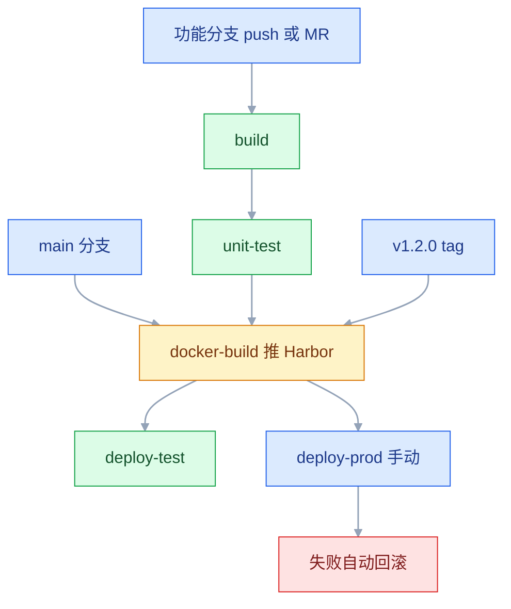
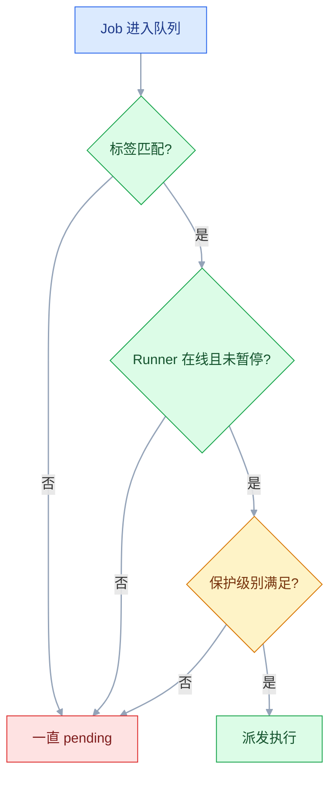

# GitLab 自动化平台

## 一、工程案例：给 order-service 配一条从 MR 到生产的手动发布流水线

**场景**：自建 GitLab（Docker 部署），代码仓库 `group/order-service`；一台构建机装 GitLab Runner（docker executor，挂载宿主 docker socket）；私有 Harbor `harbor.example.com`；测试机 `192.168.1.10`、生产机 `192.168.1.20`，都用 Docker Compose 运行。

**需求**：功能分支 push 和 MR 只跑构建与测试；合并进 `main` 自动构建镜像并部署测试机；推 `v*` tag 后出现手动按钮，点了才部署生产。

### 1.1 注册 Runner

```bash
# 构建机上执行
curl -L "https://packages.gitlab.com/install/repositories/runner/gitlab-runner/script.deb.sh" | sudo bash
sudo apt install -y gitlab-runner

sudo gitlab-runner register \
  --url "https://gitlab.example.com" \
  --token "glrt-xxxxxxxxxxxx" \
  --executor docker \
  --docker-image "alpine:3.20" \
  --tag-list "docker,build" \
  --run-untagged=false
```

Token 在项目或组的 **Settings → CI/CD → Runners → New runner** 生成，`glrt-` 开头。老文章里的 `--registration-token` 在新版本已废弃，照抄会报 `invalid token`。

```toml
# /etc/gitlab-runner/config.toml
[[runners]]
  name = "build-01"
  url = "https://gitlab.example.com"
  token = "glrt-xxxxxxxxxxxx"
  executor = "docker"
  [runners.docker]
    image = "alpine:3.20"
    volumes = ["/var/run/docker.sock:/var/run/docker.sock", "/cache"]
    privileged = false
  [runners.cache]
    Type = "local"
    Path = "/cache"
```

`volumes` 里挂 socket 是为了让 Job 里的 `docker build` 用宿主机守护进程。这等于把宿主机 root 权限交给流水线，只适合内网可信环境；严格场景用 Kaniko 或独立的 dind 服务。

### 1.2 `.gitlab-ci.yml`

```yaml
stages: [build, test, package, deploy]

variables:
  MAVEN_OPTS: "-Dmaven.repo.local=$CI_PROJECT_DIR/.m2/repository"
  HARBOR_REGISTRY: "harbor.example.com"
  IMAGE: "$HARBOR_REGISTRY/apps/order-service"

default:
  image: maven:3.9-eclipse-temurin-17
  cache:
    key:
      files: [pom.xml]
    paths: [.m2/repository/]
  interruptible: true

build:
  stage: build
  script:
    - mvn -B -s ci/settings.xml clean package -DskipTests
  artifacts:
    paths: [target/*.jar]
    expire_in: 1 week
  rules:
    - if: $CI_PIPELINE_SOURCE == "merge_request_event"
    - if: $CI_COMMIT_BRANCH
    - if: $CI_COMMIT_TAG          # tag 发布也要构建与测试，否则 docker-build 的 needs 指向不存在的 Job

unit-test:
  stage: test
  needs: [build]
  script:
    - mvn -B -s ci/settings.xml test
  artifacts:
    when: always
    reports:
      junit: target/surefire-reports/TEST-*.xml
    expire_in: 1 week
  rules:
    - if: $CI_PIPELINE_SOURCE == "merge_request_event"
    - if: $CI_COMMIT_BRANCH
    - if: $CI_COMMIT_TAG

docker-build:
  stage: package
  image: docker:27
  needs: [unit-test]
  variables:
    DOCKER_HOST: "unix:///var/run/docker.sock"
  script:
    - echo "$HARBOR_PASSWORD" | docker login "$HARBOR_REGISTRY" -u "$HARBOR_USER" --password-stdin
    # 构建上下文是仓库根目录，Dockerfile 里的 COPY 直接取 target/*.jar
    - docker build --build-arg GIT_COMMIT=$CI_COMMIT_SHA -t "$IMAGE:git-$CI_COMMIT_SHORT_SHA" .
    - docker push "$IMAGE:git-$CI_COMMIT_SHORT_SHA"
    - |
      if [ -n "$CI_COMMIT_TAG" ]; then
        docker tag "$IMAGE:git-$CI_COMMIT_SHORT_SHA" "$IMAGE:$CI_COMMIT_TAG"
        docker push "$IMAGE:$CI_COMMIT_TAG"
      fi
  rules:
    - if: $CI_COMMIT_BRANCH == $CI_DEFAULT_BRANCH
    - if: $CI_COMMIT_TAG

.deploy-base:
  stage: deploy
  image: alpine:3.20
  needs: [docker-build]
  interruptible: false      # 部署不随新提交取消，否则会停在半完成状态
  before_script:
    - apk add --no-cache openssh-client
    - install -d -m 700 ~/.ssh
    - cp "$SSH_PRIVATE_KEY" ~/.ssh/id_ed25519 && chmod 600 ~/.ssh/id_ed25519
    - ssh-keyscan -H "$SSH_HOST" >> ~/.ssh/known_hosts 2>/dev/null

deploy-test:
  extends: .deploy-base
  resource_group: test
  environment:
    name: test
    url: http://192.168.1.10:8080
  variables:
    SSH_HOST: $SSH_HOST_TEST
  script:
    - ssh "root@$SSH_HOST" "/opt/order-service/deploy.sh $IMAGE:git-$CI_COMMIT_SHORT_SHA test"
  rules:
    - if: $CI_COMMIT_BRANCH == $CI_DEFAULT_BRANCH

deploy-prod:
  extends: .deploy-base
  resource_group: production
  environment:
    name: production
    url: https://shop.example.com
  variables:
    SSH_HOST: $SSH_HOST_PROD
  script:
    - ssh "root@$SSH_HOST" "/opt/order-service/deploy.sh $IMAGE:$CI_COMMIT_TAG prod"
  rules:
    - if: $CI_COMMIT_TAG =~ /^v\d+\.\d+\.\d+$/
      when: manual
      allow_failure: false
```

`needs: [docker-build]` 让部署跳过无关的等待，直接依赖镜像 Job；`resource_group` 保证同一环境同时只有一个部署在跑，避免两次发布互相覆盖。

部署脚本放在目标机的 `/opt/order-service/deploy.sh`，测试机与生产机分别准备 `.env.test` 和 `.env.prod`。核心是记录旧镜像、更新 `.env`、重启、探活、失败切回：

```bash
#!/usr/bin/env bash
set -euo pipefail
IMAGE="$1"; ENV_NAME="$2"; APP_DIR="/opt/order-service"; ENV_FILE="$APP_DIR/.env.$ENV_NAME"

# 回滚必须还原整个 env 文件，不能只还原镜像名：
# 否则改错库地址后，旧镜像仍然连错库，健康检查照样失败
cp "$ENV_FILE" "$ENV_FILE.prev"
sed -i "s|^APP_IMAGE=.*|APP_IMAGE=$IMAGE|" "$ENV_FILE"
cd "$APP_DIR"
docker compose --env-file "$ENV_FILE" pull app
docker compose --env-file "$ENV_FILE" up -d app

for i in $(seq 1 30); do
  curl -sf http://localhost:8080/actuator/health | grep -q '"status":"UP"' && exit 0
  sleep 2
done

cp "$ENV_FILE.prev" "$ENV_FILE"
docker compose --env-file "$ENV_FILE" up -d app
exit 1
```

### 1.3 流水线形态



运行结果：

```text
# 功能分支
Pipeline #45  feature/order-cache  a1b2c3d4  passed
  build      build       01:32
  test       unit-test   02:05
  package    docker-build  skipped（规则不满足，Job 不存在）

# tag 发布
Pipeline #48  v1.2.0  b2c3d4e5  blocked
  build      build       01:20
  test       unit-test   02:11
  package    docker-build 01:45
  deploy     deploy-prod  manual  ← 等待点击
```

点下 `deploy-prod` 后，生产机上的容器变成 `harbor.example.com/apps/order-service:v1.2.0`，Deployments → Environments 里出现一条 production 记录。

### 1.4 验收

| # | 检查 | 命令或操作 | 通过标准 |
|---|---|---|---|
| 1 | Runner 可用 | 项目 → Settings → CI/CD → Runners | 在线，标签含 `docker` |
| 2 | 分支流水线 | push 一个功能分支 | 只有 build、unit-test 两个 Job |
| 3 | MR 流水线 | 开一个 Merge Request | 流水线挂在 MR 上，失败时不能合并 |
| 4 | 镜像可追溯 | `docker inspect ...:git-a1b2c3d4` | 标签含 `git.commit` |
| 5 | 测试环境自动 | 合并 main | deploy-test 自动执行，环境页有记录 |
| 6 | 生产手动 | 推 `v1.2.0` | 流水线状态 `blocked`，出现播放按钮 |
| 7 | 回滚有效 | 把 `.env.prod` 的库地址改错再发布 | 日志出现「回滚」，旧版本恢复运行 |
| 8 | 缓存生效 | 连续跑两次 build | 第二次 Maven 下载明显减少 |

## 二、高频问答：会卡住你的地方，也是面试最常问的

### 2.1 Job 一直 pending，提示没有 Runner

**现场**

Job 页面会直接写「no runners online」或「no runners that match tags」，再到 Runners 页看标签。

```bash
sudo gitlab-runner list
sudo gitlab-runner verify
```

**要点**

- Runner 在线不等于它会接这个 Job，标签匹配是另一道门。
- Job 的 `tags` 与 Runner 标签不匹配，或 Job 无 tags 而 Runner 设了 `run-untagged=false`。
- 两种提示直接分方向：一个是从没在线，一个是在线但标签不对。

**追问**

- Runner 需要公网 IP 吗？→ 不用，它是主动拉任务的。
- 标签对了还 pending？→ 查 Runner 的保护级别，不满足一样不派发。
- 怎么确认 Runner 状态？→ `gitlab-runner list` 加 `verify`。

### 2.2 手动 Job 没点，流水线却显示 passed

**现场**

看流水线状态是 `passed` 还是 `blocked`。

```yaml
# 可选：不点也算通过
deploy-prod:
  when: manual

# 阻塞：不点就停在 blocked
deploy-prod:
  rules:
    - if: $CI_COMMIT_TAG
      when: manual
```

**要点**

- `when: manual` 写在 Job 顶层是 optional 的，不点也算通过。
- 写在 `rules:` 里才是 blocking。
- 状态是 `passed` 就说明它没在等你。

**追问**

- 为什么顶层 manual 是可选的？→ 它表示允许手动触发，不是必须手动。
- 怎么让它真阻塞？→ `rules` 里 `when: manual` 再加 `allow_failure: false`。
- 界面上怎么一眼区分？→ 看这次 Pipeline 是 `passed` 还是 `blocked`。

### 2.3 cache 配了但每次都在下载依赖

**现场**

看 Job 日志里 `Checking cache for ...` 与 `Successfully extracted cache`。

```yaml
variables:
  MAVEN_OPTS: "-Dmaven.repo.local=$CI_PROJECT_DIR/.m2/repository"
cache:
  key:
    files: [pom.xml]
  paths: ["$CI_PROJECT_DIR/.m2/repository/"]
```

**要点**

- 缓存路径与 Maven 实际使用的本地仓库不一致，配了也没存对地方。
- `key` 里带了每次都变的变量，等于永远不命中。
- Job 跑到另一台 Runner，同样拿不到上次的缓存。

**追问**

- 为什么光写 `cache` 不够？→ 还要用 `-Dmaven.repo.local` 把仓库位置指过去。
- key 用 `$CI_JOB_ID` 会怎样？→ 每次都是新 key，等于禁用缓存。
- 缓存没命中算失败吗？→ 不算，`cache` 是尽力而为，必须存在的用 artifacts。

`key` 用 `pom.xml` 的哈希，依赖不变就命中；用 `$CI_JOB_ID` 当 key 等于永远不命中。

### 2.4 后续 Job 拿不到上一个 Job 的产物

**现场**

上游 Job 页面能看到 Browse artifacts，下游日志里有 `Downloading artifacts`。

```yaml
artifacts:
  when: always          # 测试失败也上传报告
  expire_in: 1 week
```

**要点**

- 产物已过期，这是最常见的一种。
- 用了 `needs`，但没声明需要哪些产物。
- 上游 Job 失败导致 artifacts 没上传，测试报告必须 `when: always`。

**追问**

- 默认会下载哪些？→ 前面所有阶段的产物，容易越传越慢。
- `dependencies: []` 是什么意思？→ 一个产物都不下载。
- artifacts 占谁的盘？→ GitLab 服务器或对象存储，不是 Runner 的。

`dependencies: []` 表示不下载任何产物；不写时默认下载前面所有阶段的产物，容易越传越慢。

### 2.5 Protected 变量在功能分支上是空的

**现场**

在 Job 里 `env | grep 变量名`；或看 Settings → Repository → Protected branches。

```bash
# 先确认分支是否受保护
git push origin HEAD:main   # 若被拒绝，说明 main 受保护
```

**要点**

- Protected 是「只在保护 ref 上可见」，不是「保护这个变量不被修改」。
- 当前分支或 tag 不在保护列表里，GitLab 直接不注入。
- 变量为空先查 ref 是否受保护，而不是查变量有没有存进去。

**追问**

- 功能分支上为什么一定是空的？→ 它不是受保护的 ref。
- 保护 tag 也算吗？→ 算，受保护的 ref 都能看到。
- 本地怎么验证规则？→ 往 main push 一次，被拒绝就说明受保护。

### 2.6 SSH 部署报 `error in libcrypto`

**现场**

在本地用同一个变量值还原文件，跑 `ssh-keygen -y -f`。

```bash
printf '%s' "$SSH_PRIVATE_KEY" | tr -d '\r' > /tmp/k
chmod 600 /tmp/k
ssh-keygen -y -f /tmp/k >/dev/null && echo ok
```

**要点**

- 私钥粘贴时混入了 `\r`，或者只复制了中间几行、缺少 BEGIN/END。
- 不是服务器 SSH 版本不兼容。
- 用变量值还原文件跑 `ssh-keygen -y`，本地就能复现。

**追问**

- 为什么 CI 里特别容易带 `\r`？→ 变量从网页或 Windows 环境复制过来。
- 怎么兜住？→ 写入前 `tr -d '\r'`，写完 `chmod 600`。
- `ssh-keyscan` 那行干什么用？→ 提前写 known_hosts，免得首次连接卡在 yes/no。

### 2.7 `Cannot connect to the Docker daemon`

**现场**

在 Job 里执行 `ls -l /var/run/docker.sock` 和 `echo $DOCKER_HOST`。

```yaml
# 方式一：挂宿主 socket
variables:
  DOCKER_HOST: "unix:///var/run/docker.sock"
# 方式二：dind
services:
  - name: docker:27-dind
    alias: docker
variables:
  DOCKER_HOST: "tcp://docker:2375"
```

**要点**

- Job 容器里没有守护进程，不是 docker 服务挂了。
- 没挂 socket，或者用了 dind 但没加 service。
- 两种方式的 `DOCKER_HOST` 完全不同：`unix://` 和 `tcp://docker:2375`。

**追问**

- 挂 socket 的代价是什么？→ 等于把宿主机 root 交给流水线。
- dind 为什么常要 privileged？→ 它要在容器里再起一个守护进程。
- 地址里为什么是 `docker`？→ service 的 alias 就是那个容器名。

### 2.8 同一个提交跑出两条流水线

**现场**

Pipelines 列表看两条流水线的 source 分别是 `push` 和 `merge_request_event`。

```yaml
workflow:
  rules:
    - if: $CI_PIPELINE_SOURCE == "merge_request_event"
    - if: $CI_COMMIT_BRANCH && $CI_OPEN_MERGE_REQUESTS
      when: never
    - if: $CI_COMMIT_BRANCH
```

**要点**

- 分支流水线和 MR 流水线同时存在，开 MR 之后 push 一次会各触发一条。
- 不是 GitLab 重复触发，是两条规则都命中了。
- 用 `workflow: rules` 只留一条。

**追问**

- 重复跑有什么代价？→ 双倍 Runner 时间，还可能重复部署。
- 怎么禁掉分支那条？→ 有开启的 MR 时 `when: never`。
- MR 那条能省吗？→ 不能，合并前的检查就该在 MR 上跑。

### 2.9 改了 `.gitlab-ci.yml`，流水线行为没变

**现场**

看这次 Pipeline 的 commit，再 `git show <sha>:.gitlab-ci.yml`。

```bash
git show HEAD:.gitlab-ci.yml | head -20
```

**要点**

- 流水线读的是**当前提交里**的配置。
- 在目标分支上改配置，不影响源分支触发的 MR 流水线。
- 改 CI 配置的那个 MR，自己也是用旧配置跑完的。

**追问**

- 为什么在 main 上改了没用？→ MR 流水线用的是源分支那次提交里的配置。
- 怎么验证？→ `git show <sha>:.gitlab-ci.yml`。
- 怎么让配置改动先生效？→ 两阶段合并，先合配置再合代码。

### 2.10 Job 卡住直到超时

**现场**

看日志最后一行停在哪个提示。

```yaml
variables:
  GIT_STRATEGY: fetch
  DEBIAN_FRONTEND: noninteractive
# ssh 加 -o BatchMode=yes，known_hosts 提前写入
```

**要点**

- 脚本里有交互式命令：`ssh` 首次连接问 yes/no、`apt` 问配置、`docker login` 等输入。
- 不是 Runner 性能太差。
- 判断依据是日志停住的位置，全程没有任何报错。

**追问**

- 怎么让 ssh 不问？→ 加 `-o BatchMode=yes`，并提前写 known_hosts。
- apt 怎么不问？→ `DEBIAN_FRONTEND=noninteractive`。
- 为什么一点报错都没有？→ 进程在等输入，什么都没输出。

### 2.11 Runner 磁盘被撑满

**现场**

`du -sh /var/lib/docker /cache /var/opt/gitlab` 逐项看。

```bash
docker system df
sudo du -sh /cache/* 2>/dev/null | sort -h | tail
```

**要点**

- 不是盘不够大，换大盘只是把问题推后。
- artifacts 没设过期、缓存目录无限增长、构建机堆积大量 dangling 镜像。
- `artifacts` 一律写 `expire_in`，这是自建 GitLab 磁盘报警最常见的原因。

**追问**

- 为什么 artifacts 最常是元凶？→ 它默认按实例保留 30 天，占的还是 GitLab 的盘。
- 缓存能直接删吗？→ 能，删了只是下次不命中，不会报错。
- 镜像怎么清？→ 先 `docker system df` 看，再清 dangling 的。

## 三、核心知识：从零开始要建立的东西

### 3.1 对象模型

| 对象 | 边界 | 常见误解 |
|---|---|---|
| Project | 一个仓库加一套 CI 设置 | 以为一个项目只能有一条流水线 |
| Pipeline | 一次触发产生的全部 Job | 以为它是「一个阶段」 |
| Stage | 执行顺序的容器 | 以为同阶段 Job 会串行 |
| Job | 最小执行单元，跑在一个 Runner 上 | 以为 Job 之间共享文件 |
| Environment | 部署目标的记录视图 | 以为它负责实际部署 |

Pipeline 是运行时对象，`.gitlab-ci.yml` 是定义。改配置不会改变已经创建的 Pipeline。

### 3.2 配置文件的加载与合并

| 关键字 | 作用 | 边界 |
|---|---|---|
| `include` | 引入其他文件或项目模板 | 循环引用会报错 |
| `extends` | 继承一个模板 Job | 只合并键，不合并数组 |
| `default` | 给所有 Job 设默认值 | Job 自己声明会覆盖 |
| `!reference` | 复用数组里的一项 | 语法较绕，不适合当通用继承 |

`extends` 不做深合并：模板里的 `script` 会被子 Job 的 `script` 整体替换，不是追加。

### 3.3 stage 与 needs 的执行图

默认模型是「阶段闸门」：同一 stage 的 Job 并行，前一 stage 全部成功才进入下一 stage。`needs` 把它改成 DAG：Job 只等自己声明的那几个上游。

| 写法 | 行为 | 适用 |
|---|---|---|
| 只用 `stage` | 阶段间全栅栏 | 小流水线，逻辑简单 |
| `needs` | 点对点依赖，可跨阶段 | 构建慢、想尽早开始下游 |
| `needs: []` | 立即开始，不等任何人 | 独立的扫描、通知 |

`needs` 同时决定执行顺序和产物下载。依赖关系画错会出现「下游先跑、找不到产物」的怪象。

### 3.4 rules 的匹配顺序

`rules` 从上往下逐条匹配，**第一条命中就定生死**，后面的不再看。

```yaml
rules:
  - if: $CI_COMMIT_TAG =~ /^v\d+\.\d+\.\d+$/
    when: manual
  - if: $CI_COMMIT_BRANCH == $CI_DEFAULT_BRANCH
    when: on_success
  - when: never
```

最后一条 `when: never` 是兜底。没有兜底时，不匹配任何规则的 Job 不会被创建；这通常正是想要的效果，但要意识到「Job 不存在」和「Job 被跳过」在界面上看起来不一样。

> **面试**：常问「rules 里有多条命中，GitLab 会怎么选？」答：从上往下逐条匹配，第一条命中就定生死，后面的规则不再看。

### 3.5 Runner 的类型与选择



| 类型 | 范围 | 典型用途 |
|---|---|---|
| Shared Runner | 整个实例 | 通用构建 |
| Group Runner | 一个组 | 团队共享 |
| Specific Runner | 一个项目 | 部署机、特殊依赖 |

Runner 是主动拉任务的，不需要公网 IP。内网 Runner 能连到 GitLab 即可工作。

### 3.6 Executor 的隔离级别

| Executor | 隔离 | 每次 Job 的环境 | 适用 |
|---|---|---|---|
| `docker` | 容器级 | 干净，镜像可复现 | 构建、测试 |
| `shell` | 无 | 复用宿主机，残留文件 | 部署脚本、老工具 |
| `kubernetes` | Pod 级 | 干净，按需扩缩 | 已上 K8s |
| `ssh` | 无 | 在远端机器执行 | 目标机就是执行机 |

`docker` 的代价是每次拉镜像、挂缓存；`shell` 的代价是环境污染和权限过大。部署任务用 `shell` 很方便，但要接受它能在宿主机上做任何事。

### 3.7 tag 与 protected 的匹配

| 设置 | 影响 Job | 影响变量 |
|---|---|---|
| Job `tags` | 只有匹配标签的 Runner 接单 | 无 |
| Protected branch | 只有 Maintainer 能 push/merge | Protected 变量可见 |
| Protected tag | 只有指定角色能创建 | Protected 变量可见 |
| Protected environment | 只有指定角色能部署 | 环境级变量可见 |

四者经常被混为一谈。变量为空时，先查「当前 ref 是否受保护」，而不是查变量有没有存进去。

### 3.8 cache 的命中条件

缓存键由 `key` 决定，命中要求 key 完全一致，且缓存文件还在 Runner 的缓存存储里。

| key 写法 | 行为 |
|---|---|
| `$CI_COMMIT_REF_SLUG` | 按分支隔离，分支间不共享 |
| `files: [pom.xml]` | 依赖文件不变就复用 |
| `$CI_COMMIT_SHA` | 每次都不同，等于禁用缓存 |
| 固定字符串 | 全项目共享，容易互相污染 |

`cache` 是尽力而为：Runner 磁盘紧张时会清理，命中失败不是错误。不要把「必须存在」的东西放缓存，那属于 artifacts。

> **面试**：常问「cache 和 artifacts 有什么区别？」答：cache 是尽力而为的加速，命不中不报错；artifacts 是要传给下游或留存的结果，必须存在。

### 3.9 artifacts 的生命周期

| 属性 | 作用 | 默认 |
|---|---|---|
| `paths` | 要保留的文件 | 无 |
| `expire_in` | 保留时长 | 实例级默认，通常 30 天 |
| `when` | 成功/失败时是否上传 | `on_success` |
| `reports:junit` | 解析测试报告并展示 | 无 |
| `dependencies` | 下游下载哪些上游产物 | 全部 |

artifacts 存在 GitLab 服务器或对象存储，占的是 GitLab 的盘，不是 Runner 的盘。测试报告要用 `when: always`，否则失败时恰恰没有报告可看。

### 3.10 变量体系与优先级

从低到高（以 GitLab 官方为准）：

```text
.gitlab-ci.yml 里的全局/Job 变量
< 实例变量 < 组变量 < 项目变量
< 流水线变量（trigger/downstream）< 运行时手动输入的变量
```

**界面里配置的项目变量会覆盖 YAML 里的同名 Job 变量**，这是最容易记反的一处：想用 YAML 临时改值，结果被项目变量按住不动。预定义变量（`CI_COMMIT_SHA` 等）不能被覆盖，只能在脚本里另存。

变量展开发生在 Runner 上，`$VAR` 在 `script` 里由 shell 展开；在 `rules:` 的 `if` 里由 GitLab 展开。两层展开混在一起时，单引号和双引号的行为不同。

### 3.11 受保护变量与保护环境

生产密钥要同时满足两个条件才可见：变量勾了 Protected，且流水线跑在受保护的 ref 上。

保护环境是另一把锁：Settings → CI/CD → Environments → 给 `production` 加 Allowed to deploy，只有指定角色能点部署。它和 `when: manual` 是两件事——前者管「谁能点」，后者管「要不要点」。

> **面试**：常问「生产密钥为什么在功能分支上取不到？」答：变量勾了 Protected，只在受保护的 ref 上注入，功能分支和未保护 tag 都拿不到。

### 3.12 镜像构建方式

| 方式 | 原理 | 风险 |
|---|---|---|
| 挂宿主 socket | Job 里直接调用宿主 docker | 等于给流水线 root |
| dind | 起一个独立守护进程容器 | 需要 privileged，内核隔离弱 |
| Kaniko / Buildah | 用户态构建，无需守护进程 | 语法和缓存行为有差异 |

小团队内网用 socket 最省事；多租户或对外暴露的 CI 必须换 Kaniko。选择标准不是「哪个快」，而是「谁能接受流水线拿到宿主机权限」。

> **面试**：常问「CI 里构建镜像有哪几种方式，各自风险是什么？」答：挂宿主 socket 等于给流水线 root，dind 要 privileged、隔离弱，Kaniko 是用户态构建，最安全。

### 3.13 部署记录与环境

```yaml
deploy-prod:
  environment:
    name: production
    url: https://shop.example.com
```

声明 `environment` 后，GitLab 会记录每次部署的版本、时间、操作人，并支持「重新部署」到指定版本。没有声明时，部署成功也不会出现在 Environments 页面。

环境名要稳定。`prod`、`production`、`prd` 混用会让记录散成三条，回滚时找不到「生产当前版本」。

### 3.14 流水线效率

| 手段 | 写法 | 效果 |
|---|---|---|
| 自动取消旧流水线 | `interruptible: true` 加实例设置 | 同分支只留最新 |
| 部署串行 | `resource_group: production` | 防并发覆盖 |
| 测试分片 | `parallel: 4` | 测试时间约降为四分之一 |
| 只跑相关 Job | `rules: changes` | 文档改动不跑构建 |

`interruptible` 不要给部署 Job 加：部署跑到一半被取消，会留下半新半旧的状态。

### 3.15 权限角色

| 角色 | 等级 | 关键能力 |
|---|---|---|
| Guest | 10 | 看 Issue |
| Reporter | 20 | 看代码、看流水线 |
| Developer | 30 | push、开 MR、跑流水线 |
| Maintainer | 40 | 改设置、管变量、改保护分支 |
| Owner | 50 | 删除或转移项目 |

开发给 Developer，运维和组长给 Maintainer。生产部署按钮用保护环境限制到 Maintainer，不要靠口头约定。

### 3.16 备份与升级

```bash
docker exec -t gitlab gitlab-backup create
# 同时备份 /etc/gitlab（含 gitlab-secrets.json）
```

备份文件默认在 `/var/opt/gitlab/backups`。只备份数据不备份 `gitlab-secrets.json`，恢复后仓库和 CI 变量都无法解密。升级前先在测试实例验证，GitLab 不支持跨大版本直接跳。

## 四、冷门知识汇总

| 知识点 | 为什么冷门 | 用到时的关键词 |
|---|---|---|
| 配置文件本身的引导问题 | 改 CI 配置的 MR 仍用旧配置跑 | 两阶段合并、先合配置 |
| `include` 的项目模板 | 多项目共享流水线定义 | `include:project`、`ref` |
| `!reference` 复用数组项 | 语法绕，平时用 extends 就够 | `!reference [.base, script]` |
| 合并请求的合并结果流水线 | 在合并后的代码上跑，能发现语义冲突 | merged results pipeline |
| 合并火车 | 多个 MR 一起验证、一起合并 | merge train |
| Runner 的 `concurrent` | 一台 Runner 能同时跑几个 Job | `concurrent = 4` |
| 缓存键最多两个文件 | 文档里一句带过 | `cache:key:files` |
| 流水线产物跨项目 | 下游项目拉上游产物 | `needs:project`、`job:artifacts` |
| 受保护环境与部署审批 | 只配 manual 不够 | protected environment、allowed to deploy |
| 部署冻结点 | 大促期间禁止发布 | freeze period |
| GitLab Pages 与作业产物 | 静态站点用 artifacts 发布 | `pages:`、`public/` |
| 审计事件 | 查谁改了保护分支和变量 | Audit Events、`/api/v4/audit_events` |
| Runner 自动伸缩 | 云上按需起 Runner | Docker Autoscaler、`instance` executor |
