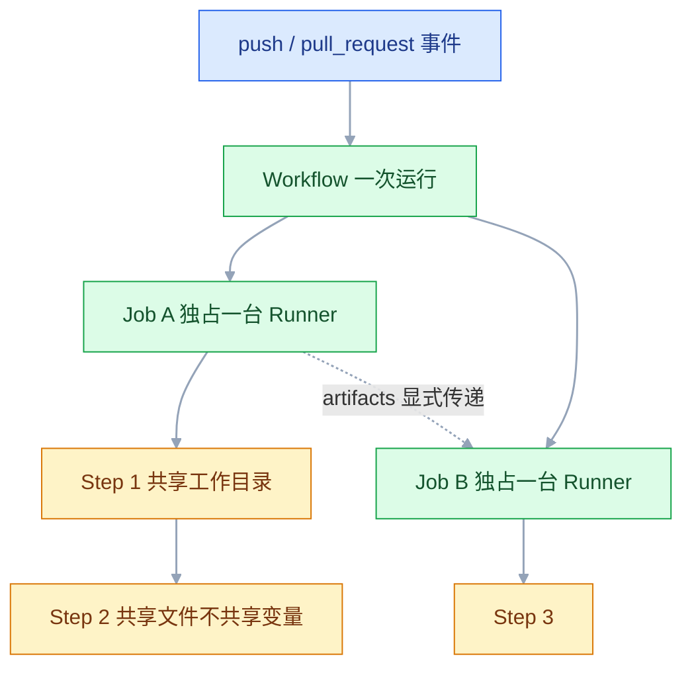

# GitHub 自动化平台

## 一、工程案例：给 order-service 配一条带矩阵测试与 GHCR 发布的流水线

**场景**：`order-service`（Spring Boot 3 / Java 17）托管在 GitHub，开源仓库；线上是一台云服务器（Ubuntu + Docker Compose）。镜像推 GHCR，推 `v*` tag 时创建 Release 并附 jar。

**需求**：PR 上跑 JDK 17 与 21 的矩阵测试；合并 main 构建镜像并 SSH 部署；推 tag 发版；全过程用 `GITHUB_TOKEN`，不额外配镜像仓库密钥。

### 1.1 workflow

```yaml
# .github/workflows/ci.yml
name: CI/CD

on:
  push:
    branches: [main]
    tags: ['v*']
  pull_request:
    branches: [main]
  workflow_dispatch:

permissions:
  contents: read

concurrency:
  group: ci-${{ github.workflow }}-${{ github.ref }}
  cancel-in-progress: true

env:
  REGISTRY: ghcr.io
  IMAGE_NAME: ${{ github.repository }}

jobs:
  test:
    name: Test (JDK ${{ matrix.java }})
    runs-on: ubuntu-24.04
    timeout-minutes: 20
    strategy:
      fail-fast: false
      matrix:
        java: ['17', '21']
    steps:
      - uses: actions/checkout@v4
      - uses: actions/setup-java@v4
        with:
          java-version: ${{ matrix.java }}
          distribution: temurin
          cache: maven
      - run: mvn -B test
      - name: 上传测试报告
        if: always()
        uses: actions/upload-artifact@v4
        with:
          name: test-reports-jdk${{ matrix.java }}
          path: target/surefire-reports/
          retention-days: 7

  build:
    needs: test
    if: github.ref == 'refs/heads/main' || startsWith(github.ref, 'refs/tags/v')
    runs-on: ubuntu-24.04
    steps:
      - uses: actions/checkout@v4
      - uses: actions/setup-java@v4
        with:
          java-version: '17'
          distribution: temurin
          cache: maven
      - run: mvn -B package -DskipTests
      - name: 读取版本号
        id: version
        run: echo "value=$(mvn help:evaluate -Dexpression=project.version -q -DforceStdout)" >> "$GITHUB_OUTPUT"
      - uses: actions/upload-artifact@v4
        with:
          name: app-jar
          path: target/*.jar
          retention-days: 7
          if-no-files-found: error
    outputs:
      version: ${{ steps.version.outputs.value }}

  docker:
    needs: build
    if: github.ref == 'refs/heads/main' || startsWith(github.ref, 'refs/tags/v')
    runs-on: ubuntu-24.04
    permissions:
      contents: read
      packages: write
    steps:
      - uses: actions/checkout@v4
      - name: 镜像路径必须全小写
        id: prep
        run: echo "image=${IMAGE_NAME,,}" >> "$GITHUB_OUTPUT"
      - uses: docker/setup-buildx-action@v3
      - uses: docker/login-action@v3
        with:
          registry: ${{ env.REGISTRY }}
          username: ${{ github.actor }}
          password: ${{ secrets.GITHUB_TOKEN }}
      - id: meta
        uses: docker/metadata-action@v5
        with:
          images: ${{ env.REGISTRY }}/${{ steps.prep.outputs.image }}
          tags: |
            type=sha,prefix=git-
            type=ref,event=branch
            type=semver,pattern={{version}}
            type=raw,value=latest,enable={{is_default_branch}}
      - uses: docker/build-push-action@v6
        with:
          context: .
          push: true
          tags: ${{ steps.meta.outputs.tags }}
          labels: ${{ steps.meta.outputs.labels }}
          build-args: |
            GIT_COMMIT=${{ github.sha }}
          cache-from: type=gha
          cache-to: type=gha,mode=max

  deploy:
    needs: docker
    if: github.ref == 'refs/heads/main'
    runs-on: ubuntu-24.04
    environment: production
    concurrency:
      group: deploy-production
      cancel-in-progress: false
    steps:
      - name: 计算镜像地址
        id: prep
        run: echo "image=ghcr.io/${GITHUB_REPOSITORY,,}:git-${GITHUB_SHA}" >> "$GITHUB_OUTPUT"
      - uses: appleboy/ssh-action@v1
        env:
          IMAGE: ${{ steps.prep.outputs.image }}
        with:
          host: ${{ secrets.SSH_HOST }}
          username: ${{ secrets.SSH_USER }}
          key: ${{ secrets.SSH_PRIVATE_KEY }}
          envs: IMAGE
          script: |
            /opt/order-service/deploy.sh "$IMAGE"

  release:
    needs: docker
    if: startsWith(github.ref, 'refs/tags/v')
    runs-on: ubuntu-24.04
    permissions:
      contents: write
    steps:
      - uses: actions/checkout@v4
      - uses: actions/download-artifact@v4
        with:
          name: app-jar
          path: dist/
      - run: |
          mv dist/*.jar "dist/order-service-${GITHUB_REF_NAME}.jar"
          ls -lh dist/
      - uses: softprops/action-gh-release@v2
        with:
          tag_name: ${{ github.ref_name }}
          generate_release_notes: true
          files: dist/*.jar
```

`docker` 与 `release` 都直接或间接依赖 `build`；`release` 的 jar 来自 `build` 的 artifact，同一 run 内可以跨 Job 按名字下载。

> GHCR 的镜像路径只接受小写。仓库名含大写字母时，`github.repository` 会原样带进去，推送报 `invalid reference format`；在 Job 里先用 `tr '[:upper:]' '[:lower:]'` 转成小写再拼镜像地址。

### 1.2 部署脚本

服务器上 `/opt/order-service/deploy.sh` 与 `.env`、`compose.yaml`。脚本接收完整镜像地址，记录旧值、更新、探活、失败切回：

```bash
#!/usr/bin/env bash
set -euo pipefail
IMAGE="$1"; APP_DIR="/opt/order-service"; ENV_FILE="$APP_DIR/.env"

# 回滚还原整个 env 文件，而不是只改 APP_IMAGE 一行：
# 否则改错库地址或端口后，旧镜像仍然连错库，健康检查照样失败
cp "$ENV_FILE" "$ENV_FILE.prev"
sed -i "s|^APP_IMAGE=.*|APP_IMAGE=$IMAGE|" "$ENV_FILE"
cd "$APP_DIR"
docker compose --env-file "$ENV_FILE" pull app
docker compose --env-file "$ENV_FILE" up -d app

for i in $(seq 1 30); do
  curl -sf http://localhost:8080/actuator/health | grep -q '"status":"UP"' && exit 0
  sleep 2
done

cp "$ENV_FILE.prev" "$ENV_FILE"
docker compose --env-file "$ENV_FILE" up -d app
exit 1
```

### 1.3 运行结果

```text
# PR
CI/CD #23  pull_request  a1b2c3d  passed
  Test (JDK 17)   1m 42s
  Test (JDK 21)   1m 45s
  Build Jar       1m 10s
  Docker Image    skipped
  Deploy          skipped
  Release         skipped

# 合并 main
CI/CD #24  push main  b2c3d4e  passed
  Test × 2 → Build Jar → Docker Image 1m 55s → Deploy 18s

# 推 tag
CI/CD #25  push v1.0.0  c3d4e5f  passed
  Docker Image 推了 1.0.0 与 git-c3d4e5f
  Deploy skipped（不是 main）
  Create Release  passed
```

### 1.4 验收

| # | 检查 | 命令或操作 | 通过标准 |
|---|---|---|---|
| 1 | 矩阵生效 | 打开 PR 的 Actions 页面 | 两个 Test Job，JDK 17 与 21 |
| 2 | 测试失败可见 | 故意让一个用例失败 | 对应矩阵项红，PR 显示检查失败 |
| 3 | 制品可下载 | 运行页底部 Artifacts | 有 `app-jar`，能解压出 jar |
| 4 | 镜像标签完整 | `docker manifest inspect ghcr.io/owner/order-service` | 有 `git-<sha>`、`1.0.0`、`latest` |
| 5 | 部署仅 main | 在 PR 上 push | Deploy Job 为 skipped |
| 6 | 环境审批 | 给 production 配 Required reviewers | Deploy 停在 Waiting for review |
| 7 | Release 有附件 | 推 `v1.0.0` | Releases 页面有 jar 附件 |
| 8 | 权限最小 | 运行日志无 403 | docker Job 只有 `packages: write` |

## 二、高频问答：会卡住你的地方，也是面试最常问的

### 2.1 下一个 Job 找不到上一个 Job 生成的文件

**现场**

在下一个 Job 里 `ls -la` 看工作目录，确认文件确实不在。

```yaml
- uses: actions/upload-artifact@v4
  with: { name: app-jar, path: target/*.jar }
# 下游
- uses: actions/download-artifact@v4
  with: { name: app-jar, path: dist/ }
```

**要点**

- 每个 Job 跑在独立的虚拟机上，文件系统不共享，上一步的文件不会自己出现在下一个 Job。
- 只有同一 Job 的 step 共享工作目录，跨 Job 必须用 artifact 显式传递。
- 把原因归到「上一步没生成文件」，通常白改一轮构建脚本。

**追问**

- 为什么同 Job 的 step 能看到？→ 同一台 Runner、同一个工作目录。
- artifact 能长期当发布物吗？→ 有保留期，发布物应进 Release 或制品库。
- 大文件也走 artifact 吗？→ 镜像推仓库，不传 tar。

### 2.2 SSH 部署时远端变量是空的

**现场**

在远端脚本里 `echo "image=[$IMAGE]"`，看方括号里是否为空。

```yaml
env:
  IMAGE: ghcr.io/${{ github.repository }}:git-${{ github.sha }}
with:
  envs: IMAGE
```

**要点**

- `env:` 的值只在 runner 上，`script:` 在远端 shell 执行，那里没有 `github.*` 上下文。
- 跨 SSH 的变量必须用 `envs:` 显式列出来，否则远端看到的是空字符串。
- 这和 Secret 配没配无关，是执行位置不同。

**追问**

- Secret 能直接写进 script 吗？→ 同样不行，也要经 `envs` 传。
- 远端要读 commit 号怎么办？→ 在 runner 上算好，作为变量传过去。
- 为什么本地手跑脚本是好的？→ 本地 shell 里变量本来就在。

### 2.3 `Resource not accessible by integration`

**现场**

看报错出现在哪个 API 调用，再对照该 Job 的 `permissions`。

```yaml
permissions:
  contents: write     # 建 Release
  packages: write     # 推 GHCR
```

**要点**

- 不是 GitHub 权限系统故障，是 `GITHUB_TOKEN` 权限不够。
- 顶层 `permissions` 收成 `contents: read` 后，Job 没给自己提权就调不动写接口。
- 顶层收窄、Job 按需提权，是唯一可维护的写法。

**追问**

- 顶层不写 `permissions` 呢？→ 用仓库默认权限，可能过宽。
- 为什么 Job 里还要再写一遍？→ Job 级是在顶层基础上按需给。
- 报错为什么看不出缺哪个权限？→ 它只说这个集成没权限，要自己对 API 和配置。

### 2.4 来自 fork 的 PR 拿不到 secrets

**现场**

看 PR 是否来自 fork；在 step 里 `env | grep SECRET` 为空。

**要点**

- fork 的 PR 不注入 secrets、也不给写权限，这是安全设计，不是名字写错。
- 想让 fork 代码参与部署，等于把密钥交给任意提交者，不能靠改触发器绕过。
- 尤其不能用 `pull_request_target` 检出 PR 代码，那正是这条防线的反面。

**追问**

- `pull_request_target` 危险在哪？→ 它能拿 secrets，又能检出 PR 代码。
- fork 贡献者怎么跑测试？→ 只跑不需要 secrets 的只读 CI。
- 内部分支的 PR 受影响吗？→ 不受，同一仓库的分支正常注入。

### 2.5 定时任务在北京时间凌晨跑错，或者干脆不跑

**现场**

看最近一次运行时间；到 Actions 页面确认 workflow 是否被 disabled。

```yaml
schedule:
  - cron: '0 18 * * *'    # UTC 18:00 = 北京时间次日 02:00
```

**要点**

- `schedule` 只认 UTC，北京时间要减 8 小时写。
- 仓库连续 60 天无活动，定时任务会被自动暂停，不是 cron 写错。
- 被暂停后要有一次活动或手动 enable 才会恢复。

**追问**

- cron 能写时区吗？→ 不能，只能在表达式里换算。
- 为什么刚配的定时任务没立刻跑？→ 它按下一个整点周期触发，不会补跑。
- 手动触发会占用额度吗？→ 会，和普通运行一样计费。

### 2.6 缓存一直不命中

**现场**

日志里搜 `Cache restored from key` 与 `Cache not found`。

```yaml
key: ${{ runner.os }}-maven-${{ hashFiles('**/pom.xml') }}
restore-keys: |
  ${{ runner.os }}-maven-
```

**要点**

- key 里带了每次都变的字段（`run_id`、`github.sha`），等于每次都新建缓存。
- 缓存的路径与工具实际使用的路径不一致，也永远命不中。
- `restore-keys` 是前缀降级，精确 key 没命中时恢复最近一个同前缀缓存。

**追问**

- 缓存能跨分支用吗？→ 仓库级共享，分支之间可能串味。
- 为什么 CI 里第一次总是慢？→ 干净环境，没有历史缓存。
- 缓存会一直留着吗？→ 超限按 LRU 淘汰。

### 2.7 上传制品报同名冲突或下载不到

**现场**

报错含 `an artifact with this name already exists`。

```yaml
name: test-reports-jdk${{ matrix.java }}
```

**要点**

- `upload-artifact@v4` 不允许同一 run 内出现同名 artifact。
- 矩阵 Job 用了同一个 `name`，几个组合会互相覆盖或直接报冲突。
- v3 到 v4 是破坏性升级，语法和并发行为都变了，不能只改版本号。

**追问**

- 为什么下载到的是另一个组合的报告？→ 同名 artifact 被合并或覆盖。
- 怎么让名字稳定又可区分？→ 固定前缀加 matrix 值。
- 重跑能解决吗？→ 同 run 内不行，要改名字。

### 2.8 SSH 报 `error in libcrypto`

**现场**

本地还原后跑 `ssh-keygen -y -f`。

```bash
printf '%s' "$SSH_PRIVATE_KEY" | tr -d '\r' > /tmp/k
chmod 600 /tmp/k && ssh-keygen -y -f /tmp/k >/dev/null && echo ok
```

**要点**

- 私钥粘贴不完整，缺 BEGIN/END 行，或混进了 `\r`。
- 报错看着像加密库问题，实际是密钥内容不合法。
- 从 Windows 或网页复制最容易带进 CRLF。

**追问**

- 为什么服务器密钥没换也会报这个？→ 报错在解析私钥，不在握手。
- 怎么一次性排除换行问题？→ 写入前统一 `tr -d '\r'`。
- 权限也要管吗？→ 要，私钥文件必须是 600。

### 2.9 旧提交的部署覆盖了新提交

**现场**

对比部署记录里的 commit 与当前 main 的 HEAD。

```yaml
concurrency:
  group: deploy-production
  cancel-in-progress: false    # 部署不取消，只排队
```

**要点**

- 两次运行并发，后启动的旧流水线最后完成，把新版本覆盖了。
- 部署 Job 要用独立 group 且 `cancel-in-progress: false`，只排队不取消。
- 对部署用 `true` 会取消正在执行的部署，留下半完成状态。

**追问**

- 全局 `concurrency` 不够吗？→ 会和 CI 抢同一把锁，互相取消。
- 为什么服务器时钟不是原因？→ 部署顺序由流水线完成时间决定。
- 排队久了怎么办？→ 收窄触发条件，别让每次 push 都部署。

### 2.10 推 tag 没有触发 workflow

**现场**

看 workflow 的 `on` 段与这次 push 的 ref。

```yaml
on:
  push:
    branches: [main]
    tags: ['v*']
```

**要点**

- `branches` 只匹配分支 push，不匹配 tag；只写它就不会响应 tag。
- `paths` 过滤对 tag 也不生效。
- 同时写 `branches` 与 `tags` 是并集，不是交集。

**追问**

- 只写 `tags` 呢？→ 分支 push 反而不触发。
- tag 上想按路径过滤怎么办？→ 不支持，只能在 Job 里用 `if` 判断。
- `workflow_dispatch` 能补吗？→ 能手动跑，但不解决自动触发。

### 2.11 服务器拉 GHCR 私有镜像 403

**现场**

在服务器上手动 `docker pull`，看返回的是 `denied` 还是 `manifest unknown`。

```bash
echo "$PAT" | docker login ghcr.io -u <用户名> --password-stdin
docker pull ghcr.io/owner/order-service:1.0.0
```

**要点**

- `denied` 是权限：服务器没登录，或 PAT 缺少 `read:packages`。
- `manifest unknown` 是标签或仓库不存在，和权限无关。
- 包的可见性仍是 private 时，匿名拉取也会 denied。

**追问**

- 为什么 CI 里能推、服务器拉不了？→ 用的令牌和作用域不同。
- `GITHUB_TOKEN` 能拿去服务器用吗？→ 不能，它只在这次运行内有效。
- 怎么区分是没登录还是没权限？→ 先 `docker login` 再拉一次。

### 2.12 上一步 `export` 的变量，下一步读不到

**现场**

下一步 `echo "$FOO"` 输出为空。

```bash
echo "FOO=bar" >> "$GITHUB_ENV"      # 后续 step 可见
echo "out=value" >> "$GITHUB_OUTPUT" # 同 Job 内按 id 读取
```

**要点**

- 每个 step 是独立的 shell 进程，`export` 只影响当前进程。
- 跨 step 传值写 `$GITHUB_ENV`，带名字的输出写 `$GITHUB_OUTPUT` 再按 id 读。
- 别把「变量名拼错」当第一嫌疑，先确认作用域。

**追问**

- 为什么 `GITHUB_ENV` 能跨 step？→ runner 读文件后注入后续 step 的环境。
- 跨 Job 怎么传？→ Job outputs 加下游 `needs`。
- 密钥也能这么传吗？→ 不能，敏感值走 secrets，不要落文件。

## 三、核心知识：从零开始要建立的东西

### 3.1 workflow / job / step 的边界

| 层级 | 隔离 | 共享 | 生命周期 |
|---|---|---|---|
| Workflow | 一次触发 | 无 | 一次运行 |
| Job | 一台 Runner 虚拟机 | 无，需 artifacts | 分钟级 |
| Step | 一个 shell 进程 | 工作目录、`GITHUB_ENV` | 秒级 |



step 之间共享文件系统，但不共享 shell 变量；Job 之间连文件系统都不共享。理解这两层隔离，大半「文件丢了」「变量没了」的问题自然消失。

> **面试**：常问「Workflow、Job、Step 之间的隔离和共享关系是什么？」答：Step 共享工作目录不共享变量，Job 各占一台 Runner 连文件都不共享，跨 Job 只能走 artifact。

### 3.2 触发器的匹配语义

| 写法 | 匹配 | 坑 |
|---|---|---|
| `branches: [main]` | 只匹配分支 push | 不匹配 tag |
| `tags: ['v*']` | 只匹配 tag push | 不匹配分支 |
| 同时写 branches 与 tags | 两者取并集 | 容易误以为有交集 |
| `paths: ['src/**']` | 只有改动这些路径才触发 | 对 tag 不生效 |
| `pull_request` | PR 打开、同步、重开 | fork PR 无 secrets |

`workflow_dispatch` 可以配 `inputs`，适合做「选环境、填版本」的手动发布入口。

### 3.3 上下文的可用范围

| 上下文 | 典型字段 | 注意 |
|---|---|---|
| `github` | `sha`、`ref`、`ref_name`、`event_name` | `ref` 带 `refs/heads/` 前缀 |
| `env` | 自定义变量 | 不能在 Job 级 `if` 里用 |
| `secrets` | 仓库/环境密钥 | 不能用在 `if` 里 |
| `needs` | 上游 Job 的 outputs | 必须先声明 `needs` |
| `steps` | 同 Job 内 step 的 outputs | 需要给 step 设 `id` |
| `runner` | `os`、`arch` | 用于条件分支 |

`if:` 里不写 `${{ }}` 也能工作；但 `run:` 里的 `${{ }}` 在 runner 上先展开，再交给 shell。

### 3.4 表达式与 shell 的边界

```yaml
- run: echo "${{ github.sha }}"      # 表达式先展开，shell 只看到值
- run: echo '${{ github.sha }}'      # 单引号也拦不住，展开发生在之前
- run: echo "$GITHUB_SHA"            # 用环境变量，最稳
```

用户可控的值（PR 标题、分支名、issue 内容）不要直接插进 `run:`，会形成脚本注入。放进 `env:` 再用 `"$VAR"` 引用。

### 3.5 矩阵展开

```yaml
strategy:
  fail-fast: false
  matrix:
    java: ['17', '21']
    os: [ubuntu-24.04]
    exclude:
      - java: '21'
        os: windows-latest
    include:
      - java: '17'
        os: ubuntu-24.04
        experimental: true
```

矩阵按笛卡尔积展开成多个 Job，每个组合一台机器。`fail-fast: false` 让一个组合失败不影响其他组合跑完，适合排查兼容性问题；追求快速反馈时保持默认 `true` 更省额度。

### 3.6 缓存键设计

| key 组成 | 命中率 | 风险 |
|---|---|---|
| `runner.os` + 依赖文件哈希 | 高 | 依赖文件一变就重建 |
| 只写固定字符串 | 最高 | 不同分支互相污染 |
| 带 `github.sha` | 零 | 每次都是新 key |
| 带 `hashFiles('**/pom.xml')` | 高 | 多模块项目要确认 glob 覆盖 |

`restore-keys` 是前缀降级：精确 key 没命中时，恢复最近一个同前缀的缓存。它提高命中率，也意味着可能拿到过期依赖。

### 3.7 制品的传递

| 需求 | 手段 |
|---|---|
| 同 Job 内传文件 | 直接写工作目录 |
| 跨 Job 传文件 | `upload-artifact` / `download-artifact` |
| 跨 workflow 传文件 | Release 附件、包仓库、对象存储 |
| 传测试报告 | artifact 加 `retention-days` |
| 传镜像 | 推镜像仓库，不传 tar |

artifact 有保留期，过期即删。需要长期保存的发布物应进 Release 或制品库，而不是依赖 artifact。

### 3.8 GITHUB_TOKEN 与 permissions

`GITHUB_TOKEN` 是每次运行自动签发的短期令牌，Job 结束即失效。权限由 `permissions` 控制：

```yaml
permissions:
  contents: read        # 顶层最小化
jobs:
  release:
    permissions:
      contents: write   # 按 Job 提权
```

| 权限 | 用途 |
|---|---|
| `contents: read/write` | 读代码、建 Release、改仓库内容 |
| `packages: write` | 推 GHCR |
| `id-token: write` | 申请 OIDC 令牌 |
| `pull-requests: write` | 评论 PR |
| `actions: write` | 管理 workflow 运行 |

顶层收窄、Job 按需提权，是唯一可维护的写法。仓库设置里的默认权限是「宽松」时，不写 `permissions` 等于给令牌过多权限。

> **面试**：常问「为什么要顶层收窄 permissions、Job 再按需提权？」答：GITHUB_TOKEN 每次运行自动签发，权限过大等于把写仓库的能力交给任意 step。

### 3.9 OIDC 短期凭据


```yaml
permissions:
  id-token: write
  contents: read
steps:
  - uses: aws-actions/configure-aws-credentials@v4
    with:
      role-to-assume: arn:aws:iam::123456789012:role/github-deploy
      aws-region: ap-southeast-1
```

信任策略要限定 `repo:org/repo:ref:refs/heads/main`，否则任何分支都能Assume。OIDC 的价值是消除长期 AK，不是省一次配置。

### 3.10 Environment 审批

```yaml
deploy:
  environment:
    name: production
    url: https://shop.example.com
```

Environment 有三个能力：审批人、等待计时器、环境级 secrets。引用后 Job 会停在 `Waiting for review`，批准才继续。它解决的是「谁批准」，不解决「批准后怎么部署」。

环境级 secrets 只对引用该环境的 Job 可见，比仓库级 secrets 范围更小，生产密钥应放这里。

### 3.11 自建 Runner 的隔离

| 方式 | 隔离 | 适用 |
|---|---|---|
| GitHub 托管 | 每次全新 VM | 绝大多数场景 |
| 自建 `self-hosted` | 取决于机器，默认复用 | 内网、大机器、特殊硬件 |
| ARC（K8s 上自建） | 每次一个 Pod | 已有 K8s、需要弹性 |

自建 Runner 不会自动清理工作目录，也不会自动隔离不同仓库的 Job。跑不受信任的代码前，必须做到一次性容器或独立机器。

### 3.12 并发控制

`concurrency` 的 group 是锁的名字，同一 group 同时只允许一个运行：

| 场景 | group | cancel-in-progress |
|---|---|---|
| PR 测试 | `ci-${{ github.ref }}` | true |
| 生产部署 | `deploy-production` | false |
| 发布 | `release` | false |

对部署用 `true`，会在新提交到来时取消正在执行的部署，留下半完成状态。部署应该排队，不该被取消。

> **面试**：常问「部署流水线的 concurrency 该怎么配？」答：独立 group、cancel-in-progress 为 false，只排队不取消，否则会留下半完成状态。

### 3.13 Action 的版本固定

| 写法 | 可复现 | 安全性 |
|---|---|---|
| `@v4` | 跟随大版本，可能漂移 | 中 |
| `@v4.1.2` | 固定小版本 | 较高 |
| `@<完整 commit sha>` | 完全固定 | 最高 |

大版本标签会移动，这是 Action 作者修 bug 的方式。高安全场景固定到 commit sha，并用 Dependabot 提 PR 升级。第三方 Action 等于把仓库密钥交给对方的代码，选之前看维护者和权限。

### 3.14 运行成本结构

| 因素 | 影响 |
|---|---|
| 仓库可见性 | 公开仓库通常不计费，私有仓库按套餐给额度 |
| 操作系统 | macOS 单价最高，Windows 次之，Linux 最低 |
| 矩阵规模 | 组合数直接乘时长 |
| 缓存 | 命中则省下载时间，不省 Runner 时间 |
| 并发 | 不加速单个 Job，只缩短总排队 |

省额度的顺序：限制触发分支、加 `timeout-minutes`、用 `concurrency` 取消旧运行、缩小矩阵、把重活放到自建 Runner。

### 3.15 复用方式

| 方式 | 复用粒度 | 适用 |
|---|---|---|
| Composite Action | 一组 step | 同一仓库或公开复用 |
| Reusable Workflow | 整个 workflow | 组织内多仓库 |
| 自己写脚本 | 任意 | 逻辑复杂、需要单测 |

Reusable Workflow 用 `uses: org/repo/.github/workflows/build.yml@main`，被调用方拿不到调用方的 secrets，需要显式 `secrets: inherit`。复用越多，调试链路越长，小团队优先用脚本。

## 四、冷门知识汇总

| 知识点 | 为什么冷门 | 用到时的关键词 |
|---|---|---|
| `GITHUB_TOKEN` 不能触发新 workflow | 防递归设计，报错不明显 | workflow_dispatch、PAT |
| `pull_request_target` 的危险性 | 它能拿 secrets，也能检出 PR 代码 | 安全审计、fork PR |
| 合并队列 | 多个 PR 依次验证后合并 | merge queue |
| 必需状态检查 | 分支保护要求特定 Job 绿 | required status checks |
| OIDC 信任策略的 ref 限制 | 只配 role 不配条件等于全开放 | `sub` 条件、`repo:org/repo:ref` |
| 环境级 secrets 的作用域 | 只在引用 environment 的 Job 可见 | environment secrets |
| 自建 Runner 的标签路由 | `runs-on: [self-hosted, linux, gpu]` | runner labels |
| 缓存的作用域与淘汰 | 仓库级共享，超限按 LRU 淘汰 | cache scope、10 GB 限制 |
| Artifact 的计费 | 存储和流量都算用量 | retention-days、artifact storage |
| `act` 本地调试 | 只能模拟一部分事件和上下文 | `act push`、`act -j build` |
| 工作流文件的语法校验 | 推上去才发现 YAML 错 | `actionlint` |
| 计划任务的时区 | 只支持 UTC | `cron`、schedule |
| 依赖缓存与锁文件 | `cache: maven` 依赖 pom，不认 gradle.lock | `hashFiles` |
