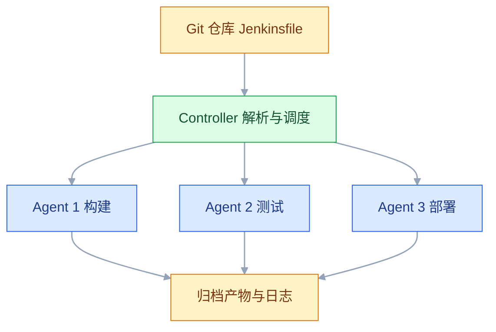

# Jenkins 自动化平台

## 一、工程案例：用 Docker 起 Jenkins，为 order-service 写一条声明式 Pipeline

**场景**：`order-service`（Spring Boot 3 / Java 17），代码在内网 GitLab；一台 Ubuntu 构建机跑 Jenkins（Docker）；Harbor 私有仓库；部署机 `192.168.1.20` 用 Docker Compose 运行。

**需求**：拉代码、Maven 构建测试、构建镜像推 Harbor、SSH 部署、失败通知。Jenkinsfile 提交进仓库，构建环境用容器，不在宿主机装 JDK。

### 1.1 启动 Jenkins

```bash
sudo mkdir -p /var/jenkins_home
sudo chown -R 1000:1000 /var/jenkins_home

docker run -d --name jenkins --restart always \
  -p 8080:8080 -p 50000:50000 \
  -v /var/jenkins_home:/var/jenkins_home \
  -v /var/run/docker.sock:/var/run/docker.sock \
  --group-add "$(getent group docker | cut -d: -f3)" \
  -e TZ=Asia/Shanghai \
  jenkins/jenkins:lts-jdk17
```

> 镜像标签以 Docker Hub 当前 LTS 为准；JDK 17 与 21 的 LTS 标签都曾长期维护，升级前先看官方标签说明。
>
> 不需要 `-u root`：Jenkins 容器内的默认用户已经能写 `/var/jenkins_home`；要访问宿主 docker，用 `--group-add` 把宿主机 docker 组的 GID 加进来即可。以 root 运行会让构建脚本拿到更高权限，与挂 socket 的风险叠加。挂 socket 本身已使容器拥有宿主机 root 等价权限，这一点必须显式知情。

```bash
docker exec jenkins cat /var/jenkins_home/secrets/initialAdminPassword
```

初始化时选 **Install suggested plugins**，再补装 Docker Pipeline、GitLab、Generic Webhook Trigger、Pipeline: Stage View、Workspace Cleanup。国内插件下载慢，可在 Manage Jenkins → Plugins → Advanced settings 把更新站点换成清华镜像。

`-v /var/jenkins_home` 是唯一不能省的一行：镜像、Job、凭据、构建历史全在里面，容器删了数据还在。挂 docker socket 让 Pipeline 能调用宿主 docker，代价是容器内拥有宿主 root 等价权限。

### 1.2 凭据与部署脚本

| ID | 类型 | 内容 |
|---|---|---|
| `harbor-cred` | Username with password | Harbor 机器人账号 |
| `deploy-key` | SSH Username with private key | 部署用户与私钥 |
| `notify-webhook` | Secret text | 钉钉或企业微信机器人地址 |

```bash
ssh-keygen -t ed25519 -C "jenkins-deploy" -f ~/.ssh/jenkins_deploy -N ""
ssh-copy-id -i ~/.ssh/jenkins_deploy.pub root@192.168.1.20
```

部署机 `/opt/order-service/deploy.sh` 与 GitLab/GitHub 场景同构，区别是接收两个参数（镜像 + 环境名），按环境读不同的 `.env.<环境>`：记录旧值、更新文件、`docker compose up -d app`、探活、失败整体还原。

```bash
#!/usr/bin/env bash
set -euo pipefail
IMAGE="$1"; ENV_NAME="$2"; APP_DIR="/opt/order-service"; ENV_FILE="$APP_DIR/.env.$ENV_NAME"

# 回滚还原整个 env 文件：只改 APP_IMAGE 无法修复被改错的库地址或端口
cp "$ENV_FILE" "$ENV_FILE.prev"
sed -i "s|^APP_IMAGE=.*|APP_IMAGE=$IMAGE|" "$ENV_FILE"
cd "$APP_DIR"
docker compose --env-file "$ENV_FILE" pull app
docker compose --env-file "$ENV_FILE" up -d app

for i in $(seq 1 30); do
  curl -sf http://localhost:8080/actuator/health | grep -q '"status":"UP"' && exit 0
  sleep 2
done

cp "$ENV_FILE.prev" "$ENV_FILE"
docker compose --env-file "$ENV_FILE" up -d app
exit 1
```

### 1.3 Jenkinsfile

```groovy
pipeline {
    agent any

    options {
        timestamps()
        timeout(time: 30, unit: 'MINUTES')
        buildDiscarder(logRotator(numToKeepStr: '20', artifactNumToKeepStr: '5'))
        disableConcurrentBuilds()
        skipDefaultCheckout(true)
    }

    triggers {
        // 对应 1.4 的 Webhook 地址，token 必须一致
        GenericTrigger(
            genericVariables: [[key: 'ref', value: '$.ref']],
            token: 'order-service-token',
            causeString: 'Triggered by GitLab push',
            printContributedVariables: false,
            printPostContent: false,
            regexpFilterText: '$ref',
            regexpFilterExpression: 'refs/heads/main'
        )
    }

    parameters {
        choice(name: 'ENV', choices: ['test', 'prod'], description: '目标环境')
        booleanParam(name: 'SKIP_TESTS', defaultValue: false, description: '跳过测试')
    }

    environment {
        HARBOR_REGISTRY = 'harbor.example.com'
        IMAGE_NAME      = 'harbor.example.com/apps/order-service'
    }

    stages {
        stage('Checkout') {
            steps {
                checkout scm
                script {
                    env.GIT_SHA = sh(script: 'git rev-parse --short=7 HEAD', returnStdout: true).trim()
                    env.IMAGE_TAG = "build-${env.BUILD_NUMBER}-git-${env.GIT_SHA}"
                }
                sh 'git log -1 --pretty=format:"%h %s"'
            }
        }

        stage('Build & Test') {
            agent {
                docker {
                    image 'maven:3.9-eclipse-temurin-17'
                    args '-v /var/jenkins_home/.m2:/root/.m2 -e TZ=Asia/Shanghai'
                    reuseNode true
                }
            }
            steps {
                sh "mvn -B -s ci/settings.xml clean package ${params.SKIP_TESTS ? '-DskipTests' : ''}"
            }
            post {
                always {
                    junit allowEmptyResults: true, testResults: 'target/surefire-reports/*.xml'
                }
            }
        }

        stage('Docker Build & Push') {
            steps {
                withCredentials([usernamePassword(
                        credentialsId: 'harbor-cred',
                        usernameVariable: 'HARBOR_USER',
                        passwordVariable: 'HARBOR_PASS')]) {
                    sh '''
                        set -e
                        echo "$HARBOR_PASS" | docker login "$HARBOR_REGISTRY" -u "$HARBOR_USER" --password-stdin
                        docker build --build-arg GIT_COMMIT="$GIT_SHA" -t "$IMAGE_NAME:$IMAGE_TAG" .
                        docker push "$IMAGE_NAME:$IMAGE_TAG"
                    '''
                }
            }
        }

        stage('Approve') {
            when { expression { params.ENV == 'prod' } }
            steps {
                input message: "确认发布 ${IMAGE_TAG} 到生产?", ok: 'Deploy', submitter: 'ops'
            }
        }

        stage('Deploy') {
            steps {
                withCredentials([sshUserPrivateKey(
                        credentialsId: 'deploy-key',
                        keyFileVariable: 'SSH_KEY',
                        usernameVariable: 'SSH_USER')]) {
                    sh '''
                        set -e
                        ssh -i "$SSH_KEY" -o StrictHostKeyChecking=yes \
                          "$SSH_USER"@192.168.1.20 \
                          "/opt/order-service/deploy.sh $IMAGE_NAME:$IMAGE_TAG $ENV"
                    '''
                }
            }
        }

        stage('Verify') {
            steps {
                sh '''
                    for i in $(seq 1 15); do
                      curl -sf http://192.168.1.20:8080/actuator/health | grep -q '"status":"UP"' \
                        && { echo "远程验证通过"; exit 0; }
                      sleep 5
                    done
                    echo "远程验证失败"; exit 1
                '''
            }
        }
    }

    post {
        always {
            archiveArtifacts artifacts: 'target/*.jar', allowEmptyArchive: true, fingerprint: true
        }
        failure {
            script {
                try {
                    withCredentials([string(credentialsId: 'notify-webhook', variable: 'WEBHOOK')]) {
                        sh '''
                            curl -s -X POST -H 'Content-Type: application/json' \
                              -d "{\\"msgtype\\":\\"text\\",\\"text\\":{\\"content\\":\\"[构建失败] $JOB_NAME #$BUILD_NUMBER $BUILD_URL\\"}}" \
                              "$WEBHOOK" || true
                        '''
                    }
                } catch (e) {
                    echo "未配置通知 webhook，跳过"
                }
            }
        }
        cleanup {
            cleanWs(deleteDirs: true, notFailBuild: true)
        }
    }
}
```

几个关键点：`skipDefaultCheckout(true)` 后必须自己 `checkout scm`；`reuseNode true` 让容器里的 stage 看到外层拉下来的代码；`mvn` 的 `.m2` 挂到宿主机，依赖跨构建保留；`input` 是生产门禁，`submitter` 限定审批角色。镜像标签在 Checkout 之后用 `git rev-parse` 生成，不能写在 `environment` 块里——那时还没拉代码，`GIT_COMMIT` 可能为空。

### 1.4 创建 Job 与 Webhook

1. New Item → 名称 `order-service` → **Pipeline**。
2. Definition 选 **Pipeline script from SCM**，SCM 选 Git，填仓库地址与凭据，Branch Specifier `*/main`，Script Path `Jenkinsfile`。
3. GitLab 项目 → Settings → Webhooks，URL 填：

```text
http://jenkins.example.com:8080/generic-webhook-trigger/invoke?token=order-service-token
```

勾选 Push events 与 Merge request events，保存后点 Test → Push events，期望返回 `HTTP 200`。

### 1.5 验收

| # | 检查 | 命令或操作 | 通过标准 |
|---|---|---|---|
| 1 | Jenkins 可访问 | 打开 `http://构建机:8080` | 登录页正常，无插件报错 |
| 2 | 首次构建 | Build with Parameters，ENV=test | 五个 stage 全绿 |
| 3 | 构建环境隔离 | 在 Build & Test 日志里执行 `java -version` | 是容器内的 JDK 17 |
| 4 | 测试报告 | 构建页 → Test Result | 有用例数和趋势图 |
| 5 | 凭据不泄露 | 搜 Console Output | 密码与私钥显示为 `****` |
| 6 | 镜像可追溯 | `docker inspect ...:build-15-git-a1b2c3d` | 标签含提交号 |
| 7 | 生产门禁 | ENV=prod 构建 | 停在 Approve，未批准不部署 |
| 8 | 部署可回滚 | 改坏目标机 `.env` 再发布 | 日志出现回滚，旧容器恢复 |
| 9 | Webhook 触发 | 向 main push 一次 | Jenkins 出现 `Started by GitLab push` |

## 二、高频问答：会卡住你的地方，也是面试最常问的

### 2.1 一直停在 `Waiting for next available executor`

**现场**

Manage Jenkins → Nodes 看在线状态与 executor 占用，再看 System Information 里的节点列表。

```groovy
agent { label 'docker && linux' }   // 要求同时具备两个标签
```

**要点**

- 不是 Jenkins 卡死，是 Job 要求的 label 没有节点匹配，或 executor 全被占满，或节点离线。
- 重启只会打断正在跑的构建，排队原因还在。
- 先分清「没有匹配的节点」和「节点在但忙」，处理方式完全不同。

**追问**

- `docker && linux` 是什么语义？→ 两个标签都要具备，缺一个就排不上。
- 节点在线却显示 0 个 executor？→ 该节点没配 executor 或被临时下线。
- 想让任务快点跑起来？→ 加节点或加 executor，不是重启。

### 2.2 docker agent 里看不到刚拉下来的代码

**现场**

在容器 stage 里 `pwd && ls -la`，看目录是否为空。

```groovy
agent {
    docker {
        image 'maven:3.9-eclipse-temurin-17'
        reuseNode true
    }
}
```

**要点**

- stage 级 docker agent 默认在新的 workspace 里启动，没有继承外层拉下来的代码。
- `reuseNode true` 让容器复用外层 node 的 workspace。
- 这是 Jenkins docker agent 最常见的一行配置，漏了就是空目录。

**追问**

- 不加会怎样？→ 容器里是空 workspace，`checkout` 的代码在另一个目录。
- 为什么本地看代码在、构建说找不到？→ 构建发生在容器里，不是宿主机。
- 多个 stage 都要写吗？→ 每个 docker agent stage 各自声明。

### 2.3 `docker: command not found`

**现场**

在对应 stage 里 `which docker`；在 Jenkins 容器里 `ls -l /var/run/docker.sock`。

```groovy
agent {
    docker {
        image 'docker:27-cli'
        args '-v /var/run/docker.sock:/var/run/docker.sock'
        reuseNode true
    }
}
```

**要点**

- 命令跑在 Job 容器里，容器镜像没有 docker CLI，宿主装了也没用。
- 宿主机 socket 没挂进 Jenkins 容器，CLI 有也连不上 daemon。
- 挂 socket 等于把宿主 root 等价权限给了容器，这一点要显式知情。

**追问**

- 宿主明明装了 Docker，为什么容器里找不到？→ 容器是独立文件系统。
- 只挂 socket 不装 CLI 行吗？→ 不行，命令本身就不存在。
- 有更安全的做法吗？→ 用独立构建节点，别把 socket 挂进主容器。

### 2.4 凭据在日志里是 `****`，登录仍然失败

**现场**

打印变量名而不是值：`echo "$HARBOR_USER"`，确认非空。

```groovy
environment {
    HARBOR = credentials('harbor-cred')
    // 实际变量是 HARBOR_USR 与 HARBOR_PSW
}
```

**要点**

- `credentials()` 对用户名密码类型生成 `<名字>_USR` / `<名字>_PSW`，变量名写错就取到空。
- 私钥末尾多了换行、凭据 ID 拼错，也会表现为「打码了但登录失败」。
- 打码只说明变量被识别，不代表值对。

**追问**

- 为什么日志里是 `****` 却还是错？→ 打码对象是变量，不是验证结果。
- 把密码拼进 URL 后为什么打码失效？→ 只匹配原值，编码或拼接后不再匹配。
- 怎么排查最快？→ 先确认变量非空，再确认账号本身能登。

### 2.5 插件升级后 Jenkins 起不来

**现场**

看 `docker logs jenkins` 里的 `Failed to load` 与版本号。

```bash
docker logs --tail 200 jenkins | grep -iE 'failed|incompatible|requires'
```

**要点**

- 插件依赖的核心版本高于当前 Jenkins，核心太老就加载不了。
- 两个插件依赖同一库的不同版本，类加载会冲突。
- Jenkins 的核心与插件是版本耦合的，不能当独立组件随便升。

**追问**

- 回滚 Jenkins 版本有用吗？→ 不一定，插件已经写进 `JENKINS_HOME`。
- 正确顺序是什么？→ 备份 → 测试实例升插件 → 验证兼容 → 生产换镜像。
- 怎么减少这类事故？→ 少装插件，锁定版本。

### 2.6 `JENKINS_HOME` 越用越大

**现场**

按目录看占用。

```bash
sudo du -sh /var/jenkins_home/* | sort -h | tail -10
```

```groovy
options {
    buildDiscarder(logRotator(numToKeepStr: '20', artifactNumToKeepStr: '5'))
}
post { cleanup { cleanWs() } }
```

**要点**

- 构建历史无限保留、workspace 不清理、旧产物不删，三者叠加才是根因。
- 换更大的磁盘只是推迟问题，增长曲线没变。
- `buildDiscarder` 管历史与归档，`cleanWs` 管 workspace，两件事都要配。

**追问**

- 归档的产物会随 workspace 清理吗？→ 不会，归档在别处，要靠保留数控制。
- 为什么清了 workspace 还是很大？→ 大头可能在 `jobs/*/builds`。
- 能直接删 builds 目录吗？→ 会破坏构建记录，用保留策略淘汰。

### 2.7 Webhook 配置了，push 后 Jenkins 没反应

**现场**

GitLab webhook 页面点 Test，看返回码与响应体。

```bash
curl -i -X POST "http://jenkins:8080/generic-webhook-trigger/invoke?token=order-service-token"
```

**要点**

- 网络不通、token 不匹配、URL 少了 `/generic-webhook-trigger/invoke`，都会没反应。
- `Connection refused` 是网络，`403` 是 token，`200` 但没构建是 Job 的过滤条件没匹配。
- Jenkins URL 配错还会导致回写状态失败，表面看像没触发。

**追问**

- 返回 200 为什么还不构建？→ `regexpFilterExpression` 没匹配这次 ref。
- 一定要公网暴露 Jenkins 吗？→ 至少要让 GitLab 能访问到这个 URL。
- 怎么快速定位是哪一层？→ 先 curl，再看 Jenkins 系统日志。

### 2.8 测试报告 404 或趋势图是空的

**现场**

在 stage 里 `ls target/surefire-reports`。

```groovy
junit allowEmptyResults: true, testResults: 'target/surefire-reports/*.xml'
```

**要点**

- `junit` 的路径与 Surefire 实际输出目录不一致，文件根本不在那儿。
- 测试被跳过时没有 XML，报告自然是空的。
- `allowEmptyResults: true` 是给「跳过测试」留的余地，不是给路径写错兜底。

**追问**

- 为什么构建是绿的、报告却没有？→ 空结果被允许了。
- 趋势图需要什么？→ 每次构建都有可解析的 XML。
- 多模块项目路径怎么写？→ 用 `**/surefire-reports/*.xml` 覆盖子模块。

### 2.9 两次发布并发，后完成的把新版本覆盖了

**现场**

看 Build History 是否有时间重叠的构建。

```groovy
options { disableConcurrentBuilds() }
```

**要点**

- 同一 Job 允许并发构建，两个构建同时改目标机的 `.env`。
- 部署类 Job 必须禁止并发；构建类可以并发，但要保证产物标签唯一。
- 这不是部署脚本的 bug，是执行模型允许了并行。

**追问**

- 为什么不在脚本里加锁？→ 锁在 Jenkins 层更早生效，还能看见排队。
- 构建 Job 也禁并发吗？→ 不必，靠唯一标签区分产物。
- 已经并发了怎么补救？→ 看部署记录，重新部署最新的 commit。

### 2.10 从 SCM 拉代码失败

**现场**

Job 配置页的 Repository URL 旁边点「Validate」；看构建日志第一条 `git fetch`。

```bash
# 在 Jenkins 容器里验证网络与凭据
docker exec -it jenkins git ls-remote https://gitlab.example.com/group/order-service.git
```

**要点**

- 凭据没有读权限，或 Branch Specifier 写成了不存在的分支。
- Git 版本太老，不支持仓库要求的新协议。
- 这些都不报「认证失败」，只报拉取失败，要看具体那条命令。

**追问**

- Validate 通过但构建还是失败？→ 构建节点上的凭据或网络不同。
- 为什么容器里 git 版本会旧？→ 用的是镜像自带的版本。
- 分支名带 `origin/` 吗？→ Branch Specifier 用 `*/main` 这种形式。

### 2.11 定时构建没在预期时间跑

**现场**

在 Jenkins 脚本控制台执行 `System.getProperty("user.timezone")`。

```groovy
triggers { cron('H 2 * * *') }   // 2 点前后随机分钟，避免整点拥堵
```

**要点**

- 容器时区默认 UTC，写 2 点实际是北京时间 10 点。
- `H` 会在小时内随机取一个分钟，本来就不是整点。
- 这两个原因都会让「时间不对」看起来像 cron 写错。

**追问**

- `H` 是 bug 吗？→ 是故意的错峰，避免所有 Job 同时抢资源。
- 怎么固定整点？→ 写具体分钟，但要接受和其他 Job 争抢。
- 时区怎么修？→ 容器加 `-e TZ=Asia/Shanghai`，然后重启。

### 2.12 Jenkinsfile 里加了一个方法，构建报 CPS 错误

**现场**

报错含 `NotSerializableException` 或 `CpsCallableInvocation`。

**要点**

- Pipeline 的 CPS 转换不能序列化某些闭包和自定义方法。
- 在 `pipeline {}` 外定义方法、或方法里调用 step，最容易触发。
- 复杂逻辑移进共享库的 `vars/` 或 `src/`，纯函数用 `@NonCPS`。

**追问**

- 为什么普通 Groovy 能跑、Pipeline 不能？→ 多了 CPS 序列化这层约束。
- `@NonCPS` 有什么代价？→ 里面不能调用 Pipeline step。
- 流水线脚本里该留什么？→ 只留编排，逻辑放共享库。

## 三、核心知识：从零开始要建立的东西

### 3.1 Controller 与 agent 的职责边界



Controller 负责读配置、排队、分派、保存结果；agent 负责执行。Controller 上跑重活会拖慢整个实例的调度，构建任务应尽量落到 agent。

> **面试**：常问「Controller 和 agent 的职责怎么划？」答：Controller 只读配置、排队、分派、存结果，构建重活放 agent，否则拖慢整个实例调度。

### 3.2 任务类型与配置来源

| 类型 | 配置在哪 | 适用 |
|---|---|---|
| Freestyle | Jenkins 内部 XML | 读老任务，不新建 |
| Pipeline | Jenkinsfile 或页面脚本 | 绝大多数新任务 |
| Multibranch Pipeline | Jenkinsfile 加分支发现 | 每个分支一条流水线 |
| Folder | 目录结构 | 按团队或项目分组 |

配置存在 Jenkins 内部时，改流程无法评审、无法 diff、迁移时跟着实例走。Jenkinsfile 进仓库后，流水线变更和代码变更走同一条评审路径。

### 3.3 声明式 Pipeline 的结构

| 块 | 作用 | 边界 |
|---|---|---|
| `agent` | 谁来跑 | 可被 stage 级覆盖 |
| `options` | 超时、保留数、并发 | 只影响本 Pipeline |
| `parameters` | 构建表单 | 首次构建后才出现 |
| `environment` | 环境变量 | 可用 `credentials()` |
| `stages` | 阶段列表 | 顺序执行，除非 `parallel` |
| `post` | 收尾 | 按结果条件执行 |

声明式适合 95% 的场景，结构固定、报错清晰。脚本式（裸 Groovy）灵活，但可读性和可维护性差，只在需要动态生成 stage 时使用。

### 3.4 agent 的分配方式

| 写法 | 含义 | 适用 |
|---|---|---|
| `agent any` | 任意节点 | 单机 Jenkins |
| `agent { label 'linux' }` | 指定标签 | 多节点 |
| `agent none` | 顶层不分配 | 各 stage 自己声明 |
| `agent { docker { ... } }` | 容器内执行 | 构建环境可复现 |
| `agent { kubernetes { ... } }` | Pod 内执行 | 已上 K8s |

`agent none` 配合 stage 级 agent 可以做到「构建在容器、部署在部署机」。代价是每个 stage 都要写一遍，漏写会落到默认节点。

> **面试**：常问「agent none 加 stage 级 agent 解决什么问题？」答：让构建在容器、部署在部署机，代价是每个 stage 都要写，漏写会落到默认节点。

### 3.5 凭据的类型与绑定

| 类型 | 绑定方式 | 产出变量 |
|---|---|---|
| Username with password | `usernamePassword` | 用户名、密码两个变量 |
| SSH private key | `sshUserPrivateKey` | 私钥文件路径、用户名 |
| Secret text | `string` | 一个变量 |
| Secret file | `file` | 文件路径 |

凭据值在日志里自动替换成 `****`，但这只匹配原值。把密码 base64 或拼进 URL 后，打码失效。凭据绑定用 `withCredentials` 包住最小代码块，不要放在全局 `environment` 里。

> **面试**：常问「Jenkins 凭据为什么还会泄露？」答：日志只对原值打码，base64、拼接进 URL 后就不再匹配，所以要用 withCredentials 包最小代码块。

### 3.6 插件依赖链

Jenkins 的能力来自插件，风险也来自插件：

| 风险 | 表现 | 处理 |
|---|---|---|
| 核心与插件版本不匹配 | 启动时报 `requires Jenkins X` | 升级前看插件页的兼容版本 |
| 插件之间依赖冲突 | 同一库多个版本，类加载失败 | 少装、按需装 |
| 插件停止维护 | 新核心上不工作 | 找替代或移除 |
| 插件带漏洞 | 安全公告 | 定期看 Jenkins 安全公告 |

最小插件集：Git、Pipeline、Credentials Binding、Docker Pipeline、GitLab、Workspace Cleanup。插件不是越多越好，每多一个都是升级时要验证的变量。

### 3.7 共享库的取舍

```text
shared-lib/
├── vars/
│   └── standardPipeline.groovy    # 全局变量，可直接调用
├── src/
│   └── org/example/Utils.groovy   # 普通 Groovy 类
└── resources/
    └── templates/deploy.sh
```

```groovy
@Library('shared-lib@main') _
standardPipeline(service: 'order-service', env: 'prod')
```

| 维度 | 用共享库 | 不用共享库 |
|---|---|---|
| 复用 | 多项目一份逻辑 | 每个仓库复制 Jenkinsfile |
| 升级 | 改一处，全部生效 | 逐个仓库改 |
| 调试 | 链路长，报错在库内部 | 就在当前文件 |
| 风险 | 一次改动影响所有项目 | 影响面小 |
| 门槛 | 需要维护库的版本与测试 | 低 |

项目少于 5 个、流程差异大时，复制 Jenkinsfile 更划算。共享库适合「几十个服务、部署流程高度一致」的组织，而且必须给库本身做版本和回滚。

### 3.8 workspace 的生命周期

| 事实 | 后果 |
|---|---|
| 同一 Job 的多次构建默认复用 workspace | 上次的产物、未跟踪文件还在 |
| 不同 Job 的 workspace 相互独立 | 不要跨 Job 读文件 |
| 容器 agent 默认新建 workspace | 需要 `reuseNode` 才看到外层代码 |
| `cleanWs()` 在 `post` 里执行 | 构建结束后清理，失败也执行 |

残留文件会导致「本地没有、CI 有」的怪问题。部署 Job 尤其要清理，避免旧脚本被误执行。

### 3.9 触发器

| 方式 | 写法 | 适用 |
|---|---|---|
| Webhook | GitLab/GitHub 插件或 Generic Webhook Trigger | 首选，实时 |
| 轮询 | `pollSCM('H/5 * * * *')` | 不能配 webhook 时 |
| 定时 | `cron('H 2 * * *')` | 夜间回归 |
| 上游 | `upstream(upstreamProjects: 'build-job')` | Job 串联 |
| 手动 | Build with Parameters | 发布、应急 |

`H` 是 Jenkins 特有的错峰语法，表示在小时内随机取一个分钟。整点 cron 会让所有 Job 同时抢资源。

### 3.10 构建产物的归档

```groovy
post {
    always {
        archiveArtifacts artifacts: 'target/*.jar', fingerprint: true
    }
}
```

归档后可在构建页面下载，`fingerprint` 记录文件哈希，用于查「这个 jar 出现在哪些构建」。归档和 workspace 是两回事：workspace 会被清理，归档不会，所以必须配 `buildDiscarder` 控制保留数量。

### 3.11 并行与人工门禁

```groovy
stage('Test') {
    parallel {
        stage('unit') { steps { sh 'mvn test' } }
        stage('lint') { steps { sh 'mvn checkstyle:check' } }
    }
}

stage('Approve') {
    steps {
        input message: '发布到生产?', ok: 'Deploy', submitter: 'ops'
    }
}
```

`parallel` 里的子 stage 同时跑，总时间取决于最慢的一支。`input` 会阻塞 executor，长时间等待会占着节点；大团队应把审批放在独立的轻量 agent 上。

### 3.12 权限矩阵

| 权限 | 典型角色 |
|---|---|
| Overall/Read | 所有开发 |
| Job/Build | 开发 |
| Job/Configure | 组长 |
| Credentials/Manage | 运维 |
| Administer | 平台管理员 |

用矩阵授权插件按项目分权，不要给所有人 Overall/Administer。能改 Job 配置的人就能改部署脚本，等价于能上生产。

### 3.13 备份与升级

```bash
sudo tar -czf jenkins-backup-$(date +%F).tar.gz /var/jenkins_home
```

备份必须包含 `jobs/`、`credentials.xml`、`config.xml`、`plugins/`、`secrets/`。恢复时先停容器，解包到同一路径，再启动。只备份不演练等于没有备份——每季度在新实例上恢复一次，确认 Job 和凭据都能用。

升级顺序：备份 → 测试实例升级插件 → 验证核心兼容 → 生产换镜像 → 观察启动日志。启动失败就把镜像换回旧 tag，再恢复 `JENKINS_HOME`。

### 3.14 不该用 Jenkins 的场景

| 场景 | 更合适的选择 |
|---|---|
| 新项目、代码在 GitHub | GitHub Actions |
| 代码在自建 GitLab、团队小 | GitLab CI |
| 只需定时跑脚本 | cron 加监控 |
| 已上 K8s、追求 GitOps | Argo CD |
| 没有专人维护服务器 | 托管 CI |

Jenkins 的价值在存量系统、特殊环境和深度定制。新项目从零搭 Jenkins，维护成本通常高于收益。

## 四、冷门知识汇总

| 知识点 | 为什么冷门 | 用到时的关键词 |
|---|---|---|
| `H` 错峰语法 | 只在 Jenkins cron 里存在 | `H 2 * * *`、`H/5 * * * *` |
| `@NonCPS` | 只有 CPS 序列化报错时才需要 | 纯函数、不可序列化 |
| 共享库的 `vars` 与 `src` | 小团队用不到 | `@Library`、`vars/*.groovy` |
| 流水线重启后恢复 | 重启时正在跑的构建会中断 | `Restart from Stage`、durable task |
| `input` 占用 executor | 审批等久了会堵住构建队列 | `submitter`、`beforeInput` |
| 节点标签表达式 | 支持与或非，不只是字符串 | `label 'linux && !gpu'` |
| 凭据的打码边界 | 拼接、编码后不再匹配 | `withCredentials`、`****` |
| 归档指纹 | 用来追溯产物出现在哪些构建 | `fingerprint: true` |
| 插件锁定版本 | 升级后难以复现 | `plugins.txt`、`install-plugins.sh` |
| 配置即代码 | 用 JCasC 管理 Jenkins 自身配置 | `jenkins.yaml`、Configuration as Code |
| 构建触发器令牌 | 远程 API 触发构建 | `token`、`/build?token=` |
| 时区与日志 | 容器默认 UTC，日志时间对不上 | `-e TZ=Asia/Shanghai`、`timestamps()` |
| 只读副本与高可用 | 原生主从，没有真正多主 | controller 单点、备份恢复 |
