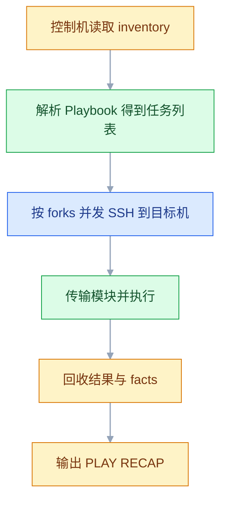

# Ansible 配置自动化

## 一、工程案例：把 3 台裸机初始化并部署 order-service

**场景**：新采购 3 台 Ubuntu 24.04（`192.168.1.11/12/13`），只有 root 加密钥登录。目标是一份 Playbook 从裸机跑到应用容器健康，且重复执行不产生多余变更；半年后加第 4 台，只在 inventory 加一行。

### 1.1 目录与 inventory

```text
ansible-deploy/
├── ansible.cfg
├── inventory.yml
├── site.yml
├── requirements.yml
├── group_vars/
│   ├── all.yml
│   ├── all/vault.yml
│   └── app.yml
└── roles/
    ├── common/
    ├── docker/
    └── app/
```

```ini
# ansible.cfg
[defaults]
inventory = ./inventory.yml
remote_user = root
host_key_checking = True
retry_files_enabled = False
forks = 10
stdout_callback = yaml

[privilege_escalation]
become = True
become_method = sudo
become_user = root
become_ask_pass = False
```

```yaml
# inventory.yml
all:
  vars:
    ansible_user: root
  children:
    app:
      hosts:
        192.168.1.11:
        192.168.1.12:
        192.168.1.13:
```

```yaml
# group_vars/all.yml
common_timezone: Asia/Shanghai
ops_user: deploy
ops_user_groups: [sudo, docker]
common_packages: [curl, vim, htop, chrony, jq]
```

```yaml
# group_vars/app.yml
app_name: order-service
app_image_repo: harbor.example.com/apps/order-service
app_image_tag: "v1.2.0"        # 发版只改这一行
app_port: 8080
app_dir: /opt/order-service
db_host: 192.168.1.21
db_name: orderdb
db_user: shop
```

```yaml
# group_vars/all/vault.yml（加密前的明文，写完立刻加密）
db_password: "ChangeMe@123"
harbor_password: "RobotPassword"
harbor_user: "robot$ci"
```

`vault.yml` 放在 `group_vars/all/` 目录下才会被加载。放在 `group_vars/vault.yml` 不会被加载，因为 inventory 里没有叫 `vault` 的组——这是 Ansible 变量加载最常见的一个坑。

### 1.2 三个 role

**common**：时区、基础包、运维用户、sudo 免密、公钥、时间同步。

```yaml
# roles/common/tasks/main.yml
- name: 设置时区
  community.general.timezone:
    name: "{{ common_timezone }}"

- name: 安装基础软件包
  ansible.builtin.apt:
    name: "{{ common_packages }}"
    state: present
    update_cache: true
    cache_valid_time: 3600

- name: 创建运维用户
  ansible.builtin.user:
    name: "{{ ops_user }}"
    groups: "{{ ops_user_groups | join(',') }}"
    append: true
    shell: /bin/bash
    create_home: true

- name: 配置 sudo 免密
  ansible.builtin.copy:
    dest: "/etc/sudoers.d/{{ ops_user }}"
    content: "{{ ops_user }} ALL=(ALL) NOPASSWD:ALL\n"
    mode: '0440'
    validate: 'visudo -cf %s'

- name: 下发公钥
  ansible.posix.authorized_key:
    user: "{{ ops_user }}"
    key: "{{ lookup('file', 'files/id_ed25519.pub') }}"

- name: 启动时间同步
  ansible.builtin.systemd:
    name: chrony
    state: started
    enabled: true
```

`validate: 'visudo -cf %s'` 是保命参数：写坏 sudoers 会让所有提权失效。`append: true` 不能省，否则 `groups` 会覆盖用户原有附加组。

**docker**：装 Docker、加组、配镜像加速、校验版本。

```yaml
# roles/docker/tasks/main.yml
- name: 安装 Docker
  ansible.builtin.apt:
    # docker.io 是发行版源里的包；要新版就用 Docker 官方源，两者不要混装
    name: [docker.io, docker-compose-v2]
    state: present
    update_cache: true
    cache_valid_time: 3600

- name: 把运维用户加入 docker 组
  ansible.builtin.user:
    name: "{{ ops_user }}"
    groups: docker
    append: true

- name: 启动 Docker
  ansible.builtin.systemd:
    name: docker
    state: started
    enabled: true

- name: 配置镜像加速
  ansible.builtin.copy:
    dest: /etc/docker/daemon.json
    content: |
      {"registry-mirrors": ["https://registry-mirror.example.com"]}
    mode: '0644'
  notify: restart docker

- name: 查询 Docker 版本
  ansible.builtin.command: docker --version
  register: docker_ver
  changed_when: false
```

**app**：目录、登录仓库、渲染 compose 与 env、拉镜像、启动、探活。

```yaml
# roles/app/tasks/main.yml
- name: 创建应用目录
  ansible.builtin.file:
    path: "{{ app_dir }}"
    state: directory
    owner: "{{ ops_user }}"
    group: "{{ ops_user }}"
    mode: '0755'

- name: 登录 Harbor
  community.docker.docker_login:
    registry: "{{ app_image_repo.split('/')[0] }}"
    username: "{{ harbor_user }}"
    password: "{{ harbor_password }}"
    reauthorize: false   # 凭据没变就不重复登录，否则每次都是 changed
  no_log: true           # 密码与令牌不进日志，-vvv 时也不会泄露

- name: 渲染 compose
  ansible.builtin.template:
    src: compose.yaml.j2
    dest: "{{ app_dir }}/compose.yaml"
    mode: '0644'
  notify: [重启应用容器, 等待应用就绪]

- name: 渲染环境变量
  ansible.builtin.template:
    src: app.env.j2
    dest: "{{ app_dir }}/.env"
    mode: '0600'
  notify: [重启应用容器, 等待应用就绪]

- name: 拉取镜像
  community.docker.docker_image:
    name: "{{ app_image_repo }}"
    tag: "{{ app_image_tag }}"
    source: pull
    force_source: true

- name: 启动容器
  community.docker.docker_compose_v2:
    project_src: "{{ app_dir }}"
    state: present
    pull: never
    recreate: auto
```

```yaml
# roles/app/handlers/main.yml
- name: 重启应用容器
  community.docker.docker_compose_v2:
    project_src: "{{ app_dir }}"
    state: restarted

- name: 等待应用就绪
  ansible.builtin.uri:
    url: "http://127.0.0.1:{{ app_port }}/actuator/health"
    status_code: 200
  register: health
  until: health.json.status == "UP"
  retries: 15
  delay: 4
  changed_when: false
```

handler 按定义顺序执行，所以「重启」必须排在「等待就绪」前面。两个 handler 都被同一个任务 notify 时，Play 结束只各执行一次。

```jinja2
# roles/app/templates/compose.yaml.j2
services:
  {{ app_name }}:
    image: {{ app_image_repo }}:{{ app_image_tag }}
    container_name: {{ app_name }}
    restart: always
    ports:
      - "{{ app_port }}:{{ app_port }}"
    env_file: [.env]
    healthcheck:
      test: ["CMD", "curl", "-f", "http://localhost:{{ app_port }}/actuator/health"]
      interval: 15s
      retries: 5
```

### 1.3 执行

```yaml
# site.yml
- name: 服务器初始化
  hosts: all
  become: true
  roles: [common]

- name: 安装 Docker
  hosts: all
  become: true
  roles: [docker]

- name: 部署应用
  hosts: app
  become: true
  roles: [app]
```

```bash
ansible-galaxy collection install -r requirements.yml
ansible-vault encrypt group_vars/all/vault.yml
ansible-playbook -i inventory.yml site.yml --ask-vault-pass
```

```text
PLAY RECAP ********************************************************
192.168.1.11 : ok=18  changed=11  unreachable=0  failed=0  skipped=0
192.168.1.12 : ok=18  changed=11  unreachable=0  failed=0  skipped=0
192.168.1.13 : ok=18  changed=11  unreachable=0  failed=0  skipped=0
```

再跑一遍，`changed=0`。改 `app_image_tag` 为 `v1.2.1` 再跑，只有 `app` 的模板任务变为 changed，common 与 docker 全部 ok。

### 1.4 验收

| # | 检查 | 命令或操作 | 通过标准 |
|---|---|---|---|
| 1 | 连通 | `ansible all -m ping` | 三台都返回 `pong` |
| 2 | 运维账号 | `ansible app -m command -a "id deploy"` | 含 `sudo` 与 `docker` 组 |
| 3 | 密钥登录 | `ssh deploy@192.168.1.11` | 不提示密码 |
| 4 | 时区 | `ansible app -m command -a "timedatectl"` | `Asia/Shanghai`，NTP 同步 |
| 5 | Docker | `ansible app -m command -a "docker info"` | 正常输出 Server 段 |
| 6 | 应用健康 | `ansible app -m uri -a "url=http://127.0.0.1:8080/actuator/health"` | `status: 200`，`UP` |
| 7 | 幂等 | 再跑一遍 Playbook | `changed=0`，`failed=0` |
| 8 | 变更范围 | 只改 `app_image_tag` 后重跑 | 只有 app 的模板任务 changed |
| 9 | 预演 | `--check --diff` | 能显示出将要改的行，不实际改机器 |

## 二、高频问答：会卡住你的地方，也是面试最常问的

### 2.1 `UNREACHABLE` 或 `Permission denied (publickey)`

**现场**

先用系统 ssh 复现，再回到 Ansible。

```bash
ssh -i ~/.ssh/id_ed25519 root@192.168.1.11 hostname
ansible app -m ping -vvv
```

**要点**

- Ansible 不创建 SSH 通道，它复用系统的 SSH；系统 ssh 连不上，Ansible 一定连不上。
- 三个常见原因：控制机到目标机的免密没配好、`ansible_user` 不是目标机上的用户、私钥不在默认路径。
- 先用 `ssh -vvv` 把认证过程看清楚，比在 Playbook 里猜快得多。

**追问**

- 为什么 `ping` 通了模块还是失败？→ 连通只证明 SSH 通，模块还依赖 Python 和提权。
- 私钥不在默认路径怎么办？→ 显式指定 `ansible_ssh_private_key_file`。
- `UNREACHABLE` 和 `FAILED` 区别？→ 前者连不上，后者连上了但任务失败。

### 2.2 `undefined variable`，变量明明写在文件里

**现场**

用 `ansible-inventory --host` 看最终变量里有没有它。

```bash
ansible-inventory -i inventory.yml --host 192.168.1.11 | grep db_password
```

**要点**

- 文件位置不对导致根本没加载，不是 YAML 缩进问题。
- `group_vars/` 下的文件名必须等于组名，`group_vars/vault.yml` 没有对应的组，永远不会被加载。
- 加密只改变内容，不改变加载规则；放错目录加密了也读不到。

**追问**

- 为什么 `group_vars/all/vault.yml` 能加载？→ `all` 是组名，`vault.yml` 只是组内的变量文件。
- 怎么确认变量来自哪一层？→ 用 `ansible-inventory --host` 看合并后的结果。
- 多个文件同名变量谁赢？→ 按变量优先级，组越具体越优先。

### 2.3 `shell` / `command` 每次都显示 changed

**现场**

看任务是否每次都在输出里，且没有 `changed_when`。

```yaml
- name: 查询版本
  ansible.builtin.command: docker --version
  register: out
  changed_when: false
```

**要点**

- 这两个模块只执行命令，不理解结果，只要执行成功就报 changed。
- 需要「不存在才执行」时用 `creates` / `removes`。
- 需要判断结果时用 `changed_when` 和 `failed_when`，幂等要自己声明。

**追问**

- 为什么不能说 Ansible 的幂等失效了？→ 模块没变，是判断依据缺失。
- `changed_when: false` 会不会掩盖真实变更？→ 会，只适合纯查询类命令。
- `command` 和 `shell` 优先用哪个？→ 能用 `command` 就用，不经 shell 更安全。

### 2.4 改了配置文件，服务没有重启

**现场**

看任务输出是 `ok` 还是 `changed`；再搜 handler 名字。

```yaml
notify: restart nginx
# handlers/main.yml
- name: restart nginx
  ansible.builtin.systemd: { name: nginx, state: restarted }
```

**要点**

- 任务没有真正 changed（内容相同），就不会触发 notify。
- `notify` 匹配的是 handler 的 `name` 字符串，大小写和空格都要一致。
- handler 写在另一个 role 里也可能接不到。

**追问**

- handler 什么时候执行？→ 默认 Play 结束统一执行，需要立刻跑就 `meta: flush_handlers`。
- 同一 handler 被 notify 多次会跑几次？→ 只跑一次。
- 为什么第一次能重启、第二次不重启？→ 第二次文件内容没变，任务报 ok。

### 2.5 模板里的变量没有被替换

**现场**

看目标机上的文件内容，确认是字面量还是渲染结果。

```yaml
- ansible.builtin.template:
    src: app.env.j2
    dest: /opt/app/.env
```

**要点**

- 用了 `copy` 而不是 `template`，文件会原样复制，`{{ }}` 不会展开。
- 变量在目标机运行时才存在，渲染时还没有值。
- `{{ }}` 被 shell 先吃掉，模板里只剩下空。

**追问**

- `template` 和 `copy` 的本质区别？→ 前者在控制机渲染后传输，后者原样复制。
- facts 什么时候可用？→ `gather_facts: true` 收集完成之后。
- 为什么模板里写 shell 变量会被吃？→ 渲染发生在控制机，不经过目标机 shell。

### 2.6 `--check` 跑出一堆失败

**现场**

看失败任务是否引用了前面任务创建的文件。

```yaml
- name: 这一步必须真跑才能检查
  ansible.builtin.command: cat /etc/app/version
  check_mode: false
```

**要点**

- check 模式下任务不真正执行，依赖前序结果的任务拿不到文件或变量。
- 它是「尽力预演」，不是完整模拟。
- 数据库、命令输出、服务状态这类依赖，预演结果只能参考。

**追问**

- 怎么让某一步真跑？→ 标 `check_mode: false`。
- 依赖链长的 Playbook 怎么预演？→ 只对独立 role 做检查。
- `--check` 能替代真实环境验证吗？→ 不能。

### 2.7 `sudo` 提权失败

**现场**

手工 ssh 上去执行 `sudo -n true`，看返回码。

```bash
ssh deploy@192.168.1.11 'sudo -n true && echo ok'
```

**要点**

- sudo 需要密码，但 `become_ask_pass=False`，于是提权直接失败。
- sudoers 被写坏，或用户被移出了 sudo 组，表现一样。
- sudoers 文件一定要用 `visudo -cf` 校验后再落盘。

**追问**

- `sudo -n` 在测什么？→ 非交互提权，能不能免密成功。
- 写坏 sudoers 怎么救？→ 控制台或 root 会话，普通 ssh 已经进不去。
- 为什么 `validate` 参数是保命参数？→ 校验不过就不会落盘。

### 2.8 装包很慢，或者报缓存过期

**现场**

看任务耗时和 `/etc/apt/sources.list` 的源地址。

```yaml
ansible.builtin.apt:
  name: nginx
  state: present
  update_cache: true
  cache_valid_time: 3600
```

**要点**

- 每次执行都 `apt update`，批量跑时开销会翻倍。
- 源指向国外，单台就慢，几十台同时跑更明显。
- `cache_valid_time` 让一小时内不重复 update。

**追问**

- `cache_valid_time` 和 `update_cache` 什么关系？→ 后者触发更新，前者给更新加有效期。
- 设了还会不会过期？→ 超过时间仍会重新 update。
- 能只装包不更新索引吗？→ 能，但新包可能找不到。

### 2.9 `loop` 里的 `item` 取不到字段

**现场**

先 debug 整个列表。

```yaml
- ansible.builtin.debug: { var: users }
  vars:
    users:
      - { name: deploy, groups: sudo }
      - { name: app, groups: docker }
```

**要点**

- 列表里混了字符串和字典，`item.name` 在字符串上取不到。
- 字段名拼错，或用了 `with_items` 的旧写法但数据结构不匹配。
- 统一数据结构，比在模板里做兼容更省事。

**追问**

- `loop` 和 `with_items` 有什么区别？→ `loop` 是新写法，语义更明确。
- 怎么快速确认结构？→ debug 整个列表，不要只看报错行。
- 嵌套列表怎么取值？→ 用 `item.字段` 逐层往下取。

### 2.10 批量重启把服务打挂了

**现场**

看重启时间是否完全重叠；看数据库连接数曲线。

```yaml
- hosts: app
  serial: 1
  max_fail_percentage: 0
```

**要点**

- 所有机器同时重启，集群里没有一台在线。
- `forks` 太大，数据库连接瞬间被打满。
- `serial: 1` 一台一台来，`serial: "30%"` 按比例分批，滚动发布必须配健康检查。

**追问**

- `serial` 和 `forks` 分别管什么？→ 分批的批大小 vs 批内并发数。
- `max_fail_percentage: 0` 意味什么？→ 有一台失败就停，不再继续。
- 只加 `serial` 不加健康检查行吗？→ 不行，只是慢一点地全挂。

### 2.11 目标机没有 Python

**现场**

用 `raw` 探一下版本。

```bash
ansible host -m raw -a "python3 --version"
```

```yaml
- name: 引导 Python
  ansible.builtin.raw: apt-get install -y python3
  changed_when: false
```

**要点**

- 绝大多数模块要在目标机跑 Python，精简镜像或新装机可能没有。
- `raw` 不走模块框架，能在没有 Python 的机器上执行，装完再切回普通模块。
- 用了 `community.docker` 集合，目标机还要有 `python3-docker`，否则报 `Failed to import the required Python library (docker)`。

**追问**

- 为什么 `raw` 能跑？→ 它只是一条 SSH 命令，不需要目标机 Python。
- 集合装在控制机就够了吗？→ 模块本身够，但它依赖的目标机 Python 库要另装。
- 怎么确认是缺库不是缺权限？→ 看报错里的库名，再 `pip show` 对一下。

### 2.12 手工改过的配置被覆盖了

**现场**

对比模板与目标文件，看差异是不是被整段替换。

```yaml
ansible.builtin.lineinfile:
  path: /etc/ssh/sshd_config
  regexp: '^#?PermitRootLogin'
  line: 'PermitRootLogin no'
  backup: true
```

**要点**

- `template` 和 `copy` 是整文件覆盖，手工加的行下次执行就消失。
- 只改一行用 `lineinfile`，整文件由代码生成用 `template`。
- 两者不要混用于同一个文件，否则每次都在互相覆盖。

**追问**

- `lineinfile` 的 `regexp` 写错会怎样？→ 匹配不到就追加，可能产生重复行。
- `backup: true` 有什么用？→ 留一份改前副本，出问题能对比。
- 怎么让手工改动合法化？→ 把改动写进模板，而不是留在机器上。

## 三、核心知识：从零开始要建立的东西

### 3.1 无 agent 的执行模型



Ansible 不在目标机常驻进程。每次执行都把模块代码通过 SSH 送过去，执行完删除。好处是目标机干净；代价是每次连接有开销，且依赖 SSH 与 Python。

> **面试**：常问「Ansible 为什么不需要在目标机装 agent？」答：每次通过 SSH 把模块送过去执行完删除，代价是依赖 SSH 与目标机 Python。

### 3.2 inventory 的组织

| 形式 | 写法 | 适用 |
|---|---|---|
| INI | `[app]` 段加主机 | 手写快，变量表达能力弱 |
| YAML | `all.children.app.hosts` | 结构清晰，推荐 |
| 动态 | 脚本或插件输出 JSON | 云上弹性伸缩 |
| 目录 | `inventory/hosts.d/` 多文件 | 大团队分片维护 |

分组按角色（app、db、cache、lb），不要按机房。Playbook 的 `hosts` 直接对应组名，组名混乱会让选择目标变成猜谜。

### 3.3 playbook 的结构

| 层级 | 作用 |
|---|---|
| Play | 一组主机加一组任务 |
| `hosts` | 目标组或主机 |
| `become` | 是否提权 |
| `vars` | Play 级变量 |
| `tasks` | 顺序执行的任务 |
| `handlers` | 被 notify 的延迟任务 |
| `roles` | 复用的任务包 |

一个 Playbook 可以有多个 Play，每个 Play 重新选择主机。Play 之间不共享变量（除非用 `set_fact` 或注册到全局）。

### 3.4 模块的幂等实现

| 模块 | 幂等依据 |
|---|---|
| `file` | 目标状态（存在、目录、权限） |
| `copy` | 内容哈希与权限 |
| `template` | 渲染结果哈希 |
| `apt` / `dnf` | 包是否已安装 |
| `user` | 用户与组是否存在 |
| `systemd` | 服务当前状态 |
| `lineinfile` | 正则是否已匹配 |

模块的返回值有 `changed`、`ok`、`failed`、`skipped` 四种。幂等的标志是第二次执行 `changed=0`，不是「没报错」。

### 3.5 command 与 shell 的边界

| | `command` | `shell` |
|---|---|---|
| 经过 shell | 否 | 是 |
| 管道、重定向、`&&` | 不支持 | 支持 |
| 变量展开 | 不支持 | 支持 |
| 注入风险 | 低 | 高 |
| 建议 | 优先 | 需要 shell 特性时 |

`command` 不经过 shell，参数按数组传递，不会被 `;` 或 `$()` 注入。能用 `command` 就不要用 `shell`；用了 `shell` 就要确保参数不来自不可信输入。

> **面试**：常问「command 和 shell 怎么选？」答：command 不经 shell、不被注入，参数按数组传；要用管道、重定向才用 shell。

### 3.6 变量优先级

从低到高：

```text
role defaults
inventory group_vars/all
inventory group_vars/<组>
inventory host_vars/<主机>
play vars / vars_files
block vars
task vars
命令行 --extra-vars
```

`--extra-vars` 最高，适合临时覆盖，不适合长期配置。把环境差异放 `group_vars`，把可调参数放 role 的 `defaults`，把机密放 vault。

### 3.7 facts 与 register

| 来源 | 内容 | 用法 |
|---|---|---|
| facts | 系统信息，自动收集 | `ansible_facts['distribution']` |
| `register` | 某个任务的返回值 | `result.rc`、`result.stdout` |
| `set_fact` | 运行时计算并持久 | `set_fact: url="..."` |

facts 收集有开销，不需要时用 `gather_facts: false` 关掉。`register` 的变量只在当前主机的当前 Play 有效，跨主机读取要用 `hostvars`。

### 3.8 条件与循环

```yaml
- name: 只在 Ubuntu 24.04 上执行
  ansible.builtin.apt: { name: nginx, state: present }
  when:
    - ansible_facts['distribution'] == "Ubuntu"
    - ansible_facts['distribution_version'] is version('24.04', '>=')

- name: 批量建用户
  ansible.builtin.user:
    name: "{{ item.name }}"
    groups: "{{ item.groups }}"
    append: true
  loop:
    - { name: deploy, groups: sudo }
    - { name: app, groups: docker }
```

`when` 里不要用 `{{ }}`，它本身就是表达式上下文。`loop` 替代了旧的 `with_items`，字典列表用 `item.字段` 取值。

### 3.9 handler 的触发时机

handler 默认在 Play 结束时统一执行，同一个 handler 被 notify 多次也只跑一次。需要立刻执行时：

```yaml
- ansible.builtin.meta: flush_handlers
```

handler 只在任务 `changed` 时触发。任务显示 `ok` 就不会 notify，这是「配置没变所以不重启」的正常行为。

### 3.10 role 的目录约定

| 目录 | 内容 | 是否必须 |
|---|---|---|
| `tasks/main.yml` | 任务入口 | 是 |
| `handlers/main.yml` | handler | 否 |
| `defaults/main.yml` | 可覆盖的默认值 | 否 |
| `vars/main.yml` | 角色内部固定值 | 否 |
| `templates/` | Jinja2 模板 | 否 |
| `files/` | 静态文件 | 否 |
| `meta/main.yml` | 依赖的其他 role | 否 |

目录名就是 role 名。`tasks/main.yml` 必须叫 `main.yml`，其他文件名要在入口里 `include_tasks`。

### 3.11 defaults 与 vars

| | `defaults/main.yml` | `vars/main.yml` |
|---|---|---|
| 优先级 | 最低 | 很高 |
| 用途 | 给使用者可调的默认值 | 角色内部固定值 |
| 覆盖 | 容易被 group_vars 覆盖 | 几乎覆盖不掉 |

能被使用者调整的参数放 `defaults`，角色内部的路径、包名放 `vars`。把两者混用会导致「明明在 group_vars 里改了却不生效」。

### 3.12 vault 的加密边界

```bash
ansible-vault encrypt group_vars/all/vault.yml
ansible-vault edit group_vars/all/vault.yml
ansible-vault rekey group_vars/all/vault.yml
ansible-playbook site.yml --vault-password-file ~/.vault_pass
```

vault 加密的是文件内容，不是访问控制。密码文件本身不能提交；团队里谁拿到密码谁就能解密。`encrypt_string` 可以只加密一个值，适合把机密嵌在普通变量文件里。

### 3.13 check mode 的能力边界

| 能做 | 不能做 |
|---|---|
| 预览文件内容变更 | 准确模拟依赖前序任务的操作 |
| 预览包安装与服务状态 | 预测命令执行后的结果 |
| 配合 `--diff` 显示行级差异 | 替代真实环境验证 |

依赖链长的 Playbook，`--check` 常在第二个任务就失败。用 `check_mode: false` 标记必须真跑的任务，或者只对独立 role 做预演。

### 3.14 批量执行策略

| 参数 | 作用 | 典型值 |
|---|---|---|
| `forks` | 同时连多少台 | 10~50，看网络与控制机 |
| `serial` | 分几批，每批多少台 | `1` 或 `30%` |
| `strategy: linear` | 每批内所有主机同步推进 | 默认 |
| `strategy: free` | 每台主机独立推进 | 任务耗时差异大 |
| `max_fail_percentage` | 失败比例超限即停 | 0~10 |

`serial` 管的是「一批做完再做下一批」，`forks` 管的是「一批内并发多少」。滚动发布用 `serial`，单纯提速调 `forks`。

### 3.15 collections 与 ansible.cfg

| 集合 | 内容 |
|---|---|
| `ansible.builtin` | 内置模块 |
| `community.general` | timezone、ufw 等通用模块 |
| `community.docker` | docker_container、docker_compose_v2 |
| `ansible.posix` | authorized_key、firewalld |

```yaml
# requirements.yml
collections:
  - name: community.docker
    version: ">=3.4.0"
  - name: community.general
  - name: ansible.posix
```

```bash
ansible-galaxy collection install -r requirements.yml
# 集合装在控制机；若集合里的模块要在目标机跑，还要在目标机装对应 Python 库
# 例如 community.docker 需要目标机有 python3-docker
```

`ansible.cfg` 放项目根目录，Ansible 会就近读取。`stdout_callback = yaml` 依赖 `community.general`，没装时这一行不报错也不生效，输出仍是默认格式。

### 3.16 与 Terraform 的分工

| | Terraform | Ansible |
|---|---|---|
| 对象 | 创建云资源 | 配置已存在的机器 |
| 状态 | 维护 state | 每次检查实际状态 |
| 频率 | 基础设施变更时 | 每次部署、每次配置变更 |
| 产物 | IP、连接地址 | 能跑应用的机器 |

先 `terraform apply` 造机器，把 output 转成 inventory，再跑 Ansible。两者的边界是「资源是否存在」和「资源里装了什么」。

> **面试**：常问「Terraform 和 Ansible 的边界在哪？」答：一个管资源是否存在，一个管资源里装了什么，terraform output 转 inventory 就是接口。

## 四、冷门知识汇总

| 知识点 | 为什么冷门 | 用到时的关键词 |
|---|---|---|
| `meta: flush_handlers` | 默认 Play 结束才执行，平时不用打断 | 立即重启、handler 顺序 |
| `serial` 与 `max_fail_percentage` | 小规模用不到，上线才需要 | 滚动发布、分批 |
| `strategy: free` | 默认 linear 够用 | 长任务、主机进度不一致 |
| `delegate_to` | 跨主机操作时才用 | 在 localhost 生成配置 |
| `run_once` | 只让一台执行 | 初始化集群、建库 |
| `hostvars` | 读其他主机的 facts | 生成后端列表 |
| `ansible-inventory --graph` | 排查分组比看 YAML 快 | 组嵌套、变量来源 |
| `ansible-doc -t callback -l` | 排查 callback 是否可用 | yaml callback |
| `raw` 模块 | 目标机没有 Python 时的入口 | 引导环境 |
| `check_mode: false` | check 模式下的例外 | 强制真跑 |
| vault 的 `encrypt_string` | 只加密单个值 | `!vault`、嵌入变量文件 |
| 动态 inventory | 云上机器随时变 | `aws_ec2`、`terraform output` |
| 配置漂移 | 有人手工改机器 | `--check --diff`、定期巡检 |
| 角色依赖 | 多角色复用时才需要 | `meta/main.yml`、`dependencies` |
