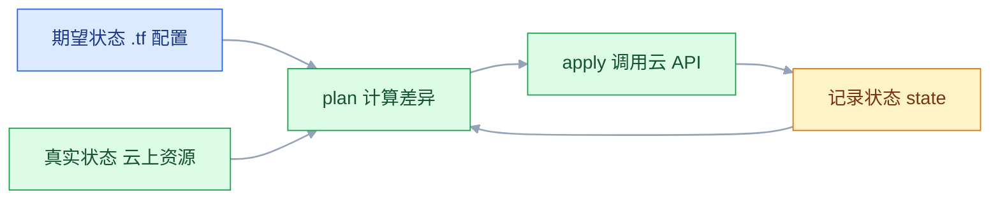
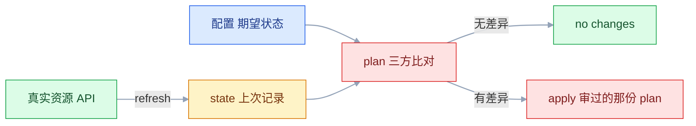
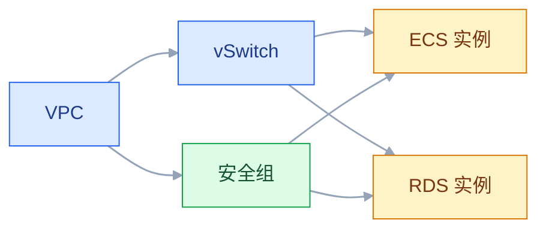

# Terraform 基础设施即代码

## 一、工程案例：在阿里云创建一套可复现的 shop 环境

**场景**：`shop` 项目在杭州地域上线，需要 1 个 VPC（`10.0.0.0/16`）、2 个交换机（应用子网与数据库子网，分属两个可用区）、1 个安全组、2 台 ECS、1 个 RDS MySQL 8.0。要求代码可评审、数据库防误删、扩缩容只动差异部分。

### 1.1 目录与 provider

```text
tf-shop/
├── main.tf
├── variables.tf
├── outputs.tf
├── terraform.tfvars       # 不提交
├── example.tfvars         # 提交的模板
└── .gitignore
```

```hcl
# main.tf
terraform {
  required_version = ">= 1.6"

  required_providers {
    alicloud = {
      source  = "aliyun/alicloud"
      version = "~> 1.0"      # 允许 1.x，禁止 2.0；具体以 registry 当前稳定版为准
    }
  }

  # 生产启用远程后端，练习阶段先用本地 state
  # backend "oss" {
  #   bucket = "shop-terraform-state"
  #   prefix = "shop/prod"
  #   region = "cn-hangzhou"
  # }
}

provider "alicloud" {
  region = var.region
  # AK 从 ALICLOUD_ACCESS_KEY / ALICLOUD_SECRET_KEY 环境变量读取，不写进代码
}
```

```hcl
# variables.tf
variable "region" {
  type    = string
  default = "cn-hangzhou"
}

variable "project" {
  type    = string
  default = "shop"
}

variable "env" {
  type    = string
  default = "test"

  validation {
    condition     = contains(["test", "staging", "prod"], var.env)
    error_message = "env 只能是 test、staging 或 prod。"
  }
}

variable "vpc_cidr" {
  type    = string
  default = "10.0.0.0/16"
}

variable "app_vswitch_cidr" {
  type    = string
  default = "10.0.1.0/24"
}

variable "db_vswitch_cidr" {
  type    = string
  default = "10.0.2.0/24"
}

variable "admin_cidr" {
  description = "允许 SSH 的来源 IP，写成 x.x.x.x/32"
  type        = string
}

variable "instance_count" {
  type    = number
  default = 2

  validation {
    condition     = var.instance_count >= 1 && var.instance_count <= 10
    error_message = "实例数必须在 1 到 10 之间。"
  }
}

variable "db_password" {
  type      = string
  sensitive = true
}
```

### 1.2 网络与安全组

```hcl
# main.tf 续
locals {
  prefix = "${var.project}-${var.env}"
  tags = {
    Project   = var.project
    Env       = var.env
    ManagedBy = "terraform"
  }
}

resource "alicloud_vpc" "main" {
  vpc_name   = "${local.prefix}-vpc"
  cidr_block = var.vpc_cidr
  tags       = local.tags
}

resource "alicloud_vswitch" "app" {
  vpc_id       = alicloud_vpc.main.id
  cidr_block   = var.app_vswitch_cidr
  zone_id      = "cn-hangzhou-h"
  vswitch_name = "${local.prefix}-vsw-app"
  tags         = local.tags
}

resource "alicloud_vswitch" "db" {
  vpc_id       = alicloud_vpc.main.id
  cidr_block   = var.db_vswitch_cidr
  zone_id      = "cn-hangzhou-i"
  vswitch_name = "${local.prefix}-vsw-db"
  tags         = local.tags
}

resource "alicloud_security_group" "app" {
  security_group_name = "${local.prefix}-sg-app"
  description         = "应用服务器：SSH 白名单与 Web 端口"
  vpc_id              = alicloud_vpc.main.id
  tags                = local.tags
}

resource "alicloud_security_group_rule" "ssh" {
  type              = "ingress"
  ip_protocol       = "tcp"
  nic_type          = "intranet"
  policy            = "accept"
  port_range        = "22/22"
  priority          = 1
  security_group_id = alicloud_security_group.app.id
  cidr_ip           = var.admin_cidr
}

resource "alicloud_security_group_rule" "http" {
  type              = "ingress"
  ip_protocol       = "tcp"
  nic_type          = "intranet"
  policy            = "accept"
  port_range        = "80/80"
  priority          = 1
  security_group_id = alicloud_security_group.app.id
  cidr_ip           = "0.0.0.0/0"
}

resource "alicloud_security_group_rule" "app" {
  type              = "ingress"
  ip_protocol       = "tcp"
  nic_type          = "intranet"
  policy            = "accept"
  port_range        = "8080/8080"
  priority          = 1
  security_group_id = alicloud_security_group.app.id
  cidr_ip           = "0.0.0.0/0"
}
```

HCL 的参数用换行分隔，块内不能写逗号。把 `type = "ingress", ip_protocol = "tcp"` 写成一行会报语法错误。

### 1.3 ECS 与 RDS

```hcl
# main.tf 续
# 镜像用固定 ID 而不是 most_recent：后者随时间漂移，同一份代码半年后 apply 会装上新镜像，
# 「可复现」就没了。先在控制台或用 data source 查一次，把 ID 固化进变量。
data "alicloud_images" "ubuntu" {
  owners      = "system"
  name_regex  = "^ubuntu_24_04_x64"
  most_recent = true
}

resource "alicloud_key_pair" "deploy" {
  key_pair_name = "${local.prefix}-deploy-key"
  public_key    = file(pathexpand("~/.ssh/terraform_ecs.pub"))
}

resource "alicloud_instance" "app" {
  count         = var.instance_count
  instance_name = "${local.prefix}-app-${count.index + 1}"
  instance_type = "ecs.c7.large"          # 规格名以控制台当前可售为准
  image_id      = data.alicloud_images.ubuntu.images[0].id

  system_disk_category = "cloud_essd"
  system_disk_size     = 40

  data_disks {
    name     = "${local.prefix}-app-${count.index + 1}-data"
    size     = 100
    category = "cloud_essd"
  }

  internet_max_bandwidth_out = 5
  vswitch_id                 = alicloud_vswitch.app.id
  security_groups            = [alicloud_security_group.app.id]
  key_name                   = alicloud_key_pair.deploy.key_name
  host_name                  = "${local.prefix}-app-${count.index + 1}"
  tags                       = local.tags
}

resource "alicloud_db_instance" "main" {
  engine               = "MySQL"
  engine_version       = "8.0"
  instance_type        = "rds.mysql.s2.large"   # 规格名以控制台当前可售为准
  instance_storage     = 50
  instance_charge_type = "Postpaid"
  instance_name        = "${local.prefix}-mysql"
  vswitch_id           = alicloud_vswitch.db.id
  security_ips         = [var.app_vswitch_cidr]
  tags                 = local.tags

  lifecycle {
    prevent_destroy = true
  }
}

resource "alicloud_db_database" "app" {
  instance_id   = alicloud_db_instance.main.id
  name          = "shopdb"
  character_set = "utf8mb4"
}

resource "alicloud_db_account" "app" {
  db_instance_id   = alicloud_db_instance.main.id
  account_name     = "shop"
  account_password = var.db_password
  account_type     = "Normal"
}

resource "alicloud_db_account_privilege" "app" {
  instance_id  = alicloud_db_instance.main.id
  account_name = alicloud_db_account.app.account_name
  privilege    = "ReadWrite"
  db_names     = [alicloud_db_database.app.name]
}
```

RDS 的 `security_ips` 只放应用子网，不是 `0.0.0.0/0`。安全组管 ECS 的进出，RDS 白名单管谁能连数据库，两层都要收口。RDS 的内网连接地址只在 VPC 内可达，公网访问要么开 `instance_charge_type` 对应的外网地址（不建议），要么走跳板机。

**白名单放的是交换机网段而不是 ECS 公网 IP**：ECS 重建后公网 IP 会变，写死 IP 会导致数据库连不上；放子网段则与实例生命周期解耦。

### 1.4 输出与执行

```hcl
# outputs.tf
output "app_public_ips" {
  value = alicloud_instance.app[*].public_ip
}

output "rds_connection_string" {
  value = alicloud_db_instance.main.connection_string
}

output "ansible_inventory" {
  value = {
    app = {
      hosts = {
        for idx, inst in alicloud_instance.app :
        inst.public_ip => { ansible_user = "root" }
      }
    }
  }
}
```

```bash
terraform fmt -recursive
terraform init
terraform validate
terraform plan -out=tfplan
terraform apply tfplan
```

```text
Plan: 14 to add, 0 to change, 0 to destroy.

Apply complete! Resources: 14 added, 0 changed, 0 destroyed.

Outputs:
app_public_ips = ["47.98.x.x", "47.98.y.y"]
rds_connection_string = "rm-bp1xxxx.mysql.rds.aliyuncs.com"
```

计划数量能对上：VPC 1、交换机 2、安全组 1、规则 3、密钥对 1、ECS 2、RDS 1、库 1、账号 1、授权 1，共 14 个。

### 1.5 验收

| # | 检查 | 命令或操作 | 通过标准 |
|---|---|---|---|
| 1 | 格式与语法 | `terraform fmt -check -recursive && terraform validate` | 无输出，`Success` |
| 2 | 计划数量 | `terraform plan -out=tfplan` | 14 to add，0 to destroy |
| 3 | 输出可用 | `terraform output -json ansible_inventory` | 两台 ECS 的 IP 都在 |
| 4 | SSH 可达 | `ssh -i ~/.ssh/terraform_ecs root@47.98.x.x hostname` | 返回 `shop-test-app-1` |
| 5 | 数据库不暴露 | 从 VPC 外的一台机器（如本地或另一个 VPC 的 ECS）`nc -vz <RDS地址> 3306` | 超时或被拒；RDS 内网地址本来就不该从公网可达 |
| 6 | 应用可连库 | 在 ECS 上 `nc -vz <RDS地址> 3306` | 成功，因为 RDS 白名单放行了应用子网 |
| 7 | 数据库防删 | `terraform destroy`（不确认） | 报 `prevent_destroy`，停止 |
| 8 | 扩容只加一台 | `instance_count = 3` 后 plan | 1 to add，0 to destroy |
| 9 | 漂移可发现 | 控制台改一条安全组规则后 `plan -detailed-exitcode` | 退出码 2，plan 显示差异 |
| 10 | state 可读 | `terraform state list` | 14 个资源地址，与配置对应 |

## 二、高频问答：会卡住你的地方，也是面试最常问的

### 2.1 只改了一个参数，plan 却要销毁重建机器

**现场**

plan 里出现 `-/+`、`must be replaced` 或 `forces replacement`。

```bash
terraform plan -out=tfplan
grep -nE 'must be replaced|forces replacement' tfplan.txt
```

**要点**

- 不是 Terraform 的 bug，这个属性是 force-new：云 API 不支持原地修改，只能删旧建新。
- 改 `image_id`、`cidr_block`、RDS 引擎版本都可能触发。
- provider 只是如实描述 API 能力，把「重建」当异常会找错方向。

**追问**

- 怎么避免重建？→ 换可原地修改的实现方式，或接受重建并做好切换。
- `-/+` 和 `-` 有什么区别？→ 前者重建，后者只销毁。
- 不能断服时怎么办？→ `create_before_destroy`，但要保证名字和端口不冲突。

### 2.2 `Error acquiring the state lock`

**现场**

看报错里的 `Who`、`Created`、`ID` 三个字段。

```text
Error: Error acquiring the state lock
Lock Info:
  ID:        b4d5e6f7-a1b2-c3d4-e5f6-1234567890ab
  Who:       user-a@192.168.1.100
  Created:   2026-10-20 10:12:33
```

```bash
terraform force-unlock b4d5e6f7-a1b2-c3d4-e5f6-1234567890ab
```

**要点**

- 上一次 apply 被 Ctrl+C 或进程被杀，锁没释放；也可能同事正在 apply。
- 只有确认没有任何 apply 在跑时才能强制解锁。
- 并发 apply 会写坏 state，修复成本远高于等几分钟。

**追问**

- 直接删锁记录行吗？→ 不行，锁在远程后端里，不在本地文件。
- 怎么判断是不是真有人在跑？→ 看 `Who` 和 `Created`，先问对方。
- 为什么不能两个人同时 apply？→ state 是单一写入口，并发写会互相覆盖。

### 2.3 state 丢了，apply 要再创建一套资源

**现场**

`terraform state list` 为空，但云上资源还在。

```bash
# 先别 apply，先看云上有什么
terraform state list
aliyun ecs DescribeInstances --RegionId cn-hangzhou
```

**要点**

- Terraform 靠 state 认领资源，没有 state 就认为资源不存在，会新建同名资源。
- 旧资源会变成无人管理的孤儿，继续计费。
- 正确顺序是恢复后端对象存储的历史版本，或用 `import` 把资源逐个纳管。

**追问**

- 直接 apply 会怎样？→ 重复资源、重复计费，还可能出现名字冲突。
- 为什么不能手改 state？→ 会破坏一致性和依赖关系。
- 恢复后要验证什么？→ `plan` 应该没有差异。

### 2.4 两个人同时用本地 state，资源建了两套

**现场**

两人 `terraform state list` 的结果不同。

**要点**

- 各自本地 `terraform.tfstate`，互相不知道对方做了什么。
- 本地 state 只适合单人练习，多人协作必须用远程后端加锁。
- 每个人执行前先 `terraform init` 同步最新 state。

**追问**

- 有远程后端还要 init 吗？→ 要，它负责拉取和配置后端。
- 锁是谁提供的？→ 后端，比如 OSS 配 Tablestore 表。
- 已经建了两套怎么办？→ 先 import 一套，另一套确认后清理。

### 2.5 `terraform.tfvars` 里的值没生效

**现场**

`terraform console` 里打印变量值。

```bash
echo 'var.instance_count' | terraform console
terraform plan -var-file=envs/prod.tfvars
```

**要点**

- 文件名不是 `terraform.tfvars` 或 `*.auto.tfvars`，就不会自动加载。
- 被命令行 `-var` / `-var-file` 覆盖也是常见原因。
- 优先级从低到高：`default` → `terraform.tfvars` → `*.auto.tfvars` → `-var` / `-var-file`。

**追问**

- 为什么 `envs/prod.tfvars` 必须显式指定？→ 它不在自动加载名单里。
- `locals` 能被 tfvars 覆盖吗？→ 不能，它是配置内部计算值。
- 怎么确认最终用的哪个值？→ `terraform console` 读 `var.x`。

### 2.6 `terraform init` 下载 provider 超时

**现场**

报错含 `Could not retrieve the list of available versions`。

```hcl
# ~/.terraformrc
provider_installation {
  network_mirror {
    url = "https://mirrors.aliyun.com/terraform/"
  }
  direct {
    exclude = ["registry.terraform.io/*/*"]
  }
}
```

**要点**

- 默认从 `registry.terraform.io` 拉 provider，国内直连经常超时。
- 配 `network_mirror` 走镜像，是这类报错的标准解法。
- 镜像必须包含所需 provider 的全部平台包，否则会回退到直连。

**追问**

- 镜像不全时会怎样？→ 自动回退直连，看起来像镜像没生效。
- `.terraform.lock.hcl` 要提交吗？→ 要，它锁定版本与校验和。
- `.terraform/` 要提交吗？→ 不要，那是下载的二进制。

### 2.7 `resource already exists`

**现场**

报错里的资源 ID 与云上现有资源对得上。

```bash
terraform import alicloud_security_group.manual sg-bp1xxxxxxxx
terraform plan
```

**要点**

- 资源是控制台手工建的，state 里没有，Terraform 尝试创建同名资源。
- 先写资源定义再 `import`，顺序反了会一直报冲突。
- `import` 后 `plan` 应该没有差异；有差异说明代码参数和云上不一致。

**追问**

- 为什么不直接删云上资源再 apply？→ 生产资源删了可能就回不来。
- `import` 会改云上资源吗？→ 不会，只写 state。
- 老版本没有 `import` 块怎么办？→ 用命令式 `terraform import`。

### 2.8 改资源名后，plan 要删一台再建一台

**现场**

plan 里同时出现 `-` 和 `+`，地址不同。

```hcl
moved {
  from = alicloud_instance.app
  to   = alicloud_instance.web
}
```

**要点**

- 资源地址 `类型.名字` 是 state 的键，改名等于换了一个资源。
- 名字不是标签，它决定 Terraform 认哪一条 state 记录。
- 用 `moved` 块或 `state mv`，必须在 apply 前完成。

**追问**

- apply 之后再改还有用吗？→ 没用，已经按新地址重建过了。
- 老版本没有 `moved` 怎么办？→ `terraform state mv`。
- 块内的资源改名也一样吗？→ 一样，`moved` 的地址要写到块内。

### 2.9 `terraform destroy` 把数据库删了

**现场**

`terraform plan -destroy` 的资源列表里是否有数据库。

```hcl
lifecycle {
  prevent_destroy = true
}
```

**要点**

- `destroy` 按 state 删除所有资源，RDS 实例和数据一起没。
- 没有备份就真的没了，云厂商不负责帮你回滚数据。
- 生产数据库、对象存储桶、密钥都应该加 `prevent_destroy`。

**追问**

- `prevent_destroy` 能防住有权限的人吗？→ 不能，删掉这行就能绕过。
- 它保护的是什么？→ 误操作，不是恶意删除。
- 有备份就够了吗？→ 不够，还要验证备份能恢复。

### 2.10 控制台改了配置，plan 却显示 no changes

**现场**

搜配置里的 `ignore_changes`，再看 `terraform state show` 的属性。

```bash
terraform plan -refresh-only
terraform state show alicloud_db_instance.main | grep -i storage
```

**要点**

- `lifecycle { ignore_changes = [...] }` 把这个属性排除了。
- 改的属性根本不在 state 里，Terraform 也不会感知。
- `ignore_changes` 是「承认差异但不处理」，不是「差异不存在」。

**追问**

- 想看真实漂移怎么办？→ `terraform plan -refresh-only` 先刷新 state。
- 长期 ignore 有什么后果？→ 漂移会在别的地方爆出来。
- 怎么发现控制台改动？→ CI 里定期跑 `plan -detailed-exitcode`。

### 2.11 `sensitive = true` 了，密码还是出现在 plan 和 state 里

**现场**

`terraform state show` 或 `terraform show -json tfplan` 搜密码。

```bash
terraform state pull | grep -i password
```

**要点**

- `sensitive` 只控制 CLI 输出显示，state 里仍是明文。
- plan 文件也可能含明文，它本身就是一份计划快照。
- 防护靠后端加密、访问控制和 state 不入 Git，不靠这个标记。

**追问**

- 那还需要 `sensitive` 吗？→ 需要，至少防止终端和日志泄露。
- 密码应该放哪？→ 密钥管理服务在运行时注入。
- `TF_VAR_db_password` 安全吗？→ 避开命令行历史，但仍会进 state。

### 2.12 删掉 count 中间的一台，其他机器全被重建

**现场**

plan 里多台实例同时 `-/+`。

```hcl
resource "alicloud_instance" "app" {
  for_each = toset(["app-1", "app-2", "app-3"])
  name     = each.key
}
```

**要点**

- `count` 用下标定位资源，删掉 `app[0]` 后原来的 `app[1]` 变成 `app[0]`，地址全错位。
- 地址一变，Terraform 就认为旧资源没了、新资源要建。
- 有稳定标识用 `for_each`，纯数量扩缩容用 `count`。

**追问**

- `for_each` 的键能随便写吗？→ 必须稳定，键一变资源就重建。
- 已经用 `count` 了怎么迁移？→ 用 `moved` 块逐条改地址。
- 混用会怎样？→ 付重建代价，还可能丢本地数据。

## 三、核心知识：从零开始要建立的东西

### 3.1 声明式与状态文件



Terraform 不是「执行一遍脚本」，而是「把现实对齐到声明」。对齐的依据是 state，所以 state 比配置文件更怕丢。

### 3.2 plan 的差异计算

| 符号 | 含义 | 风险 |
|---|---|---|
| `+` | 创建 | 花钱，但可逆 |
| `~` | 原地修改 | 低，可能短暂中断 |
| `-/+` | 销毁后重建 | 高，IP 与本地数据可能丢 |
| `-` | 销毁 | 高，不可恢复 |
| `<=` | 读取数据源 | 无 |



plan 是最后一道闸门。生产环境必须「看 plan、存 plan、apply 这个 plan」，而不是直接 `apply` 再算一次。`terraform apply tfplan` 执行的就是审过的那份计划。

> **面试**：常问「为什么生产要 apply 审过的那份 plan？」答：plan 是三方比对的结果，直接 apply 会重新计算，审的和执行的可能不是同一份。

### 3.3 state 的本质

state 是一个 JSON，记录资源地址、真实 ID、属性值和依赖关系。

| 内容 | 作用 |
|---|---|
| 资源地址 | 把配置块映射到云上对象 |
| 真实 ID | 调用 API 时的句柄 |
| 属性快照 | 计算差异的基线 |
| 依赖关系 | 决定删除顺序 |

两条铁律：**不提交 Git**（含明文敏感值），**不手工编辑**（会破坏一致性）。需要干预时只用 `terraform state` 子命令。

> **面试**：常问「state 里存了什么，为什么不能提交 Git？」答：资源地址、真实 ID、属性快照和依赖关系，还含明文敏感值，只能靠远程后端。

### 3.4 远程后端与锁

| 后端 | 锁机制 | 适用 |
|---|---|---|
| OSS | Tablestore 表 | 阿里云 |
| S3 | DynamoDB 表或 `use_lockfile` | AWS |
| GCS | 原生对象锁 | GCP |
| Terraform Cloud | 内置 | 托管协作 |

```hcl
terraform {
  backend "oss" {
    bucket              = "shop-terraform-state"
    prefix              = "shop/prod"
    region              = "cn-hangzhou"
    tablestore_endpoint = "https://shop-tf-state.cn-hangzhou.ots.aliyuncs.com"
    tablestore_table    = "terraform_lock"
  }
}
```

后端配置里不能使用变量。切后端用 `terraform init -migrate-state`，它会询问是否把本地 state 复制过去。

### 3.5 provider 与版本约束

| 写法 | 允许范围 |
|---|---|
| `= 1.220.0` | 只允许这一个版本 |
| `~> 1.220.0` | 1.220.x |
| `~> 1.220` | 1.x，大于等于 1.220 |
| `>= 1.220, < 2.0` | 显式区间 |

`~>` 只放宽最右边一位。`~> 1.220` 和 `~> 1.220.0` 的行为不同，前者允许 1.300，后者不允许。

`.terraform.lock.hcl` 要提交，它锁定 provider 的版本与校验和；`.terraform/` 是下载的二进制，不提交。

### 3.6 资源引用与依赖图

```hcl
resource "alicloud_vswitch" "app" {
  vpc_id = alicloud_vpc.main.id
}
```

引用即依赖。Terraform 根据引用关系建图，无依赖的资源并行创建，删除时反序执行。



vSwitch 与安全组互不引用，所以并行创建；ECS 同时依赖两者，必须等它们都完成。

`depends_on` 只用于「没有属性可引用，但必须先发生」的场景，比如安全组规则先于实例。滥用 `depends_on` 会让并行度下降。

### 3.7 变量与 locals

| 来源 | 优先级 | 用途 |
|---|---|---|
| `default` | 最低 | 兜底值 |
| `terraform.tfvars` | 低 | 本地默认 |
| `*.auto.tfvars` | 中 | 按环境自动加载 |
| `-var` / `-var-file` | 最高 | 临时覆盖 |

`locals` 是配置内部的计算值，不对外暴露，也不能被命令行覆盖。命名前缀、公共标签、拼接出来的 ARN 都适合放 locals。

### 3.8 模块的边界

| 输入 | 输出 | 不该做 |
|---|---|---|
| 变量声明清楚 | 只暴露调用方需要的 ID | 把内部资源名硬编码到外部 |
| 有默认值 | 有 description | 依赖调用方的目录结构 |
| 版本可固定 | 输出稳定 | 在模块里写 provider 凭据 |

模块像函数：定义一次，多处调用。项目少于三个环境时，抽模块的收益可能低于维护成本；复制两份配置反而更直观。

### 3.9 count 与 for_each

| | `count` | `for_each` |
|---|---|---|
| 定位方式 | 下标 | 键 |
| 删除中间项 | 后续全部错位 | 只影响被删的键 |
| 适用 | 纯数量扩缩容 | 有稳定名称的资源 |
| 引用 | `resource.app[0]` | `resource.app["web"]` |

`for_each` 的键必须稳定，不能用随机数或时间戳。键一变，资源就被重建。

> **面试**：常问「count 和 for_each 该怎么选？」答：count 按下标定位，删中间项会全体错位；有稳定名称的资源用 for_each。

### 3.10 lifecycle 的四个开关

| 开关 | 作用 | 风险 |
|---|---|---|
| `prevent_destroy` | 拒绝销毁 | 真需要删时要先改代码 |
| `create_before_destroy` | 先建后删 | 需要名字、端口不冲突 |
| `ignore_changes` | 忽略指定属性的外部变更 | 掩盖漂移 |
| `replace_triggered_by` | 依赖变化时强制替换 | 可能意外重建 |

`prevent_destroy` 保护的是「误操作」，不是「恶意删除」。有权限改代码的人删掉这一行就能绕过，所以生产权限仍要收口。

### 3.11 漂移的检测

漂移 = 云上真实状态与 state 记录不一致，通常由控制台手工修改引起。

```bash
terraform plan -detailed-exitcode
echo $?
```

| 退出码 | 含义 |
|---|---|
| 0 | 无差异 |
| 1 | 出错 |
| 2 | 有差异 |

`-refresh-only` 只刷新 state，不产生变更计划，适合先看清漂移再决定是否纳管。定期在 CI 里跑 `plan -detailed-exitcode`，比出事后再查便宜得多。

### 3.12 import 与 moved

| 场景 | 手段 |
|---|---|
| 纳管控制台手工建的资源 | `terraform import` 或 `import` 块 |
| 资源改名 | `moved` 块或 `state mv` |
| 从 state 移除但保留资源 | `terraform state rm` |
| 强制重建单个资源 | `terraform apply -replace=...` |

`terraform state rm` 只是「不再管理」，云上资源还在计费。删资源用 `destroy -target` 或改配置，别把 `state rm` 当成删除。

### 3.13 多环境隔离

| 方式 | 隔离强度 | 适用 |
|---|---|---|
| 目录隔离 `envs/test`、`envs/prod` | 最强，state 和后端都分开 | 生产与测试必须分开 |
| 同一目录加不同 tfvars | 弱，靠人记得切 | 临时演示 |
| Workspaces | 中，state 分开但配置相同 | 少量同构环境 |

推荐目录隔离加共享 modules：改测试环境不可能碰到生产，这是硬隔离，不依赖执行者的自觉。

### 3.14 敏感数据

| 位置 | 是否含明文 | 处理 |
|---|---|---|
| `.tf` 配置 | 可能 | 不写密码，用变量 |
| `terraform.tfvars` | 可能 | 不提交，或改用密钥管理 |
| state | 是 | 后端加密、访问控制、不公开 |
| plan 文件 | 可能 | 不提交，用完删除 |
| 控制台输出 | 部分 | `sensitive = true` 只挡显示 |

`TF_VAR_db_password` 环境变量可以避免密码进入命令行历史，但仍会进入 state。真正的秘密应该由密钥管理服务在运行时注入。

### 3.15 destroy 的风险面

| 风险 | 防护 |
|---|---|
| 删错环境 | 目录隔离加 `pwd` 确认 |
| 删数据库 | `prevent_destroy` |
| 数据盘随实例删除 | 独立数据盘并设置保留 |
| 公网 IP 释放 | 使用弹性 IP |
| state 丢失后重复计费 | 后端版本控制与定期核对账单 |

```bash
pwd
terraform workspace show
terraform state list
terraform plan -destroy
```

四个命令看完再执行 destroy。生产环境不应该由个人在本地执行 destroy。

### 3.16 与配置管理的分工

| | Terraform | Ansible |
|---|---|---|
| 管什么 | 资源是否存在 | 资源里装了什么 |
| 状态 | 维护 state | 每次检查实际状态 |
| 典型动作 | 建 VPC、ECS、RDS | 装 Docker、写配置、起服务 |
| 失败恢复 | 再 apply 对齐 | 再跑一遍 Playbook |

Terraform 的输出可以直接生成 Ansible inventory，这是两者最常用的接口。分工清楚了，就不会出现「用 Terraform 装软件」或「用 Ansible 建 VPC」这类错位。

## 四、冷门知识汇总

| 知识点 | 为什么冷门 | 用到时的关键词 |
|---|---|---|
| License 变更与 OpenTofu | 2023 年从 MPL 改为 BUSL 1.1，社区分叉出 OpenTofu | `tofu`、MPL、BUSL |
| S3 原生锁 | 新版本支持 `use_lockfile`，不再必须 DynamoDB | `use_lockfile = true` |
| `import` 块 | 声明式纳管，替代命令式 import | `import { to = ... id = ... }` |
| `moved` 块 | 资源改名不重建 | `moved { from, to }` |
| `-replace` | 强制重建单个资源，替代旧的 taint | `terraform apply -replace=...` |
| `-target` 的副作用 | 只 apply 一部分会让 state 与配置脱节 | 应急、调试 |
| `terraform graph` | 看依赖图，需要 Graphviz | `terraform graph \| dot -Tpng` |
| `TF_LOG` | 调试 provider 的 API 调用 | `TF_LOG=DEBUG` |
| `terraform console` | 交互式验证表达式和变量 | `var.x`、`local.y` |
| `pathexpand` | HCL 的 `file()` 不认识 `~` | `file(pathexpand("~/.ssh/x.pub"))` |
| `dynamic` 块 | 动态生成重复的嵌套块 | 多条安全组规则 |
| `terraform_remote_state` | 跨配置读取另一个 state 的 output | 网络层与业务层分离 |
| 状态文件版本控制 | 后端开版本控制，误删可恢复 | OSS versioning、S3 versioning |
| 资源地址与依赖 | 地址是 state 的键，改名等于换资源 | `state mv`、`moved` |
