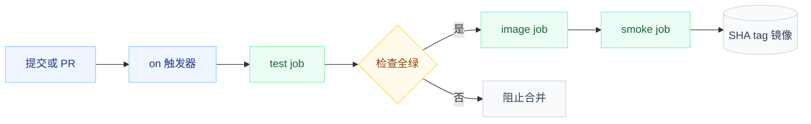

# 持续集成流水线

> 这篇从持续集成的定位讲起，经过 GitHub Actions 最小流水线、触发器与运行模型、质量门禁、镜像构建与签名、流水线安全，再到 GitLab CI 与 Jenkins 的同能力对照，最后落到 CI 排障现场手册。
>
> 学完能为任意代码仓库独立搭出"提交即构建、即测试、即出可追溯镜像"的流水线，并在流水线异常时按现象查到第一条命令。

## 一、持续集成的定位与边界

持续集成（Continuous Integration，CI）是"提交代码之后所有人工步骤自动化"的流水线：每次 push 触发 checkout、装依赖、静态检查、测试、打包镜像、推制品库，产出"永远可部署"的制品。CI 的价值不在"自动构建"，而在于把质量左移：坏代码在合并前被拦截，main 分支每时每刻都可发布。

CI 与 CD 的边界：

| 阶段 | 输入 | 输出 | 归属 |
|---|---|---|---|
| 持续集成 CI | 一次 commit | 测试报告 + 镜像制品 | 本篇 |
| 持续交付 CD | 镜像制品 | 环境里的新版本 | GitOps 篇 |

CI 只负责到"制品库里的一个带签名镜像 tag"为止；往哪个环境、放多少流量，是 Argo CD 与渐进式发布的事。把 `kubectl apply` 写进 CI 作业，是 Push 模型，会让集群状态失去唯一真相源，下一篇会讲为什么必须改掉。

三大平台对照（2026-11 仍为企业主流）：

| 平台 | 形态 | 适合 | 短板 |
|---|---|---|---|
| GitHub Actions | SaaS 为主 | GitHub 托管仓库 | 深度绑定 GitHub |
| GitLab CI | SaaS 或自建 | GitLab 一体化仓库 | 绑定 GitLab |
| Jenkins | 自建 | 复杂遗留构建、强网络隔离 | 维护成本高 |

> 版本基线（2026-11）：GitHub Actions（SaaS，runner `ubuntu-24.04` 及以上）；GitLab 18/19，CI 语法近三年稳定；Jenkins 2.x LTS（声明式流水线语法自 2018 年稳定）。本篇命令默认 Linux runner，示例以 Ubuntu 为主。

CI 不适用的场景：

- 没有任何测试资产的仓库，CI 退化成"自动构建按钮"，拦不住任何坏代码——先补测试，再上 CI；
- 一次性的基础设施手工变更，走 PR 评审 + `terraform plan` 贴评论，比流水线更直接；
- 构建产物不进任何环境的手工实验代码，强上流水线只增加噪音。

## 二、准备：最小流水线与本地验证

最小闭环的目标：装好 CLI，推一次代码，看到一条绿色流水线。以 GitHub Actions 为例，本地只需要 Git 和 `gh`（GitHub CLI）。

`gh` 安装：

```bash
# macOS
brew install gh

# Windows（winget）
winget install --id GitHub.cli

# Ubuntu：先加 GitHub 官方 apt 仓库再安装，保证拿到当前版本
sudo mkdir -p -m 755 /etc/apt/keyrings
wget -qO- https://cli.github.com/packages/githubcli-archive-keyring.gpg | sudo tee /etc/apt/keyrings/githubcli-archive-keyring.gpg > /dev/null
sudo chmod go+r /etc/apt/keyrings/githubcli-archive-keyring.gpg
echo "deb [arch=$(dpkg --print-architecture) signed-by=/etc/apt/keyrings/githubcli-archive-keyring.gpg] https://cli.github.com/packages stable main" | sudo tee /etc/apt/sources.list.d/github-cli.list > /dev/null
sudo apt update && sudo apt install -y gh

# Rocky / RHEL 系：用 GitHub 官方仓库的 rpm
sudo dnf install -y 'dnf-command(config-manager)'
sudo dnf config-manager --add-repo https://cli.github.com/packages/rpm/gh-cli.repo
sudo dnf install -y gh

gh auth login   # 登录后 gh 才能读仓库、看流水线日志
```

最小流水线 `.github/workflows/ci.yml`：

```yaml
name: ci
on:
  push:
    branches: [main]        # main 上的每次提交都要完整验证，保证 main 永远可发布
  pull_request: {}          # 任意目标分支的 PR 都触发，合并前先看结果

jobs:
  test:
    runs-on: ubuntu-24.04
    steps:
      - uses: actions/checkout@v4   # 只需要默认深度的浅克隆，构建更快
      - uses: actions/setup-java@v4
        with:
          distribution: temurin
          java-version: '21'
          cache: maven               # 缓存绑定 pom.xml 依赖清单，命中后跳过全量下载
      - run: mvn -B -ntp verify     # -B 关闭交互式进度条，日志更适合 CI 场景
```

验证：

```bash
git add .github/workflows/ci.yml
git commit -m "ci: add minimal pipeline"
git push origin main

gh run list --limit 3
gh run watch        # 跟踪最近一次运行，直到成功或失败
```

预期输出（示例）：

```text
STATUS  NAME  WORKFLOW  BRANCH  EVENT  ID          ELAPSED  AGE
✓       ci    ci        main    push   9876543210  2m31s    1m
```

可选的本地执行器 `act`（社区工具，用 Docker 在本机模拟 runner）：

```bash
brew install act          # macOS；Ubuntu 用官方安装脚本 curl -s https://raw.githubusercontent.com/nektos/act/master/install.sh | sudo bash
act -j test               # 只跑 test 这个 job，避免模拟全套环境
```

> 边界：`act` 与真实 runner 有差异（CPU 架构、镜像源、Secrets 注入），定位"本地先过一遍"够用，不能替代真实运行；判断"为什么 CI 挂而本地不挂"，最终还是要看云端日志。

## 三、触发器、Job 与 Step 的运行模型

一条流水线的运行模型由四层组成：workflow（一次 `.yml` 文件）→ 触发器 `on` → job（并行单元，各自拿一台 runner）→ step（同一 job 内串行的 shell 或 action）。理解这四层，才能解释"为什么这个 job 没跑"和"为什么改个 step 要重建缓存"。



触发器决定"什么时候花这笔构建预算"：

| 触发器 | 何时触发 | 典型用途 |
|---|---|---|
| `push` | 指定分支收到提交 | main 构建镜像 |
| `pull_request` | PR 打开/更新 | 合并前的质量门禁 |
| `workflow_dispatch` | 手动点击 | 临时参数化构建 |
| `schedule` | cron 定时 | 依赖漏洞巡检 |
| `paths` 过滤 | 变更命中路径 | 文档改动不跑全量 |

```yaml
on:
  push:
    branches: [main]
    paths-ignore: ['docs/**', '**.md']   # 文档不改不影响制品，跳过以省构建预算
  pull_request:
    branches: [main]
  workflow_dispatch: {}                  # 留一个手动入口，出事时不至于等定时或提交
```

取消重复运行：同分支连续 push 时，旧构建没有价值，直接取消：

```yaml
concurrency:
  group: ${{ github.workflow }}-${{ github.ref }}   # 同一分支共享一个组，新跑顶掉旧跑
  cancel-in-progress: true
```

Job 之间的依赖用 `needs`，同一 workflow 内先测后打包：

```yaml
jobs:
  test:
    runs-on: ubuntu-24.04
    strategy:
      matrix:
        java: ['21', '25']        # LTS 双版本矩阵，提前暴露下一个 LTS 的兼容问题
    steps:
      - uses: actions/checkout@v4
      - uses: actions/setup-java@v4
        with:
          distribution: temurin
          java-version: ${{ matrix.java }}
      - run: mvn -B -ntp verify
  package:
    needs: test                   # 全部矩阵测试通过才打包，失败不浪费构建资源
    runs-on: ubuntu-24.04
    steps:
      - run: echo "package here"
```

常用上下文速查：

| 上下文 | 内容 | 典型引用 |
|---|---|---|
| `github` | 事件与仓库信息 | <span v-pre>`${{ github.sha }}`</span> |
| `matrix` | 矩阵变量 | <span v-pre>`${{ matrix.java }}`</span> |
| `secrets` | 仓库/组织密钥 | <span v-pre>`${{ secrets.NEXUS_TOKEN }}`</span> |
| `needs` | 上游 job 输出 | <span v-pre>`${{ needs.test.outputs.version }}`</span> |
| `env` | 环境变量 | <span v-pre>`${{ env.IMAGE }}`</span> |

缓存的关键是"key 稳定、内容可复用"：

```yaml
      - uses: actions/cache@v4
        with:
          path: ~/.m2/repository
          key: maven-${{ hashFiles('**/pom.xml') }}   # key 绑定依赖清单，依赖不变必命中
          restore-keys: maven-                        # 变了也先回退到旧缓存，只补增量
```

> 边界：矩阵是把一把刀，版本 × 模块数乘起来就是构建分钟数；超过 4 个组合就要问"这个组合真的会在生产出现吗"。缓存超过 10 GB 会被仓库级上限驱逐，大缓存优先放制品库而不是 runner 缓存。

## 四、质量门禁：让红的不能合

门禁的本质是"分支保护规则 + 必须状态检查"：PR 的合并按钮被检查项锁住，CI 没绿就合不进去。没有门禁的 CI 只是"绿色装饰"，任何人都能跳过。

检查分两层，快慢分离：

| 层 | 内容 | 时长目标 | 是否必须 |
|---|---|---|---|
| 快速层 | 编译、单测、lint | < 5 分钟 | 必须 |
| 慢速层 | 集成测试、镜像构建 | < 15 分钟 | main 必须 |

```yaml
jobs:
  quick:
    runs-on: ubuntu-24.04
    timeout-minutes: 10            # 防御挂死的 step：超时按失败处理，不占住 runner
    steps:
      - uses: actions/checkout@v4
      - run: mvn -B -ntp -DskipITs verify   # -DskipITs 先跳过集成测试，快层只管单测
  slow:
    needs: quick
    timeout-minutes: 20
    steps:
      - uses: actions/checkout@v4
      - run: mvn -B -ntp verify              # 慢层跑完整 verify：单测加集成测试
```

打开门禁（分支保护规则，需要管理员权限）：

```bash
gh api -X PUT repos/{owner}/{repo}/branches/main/protection \
  -F required_status_checks[strict]=true \
  -f required_status_checks[contexts][]="quick" \
  -f required_status_checks[contexts][]="slow" \
  -F enforce_admins=true \
  -F required_pull_request_reviews[required_approving_review_count]=1
```

参数含义：

- `strict=true`：合并前分支必须已包含 main 最新提交，防止"基于旧 main 的绿灯"；
- `enforce_admins=true`：管理员同样不能绕过——门禁最常死在"管理员强合"这个口子；
- `contexts`：必须绿的检查名，与 job 名一致。

合并队列（merge queue）解决"每个 PR 单独是绿的，合到一起却红了"的竞态：GitHub 依次把 PR 排队与最新 main 真实合并后验证。

```yaml
on:
  pull_request:
    branches: [main]
  merge_group:     # 合并队列触发单独的验证运行，验证的是"真正要合进去的组合"
    branches: [main]
```

> 边界：`merge_group` 事件与 `pull_request` 事件的内容不同，门禁 job 必须同时声明两种触发，否则进队后没有可必须的检查，队列会卡住。覆盖率门槛设成"不低于当前值"的棘轮（ratchet），比设一个永远达不到的 80% 更诚实。

## 五、镜像构建、签名与推送

CI 的最终产物是一个内容可寻址的镜像：tag 指向唯一 digest，谁构建的（provenance）、里面有什么（SBOM）、没被改过（签名）都可验证。做到这三点，供应链攻击面就大幅收窄。

多阶段 Dockerfile 是基线（镜像越小、攻击面越小、拉取越快）：

```dockerfile
# ---- 构建阶段：带完整 JDK 和 Maven，只在构建期存在 ----
FROM maven:3.9-eclipse-temurin-21 AS build
WORKDIR /src
COPY pom.xml .
RUN mvn -B -ntp dependency:go-offline    # 先只复制 pom 下载依赖，源码变动时仍命中这一层缓存
COPY src ./src
RUN mvn -B -ntp package -DskipTests       # 测试已在 CI 前一个 job 跑过，这里不重复花时间

# ---- 运行阶段：只带 JRE 和产物，不含构建工具链 ----
FROM eclipse-temurin:21-jre-alpine
RUN addgroup -S app && adduser -S app -G app   # 非 root 运行，容器被攻破也只有普通用户权限
USER app
COPY --from=build /src/target/app.jar /app/app.jar
EXPOSE 8080
ENTRYPOINT ["java", "-jar", "/app/app.jar"]
```

构建与推送（GHCR，GitHub 自带制品库）：

```yaml
name: ci
on:
  push:
    branches: [main]

permissions:
  contents: read
  packages: write      # 只授予本条流水线真正需要的最小权限，默认 GITHUB_TOKEN 权限过大

jobs:
  test:
    runs-on: ubuntu-24.04
    steps:
      - uses: actions/checkout@v4
      - uses: actions/setup-java@v4
        with:
          distribution: temurin
          java-version: '21'
          cache: maven
      - run: mvn -B -ntp verify

  image:
    needs: test
    runs-on: ubuntu-24.04
    steps:
      - uses: actions/checkout@v4
      - uses: docker/setup-buildx-action@v3      # buildx 支持内联缓存导出，下次构建分层复用
      - uses: docker/login-action@v3
        with:
          registry: ghcr.io
          username: ${{ github.actor }}
          password: ${{ secrets.GITHUB_TOKEN }}  # 一次性令牌，避免在仓库里放长生命周期的 PAT
      - id: push
        uses: docker/build-push-action@v6   # id 让后续步骤能引用这次推送输出的 digest
        with:
          context: .
          push: true
          tags: ghcr.io/${{ github.repository }}:${{ github.sha }}
          cache-from: type=gha                    # 缓存挂到 GitHub 的缓存后端，不占镜像库
          cache-to: type=gha,mode=max
          provenance: mode=max                    # 附带 SLSA 证明，可审计这次构建的完整来源
      - uses: sigstore/cosign-installer@v3
      - run: |
          # keyless 签名：证书绑定本次 workflow 的 OIDC 身份，不需要管理任何私钥
          # 对 digest 而不是 tag 签名：digest 永远指向同一份内容，tag 可被移动
          cosign sign --yes ghcr.io/${{ github.repository }}@${{ steps.push.outputs.digest }}
```

tag 策略决定"回滚是否只是改一个字段"：

| tag | 来源 | 用途 | 可变性 |
|---|---|---|---|
| commit SHA | <span v-pre>`${{ github.sha }}`</span> | 每次构建唯一，K8s 里精确追溯 | 不可变 |
| 语义版本 | git tag `v1.42.0` | 发布里程碑 | 不可变 |
| `latest` | 默认分支 | 本地试用 | 会被覆盖 |

> 边界：生产清单里禁止出现 `latest` 和裸 `v1.42` 这类可变 tag——今天部署的和明天部署的不是同一个 digest。集群侧引用一律带 `@sha256:` digest 或完整 SHA tag。

验证制品：

```bash
cosign verify ghcr.io/octo-org/orders:abc1234 --certificate-identity-regexp '^https://github.com/octo-org/orders/.github/workflows/ci.yml@refs/heads/main$'
crane digest ghcr.io/octo-org/orders:abc1234
```

预期输出（示例）：

```text
Verification for ghcr.io/octo-org/orders:abc1234 --
The following checks were performed on each of these signatures:
 - The cosign claims were validated
 - The code-signing certificate was verified using the Fulcio intermediate CA
sha256:9f86d081884c7d659a2feaa0c55ad015a3bf4f1b2b0b822cd15d6c15b0f00a08
```

镜像库选择：

| 制品库 | 形态 | 适合 |
|---|---|---|
| GHCR | SaaS | GitHub 仓库，零运维 |
| Harbor | 自建 | 多集群、需要代理缓存与漏洞扫描 |
| 云厂商 ACR/ECR | 托管 | 同云部署 |

## 六、Secrets 与流水线安全

流水线是仓库里权限最高的执行体：它能读密钥、能推生产镜像，所以它是供应链攻击的首选目标。安全基线四条：密钥进 secrets 不进代码、第三方 action 固定到 commit SHA、fork 的 PR 拿不到 secrets、默认令牌最小权限。

| 威胁 | 手段 | 落地配置 |
|---|---|---|
| 密钥入库 | secrets + 扫描 | `gh secret set` |
| 第三方 action 被投毒 | 固定 SHA | `uses: actions/checkout@11bd71901bbe5b1630ceea73d27597364c9af683` |
| fork 恶意 PR 偷密钥 | secrets 只进可信事件 | 避免使用 `pull_request_target` |
| 默认令牌权限过大 | 仓库级最小权限 | Settings → Actions → General → Read repository contents |

设置密钥：

```bash
gh secret set NEXUS_TOKEN --env production   # 按环境隔离，泄漏半径控制在一个环境
gh secret list
```

> 边界：`pull_request_target` 会以仓库密钥运行不可信代码，是 GitHub Actions 最经典的漏洞组合；需要 fork 贡献者跑 CI 时，用普通 `pull_request` 事件（secrets 自动不注入），需要密钥的 job 用 `pull_request_target` + 严格审查 checkout 的 ref。云资源访问优先走 OIDC（见第九章案例的部署凭证），彻底取消长期密钥。

## 七、GitLab CI 与 Jenkins 对照

三家平台的构建语义一致，差别在语法载体与 runner 模型。对照学习的关键：把"第四章的检查清单"翻译到另一家，而不是重新设计。

GitLab CI 的等价实现 `.gitlab-ci.yml`：

```yaml
stages: [test, image]            # stage 决定串行顺序，同 stage 内的 job 并行

default:
  image: maven:3.9-eclipse-temurin-21

test:
  stage: test
  cache:
    key:
      files: [pom.xml]           # key 绑定依赖清单，等价于 hashFiles 的语义
    paths: [.m2/repository]
  script:
    - mvn -B -ntp verify
  rules:
    - if: $CI_PIPELINE_SOURCE == "merge_request_event"   # MR 触发：门禁
    - if: $CI_COMMIT_BRANCH == "main"                     # main 触发：发布
  artifacts:
    when: always                 # 失败也保留报告，排查不用重跑
    paths: [target/surefire-reports/]
    reports:
      junit: target/surefire-reports/TEST-*.xml

build-image:
  stage: image
  image: docker:27
  services: [docker:27-dind]     # sidecar 容器提供 Docker 守护进程，等价于 buildx 步骤
  variables:
    IMAGE: $CI_REGISTRY_IMAGE:$CI_COMMIT_SHA
    DOCKER_HOST: tcp://docker:2375   # 让 docker CLI 连到 dind sidecar
    DOCKER_TLS_CERTDIR: ""           # 内网 runner 关掉 sidecar 的 TLS 才能走 2375
  script:
    - echo "$CI_REGISTRY_PASSWORD" | docker login -u "$CI_REGISTRY_USER" --password-stdin "$CI_REGISTRY"
    - docker build -t "$IMAGE" .
    - docker push "$IMAGE"
  rules:
    - if: $CI_COMMIT_BRANCH == "main"
```

Jenkins 声明式流水线的等价实现 `Jenkinsfile`：

```groovy
pipeline {
  agent any
  options {
    timestamps()                       // 日志带时间戳，事后对时间线
    timeout(time: 20, unit: 'MINUTES')// 防挂死占住执行节点
  }
  stages {
    stage('test') {
      agent {
        docker {
          image 'maven:3.9-eclipse-temurin-21'
          args '-v $HOME/.m2:/root/.m2'  // 宿主机 .m2 挂进容器，等价于 CI 缓存
          reuseNode true
        }
      }
      steps {
        sh 'mvn -B -ntp verify'
        junit '**/target/surefire-reports/TEST-*.xml'   // 测试报告回传 Jenkins，门禁才有数据
      }
    }
    stage('image') {
      when { branch 'main' }            // 只有 main 构建镜像，PR 只做验证
      steps {
        script {
          docker.withRegistry("https://registry.example.com", 'registry-cred') {
            def img = docker.build("registry.example.com/orders:${env.GIT_COMMIT}")
            img.push()
          }
        }
      }
    }
  }
  post {
    always {
      cleanWs()                         // 清工作区，避免残留文件污染下次构建
    }
  }
}
```

三平台能力对照：

| 能力 | GitHub Actions | GitLab CI | Jenkins |
|---|---|---|---|
| 定义文件 | `.github/workflows/*.yml` | `.gitlab-ci.yml` | `Jenkinsfile` |
| 运行节点 | 托管 runner / 自建 | 托管 / 自建 | 自建 agent |
| 缓存 | `actions/cache` | `cache:` key | 宿主机目录挂载 |
| 测试报告门禁 | 任意第三方 action | 内置 `reports` | 内置 `junit` |
| 密钥 | secrets / OIDC | masked variables | credentials 插件 |

> 边界：Jenkins 的真正理由只有两个——物理网络隔离（构建必须在客户内网）和大量遗留自由式任务；新项目在两家 SaaS 里选，维护成本差一个数量级。迁移时先迁移"门禁"，再迁移"镜像"，两者解耦后可以逐步搬。

## 八、CI 排障现场手册

排障顺序永远是"先拿日志再动手改"：`gh run view --log-failed` 一条命令能省掉九成猜测。

| 现象 | 最可能原因 | 第一条命令 |
|---|---|---|
| push 后没有运行 | 分支/路径过滤没命中 | 检查 `on:` 的 `branches`/`paths` |
| PR 检查被跳过 | fork PR 无 secrets | 看 job 是否用了 secrets |
| 本地过、CI 挂 | 环境或缓存差异 | `gh run view --log-failed` |
| 缓存不命中 | key 变了或被驱逐 | `gh cache list` |
| runner 磁盘满 | 大依赖/镜像堆积 | `df -h`，自建 runner 清理 |
| 镜像 push 401 | token 权限不足 | 检查 `permissions: packages` |
| 合并队列卡住 | merge_group 无检查 | 补 `merge_group` 触发 |
| 定时任务不跑 | cron 时区与限流 | 用 UTC 写 cron |

看失败日志与重新运行：

```bash
gh run list --limit 5                 # 先定位是哪一次运行
gh run view 9876543210 --log-failed   # 只看失败 step 的日志，跳过海量成功输出
gh run rerun 9876543210 --failed      # 只重跑失败的 job，矩阵没全重烧
gh run view 9876543210 --json jobs --jq '.jobs[] | {name, conclusion}'   # 一行看全部结论
```

下载产物排查（测试报告、构建日志）：

```bash
gh run download 9876543210 -n surefire-report -D /tmp/report
```

预期输出（示例）：

```text
1 file downloaded to /tmp/report
```

> 边界：间歇性失败（flaky）与真实失败的分界线是"同 commit 重跑结果是否稳定"；重跑一次绿了不代表没 bug，给 flaky 测试打标签、建 issue 跟踪，而不是无脑 rerun 到绿。

## 九、最佳实践案例

### 9.1 案例背景

一个 12 人的订单团队，Spring Boot 3.5 单仓库，托管在 GitHub 企业版。现状是手工打包 jar 后 scp 到测试机，构建不可复现（本机 JDK 版本各异）、测试靠自觉（合并前没有强制检查）、部署事故后查不到"线上到底是哪次提交"。目标：PR 必须全绿才能合并；main 每次提交产出一个带签名的镜像，tag 与 commit 一一对应；整条流水线 10 分钟内完成。约束：不自建 runner，镜像进 GHCR，测试报告与部署凭证全部走 OIDC，不落任何长期密钥。

### 9.2 案例实操

第一步，落地 Dockerfile 与完整流水线 `.github/workflows/ci.yml`：

```yaml
name: ci
on:
  push:
    branches: [main]
  pull_request:
    branches: [main]
  merge_group:
    branches: [main]

permissions:
  contents: read
  packages: write
  id-token: write        # cosign keyless 签名要用 OIDC token 换 Fulcio 证书，只在本条流水线内有效

concurrency:
  group: ci-${{ github.ref }}
  cancel-in-progress: true

jobs:
  test:
    runs-on: ubuntu-24.04
    timeout-minutes: 10
    steps:
      - uses: actions/checkout@11bd71901bbe5b1630ceea73d27597364c9af683   # 固定到 commit SHA，防投毒
      - uses: actions/setup-java@v4
        with:
          distribution: temurin
          java-version: '21'
          cache: maven
      - run: mvn -B -ntp verify
      - uses: actions/upload-artifact@v4
        if: always()     # 失败也上传报告，排查不用重跑八分钟的流水线
        with:
          name: surefire-report
          path: target/surefire-reports/

  image:
    needs: test          # 测试不过不烧构建时间，也不产生"未验证的镜像"
    if: github.event_name == 'push' && github.ref == 'refs/heads/main'
    runs-on: ubuntu-24.04
    outputs:
      digest: ${{ steps.push.outputs.digest }}
    steps:
      - uses: actions/checkout@11bd71901bbe5b1630ceea73d27597364c9af683
      - uses: docker/setup-buildx-action@v3
      - uses: docker/login-action@v3
        with:
          registry: ghcr.io
          username: ${{ github.actor }}
          password: ${{ secrets.GITHUB_TOKEN }}
      - id: push
        uses: docker/build-push-action@v6
        with:
          context: .
          push: true
          tags: |
            ghcr.io/octo-org/orders:${{ github.sha }}
            ghcr.io/octo-org/orders:latest
          cache-from: type=gha
          cache-to: type=gha,mode=max
          provenance: mode=max
      - uses: sigstore/cosign-installer@v3
      - run: |
          cosign sign --yes ghcr.io/octo-org/orders@${{ steps.push.outputs.digest }}
      # digest 而不是 tag 参与签名：tag 可被移动，digest 永远指向同一份内容

  smoke:
    needs: image
    runs-on: ubuntu-24.04
    steps:
      - uses: docker/login-action@v3
        with:
          registry: ghcr.io
          username: ${{ github.actor }}
          password: ${{ secrets.GITHUB_TOKEN }}   # 私有镜像也要登录才能拉取，冒烟不假设公开
      - run: |
          CID=$(docker run -d -p 8080:8080 ghcr.io/octo-org/orders@${{ needs.image.outputs.digest }})
          trap 'docker rm -f $CID' EXIT           # 无论成败都清理容器，不给 runner 留残留
          for i in $(seq 1 30); do
            curl -sf http://127.0.0.1:8080/actuator/health && exit 0
            sleep 2
          done
          docker logs $CID | tail -50            # 失败时带上容器日志，健康检查不过不用猜
          exit 1
```

第二步，打开门禁（管理员执行）。PR 只要求 `test`：镜像与冒烟 job 只在 main 上运行，属于发布前验证，不阻塞 PR 合并：

```bash
gh api -X PUT repos/octo-org/orders/branches/main/protection \
  -F required_status_checks[strict]=true \
  -f required_status_checks[contexts][]="test" \
  -F enforce_admins=true \
  -F required_pull_request_reviews[required_approving_review_count]=1
```

第三步，日常发布验证：

```bash
git commit --allow-empty -m "release: trigger v1.42.0" && git push origin main
gh run watch --exit-status
# tag 用完整 commit SHA，验证时也必须用完整 SHA，短 SHA 查不到镜像
crane digest ghcr.io/octo-org/orders:$(git rev-parse HEAD)
cosign verify ghcr.io/octo-org/orders:$(git rev-parse HEAD) \
  --certificate-identity-regexp '^https://github.com/octo-org/orders/.github/workflows/ci.yml@refs/heads/main$'
```

预期输出（示例）：

```text
✓ test    completed successfully  2m48s
✓ image   completed successfully  1m52s
✓ smoke   completed successfully  0m41s
sha256:9f86d081884c7d659a2feaa0c55ad015a3bf4f1b2b0b822cd15d6c15b0f00a08
Verified OK
```

第四步，验证门禁真的拦得住坏提交（故意引入失败用例）：

```bash
git checkout -b bad-change
echo 'assertThat(1).isEqualTo(2);' >> src/test/java/OrdersTest.java
git commit -am "bad change" && git push origin bad-change
gh pr create --fill
gh pr checks --watch    # 结果为 fail，PR 出现 "Merging is blocked"
```

预期输出（示例）：

```text
X test  fail  2m31s
Some checks were not successful
```

### 9.3 案例结果

流水线端到端 5 分 21 秒（示例：test 2m48s + image 1m52s + smoke 0m41s），Maven 缓存命中后依赖安装从 3 分钟降到约 30 秒。上线后三个月：门禁拦截带失败用例的合并 7 次；`enforce_admins` 关闭管理员强合后，main 上再没出现"红线合入"；一次线上回归通过 `git revert` 触发流水线，6 分钟内产出回滚镜像，清单里引用的是 revert commit 的 SHA tag，与构建一一对应。失败模式复盘：初期 admin 绕过门禁强合过两次，根因是"门禁挡住了紧急修"没有对齐流程，解决方式不是开洞，而是约定"紧急修也走 PR，用 auto-merge 让绿灯自动合并"；`latest` tag 保留给开发者本机试用，所有环境清单只允许 SHA tag，这条在 code review 里由 CI 的清单校验 job 强制。整体教训：门禁的价值来自"没有任何例外"，任何例外口子都会被滥用成常态。
