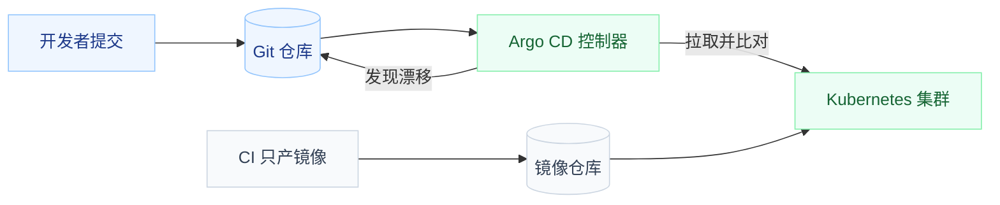

# GitOps与渐进式发布

> 这篇从 GitOps 的声明式拉取模型讲起，经过 Argo CD 安装与最小验证、Application 同步机制、Helm/Kustomize 接入、ApplicationSet 多环境编排，再到 Argo Rollouts 的金丝雀与蓝绿、Flagger 对照和回滚纪律，最后落到 GitOps 排障现场手册。
>
> 学完能把集群变更收进 Git，用一条提交完成多环境发布，并让新版本按流量比例逐步放量、指标不达标时自动回滚。

## 一、GitOps 的定位与边界

GitOps 是把"集群期望状态"存进 Git，由集群内的控制器持续把实际状态拉齐到期望状态的交付方式。它把发布从"人执行命令"变成"人提交差异"，因此每一次变更都有 diff、有评审、有历史、可回滚。

四条判据缺一不可：

| 判据 | 含义 | 反例 |
|---|---|---|
| 声明式 | 描述终态而非步骤 | 一堆 `kubectl set image` |
| 版本化 | 期望状态在 Git 里 | 只存在某人终端历史 |
| 自动拉取 | 集群侧主动对齐 | CI 里 push `kubectl apply` |
| 持续调和 | 漂移自动纠正 | 手工改完就没人管 |

拉取模型与推送模型的区别：



推送模型的根本问题不是"多一条命令"，而是凭据方向：CI 要持有集群管理员凭据，才能从外部改集群；拉取模型里集群只读 Git，凭据不出集群。这也是 GitOps 能在受监管环境落地的主要原因。

> 版本基线（2026-11）：Kubernetes 1.33+，Argo CD 3.x（2.14+ 的清单与 CRD 语法兼容），Argo Rollouts 1.8+，Flagger 1.4x，Helm 3/4，Kustomize 5.x。命令默认 Linux，系统示例以 Ubuntu 为主。

不适用的场景：

- 工作负载本身不是声明式的（手工装的有状态中间件、外部 SaaS 配置），只能部分纳管；
- 需要秒级交互式调试的一次性排查，直接在集群里 `kubectl exec` 更合适，但改配置仍要回 Git；
- 没有 Git 评审流程的团队，GitOps 只会把"手滑"变成"一次提交"，先有评审再有 GitOps。

## 二、准备：安装 Argo CD 与最小验证

最小闭环：装 CLI，装控制面，登录，同步一个示例应用，看到 `Synced / Healthy`。

安装控制面（集群内，单租户起步）：

```bash
kubectl create namespace argocd
# 用 stable 清单，版本随官方发布推进；生产固定到具体 tag 的清单地址便于复现
kubectl apply -n argocd -f https://raw.githubusercontent.com/argoproj/argo-cd/stable/manifests/install.yaml
kubectl -n argocd rollout status deploy/argocd-server
```

安装 CLI：

```bash
# macOS
brew install argocd

# Ubuntu / Rocky：直接用官方 linux-amd64 二进制，不依赖发行版仓库
curl -sSL -o /tmp/argocd https://github.com/argoproj/argo-cd/releases/latest/download/argocd-linux-amd64
sudo install -m 555 /tmp/argocd /usr/local/bin/argocd

# Windows：从 releases 下载 argocd-windows-amd64.exe，改名 argocd.exe 后加入 PATH
argocd version --client
```

登录（本地端口转发，不暴露控制面）：

```bash
kubectl -n argocd port-forward svc/argocd-server 8080:443
# 初始密码藏在 Secret 里，首次登录后立即改掉并删除该 Secret
argocd login localhost:8080 \
  --username admin \
  --password "$(kubectl -n argocd get secret argocd-initial-admin-secret -o jsonpath='{.data.password}' | base64 -d)" \
  --insecure
```

最小应用清单 `apps/guestbook.yaml`：

```yaml
apiVersion: argoproj.io/v1alpha1
kind: Application
metadata:
  name: guestbook
  namespace: argocd          # Application 必须和控制器同命名空间，否则控制器看不到
spec:
  project: default
  source:
    repoURL: https://github.com/argoproj/argocd-example-apps.git
    targetRevision: HEAD
    path: guestbook
  destination:
    server: https://kubernetes.default.svc
    namespace: guestbook
  syncPolicy:
    automated:
      prune: true            # Git 里删掉的资源同步删除，否则孤儿资源永久残留
      selfHeal: true         # 手工改回期望状态，防止"临时改一下"变成长期漂移
    syncOptions:
      - CreateNamespace=true # 目标命名空间不存在时自动创建，减少一次前置提交
```

```bash
kubectl apply -f apps/guestbook.yaml
argocd app get guestbook
kubectl -n guestbook get deploy,svc,pod
```

预期输出（示例）：

```text
Name:               argocd/guestbook
Sync Status:        Synced
Health Status:      Healthy
Operation:          Synced to HEAD (3f2a1c9)
```

> 边界：`selfHeal` 会覆盖所有手工改动，包括排障时的临时扩容；排障改动用 `kubectl scale` 前先接受"几分钟后被改回"。生产环境把 `prune` 打开前，先确认没有"仓库外创建、但被 Application 纳管"的资源，否则第一次同步就删。

## 三、Application 与同步机制

Application 是"Git 路径 → 集群命名空间"的绑定声明，同步引擎负责比对与执行。常见误解是把 Application 当成部署记录，实际上它默认约每 3 分钟轮询一次 Git（配 webhook 时提交即可触发），`Synced` 只是"此刻一致"。

核心字段：

| 字段 | 作用 | 易错点 |
|---|---|---|
| `source.path` | 清单所在目录 | 指向 Helm chart 根目录而非 values |
| `targetRevision` | 分支/tag/commit | 用分支名等于允许移动目标 |
| `destination.namespace` | 落点命名空间 | 清单内写死 namespace 会冲突 |
| `syncPolicy.automated` | 自动同步 | 与 CI 推送混用造成双写 |

同步策略的三种档位：

```yaml
  syncPolicy:
    automated: {}                 # 自动同步：有更新就 apply，但不删、不纠正漂移
    # automated: {prune: true}    # 自动同步 + 删除 Git 里已移除的资源
    # automated: {prune: true, selfHeal: true}   # 再加漂移纠正，生产推荐
  syncOptions:
    - ServerSideApply=true        # 大 CRD 超过注解上限时必需
    - RespectIgnoreDifferences=true
  retry:
    limit: 5                      # 依赖组件尚未就绪时自动重试，避免一次失败就停摆
    backoff:
      duration: 5s
      factor: 2
      maxDuration: 3m
```

刷新时机决定"提交后多久生效"：

- Webhook：Git 平台回调 Argo CD，秒级刷新，生产必配；
- 轮询：默认 3 分钟一次，Webhook 失败时的兜底；
- 手动：`argocd app get --refresh`，排障时用。

同步顺序用 sync-wave 控制（数据库迁移必须先于应用）：

```yaml
metadata:
  annotations:
    argocd.argoproj.io/sync-wave: "-1"   # 数字小的先执行，负数用于前置依赖
```

| 波次 | 放什么 | 原因 |
|---|---|---|
| -1 | Namespace、Secret、ConfigMap | 后续资源依赖 |
| 0 | 数据库迁移 Job | 应用启动前完成 |
| 1 | Deployment/StatefulSet | 主体工作负载 |
| 2 | Ingress、HPA、监控规则 | 依赖工作负载就绪 |

> 边界：sync-wave 按波次推进，同一波内的资源全部健康后才进入下一波；真正的前后依赖（迁移完成才启动应用）用 hook（`PreSync`/`PostSync`）加 Job 探活。hook 资源默认不随 `prune` 删除，需要 `hook-delete-policy` 显式声明。

## 四、Helm 与 Kustomize 的接入

GitOps 仓库里通常不存渲染后的 YAML，而是存 chart 或 overlay，让 Argo CD 渲染。两种方式的取舍：Helm 适合"同一 chart 多套值"，Kustomize 适合"同一份基线做小改"。

Helm 作为 source（chart 来自仓库或 Git）：

```yaml
spec:
  source:
    repoURL: https://charts.example.com
    chart: orders
    targetRevision: 1.42.0        # 固定 chart 版本，避免上游一升级就全量漂移
    helm:
      releaseName: orders
      valueFiles:
        - values-prod.yaml        # 仓库内的值文件，按环境覆盖
      parameters:
        - name: image.tag
          value: v1.42.0          # 镜像 tag 由发布提交决定，与 chart 版本解耦
```

Kustomize 作为 source（base + overlay）：

```yaml
spec:
  source:
    repoURL: https://github.com/octo-org/orders-deploy.git
    targetRevision: main
    path: apps/orders/overlays/prod
    kustomize:
      images:
        - ghcr.io/octo-org/orders=v1.42.0   # 覆盖镜像而不改 base，发布只动这一处
```

目录约定（避免"改错环境"这类事故）：

```text
orders-deploy/
├── apps/orders/base/            # Deployment、Service、Ingress 基线
├── apps/orders/overlays/dev/    # 1 副本、小资源、调试日志
├── apps/orders/overlays/staging/
├── apps/orders/overlays/prod/   # 6 副本、PDB、生产资源
└── argocd/applicationset.yaml
```

> 边界：Helm 的 `--set` 参数写进 Application 后不可审计（改的是 CR 不是 Git），能进 values 文件的就别用 parameters；Kustomize 的 `images` 覆盖只改镜像，镜像升级、副本数调整、资源调参分三个提交做，别把"发布"和"调参"混在一次改动里。

## 五、ApplicationSet 与多环境编排

ApplicationSet 用生成器批量产出 Application：一个模板 + 一组参数，环境数量从 3 涨到 30 也不用复制 YAML。

按目录生成（最常见，环境即目录）：

```yaml
apiVersion: argoproj.io/v1alpha1
kind: ApplicationSet
metadata:
  name: orders
  namespace: argocd
spec:
  goTemplate: true                       # 开 Go 模板，能直接用 path.basename 等函数
  goTemplateOptions: ["missingkey=error"] # 变量拼错时直接报错，避免生成空名字的应用
  generators:
    - git:
        repoURL: https://github.com/octo-org/orders-deploy.git
        revision: main
        directories:
          - path: apps/orders/overlays/*   # 每个 overlay 目录生成一个 Application
  template:
    metadata:
      name: 'orders-{{.path.basename}}'
    spec:
      project: orders
      source:
        repoURL: https://github.com/octo-org/orders-deploy.git
        targetRevision: main
        path: '{{.path.path}}'
      destination:
        name: in-cluster
        namespace: 'orders-{{.path.basename}}'
      syncPolicy:
        automated:
          prune: true
          selfHeal: true
        syncOptions:
          - CreateNamespace=true
```

其余生成器：

| 生成器 | 参数来源 | 典型场景 |
|---|---|---|
| `list` | 手写元素表 | 少量固定集群 |
| `cluster` | 集群 Secret 标签 | 每集群一套同名应用 |
| `git` files | 仓库内 JSON/YAML | 环境清单由业务维护 |
| `matrix` | 两个生成器笛卡尔积 | 环境 × 集群 |

```yaml
  generators:
    - matrix:
        generators:
          - clusters:
              selector:
                matchLabels:
                  tier: prod          # 只选生产集群，测试集群不会被这条规则命中
          - list:
              elements:
                - app: orders
                - app: payments
```

> 边界：ApplicationSet 的 `prune` 语义比 Application 更危险——删除一个目录或改一次标签，会连带删除整批 Application；删除 Application 时是否级联删除集群资源，取决于 `resources-finalizer.argoproj.io` 终结器。批量改生成器前先在 staging 试运行，用 `argocd app list -l` 核对生成结果。

## 六、渐进式发布：金丝雀与蓝绿

渐进式发布把"一次全量替换"拆成"按比例放量 + 指标判定"，出问题时影响面被限制在已放量的比例内。三种策略的边界：

| 策略 | 流量控制 | 回滚速度 | 资源成本 |
|---|---|---|---|
| 滚动更新 | 无，按副本替换 | 中 | 低 |
| 金丝雀 | 按百分比/请求头 | 快 | 低 |
| 蓝绿 | 全量切换 | 最快 | 双倍 |

金丝雀适合绝大多数无状态服务；蓝绿适合"必须整批切换"或有状态迁移的场景；滚动更新只解决"不停机"，不解决"新版本有 bug"。

安装 Argo Rollouts（控制器 + kubectl 插件）：

```bash
kubectl create namespace argo-rollouts
kubectl apply -n argo-rollouts -f https://github.com/argoproj/argo-rollouts/releases/latest/download/install.yaml

# CLI 插件：macOS 用 brew，Linux 直接下二进制
brew install argoproj/tap/kubectl-argo-rollouts
curl -sSL -o /tmp/kubectl-argo-rollouts https://github.com/argoproj/argo-rollouts/releases/latest/download/kubectl-argo-rollouts-linux-amd64
sudo install -m 555 /tmp/kubectl-argo-rollouts /usr/local/bin/kubectl-argo-rollouts
kubectl argo rollouts version
```

金丝雀 Rollout（10% → 分析 → 50% → 100%）：

```yaml
apiVersion: argoproj.io/v1alpha1
kind: Rollout
metadata:
  name: orders
  namespace: orders
spec:
  replicas: 6
  revisionHistoryLimit: 3          # 只留 3 个历史版本，ReplicaSet 太多会拖慢控制器
  selector:
    matchLabels: {app: orders}
  strategy:
    canary:
      canaryService: orders-canary   # 金丝雀流量落到这个 Service
      stableService: orders-stable   # 稳定流量始终落这个 Service
      trafficRouting:
        nginx:
          stableIngress: orders      # 由 Rollouts 改写 Ingress 注解做权重切分
      steps:
        - setWeight: 10             # 先放 10%，把故障半径压到十分之一
        - pause: {duration: 2m}     # 观察窗口，等指标稳定再继续
        - analysis:
            templates:
              - templateName: success-rate
            args:
              - name: service
                value: orders-canary
        - setWeight: 50
        - pause: {duration: 5m}
        - setWeight: 100
      analysis:
        startingStep: 1             # 从第一步就开始后台分析，不等人工点继续
        templates:
          - templateName: success-rate
  template:
    metadata:
      labels: {app: orders}
    spec:
      containers:
        - name: orders
          image: ghcr.io/octo-org/orders:v1.42.0
          ports: [{containerPort: 8080}]
```

分析模板（指标不达标自动中止）：

```yaml
apiVersion: argoproj.io/v1alpha1
kind: AnalysisTemplate
metadata:
  name: success-rate
  namespace: orders
spec:
  args:
    - name: service
  metrics:
    - name: success-rate
      interval: 1m
      count: 5                       # 连续 5 个采样点都合格才算通过
      failureLimit: 1                # 累计 1 次不合格就中止，不用等满 5 次
      successCondition: result[0] >= 0.99
      failureCondition: result[0] < 0.95   # 留出缓冲，避免边界抖动误杀
      provider:
        prometheus:
          address: http://prometheus.monitoring:9090
          query: |
            sum(rate(http_requests_total{service="{{args.service}}",code!~"5.."}[2m]))
            /
            sum(rate(http_requests_total{service="{{args.service}}"}[2m]))
```

蓝绿 Rollout（预览环境验证后整体切换）：

```yaml
  strategy:
    blueGreen:
      activeService: orders-stable     # 线上流量入口
      previewService: orders-preview   # 新版本先在这里被验证
      autoPromotionEnabled: false      # 人工确认后再切，适合有 DB 迁移的版本
      scaleDownDelaySeconds: 60        # 旧版本保留 60 秒，便于瞬时回切
      prePromotionAnalysis:
        templates:
          - templateName: success-rate
```

```bash
kubectl argo rollouts promote orders -n orders     # 蓝绿：验证通过后放行
kubectl argo rollouts abort orders -n orders       # 任一时点中止，流量回稳定版
kubectl argo rollouts get rollout orders -n orders --watch
```

金丝雀放量过程（示例输出）：

```text
Name:            orders
Namespace:       orders
Status:          ॥ Paused
Strategy:        Canary
  Step:          2/6
  SetWeight:     10
  ActualWeight:  10
Images:          ghcr.io/octo-org/orders:v1.42.0 (canary)
Replicas:
  Desired:       6
  Current:       7
  Updated:       1
  Ready:         7
  Available:     7
```

> 边界：`setWeight` 只对支持流量切分的入口生效（Nginx Ingress、Istio、Gateway API、ALB）；没有 trafficRouting 时 Rollouts 退化成"按副本比例"，10% 在 6 副本里只能是 1 个 Pod 的近似值。分析模板的 Prometheus 地址必须从集群内可达，写 `localhost` 是最常见的失败原因。

Flagger 是同类工具的另一条路线，差异在集成方式：

| 维度 | Argo Rollouts | Flagger |
|---|---|---|
| 定义对象 | `Rollout` CR | 标准 `Deployment` + `Canary` CR |
| 流量控制 | Nginx/Istio/Gateway/ALB | Istio/Linkerd/Nginx/App Mesh |
| 分析 | AnalysisTemplate（Prometheus 等） | 内置指标检查 + webhook |
| 上手成本 | 需改工作负载类型 | 工作负载不动，只加 Canary |
| 适合 | 已在 Argo 生态 | 已有服务网格 |

```yaml
# Flagger 片段：工作负载仍是普通 Deployment，Canary 声明放量节奏
apiVersion: flagger.app/v1beta1
kind: Canary
metadata:
  name: orders
  namespace: orders
spec:
  targetRef:
    apiVersion: apps/v1
    kind: Deployment
    name: orders
  service:
    port: 8080
  analysis:
    interval: 1m
    threshold: 2          # 连续 2 次检查失败即回滚
    maxWeight: 50
    stepWeight: 10
    metrics:
      - name: error-rate
        thresholdRange:
          max: 1          # 百分比，超过 1% 视为失败
        query: |
          sum(rate(http_requests_total{code=~"5.."}[1m])) / sum(rate(http_requests_total[1m])) * 100
```

## 七、发布安全、回滚与紧急变更

回滚的第一手段是 `git revert`，不是集群命令：Git 里回退，控制器把集群拉回旧状态，回滚本身也留下审计记录。

```bash
git revert --no-edit <bad-commit>
git push origin main
argocd app get orders-prod --refresh     # 等 Synced/Healthy
```

应急手段（控制器不可用或需要绕过 Git 时）：

```bash
argocd app rollback orders-prod 3        # 回到第 3 个历史版本，会临时禁用自动同步
argocd app history orders-prod
kubectl argo rollouts undo orders -n orders   # 只回退工作负载，不动其他资源
```

> 边界：`argocd app rollback` 会关闭该应用的自动同步，回滚后必须手动恢复，否则下一次 Git 提交不会生效；这也是"应急回滚后忘了改回去"的经典事故。生产环境优先 `git revert`，`rollback` 只用于 Git 不可达的分钟级窗口。

发布纪律四条：

- 镜像 tag 用不可变 SHA，禁止 `latest`；
- 生产分支保护 + 至少一人评审，`selfHeal` 保证手工改动活不过一个同步周期；
- 数据库迁移与应用发布解耦，先兼容后清理（expand/contract）；
- 每次放量都有指标判定，不靠"看起来没问题"。

## 八、GitOps 排障现场手册

排障的入口永远是"三看"：看 Application 状态、看 diff、看控制器日志。

| 现象 | 最可能原因 | 第一条命令 |
|---|---|---|
| `OutOfSync` 反复出现 | 有人手工改集群 | `argocd app diff` |
| `SyncFailed` 权限错误 | AppProject 白名单 | `argocd app get -o yaml` |
| 一直 `Progressing` | 镜像拉取失败/探针不过 | `kubectl -n NS describe pod` |
| 金丝雀停住不动 | pause 时长或分析未结束 | `kubectl argo rollouts get rollout` |
| 分析报错 | Prometheus 地址/查询 | `kubectl -n NS get analysisrun -o yaml` |
| 同步后资源被删 | prune + 目录改名 | `argocd app history` |
| Webhook 不生效 | 回调地址不可达 | 控制器日志 `grep webhook` |

```bash
argocd app diff orders-prod              # 期望状态与实际的逐字段差异
argocd app get orders-prod -o yaml | grep -A5 'status:'
kubectl -n argocd logs deploy/argocd-application-controller --tail=100 | grep -i error
kubectl -n orders get analysisrun,rollout
kubectl argo rollouts get rollout orders -n orders
```

漂移的合法例外（运营商注入的注解、HPA 改的副本数）用 `ignoreDifferences` 声明，而不是关掉 `selfHeal`：

```yaml
spec:
  ignoreDifferences:
    - group: apps
      kind: Deployment
      jsonPointers: [/spec/replicas]     # HPA 管副本数，Git 不再与之争抢
```

> 边界：`ignoreDifferences` 每加一条就少一分一致性，只对"确知由其他控制器管理"的字段使用；把整个 `spec` 忽略掉，等于把 GitOps 退回成"手动部署 + 备份"。

## 九、最佳实践案例

### 9.1 案例背景

一个电商订单服务，3 个环境（dev/staging/prod），此前用 CI 里 `kubectl set image` 发布：发布无 diff、事故后不知道改了什么、回滚靠人记旧 tag。目标：所有环境由 Git 驱动；生产发布按 10%→50%→100% 放量，5xx 比例超过 5% 自动回滚；任何回滚都能追溯到一次提交。约束：现有 Nginx Ingress 不改造成服务网格，监控已有 Prometheus，团队 8 人、无专职 SRE。

### 9.2 案例实操

第一步，部署仓库结构（发布清单与业务代码分离）：

```text
orders-deploy/
├── apps/orders/base/
│   ├── rollout.yaml
│   ├── service-stable.yaml
│   ├── service-canary.yaml
│   └── ingress.yaml
├── apps/orders/overlays/prod/
│   ├── kustomization.yaml
│   ├── replicas-patch.yaml
│   └── analysis.yaml
├── apps/orders/overlays/{dev,staging}/
└── argocd/applicationset.yaml
```

第二步，ApplicationSet 生成三套环境：

```yaml
apiVersion: argoproj.io/v1alpha1
kind: ApplicationSet
metadata:
  name: orders
  namespace: argocd
spec:
  goTemplate: true
  goTemplateOptions: ["missingkey=error"]
  generators:
    - git:
        repoURL: https://github.com/octo-org/orders-deploy.git
        revision: main
        directories:
          - path: apps/orders/overlays/*
  template:
    metadata:
      name: 'orders-{{.path.basename}}'
    spec:
      project: orders
      source:
        repoURL: https://github.com/octo-org/orders-deploy.git
        targetRevision: main
        path: '{{.path.path}}'
      destination:
        name: in-cluster
        namespace: 'orders-{{.path.basename}}'
      syncPolicy:
        automated: {prune: true, selfHeal: true}
        syncOptions: [CreateNamespace=true]
```

第三步，prod 的 Rollout 与分析模板（base 中定义，overlay 只覆盖副本与镜像）：

```yaml
# apps/orders/base/rollout.yaml（节选，完整字段同第六章）
spec:
  replicas: 6
  strategy:
    canary:
      canaryService: orders-canary
      stableService: orders-stable
      trafficRouting:
        nginx: {stableIngress: orders}
      steps:
        - setWeight: 10
        - pause: {duration: 5m}
        - analysis:
            templates: [{templateName: orders-success-rate}]
        - setWeight: 50
        - pause: {duration: 5m}
        - setWeight: 100
```

```yaml
# apps/orders/overlays/prod/analysis.yaml
apiVersion: argoproj.io/v1alpha1
kind: AnalysisTemplate
metadata:
  name: orders-success-rate
spec:
  metrics:
    - name: success-rate
      interval: 1m
      count: 5
      failureLimit: 1
      successCondition: result[0] >= 0.99
      failureCondition: result[0] < 0.95
      provider:
        prometheus:
          address: http://prometheus.monitoring:9090
          query: |
            sum(rate(http_requests_total{service="orders-canary",code!~"5.."}[2m]))
            /
            sum(rate(http_requests_total{service="orders-canary"}[2m]))
```

第四步，发布 v1.42.0（只改一处镜像）：

```bash
cd orders-deploy/apps/orders/overlays/prod
# overlay 里的 images 字段改一行；kustomize edit 要求当前目录有 kustomization.yaml
kustomize edit set image ghcr.io/octo-org/orders=v1.42.0
git diff kustomization.yaml
cd ../../../..
git commit -am "release: orders v1.42.0"
git push origin main
argocd app get orders-prod --refresh
kubectl argo rollouts get rollout orders -n orders-prod --watch
```

放量到 10% 时的输出（示例）：

```text
Name:            orders
Namespace:       orders-prod
Status:          ॥ Paused
Strategy:        Canary
  Step:          2/6
  SetWeight:     10
  ActualWeight:  10
Images:          ghcr.io/octo-org/orders:v1.42.0 (canary)
Replicas:
  Desired:       6
  Current:       7
  Updated:       1
  Ready:         7
  Available:     7
```

第五步，验证自动回滚（故意发布有 5xx 缺陷的 v1.42.1）：

```bash
cd orders-deploy/apps/orders/overlays/prod
kustomize edit set image ghcr.io/octo-org/orders=v1.42.1
cd ../../../..
git commit -am "release: orders v1.42.1"
git push origin main
kubectl argo rollouts get rollout orders -n orders-prod --watch
```

分析失败后的输出（示例）：

```text
Status:          ✖ Degraded
Message:         RolloutAborted: metric "success-rate" assessed Failed due to failed (2) > failureLimit (1)
  Step:          3/6
  SetWeight:     10
  ActualWeight:  0
Images:          ghcr.io/octo-org/orders:v1.42.0 (stable)
                 ghcr.io/octo-org/orders:v1.42.1 (canary)
```

此时稳定版仍是 v1.42.0，实际流量已回切。随后用提交回滚：

```bash
git revert --no-edit HEAD
git push origin main
argocd app wait orders-prod --health --timeout 300
kubectl argo rollouts list rollouts -n orders-prod
```

### 9.3 案例结果

发布窗口从"人工 30 分钟、全量切换"变为"12 分钟、三段放量"（示例：10% 观察 5 分钟 + 50% 观察 5 分钟 + 收尾 2 分钟）。v1.42.1 的事故在放量到 10% 后 4 分钟内被 AnalysisRun 判定失败并自动中止，受影响请求约 8%，稳定版未中断；从提交坏版本到恢复稳定共 9 分钟，全部动作都能在 `argocd app history` 与 Git 提交里对上。失败模式复盘：第一次演练时金丝雀卡在 Paused 超过一小时，原因是 `pause: {duration: 5m}` 被误写成 `pause: {}`（无限暂停等人工 promote），排障命令是 `kubectl argo rollouts get rollout` 看 Step 状态；另一次 OutOfSync 反复出现，是运营商给 Ingress 注入了注解，用 `ignoreDifferences` 精确忽略该字段后消失。遗留风险：分析模板只覆盖 5xx，延迟劣化（P99 突增但成功率正常）目前靠人工看板，下一轮把延迟 SLI 加进第二条 metric。
