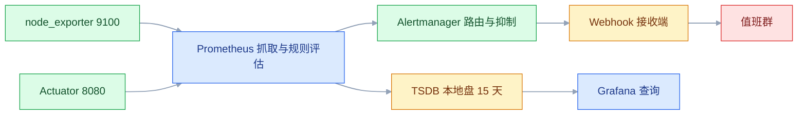
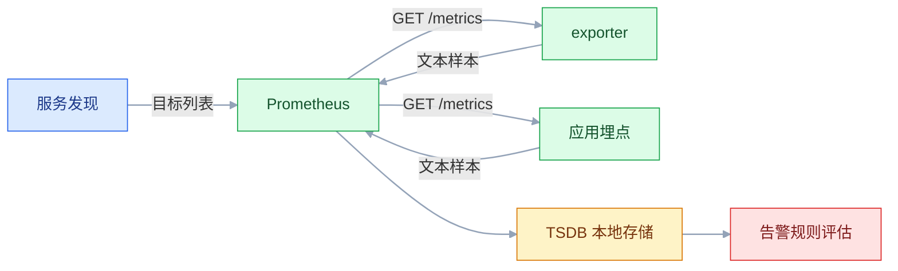
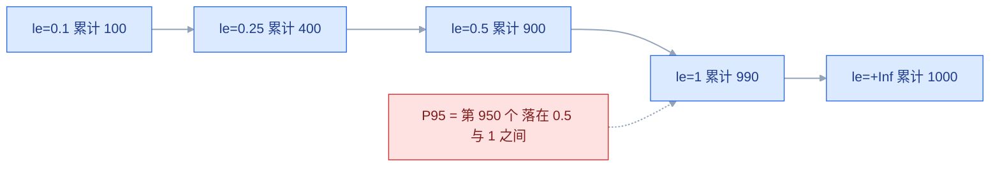
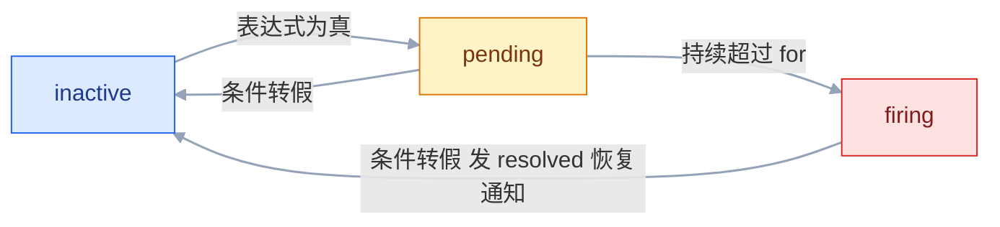
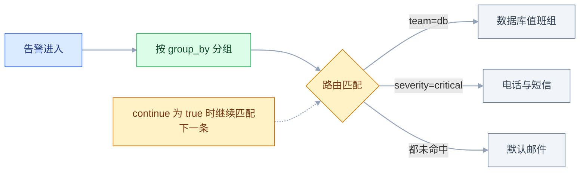

# Prometheus 监控告警系统

## 一、工程案例：把一台 Spring Boot 应用的指标接进 Prometheus 并配一条真正会响的告警

**场景**：三台机器，`10.0.0.10` 只跑监控，`10.0.0.11` / `10.0.0.12` 各跑一个 `order-service`（Spring Boot，8080）。目标是产出一条**端到端可验证的告警链路**：停掉 `.12` 上的实例，1 分钟内 webhook 收到告警；实例恢复后再收到恢复通知；Prometheus 容器重启后，历史数据仍然可查。

**为什么要从告警倒着做**：`/targets` 全绿只证明「抓到了」，不证明「出事会响」。真正要验收的是「故障发生 → 指标变化 → 规则判定 → 路由 → 通知」这条链，任何一环断了，前面采得再全也没有意义。

**这条链的总时长要提前算清**：停服到收到 webhook ≈ `for` + `group_wait`（critical 路由）。本例是 `1m + 10s` ≈ 70 秒，所以验收写「90 秒内」而不是「1 分钟内」。把 `for` 压到 30s 以内会让偶发抓取失败也变成告警，通常不划算。

**动手前确认**：三台机器 `timedatectl` 均为 `synchronized: yes`；`9090`、`9100`、`8080`、`9093` 在监控机与目标机之间可达；`.11` / `.12` 已装 Docker。



### 1.1 主线（按顺序执行）

```bash
# ① 监控机：目录、网络、一个本地 webhook 接收端（先代替真实值班群，便于验收）
sudo mkdir -p /opt/monitor/prometheus/conf/{rules,tests} /opt/monitor/alertmanager
docker network create monitor-net

cat > /opt/monitor/alert-sink.py <<'EOF'
from http.server import BaseHTTPRequestHandler, HTTPServer
class H(BaseHTTPRequestHandler):
    def do_POST(self):
        n = int(self.headers.get("Content-Length", 0))
        print(self.path, self.rfile.read(n).decode()[:800], flush=True)
        self.send_response(200); self.end_headers()
HTTPServer(("0.0.0.0", 8080), H).serve_forever()
EOF
docker run -d --name alert-sink --network monitor-net --restart=always \
  -v /opt/monitor/alert-sink.py:/sink.py:ro python:3-alpine python /sink.py
```

```yaml
# ② /opt/monitor/prometheus/conf/prometheus.yml
global:
  scrape_interval: 15s
  evaluation_interval: 15s
  scrape_timeout: 10s
  external_labels:
    cluster: prod
    replica: a
rule_files:
  - /etc/prometheus/rules/*.yml
alerting:
  alertmanagers:
    - static_configs:
        - targets: ['alertmanager:9093']
scrape_configs:
  - job_name: prometheus
    static_configs:
      - targets: ['localhost:9090']
  - job_name: node
    static_configs:
      - targets: ['10.0.0.11:9100', '10.0.0.12:9100']
        labels:
          env: prod
  - job_name: order-service
    metrics_path: /actuator/prometheus
    static_configs:
      - targets: ['10.0.0.11:8080', '10.0.0.12:8080']
        labels:
          application: order-service
          env: prod
```

```bash
# ③ 启动 Prometheus（数据卷必须独立，否则重启丢历史）
docker run -d --name prometheus --network monitor-net --restart=always \
  -p 9090:9090 \
  -v /opt/monitor/prometheus/conf:/etc/prometheus:ro \
  -v prometheus-data:/prometheus \
  prom/prometheus:latest \
  --config.file=/etc/prometheus/prometheus.yml \
  --storage.tsdb.retention.time=15d \
  --web.enable-lifecycle

curl -s http://localhost:9090/-/healthy      # → Prometheus Server is Healthy.
curl -s http://localhost:9090/api/v1/status/config | grep -c order-service
```

```bash
# ④ 两台应用机各跑一个 node_exporter
docker run -d --name node-exporter --restart=always \
  --net=host --pid=host \
  -v /:/host:ro,rslave \
  prom/node-exporter:latest --path.rootfs=/host

# ⑤ 应用侧：pom.xml 两个依赖
# spring-boot-starter-actuator
# micrometer-registry-prometheus
```

```yaml
# /opt/app/application.yml 追加
management:
  endpoints:
    web:
      exposure:
        include: health,info,prometheus
  endpoint:
    prometheus:
      enabled: true
  metrics:
    tags:
      application: ${spring.application.name}
    distribution:
      percentiles-histogram:
        http.server.requests: true
      sla:
        http.server.requests: 50ms,100ms,300ms,1s,3s
```

```bash
# ⑥ 验证应用已暴露直方图（桶必须出现，否则后面算不出 P95）
curl -s http://10.0.0.11:8080/actuator/prometheus \
  | grep -E '^http_server_requests_seconds_(bucket|count)' | head -4
# http_server_requests_seconds_bucket{application="order-service",le="0.05",...} 12.0
# http_server_requests_seconds_bucket{application="order-service",le="+Inf",...} 152.0
# http_server_requests_seconds_count{application="order-service",status="200",...} 152.0
```

```yaml
# ⑦ /opt/monitor/prometheus/conf/rules/order-service.yml
groups:
  - name: order-service
    rules:
      - alert: OrderServiceDown
        expr: up{job="order-service"} == 0
        for: 1m
        labels:
          severity: critical
        annotations:
          summary: '订单服务实例抓取失败 ({{ $labels.instance }})'
          description: '已持续 1 分钟抓不到指标，先看进程与 8080 端口'
          # 只覆盖「目标还在配置里但抓不到」；整个 job 下线要用 absent()，见 2.4
      - alert: OrderServiceHighErrorRate
        expr: |
          sum by (application) (rate(http_server_requests_seconds_count{job="order-service", status=~"5.."}[5m]))
          / sum by (application) (rate(http_server_requests_seconds_count{job="order-service"}[5m])) * 100 > 1
        for: 2m
        labels:
          severity: critical
        annotations:
          summary: '订单服务 5xx 比例过高 ({{ $labels.application }})'
          description: '当前 {{ printf "%.2f" $value }}%，检查下游依赖与最近变更'
      - alert: OrderServiceP95Slow
        expr: |
          histogram_quantile(0.95,
            sum by (le, application) (
              rate(http_server_requests_seconds_bucket{job="order-service", uri!~".*/(health|prometheus|favicon.ico)"}[5m])
            )) > 0.5
        for: 5m
        labels:
          severity: warning
        annotations:
          summary: '订单服务 P95 延迟超过 500ms ({{ $labels.application }})'
          description: '当前 P95 = {{ printf "%.3f" $value }}s，排除健康检查后仍偏高'
```

```yaml
# ⑧ /opt/monitor/alertmanager/alertmanager.yml
global:
  resolve_timeout: 5m
route:
  receiver: default
  group_by: ['alertname', 'application']
  group_wait: 30s
  group_interval: 5m
  repeat_interval: 4h
  routes:
    - matchers:
        - severity = "critical"
      receiver: oncall
      group_wait: 10s
      repeat_interval: 1h
inhibit_rules:
  - source_matchers:
      - alertname = "OrderServiceDown"
    target_matchers:
      - severity = "warning"
    equal: ['instance']
    # 宕机期间同一实例的 warning 不再发；critical 保留，因为它携带宕机告警没有的信息
receivers:
  - name: default
    webhook_configs:
      - url: http://alert-sink:8080/default
        send_resolved: true
  - name: oncall
    webhook_configs:
      - url: http://alert-sink:8080/oncall
        send_resolved: true
```

```bash
# ⑨ 校验后启动 Alertmanager（语法错误会导致容器无限重启）
docker run --rm --entrypoint amtool \
  -v /opt/monitor/alertmanager:/etc/alertmanager \
  prom/alertmanager:latest check-config /etc/alertmanager/alertmanager.yml
# → SUCCESS

docker run -d --name alertmanager --network monitor-net --restart=always \
  -p 9093:9093 \
  -v /opt/monitor/alertmanager:/etc/alertmanager \
  -v alertmanager-data:/alertmanager \
  prom/alertmanager:latest \
  --config.file=/etc/alertmanager/alertmanager.yml \
  --storage.path=/alertmanager

docker exec prometheus promtool check rules /etc/prometheus/rules/order-service.yml
# → SUCCESS: 3 rules found
curl -X POST http://localhost:9090/-/reload      # 热加载，不重启容器
```

### 1.2 验收（9 项全过才算交付）

| # | 项 | 命令或查询 | 通过标准 |
|---|---|---|---|
| 1 | 服务健康 | `curl -s localhost:9090/-/healthy` | 输出 `Prometheus Server is Healthy.` |
| 2 | 抓取目标 | 查询 `up` | 5 条序列全为 `1`，无 `down` |
| 3 | 应用指标 | `curl -s 10.0.0.11:8080/actuator/prometheus \| grep _bucket` | 至少 6 个 `le` 桶，含 `+Inf` |
| 4 | 规则加载 | 查询 `prometheus_rule_group_rules` | 值为 `3`，`/api/v1/rules` 无 `lastError` |
| 5 | 告警触发 | 在 `.12` 执行 `docker stop order-service` | 90 秒内 `OrderServiceDown` 从 `pending` 变 `firing`（`for: 1m` + `group_wait: 10s`） |
| 6 | 通知送达 | `docker logs --tail 5 alert-sink` | 出现 `POST /oncall` 且 body 含 `"status":"firing"` |
| 7 | 恢复通知 | `docker start order-service` | 2 分钟内出现 `"status":"resolved"` |
| 8 | 数据持久 | `docker restart prometheus` 后查 `up[1h]` | 重启前后的历史点连续，无断档 |
| 9 | 热加载 | 改规则后 `curl -X POST localhost:9090/-/reload` | HTTP 200，`/rules` 显示新内容 |

> **第 5 项必须真的停进程**。用 `expr` 手改阈值测出来的「告警」，只验证了表达式，没验证抓取失败这条路。
> **第 8 项是数据卷的验收**：容器重启后 TSDB 要能重放 WAL，序列才连续；没有独立数据卷时，重启即清零。

### 1.3 不等 5 分钟也能验证规则

改完规则先跑单元测试，比制造真实故障快一个数量级：

```yaml
# /opt/monitor/prometheus/conf/tests/order-service.test.yml
rule_files:
  - /etc/prometheus/rules/order-service.yml
evaluation_interval: 1m
tests:
  - interval: 1m
    input_series:
      - series: 'up{job="order-service", instance="10.0.0.12:8080", application="order-service"}'
        values: '1 1 0 0 0'
    alert_rule_test:
      - eval_time: 3m
        alertname: OrderServiceDown
        exp_alerts:
          - exp_labels:
              severity: critical
              job: order-service
              instance: 10.0.0.12:8080
              application: order-service
            exp_annotations:
              summary: 订单服务实例抓取失败 (10.0.0.12:8080)
              description: 已持续 1 分钟抓不到指标，先看进程与 8080 端口
```

```bash
docker exec prometheus promtool test rules /etc/prometheus/tests/order-service.test.yml
# → SUCCESS
```

> 测试文件**不能放进 `rules/` 目录**：`rule_files` 是通配符，会把测试文件当规则加载，Prometheus 直接启动失败。单独放 `tests/` 是硬要求。

### 1.4 从 2 个实例扩到 20 个

`static_configs` 每加一台就要改主配置并 reload。目标多了换成文件服务发现，改 target 文件即可，30 秒自动生效：

```yaml
  - job_name: order-service
    metrics_path: /actuator/prometheus
    file_sd_configs:
      - files: ['/etc/prometheus/targets/order-service.json']
        refresh_interval: 30s
```

```json
[
  {
    "targets": ["10.0.0.11:8080", "10.0.0.12:8080"],
    "labels": {"application": "order-service", "env": "prod"}
  }
]
```

| 约束 | 处理 |
|---|---|
| 文件必须是合法 JSON | 改完 `python3 -m json.tool` 校验；格式错时 Prometheus 保留上一次的 target 列表，不报错也不更新 |
| 删除 target 会丢 `up` 序列 | 目标下线后 `up == 0` 不会触发，改用 `absent(up{...})` 或保留一条静态哨兵 |
| 标签冲突 | target 自带 `job` / `instance`，文件里再写同名标签会被忽略，需要 `honor_labels` 或 relabel |
| 大规模动态环境 | 容器/K8s 用 `kubernetes_sd_configs`，不要手维护 JSON |

---

## 二、高频问答：会卡住你的地方，也是面试最常问的

### 2.1 目标显示 down，报 `connection refused`

**现场**

在目标机 `ss -tlnp | grep 9100`；在 Prometheus 容器里 `wget -qO- 目标:9100/metrics`。

```bash
# 在目标机确认监听地址
ss -tlnp | grep 9100
# 0.0.0.0:9100 → 正常；127.0.0.1:9100 → 外部永远抓不到

# 在监控端确认是「拒绝」还是「超时」
docker exec prometheus wget -T 3 -qO- http://10.0.0.11:9100/metrics | head -3
```

**要点**

- `connection refused` 是 TCP RST，包到了目标机，但没有进程接这个端口。
- 防火墙丢包的表现是 `context deadline exceeded`，两种报错指向完全不同的层。
- 目标端没监听、只监听 `127.0.0.1`、容器没加 `-p`，都会是拒绝。

**追问**

- 拒绝和超时分别该查哪层？→ 拒绝查进程与监听地址，超时查网络与防火墙。
- 容器里监听了 `0.0.0.0`，外面为什么还抓不到？→ 没做端口映射或不在同一网络。
- 先看错误文本还是先改配置？→ 先看文本，它已经告诉你卡在哪一层。

### 2.2 `/actuator/prometheus` 返回 404

**现场**

`curl -s localhost:8080/actuator | jq '._links'`，看端点列表里有没有 `prometheus`。

```bash
curl -s http://10.0.0.11:8080/actuator | jq -r '._links | keys[]'
# health, info, prometheus   ← 有 prometheus 才说明端点开了

# 独立管理端口时，抓取地址是 management.server.port，不是 8080
curl -s http://10.0.0.11:8081/actuator/prometheus | head -3
```

**要点**

- Actuator 默认只暴露 `health`，`prometheus` 没在 `exposure.include` 里。
- 应用配了独立的 `management.server.port` 或 `base-path`，路径就不是 8080 上那个。
- Spring Boot 没有 `/metrics` 这个路径，把地址换掉解决不了问题。

**追问**

- 加了 `micrometer-registry-prometheus` 为什么还是 404？→ 依赖只提供端点，暴露要配置。
- 怎么一次确认两件事？→ 先看 `/actuator` 的 links，再对管理端口。
- 生产环境该暴露全部端点吗？→ 不该，只开需要的几个。

### 2.3 查询时提示指标不存在

**现场**

用标签值接口搜真实指标名，不要凭记忆写。

```bash
curl -s 'http://localhost:9090/api/v1/label/__name__/values' \
  | jq -r '.data[]' | grep http_server

curl -s 'http://localhost:9090/api/v1/series' \
  --data-urlencode 'match[]=http_server_requests_seconds_count' \
  | jq '.data[0]'
# 能看到完整标签集，说明指标存在，只是名字/标签写错了
```

**要点**

- Counter 带 `_total`，Histogram 只有 `_bucket` / `_sum` / `_count`，没有裸的 `_seconds`。
- 不同 Micrometer 版本命名也有差异，不能照抄别处的查询。
- `up` 为 1 只说明抓取成功，不说明你要的那个指标存在。

**追问**

- 怎么区分「没抓到」和「名字写错」？→ `series` 接口能查到就说明存在。
- 为什么 `histogram_quantile` 要用 `_bucket`？→ 分位靠累计桶插值，`_count` 只是总数。
- 换个版本指标名就变了，怎么防？→ 用 `/api/v1/label/__name__/values` 核对。

### 2.4 服务停了，告警却没触发

**现场**

查 `ALERTS{alertname="OrderServiceDown"}` 是否为空，再查 `count(up{job="order-service"})`。

```promql
# 目标被移除时，这条返回空而不是 0
up{job="order-service"} == 0

# 覆盖「整个 job 消失」的写法
absent(up{job="order-service"})
```

**要点**

- 目标从配置里删掉后，`up` 序列随之消失，`up == 0` 查不到任何数据，自然不触发。
- 也可能是 `for` 还没走完，状态仍停在 pending。
- `== 0` 只能表达「抓到了但失败」，表达不了「连序列都没有」。

**追问**

- 下线、改名、删 job 分别属于哪种？→ 都是序列消失，要用 `absent()` 兜底。
- `absent` 和 `absent_over_time` 区别？→ 当前无序列 vs 一段时间内都没有。
- 为什么删 target 比停进程更危险？→ 停进程还有 `up=0`，删了连告警都没了。

### 2.5 告警一直停在 pending，永远不进 firing

**现场**

查 pending 告警的标签是否在两次评估间变化。

```promql
ALERTS{alertstate="pending"}
count by (alertname) (ALERTS{alertstate="pending"})
# 同一个 alertname 的 pending 条数持续增加 → 标签在变
```

```bash
# 看规则评估详情与最近一次错误
curl -s http://localhost:9090/api/v1/rules | jq '.data.groups[].rules[] | {name, state, lastError}'
```

**要点**

- `for` 的计时单位是「同一组标签的告警」，标签一变就换了一条告警，重新计时。
- 版本号、Pod 名、`revision` 这类会漂移的标签是常见元凶。
- 修法是去掉漂移标签，而不是缩短或删掉 `for`。

**追问**

- 把 `for` 删掉会怎样？→ 抖动直接放大成告警风暴。
- 怎么去掉漂移标签？→ `metric_relabel_configs` 里 `labeldrop`。
- 为什么 pending 条数会越来越多？→ 每次标签变化都新建一条待触发告警。

### 2.6 一次故障收到几十条告警

**现场**

Alertmanager UI 看分组数量；`amtool alert query` 看同一 `alertname` 有多少条。

```promql
# 错：每个 uri、每个 status 都会生成一条告警
rate(http_server_requests_seconds_count{status=~"5.."}[5m]) > 0

# 对：先收敛到 application 维度
sum by (application) (rate(http_server_requests_seconds_count{status=~"5.."}[5m])) > 1

# 看当前哪条规则产出的告警最多
topk(5, count by (alertname) (ALERTS))
```

**要点**

- 表达式保留了 `uri` / `instance` 等高基数维度。
- `group_by` 又按这些维度拆组，一条故障被拆成很多条通知。
- 没有配抑制，下游故障把上游全部带响。

**追问**

- 告警维度该按什么定？→ 按「谁来处理」，不是按数据有多少切面。
- 抑制和分组有什么区别？→ 分组合并通知，抑制让被波及的告警不响。
- `uri` 该放哪？→ 只留在看板和排障查询里，不进告警标签。

### 2.7 规则在 firing，值班群却没消息

**现场**

先用 `amtool config routes test` 看会走哪个 receiver，再看适配器日志。

```bash
docker exec alertmanager amtool config routes test \
  --config.file=/etc/alertmanager/alertmanager.yml \
  severity=critical application=order-service
# → oncall   （打印实际命中的 receiver）

docker logs --tail 20 alertmanager | grep -iE "notify|error"
docker logs --tail 20 <webhook-adapter> | grep -iE "error|310000"
```

**要点**

- 告警没匹配到任何 route，落到了错误的 receiver。
- webhook 适配器的安全设置（关键词、加签、IP 白名单）拒绝了请求。
- 容器网络不通，请求根本发不出去。

**追问**

- 配置里写了 receiver，为什么还不命中？→ 路由是树形匹配，父节点 receiver 只是兜底。
- `continue` 默认是什么？→ `false`，命中第一条就停。
- 怎么快速区分是路由还是渠道问题？→ 路由测试打印 receiver，再看适配器日志。

### 2.8 P95 算出来明显偏低

**现场**

对比「先聚合桶再算分位」与「先算分位再平均」的结果，并检查桶分布。

```promql
# 对：先按 le 聚合，再算整体分位
histogram_quantile(0.95, sum by (le) (rate(http_server_requests_seconds_bucket[5m])))

# 错：各实例 P95 的平均值，不是整体 P95
avg(histogram_quantile(0.95, rate(http_server_requests_seconds_bucket[5m])))

# 看桶是否够细：绝大多数请求落在哪个 le
sum by (le) (rate(http_server_requests_seconds_bucket[5m]))
```

**要点**

- 分位数不是可加量，对多个实例的分位再求平均，数学上不成立。
- 桶边界太粗时，P95 落在 `+Inf` 前的最后一个桶，只能返回该桶上界。
- 只有保留桶才能正确合并，Summary 的分位无法跨实例加权。

**追问**

- 多实例整体 P95 怎么写？→ 先 `sum by (le)` 再 `histogram_quantile`。
- 为什么桶要按 SLO 定？→ 桶不在目标附近，插值误差会把结果拉偏。
- P99 为什么更难算？→ 需要更细的尾部桶，否则会落进 `+Inf` 前一档。

### 2.9 `rate()` 出现尖刺、断点或空值

**现场**

数窗口内的样本数，并确认指标类型。

```promql
count_over_time(http_server_requests_seconds_count[1m])
# 小于 2 → 这个窗口算不出速率，曲线会断
```

**要点**

- 窗口内点数不足（窗口小于 2 个抓取间隔），算不出速率。
- 对 Gauge 用了 `rate`，语义本身就不对。
- Counter 重启后 `rate` 按重置处理，但首个窗口会失真。

**追问**

- `rate` 只能用于什么类型？→ Counter，Gauge 要用 `delta` / `deriv`。
- 15s 抓取该用多长窗口？→ `[1m]` 起步，至少 4 个抓取间隔。
- 低流量指标为什么看起来在「跳」？→ 短窗口加稀疏样本，外推把误差放大。

### 2.10 TSDB 序列数暴涨、内存持续上涨

**现场**

按指标名和标签值数量排序，找出增长源。

```promql
topk(10, count by (__name__) ({__name__=~".+"}))
count by (uri) (http_server_requests_seconds_count)
count by (instance) ({__name__=~".+"})
```

```bash
curl -s http://localhost:9090/api/v1/status/tsdb | jq '.data.seriesCountByMetricName[:5]'
```

**要点**

- 高基数标签是根因：URL 里带订单号、`userId` 进标签、Pod 名带随机后缀、每个版本一个 `version`。
- 序列数是「指标名 × 每个标签取值数」的组合爆炸，不是数据量大就要加内存。
- 先砍标签，再谈容量。

**追问**

- 加内存能解决吗？→ 只能推迟，序列数还在涨。
- 怎么定位是哪个标签？→ 按标签分组数取值数，看谁在膨胀。
- 已经写进去的高基数序列怎么办？→ 改埋点和 relabel，别指望历史自动消失。

### 2.11 容器里的 node_exporter 采到的是容器指标

**现场**

对比 `node_memory_MemTotal_bytes` 与宿主机 `free -b`；数值等于容器限额就是采错了。

```bash
# 正确启动方式
docker run -d --name node-exporter --restart=always \
  --net=host --pid=host -v /:/host:ro,rslave \
  prom/node-exporter:latest --path.rootfs=/host
```

**要点**

- 没加 `--net=host` / `--pid=host`，也没挂宿主机根目录，读到的是容器自己的 `/proc`。
- node_exporter 不会自动知道「宿主机」在哪，它只读启动时看到的 `/proc` 和 `/sys`。
- 三个参数缺一个，指标就可能少一块或全错。

**追问**

- 只加 `--net=host` 够吗？→ 不够，还要 `--pid=host` 和 `--path.rootfs`。
- 为什么容器里看到的核数和内存不对？→ 读的是容器命名空间。
- 换一个查询能绕过吗？→ 不能，数据源本身就采错了。

### 2.12 两台 Prometheus 同时发通知

**现场**

Alertmanager UI 同一 fingerprint 出现两条；两台实例的 `external_labels` 缺少区分。

```bash
# 两个 Alertmanager 用 gossip 组成集群，通知只发一次
alertmanager --cluster.listen-address=0.0.0.0:9094 \
  --cluster.peer=am-2:9094
```

**要点**

- 双实例都连着同一个 Alertmanager，但没有组成集群，去重没有发生。
- Prometheus 侧的高可用只是「两份数据」，去重发生在 Alertmanager 集群层。
- 只复制 Prometheus 不组 Alertmanager 集群，等于把通知翻倍。

**追问**

- 怎么让通知只发一次？→ Alertmanager 用 gossip 组集群，`external_labels` 保持一致。
- 两台实例的 `external_labels` 为什么要区分副本？→ 查询端去重要靠它识别同一条序列。
- 单实例部署需要考虑这些吗？→ 不需要，这是双实例才出现的问题。

## 三、核心知识：从零开始要建立的东西

### 3.1 时间序列与样本模型

Prometheus 存的是**样本**，一条样本由四部分组成：

```text
指标名{标签1="值1", 标签2="值2"} 数值 时间戳
http_requests_total{job="app", instance="10.0.0.11:8080", status="200"} 152340 1759600000
```

| 部分 | 作用 | 约束 |
|---|---|---|
| 指标名 | 说明「量的是什么」 | 匹配 `[a-zA-Z_:][a-zA-Z0-9_:]*` |
| 标签集 | 说明「哪一维度」 | 指标名 + 全部标签唯一确定一条序列 |
| 数值 | float64 | 不支持字符串；字符串信息只能放标签或日志 |
| 时间戳 | 毫秒 | 由抓取时刻决定，不是应用自己报的 |

**序列 identity 的关键推论**：标签多一个取值，就多一条完整的时间线。`status="200"` 和 `status="500"` 是两条独立的线，不是同一条线上的两个点。这决定了后面所有的容量与查询设计。

### 3.2 四种指标类型与适用场景

| 类型 | 客户端行为 | 服务端用法 | 典型指标 |
|---|---|---|---|
| Counter | 只增，重启归零 | `rate()` / `increase()` | `http_requests_total` |
| Gauge | 可增可减 | 直接取值、`delta()`、`predict_linear()` | `node_memory_MemAvailable_bytes` |
| Histogram | 按桶累计计数 | `histogram_quantile()`，桶可跨实例合并 | `http_request_duration_seconds_bucket` |
| Summary | 客户端算好分位数 | 直接读 `quantile` 标签，不能合并 | `rpc_duration_seconds{quantile="0.95"}` |

```text
Histogram 暴露的是累计桶：
  le="0.1"  1520      ≤100ms 的有 1520 个
  le="0.5"  1890      ≤500ms 的有 1890 个（包含前面 1520 个）
  le="+Inf" 2000      总数 2000

Summary 暴露的是算好的分位：
  quantile="0.95"  0.31
```

**选型边界**：需要跨实例、跨维度合并分位数，只能选 Histogram；Summary 的分位是客户端近似值，且各实例的分位无法加权合并。Histogram 的代价是桶边界要提前定，桶太粗会损失精度，桶太多会增加序列数。

> **面试**：常问「Histogram 和 Summary 怎么选？」答：要跨实例合并分位只能选 Histogram，Summary 的分位在客户端算好，无法加权合并。

### 3.3 拉取模型与抓取生命周期

Prometheus 每隔 `scrape_interval` 主动 `GET` 目标的 `metrics_path`，解析文本，写入 TSDB。一次抓取的结果只有两种：成功（`up=1`）或失败（`up=0`）。

| 阶段 | 超时参数 | 失败表现 |
|---|---|---|
| 建立连接 | `scrape_timeout` 内 | `context deadline exceeded` |
| 读取响应 | `scrape_timeout` 内 | `context deadline exceeded` |
| 解析样本 | 无单独超时 | `text format parsing error` |
| 写入 TSDB | 无单独超时 | `out of order sample`、`duplicate sample` |



**Pull 与 Push 的取舍**：

| 维度 | Pull | Push |
|---|---|---|
| 配置位置 | 监控端集中配置 | 每个客户端各自配置 |
| 故障语义 | 抓不到 = 目标异常，语义明确 | 不推了分不清是挂了还是没配 |
| 动态目标 | 服务发现自动增删 | 客户端要自己注册 |
| 短生命周期任务 | 容易扑空 | 天然适配 |

**边界**：批处理任务（跑几十秒就退出）用 Pushgateway 中转，但 Pushgateway 不会自动过期，最后一次推送的值会永久保留。必须用 `push_time_seconds` 判断数据新旧，或让任务退出前推一次失败标记。

### 3.4 job、instance 与标签体系

| 标签 | 来源 | 含义 |
|---|---|---|
| `job` | `job_name` | 一类抓取任务，如 `node`、`order-service` |
| `instance` | target 地址 | 一个具体目标，`host:port` |
| `env` / `application` | target 的 `labels` | 业务维度，由配置附加 |
| `__address__` | 抓取前 | 实际抓取地址，relabel 后可改 |
| `__param_*` | relabel | 追加到请求 URL 的参数 |

`up` 是 Prometheus 自动生成的合成指标，标签与目标一致，值为 1/0。它是最便宜的「目标存活」信号，也是所有 `absent` 类告警的基础。

**标签冲突规则**：目标自己暴露的标签与抓取配置冲突时，默认保留目标的值（`honor_labels: false` 时冲突标签被重命名为 `exported_job` 等）。需要让配置覆盖目标值时，显式设 `honor_labels: true`。

### 3.5 标签基数与序列预算

一条序列的标签组合数是各标签取值数的乘积。`job` 有 3 个值、`instance` 有 20 个、`uri` 有 200 个、`status` 有 6 个，理论上就是 `3 × 20 × 200 × 6 = 72000` 条序列，而不是 3 条。

| 标签 | 取值规模 | 结论 |
|---|---|---|
| `env` / `job` / `service` | 个位数到几十 | 适合 |
| `status` / `method` | 几个到几十 | 适合，但要控制组合 |
| `uri` | 几十到几百（必须归一化） | 谨慎，只留模板路径 |
| `userId` / `traceId` / `orderId` | 无上限 | 禁止 |
| `version` / `pod`（带随机后缀） | 每次发布都新增 | 禁止或先脱敏 |

**归一化**：`/api/orders/12345` 与 `/api/orders/67890` 必须变成 `/api/orders/{id}`。Spring Boot 的 Micrometer 默认对 `@RequestMapping` 路径做模板化，但手写的 `uri` 标签、网关转发的原始路径不会自动归一化。

**预算方法**：先看 `prometheus_tsdb_head_series`，按当前序列数估内存与磁盘；序列数持续上升而业务量没变，基本就是新加了高基数标签。

> **面试**：常问「序列数为什么会爆炸？」答：一条序列由指标名加全部标签唯一确定，标签取值数相乘就是序列数，高基数标签必须禁止。

### 3.6 PromQL 选择器与时间修饰

```promql
http_requests_total                          # 瞬时向量：当前时刻
http_requests_total{job="app"}               # 标签过滤
http_requests_total{status=~"5.."}           # 正则，全匹配
http_requests_total[5m]                      # 范围向量，只能喂给函数
http_requests_total offset 1h                # 1 小时前的值
http_requests_total @ 1759600000             # 固定在某个 Unix 时间点
```

| 写法 | 含义 | 常见误用 |
|---|---|---|
| `=` / `!=` | 精确相等/不等 | 空标签匹配要写 `label=""` |
| `=~` / `!~` | 正则全匹配 | `=~"/api"` 匹配不到 `/api/orders` |
| `offset` | 相对当前时间偏移 | 与 `@` 同时使用时以 `@` 为基准 |
| `@` | 固定评估时刻 | 图表回看时容易忽略它压掉了当前时间 |

**正则的全匹配语义**是高频坑：Prometheus 的正则是隐式锚定的，`=~"5.."` 等价于 `^5..$`，不是「包含 5」。

### 3.7 计数器速率与窗口边界

| 函数 | 计算方式 | 适用 | 特点 |
|---|---|---|---|
| `rate(v[5m])` | 窗口首尾差值 / 秒数，处理重置 | Counter | 平滑，最常用 |
| `irate(v[5m])` | 最后两个点的瞬时斜率 | Counter | 敏感、抖动大，适合看突变 |
| `increase(v[1h])` | 窗口内的增量 | Counter | 结果不是每秒，是总量 |
| `delta(v[5m])` | 首尾差值 | Gauge | 不看重置 |
| `deriv(v[5m])` | 线性回归斜率 | Gauge | 适合缓慢变化的量 |

**窗口下限**：窗口内至少要有 2 个样本，实际建议 ≥ 4 个抓取间隔。15s 抓取配 `[5m]` 有 20 个点，足够稳；配 `[30s]` 只有 2 个点，任何一次抓取失败都会让曲线断裂。

**外推**：`rate` 会把首尾样本之间的斜率外推到整个窗口边界，短窗口 + 稀疏样本会放大误差；这是 `rate` 在低流量指标上看起来「跳」的原因，不是数据坏了。

### 3.8 聚合、分组与向量匹配

```promql
sum(rate(http_requests_total[5m]))                      # 所有序列求和，标签全丢
sum by (application) (rate(http_requests_total[5m]))    # 保留 application
sum without (instance, pod) (rate(...))                 # 去掉指定标签，保留其余
topk(5, sum by (uri) (rate(http_requests_total[5m])))   # 每组取前 5
count by (job) (up)                                     # 每个 job 有多少目标
```

**向量匹配**用于两条不同标签集的序列做运算：

```promql
# 左右标签不一致，用 on 指定匹配键
sum by (instance) (rate(node_cpu_seconds_total{mode="idle"}[5m]))
  * on (instance) group_left
sum by (instance) (node_cpu_cores)

# 只忽略某些标签
method:http_requests:rate5m / ignoring (method) group_left
sum without (method) (method:http_requests:rate5m)
```

| 关键字 | 作用 | 注意 |
|---|---|---|
| `on(...)` | 只按这些标签匹配 | 未列出的标签被丢弃 |
| `ignoring(...)` | 忽略这些标签后匹配 | 其余标签必须一致 |
| `group_left` | 左多右一，保留左侧标签 | 右侧匹配键必须唯一 |
| `group_right` | 左一右多 | 少用，容易写出笛卡尔积 |

**默认匹配是「标签集完全相等」**，少一个标签就匹配不上，结果是空向量而不是报错。这是 PromQL 静默失败最常见的原因。

### 3.9 直方图、分桶与分位数

Histogram 的桶是**累计计数**，`le` 表示「小于等于」。`histogram_quantile(φ, v)` 在相邻桶之间做线性插值，前提是 `v` 里每个 `le` 都有值。



图上每个数都是「小于等于该边界的请求总数」，所以后一个桶一定大于等于前一个桶。P95 先算出第 950 个请求，再定位它落在哪两个 `le` 之间，最后按比例插值。


```promql
# 单实例 P95
histogram_quantile(0.95, rate(http_request_duration_seconds_bucket[5m]))

# 多实例整体 P95：必须先 sum by (le)
histogram_quantile(0.95,
  sum by (le) (rate(http_request_duration_seconds_bucket[5m])))
```

**桶边界设计**：按 SLO 定，不按「好看」定。目标 P95 < 500ms，桶里必须有 `0.1 / 0.25 / 0.5 / 1 / 2.5` 这些边界，否则插值会把结果拉向邻近桶。桶数量每多一个，该指标的序列数就多一批。

**边界**：`histogram_quantile` 的结果是近似值，桶越粗误差越大；P99 需要更细的尾部桶，否则会落在 `+Inf` 前一个桶，返回值被高估或低估。原生直方图（native histogram）能缓解桶设计问题，但需要客户端与服务端同时支持，落地前先确认生态兼容性。

> **面试**：常问「histogram_quantile 算出来的 P95 为什么是近似值？」答：它在相邻桶之间线性插值，桶越粗误差越大，桶边界要按 SLO 定。

### 3.10 Recording rule 与预计算

Recording rule 把高频、昂贵的查询预先算成一条新指标，看板和告警直接读结果：

```yaml
groups:
  - name: app-recording
    interval: 30s
    rules:
      - record: application:http_requests:rate5m
        expr: sum by (application) (rate(http_server_requests_seconds_count[5m]))
      - record: application:http_errors:ratio5m
        expr: |
          sum by (application) (rate(http_server_requests_seconds_count{status=~"5.."}[5m]))
          / sum by (application) (rate(http_server_requests_seconds_count[5m]))
```

| 要点 | 说明 |
|---|---|
| 命名 | 推荐 `level:metric:operation`，如 `application:http_errors:ratio5m` |
| 评估间隔 | 不小于原始抓取间隔，通常 30s 或 1m |
| 收益 | 看板查询从「扫全部原始序列」变成「读一条预计算序列」 |
| 代价 | 多存一份序列；链式 recording rule 过深会放大延迟与存储 |

**边界**：只在查询确实慢、或同一表达式被多个看板复用时才加。给每条查询都套一层 recording rule，会让指标数量翻倍，排障时还要多跳一层。

### 3.11 告警规则与状态机



| 字段 | 作用 | 写法建议 |
|---|---|---|
| `expr` | 判定条件 | 结果非空且为真才触发；用 `sum by` 收敛维度 |
| `for` | 持续时长 | 宕机 1m，资源 5m，错误率 2m；瞬时告警是风暴源头 |
| `labels` | 路由依据 | `severity` 决定打扰程度，`team` / `category` 决定接收方 |
| `annotations` | 人读的信息 | 带 `instance`、当前值、处理建议 |
| `keep_firing_for` | 条件恢复后仍保持 firing 一段时间 | 抑制指标抖动导致的反复恢复 |

**模板变量**：`{{ $labels.instance }}` 取标签，`{{ $value }}` 取原始数值，`{{ printf "%.2f" $value }}` 控制精度。`$value` 默认是科学计数法，直接拼进消息会很难读。

### 3.12 Alertmanager 的路由与抑制

Alertmanager 只做三件事：**分组、路由、去重/抑制**。它不评估表达式。




| 参数 | 含义 | 调大后的效果 |
|---|---|---|
| `group_by` | 按哪些标签合并成一条通知 | 通知更少，但不同问题被合并 |
| `group_wait` | 新组首次发送前等待 | 等更多同类告警一起发，延迟更高 |
| `group_interval` | 同组新增告警的最短发送间隔 | 减少更新频率 |
| `repeat_interval` | 未恢复告警的重复提醒 | 提醒更稀，容易漏看 |
| `continue` | 匹配后是否继续匹配后续路由 | 默认 false，命中即停 |

**抑制的匹配语义**：`source_matchers` 命中且 `target_matchers` 命中，并且 `equal` 里的标签值完全相同，才抑制。`equal` 放得越多，抑制越难发生；只按 `instance` 相等通常最符合「同一台机器」的语义。

**静默**是带过期时间的过滤器，不是删除规则。静默到期自动失效，但配了 `duration` 却忘了原因，会在下一次故障时变成「明明配了静默却还在响」的误判。

### 3.13 Exporter 分类与多目标探测

| 类型 | 工作方式 | 代表 |
|---|---|---|
| 直接埋点 | 应用自己暴露 `/metrics` | Micrometer、client_golang |
| 独立 exporter | 读目标状态再翻译 | node_exporter、mysqld_exporter |
| 探针型 | 每次抓取时主动拨测 | blackbox_exporter |
| 推送网关 | 接收短任务推送，等待被抓 | Pushgateway |

**探针型的关键在 relabel**：`targets` 里写的是「要探测的 URL」，不是「要抓的地址」，必须把 URL 塞进 `__param_target`，再把 `__address__` 改成 blackbox 自己：

```yaml
  - job_name: blackbox-http
    metrics_path: /probe
    params:
      module: [http_2xx]
    static_configs:
      - targets: ['https://api.example.com/health']
    relabel_configs:
      - source_labels: [__address__]
        target_label: __param_target
      - source_labels: [__param_target]
        target_label: instance
      - target_label: __address__
        replacement: blackbox-exporter:9115
```

### 3.14 本地 TSDB、保留与远程写

Prometheus 本地存储按 2 小时一个 block 落盘，写入先经过 WAL；重启时重放 WAL 恢复最近数据。保留策略支持按时间或按大小：

```bash
--storage.tsdb.retention.time=15d
--storage.tsdb.retention.size=50GB     # 两个都设时先到先删
```

| 需求 | 方案 | 边界 |
|---|---|---|
| 单集群 15 天 | 本地 TSDB | 磁盘随序列数线性增长 |
| 跨年查询 | Remote Write 到 Thanos / Mimir / VictoriaMetrics | 需要额外组件与对象存储 |
| 多集群汇总 | 联邦或远程写后全局查询 | 联邦只适合少量聚合指标 |
| 采集端高可用 | 两份同配置实例 + 相同 `external_labels` | 查询端要去重 |

**Prometheus 本身不做分布式存储**：两个实例各存各的，不会自动复制。所谓高可用是「两份独立采集」，不是「一个集群」。

### 3.15 服务发现与目标管理

| 方式 | 配置 | 适用 |
|---|---|---|
| `static_configs` | 手写 target 列表 | 少量固定机器 |
| `file_sd_configs` | 读 JSON/YAML 文件，定时刷新 | 中等规模、由 CMDB 生成 |
| `dns_sd_configs` | 按 DNS SRV/A 记录发现 | 云上动态 IP |
| `kubernetes_sd_configs` | 读 K8s API | Pod/Service 自动增减 |
| `consul_sd_configs` | 读 Consul 服务目录 | 已有服务注册中心 |

**relabel 是服务发现的配套能力**：在抓取前改标签、过滤目标、改地址。最常见的三件事是 `keep`（只留某类目标）、`drop`（去掉测试实例）、`labelmap`（把云厂商标签映射成业务标签）。relabel 配错时目标会静默消失，`/service-discovery` 页面是唯一能看清「过滤前/过滤后」的地方。

### 3.16 告警分级与可操作性

| 级别 | 判定 | 响应 | 例子 |
|---|---|---|---|
| critical | 用户已受影响，或数据面临丢失 | 立即，含夜间 | 实例全挂、5xx 飙升、磁盘 95% |
| warning | 有风险，用户可能未感知 | 工作时间内 | CPU 80% 持续、P95 上升、证书 30 天到期 |
| info | 仅供知晓 | 日报/周报 | 发布完成、扩缩容事件 |

**一条合格告警的三个条件**：需要人采取行动、紧急、用户可感知。三条不满足的，改成看板或报表。

**消息必须能直接开始处理**：问题是什么、影响哪些实例、当前值多少、持续多久、先看哪里。只有「CPU 高」三个字的告警，收到的人还要再查一遍，等于把定位成本转嫁给了值班。

---

## 四、冷门知识汇总

| 知识点 | 为什么冷门 | 用到时的关键词 |
|---|---|---|
| `absent_over_time` | 多数人只用 `absent`，忽略「曾经有、现在没了」的场景 | `absent_over_time(up{job="x"}[10m])` |
| `@` 修饰符 | 日常查询都基于当前时刻，回看对齐时才用 | `query @ 1759600000`、`@ start()` / `@ end()` |
| `group_left` 关联信息指标 | 只在把 `*_info` 指标拼到业务指标上时才需要 | `group_left(version)`、`on(instance)` |
| 原生直方图 | 默认还是经典桶，只有新客户端才暴露 | `native_histogram`、`histogram_count()` |
| Exemplar | 指标点关联 traceId，需要客户端与 Grafana 同时支持 | `exemplar`、`trace_id` |
| `metric_relabel_configs` 丢标签 | 抓取后再删标签，能救高基数，但不减少抓取开销 | `labeldrop`、`labelkeep` |
| `honor_labels` | 只有目标自带 `job` / `instance` 时才需要 | `exported_job`、`exported_instance` |
| WAL 重放 | 只在非正常停机后出现，表现为启动慢 | `WAL replay`、`out of order sample` |
| `promtool tsdb` | 排障 TSDB 损坏时才用 | `promtool tsdb analyze`、`tsdb dump` |
| Agent 模式 | 只需远程写、不要本地查询时使用 | `--enable-feature=agent` |
| Alertmanager 集群 | 单实例部署时完全用不到 | `--cluster.peer`、gossip |
| `keep_firing_for` | 新版本才有，解决「抖动导致反复恢复」 | `keep_firing_for: 5m` |
| 抓取类（scrape class） | 需要不同抓取参数（如原生直方图）时才出现 | `scrape_class`、`scrape_protocols` |
| UTF-8 指标名 | 3.x 才允许，旧版只认 ASCII | `utf8_name`、`__name__` |
