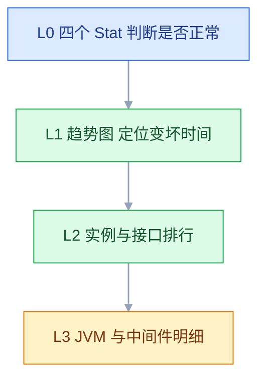

# Grafana 监控可视化

## 一、工程案例：从空 Grafana 搭出一块能值班的订单服务看板

**场景**：`10.0.0.10` 上 Prometheus 已能抓到 `order-service` 的指标，Grafana 还是空的。目标交付一块**值班同事不用懂 PromQL 也能用**的看板：两个变量切换实例与应用，11 个 Panel 覆盖流量、错误、延迟、JVM、中间件，单位与阈值正确；再加一块导入的主机看板，以及一个只读、无菜单的大屏链接。

**为什么先定看板结构再画图**：Panel 是一个个加的，但值班时的视线顺序是固定的——先看「现在好不好」，再看「什么时候变坏」，最后看「坏在哪」。顺序错了，图再漂亮也要来回找。

**动手前确认**：Prometheus 的 `http_server_requests_seconds_bucket` 已存在（没有直方图就算不出 P95）；Grafana 与 Prometheus 在同一 Docker 网络；`3000` 端口通过反代或防火墙限制来源，不对公网开放。



### 1.1 部署与数据源

```bash
# ① 目录：provisioning 放数据源与看板提供者，dashboards 放 JSON
sudo mkdir -p /opt/grafana/{data,plugins,dashboards} \
  /opt/grafana/provisioning/{datasources,dashboards}
sudo chown -R 472:472 /opt/grafana     # 容器内 grafana 用户 UID

# ② 数据源用文件声明，重建容器也不丢
cat > /opt/grafana/provisioning/datasources/prometheus.yml <<'EOF'
apiVersion: 1
datasources:
  - name: Prometheus
    uid: prom-main
    type: prometheus
    access: proxy
    url: http://prometheus:9090
    isDefault: true
    jsonData:
      timeInterval: 15s
      httpMethod: POST
EOF

# ③ 看板提供者：把 JSON 文件自动加载进 App 目录
cat > /opt/grafana/provisioning/dashboards/app.yml <<'EOF'
apiVersion: 1
providers:
  - name: app-dashboards
    orgId: 1
    folder: App
    type: file
    disableDeletion: false
    updateIntervalSeconds: 30
    options:
      path: /var/lib/grafana/dashboards
EOF

# ④ 启动（密码从环境文件读，不进命令行与 shell history）
cat > /opt/grafana/admin.env <<'EOF'
GF_SECURITY_ADMIN_USER=admin
GF_SECURITY_ADMIN_PASSWORD=ChangeMe_2026
GF_USERS_ALLOW_SIGN_UP=false
TZ=Asia/Shanghai
EOF
chmod 600 /opt/grafana/admin.env

docker run -d --name grafana --network monitor-net --restart=always \
  -p 127.0.0.1:3000:3000 \
  -v /opt/grafana/data:/var/lib/grafana \
  -v /opt/grafana/plugins:/var/lib/grafana/plugins \
  -v /opt/grafana/provisioning:/etc/grafana/provisioning:ro \
  -v /opt/grafana/dashboards:/var/lib/grafana/dashboards:ro \
  --env-file /opt/grafana/admin.env \
  grafana/grafana:latest

curl -s http://localhost:3000/api/health | jq '{database, version}'
# → {"database": "ok", "version": "..."}   database 为 ok 才算数据库正常
```

> `-p 127.0.0.1:3000:3000` 只监听回环，外部访问要走 Nginx 反代并加鉴权；`-p 3000:3000` 会绑到 `0.0.0.0`，与「只对内网开放」的期望不符。
> `uid: prom-main` 是刻意写死的。导入别人导出的看板时，Panel 里记录的是数据源 UID，UID 固定才不会出现 `Datasource not found`。
> `access: proxy` 表示由 Grafana 后端去请求数据源，浏览器不直连 Prometheus；容器里访问 `http://prometheus:9090` 必须用容器名，不能用 `localhost`。

### 1.2 变量

看板设置（齿轮）→ Variables → New variable，建两个：

| 变量 | 类型 | 查询 | 选项 |
|---|---|---|---|
| `instance` | Query | `label_values(up{job="order-service"}, instance)` | Multi-value + Include All |
| `application` | Query | `label_values(http_server_requests_seconds_count, application)` | Multi-value + Include All |

引用时统一用 `=~` 和双引号：

```promql
sum(rate(http_server_requests_seconds_count{instance=~"$instance", application=~"$application"}[$__rate_interval]))
```

**多选与 All 的展开规则**：多选值被拼成正则 `(a|b)`，All 展开成 `.*`，所以只能用 `=~`；单选时写 `=` 也能跑，但一旦有人多选就返回空。统一写 `=~` 是唯一不用记规则的做法。

### 1.3 Panel（11 个，按值班视线排序）

```promql
# ① 总 QPS（Stat，Instant 打开，Unit: reqps，Decimals 2）
sum(rate(http_server_requests_seconds_count{instance=~"$instance", application=~"$application"}[$__rate_interval]))

# ② 5xx 比例（Stat，Unit: percent (0-100)，Thresholds: 0 绿 / 1 黄 / 5 红）
( sum(rate(http_server_requests_seconds_count{status=~"5..", instance=~"$instance", application=~"$application"}[$__rate_interval]))
  / sum(rate(http_server_requests_seconds_count{instance=~"$instance", application=~"$application"}[$__rate_interval])) ) * 100

# ③ P95（Gauge，Unit: seconds (s)，Min 0 Max 2，Thresholds: 0 绿 / 0.5 黄 / 1 红）
histogram_quantile(0.95,
  sum by (le) (rate(http_server_requests_seconds_bucket{instance=~"$instance", application=~"$application"}[$__rate_interval])))

# ④ QPS 趋势（Time series，Legend {{uri}}）
sum by (uri) (rate(http_server_requests_seconds_count{instance=~"$instance", application=~"$application"}[$__rate_interval]))

# ⑤ P50 / P95 / P99（Time series，三条查询，Legend 分别写 P50/P95/P99）
histogram_quantile(0.50, sum by (le) (rate(http_server_requests_seconds_bucket{instance=~"$instance", application=~"$application"}[$__rate_interval])))
histogram_quantile(0.95, sum by (le) (rate(http_server_requests_seconds_bucket{instance=~"$instance", application=~"$application"}[$__rate_interval])))
histogram_quantile(0.99, sum by (le) (rate(http_server_requests_seconds_bucket{instance=~"$instance", application=~"$application"}[$__rate_interval])))

# ⑥ JVM 堆（Time series，Unit: bytes (IEC)，Query A 已用 / Query B 上限）
sum by (id) (jvm_memory_used_bytes{area="heap", instance=~"$instance", application=~"$application"})
sum by (id) (jvm_memory_max_bytes{area="heap", instance=~"$instance", application=~"$application"})

# ⑦ GC（Time series，Unit: ops，Legend 每秒次数 / 单次毫秒）
sum by (instance) (rate(jvm_gc_pause_seconds_count{instance=~"$instance", application=~"$application"}[$__rate_interval]))
1000 * sum(rate(jvm_gc_pause_seconds_sum{instance=~"$instance", application=~"$application"}[$__rate_interval]))
     / sum(rate(jvm_gc_pause_seconds_count{instance=~"$instance", application=~"$application"}[$__rate_interval]))

# ⑧ 活跃线程（Time series，Unit: short）
jvm_threads_live_threads{instance=~"$instance", application=~"$application"}

# ⑨ MySQL 连接（Time series，Unit: short；上限画成参考线）
mysql_global_status_threads_connected
mysql_global_variables_max_connections

# ⑩ Redis 命中率（Stat，Unit: percent (0-100)；阈值反向：0 红 / 80 黄 / 95 绿）
( rate(redis_keyspace_hits_total[$__rate_interval])
  / (rate(redis_keyspace_hits_total[$__rate_interval]) + rate(redis_keyspace_misses_total[$__rate_interval])) ) * 100

# ⑪ 接口 P95 TOP10（Bar gauge，Horizontal，Unit: seconds (s)，Display mode: Gradient）
topk(10, histogram_quantile(0.95,
  sum by (le, uri) (rate(http_server_requests_seconds_bucket{instance=~"$instance", application=~"$application"}[$__rate_interval]))))
```

| Panel | 配置要点 | 常见错法 |
|---|---|---|
| Stat / Gauge | Query options → **Instant 打开**，Type 选 `Instant` | 不打开，拿到一串时间点后做了平均 |
| Stat 错误率 | Calculation 保持 `Last`，不要选 `Mean` | 选 Mean 会把历史的低错误率平均进来 |
| P95 Gauge | Max 设 2，超出的值不再撑破仪表 | Max 留默认 `Auto`，阈值颜色失真 |
| Bar gauge | Orientation `Horizontal`，否则名字挤在底部 | 单位用 `ms` 但数据是秒 |
| 所有 Panel | 统一 `$__rate_interval`，不写死 `[5m]` | 拉 7 天时点数爆炸 |

### 1.4 导入主机看板

Dashboards → New → Import → 输入 `1860`（Node Exporter Full）→ Load → 选择数据源 `Prometheus` → Folder 填 `Host` → Import。

导入后第一件事是**核对变量**：顶部 `Instance` 下拉是否列出三台机器；再核对 `Job` 变量是否只剩 `node`。社区看板默认按 `job=~"node"` 过滤，你的 job 名如果叫 `node-exporter`，所有 Panel 都会是 `No data`。

### 1.5 共享与权限

| 需求 | 做法 |
|---|---|
| 值班室挂电视 | `http://10.0.0.10:3000/d/<uid>?kiosk&refresh=30s`，隐藏菜单与标题栏 |
| 给同事看某一时刻的图 | Panel ⋯ → Share → Snapshot，生成固定快照，不受后续数据变化影响 |
| 只读账号 | Administration → Users → 新建用户，角色 `Viewer` |
| 按团队隔离 | 看板放进 Folder，Folder 权限里给 Team 授 `View` / `Edit` |
| 程序同步看板 | Service account 生成 token，走 `/api/dashboards/db` |

> **Viewer 仍然能改时间范围和变量**，这是设计如此；要连这个也锁住，只能发 Snapshot 或截图。
> `?kiosk` 只是隐藏界面，不提供鉴权；公网可访问的 Grafana 不能靠它当权限。

### 1.6 验收（10 项全过才算交付）

| # | 项 | 命令或操作 | 通过标准 |
|---|---|---|---|
| 1 | 服务健康 | `curl -s localhost:3000/api/health` | `database` 为 `ok` |
| 2 | 数据源 | 数据源页 Save & test | `Data source is working` |
| 3 | 变量取值 | 展开 `instance` | 两个应用实例都在列表里 |
| 4 | 单选联动 | 选一个实例 | 所有 Panel 只显示该实例，无 `No data` |
| 5 | 多选求和 | 选两个实例 | QPS 约等于两实例之和 |
| 6 | 单位渲染 | 看 P95 与堆内存 | 显示 `ms` / `GiB`，不是裸数字 |
| 7 | 阈值生效 | 临时把错误率阈值改成 `0.01` | 数值块变红/变黄，不是永远绿色 |
| 8 | Instant 正确 | 对比 Stat 与 Instant 查询结果 | 数值一致，不是区间平均 |
| 9 | 主机看板 | 打开 1860 | 三台机器都有曲线，变量可切换 |
| 10 | 只读分享 | 用 Viewer 账号打开 kiosk 链接 | 只能看，无编辑入口，无菜单栏 |

> 第 7 项要**真的改一次阈值**再改回来。阈值颜色依赖 step 顺序与 Base 颜色，只看默认绿色无法判断配没配对。

---

## 二、高频问答：会卡住你的地方，也是面试最常问的

### 2.1 数据源报 `lookup prometheus: no such host`

**现场**

`docker network inspect monitor-net` 看两个容器是否都在；在 Grafana 容器里探一下。

```bash
docker inspect grafana --format '{{range $k,$v := .NetworkSettings.Networks}}{{$k}} {{end}}'
docker exec grafana wget -qO- http://prometheus:9090/-/healthy
```

**要点**

- `no such host` 是 DNS 解析失败，不是连接失败。
- Grafana 容器不在 `monitor-net` 里，解析不到这个名字。
- URL 写成 `localhost:9090` 也不行，容器里的 localhost 是 Grafana 自己。

**追问**

- Prometheus 活着为什么还解析不到？→ 不在同一网络，没有内嵌 DNS。
- 什么时候可以用 `localhost`？→ 只有同容器，或 `host` 网络下。
- 为什么改 IP 也不稳？→ 容器重建 IP 会变，容器名才稳定。

### 2.2 Stat 面板显示的数字明显不对

**现场**

Panel ⋯ → Inspect → Query，看请求里是否有 `instant=true`；再对比 Explore 的 Instant 查询。

```text
Query options:
  Type: Instant          ← Stat / Gauge 必须
  Time: 保持面板时间范围
Reduce: Last             ← 不要用 Mean 看当前值
```

**要点**

- 没打开 Instant，Grafana 把区间内所有点做了归约（默认 Last，也可能是 Mean）。
- Stat 显示的「当前值」来自归约后的单个数字，不是最新采样点。
- 时间范围与刷新间隔不匹配时，归约的区间也跟着变。

**追问**

- Reduce 该选什么？→ 看当前值用 Last，不要用 Mean。
- 为什么加大时间范围数字就变了？→ 归约的是整段区间。
- Instant 打开后还要注意什么？→ 只返回一个点，别拿它算趋势。

### 2.3 切换变量后 Panel 变 `No data`

**现场**

Inspect → Query 看最终展开的表达式，里面是否还残留固定值。

```promql
# 错：写死实例
node_cpu_seconds_total{instance="10.0.0.11:9100"}

# 对：支持单选、多选、All
node_cpu_seconds_total{instance=~"$instance"}

# 变量名后紧跟字母时用花括号
node_cpu_seconds_total{instance=~"${instance}"}
```

**要点**

- Panel 里把实例写死了，变量切了也不生效。
- 多选时用了 `=`，而多选值会被拼成正则 `(a|b)`。
- 变量名后紧跟字母或数字，没写成 `${var}`，边界就断了。

**追问**

- 变量替换会改变运算符吗？→ 不会，只替换文本，所以 `=` 配多选语法就错了。
- All 展开成什么？→ `.*`，因此必须用 `=~`。
- 为什么单选时 `=` 也能跑？→ 单值替换后语法合法，一多选就空。

### 2.4 时间范围拉到 7 天，图表卡死或超时

**现场**

Inspect → Query 看 `maxDataPoints` 与 `interval`；再看单次查询耗时。

```promql
# 错：窗口固定，点数随时间范围线性增长
rate(http_server_requests_seconds_count[5m])

# 对：窗口随面板宽度和时间范围自动放大
rate(http_server_requests_seconds_count[$__rate_interval])
```

```text
Query options → Max data points: 400 ~ 1000
Query options → Min step: 15s（不小于抓取间隔）
```

**要点**

- 查询写死 `[5m]`，7 天要画几十万个点。
- Panel 数量多，每个都扫原始序列，叠加起来更慢。
- 卡顿通常不是渲染慢，是查询返回的点太多。

**追问**

- 控制点数的两个闸门是什么？→ `$__rate_interval` 与 Min step。
- Max data points 设多少合适？→ 400~1000，再多肉眼也分辨不出。
- 换更强的服务器有用吗？→ 治标，点数问题还在。

### 2.5 导入的看板全是 `Datasource not found`

**现场**

看板 JSON 里搜 `datasource`，对比当前数据源的 UID。

```bash
# 查当前数据源 UID
curl -s -u admin:'ChangeMe_2026' http://localhost:3000/api/datasources \
  | jq -r '.[] | "\(.name) \(.uid)"'
```

**要点**

- JSON 里记录的是原环境的数据源 UID，新环境 UID 不同。
- 导入界面的「选择数据源」只替换顶层引用，Panel 里内嵌的 UID 不一定被替换。
- 固定 UID 或导入后批量改 JSON，才是可重复的做法。

**追问**

- 为什么顶层选了数据源，Panel 还报找不到？→ 内嵌 UID 没被替换。
- 怎么固定 UID？→ provisioning 里写死 `uid`，比如 `prom-main`。
- 手工改 JSON 有什么风险？→ 漏改一处就还是 `No data`，最好脚本化。

### 2.6 图表时间比服务器时间差 8 小时

**现场**

看板设置 → General → Timezone；浏览器执行 `Intl.DateTimeFormat().resolvedOptions().timeZone`。

```bash
# 容器时区
docker exec grafana date
# 数据库里的时间戳带不带时区
```

**要点**

- 浏览器时区、Dashboard 时区、数据源时间戳三者可能不一致。
- Grafana 默认按浏览器时区渲染，服务器是 UTC 时同一时刻会显示成两个时间。
- SQL 数据源常把 UTC 当本地时间存，查询结果本身就有偏差。

**追问**

- 这是数据错了吗？→ 通常不是，是显示层的时区换算。
- 怎么统一？→ Dashboard 固定时区，数据源统一存 UTC。
- 容器时区影响图表吗？→ 影响 SQL 数据源里时间戳的语义。

### 2.7 单位显示成 `0.42` 而不是 `42%`

**现场**

看原始值范围，再对照单位定义。

| 原始值 | 正确单位 | 显示 |
|---|---|---|
| `0.42` | `percentunit` | `42%` |
| `42` | `percent (0-100)` | `42%` |
| `1523400000` | `bytes (IEC)` | `1.42 GiB` |
| `0.123` | `seconds (s)` | `123 ms` |

**要点**

- `percent` 用于 0-100 的数，`percentunit` 用于 0-1 的数。
- `bytes` 是十进制，`bytes (IEC)` 才是 1024 进制。
- 单位是显示层换算，不是计算层，不要为了显示去乘 100。

**追问**

- 乘 100 为什么不行？→ 阈值和告警会跟着错，它们按原始值判定。
- `0.123` 秒想显示成 `123 ms` 选什么？→ `seconds (s)`，Grafana 自动换算。
- 单位会影响查询结果吗？→ 不会，只影响显示。

### 2.8 配了阈值，颜色不变

**现场**

编辑 Panel → Thresholds 看每个 step 的数值与颜色；再看 Standard options → Color scheme。

```text
Thresholds:
  Base   green
  1      yellow
  5      red

Color mode: Background   ← 数值块整体变色
```

**要点**

- Mode 选了 `Percentage` 却按绝对值填，区间对不上。
- Stat 的 Color mode 是 `Value` 而不是 `Background`，只有文字变色。
- 第一个 step 不是 Base，整条阈值链都不成立。

**追问**

- `Value` 和 `Background` 区别？→ 只给文字上色 vs 数值块整体变色。
- 为什么数值一直绿？→ 它始终落在 Base 区间，看起来像没生效。
- 阈值等于告警吗？→ 不等于，看板变红不会有人收到通知。

### 2.9 同事登录后看不到看板，或者能改

**现场**

Folder → Permissions 看 Team/User 权限；Administration → Users 看 Org role。

| 角色 | 能做什么 |
|---|---|
| Viewer | 看、改时间范围、改变量，不能保存 |
| Editor | 建/改看板，不能管用户与数据源 |
| Admin | 管组织内一切 |

**要点**

- 看板在 `General` 文件夹，默认对所有登录用户可见。
- Folder 权限给了 `Edit`，或者组织角色本身是 `Editor`。
- Grafana 的权限是「组织角色 + Folder 权限」叠加，不是单一看板开关。

**追问**

- 只改角色不改 Folder 有用吗？→ 等于没锁，Folder 权限还在放行。
- Viewer 能改什么？→ 时间范围和变量，这是设计如此。
- 要连这个也锁住怎么办？→ 只能发 Snapshot 或截图。

### 2.10 Grafana 容器反复重启，日志报 `permission denied`

**现场**

`docker logs grafana` 看 `failed to open database`；`ls -ld /opt/grafana/data`。

```bash
sudo chown -R 472:472 /opt/grafana
docker restart grafana
```

**要点**

- 宿主机目录属主不是 UID 472，容器内的 grafana 用户写不了 `/var/lib/grafana`。
- 这是文件权限问题，不是镜像问题，换多少个版本结果都一样。
- 挂载的 data、plugins 目录都要归 472。

**追问**

- 为什么是 472？→ 镜像里 grafana 用户的 UID。
- 只 chown data 目录够吗？→ 不够，plugins 等挂载目录同样要写权限。
- 用 root 跑能绕过吗？→ 能跑起来，但不建议，等于放弃最小权限。

### 2.11 配了 Grafana 告警，一直不触发

**现场**

Alerting → Alert rules 看状态与 `No data` 标记；Notification policies 看默认 receiver。

```text
Alert rule:
  Evaluate every: 1m
  Pending period: 2m
  Condition: IS ABOVE 1

Notification policy:
  Default contact point: dingtalk   ← 必须指向实际渠道
```

**要点**

- 查询返回 `No data`，而默认处理是 `No Data` 状态，不是 Alerting。
- Pending period 没走完，规则还停在 Pending。
- Contact point 没挂到 Notification policy，规则红了也没人收到。

**追问**

- 规则 firing 和通知送达是一回事吗？→ 不是，两段，中间还有通知策略。
- 只有哪个状态会进通知策略？→ `Alerting`。
- `No data` 想当告警怎么办？→ 在规则里单独配 No data 的处理方式。

### 2.12 看板打开要十几秒

**现场**

Inspect → Query 看每个 Panel 的耗时；Chrome Network 看请求数。

| 手段 | 效果 |
|---|---|
| 用 Row 折叠次要 Panel | 折叠的 Panel 不查询 |
| 重查询改成 recording rule | 从扫原始序列变成读一条预计算序列 |
| 变量查询限定 job | `label_values(up{job="order-service"}, instance)` |
| 减少 `topk` 的时间范围 | `topk` 要先算全部再排序，代价高 |

**要点**

- Panel 太多，且每个都查原始高基数指标。
- 变量查询扫全量，打开看板就先慢一截。
- 没有预计算，重复的昂贵查询每次重算。

**追问**

- 最便宜的提速手段？→ Row 折叠，折叠的 Panel 不会发起查询。
- 加 Grafana 内存有用吗？→ 不会让 PromQL 变快，慢的根因在数据源侧。
- 什么查询该做成 recording rule？→ 被多个 Panel 复用、且确实慢的。

## 三、核心知识：从零开始要建立的东西

### 3.1 数据源与查询代理模型

Grafana 不存指标，只存「怎么连数据源」和「怎么画」。查询由 Grafana 后端代理发出，浏览器只收渲染结果。

| 配置 | 作用 | 默认值 |
|---|---|---|
| `url` | 数据源地址 | 无，必填 |
| `access` | `proxy` 由后端请求，`direct` 由浏览器请求 | `proxy` |
| `timeInterval` | 数据源的最小抓取间隔 | 空，建议与 scrape 一致 |
| `httpMethod` | 查询用 GET 还是 POST | POST 更适合长查询 |


**边界**：`direct` 模式要求浏览器能直连数据源，等于把数据源暴露给每个访问者；内网监控一律用 `proxy`。

> **面试**：常问「Grafana 的 proxy 和 direct 两种访问模式差在哪？」答：proxy 由后端请求数据源，direct 让浏览器直连，等于把数据源暴露给每个访问者。

### 3.2 面板类型与问题类型

| 问题 | 面板 | 理由 |
|---|---|---|
| 现在好不好 | Stat | 一个数字 + 颜色，最快判断 |
| 用了多少比例 | Gauge | 有上下限，适合百分比 |
| 随时间怎么变 | Time series | 趋势与拐点 |
| 谁排第一 | Bar gauge | 横向长度可直接比较 |
| 精确明细 | Table | 看具体行，可排序 |
| 分布形态 | Heatmap | 看集中在哪个区间 |
| 具体报错内容 | Logs | 保留原始文本与上下文 |

**选择原则**：一个 Panel 只回答一个问题。把 QPS、错误率、延迟塞进同一张图，三条线量纲不同，谁也读不准。

### 3.3 单位、精度与阈值

| 设置 | 影响 | 注意 |
|---|---|---|
| Unit | 数值的显示换算 | 不改变查询结果与告警阈值 |
| Decimals | 小数位 | 延迟用 2-3 位，百分比用 1-2 位 |
| Min / Max | 仪表与条形的范围 | Gauge 不设 Max，百分比会失真 |
| Thresholds | 颜色分级 | 第一个 step 是 Base，必须存在 |
| Color mode | 数值/背景/整行着色 | Stat 默认 `Value`，只给文字上色 |

**阈值的语义**：阈值是给人看的「紧张程度」，不是告警。看板变红不等于有人收到通知；真正的告警要单独配规则。

### 3.4 变量类型与数据来源

| 类型 | 取值方式 | 适用 |
|---|---|---|
| Query | 从数据源查 | 实例、job、服务名 |
| Custom | 手写逗号分隔 | `prod,staging` |
| Interval | 预置时间间隔 | 聚合窗口 |
| Constant | 固定值 | 隐藏的阈值参数 |
| Text box | 手工输入 | 临时过滤关键词 |
| Data source | 切换数据源 | 多环境同构看板 |

**变量查询的代价**：每次打开看板、每次改变量，都会执行一次变量查询。`label_values(metric, label)` 在超高基数指标上可能比 Panel 还慢，务必限定 `job` 或时间范围。

### 3.5 变量插值与多值展开

| 写法 | 展开结果 | 场景 |
|---|---|---|
| `$var` | 单值原样替换 | 单选、Custom |
| `${var}` | 同上，边界明确 | 变量后紧跟字母/数字 |
| `${var:regex}` | 转义成正则安全文本 | 值里含 `.` `+` 等字符 |
| `${var:csv}` | 逗号分隔 | SQL 的 `IN (...)` |
| `${var:json}` | JSON 数组 | API 类数据源 |

**All 的本质**：不是「不过滤」，而是展开成 `.*` 或数据源对应的通配。所以查询里必须用 `=~`；用 `=` 时 All 会返回空。

> **面试**：常问「变量多选和 All 为什么必须用 =~？」答：多选被拼成正则 (a|b)、All 展开成 .*，用 = 时直接返回空。

### 3.6 时间范围与刷新

| 概念 | 控制什么 | 典型值 |
|---|---|---|
| Time range | 查询窗口 | 排障 1h，趋势 7d |
| Refresh | 多久重查一次 | 值班 30s，写报告 Off |
| `$__rate_interval` | `rate()` 的窗口 | 由抓取间隔与面板宽度推算 |
| `$__interval` | 聚合的时间桶 | 由时间范围与最大点数推算 |
| `$__timeFilter()` | SQL 的时间条件 | 仅 SQL 数据源 |

**刷新不是越短越好**：30s 刷新配 15s 抓取，等于每两次抓取查一次；10s 刷新只会让浏览器和后端做重复工作，数据不会更细。

### 3.7 查询选项与数据点预算

| 选项 | 作用 | 建议 |
|---|---|---|
| Format | 结果形态：Time series / Table / Logs | Table 面板必须选 Table |
| Instant | 只取当前时刻 | Stat / Gauge 必开 |
| Min step | 最小聚合粒度 | 不小于抓取间隔 |
| Max data points | 单条曲线的最大点数 | 400-1000 |
| Legend | 图例模板 | `{{instance}}`、`{{uri}}` |

**点数预算**：一条曲线 1000 个点已经足够看清趋势。超过这个量级，浏览器渲染和网络传输都会成为瓶颈，而肉眼分辨不出差别。

### 3.8 Transformations 与字段加工

Transformations 是「查询之后的加工流水线」，不改变数据源里的数据。

| 转换 | 用途 | 典型场景 |
|---|---|---|
| Add field from calculation | 两列做四则运算 | 总耗时 / 请求数 = 平均耗时 |
| Rename by regex | 批量改字段名 | 去掉指标前缀，图例更短 |
| Filter data by values | 按值过滤行 | 去掉测试实例 |
| Join by field | 两个查询按字段拼接 | 请求数与错误数合成一张表 |
| Merge | 多查询合并成一张表 | 多实例汇总 |
| Organize fields | 排序、隐藏、改名 | 表格列顺序 |

**边界**：能在 PromQL 里算的，尽量不要放到 Transformation。转换发生在 Grafana 侧，无法被 recording rule 预计算，也无法被告警复用。

### 3.9 看板分层与布局

Dashboard 是 24 列网格，每个 Panel 用 `x, y, w, h` 定位。布局的本质是**信息优先级**：

| 层 | 内容 | 高度 |
|---|---|---|
| L0 | 4 个核心 Stat：流量、错误、延迟、饱和度 | 顶部一行，不滚动即可见 |
| L1 | 趋势图：QPS、错误率、P50/P95/P99 | 第二行 |
| L2 | 排行与实例对比：TOP 接口、各实例资源 | 第三行 |
| L3 | 明细：JVM、GC、连接池、中间件 | 折叠或底部 |

**Row 的作用**：Row 不只是分组，折叠后其中的 Panel 不会发起查询。把 L3 放进可折叠 Row，是看板提速最便宜的手段。

### 3.10 看板即代码

| 方式 | 适用 | 特点 |
|---|---|---|
| JSON 导出/导入 | 单块看板迁移 | 带数据源 UID，需改绑 |
| Provisioning | 容器启动即加载 | 文件只读，UI 改动重启后丢失 |
| HTTP API | CI 同步、批量导出 | 需要 service account token |
| Terraform provider | 多环境统一管理 | 学习成本高，适合平台团队 |

```bash
# 导出单块看板
curl -s -u admin:'ChangeMe_2026' \
  http://localhost:3000/api/dashboards/uid/<uid> | jq '.dashboard' > dashboard.json

# 导入到另一套 Grafana
curl -s -X POST -u admin:'ChangeMe_2026' \
  -H 'Content-Type: application/json' \
  -d @dashboard.json http://另一台:3000/api/dashboards/db
```

**边界**：Provisioning 加载的看板在 UI 里是只读的，改完不会回写文件。要么全走 Git，要么全走 UI，混用会出现「重启后改动消失」。

### 3.11 权限模型

| 层 | 控制什么 | 粒度 |
|---|---|---|
| Organization | 租户隔离 | 整个实例 |
| Team | 用户分组 | 组织内 |
| Folder | 看板与告警的容器 | 目录级 |
| Dashboard | 单块看板 | 可继承 Folder |
| Data source | 能查哪些数据 | 可限制团队 |

**最小权限做法**：Viewer 角色 + Folder `View` + 数据源权限按团队授予。需要 API 的自动化账号用 Service account，不要共享 admin 密码。

### 3.12 共享、快照与嵌入

| 方式 | 数据是否实时 | 适用 |
|---|---|---|
| 直接链接 | 实时 | 同一实例内同事 |
| Snapshot | 冻结当时结果 | 发给外部、留证 |
| 导出 JSON | 不含数据 | 迁移、版本管理 |
| PNG 渲染 | 冻结 | 报告、告警附图 |
| iframe 嵌入 | 实时 | 内部门户 |

**kiosk 参数**：`?kiosk` 隐藏顶部与侧边栏，`&refresh=30s` 控制自动刷新。它只改变显示，不改变权限，不能当作访问控制。

### 3.13 内建告警的适用边界

| 场景 | 建议 |
|---|---|
| 主机、应用、中间件的阈值告警 | 外部规则引擎 + 统一路由 |
| 业务口径判断（同比、环比、多数据源） | Grafana 告警更灵活 |
| 图上临时加一条 | Grafana 最快 |
| 需要复杂抑制、静默、分组 | 外部 Alertmanager 更成熟 |

**不要重复配同一条规则**：两套系统各发一遍，同一故障收到两条通知，值班的人会开始忽略所有通知。分工写清楚：基础设施告警归规则引擎，业务口径告警归 Grafana。

### 3.14 查询性能与成本

| 现象 | 根因 | 处理 |
|---|---|---|
| 拉大时间范围卡死 | 返回点数过多 | `$__rate_interval` + Max data points |
| 看板整体慢 | Panel 太多、串行查询 | 折叠 Row、减少 Panel、预计算 |
| 单条查询超时 | 高基数聚合、正则全扫 | 先 `sum by` 收敛、加标签过滤 |
| 变量下拉很慢 | 变量查询扫全量 | 限定 job 或改用 Custom |
| 浏览器内存高 | 单 Panel 序列太多 | `topk` / `sum by` 限维度 |

**Inspect 是第一位工具**：Panel ⋯ → Inspect → Query 能看到实际发出的表达式、耗时、返回字节数；Data 能看到原始表。先看它，再改查询。

> **面试**：常问「看板慢该从哪里查？」答：先 Inspect 看实际查询、耗时和返回字节数，根因几乎都在数据源侧，加 Grafana 内存没用。

### 3.15 版本升级与插件

```bash
# 升级前备份：先停容器，保证 SQLite 文件一致
docker stop grafana
docker cp grafana:/var/lib/grafana/grafana.db /opt/backup/grafana-before-upgrade.db

# 用同一套挂载、只换镜像 tag 重建
docker rm -f grafana
docker run -d ... grafana/grafana:<目标版本>
curl -s http://localhost:3000/api/health
```

**边界**：Grafana 升级会自动做数据库 schema 迁移，迁移不可逆。回滚只能用「旧镜像 + 升级前备份」，所以备份必须在停容器后做。插件要匹配 Grafana 大版本，升级后先看 `docker logs` 里有没有插件加载失败。

---

## 四、冷门知识汇总

| 知识点 | 为什么冷门 | 用到时的关键词 |
|---|---|---|
| Provisioning 只读 | 用了文件加载后 UI 改动不落盘，踩过一次才知道 | `provisioning/dashboards`、`allowUiUpdates` |
| Library Panel | 跨看板复用，日常一块看板用不到 | `library panel`、`Save as library panel` |
| 看板版本历史 | 只有误改回滚时才打开 | Dashboard → Versions、`version` |
| Chained variables | 变量之间互相依赖时才需要 | `$env` 影响 `$instance` |
| Ad hoc filters | 临时多维过滤，不用改查询 | `ad hoc filters` |
| `$__all` | 判断「当前是否选了 All」 | `$__all`、`includeAll` |
| 数据源混合 | 一个 Panel 查多种数据源 | `Mixed`、`-- Mixed --` |
| 快照外链 | 本地快照默认只在当前实例可看 | `snapshot`、`GF_SNAPSHOTS_EXTERNAL_ENABLED` |
| 告警静默与时段 | 维护窗口、夜间降级才用 | `silence`、`mute timing` |
| 图像渲染服务 | 告警带图、导出 PNG 才需要 | `grafana-image-renderer` |
| 看板时区覆盖 | 跨时区团队协作时出现 | `Dashboard timezone`、`UTC` |
| 数据源缓存 | 重复查询多时才开 | `cache`、`TTL` |
| Service account | 替代共享 admin 账号跑 CI | `service account token`、`Authorization: Bearer` |
| 嵌入与 CSP | iframe 被浏览器拦下才查 | `allow_embedding`、`X-Frame-Options` |
