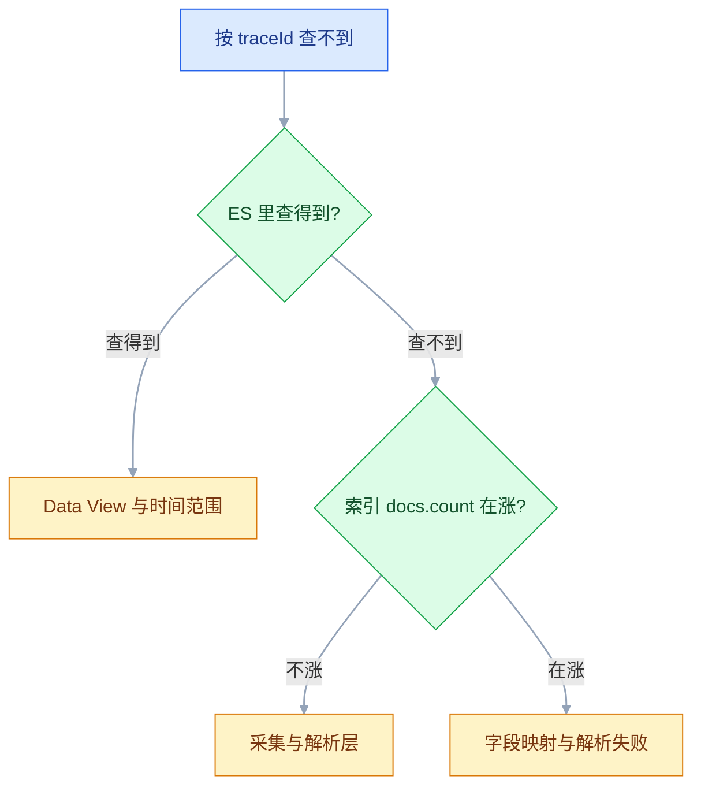

# ELK 日志系统

## 一、工程案例：让一条 Java 异常在 60 秒内能按 traceId 查回来

**场景**：`10.0.0.10` 跑日志平台，`10.0.0.11` / `10.0.0.12` 跑 `order-service`。目标是把应用日志从「三台机器各写各的文件」变成「一个搜索框能按 traceId 串起全链路」：一条异常日志进入 Elasticsearch 后，`level`、`service`、`traceId`、`duration_ms` 都是独立字段，堆栈不被拆行，索引按天滚动、30 天自动删除。

**为什么要先改日志格式**：纯文本日志要靠 grok 正则现场拆字段，格式一改就崩；JSON 日志在应用侧就把字段定好，采集端只做搬运。改一次 logback，后面所有解析配置都省掉。

**动手前确认**：日志平台机器至少 8 GB 内存（ES 堆 2 GB，其余留给页缓存）；`vm.max_map_count` 已调到 262144；三台机器时间同步。


### 1.1 部署日志平台

```bash
# 宿主机准备（ES 启动的硬要求）
sudo sysctl -w vm.max_map_count=262144
echo 'vm.max_map_count=262144' | sudo tee /etc/sysctl.d/99-es.conf

sudo mkdir -p /opt/elk/{es-data,logstash/pipeline,kibana}
sudo chown -R 1000:1000 /opt/elk/es-data     # ES 容器内 UID 1000
```

```yaml
# /opt/elk/docker-compose.yml
services:
  elasticsearch:
    image: docker.elastic.co/elasticsearch/elasticsearch:latest
    container_name: elasticsearch
    restart: always
    environment:
      - node.name=es01
      - cluster.name=elk
      - discovery.type=single-node
      - ES_JAVA_OPTS=-Xms2g -Xmx2g
      - xpack.security.enabled=false
      - bootstrap.memory_lock=true
      - TZ=Asia/Shanghai
    ulimits:
      memlock: { soft: -1, hard: -1 }
      nofile: { soft: 65536, hard: 65536 }
    volumes:
      - /opt/elk/es-data:/usr/share/elasticsearch/data
    ports: ["9200:9200"]
    healthcheck:
      test: ["CMD-SHELL", "curl -fsS http://localhost:9200/_cluster/health || exit 1"]
      interval: 20s
      timeout: 5s
      retries: 10

  kibana:
    image: docker.elastic.co/kibana/kibana:latest
    container_name: kibana
    restart: always
    environment:
      - ELASTICSEARCH_HOSTS=http://elasticsearch:9200
      - I18N_LOCALE=zh-CN
      - TZ=Asia/Shanghai
    ports: ["5601:5601"]
    depends_on:
      elasticsearch: { condition: service_healthy }

  logstash:
    image: docker.elastic.co/logstash/logstash:latest
    container_name: logstash
    restart: always
    environment: [LS_JAVA_OPTS=-Xms1g -Xmx1g, TZ=Asia/Shanghai]
    volumes:
      - /opt/elk/logstash/pipeline:/usr/share/logstash/pipeline:ro
    ports:
      - "5044:5044"
      - "9600:9600"        # monitoring API，2.x 排查用
    depends_on:
      elasticsearch: { condition: service_healthy }

networks:
  default:
    name: elk-net
```

```bash
cd /opt/elk && docker compose up -d
curl -s http://localhost:9200 | jq '{name, version: .version.number}'
curl -s 'http://localhost:9200/_cluster/health?pretty' | jq '{status, number_of_nodes}'
# status: yellow   ← 单节点没有副本可分配，正常；red 才是故障
curl -s -o /dev/null -w '%{http_code}\n' http://localhost:5601/api/status   # 200
```

> 示例统一用 `latest`，生产要固定具体版本（以官方当前稳定版为准）。ES 大版本升级有 breaking change，升级前先看官方 release notes。`xpack.security.enabled=false` 只用于内网测试，生产必须开认证；新版 Kibana 已不认 `XPACK_SECURITY_ENABLED=false`，它只是连上未设认证的 ES，所以上线前先补认证。

### 1.2 应用输出 JSON 日志

在 `10.0.0.11`、`10.0.0.12` 上先建目录，保证应用进程可写：`sudo mkdir -p /data/logs/order-service`。

```xml
<!-- pom.xml -->
<dependency>
  <groupId>net.logstash.logback</groupId>
  <artifactId>logstash-logback-encoder</artifactId>
  <version>7.4</version>   <!-- 与项目 logback 版本匹配，以官方当前稳定版为准 -->
</dependency>
```

```xml
<!-- logback-spring.xml 的文件 appender 关键段 -->
<appender name="JSON_FILE" class="ch.qos.logback.core.rolling.RollingFileAppender">
  <file>/data/logs/order-service/order-service.log</file>
  <rollingPolicy class="ch.qos.logback.core.rolling.TimeBasedRollingPolicy">
    <fileNamePattern>/data/logs/order-service/order-service.%d{yyyy-MM-dd}.log</fileNamePattern>
    <maxHistory>7</maxHistory>
  </rollingPolicy>
  <encoder class="net.logstash.logback.encoder.LogstashEncoder">
    <customFields>{"service":"order-service","env":"prod"}</customFields>
    <timeZone>Asia/Shanghai</timeZone>
    <throwableConverter class="net.logstash.logback.stacktrace.ShortenedThrowableConverter">
      <maxDepthPerThrowable>30</maxDepthPerThrowable>
      <maxLength>8192</maxLength>
    </throwableConverter>
  </encoder>
</appender>
```

```bash
# 验证：一行一个 JSON，堆栈在 stack_trace 字段里
tail -1 /data/logs/order-service/order-service.log | jq '{
  ts: .["@timestamp"], level, service, traceId,
  message, stack_len: (.stack_trace | length)
}'
# {"ts":"2026-10-20T14:32:15.123+08:00","level":"ERROR","service":"order-service",
#  "traceId":"a1b2c3d4e5f6","message":"下单失败, userId=123","stack_len":612}
```

> `traceId` 在请求入口用 `MDC.put("traceId", ...)` 注入，`finally` 里必须 `MDC.remove("traceId")`。线程池复用线程时，不清理会把上一个请求的 traceId 带到下一个请求。

### 1.3 Filebeat 采集

```yaml
# /opt/filebeat/filebeat.yml（两台应用机相同）
filebeat.inputs:
  - type: filestream
    id: order-service-log
    enabled: true
    paths: ['/data/logs/order-service/*.log']
    fields: { service: order-service, env: prod, log_type: application }
    fields_under_root: true
    # JSON 日志一行一条，绝对不要配 multiline

processors:
  - add_host_metadata:
      when.not.contains.tags: forwarded
  - drop_fields:
      fields: ['agent.ephemeral_id', 'event.original']
      ignore_missing: true

output.logstash:
  hosts: ['10.0.0.10:5044']
  loadbalance: true

filebeat.registry.path: /var/lib/filebeat/registry
logging.level: info
```

```bash
docker run -d --name filebeat --restart=always --user=root \
  -v /opt/filebeat/filebeat.yml:/usr/share/filebeat/filebeat.yml:ro \
  -v /data/logs:/data/logs:ro \
  -v /var/lib/filebeat:/var/lib/filebeat \
  -v /var/log/filebeat:/var/log/filebeat \
  docker.elastic.co/beats/filebeat:latest

docker logs --tail 20 filebeat | grep -E 'Harvester started|Pipeline output|error'
# Harvester started for file: /data/logs/order-service/order-service.log
# Pipeline output: logstash
```

> `registry` 目录必须挂到宿主机。容器重建后 registry 丢失，Filebeat 会从文件开头重读，整份日志重复入库。

### 1.4 Logstash 解析与分流

```ruby
# /opt/elk/logstash/pipeline/logstash.conf
input {
  beats { port => 5044 }
}

filter {
  if [log_type] == "application" {
    json {
      source => "message"
      target => "app"
      skip_on_invalid_json => true
    }

    if ![app][level] {
      mutate { add_tag => ["_jsonparsefailure"] }
    } else {
      mutate {
        add_field => {
          "level"   => "%{[app][level]}"
          "service" => "%{[app][service]}"
          "traceId" => "%{[app][traceId]}"
        }
        replace => { "message" => "%{[app][message]}" }
      }

      # 用日志内时间覆盖采集时间
      # 字符串自带 +08:00 时以字符串为准；只有不带偏移量时 timezone 才生效
      date {
        match    => ["[app][@timestamp]", "ISO8601"]
        target   => "@timestamp"
        timezone => "Asia/Shanghai"
      }

      mutate { remove_field => ["app"] }
    }
  }
}

output {
  if [log_type] == "application" {
    elasticsearch {
      hosts => ["http://elasticsearch:9200"]
      index => "app-logs-write"
      manage_template => false
      ilm_enabled => false        # 模板与策略由 1.5 手工管理，别让 Logstash 再建一套
    }
  }
}
```

```bash
docker exec logstash bin/logstash \
  -f /usr/share/logstash/pipeline/logstash.conf --config.test_and_exit
# → Configuration OK
docker restart logstash
docker logs --tail 20 logstash | grep -E 'Pipelines running|ERROR'
# Pipelines running {:count=>1, :running_pipelines=>[:main]}
```

### 1.5 索引模板、ILM 与写别名

顺序不能乱：**先策略，再模板，最后创建带别名的第一个索引**。模板只对新建索引生效，先建索引再建模板，第一个索引会用动态映射。

```bash
# ① 保留策略：写入 1 天或 10GB 滚动，30 天后删除
curl -s -X PUT 'http://localhost:9200/_ilm/policy/app-logs-policy' \
  -H 'Content-Type: application/json' -d '{
  "policy": {"phases": {
    "hot":    {"actions": {"rollover": {"max_age": "1d", "max_primary_shard_size": "10gb"}}},
    "delete": {"min_age": "30d", "actions": {"delete": {}}}
  }}}'
# {"acknowledged":true}

# ② 索引模板：字段类型写死，别让 ES 猜
curl -s -X PUT 'http://localhost:9200/_index_template/app-logs-template' \
  -H 'Content-Type: application/json' -d '{
  "index_patterns": ["app-logs-*"],
  "template": {
    "settings": {
      "number_of_shards": 1,
      "number_of_replicas": 0,
      "index.lifecycle.name": "app-logs-policy",
      "index.lifecycle.rollover_alias": "app-logs-write"
    },
    "mappings": {"properties": {
      "@timestamp":  {"type": "date"},
      "level":       {"type": "keyword"},
      "service":     {"type": "keyword"},
      "env":         {"type": "keyword"},
      "traceId":     {"type": "keyword"},
      "uri":         {"type": "keyword"},
      "status":      {"type": "integer"},
      "duration_ms": {"type": "long"},
      "message":     {"type": "text"},
      "stack_trace": {"type": "text", "index": false}
    }}
  }}'
# {"acknowledged":true}

# ③ 创建第一个索引，写别名指向它
curl -s -X PUT 'http://localhost:9200/app-logs-000001' \
  -H 'Content-Type: application/json' -d '{
  "aliases": {"app-logs-write": {"is_write_index": true}}
}'
# {"acknowledged":true,"shards_acknowledged":true,"index":"app-logs-000001"}
```

| 设置 | 取值 | 理由 |
|---|---|---|
| `number_of_shards` | 单节点 1 | 分片数创建后不能改，小索引多分片会拖垮集群状态 |
| `number_of_replicas` | 单节点 0，生产 1 | 副本直接翻倍磁盘，单节点分配不了副本只会 yellow |
| `rollover_alias` | `app-logs-write` | Logstash 永远写别名，滚动后自动指向新索引 |
| `stack_trace` | `index: false` | 堆栈只给人看，不参与搜索，省索引空间 |
| `level` / `service` / `traceId` | `keyword` | 要聚合、要精确匹配，不能用分词字段 |

### 1.6 Kibana 查询与验收

Stack Management → Data Views → Create data view：Name `app-logs`，Index pattern `app-logs-*`，Timestamp field `@timestamp`。

```bash
# 造一条真实的多行异常（JSON 形式，堆栈转义在字符串里）
cat >> /data/logs/order-service/order-service.log <<'EOF'
{"@timestamp":"2026-10-20T14:32:15.123+08:00","level":"ERROR","service":"order-service","logger_name":"c.e.order.OrderService","thread_name":"http-nio-8080-exec-3","message":"下单失败, userId=123","traceId":"a1b2c3d4e5f6","stack_trace":"java.lang.NullPointerException: Cannot invoke \"User.getId()\" because \"user\" is null\n\tat com.example.order.OrderService.createOrder(OrderService.java:87)"}
EOF

sleep 10
curl -s 'http://localhost:9200/app-logs-*/_search' \
  -H 'Content-Type: application/json' -d '{
  "size": 1,
  "query": {"term": {"traceId": "a1b2c3d4e5f6"}},
  "sort": [{"@timestamp": "desc"}]
}' | jq '{total: .hits.total.value, index: .hits.hits[0]._index,
         level: .hits.hits[0]._source.level,
         stack_len: (.hits.hits[0]._source.stack_trace | length)}'
# {"total":1,"index":"app-logs-000001","level":"ERROR","stack_len":148}
```

### 1.7 验收（10 项全过才算交付）

**交付物**：`logback-spring.xml`、两台应用机的 `filebeat.yml`、`logstash.conf`、索引模板与 ILM 策略的 JSON、Kibana Data View 和一条按 traceId 复查的查询，全部进 Git；配置在仓库里，重建环境才不用重想。

| # | 项 | 命令或查询 | 通过标准 |
|---|---|---|---|
| 1 | 集群可用 | `_cluster/health` | `yellow`（单节点）或 `green`，不能 `red` |
| 2 | 索引模板生效 | `GET app-logs-000001/_mapping` | `level`/`service`/`traceId` 均为 `keyword` |
| 3 | 写别名正确 | `GET _cat/aliases/app-logs-write` | 指向 `app-logs-000001` 且 `is_write_index=true` |
| 4 | ILM 绑定 | `GET app-logs-000001/_ilm/explain` | `policy` 为 `app-logs-policy`，`phase` 为 `hot` |
| 5 | 采集链路 | `GET _cat/indices/app-logs-*` | `docs.count` 持续增长 |
| 6 | 一条异常一条文档 | 按 traceId 查询 | `total = 1`，`stack_trace` 完整 |
| 7 | 字段可聚合 | `terms` 聚合 `level` | 返回 `ERROR`/`INFO` 分桶，无 fielddata 报错 |
| 8 | 时间正确 | 看 `@timestamp` | 等于日志内时间，不是采集时间 |
| 9 | 解析失败可见 | `GET app-logs-*/_count?q=tags:_jsonparsefailure` | 为 0；不为 0 说明应用输出了非 JSON 行 |
| 10 | 保留生效 | `GET _ilm/policy/app-logs-policy` | `delete.min_age` 为 `30d` |

> 第 6 项是关键：堆栈如果被拆成多条，`total` 会大于 1。JSON 日志 + `stack_trace` 字段从源头解决了这个问题，不需要 multiline。

---

## 二、高频问答：会卡住你的地方，也是面试最常问的

先定位层，再对号入座：ES 里查得到，问题在展示层；查不到，再顺采集和解析往下排。



### 2.1 Kibana 里搜不到日志，但 ES 里明明有

**现场**

绕过 Kibana 直接查 ES，再核对 Data View 的 pattern 与时间字段。

```bash
curl -s 'http://localhost:9200/app-logs-*/_count' | jq '.count'
curl -s 'http://localhost:9200/_cat/indices/app-*?h=index,docs.count'
curl -s 'http://localhost:9200/_cat/fielddata?v' | head
```

**要点**

- Kibana 只是查询前端，ES 有数据而 Kibana 没有，问题一定在 Data View 或时间范围，不在采集。
- 常见三处：index pattern 写错（少个 `s`、多了日期）、时间字段选了 `@timestamp` 但数据里没有、时间范围落在日志时间之外。
- 判断顺序是先查 ES 的 count，再对 Data View 的 pattern 与时间字段。

**追问**

- pattern 写错为什么不报错？→ Kibana 显示「匹配 0 个索引」，不是报错。
- ES 里 count 也是 0 呢？→ 问题回到采集与解析层，看 `docs.count` 是否在涨。
- 怎么快速排除时间范围？→ 用绝对时间框住故障前后，并确认时间字段选的是 `@timestamp`。

### 2.2 Java 异常堆栈被拆成好几条日志

**现场**

按 traceId 查，命中条数大于 1 就是被拆了。

```yaml
# filebeat.yml，放在对应的 input 下
# 纯文本日志：行首是日期 = 新日志开始
multiline:
  type: pattern
  pattern: '^\d{4}-\d{2}-\d{2}'
  negate: true
  match: after
  max_lines: 500
  timeout: 5s
```

**要点**

- multiline 是采集端的补丁，不是解析问题；采集器按行读取时，堆栈的每个 `at ...` 都是一行。
- 纯文本日志没配 multiline 会被拆，JSON 日志却又配了 multiline，会把下一条不相干的日志拼上来，比不配更糟。
- 根治办法是应用输出单行 JSON，让堆栈进 `stack_trace` 字段。

**追问**

- 为什么 JSON 日志不能配 multiline？→ 一行就是一个完整事件，合并只会把下一条拼进来。
- multiline 的规则怎么写？→ 行首是日期表示新日志开始，`negate: true` 配 `match: after`。
- 已经拆开的历史日志能修吗？→ 采集端修不了已入库的数据，只能重新采集。

### 2.3 聚合时报 `Fielddata is disabled on text fields`

**现场**

`GET 索引/_mapping` 看字段类型，再用 `.keyword` 子字段聚合。

```bash
# 用 .keyword 子字段聚合（动态映射会自动生成）
curl -s 'http://localhost:9200/app-logs-*/_search' -H 'Content-Type: application/json' -d '{
  "size": 0,
  "aggs": {"by_level": {"terms": {"field": "level.keyword"}}}
}'
```

**要点**

- 字段被动态映射成 `text`（分词），而 `terms` 聚合需要 `keyword`（不分词）。
- `fielddata=true` 会把分词结果加载进堆，高基数文本会直接把 ES 打爆，正确做法是改 mapping 用 `keyword`。
- 已经写入的字段类型不能改，只能 reindex，或者先借动态映射生成的 `.keyword` 子字段。

**追问**

- 为什么不能直接开 fielddata？→ 堆占用随唯一词数增长，高基数文本很快就爆。
- 动态映射下怎么聚合？→ 用 `level.keyword` 子字段。
- 模板里应该怎么写？→ 要聚合的字段显式声明 `keyword`，别让 ES 猜。

### 2.4 ES 启动失败，日志提示 `max virtual memory areas vm.max_map_count [65530] is too low`

**现场**

`sysctl vm.max_map_count` 看当前值，`docker logs elasticsearch | grep max_map_count` 确认是这条报错。

```bash
sudo sysctl -w vm.max_map_count=262144
echo 'vm.max_map_count=262144' | sudo tee /etc/sysctl.d/99-es.conf
sudo sysctl --system
```

**要点**

- 这是宿主机内核参数，不是 JVM 堆参数；容器内改无效，必须在宿主机改。
- ES 用 mmap 读索引文件，映射数量超过 `vm.max_map_count` 就起不来。
- 加大堆只会让 ES 更快被 OOM，解决不了 mmap 上限。

**追问**

- 为什么在容器里改没用？→ 内核参数属于宿主机，容器共享同一个内核。
- `sysctl -w` 和写配置文件有什么区别？→ 前者立即生效但不持久，后者重启后仍然有效。
- ES 启动还有哪些硬要求？→ 内存锁和文件句柄，对应 compose 里的 `ulimits`。

### 2.5 日志突然写不进去，索引变成只读

**现场**

`GET _cat/indices?v` 看 `status`，`GET _cluster/allocation/explain` 会给出磁盘水位判定。

> 这是磁盘打满的前兆，属于本篇最高频的「致命但能救」故障，所以留在这里，不放第四节。

```bash
# 先清磁盘（删最旧索引 / 扩容），再解除只读
curl -s -X DELETE 'http://localhost:9200/app-logs-2026.09.01'
curl -s -X PUT 'http://localhost:9200/_all/_settings' \
  -H 'Content-Type: application/json' \
  -d '{"index.blocks.read_only_allow_delete": null}'
```

**要点**

- 磁盘使用率超过 flood stage（默认 95%）触发保护，ES 把所有索引设为 `read_only_allow_delete`，写入全部被拒。
- 只解除只读不清磁盘，下一次写入很快又触发；水位线是保护机制，不是 bug。
- 正确顺序是先删最旧索引或扩容，再解除只读。

**追问**

- 三个水位线分别是什么？→ 85% 不再分配新分片、90% 尝试迁走、95% 只读拒写。
- 直接调高水位线行不行？→ 只是延后故障，不是解决容量。
- 变成只读后数据会丢吗？→ 已有数据还在，只是拒绝新的写入。

### 2.6 单节点集群一直是 yellow

**现场**

`GET _cluster/allocation/explain` 看未分配原因。

```bash
curl -s 'http://localhost:9200/_cluster/health?pretty' | jq '{status, unassigned_shards}'
# yellow + unassigned_shards > 0，且节点数为 1 → 正常现象
```

**要点**

- 副本数为 1，但只有一个节点，副本无处分配；`yellow` 表示主分片可用、副本未分配。
- `yellow` 不是故障，`red` 才是有主分片不可用。
- 单节点测试把副本设为 0 就不会 yellow。

**追问**

- 生产能不能也设 0 副本？→ 不能，副本是高可用和读吞吐的来源。
- 遇到 `red` 怎么下手？→ 先看 allocation explain，确认是节点掉线还是分片损坏。
- 加了节点会自动变 green 吗？→ 副本会自动分配，但要等恢复完成。

### 2.7 Logstash 的 `in` 远大于 `out`

**现场**

看 `filtered` 与 `out` 的差值，再查解析失败标签。

```bash
curl -s http://localhost:9600/_node/stats/events | jq '.events | {in, filtered, out}'
curl -s 'http://localhost:9200/app-logs-*/_count?q=tags:_grokparsefailure'
curl -s 'http://localhost:9200/app-logs-*/_count?q=tags:_jsonparsefailure'
```

**要点**

- `in` 是收到的事件数，`out` 是发出去的；差值大不一定是丢，也可能是 ES 慢导致队列堆积。
- 真丢的三种常见原因：grok/date 解析失败、输出条件没匹配上、ES 写入慢造成背压。
- 判断顺序是先看 `filtered` 和队列，再判断是丢还是堵。

**追问**

- 怎么确认是解析失败？→ 查 `_grokparsefailure` 和 `_jsonparsefailure` 的文档数。
- 重启为什么救不了？→ 堵在 ES 写入时，重启只是清掉队列，数据照样丢。
- 输出条件没匹配上怎么查？→ 对照 output 里的 `if` 条件和事件字段，比如 `log_type` 有没有被打上。

### 2.8 `@timestamp` 比实际时间早 8 小时

**现场**

对比 `_source.@timestamp` 与日志正文里的时间，再看 Logstash 的 `date` 配置。

```ruby
date {
  match    => ["[app][@timestamp]", "ISO8601"]
  target   => "@timestamp"
  timezone => "Asia/Shanghai"     # 字符串不带偏移时才生效
}
```

**要点**

- `@timestamp` 是 UTC 存储、按浏览器时区展示；存储值本身错了，改展示时区只会让所有历史数据一起错。
- 根因是 `date` 插件没写 `timezone`，把本地时间当 UTC 解析，或 JSON 里的时间字符串不带时区、被按 UTC 解释。
- 字符串自带 `+08:00` 时以字符串为准，`timezone` 只对不带偏移量的时间生效。

**追问**

- 改 Kibana 时区能修好吗？→ 不能，只改展示，存储值还是错的。
- 为什么有的日志对、有的差 8 小时？→ 带偏移量的按偏移量解析，不带偏移量的才吃 `timezone`。
- 历史数据怎么办？→ 改配置只影响新数据，老的只能 reindex 或在查询侧补偿。

### 2.9 同一个字段在不同索引里类型冲突，写入报 `mapper_parsing_exception`

**现场**

`GET 索引/_mapping/field/字段名`，逐个索引对比。

```bash
curl -s 'http://localhost:9200/app-logs-2026.10.19/_mapping/field/status' | jq
curl -s 'http://localhost:9200/app-logs-2026.10.20/_mapping/field/status' | jq
```

**要点**

- ES 的字段类型一旦写入就不能改，只能 reindex。
- 冲突来自动态映射：字段先被映射成 `long`，后来来了字符串；或模板只对新建索引生效，老索引还是旧类型。
- 模板不是 retroactive 的，老索引必须重建。

**追问**

- 模板生效了老索引为什么还是错的？→ 模板只作用于之后新建的索引。
- 能不能直接改 mapping 里的类型？→ 不能，只能新建索引再 reindex。
- 怎么预防？→ 模板里显式声明字段类型，别让 ES 猜。

### 2.10 磁盘增长远超原始日志量

**现场**

看副本数、`_source` 设置、ILM explain 和索引大小。

```bash
curl -s 'http://localhost:9200/app-logs-000001/_settings?pretty' | jq '.[].settings.index | {number_of_replicas, lifecycle}'
curl -s 'http://localhost:9200/app-logs-000001/_ilm/explain' | jq '.indices[].step'
curl -s 'http://localhost:9200/_cat/indices/app-logs-*?h=index,store.size,docs.count&s=index'
```

**要点**

- 容量要按 `原始量 × 放大系数 × (1 + 副本数) × 保留天数` 算，只按原始量买盘，上线两周就会满。
- 放大来自副本翻倍、`_source` 默认全存，以及索引本身的额外开销。
- 还有两个隐形增长点：ILM 没有真正 attach，rollover 没发生导致单索引无限增长。

**追问**

- 副本对磁盘的影响有多大？→ 直接翻倍。
- 怎么确认 ILM 真的挂上了？→ `_ilm/explain` 看 policy 和当前 step。
- rollover 为什么没发生？→ 写入没走别名，或策略条件一直没触发。

### 2.11 索引和分片数量失控，集群状态变大

**现场**

`GET _cat/shards` 统计分片数，`GET _cluster/health` 看 `active_shards`。

```bash
curl -s 'http://localhost:9200/_cat/shards?h=index,shard,prirep,store' | wc -l
curl -s 'http://localhost:9200/_cat/indices?h=index,pri,rep,store.size' | sort -k4 -h | tail
```

**要点**

- 按天建索引 + 每个索引多分片，30 天就是几百个分片；每个分片都有开销，集群状态与堆压力随分片数上升。
- 分片不是越多越并行，单分片 10-50 GB 是常见目标。
- 小索引应该合并或减少分片，而不是加节点。

**追问**

- 分片数为什么创建后不能改？→ 路由依赖分片数，要改只能 reindex。
- 加节点能解决分片过多吗？→ 不能，每个节点都要维护全量集群状态。
- 按天索引怎么改？→ 换成 rollover + 写别名，按大小滚动。

### 2.12 Filebeat 重启后日志重复入库

**现场**

`docker inspect filebeat` 看 registry 目录是否在挂载列表，再确认文件存在。

```bash
docker inspect filebeat --format '{{range .Mounts}}{{.Source}} -> {{.Destination}}{{"\n"}}{{end}}'
```

**要点**

- `filebeat.registry.path` 没挂到宿主机，容器重建后进度丢失，从文件头重读。
- Kibana 不做去重，ES 也不做；采集进度是采集端的状态，必须持久化。
- 判断方法是看重复日志的时间戳是否完全一致。

**追问**

- 已经在库里的重复数据怎么清？→ 按查询条件 `delete_by_query` 或重建索引，没有自动去重入口。
- registry 丢了还能避免重复吗？→ 不能，只能入库前拦截或事后清理。
- 宿主机上直接跑 Filebeat 会有这问题吗？→ 本机路径天然持久，但换机器会丢进度。

---

## 三、核心知识：从零开始要建立的东西

### 3.1 文档、索引与倒排索引

| 概念 | 说明 | 类比 |
|---|---|---|
| 文档 Document | 一条 JSON 数据 | 表里的一行 |
| 索引 Index | 一类文档的集合 | 一张表 |
| 字段 Field | 文档里的属性 | 列 |
| Mapping | 字段类型定义 | 表结构 |
| 倒排索引 | 词 → 文档列表 | 书末的关键词索引 |

正排是「文档 → 内容」，倒排是「词 → 出现在哪些文档」。查询 `NullPointerException` 时，倒排索引直接给出文档 ID 列表，不需要逐条扫描。代价是写入时要分词、维护这张表，所以 ES 的写入比关系库贵。

> **面试**：常问「倒排索引是什么？为什么 ES 写入比关系库贵？」答：它是词到文档列表的索引，查询免扫描；写入要分词并维护这张表，所以更贵。

### 3.2 分片、副本与集群状态

| 概念 | 作用 | 约束 |
|---|---|---|
| 主分片 Primary | 数据的水平切分 | 数量创建后不能改，只能 reindex |
| 副本 Replica | 高可用 + 读吞吐 | 可与主分片分到不同节点 |
| 路由 Routing | 决定文档进哪个分片 | 默认按 `_id` 哈希 |

**状态含义**：`green` 全部分片可用；`yellow` 主分片可用、副本未分配；`red` 至少一个主分片不可用。单节点 + 1 副本必然是 `yellow`，不是故障。

**分片规划**：单分片 10-50 GB，单节点分片总数控制在几百以内。分片太多会让集群状态、恢复时间、文件句柄一起上升；分片太大则单分片恢复慢、无法并行。

> **面试**：常问「yellow 和 red 有什么区别？」答：yellow 是副本未分配、主分片可用；red 是有主分片不可用。单节点配 1 副本必然 yellow，不是故障。

### 3.3 Mapping 与字段类型

| 类型 | 是否分词 | 能搜索 | 能聚合/排序 | 用于 |
|---|---|---|---|---|
| `text` | 是 | 全文 | 否（需 fielddata） | 日志正文、错误消息 |
| `keyword` | 否 | 精确 | 是 | 服务名、级别、traceId、状态码 |
| `long` / `integer` | 否 | 范围 | 是 | 耗时、状态码 |
| `date` | 否 | 范围 | 是 | `@timestamp` |
| `ip` | 否 | 范围 | 是 | 客户端 IP |
| `object` | 否 | 子字段 | 子字段 | 结构化嵌套 |
| `nested` | 否 | 子字段独立 | 是 | 数组内对象需独立匹配 |

**动态映射的风险**：字符串默认同时生成 `text` 和 `text.keyword`；数字第一次出现是 `long`，之后来一个带小数的值就可能冲突。日志字段应该显式声明，尤其是 `level`、`service`、`traceId` 这种要聚合的字段。

### 3.4 写入路径与 refresh


| 动作 | 默认 | 影响 |
|---|---|---|
| refresh | 1s | 写入后最多 1 秒可搜；调大省资源但延迟可见性 |
| translog | 每请求 fsync | 宕机恢复的依据；` durability` 可调 |
| merge | 后台自动 | 合并小段，消耗 IO 与 CPU |

**边界**：批量导入时把 `refresh_interval` 调成 `-1`、副本设 0，导入完再改回来，能显著提升吞吐；但期间数据不可搜，不能用于在线日志。

### 3.5 查询路径与聚合

查询分两阶段：`query` 阶段在每个分片上算匹配文档 ID 与排序值，`fetch` 阶段取回 `_source`。聚合走 `doc_values`（列式存储），所以 `keyword` 聚合快，`text` 聚合需要 fielddata（把分词结果加载进堆），代价极高。

| 查询 | 用途 | 注意 |
|---|---|---|
| `term` | 精确匹配 keyword | 不要用于 text |
| `match` | 分词后匹配 text | 会经过分析器 |
| `range` | 数值/时间范围 | 时间要用 `@timestamp` |
| `bool` | must/should/filter/must_not | `filter` 不参与评分，更快 |
| `terms` 聚合 | 按字段分组计数 | 字段必须是 keyword |

### 3.6 采集链路分层

| 层 | 组件 | 职责 | 资源 |
|---|---|---|---|
| 采集 | Filebeat / Fluent Bit | 读文件、打标、多行合并 | 几十 MB |
| 解析 | Logstash / ES Ingest | grok、JSON、时间、分流 | 几百 MB 到 GB |
| 存储 | Elasticsearch | 索引、分片、聚合 | 堆 + 页缓存 |
| 查询 | Kibana | Data View、KQL、可视化 | 几百 MB |


**选型**：日志已经是 JSON、不需要复杂解析，Filebeat 直连 ES 最短；需要 grok、条件分流、多路输出，才引入 Logstash。把 Logstash 装在每台业务机上，是资源与运维的双重浪费。

> **面试**：常问「Filebeat 和 Logstash 怎么分工？」答：Filebeat 只采集和打标，Logstash 做解析与分流，JSON 日志可以直连省掉 Logstash。

### 3.7 结构化日志与解析成本

| 维度 | 纯文本 + grok | JSON |
|---|---|---|
| 字段来源 | 正则提取 | 应用直接输出 |
| 格式变更 | 正则失效，字段丢失 | 新增字段无需改采集 |
| 解析开销 | 每条跑正则 | 一次 JSON 解析 |
| 堆栈 | 必须 multiline | 一个字段搞定 |
| 排错 | `_grokparsefailure` 标签 | `_jsonparsefailure` 标签 |

**结论**：能改应用就输出 JSON。改一次 logback，省掉后面所有 grok 维护；不能改应用（第三方系统）才用 grok，并且必须加 `tag_on_failure`，让解析失败可见。

### 3.8 时间字段与时区

| 层 | 谁决定 | 常见问题 |
|---|---|---|
| 应用日志时间 | 应用时区 / 日志框架 | 容器默认 UTC |
| `@timestamp` | Logstash `date` 或 ES ingest | 没指定时区，早 8 小时 |
| Kibana 展示 | 浏览器时区 / 看板时区 | 存储对、展示错 |

**规则**：`@timestamp` 永远存 UTC；日志字符串带偏移量时按偏移量解析；不带偏移量时显式指定 `timezone`。排查时先看 `_source.@timestamp` 的原始值，再看 Kibana 的展示时区。

### 3.9 索引命名与 rollover

| 方案 | 写法 | 适用 |
|---|---|---|
| 按天 | `app-logs-2026.10.20` | 保留期按天、量稳定 |
| 按大小滚动 | `app-logs-000001` + 写别名 | 量波动大，单索引不超 10-50 GB |
| 按租户 | `tenant-a-logs-*` | 多租户隔离 |

**rollover 的前提**：写入必须经过别名（`app-logs-write`），别名上设 `is_write_index: true`。直接写具体索引名，rollover 不会发生，索引会无限增长。

> **面试**：常问「为什么配了 rollover 索引还是一直变大？」答：写入没走别名，或别名没设 `is_write_index`，滚动条件不会触发。

### 3.10 ILM 阶段与保留

| 阶段 | 动作 | 典型配置 |
|---|---|---|
| hot | rollover | `max_age: 1d`、`max_primary_shard_size: 10gb` |
| warm | 降副本、forcemerge、迁到冷节点 | `min_age: 7d` |
| cold | 只读、压缩 | `min_age: 30d` |
| delete | 删除 | `min_age: 30d` |

**边界**：ILM 只对「带 policy 的索引」生效。模板里写了 `index.lifecycle.name`，但老索引不会自动补上；要么重建，要么用 `PUT 索引/_settings` 手动挂。

### 3.11 容量估算

| 项 | 取值 | 说明 |
|---|---|---|
| 原始日志量 | 实测 3-5 天取平均 | 不要拍脑袋 |
| ES 放大 | 1.1-1.5 倍 | 含索引与 `_source` |
| 副本 | 0（单节点）/ 1（生产） | 直接乘倍数 |
| 保留 | 应用 15-30 天，审计 90 天+ | 合规决定 |

**算式**：`日增量 × 放大系数 × (1 + 副本数) × 保留天数`。5 GB/天、1.3 倍、1 副本、30 天 ≈ 390 GB；再留 30% 余量，申请 512 GB。磁盘水位到 85% 就该处理，不要等到只读。

### 3.12 集群健康与磁盘水位

| 水位 | 默认阈值 | 行为 |
|---|---|---|
| low | 85% | 不再往该节点分配新分片 |
| high | 90% | 尝试迁走分片 |
| flood_stage | 95% | 索引设为只读，拒绝写入 |

```bash
curl -s 'http://localhost:9200/_cat/allocation?v'
curl -s 'http://localhost:9200/_cluster/health?pretty' | jq '{status, active_shards, unassigned_shards}'
```

**边界**：调高水位线只是延后故障，不是解决容量。真正的处理是删旧索引、缩短保留、加盘或迁冷数据。

### 3.13 Kibana Data View 与 KQL

| 语法 | 含义 |
|---|---|
| `level: "ERROR"` | 精确匹配 keyword |
| `level: "ERROR" or level: "WARN"` | 或 |
| `not level: "INFO"` | 非 |
| `message: "超时*"` | 通配符（谨慎，开销大） |
| `status >= 500` | 数值范围 |
| `traceId: *` | 字段存在 |
| `status: (500 or 502)` | 分组 |

**Data View 的本质**：一个索引 pattern + 一个时间字段。它不复制数据，也不改变 mapping；pattern 写错时，Kibana 会显示「匹配 0 个索引」，而不是报错。

### 3.14 快照与配置备份

| 对象 | 是否值得备份 | 方式 |
|---|---|---|
| 日志数据 | 通常不值得 | 原始文件 / 对象存储另存 |
| 索引模板、ILM | 值得 | `_index_template`、`_ilm/policy` 导出 |
| Kibana 看板、Data View | 值得 | Saved Objects 导出 `.ndjson` |
| 采集与解析配置 | 值得 | Git 管理 `filebeat.yml`、`logstash.conf` |

**顺序**：先备份配置，再动集群。日志丢了可以重采，看板和解析规则丢了要重做一遍。

### 3.15 安全边界与多租户

| 项 | 测试环境 | 生产 |
|---|---|---|
| 认证 | 可关 | 必须开，内置用户或 LDAP/SSO |
| 传输 | HTTP | TLS |
| Kibana 暴露 | 内网 | 只在内网，或反代 + 认证 |
| 敏感字段 | 明文 | 采集侧脱敏（手机号、身份证、token） |

**脱敏位置**：越靠近源头越好。Logstash 的 `mutate { gsub => [...] }` 可以在入库前替换；等到 Kibana 再遮，原文已经在磁盘上了。

---

## 四、冷门知识汇总

| 知识点 | 为什么冷门 | 用到时的关键词 |
|---|---|---|
| OpenSearch 分支 | 只有避开 Elastic 许可时才接触 | `OpenSearch`、`OpenSearch Dashboards` |
| 冷热分层 | 数据量大到需要按成本分层才用 | `hot-warm-cold`、`allocation.attributes` |
| 可搜索快照 | 需要低成本保留历史又要求可查 | `searchable snapshot`、`_snapshot` |
| `_forcemerge` | 只读索引才做，在线索引禁用 | `forcemerge`、`max_num_segments` |
| Ingest Pipeline | 简单解析可不下 Logstash | `_ingest/pipeline`、`processors` |
| Logstash 多 pipeline | 多类日志互相隔离时才用 | `pipelines.yml`、`pipeline.id` |
| Beats 家族 | 除 Filebeat 外的采集器按需才装 | `Metricbeat`、`Auditbeat`、`Packetbeat` |
| Filebeat autodiscover | 容器动态环境才需要 | `autodiscover`、`hints` |
| 索引模板组合 | 多团队共享基础 mapping | `_component_template`、`composable template` |
| 中文分词 | 日志场景通常不需要 | `IK analyzer`、`analysis-ik` |
| 跨集群搜索 | 多集群联邦查询才用 | `cross-cluster search`、`remote cluster` |
| 快照仓库 | 定期归档与灾难恢复 | `_snapshot`、S3/OSS repository |
| 写入拒绝 | 线程池满时出现，先看 bulk 队列 | `es_rejected_execution_exception`、`write thread pool` |
| 字段别名 | 字段改名又不想 reindex | `field alias`、`path` |
