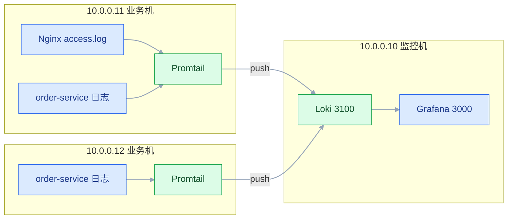
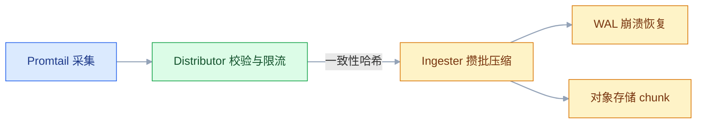

# Loki 日志系统

## 一、工程案例：把两个服务的日志接进 Loki，用一条 LogQL 串起一次失败请求

**场景**：`10.0.0.10` 跑 Loki + Grafana，`10.0.0.11` 跑 Nginx 与 `order-service`，`10.0.0.12` 再跑一个 `order-service`。目标是交付三件事：按 `traceId` 一条查询串起跨服务全链路；按 `status` 算出 Nginx 的 5xx 比例；按 `rt` 找出慢请求。同时保证 30 天前的日志真的被删除。

**为什么选标签索引**：日常排障 90% 是「哪个服务 + 哪段时间 + 什么关键字」，这类查询只需要标签定位到日志块，再在块内扫关键字，不需要给每个词建倒排索引。省下的是存储与运维成本，代价是「任意词全文搜索」会慢。

**动手前确认**：日志已经是单行 JSON（应用侧改完 logback）；业务机能连到监控机的 `3100`（`9080` 是 Promtail 自己的指标端口，不需要在机器之间互通）；`/opt/loki/data` 预留磁盘按「日增量 × 30 天 × 0.5 压缩比 + 30% 余量」估算，约 20 倍日增量。



两台业务机各跑一个 Promtail，用 `instance` 标签区分；两个 order-service 的 `service` 标签相同，这样跨实例查全链路时不会因为标签不同而漏掉其中一台。

### 1.1 部署 Loki 与 Grafana

```bash
sudo mkdir -p /opt/loki/{config,data} /opt/grafana/data
sudo chown -R 10001:10001 /opt/loki      # Loki 容器内 UID
sudo chown -R 472:472 /opt/grafana/data  # Grafana 容器内 UID
```

```yaml
# /opt/loki/config/loki-config.yml
auth_enabled: false

server:
  http_listen_port: 3100
  grpc_listen_port: 9096
  log_level: info

common:
  instance_addr: 127.0.0.1
  path_prefix: /loki
  storage:
    filesystem:
      chunks_directory: /loki/chunks
      rules_directory: /loki/rules
  replication_factor: 1
  ring:
    kvstore:
      store: inmemory

schema_config:
  configs:
    - from: 2024-01-01
      store: tsdb
      object_store: filesystem
      schema: v13
      index:
        prefix: index_
        period: 24h

storage_config:
  tsdb_shipper:
    active_index_directory: /loki/tsdb-index
    cache_location: /loki/tsdb-cache
  filesystem:
    directory: /loki/chunks

limits_config:
  retention_period: 720h
  reject_old_samples: true
  reject_old_samples_max_age: 168h
  ingestion_rate_mb: 10
  ingestion_burst_size_mb: 20
  max_query_series: 500
  max_query_parallelism: 32
  allow_structured_metadata: true

compactor:
  working_directory: /loki/compactor
  compaction_interval: 10m
  retention_enabled: true          # 不开这行，retention_period 不执行删除
  delete_request_store: filesystem

querier:
  max_concurrent: 4
  query_timeout: 5m

analytics:
  reporting_enabled: false
```

```yaml
# /opt/loki/docker-compose.yml
services:
  loki:
    image: grafana/loki:latest       # 生产环境改成验证过的固定 tag，不要跟 latest
    container_name: loki
    restart: always
    user: "10001:10001"
    ports: ["3100:3100"]
    volumes:
      - /opt/loki/config/loki-config.yml:/etc/loki/loki-config.yml:ro
      - /opt/loki/data:/loki
    command: -config.file=/etc/loki/loki-config.yml
    healthcheck:
      test: ["CMD-SHELL", "wget -qO- http://localhost:3100/ready | grep -q ready"]
      interval: 15s
      timeout: 5s
      retries: 10

  grafana:
    image: grafana/grafana:latest     # 同上，生产固定 tag
    container_name: grafana
    restart: always
    ports: ["3000:3000"]
    environment:
      - GF_SECURITY_ADMIN_USER=admin
      - GF_SECURITY_ADMIN_PASSWORD=ChangeMe_2026
      - GF_USERS_ALLOW_SIGN_UP=false
      - TZ=Asia/Shanghai
    volumes:
      - /opt/grafana/data:/var/lib/grafana
    depends_on: [loki]

networks:
  default:
    name: logging-net
```

Grafana 只对宿主机暴露 `3000`；Loki 的 `3100:3100` 默认绑定在所有网卡上，业务机可以直接推 `http://10.0.0.10:3100/loki/api/v1/push`，前提是防火墙放行 `3100`。如果把 ports 写成 `127.0.0.1:3100:3100`，业务机就连不上，这正是「Grafana 里查不到日志」的一个常见来源。

```bash
cd /opt/loki && docker compose up -d
curl -s http://localhost:3100/ready                       # → ready
curl -s http://localhost:3100/loki/api/v1/labels | jq    # data 为空，正常（还没采集）
curl -s http://localhost:3000/api/health | jq '.database' # → "ok"
```

数据源：Connections → Data sources → Loki，URL `http://loki:3100`，Max lines `1000` → Save & test。成功提示是 `Data source connected and labels found`；只显示 connected 而没有 labels，说明 Loki 里还没有数据。

### 1.2 Promtail 采集

```yaml
# /opt/promtail/promtail-config.yml
server:
  http_listen_port: 9080
  grpc_listen_port: 0

positions:
  filename: /var/lib/promtail/positions.yaml

clients:
  - url: http://10.0.0.10:3100/loki/api/v1/push
    batchwait: 1s
    batchsize: 1048576
    backoff_config: { min_period: 500ms, max_period: 5m, max_retries: 10 }

scrape_configs:
  - job_name: order-service
    static_configs:
      - targets: [localhost]
        labels:
          job: order-service
          service: order-service
          instance: order-1      # 两台业务机用 order-1 / order-2 区分
          env: prod
          __path__: /data/logs/order-service/*.log
    pipeline_stages:
      - json:
          expressions:
            level: level
            traceId: traceId
            msg: message
            ts: '@timestamp'
      - labels:
          level:                 # 只把低基数字段提升为标签
      - timestamp:
          source: ts
          format: RFC3339Nano
          location: Asia/Shanghai

  - job_name: nginx
    static_configs:
      - targets: [localhost]
        labels:
          job: nginx
          service: nginx
          env: prod
          __path__: /var/log/nginx/access.log
    pipeline_stages:
      - regex:
          expression: '^(?P<client_ip>\S+) - \S+ \[(?P<time_local>[^\]]+)\] "(?P<method>\S+) (?P<uri>\S+) [^"]+" (?P<status>\d{3}) \S+ "[^"]*" "[^"]*" rt=(?P<rt>[\d.]+|-)'
      - labels:
          method:                # status/uri/rt 都留在正文里，查询时用过滤器
      - timestamp:
          source: time_local
          format: '02/Jan/2006:15:04:05 -0700'
      - template:
          source: rt
          template: '{{ if eq .Value "-" }}0{{ else }}{{ .Value }}{{ end }}'
```

`instance` 是这台机器的固定标识，取值只有 `order-1` / `order-2`，可以安全地做标签。`rt` 为 `-` 的情况发生在缓存命中或请求被内部中断时，模板把它归一成 `0`；不处理的话，这些行会被 `rt > 1` 静默丢掉。

同时别在 order-service 的流水线里加 `output: source: msg`。它会把 JSON 外壳连同 `traceId` 一起丢掉，1.3 的 ① 就永远查不到东西。正文保留整行 JSON，代价只是 Grafana 里看着啰嗦。

```bash
# Nginx 日志格式必须带 rt，否则「慢请求」无从判断
# /etc/nginx/nginx.conf 的 http 块
# log_format main '$remote_addr - $remote_user [$time_local] "$request" '
#                 '$status $body_bytes_sent "$http_referer" "$http_user_agent" '
#                 'rt=$request_time urt=$upstream_response_time';
# access_log /var/log/nginx/access.log main;
sudo nginx -t && sudo nginx -s reload

sudo mkdir -p /var/lib/promtail
docker run -d --name promtail --restart=always --user=root \
  -v /opt/promtail/promtail-config.yml:/etc/promtail/config.yml:ro \
  -v /data/logs:/data/logs:ro \
  -v /var/log/nginx:/var/log/nginx:ro \
  -v /var/lib/promtail:/var/lib/promtail \
  grafana/promtail:latest -config.file=/etc/promtail/config.yml

# 第二台业务机 10.0.0.12：复制配置，只改 instance: order-2 与挂载路径，再执行同一条 docker run
# 生产固定 promtail 的 tag；官方已把采集端重心转到 Grafana Alloy，新部署优先选 Alloy

docker logs --tail 20 promtail | grep -E 'Adding target|tail routine|error'
# level=info msg="Adding target" key="{env=\"prod\", job=\"order-service\", service=\"order-service\"}"
# level=info msg="tail routine: started" path=/data/logs/order-service/order-service.log

curl -s http://10.0.0.10:3100/loki/api/v1/labels | jq
# {"status":"success","data":["env","job","level","method","service"]}
```

### 1.3 三个查询

```logql
# ① 跨服务全链路：traceId 不是标签，用过滤器在正文里找
{service=~".+"} |= "a1b2c3d4e5f6"

# ② Nginx 5xx 比例（百分比）；状态码紧跟在请求行的右引号之后
sum(rate({job="nginx"} | regexp `" (?P<status>\d{3}) \d+ ` | status >= 500 [5m]))
/
sum(rate({job="nginx"} [5m])) * 100

# ③ 慢请求明细
{job="nginx"} | regexp `rt=(?P<rt>[\d.]+|-)` | rt > 1

# ④ 慢请求 TOP10 接口
topk(10,
  sum by (uri) (
    count_over_time(
      {job="nginx"} | regexp `"(?P<method>[A-Z]+) (?P<uri>\S+) [^"]*" (?P<status>\d{3}) \S+ "[^"]*" "[^"]*" rt=(?P<rt>[\d.]+|-)`
      | rt > 1 [1h]
    )
  )
)
```

正则从右引号开始匹配，而不是从行首 `\S+` 开始：`(?P<uri>\S+)` 放在 `"GET` 这种位置会把引号和 GET 一起吞掉，`uri` 就变成了 `"GET`。

```text
① 的预期输出（按时间正序，两台业务机各一条，正文是整行 JSON）：
{"@timestamp":"2026-10-22T14:32:15.100+08:00","level":"INFO","traceId":"a1b2c3d4e5f6","message":"收到下单请求 userId=123"}
{"@timestamp":"2026-10-22T14:32:15.118+08:00","level":"WARN","traceId":"a1b2c3d4e5f6","message":"库存不足，重试查询"}
{"@timestamp":"2026-10-22T14:32:15.123+08:00","level":"ERROR","traceId":"a1b2c3d4e5f6","message":"下单失败 userId=123","stack_trace":"java.lang.NullPointerException: ..."}

② 的预期输出：一个数字，如 2.35（单位是百分比）
③ 的预期输出：rt=2.341、rt=1.782 这类超过 1 秒的原始日志行
```

> `{service=~".+"}` 能跨服务，但范围仍然受时间范围限制。查全链路时把时间范围设成「故障前后 10 分钟」的绝对时间，比 `Last 1 hour` 更准。

### 1.4 验收（9 项全过才算交付）

| # | 项 | 命令或查询 | 通过标准 |
|---|---|---|---|
| 1 | Loki 就绪 | `curl -s localhost:3100/ready` | 输出 `ready` |
| 2 | 数据源 | Grafana Save & test | connected 且带 labels |
| 3 | 标签集合 | `GET /loki/api/v1/labels` | 只有 `env/instance/job/level/method/service`，没有 `traceId` |
| 4 | 采集启动 | `docker logs promtail` | 出现 `tail routine: started` |
| 5 | 全链路 | `{service=~".+"} \|= "a1b2c3d4e5f6"` | 返回多个实例、按时间排列 |
| 6 | 5xx 比例 | 查询 ② | 返回 0-100 的数值，无解析错误 |
| 7 | 慢请求 | 查询 ③ | 返回的每行 `rt` 都大于 1 |
| 8 | 保留生效 | `curl -s localhost:3100/config` 与 compactor 日志 | 能看到 `retention_period: 720h`，且 compactor 日志出现 chunk 删除记录 |
| 9 | 标签基数 | `loki_ingester_memory_streams`（Prometheus 抓 `/metrics`） | 数值稳定在几十，不随时间线性上涨 |

> 第 3 项是这套设计的核心验收：`traceId` 一旦出现在标签列表里，说明有人把它提升成了标签，必须立刻改回过滤器。

---

## 二、高频问答：会卡住你的地方，也是面试最常问的

### 2.1 Grafana 里查不到日志，Loki 的 labels 是空的

**现场**

从 Grafana 容器里请求 Loki，再看 Promtail 的 target 与 tail 日志。

```bash
docker exec grafana wget -qO- http://loki:3100/ready
docker logs --tail 30 promtail | grep -E 'Adding target|tail routine|no such file|permission'
```

**要点**

- `labels` 为空说明 Loki 没收到任何流，问题在采集端或网络，不在 Grafana 的查询语法。
- 三个常见断点：数据源 URL 写成 `localhost:3100`（容器里它是自己）、Promtail 的 `clients.url` 端口写错、日志路径根本没匹配到文件。
- 排查顺序是从 Grafana 容器请求 Loki，再看 Promtail 的 target 与 tail 日志。

**追问**

- 数据源显示 connected 但没有 labels 是什么意思？→ Loki 里还没有数据。
- 为什么容器里不能用 `localhost`？→ `localhost` 指容器自己，不是 Loki 容器。
- Promtail 日志里该看什么？→ 有没有 `Adding target` 和 `tail routine: started`。

### 2.2 同一条日志在 Grafana 里出现两次

**现场**

看 positions 文件是否存在、挂载是否正确，再比同内容日志的时间戳。

```bash
ls -lh /var/lib/promtail/positions.yaml
docker inspect promtail --format '{{range .Mounts}}{{.Source}} -> {{.Destination}}{{"\n"}}{{end}}'
```

**要点**

- Loki 按「标签 + 时间戳 + 正文」存日志，不做业务去重，重复一定来自采集端读了两次。
- 三种来源：`positions.yaml` 没持久化导致重启后从头读、同一台机器跑了两个 Promtail、应用同时写 stdout 和文件被两路采集。
- 判断方法是看同内容日志的时间戳是否完全一致。

**追问**

- positions 文件丢了会怎样？→ 从文件头重读，整份日志重复入库。
- 怎么确认跑了两份采集？→ `ps` 或 `docker ps` 看同名采集进程和端口占用。
- Loki 能做去重吗？→ 不做，存储时只按标签、时间戳和正文归类。

### 2.3 查询报 `too many streams` 或直接超时

**现场**

看查询里的标签选择器，用 `index/stats` 看命中流数。

```logql
# 会被拒绝：没有任何非空匹配
{job=~".*"}

# 正确：至少一个标签是精确匹配或非空正则
{job="nginx"} |= "ERROR"
{service=~".+"} |= "a1b2c3"
```

```bash
curl -s -G 'http://localhost:3100/loki/api/v1/index/stats' \
  --data-urlencode 'query={job="nginx"}' | jq
# {"streams":3,"chunks":128,"entries":152340,"bytes":24576000}
```

**要点**

- 查询成本与「命中的流数 × 时间范围」成正比，加内存不会让全量扫描变快，缩小标签范围才会。
- 报错根因是没有有效标签过滤（如 `{job=~".*"}`），或时间范围过大一次扫几千个流。
- 至少保留一个精确匹配或非空正则，Loki 才肯执行。

**追问**

- 为什么 `{job=~".*"}` 会被拒绝？→ 它没有任何非空匹配，等于要求全量扫描。
- 行过滤器能减少扫描吗？→ 不能，只过滤已经读出来的行，减少 IO 靠标签和时间范围。
- 怎么估算一次查询要扫多少？→ `index/stats` 看 streams、chunks、bytes。

### 2.4 Loki 内存持续暴涨，Ingester 被 OOM

**现场**

统计每个标签的取值个数，找出异常项。

```bash
for label in $(curl -s http://localhost:3100/loki/api/v1/labels | jq -r '.data[]'); do
  count=$(curl -s "http://localhost:3100/loki/api/v1/label/$label/values" | jq '.data | length')
  echo "$label: $count"
done
# env: 2  job: 3  level: 5  service: 2   ← 正常
# traceId: 15234                        ← 灾难
```

**要点**

- 内存涨的根因是流数量，不是日志量；加内存只会把 OOM 推迟几小时。
- 标签基数失控：`traceId`、`userId`、`requestId` 被做成标签，每个取值都是一个新流。
- 流数量是各标签取值数的乘积，不是相加。

**追问**

- 为什么 `traceId` 不能做标签？→ 取值无上限，流数量跟着无限增长。
- 已经做成标签了怎么改？→ 改 Promtail 的 `labels` stage 去掉它，新数据才生效。
- 怎么看当前流数？→ 抓 `/metrics` 看 `loki_ingester_memory_streams`。

### 2.5 配了 `retention_period`，日志却一直不删

**现场**

看运行配置，再看 compactor 日志。

```bash
curl -s http://localhost:3100/config | grep -A3 retention
docker logs loki 2>&1 | grep -iE 'retention|compactor|deleting' | tail
```

**要点**

- `retention_period` 只是声明保留多久，真正执行删除的是 compactor，两个开关缺一不可。
- 还要 `compactor.retention_enabled: true` 并配好 `delete_request_store`，compactor 本身得在跑。
- 删除是异步的，不会在到期那一刻立刻消失。

**追问**

- 开了保留期日志还在，先查什么？→ compactor 日志里有没有 deleting 记录。
- compactor 没跑会怎样？→ 保留期永远不执行，磁盘只涨不降。
- 能给某个流设不同保留期吗？→ 可以，用 `retention_stream`。

### 2.6 日志时间整体偏移，或被 Loki 拒收

**现场**

对比 Loki 里的时间戳与日志正文，看 Promtail 是否报 `entry too far behind`。

```yaml
- timestamp:
    source: ts
    format: RFC3339Nano       # 必须与字符串完全匹配
    location: Asia/Shanghai   # 字符串不带偏移量时才生效
```

**要点**

- 系统时区只影响新写入的本地时间；解析规则错时会稳定偏移固定小时数，改时区只会把偏差换个方向。
- 三种原因：`timestamp` stage 的 `format` 与日志格式不匹配、`location` 没写、日志时间超过 `reject_old_samples_max_age`。
- `location` 只在字符串不带偏移量时生效。

**追问**

- 为什么改系统时区没用？→ 偏差来自解析规则，改时区只是把偏移换个方向。
- `entry too far behind` 是谁拒的？→ Loki 按 `reject_old_samples_max_age` 拒收过旧样本。
- 补采历史日志要注意什么？→ 不能超过拒收窗口，还会打破流内时间递增。

### 2.7 长日志被截断，堆栈只剩前几行

**现场**

看原始文件里的行长度，再对比 Loki 里该条的正文长度。

```bash
awk '{ print length($0) }' /data/logs/order-service/order-service.log | sort -rn | head -3
```

**要点**

- Loki 存的是整行文本，不会主动截断，截断一定发生在采集端。
- 三种来源：Promtail 有单行长度限制、应用把多行堆栈写成多行却没配 multiline、采集端按行截断。
- 正确做法是应用输出单行 JSON，把堆栈放进 `stack_trace` 字段，而不是靠采集端合并。

**追问**

- 为什么不能靠调 chunk 大小解决？→ chunk 是存储单位，截断发生在写入之前。
- 怎么确认是采集端截的？→ 原始文件行长度正常、Loki 里的正文变短。
- 多行堆栈的正确做法？→ 应用输出单行 JSON，堆栈放一个字段。

### 2.8 写入报 `entry too far behind` 或日志顺序错乱

**现场**

对比两台机器的 `date -u`，看 Promtail 的 `batchwait`。

```bash
date -u; ssh 10.0.0.11 date -u
timedatectl | grep -E 'synchronized|NTP'
```

**要点**

- Loki 要求同一流的日志按时间递增写入，时钟偏差或补采历史日志都会打破这个顺序。
- 两种原因：业务机与 Loki 主机时间不同步，或 `batchwait` 太大，晚到的旧日志被新日志超过。
- 不是 Loki 时钟坏了，先对齐 NTP。

**追问**

- 为什么同一流必须递增？→ chunk 按时间排列，乱序就定位不到位置。
- `batchwait` 调大有什么副作用？→ 发送延迟变大，旧日志更容易被新日志超过。
- 怎么确认时间同步？→ `date -u` 对比两台机器，再看 `timedatectl` 的 NTP 状态。

### 2.9 查询很慢，Explore 一直转圈

**现场**

Query inspector 看扫描字节数与耗时，先用 `index/stats` 估算范围。

```logql
# 慢：先解析全部 JSON，再过滤
{job="nginx"} | json | status >= 500

# 快：先用行过滤器砍掉大部分，再解析
{job="nginx"} |= " 500 " | json
```

**要点**

- LogQL 的执行顺序从左到右，把最便宜的过滤放最前面，比加副本有效得多。
- 慢的四个原因：时间范围太大、行过滤器放在解析器之后、正则写得太宽、一次返回太多行。
- 加 Querier 副本不解决单次查询的扫描量。

**追问**

- 为什么 `| json` 放前面会慢？→ 先把全部 JSON 解析完再过滤，大量解析白做。
- 行过滤器能减少 chunk 读取吗？→ 不能，只减少后续解析。
- 怎么快速定位慢在哪一段？→ Query inspector 看各阶段耗时和扫描字节数。

### 2.10 Promtail 启动了，但某些文件没被采集

**现场**

在 Promtail 容器里 `ls` 目标路径，再看 tail 日志里有没有该文件。

```bash
docker exec promtail ls -l /data/logs/order-service/
docker logs promtail | grep -iE 'no such file|permission denied|tail routine'
```

**要点**

- `__path__` 是容器内视角，不是宿主机视角，挂载点与路径必须同时对上。
- 另外两个原因：文件权限不足、日志轮转后新文件不在通配范围内。
- 判断方法是在容器里 `ls` 目标路径，再看 tail 日志。

**追问**

- 宿主机上明明有文件，为什么容器里没有？→ 目录没挂进容器，容器看不到。
- 轮转后为什么断了？→ 新文件名不在 `__path__` 的通配范围。
- 怎么确认是权限问题？→ 日志里有 `permission denied`，容器内 `ls -l` 看属主。

### 2.11 5xx 比例算出来是 0 或大于 100

**现场**

先不加聚合，直接看提取出的 `status` 值。

```logql
{job="nginx"} | regexp `\s(?P<status>\d{3})\s` | line_format "{{.status}}"
```

**要点**

- 正则与日志格式必须逐字对应，格式改过一次，正则就要跟着改。
- 三种原因：正则没匹配到 `status` 导致过滤器恒为假、分母把非请求日志也算进去、`status` 被当字符串比较。
- 分母用「全部日志行」只在访问日志里成立。

**追问**

- 为什么结果是 0？→ 正则没匹配到，`status >= 500` 永远是假。
- 为什么会大于 100？→ 分子分母口径不一致，分母混进了非请求日志。
- 怎么确认正则和日志对得上？→ 用 `line_format` 把提取结果打出来看。

---

## 三、核心知识：从零开始要建立的东西

### 3.1 标签索引模型

Loki 只索引标签，不索引正文。索引里记录的是「哪组标签对应哪些 chunk」，正文压缩后存进 chunk。

| 部分 | 存什么 | 大小 |
|---|---|---|
| Index | 标签组合 → chunk 引用 | 小 |
| Chunks | 压缩后的日志正文 | 大 |
| WAL | 写入前的预写日志 | 中，随写入增长 |
| Compactor | 合并与删除 | 临时 |


**推论**：按标签查很快，因为索引直接给出 chunk 列表；按正文查要先定位 chunk，再逐块扫描。标签设计决定了 90% 的查询性能。

> **面试**：常问「Loki 为什么比 ES 省存储？」答：只索引标签不索引正文，正文压缩进 chunk，代价是任意词搜索要扫块。

### 3.2 日志流与基数

一组完全相同的标签 + 按时间排列的日志，构成一个**流（stream）**。

```text
{job="order-service", service="order-service", env="prod", level="ERROR"}  → 流 A
{job="order-service", service="order-service", env="prod", level="INFO"}   → 流 B
```

| 字段 | 取值数 | 是否做标签 |
|---|---|---|
| `env` / `job` / `service` | 个位数 | 是 |
| `level` | 5 个左右 | 是 |
| `method` | 5 个左右 | 可以 |
| `status` | 几十个 | 通常不做，用过滤器 |
| `uri` | 几百到几千 | 不做 |
| `traceId` / `userId` | 无上限 | 禁止 |

**基数判断**：取值数小于 100 可以考虑，100-1000 要谨慎，超过 1000 一律留在正文。流数量是 `各标签取值数的乘积`，不是相加。

> **面试**：常问「什么字段不能做标签？」答：取值无上限的 `traceId`、`userId`、原始 `uri`，每个取值都是一条新流。

### 3.3 写入路径



| 组件 | 职责 | 失败表现 |
|---|---|---|
| Distributor | 校验、限流、分片 | 429（超限）、400（标签非法） |
| Ingester | 攒批、压缩、查询内存数据 | OOM、`too many streams` |
| WAL | 崩溃恢复 | 重启后重放，启动变慢 |

**边界**：单机模式（`-target=all`）下这些角色在同一个进程里，不需要关心它们之间的通信；但看日志时要能认出 `ingester`、`distributor` 这些词对应的环节。

### 3.4 查询路径

```text
Grafana → LogQL
        → Querier 解析标签选择器
        → 查索引，得到候选 chunk
        → 并行读取 chunk，解压
        → 按时间与行过滤器筛选
        → 聚合或返回日志行
```

| 阶段 | 成本 | 优化手段 |
|---|---|---|
| 标签定位 | 低 | 精确匹配、缩小时间范围 |
| chunk 读取 | 中 | 减少命中流数 |
| 解压扫描 | 高 | 行过滤器前置、缩短范围 |
| 聚合 | 中 | `sum by` 收敛维度 |

**关键**：LogQL 的过滤器顺序就是执行顺序。`|= "ERROR"` 放在 `| json` 前面，可以先砍掉大部分行，再解析剩下的。

### 3.5 存储布局

| 后端 | 适用 | 特点 |
|---|---|---|
| filesystem | 测试、小规模（<100 GB） | 部署最简单，扩容要停机迁盘 |
| S3 / OSS / MinIO | 生产 | 容量几乎无限，本地盘只做缓存 |
| 多副本对象存储 | 大规模 | 需要配 `replication_factor` 与哈希环 |

**保留与删除**：compactor 按 `retention_period` 删除过期 chunk，按 `retention_stream` 可以给特定流更短或更长的保留期。删除是异步的，不会在到期那一刻立刻消失。

### 3.6 Promtail 流水线

```text
原始行 → multiline → json/regex/logfmt → labels → timestamp → output
```

| stage | 作用 | 顺序要求 |
|---|---|---|
| `multiline` | 合并多行 | 必须最前 |
| `json` / `regex` / `logfmt` | 解析字段 | 在 labels 前 |
| `labels` | 把字段提升为标签 | 只放低基数字段 |
| `timestamp` | 用日志时间替换采集时间 | 解析后 |
| `output` | 决定正文内容 | 最后 |
| `template` | 改写字段值 | 任意，按需 |

**边界**：`labels` stage 每提升一个字段，流数量就可能乘一个系数。默认只提升 `level`，其余字段留在结构化元数据或正文里。

### 3.7 LogQL 日志查询

```logql
{service="order-service"}                          # 标签选择
{service="order-service", level="ERROR"}           # 多标签与
{service=~"order.*"}                               # 正则
{service!="nginx"}                                 # 不等
{job="nginx"} |= "ERROR" != "health" |~ "timeout"  # 行过滤，可串联
```

| 运算符 | 含义 | 性能 |
|---|---|---|
| `\|=` | 包含子串 | 快 |
| `!=` | 不包含 | 快 |
| `\|~` | 正则匹配 | 中 |
| `!~` | 正则不匹配 | 中 |

**边界**：行过滤器只能过滤「已经读出来的行」，不能减少 chunk 读取量。真正减少 IO 的是标签选择器与时间范围。

### 3.8 LogQL 指标查询

```logql
sum(rate({job="nginx"}[5m]))                                  # 每秒日志行数
sum by (level) (count_over_time({job="app"}[5m]))             # 各 level 的行数
sum(rate({job="nginx"} |= " 500 " [5m]))                      # 每秒 5xx 行数
topk(5, sum by (service) (rate({job=~".+"}[5m])))             # 日志量 TOP5
```

| 函数 | 输入 | 输出 |
|---|---|---|
| `rate` | 日志范围 | 每秒行数 |
| `count_over_time` | 日志范围 | 区间总行数 |
| `bytes_rate` | 日志范围 | 每秒字节数 |
| `sum by` / `topk` | 指标查询 | 聚合结果 |

**边界**：指标查询的结果是数值，可以画曲线、可以告警；日志查询返回原始行，适合看上下文。两者不能混在同一个查询里。

### 3.9 解析器与结构化元数据

| 解析器 | 语法 | 适用 |
|---|---|---|
| `json` | `\| json` | JSON 日志 |
| `logfmt` | `\| logfmt` | `key=value` |
| `regexp` | `` \| regexp `(?P<status>\d{3})` `` | 自定义文本 |
| `pattern` | `` \| pattern `<_> "<method> <uri>"` `` | 结构化程度较高的文本 |

**结构化元数据**：Loki 3.x 允许把 `traceId` 这类字段作为「非索引元数据」随日志存储，查询时可以用 `| traceId="..."` 过滤，而不会增加流数量。它比正文过滤精确，又不像标签那样有基数代价；前提是打开 `allow_structured_metadata`。

> **面试**：常问「`traceId` 想精确过滤又不想做标签怎么办？」答：用结构化元数据，随日志存储但不进索引，前提是打开 `allow_structured_metadata`。

### 3.10 标签设计

| 步骤 | 做法 |
|---|---|
| 1 | 列出所有想过滤的字段 |
| 2 | 估算每个字段的取值数 |
| 3 | 只把「低基数 + 高频过滤」的字段做标签 |
| 4 | 高基数字段用正文过滤或结构化元数据 |
| 5 | 上线后盯 `loki_ingester_streams` |

**反模式**：把 `traceId`、`userId`、原始 `uri`、`pod` 名（带随机后缀）、`error message` 做成标签。它们的共同点是「每个值都不一样」，流数量会无限增长。

### 3.11 保留与压缩

| 配置 | 作用 | 默认 |
|---|---|---|
| `limits_config.retention_period` | 声明保留时长 | 0（不删） |
| `compactor.retention_enabled` | 真正执行删除 | false |
| `compactor.compaction_interval` | 合并与删除检查间隔 | 10m |
| `limits_config.retention_stream` | 按流覆盖保留期 | 空 |

**成本关系**：保留天数 × 日增量 = 磁盘需求。压缩比通常在 5-10 倍，但 WAL 与索引也占空间，规划时按原始量的 0.3-0.5 倍估算 chunk，再留 30% 余量。

### 3.12 限流与查询保护

| 参数 | 防什么 | 调小的后果 |
|---|---|---|
| `ingestion_rate_mb` | 单租户写入速率 | 正常流量被 429 |
| `ingestion_burst_size_mb` | 突发写入 | 批量补日志被拒 |
| `max_query_series` | 单次查询流数 | 正常查询被截断 |
| `max_query_parallelism` | 查询并发 | 大查询变慢 |
| `query_timeout` | 单次查询时长 | 长范围查询失败 |

**边界**：限流是保护 Loki 不被单个租户打挂，不是容量规划。频繁触发 429 说明要么限得太紧，要么采集端在刷日志。

### 3.13 Grafana 联动

| 方式 | 做法 | 用途 |
|---|---|---|
| 同屏上下排列 | 指标 Panel 在上，日志 Panel 在下 | 框选异常时间段，日志同步缩放 |
| Data link | 指标 Panel 配链接跳到 Explore | 从实例直接跳到该实例日志 |
| Derived field | 日志字段关联 traceId | 跳到链路系统 |
| 变量共享 | 指标与日志用同名 `instance` / `service` | 一次切换两边同步 |

**前提**：Prometheus 的 `instance` 与 Loki 的 `service` 必须能对应上。标签体系不一致时，联动只能靠手输时间与关键字。

### 3.14 单机与分布式

| 形态 | 适用 | 部署 |
|---|---|---|
| 单机 `-target=all` | <100 GB、<50 GB/天 | 一个进程 + 本地盘 |
| 简单拆分 | 写入与查询分离 | distributor/ingester/querier 分开 |
| 微服务 + 对象存储 | 大规模、多租户 | 各组件独立伸缩，索引与 chunk 进对象存储 |

**演进顺序**：先换对象存储（只改配置），再拆组件。日志量没到单机瓶颈就拆微服务，是用十倍的运维成本换一倍的容量。

### 3.15 与全文索引系统的取舍

| 维度 | 标签索引（Loki） | 全文索引（Elasticsearch） |
|---|---|---|
| 存储成本 | 原始量 × 0.2-0.5 | 原始量 × 1.1-2 |
| 任意词搜索 | 慢，需扫 chunk | 快，走倒排 |
| 聚合分析 | LogQL 指标查询 | 原生聚合，能力强 |
| 运维复杂度 | 低 | 高（堆、分片、ILM） |
| 与指标联动 | 标签体系一致，天然联动 | 需要额外映射 |

**判断口诀**：能用标签先框出一个小范围，选 Loki；需要「日志里任意一个词都能毫秒命中」，选全文索引。两者可以共存：Loki 存全量用于日常排障，全文索引只存审计与关键业务日志。

> **面试**：常问「什么时候选 Loki，什么时候选 ES？」答：能先用标签框出小范围选 Loki，要任意词毫秒命中选择全文索引。

---

## 四、冷门知识汇总

| 知识点 | 为什么冷门 | 用到时的关键词 |
|---|---|---|
| 结构化元数据 | 3.x 新特性，多数人还在用正文过滤 | `allow_structured_metadata`、`structured_metadata` |
| Ruler 告警 | 日志告警大多交给 Prometheus | `ruler`、`alerting_rules` |
| 多租户 | 单团队部署用不到 | `auth_enabled`、`X-Scope-OrgID` |
| 查询拆分 | 大范围查询超时后才调 | `split_queries_by_interval`、`max_query_parallelism` |
| Chunk 缓存 | 重复查询多时才需要 | `chunk_store_config`、`memcached` |
| 日志量按流统计 | 定位「谁最占空间」时用 | `index/stats`、`bytes` |
| 删除请求 | 按需删除特定日志（合规） | `delete_request`、`compactor` |
| 采集端限流 | 业务机日志暴涨时保护 Loki | `limits_config`、`per_stream_rate_limit` |
| Docker 服务发现 | 容器名动态变化时才用 | `docker_sd_configs`、`relabel_configs` |
| Promtail 替代品 | 新部署才考虑 | `Grafana Alloy`、`Fluent Bit` |
| 日志与 Trace 关联 | 有 Tempo 时才用 | `exemplar`、`traceID` |
| WAL 重放 | 非正常停机后才出现 | `wal`、`replay` |
| 单机转对象存储 | 磁盘满之前不会碰 | `object_store: s3`、`bucketnames` |
