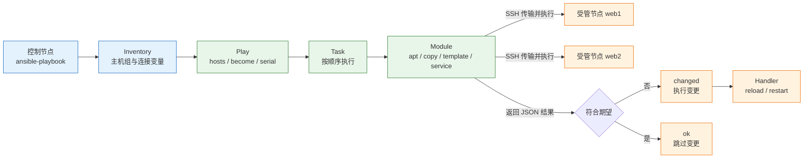
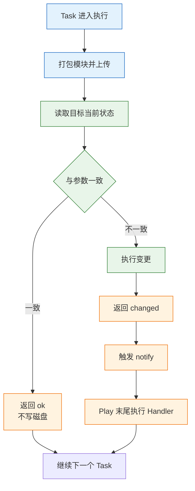
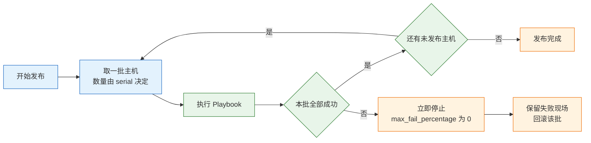

# Ansible 配置自动化

---

## 一、Ansible 是什么

Ansible 是开源的配置管理与自动化编排工具。它把“机器应当处于什么状态”写成 YAML 任务，通过 SSH 推送到受管节点，由模块完成实际变更。它解决配置漂移、批量操作和发布编排，不负责云资源的创建与销毁，也不替人决定配置内容。

三台 Web 服务器手工装 Nginx、改端口、放证书、重启，常见的结局是这样：

- 第一台改了 `worker_connections`，第二台忘了，两台机器的并发能力不一致。
- 第三台证书路径不同，因为当时是另一个人装的，没人记录。
- 半年后要加一台，没人说得清另外三台到底改过什么。

配置管理要解决的是：**同样的目标状态，能在任意一台机器上重复达到；执行结果可检查；改动能评审和回滚。** Ansible 用“无代理 + 幂等模块 + 纯文本描述”这三件事达成目标。

### 1.1 核心概念

理解 Ansible 只需要抓住一条主线：控制节点把任务翻译成模块，模块在受管节点上比对现状，只在不一致时动手。

| 概念 | 含义 | 直接后果 |
|---|---|---|
| 控制节点 | 执行 `ansible` 命令的机器 | 只装 Ansible，不装 agent |
| 受管节点 | 被管理的目标机 | 需要 SSH 与 Python |
| Inventory | 主机与分组清单 | 写错会打到错误的机器 |
| Playbook | 用 YAML 写的任务集合 | 可进 Git、可评审 |
| Module | 幂等操作单元 | 用错模块会失去幂等 |
| Fact | 从目标机采集的变量 | 模板与条件判断的数据源 |
| Handler | 被 `notify` 触发的收尾动作 | 默认在 play 末尾执行一次 |
| Role | 可复用的目录结构 | 把任务、模板、变量打包 |

**幂等**是其中最重要的性质：模块先读取当前状态，再和参数比较，只有不一致才执行。`copy` 会比对文件内容与权限，一致就返回 `ok`；`shell` 不做任何判断，每次都执行并报 `changed`。因此能用专用模块就不要用 `shell`。

Ad-hoc 命令与 Playbook 用的是同一套模块，区别只在组织方式：临时查一台机器用 ad-hoc，需要重复执行、需要评审的用 Playbook。

### 1.2 与相邻技术的关系

Ansible 经常被放进“自动化”这个大筐里，但它和 Terraform、Packer、Shell 脚本的职责边界很清楚。

| 技术 | 管理对象 | 状态模型 | 与 Ansible 的分工 |
|---|---|---|---|
| Ansible | 已存在机器的内部配置 | 不保存状态，现场比对 | 装软件、发配置、编排发布 |
| Terraform | 云资源与基础设施 | 保存 state，按计划变更 | 建网络、建主机，再把主机交给 Ansible |
| Packer | 机器镜像 | 构建产物即版本 | 把基线固化进镜像，减少运行期配置 |
| Shell 脚本 | 任意命令序列 | 无，执行即生效 | 一次性任务，不能替代幂等模块 |
| Kubernetes | 容器化工作负载 | 声明式，控制器持续收敛 | 容器编排，Ansible 只做集群初始化 |

几条必须建立的边界：

- **不用 Ansible 创建整套云资源。** 能做，但依赖关系、删除顺序和状态管理会非常痛苦。让 Terraform 管资源，Ansible 管机器内部。
- **不用 Ansible 构建镜像。** 不可变基础设施用 Docker/Packer 更合适，Ansible 负责镜像构建后的最后一段配置。
- **不指望它持续收敛。** Ansible 默认“运行才执行”，两次运行之间配置仍会漂移；需要持续收敛就配定时任务或 AWX，并接受这个时间窗。
- **Windows 与网络设备不走普通 SSH。** Windows 用 WinRM 连接插件，网络设备用厂商 collection，模块与参数体系都不同。

> **运维提示**：Ansible 与 Terraform 不是替代关系。典型链路是 Terraform 创建 VPC、子网、虚机，输出 IP 清单，Ansible 用动态 inventory 接管这些机器。

### 1.3 架构组成

Ansible 没有数据库、没有消息队列、没有常驻服务，整条链路就是“读清单 → 跑任务 → SSH 执行 → 回收结果”。



| 组件 | 运行位置 | 职责 |
|---|---|---|
| `ansible` / `ansible-playbook` | 控制节点 | 解析命令与 YAML，调度任务 |
| Inventory 插件 | 控制节点 | 提供主机列表与分组变量 |
| Connection 插件 | 控制节点 | 建立 SSH/WinRM 连接，默认 `ssh` |
| Module | 受管节点 | 真正执行变更，返回 JSON |
| Callback 插件 | 控制节点 | 格式化输出、计时、写日志 |
| Collection | 控制节点 | 模块、角色、插件的分发单位 |

受管节点只需要 SSH 服务和 Python 解释器，模块执行完即删除，不留常驻进程。这也是 Ansible 能快速接入存量机器的原因，但代价是每次任务都要重新建立连接、重新采集事实，规模上来后性能问题会先暴露在 SSH 往返上。

---

## 二、Ansible 安装与配置

> **版本现状（2026-10）**：`ansible-core` 2.21.5 为当前稳定小版本，对应 community package 14.x。生产环境固定小版本，升级前先读 porting guide，不要直接跟随最新版。

### 2.1 控制节点安装

控制节点只支持 Linux 与 macOS，Windows 不能作为控制节点。推荐用虚拟环境隔离，避免和系统包管理器互相覆盖。

```bash
# ========== 准备 Python 环境 ==========
# 确认 Python 版本，控制节点建议 3.12 以上
python3 --version

# 创建独立虚拟环境，避免污染系统 Python
python3 -m venv ~/.venv/ansible

# 激活虚拟环境，后续命令都在其中执行
source ~/.venv/ansible/bin/activate

# ========== 安装 ansible-core ==========
# 升级 pip，旧版 pip 解析依赖约束容易失败
python3 -m pip install --upgrade pip

# 固定小版本安装，不要裸装 ansible 大包
python3 -m pip install "ansible-core==2.21.5"

# 验证版本与配置文件加载位置
ansible --version

# ========== 安装 collection ==========
# 按 requirements.yml 安装角色与 collection，版本固定
ansible-galaxy collection install -r requirements.yml
```

预期输出类似（Python 路径因系统而异）：

```text
ansible [core 2.21.5]
  config file = /etc/ansible/ansible.cfg
  configured module search path = ['/home/deploy/.ansible/plugins/modules']
  python version = 3.13.x
```

| 安装方式 | 命令 | 适用场景 |
|---|---|---|
| pip + venv | `python3 -m pip install ansible-core` | 控制节点，版本可控 |
| 系统包管理器 | `dnf install ansible-core` | 内网离线、统一基线 |
| pipx | `pipx install ansible-core` | 单用户、少依赖冲突 |
| 容器镜像 | 挂载工作目录运行 | CI Runner、临时执行 |

> **注意**：`ansible` 大包包含数百个 collection，体积大、升级面广；只做 Playbook 时装 `ansible-core` 即可，需要什么 collection 再单独装。

### 2.2 Inventory 准备

Inventory 定义“对谁执行”。最小可用的是 INI 格式，主机行后面直接跟连接变量。

```ini
# inventory/prod.ini
[web]
# 文档专用地址段 192.0.2.0/24，实际使用时替换为真实 IP 或域名
web1 ansible_host=192.0.2.11 ansible_user=deploy
web2 ansible_host=192.0.2.12 ansible_user=deploy

[db]
db1 ansible_host=192.0.2.21 ansible_user=deploy

[web:vars]
# 目标机 Python 路径，避免自动发现失败
ansible_python_interpreter=/usr/bin/python3

[all:vars]
# 统一走跳板机，内网机器不暴露公网 SSH
ansible_ssh_common_args=-o ProxyJump=bastion.example.com
```

| 变量 | 作用 | 常见错误 |
|---|---|---|
| `ansible_host` | 实际连接地址 | 写成主机名但 DNS 不解析 |
| `ansible_user` | 登录用户 | 与 sudo 用户混淆 |
| `ansible_port` | SSH 端口 | 非 22 时忘记配置 |
| `ansible_ssh_private_key_file` | 指定私钥 | 权限过宽被 SSH 拒绝 |
| `ansible_python_interpreter` | 指定 Python | 指向不存在的解释器 |
| `ansible_become` | 是否提权 | 全局开启扩大风险面 |

先确认清单解析正确，再验证连通性：

```bash
# ========== 检查清单结构 ==========
# 以树形展示分组与主机归属，主机放错组一眼可见
ansible-inventory -i inventory/prod.ini --graph

# 查看某台主机最终生效的全部变量
ansible-inventory -i inventory/prod.ini --host web1

# ========== 验证连通性 ==========
# ping 模块走完整 SSH + Python 链路，比系统 ping 更有意义
ansible -i inventory/prod.ini web -m ansible.builtin.ping
```

预期：

```text
web1 | SUCCESS => {
    "changed": false,
    "ping": "pong"
}
web2 | SUCCESS => {
    "changed": false,
    "ping": "pong"
}
```

> **注意**：`ping` 模块不是 ICMP，它验证的是 SSH 登录、Python 解释器和模块传输三段链路。报 `UNREACHABLE` 时先查网络与认证，报 `MODULE FAILURE` 时查 Python。

云上主机用动态 inventory 插件，按标签、区域或实例状态自动分组。动态 inventory 是只读视图，不要手工修改缓存文件；分组名要稳定，因为 Playbook 的 `hosts` 和 `group_vars` 路径都依赖它。

> **运维提示**：静态 inventory 写多了，最容易犯的错是主机放错组。每次改动后先用 `ansible-inventory --graph` 看一眼层级，再执行任务。

### 2.3 核心配置

`ansible.cfg` 的查找顺序是环境变量 `ANSIBLE_CONFIG` → 当前目录 → `~/.ansible.cfg` → `/etc/ansible/ansible.cfg`。项目内放一份，随代码进 Git，团队行为才能一致。

```ini
# ansible.cfg
[defaults]
# 默认清单路径，命令行可覆盖
inventory = inventory/prod.ini

# 角色搜索路径
roles_path = roles

# 默认并行主机数，5 太小，20 适合中等规模
forks = 20

# 事实采集策略：smart 表示有缓存就不重复采集
gathering = smart

# 事实缓存写入本地 JSON 文件，减少重复采集开销
fact_caching = jsonfile
# 缓存目录必须提前创建，否则运行时报错
fact_caching_connection = .cache/facts
fact_caching_timeout = 86400

# 主机密钥校验保持开启，关闭会引入中间人风险
host_key_checking = True

# 输出格式：default 无额外依赖；yaml 需先装 community.general
stdout_callback = default
callbacks_enabled = timer, profile_tasks

# 目标机 Python 自动发现，找不到时静默回退
interpreter_python = auto_silent

[ssh_connection]
# 开启 pipelining，减少一次文件传输往返
pipelining = True

# 连接复用，60 秒内复用同一条 SSH 连接
ssh_args = -o ControlMaster=auto -o ControlPersist=60s
```

| 配置项 | 默认值 | 建议 |
|---|---|---|
| `forks` | 5 | 20–50，按控制节点与网络承载调整 |
| `gathering` | implicit | 大清单用 `smart` 或 `explicit` |
| `fact_caching` | memory | 跨次运行用 `jsonfile` 或 Redis |
| `pipelining` | False | 开启，需要目标机 `requiretty` 关闭 |
| `host_key_checking` | True | 保持开启，首次连接人工确认指纹 |
| `stdout_callback` | default | 调试可装 community.general 后用 `yaml` |

> **注意**：`pipelining` 与 `sudo` 的 `requiretty` 冲突，开启后若出现 `sudo: sorry, you must have a tty`，要在 sudoers 中关闭 `requiretty`，而不是回退 pipelining。

### 2.4 权限与安全

Ansible 用 SSH 登录，用 `become` 提权。两者是分离的：连接用户可以普通账号，提权走 sudo。

```bash
# ========== 准备密钥 ==========
# 生成专用密钥，不要复用个人登录密钥
ssh-keygen -t ed25519 -C "ansible-deploy" -f ~/.ssh/id_ansible

# 分发公钥到目标机
ssh-copy-id -i ~/.ssh/id_ansible.pub deploy@192.0.2.11

# ========== 验证提权 ==========
# 手动确认 sudo 可用，再交给 Ansible
ssh -i ~/.ssh/id_ansible deploy@192.0.2.11 'sudo -n true'

# ========== 执行提权任务 ==========
# -b 开启 become，-K 交互输入 sudo 密码
ansible -i inventory/prod.ini web -m ansible.builtin.apt \
  -a 'name=nginx state=present' -b -K
```

目标机上的 sudoers 片段，只放行必要的包管理与服务操作：

```text
# /etc/sudoers.d/ansible-deploy
# 只允许 deploy 免密执行指定命令，不要写 ALL
# systemctl 权限接近 root，生产应进一步限定到具体服务单元
deploy ALL=(root) NOPASSWD: /usr/bin/apt, /usr/bin/systemctl
```

> **安全警告**：`host_key_checking = False` 会跳过主机指纹校验，攻击者可在中间人位置截获凭据与任务内容。只在一次性测试环境使用，生产必须维护 `known_hosts`。

> **安全警告**：`become: true` 加在 play 级别等于所有任务都以 root 执行。按需加在单个 task 或 block 上，能用普通用户完成的文件操作不要提权。

---

## 三、核心对象管理

### 3.1 幂等与变更检测原理

一个规范模块通常做三件事：读取当前状态、与参数比较、只在不一致时写入。返回值里的 `changed` 表示“这次真的改了”，`ok` 表示“已经符合期望”，两者都不是“任务有没有跑”。



| 返回状态 | 含义 | 常见原因 |
|---|---|---|
| `ok` | 已符合期望，未改动 | 正常幂等 |
| `changed` | 本次发生了改动 | 首次执行或配置漂移 |
| `failed` | 执行失败 | 参数错、权限不足、服务异常 |
| `skipped` | 条件不满足 | `when` 为假 |
| `unreachable` | 连不上目标机 | 网络、SSH、认证问题 |

反面写法是先追加一行，再谈幂等：

```yaml
# 错误示例：每执行一次就多一行，机器越跑越乱
- name: add line
  ansible.builtin.shell: echo "net.ipv4.ip_forward=1" >> /etc/sysctl.conf
```

正确写法是交给专用模块，由模块判断现值：

```yaml
# 正确示例：sysctl 模块读取现值，不一致才写入并重载
- name: enable ip forward
  ansible.builtin.sysctl:
    name: net.ipv4.ip_forward
    value: "1"
    state: present
    reload: true
```

确实必须执行命令时，要给它补上“是否已完成”的判据：

```yaml
# creates 指向标记文件，文件存在就跳过，避免重复初始化
- name: initialize database
  ansible.builtin.command:
    cmd: /usr/local/bin/init-db
    creates: /var/lib/app/.initialized

# 纯查询命令不会改变系统，显式声明不产生变更
- name: read kernel release
  ansible.builtin.command: uname -r
  changed_when: false
  register: kernel_release

# 用退出码表达业务语义，而不是依赖命令默认行为
- name: check cluster health
  ansible.builtin.command: /usr/local/bin/clusterctl health
  register: health
  failed_when: health.rc not in [0, 2]
```

`creates` 判断文件是否存在，`removes` 判断文件是否不存在，`chdir` 指定工作目录；`changed_when` 修正变更语义，`failed_when` 修正失败语义；`check_mode: false` 让某些只读任务在 `--check` 下也真正执行。缺了这些，`command`/`shell` 既不幂等，也可能把失败当成功。

> **运维红线**：在成组主机上执行 `shell` 拼接的 `rm -rf`、`dd`、`mkfs` 前，先用 `--check --diff --limit` 单机验证，并确认 `hosts` 指向的组不是 `all`。Ad-hoc 命令没有回滚，打错组就是批量事故。

### 3.2 基本命令

Ad-hoc 适合查询和一次性变更，不写文件、不留记录，因此不适合作为常规变更手段。

```bash
# ========== 连通性与信息采集 ==========
# 批量测试连通性
ansible -i inventory/prod.ini all -m ansible.builtin.ping

# 采集指定事实，避免拉回全部变量
ansible -i inventory/prod.ini web -m ansible.builtin.setup \
  -a 'filter=ansible_distribution*,ansible_memtotal_mb'

# 查看目标机时间与负载，command 模块不经过 shell
ansible -i inventory/prod.ini web -m ansible.builtin.command -a 'uptime'

# ========== 一次性变更 ==========
# 安装软件包，-b 提权，--limit 收窄范围
ansible -i inventory/prod.ini web -m ansible.builtin.apt \
  -a 'name=nginx state=present update_cache=true' -b --limit web1

# 重启服务，先确认业务无状态或已摘流量
ansible -i inventory/prod.ini web -m ansible.builtin.service \
  -a 'name=nginx state=restarted' -b --limit web1

# ========== 文档与清单 ==========
# 列出全部模块，配合 grep 找能力
ansible-doc -l | grep -i sysctl

# 查看模块参数与示例，比凭记忆写参数可靠
ansible-doc ansible.builtin.template

# 查看角色与 collection 安装情况
ansible-galaxy role list
# 列出已安装 collection 及版本
ansible-galaxy collection list
```

| 命令 | 用途 | 典型场景 |
|---|---|---|
| `ansible` | 执行 ad-hoc 任务 | 查事实、临时改一台 |
| `ansible-playbook` | 执行 Playbook | 常规变更与发布 |
| `ansible-inventory` | 查看清单解析结果 | 排查主机分组与变量 |
| `ansible-doc` | 查模块文档 | 核对参数名 |
| `ansible-galaxy` | 管理角色与 collection | 安装依赖、锁定版本 |
| `ansible-vault` | 加解密敏感文件 | 存放密钥与证书 |
| `ansible-config` | 查看生效配置 | 确认 cfg 是否被加载 |

> **注意**：ad-hoc 的 `-m command` 不经过 shell，管道、重定向、通配符都不会生效；确需 shell 特性才用 `-m shell`，并接受它不做幂等判断。

### 3.3 Playbook 指令详解

Play 决定“在哪批机器上、以什么身份、分几批执行”，Task 决定“做什么”。常用指令不多，但每个都影响故障半径。

```yaml
---
# Play 级别：主机范围、执行身份、批次与失败策略
- name: web tier baseline
  hosts: web
  become: true
  gather_facts: true

  # 每批 2 台，成功后再进入下一批
  serial: 2

  # 任意一批失败超过 0%，立即停止后续批次
  max_fail_percentage: 0

  # 任意一台失败即终止整个 play，适合强一致变更
  any_errors_fatal: true

  vars:
    http_port: 8080

  pre_tasks:
    # 变更前检查，失败则不进入正式任务
    - name: verify disk space
      ansible.builtin.assert:
        that:
          - ansible_mounts | selectattr('mount', 'equalto', '/') | map(attribute='size_available') | first > 5368709120
        fail_msg: "根分区可用空间不足 5GB"

  roles:
    - role: nginx

  tasks:
    # 成组任务配合 rescue，失败时执行补偿动作
    - name: deploy application
      block:
        - name: copy release
          ansible.builtin.copy:
            src: "files/app-{{ app_version }}.jar"
            dest: /opt/app/app.jar
            mode: "0644"
          notify: restart app

        - name: wait for health
          ansible.builtin.uri:
            url: "http://127.0.0.1:{{ http_port }}/healthz"
            status_code: 200
          retries: 10
          delay: 3
          register: health
          until: health.status == 200
      rescue:
        # 失败时回滚到上一版本并记录
        - name: rollback release
          ansible.builtin.copy:
            src: "files/app-{{ app_previous_version }}.jar"
            dest: /opt/app/app.jar
            mode: "0644"
          notify: restart app
      always:
        # 无论成败都执行，用于清理临时文件
        - name: remove staging files
          ansible.builtin.file:
            path: /tmp/release-staging
            state: absent

  handlers:
    # 与 notify 名称完全一致，全部任务结束后执行一次
    - name: restart app
      ansible.builtin.service:
        name: app
        state: restarted
```

| 指令 | 作用 | 易错点 |
|---|---|---|
| `hosts` | 指定目标组或主机 | 组名拼错会匹配空集而不报错 |
| `become` | 提权执行 | 全局开启扩大风险面 |
| `gather_facts` | 是否采集事实 | 不需要 facts 时白白拖慢 |
| `serial` | 每批主机数或比例 | 与 `forks` 混淆，见 6.2 |
| `max_fail_percentage` | 批次失败阈值 | 单台批次下等于一票否决 |
| `any_errors_fatal` | 任一失败即终止 | 长任务中会留下半完成状态 |
| `tags` | 任务标签 | 标签名不一致导致漏跑 |
| `when` | 条件执行 | 变量未定义直接报错 |
| `loop` | 循环 | 大列表逐条执行很慢 |
| `register` | 保存返回结果 | 变量名覆盖不报错 |
| `until` / `retries` | 重试直到条件成立 | 忘记 `delay` 会空转 |
| `notify` | 触发 handler | 名称为 `ok` 时不触发 |

### 3.4 最佳实践

| 实践 | 原因 | 落地方式 |
|---|---|---|
| 一个 Play 只做一类事 | 失败定位快，可单独重跑 | 按安装、配置、发布拆分 |
| 任务名写清动作与对象 | 输出即文档 | `install nginx from distro repo` |
| 变量带默认值 | 避免未定义中断 | `defaults/main.yml` + `default()` |
| 变更前先断言 | 磁盘、内存、版本不满足时早停 | `assert` + `fail` |
| handler 名统一 | 改名后通知静默失效 | 常量式命名，评审时检查 |
| 全量任务可重复执行 | 第二次运行应 `changed=0` | CI 中跑两遍验证幂等 |

> **运维提示**：把“第二次运行 `changed=0`”做成流水线门禁，比人工检查可靠。任何新增任务只要破坏幂等，第二次运行就会暴露。

---

## 四、Playbook 配置语法

### 4.1 变量与优先级

变量按来源分层，优先级从低到高大致是：role defaults → inventory group_vars → inventory host_vars → play vars → task vars → `-e` extra vars。`-e` 永远最高，适合临时覆盖，不适合当常规配置来源。

| 来源 | 位置 | 优先级 | 适用 |
|---|---|---|---|
| role defaults | `roles/x/defaults/main.yml` | 最低 | 可被覆盖的默认值 |
| inventory group_vars | `group_vars/<组>.yml` | 低 | 环境与组级差异 |
| inventory host_vars | `host_vars/<主机>.yml` | 中 | 单机特例 |
| play vars | Playbook 内 `vars:` | 较高 | 本次编排的局部值 |
| task vars | Task 内 `vars:` | 高 | 单任务临时值 |
| extra vars | `-e` 或 `--extra-vars` | 最高 | 临时覆盖与调试 |

环境差异放文件，不要复制多份 Playbook：

```yaml
# group_vars/web.yml：所有 Web 节点共用
http_port: 8080
app_version: "1.4.2"

# group_vars/prod.yml：生产覆盖
http_port: 80
app_previous_version: "1.4.1"

# host_vars/web1.yml：单机特例
ansible_host: 192.0.2.11
```

> **注意**：`group_vars/all.yml` 的优先级低于具体组，容易被误认为“全局最高”。排查变量取值时用 `ansible-inventory --host` 看最终结果，不要靠猜。

### 4.2 Jinja2 模板

模板让配置文件随变量变化，同时保留完整语法。模板里只放结构，不放明文密钥。

```jinja
{# templates/site.conf.j2 #}
# 由 Ansible 管理，手工修改会在下次运行时被覆盖
upstream backend {

    server {{ hostvars[host].ansible_host }}:{{ http_port }};

}

server {
    listen {{ http_port | default(8080) }};
    server_name {{ server_name | default('_') }};

    # 证书路径必须显式传入，缺失时立即失败而不是生成坏配置
    ssl_certificate     {{ ssl_cert | mandatory }};
    ssl_certificate_key {{ ssl_key | mandatory }};

    location / {
        proxy_pass http://backend;
        proxy_set_header Host $host;
        proxy_set_header X-Real-IP $remote_addr;
    }
}
```

| 过滤器 | 用途 | 示例 |
|---|---|---|
| `default()` | 变量缺失时给默认值 | `{{ port \| default(80) }}` |
| `mandatory` | 变量缺失时直接失败 | `{{ ssl_cert \| mandatory }}` |
| `join()` | 列表拼成字符串 | `{{ azs \| join(',') }}` |
| `to_json` / `to_yaml` | 结构转文本 | `{{ config \| to_json }}` |
| `b64encode` | 编码敏感内容 | 仅编码，不等于加密 |

> **注意**：模板任务要显式写 `mode`。不写时权限由 umask 决定，同一份配置在不同机器上可能得到 0644 或 0600，证书私钥尤其危险。

### 4.3 Role 目录结构

Role 把“一类机器的一种能力”打包，调用方只传变量。

```text
ansible/
├── ansible.cfg
├── inventory/
│   ├── staging.ini
│   └── prod.ini
├── group_vars/
│   ├── web.yml
│   └── prod/
│       └── vault.yml
├── roles/
│   └── nginx/
│       ├── defaults/main.yml
│       ├── vars/main.yml
│       ├── tasks/main.yml
│       ├── templates/site.conf.j2
│       ├── handlers/main.yml
│       ├── files/
│       └── meta/main.yml
├── requirements.yml
└── site.yml
```

```yaml
# roles/nginx/tasks/main.yml
---
# 安装：包管理器模块保证幂等
- name: install nginx
  ansible.builtin.apt:
    name: nginx
    state: present
    update_cache: true
    cache_valid_time: 3600

# 配置：模板内容变化才触发 reload
- name: deploy site config
  ansible.builtin.template:
    src: site.conf.j2
    dest: /etc/nginx/conf.d/site.conf
    owner: root
    group: root
    mode: "0644"
  notify: reload nginx

# 校验：解析整份配置，失败则不进入 handler
- name: validate nginx config
  ansible.builtin.command: nginx -t
  changed_when: false

# 服务：保证运行且开机自启
- name: ensure nginx is running
  ansible.builtin.service:
    name: nginx
    state: started
    enabled: true
```

```yaml
# roles/nginx/defaults/main.yml
---
# 优先级最低，调用方可用 group_vars 覆盖
http_port: 8080
worker_connections: 1024

# roles/nginx/handlers/main.yml
---
- name: reload nginx
  ansible.builtin.service:
    name: nginx
    state: reloaded
```

| 目录 | 内容 | 注意 |
|---|---|---|
| `defaults/` | 可覆盖默认值 | 优先级最低，适合放环境无关值 |
| `vars/` | 角色内部常量 | 优先级高，不要放环境差异 |
| `tasks/` | 任务入口 | 用 `main.yml` 引入子文件 |
| `templates/` | Jinja2 模板 | 不放明文密钥 |
| `handlers/` | 收尾动作 | 名称与 `notify` 完全一致 |
| `meta/` | 依赖与元数据 | 依赖角色先于本角色执行 |

> **注意**：`vars/main.yml` 的优先级高于 `group_vars`，放进去的环境值会让调用方“改了不生效”。环境差异一律放 `group_vars` 或 `host_vars`。

一个 role 超过几百行、开始出现大量 `when: env == ...`，通常该拆了。按“安装、配置、服务”拆，或者按组件拆，比按环境拆更易复用。

外部依赖写进 `requirements.yml`，用版本约束固定，不要依赖控制节点上“恰好装过”：

```yaml
# requirements.yml
---
roles:
  # 示例值，落地时替换为团队验证过的版本
  - name: geerlingguy.docker
    version: "7.4.1"

collections:
  # 约束区间，避免跨大版本升级引入不兼容
  - name: community.general
    version: ">=10.0.0,<11.0.0"
```

### 4.4 标签与流程控制

标签用于“只跑其中一段”，是排障和分步发布的常用手段。

```yaml
# 给任务打标签，粒度按能力划分
- name: install packages
  ansible.builtin.apt:
    name: "{{ packages }}"
    state: present
  tags: [packages, nginx]

- name: deploy config
  ansible.builtin.template:
    src: site.conf.j2
    dest: /etc/nginx/conf.d/site.conf
  tags: [config, nginx]
  notify: reload nginx
```

```bash
# ========== 按标签执行 ==========
# 只跑配置相关任务
ansible-playbook -i inventory/prod.ini site.yml --tags config

# 排除耗时任务
ansible-playbook -i inventory/prod.ini site.yml --skip-tags packages

# 列出全部标签，确认拼写
ansible-playbook -i inventory/prod.ini site.yml --list-tags

# ========== 分步执行 ==========
# 从指定任务开始，调试时避免重复前置步骤
ansible-playbook -i inventory/prod.ini site.yml --start-at-task "deploy config"

# 单步确认，每跑一个任务询问一次
ansible-playbook -i inventory/prod.ini site.yml --step
```

> **注意**：`--tags` 只执行带标签的任务，但被 `include_tasks` 引入的文件如果没有继承标签，可能整体不执行。用 `--list-tasks` 核对实际任务清单。

---

## 五、完整示例：Nginx 基线与滚动发布

这一节从空目录走到可重复执行的发布，关键文件如下，只需替换 inventory 中的地址。

### 5.1 目录规划

```text
nginx-baseline/
├── ansible.cfg
├── inventory/prod.ini
├── group_vars/web.yml
├── roles/nginx/{defaults,tasks,templates,handlers}/
└── site.yml
```

`site.yml` 只做编排，不堆任务：

```yaml
# site.yml
---
- name: web tier
  hosts: web
  become: true

  # 一次两台，失败即停
  serial: 2
  max_fail_percentage: 0

  roles:
    - role: nginx
```

### 5.2 配置清单

```ini
# inventory/prod.ini
[web]
web1 ansible_host=192.0.2.11 ansible_user=deploy
web2 ansible_host=192.0.2.12 ansible_user=deploy

[web:vars]
ansible_python_interpreter=/usr/bin/python3
```

```yaml
# group_vars/web.yml
http_port: 8080
server_name: example.internal
```

```yaml
# roles/nginx/defaults/main.yml
http_port: 8080
worker_connections: 1024
```

```yaml
# roles/nginx/tasks/main.yml
---
# 安装 Nginx，缓存有效期内不重复刷新索引
- name: install nginx
  ansible.builtin.apt:
    name: nginx
    state: present
    update_cache: true
    cache_valid_time: 3600

# 渲染站点配置，内容变化时通知 handler
- name: deploy site config
  ansible.builtin.template:
    src: site.conf.j2
    dest: /etc/nginx/conf.d/site.conf
    owner: root
    group: root
    mode: "0644"
  notify: reload nginx

# 语法校验，避免坏配置进入 reload
- name: validate nginx config
  ansible.builtin.command: nginx -t
  changed_when: false

# 保证服务运行并开机自启
- name: ensure nginx is running
  ansible.builtin.service:
    name: nginx
    state: started
    enabled: true
```

```jinja
{# roles/nginx/templates/site.conf.j2 #}
server {
    listen {{ http_port }};
    server_name {{ server_name }};
    location / {
        return 200 "ok";
    }
}
```

```yaml
# roles/nginx/handlers/main.yml
- name: reload nginx
  ansible.builtin.service:
    name: nginx
    state: reloaded
```

### 5.3 执行与验证

先做语法检查，再做单机预演，最后按批次扩散：

```bash
# ========== 语法与清单 ==========
# 不连机器，只校验 YAML 结构与任务引用
ansible-playbook -i inventory/prod.ini site.yml --syntax-check

# 确认分组与变量解析正确
ansible-inventory -i inventory/prod.ini --graph

# ========== 单机预演 ==========
# check 模式不落盘，diff 显示将要改动的行
ansible-playbook -i inventory/prod.ini site.yml --check --diff --limit web1

# ========== 首次安装 ==========
# 空机器上 check 不会真正装包，模板任务可能因目录不存在而失败；
# 首次直接正式执行，再用 check 验证幂等
ansible-playbook -i inventory/prod.ini site.yml --limit web1

# ========== 正式执行 ==========
# 单机验证通过后，按 serial 分批扩散到全组
ansible-playbook -i inventory/prod.ini site.yml

# ========== 幂等验证 ==========
# 再跑一次，changed 必须为 0
ansible-playbook -i inventory/prod.ini site.yml
```

> **注意**：`--check` 不是万能的。空机器上前一个任务不会真正创建目录，后一个模板任务可能因此报错；依赖命令输出的任务在 check 模式下也可能判断失真。因此首次变更先 `--limit` 一台正式执行，再用 check 验证幂等。

首次执行的 PLAY RECAP 类似（任务数与 changed 随现状变化）：

```text
PLAY RECAP *********************************************************************
web1 : ok=4 changed=3 unreachable=0 failed=0 skipped=0 rescued=0 ignored=0
web2 : ok=4 changed=3 unreachable=0 failed=0 skipped=0 rescued=0 ignored=0
```

第二次执行的期望是 `changed=0`。如果仍然大于 0，说明有任务不幂等，先修 Playbook，不要继续叠加机器。



验证服务本身，而不是只看 Ansible 的颜色：

```bash
# ========== 服务与端口 ==========
# 确认进程存在
ansible -i inventory/prod.ini web -m ansible.builtin.command -a 'systemctl is-active nginx'

# 确认端口监听
ansible -i inventory/prod.ini web -m ansible.builtin.command -a 'ss -lntp'

# ========== 业务响应 ==========
# 从控制节点验证返回码与内容
curl -sS -o /dev/null -w '%{http_code}\n' http://192.0.2.11:8080/

# 确认配置语法本身没有问题
ansible -i inventory/prod.ini web -m ansible.builtin.command -a 'nginx -t' -b
```

| 阶段 | 命令 | 判定标准 |
|---|---|---|
| 语法 | `--syntax-check` | 退出码 0 |
| 预演 | `--check --diff --limit` | 差异符合预期 |
| 首批 | `--limit web1` | RECAP 无 failed |
| 扩散 | `serial: 2` | 每批成功后再下一批 |
| 幂等 | 再跑一次 | `changed=0` |
| 业务 | `curl` / `nginx -t` | 200 且配置校验通过 |

### 5.4 健康检查与回滚

发布后的健康检查要放在 Playbook 里，而不是靠人盯：

```yaml
# 等待服务就绪，10 次重试，每次间隔 3 秒
- name: wait for health
  ansible.builtin.uri:
    url: "http://{{ ansible_host }}:{{ http_port }}/healthz"
    status_code: 200
  retries: 10
  delay: 3
  register: health
  until: health.status == 200

# 健康检查通过后，把节点重新挂回负载均衡
- name: register healthy node
  ansible.builtin.uri:
    url: "http://lb.example.internal/api/register"
    method: POST
    body_format: json
    body:
      host: "{{ inventory_hostname }}"
  delegate_to: localhost
  when: health.status == 200
```

`uri` 失败会重试，10 次都失败则这台机器标记 `failed`，配合 `serial` 阻止继续扩散。注意 `ansible_host` 是连接地址，不一定能从控制节点直接访问业务端口；不通时用 `delegate_to: localhost` 或从负载均衡器侧检查。

回滚不引入额外工具，回到上一个可用提交再执行同一份 Playbook：

```bash
# ========== 回滚 ==========
# 查看变更历史，定位上一个可用版本
git log --oneline -- roles/nginx

# 回退该角色到上一个提交
git checkout <commit> -- roles/nginx

# 只对失败批次回滚，不扩大到其他机器
ansible-playbook -i inventory/prod.ini site.yml --limit web1

# ========== 事后确认 ==========
# 对比两台机器的配置文件，确认回到同一基线
ansible -i inventory/prod.ini web -m ansible.builtin.command \
  -a 'sha256sum /etc/nginx/conf.d/site.conf'
```

> **运维提示**：回滚的前提是“上一版本仍可取回”。配置进 Git、发布打 tag、模板变更单独提交，回滚才是一条命令；否则只能靠登录机器手工改，越改越偏。

---

## 六、密钥、性能与安全边界

Ansible 没有 state，这一节处理的是“敏感数据放哪、执行有多快、权限给到多大”。

### 6.1 密钥管理

Vault 用 AES 加密整个文件，保护的是“文件内容”，不保护解密后的进程内存、日志和临时文件。

```bash
# ========== 加密与查看 ==========
# 加密整个变量文件，命令会提示输入密码
ansible-vault encrypt group_vars/prod/vault.yml

# 查看内容，不落盘明文
ansible-vault view group_vars/prod/vault.yml

# 编辑后自动重新加密
ansible-vault edit group_vars/prod/vault.yml

# ========== 单值加密 ==========
# 只加密一个值，便于嵌入普通变量文件
ansible-vault encrypt_string --name 'db_password' 'S3cretValue'

# ========== 执行时提供密码 ==========
# 交互输入，适合临时操作
ansible-playbook -i inventory/prod.ini site.yml --ask-vault-pass

# 密码文件方式，适合自动化；权限必须是 600
ansible-playbook -i inventory/prod.ini site.yml \
  --vault-password-file ~/.ansible/vault-pass

# ========== 轮换 ==========
# 换密码后所有引用该文件的 Playbook 都要更新密码来源
ansible-vault rekey group_vars/prod/vault.yml
```

```yaml
# group_vars/prod/vault.yml（加密前）
vault_db_password: "S3cretValue"
vault_api_token: "token-value"
```

| 操作 | 命令 | 注意 |
|---|---|---|
| 加密文件 | `encrypt` | 整个文件变成密文 |
| 查看 | `view` | 不产生明文临时文件 |
| 编辑 | `edit` | 退出时自动加密 |
| 改密码 | `rekey` | 旧密码无法再解密该文件 |
| 单值加密 | `encrypt_string` | 输出可粘贴进 YAML |
| 多密码 | `--vault-id` | 按环境区分密码来源 |

> **安全警告**：`ansible-vault decrypt` 会把明文写回磁盘，且不会自动还原。生产环境不要执行；确需排查时用 `view`，并在结束后确认没有明文残留。

> **注意**：含密码的任务加 `no_log: true`，否则失败时模块参数会进入日志。`debug: var=hostvars` 这类任务会把所有变量打印出来，生产禁用。

### 6.2 执行性能

默认 `forks=5`，一次只对 5 台并行；SSH 往返、事实采集、包管理器锁都会拖慢整体。调优要分清瓶颈在哪。

| 参数 | 默认 | 调整方向 |
|---|---|---|
| `forks` | 5 | 提到 20–50，先看控制节点与网络承载 |
| `gather_facts` | true | 不需要事实的 Play 设为 false |
| `pipelining` | false | 开启，减少文件传输往返 |
| `strategy` | linear | 长任务用 free，主机之间不互相等 |
| `fact_caching` | memory | 用 jsonfile 或 Redis 跨运行复用 |
| `ControlPersist` | 无 | 设 60s，复用 SSH 连接 |
| `serial` | 全部 | 按批次发布，控制爆炸半径 |
| `async` / `poll` | 同步 | 长命令异步执行，避免连接超时 |

`forks` 和 `serial` 是两件事：`forks` 决定同时连多少台，`serial` 决定一次发布多少台。发布用 `serial` 限流，采集用 `forks` 提速，不要互相替代。

```bash
# ========== 性能对比 ==========
# 提高并行度做事实采集
ansible -i inventory/prod.ini web -m ansible.builtin.setup -f 30

# 关闭隐式事实采集跑纯命令任务
ANSIBLE_GATHERING=explicit ansible-playbook -i inventory/prod.ini site.yml --limit web

# ========== 长任务异步 ==========
# 后台执行，立刻返回 job id，适合超过 SSH 超时的任务
ansible -i inventory/prod.ini web -m ansible.builtin.command \
  -a 'sleep 600' -B 900 -P 0
```

> **注意**：`strategy: free` 会让主机各自推进，输出顺序打乱，排障难度上升；只在任务彼此独立、耗时差异大时使用。

### 6.3 审计与安全边界

| 风险 | 后果 | 措施 |
|---|---|---|
| Playbook 无评审 | 误删、误重启直接生效 | 进 Git，变更走 PR |
| `become` 全局开启 | 所有任务以 root 运行 | 按 task 或 block 提权 |
| 密钥进仓库 | 泄露后无法追溯 | Vault 或外部密钥系统 |
| 日志打印变量 | 密码进入日志平台 | `no_log: true` |
| 无运行记录 | 出事无法对应到一次执行 | CI/AWX 集中留存 |
| 控制节点当跳板 | 单点故障、凭证扩散 | 专用 Runner，最小权限 |

执行记录至少保留：谁触发、哪个提交、哪些主机、check/diff 结果、失败任务。把这部分交给 CI 或 AWX，而不是靠终端滚屏。规模上来后也不要用一台笔记本当控制节点，凭证应由平台注入。

### 6.4 能力边界

| 维度 | Ansible | Terraform / OpenTofu |
|---|---|---|
| 主要对象 | 已存在机器的配置 | 云资源的创建与生命周期 |
| 状态 | 不保存状态，靠现场检查 | 保存 state，按计划变更 |
| 执行 | Push，运行即生效 | plan → apply，先预览 |
| 强项 | 批量配置、发布编排、一次性任务 | 网络、数据库、集群等资源依赖 |
| 弱项 | 资源依赖与漂移管理 | 机器内部的细粒度配置 |

- **不要把 Vault 当密钥管理系统。** 它能加密文件，但密钥轮换、审计、动态凭据要靠外部系统。
- **不要把 Ansible 当“每次从头装环境”的工具。** 基础软件由镜像或基础设施预置，Ansible 只做最后一公里；否则一次发布半小时，每次都在赌包源和网络。
- **不要在生产机上手工改完再补 Playbook。** 现场与代码会立刻分叉，下一次运行把手工改动覆盖掉，故障因此变得不可解释。
- **不要留下没有归属的 Playbook。** 没有 owner 的自动化会变成新的“祖传脚本”；至少要有 README、变量说明和最后一次成功运行记录。

---

## 七、常见排障

| 现象 | 最可能原因 | 处理 |
|---|---|---|
| `UNREACHABLE` | SSH 端口、用户、密钥错，安全组不通 | `ssh -vvv user@host` 复现，核对 inventory |
| `Host key verification failed` | 目标机不在 `known_hosts` | 核对指纹后 `ssh-keyscan` 写入 |
| `Missing sudo password` | 需要 become 密码 | 加 `--ask-become-pass`，或配置受限 NOPASSWD |
| `/usr/bin/python3: not found` | 目标机没有 Python | 安装 Python，或设 `ansible_python_interpreter` |
| 任务每次都 `changed` | 用了 `shell` / `command` | 换模块，或加 `changed_when`、`creates` |
| handler 没执行 | 任务返回 `ok`，或名称不匹配 | 核对 `notify` 名称，必要时 `--force-handlers` |
| 变量未定义 | 拼写、`group_vars` 路径、优先级 | `-e` 临时验证，`ansible-inventory --host` |
| Vault 解密失败 | 密码错、文件未加密、参数缺失 | 核对 vault-id 与密码文件 |
| 执行很慢 | 事实采集、SSH 往返、串行 | `gather_facts: false`、开 pipelining、调 forks |
| `apt lock` | 另一个 apt 或 cloud-init 在跑 | 等待或重试，不要强杀包管理器 |
| 模板渲染报错 | 变量缺失或类型不符 | `default()` 兜底，`mandatory` 显式失败 |
| 部分主机成功部分失败 | 网络抖动或批次策略 | 先修失败机，再对剩余主机 `--limit` 重跑 |

排障顺序：

1. `ansible -i inventory.ini <host> -m ping`，先排除连接与 Python 问题。
2. `--syntax-check`，排除 YAML 与任务结构错误。
3. `ansible-inventory --graph` 和 `--host`，确认主机分组与变量取值。
4. `--check --diff --limit <one-host>`，看它准备改什么。
5. 加 `-vvv` 看 SSH、Python、become 的实际命令与返回。
6. `ansible-doc <module>` 核对参数，不要凭记忆写模块名。
7. 最后看目标机日志：包管理器、服务单元、SELinux/AppArmor、磁盘。

> **运维提示**：Ansible 的报错通常只有一行，真正原因在 `-vvv` 的第三条命令和模块返回的 `stderr` 里。先读完整 JSON 结果，再决定是否改 Playbook。
