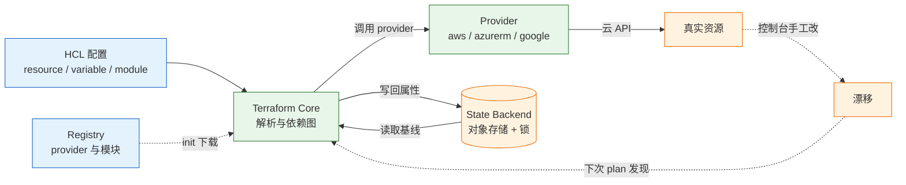
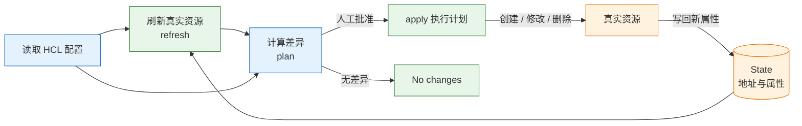
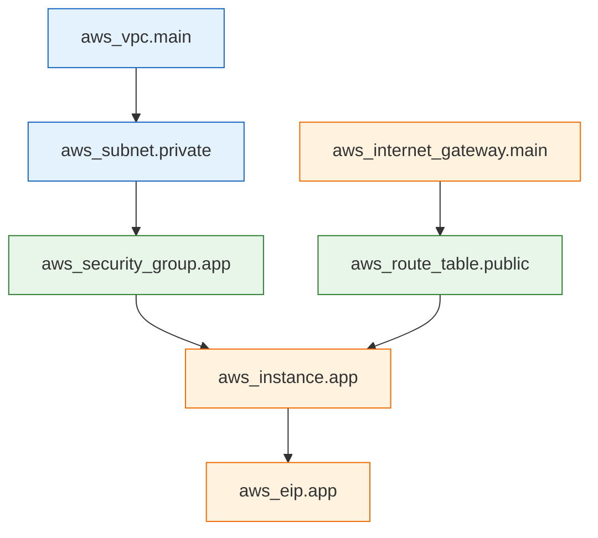

# Terraform 基础设施即代码

---

## 一、Terraform 是什么

Terraform 是 HashiCorp 开源的基础设施即代码工具。它把云资源写成 HCL 配置，用 state 记住“配置里的地址”对应“现实中的哪个资源”，再通过 plan/apply 把现实改成配置描述的样子。它解决资源的可复现与变更审核，不解决机器内部配置，也不适合与手工操作抢同一个资源。

一个典型现场：

- 测试环境是某人在控制台点出来的，安全组、子网、路由表没人记得全。
- 生产要再加一套，靠截图和记忆重做，漏了一条入站规则，排查半天。
- 删除时不知道哪些资源属于这个系统，删了负载均衡，忘了后面的 NAT 网关还在计费。
- 出问题想看“上次改了什么”，只有控制台操作记录，没有变更计划。

基础设施即代码要解决的是：**环境可以从代码重建、变更有计划、资源有归属、删除有顺序。** Terraform 用“声明式配置 + 状态文件 + 差异计划”这三件事达成目标。

### 1.1 核心概念

Terraform 不是“执行脚本”，而是“算差异”。它先读 state，再刷新真实资源，然后生成一张“要新增、修改、删除什么”的计划，apply 执行的就是这张计划。

| 概念 | 含义 | 运维后果 |
|---|---|---|
| 声明式配置 | 只写最终形态，不写步骤 | 顺序由依赖图决定，不靠人排 |
| Provider | 把 HCL 翻译成云 API 调用 | 版本或认证问题会让 plan 直接失败 |
| Resource | 一个被管理的真实对象 | 地址变化可能触发重建 |
| State | 资源地址到真实 ID 的映射 | 丢失就不知道在管哪些资源 |
| Plan | 配置与现状的差异清单 | 不看 plan 就 apply 等于闭眼改生产 |
| Module | 可复用的资源组合 | 版本不固定会导致环境分叉 |

**资源地址**是理解一切现象的钥匙。`aws_instance.web` 是一个地址，state 里记着它对应的真实实例 ID。改了资源名、改了 `for_each` 的 key、把资源从一个模块移到另一个模块，地址都会变，Terraform 就会认为“旧的要删、新的要建”。

### 1.2 与相邻技术的关系

| 技术 | 管理对象 | 状态模型 | 与 Terraform 的分工 |
|---|---|---|---|
| Terraform | 云资源与基础设施 | 保存 state，按计划变更 | 建网络、建主机、建数据库 |
| Ansible | 已存在机器的配置 | 不保存状态，现场比对 | 装软件、发配置、编排发布 |
| CloudFormation | AWS 资源 | 托管栈状态 | 仅限 AWS，与云深度绑定 |
| Pulumi | 云资源 | 保存 state | 用通用语言写，团队需编程能力 |
| Crossplane | Kubernetes 中的云资源 | 控制器持续协调 | 平台化、K8s 原生场景 |

几条边界必须说清：

- **它管资源的生命周期，不管机器里装了什么软件。** 那部分交给 Ansible、镜像或 cloud-init。
- **它不保证应用高可用。** 它只是把高可用架构写成代码，多可用区是否真的生效要看资源和业务配置。
- **它不替代云平台。** provider 只是调用云 API，配额、可用区、计费规则仍由云厂商决定。
- **许可需要单独判断。** Terraform 1.6 起改为 BUSL 1.1，OpenTofu 是 MPL 2.0 分支；命令高度相似，选型要看许可与社区支持，不要只看语法。

> **运维提示**：Terraform 与 Ansible 的衔接点是输出。Terraform 用 `output` 导出 IP、域名、连接串，Ansible 用动态 inventory 或 `terraform output -json` 读取，避免两边各维护一份主机清单。

### 1.3 架构组成

Terraform 是单个二进制，核心只做三件事：解析配置、构建依赖图、比较状态。真正干活的是 provider。



| 组件 | 职责 | 失败表现 |
|---|---|---|
| Terraform Core | 解析 HCL、构建图、算差异 | 语法错、版本不满足 |
| Provider | 认证、调用云 API、映射属性 | 认证失败、限流、版本不兼容 |
| State Backend | 保存状态、提供锁 | 锁冲突、读写权限不足 |
| Registry | 分发 provider 与模块 | 下载超时、版本不存在 |
| CLI | 执行命令、输出计划 | 参数错、工作目录错 |

> **注意**：`.terraform/` 目录是 init 下载的 provider 与模块缓存，可以删除重建；`.terraform.lock.hcl` 记录版本与校验和，必须提交。把两者混为一谈，会在换机器后得到不同的 provider 版本。

---

## 二、Terraform 安装与配置

> **版本现状（2026-10）**：Terraform 1.17.0 为当前稳定版。团队要固定 `required_version` 与 provider 版本，并提交 `.terraform.lock.hcl`；本地与 CI 使用同一版本，否则同一份配置可能算出不同计划。

### 2.1 安装与版本固定

Terraform 以单文件发布，解压即用；团队环境更推荐版本管理器，避免“本地 1.9、CI 1.17”这种隐性差异。

```bash
# ========== 二进制安装 ==========
# 下载官方发布包，版本与平台按实际替换
curl -O https://releases.hashicorp.com/terraform/1.17.0/terraform_1.17.0_linux_amd64.zip

# 解压到系统 PATH
sudo unzip terraform_1.17.0_linux_amd64.zip -d /usr/local/bin/

# 验证版本
terraform version

# 安装命令补全，减少参数拼写错误
terraform -install-autocomplete

# ========== 版本管理器安装 ==========
# 用 tfenv 固定项目版本，进入目录自动切换
tfenv install 1.17.0
# 切换到指定版本
tfenv use 1.17.0

# 在项目根目录写版本文件，团队成员共用
echo "1.17.0" > .terraform-version
```

| 安装方式 | 命令 | 适用场景 |
|---|---|---|
| 官方二进制 | 解压到 `/usr/local/bin` | 单机、容器镜像 |
| tfenv | `tfenv install` | 多项目多版本 |
| asdf | `asdf install terraform` | 已用 asdf 管理多工具 |
| 系统包管理器 | `brew install terraform` | 本地开发 |

> **注意**：不要用 `latest` 作为团队基线。版本差异会体现在计划结果上，尤其是 provider 协议与状态格式；升级 Terraform 本体要单独开 PR，跑完整 plan。

### 2.2 工作目录与初始化

一个 Terraform 目录就是一个“根模块”，`init` 是任何操作的起点。

```bash
# ========== 创建目录 ==========
mkdir -p ~/tf-demo && cd ~/tf-demo

# ========== 初始化 ==========
# 下载 provider、初始化 backend、生成锁文件
terraform init

# 升级 provider 到约束内最新版，需人工 review 锁文件变化
terraform init -upgrade

# 后端配置变更后迁移状态，不要手工拷贝 state
terraform init -migrate-state

# ========== 目录检查 ==========
# 查看 init 生成的缓存与锁文件
ls -la
```

`init` 之后目录里至少有这几类文件：

| 路径 | 作用 | 是否提交 |
|---|---|---|
| `*.tf` | 配置源码 | 提交 |
| `.terraform.lock.hcl` | provider 版本与校验和 | 提交 |
| `.terraform/` | provider 与模块缓存 | 不提交 |
| `terraform.tfstate` | 本地状态 | 绝不提交 |
| `*.tfvars` | 变量值 | 按敏感性决定 |

### 2.3 核心配置

`terraform` 块声明版本、provider 来源和后端，是整个目录的入口约束。

```hcl
# versions.tf
terraform {
  # 本体版本下限与上限，避免团队成员用差异过大的版本
  required_version = ">= 1.17.0, < 2.0.0"

  required_providers {
    aws = {
      source  = "hashicorp/aws"
      version = "~> 6.0"
    }
    local = {
      source  = "hashicorp/local"
      version = "~> 2.5"
    }
  }

  # 后端在 init 阶段初始化，不能引用变量
  backend "s3" {
    bucket       = "example-tfstate-prod"
    key          = "network/terraform.tfstate"
    region       = "ap-southeast-1"
    use_lockfile = true
    encrypt      = true
  }
}

# 默认 provider 配置，region 与 profile 由 variables.tf 传入
provider "aws" {
  region  = var.region
  profile = var.aws_profile
}
```

| 配置块 | 作用 | 注意 |
|---|---|---|
| `required_version` | 限制 Terraform 本体版本 | 不写会在升级后才发现不兼容 |
| `required_providers` | 声明来源与版本约束 | 省略 source 会去默认命名空间找 |
| `backend` | 状态存放位置与锁 | 块内不能引用变量 |
| `provider` | 认证方式与默认参数 | 别名用于多区域、多账号 |

> **运维提示**：`backend` 块里不能写变量，多环境只能靠不同目录、不同 `-backend-config` 文件或部分配置传入。把环境塞进同一个 backend 再切 workspace，是误用的高发区。

### 2.4 认证与权限

Terraform 不保存云凭据，只读取运行环境提供的凭据。凭据来源决定泄露风险。

```bash
# ========== 本地开发 ==========
# 使用命名 profile，避免默认 profile 权限过大
aws configure --profile tf-deploy

# 指定 profile 运行
export AWS_PROFILE=tf-deploy
# 生成计划，验证凭据是否可用
terraform plan

# ========== CI 环境 ==========
# 短期凭据由平台注入，不落盘、不进仓库
export AWS_ROLE_ARN=arn:aws:iam::123456789012:role/tf-ci
# 指定 OIDC 令牌文件路径，由平台挂载
export AWS_WEB_IDENTITY_TOKEN_FILE=/var/run/secrets/token

# ========== 权限验证 ==========
# 确认当前身份与账号，避免打错环境
aws sts get-caller-identity
```

| 认证方式 | 适用 | 风险 |
|---|---|---|
| 环境变量 | 本地临时、CI | 可能进入 shell 历史 |
| 命名 profile | 本地多账号 | 配置文件泄露 |
| 实例角色 | EC2/ECS 上运行 | 角色权限过宽 |
| OIDC 联合 | CI/CD | 需正确限制仓库与分支 |
| 静态密钥 | 不推荐 | 长期有效、难轮换 |

> **安全警告**：访问密钥、`terraform.tfvars` 中的密码、state 中的敏感属性都不能进 Git。CI 使用 OIDC 换取短期凭据，权限按“只够管理本目录资源”收敛。

---

## 三、核心对象管理

### 3.1 资源与状态原理

一次完整的变更是一条闭环：读配置、读状态、刷新真实资源、算差异、执行、写回状态。



| 对象 | 作用 | 出错后的后果 |
|---|---|---|
| HCL 配置 | 声明想要的资源、变量、输出 | 写错就是计划错误或资源错配 |
| Provider | 把 HCL 翻译成云 API 调用 | 版本与认证问题会让 plan 直接失败 |
| State | 资源地址到真实 ID 的映射，含属性 | 丢了就不知道管的是哪些资源 |
| Plan | 配置与现状的差异 | 不看 plan 直接 apply，等于闭眼改生产 |
| Graph | 资源之间的依赖顺序 | 依赖缺失会导致创建失败 |

`apply` 执行的是它算出的计划（用 `-out` 保存后就是同一份），不是重新读一遍意图。理解这一点，很多现象就顺了：

- 控制台手工改了资源，下次 plan 会想改回去，这叫漂移。
- 改了资源名或 `for_each` 的 key，地址变了，Terraform 会计划“先删后建”。
- state 里没有的资源，Terraform 不会自动接管，要用 `import`。
- 两个人同时 apply，会争同一份 state，所以需要锁。

### 3.2 基本命令

```bash
# ========== 初始化与格式 ==========
# 下载依赖并初始化后端
terraform init

# 统一格式，CI 中用 -check 只检查不修改
terraform fmt -recursive
# 只检查格式，不写回文件
terraform fmt -check -recursive

# ========== 校验与计划 ==========
# 语法与类型检查，不访问云 API
terraform validate

# 生成计划并保存，评审与执行用同一份
terraform plan -out=tfplan

# 有差异时返回退出码 2，用于漂移检测
terraform plan -detailed-exitcode

# ========== 执行与查看 ==========
# 执行保存的计划，不再询问
terraform apply tfplan

# 查看当前状态与输出
terraform show
# 列出全部输出值
terraform output
# 只取原始值，便于脚本消费
terraform output -raw db_endpoint

# ========== 销毁 ==========
# 先看销毁计划，确认资源清单
terraform plan -destroy

# 真正删除，生产必须双人确认
terraform destroy
```

> **运维红线**：`terraform destroy` 会删除当前 state 里的全部资源，且多数云资源不可恢复。执行前必须确认三件事：工作目录对应哪个环境、backend 指向哪个 key、`plan -destroy` 列出的资源是否全部属于本系统。生产环境禁止 `-auto-approve`。

| 命令 | 用途 | 风险 |
|---|---|---|
| `init` | 初始化依赖与后端 | 低 |
| `validate` | 语法与类型检查 | 无 |
| `plan` | 生成差异计划 | 只读 |
| `apply` | 执行变更 | 高 |
| `destroy` | 删除全部资源 | 极高 |
| `state rm` | 从状态移除 | 高，资源失控 |
| `force-unlock` | 强制释放锁 | 高，可能写坏状态 |

`-target` 只应作为故障处置手段，用来修复单个卡住的资源；它会跳过依赖计算，让计划不再完整。常规变更禁止用 `-target` 分批推进，那会把一次原子变更拆成多个中间态。`terraform refresh` 已并入 `plan` 与 `apply` 的默认流程，单独执行只会更新 state，不改变真实资源，排障时应优先看 plan 的刷新结果。

### 3.3 HCL 块详解

HCL 的块类型不多，组合起来就能描述整套基础设施。下面是一份带注释的完整骨架：

```hcl
# variables.tf：输入参数，带类型与校验
variable "region" {
  description = "云资源部署区域"
  type        = string
  default     = "ap-southeast-1"

  validation {
    condition     = contains(["ap-southeast-1", "ap-northeast-1"], var.region)
    error_message = "只允许部署到已审批的区域。"
  }
}

variable "instance_count" {
  description = "应用实例数量"
  type        = number
  default     = 2

  validation {
    condition     = var.instance_count >= 1 && var.instance_count <= 10
    error_message = "实例数量必须在 1 到 10 之间。"
  }
}

variable "project" {
  description = "项目名，用于资源命名与标签"
  type        = string
}

variable "env" {
  description = "环境标识，如 staging 或 prod"
  type        = string
}

variable "instance_type" {
  description = "应用实例规格"
  type        = string
  default     = "t3.small"
}

variable "subnet_ids" {
  description = "可放置实例的子网列表"
  type        = list(string)

  validation {
    condition     = length(var.subnet_ids) > 0
    error_message = "至少提供一个子网。"
  }
}

variable "db_password" {
  description = "数据库初始密码，由密钥系统注入"
  type        = string
  sensitive   = true
}

variable "aws_profile" {
  description = "本地使用的 AWS CLI profile"
  type        = string
  default     = "default"
}

# locals：组合与命名，减少重复表达式
locals {
  name_prefix = "${var.project}-${var.env}"
  common_tags = {
    Project     = var.project
    Environment = var.env
    ManagedBy   = "terraform"
  }
}

# data：只读查询已存在资源，不纳入管理
data "aws_ami" "app" {
  most_recent = true
  owners      = ["self"]

  filter {
    name   = "name"
    values = ["app-base-*"]
  }
}

# resource：声明要管理的资源
resource "aws_instance" "app" {
  count = var.instance_count

  ami           = data.aws_ami.app.id
  instance_type = var.instance_type
  subnet_id     = var.subnet_ids[count.index % length(var.subnet_ids)]

  tags = merge(local.common_tags, {
    Name = "${local.name_prefix}-app-${count.index}"
  })

  # 先建新实例再删旧实例，减少停机
  lifecycle {
    create_before_destroy = true
    # 生产资源加删除保护，destroy 会被拒绝
    prevent_destroy       = true
    # 忽略外部系统写入的时间戳标签，避免持续漂移
    ignore_changes        = [tags["LastModified"]]
  }
}

# output：向上层或运维人员暴露结果
output "instance_ids" {
  description = "应用实例 ID 列表"
  value       = aws_instance.app[*].id
  sensitive   = false
}

output "db_password" {
  description = "数据库初始密码"
  value       = var.db_password
  sensitive   = true
}
```

| 块类型 | 作用 | 常用参数 |
|---|---|---|
| `variable` | 输入参数 | `type`、`default`、`validation` |
| `locals` | 局部表达式 | 任意命名值 |
| `data` | 只读查询 | `filter`、`depends_on` |
| `resource` | 管理真实资源 | `count`、`for_each`、`lifecycle` |
| `output` | 导出结果 | `value`、`sensitive` |
| `module` | 复用资源组合 | `source`、`version`、入参 |
| `moved` | 改地址不重建 | `from`、`to` |
| `import` | 纳管存量资源 | `to`、`id` |

### 3.4 最佳实践

| 实践 | 原因 | 落地方式 |
|---|---|---|
| 一个目录一个状态 | 缩小爆炸半径 | 按网络、数据、应用分层 |
| 变量都有类型与描述 | 计划可读，错误提前暴露 | `type` + `description` + `validation` |
| 资源打统一标签 | 归属清晰，便于计费分摊 | `locals.common_tags` + `merge` |
| 输出只暴露必要值 | 减少敏感信息扩散 | `sensitive = true` |
| 变更先 plan 后 apply | 防止意外删除 | `-out=tfplan`，评审后执行 |
| 状态放远端并加锁 | 避免并发写坏 | 对象存储 + 版本控制 + 锁 |

> **运维提示**：给所有可删除资源加 `prevent_destroy` 只能防 `destroy`，防不住“变量为空导致整组资源消失”。真正的防线是完整读 plan，并在 CI 中对删除数量设阈值告警。

---

## 四、配置语法与依赖

### 4.1 表达式与函数

HCL 的表达式接近函数式写法：条件、循环、引用属性，都能内联在参数里。

```hcl
# 条件表达式：按环境选择实例规格
instance_type = var.env == "prod" ? "m6i.large" : "t3.small"

# for 表达式：从列表生成映射
subnet_map = { for idx, id in var.subnet_ids : "subnet-${idx}" => id }

# splat 表达式：提取列表属性
instance_ids = aws_instance.app[*].id

# 函数组合：按索引轮询子网，避免全部落在一个可用区
subnet_id = var.subnet_ids[count.index % length(var.subnet_ids)]

# try 与 coalesce：容忍缺失值，但不要掩盖真正的配置错误
endpoint = try(aws_db_instance.main[0].endpoint, null)
name     = coalesce(var.custom_name, "${local.name_prefix}-default")
```

| 函数 | 用途 | 示例 |
|---|---|---|
| `cidrsubnet` | 切分子网 | `cidrsubnet("10.0.0.0/16", 8, 1)` |
| `lookup` | 映射取值带默认 | `lookup(var.sizes, var.env, "t3.small")` |
| `merge` | 合并映射 | `merge(local.tags, { Name = "app" })` |
| `try` | 容忍表达式错误 | `try(var.optional, null)` |
| `coalesce` | 取第一个非空值 | `coalesce(var.name, "default")` |
| `jsonencode` | 结构转 JSON | 策略文档、启动配置 |
| `templatefile` | 渲染模板文件 | 用户数据脚本 |

> **注意**：`try` 与 `coalesce` 会吞掉错误。用它处理“可选属性”可以，用来掩盖拼写错误会让资源静默使用默认值，问题推迟到运行期才暴露。

### 4.2 元参数与依赖

Terraform 默认根据属性引用自动建依赖图，`depends_on` 只用于补“看不见的依赖”。



| 元参数 | 作用 | 易错点 |
|---|---|---|
| `count` | 按数量复制资源 | 中间删除会导致后续索引重排 |
| `for_each` | 按 map/set 复制资源 | key 变化等同重建 |
| `depends_on` | 显式声明依赖 | 滥用会拖慢并行创建 |
| `provider` | 指定非默认 provider | 多区域场景必须显式写 |
| `lifecycle` | 控制替换与保护 | `prevent_destroy` 不防变量为空 |

`count` 与 `for_each` 的选择直接影响资源身份：

| 写法 | 地址 | 坑 |
|---|---|---|
| `count = 3` | `aws_instance.web[0..2]` | 中间删一个，后面全部重排，可能重建 |
| `for_each = toset(["a","b"])` | `aws_instance.web["a"]` | key 稳定；改 key 仍会重建 |

需要稳定身份的资源优先 `for_each`，key 用业务名，不要用序号。

> **运维提示**：`for_each` 的 key 必须已知。依赖运行时属性（如刚创建资源的 ID）的 map 无法用于 `for_each`，这时应改为 `count` 或拆成两阶段。

### 4.3 模块化与多环境

目录按环境隔离，代码复用模块：

```text
infra/
├── modules/
│   └── network/
│       ├── main.tf
│       ├── variables.tf
│       └── outputs.tf
├── envs/
│   ├── staging/
│   │   ├── main.tf
│   │   ├── terraform.tfvars
│   │   └── backend.tf
│   └── prod/
│       ├── main.tf
│       ├── terraform.tfvars
│       └── backend.tf
└── .terraform-version
```

```hcl
# envs/prod/main.tf：调用本地模块，只传必要变量
module "network" {
  source = "../../modules/network"

  cidr = "10.20.0.0/16"
  azs  = ["ap-southeast-1a", "ap-southeast-1b"]

  tags = {
    Environment = "prod"
    ManagedBy   = "terraform"
  }
}

# 使用模块输出，而不是在环境目录里重复写资源引用
output "vpc_id" {
  value = module.network.vpc_id
}
```

| 隔离方式 | 隔离级别 | 适用 |
|---|---|---|
| 独立目录 + 独立 backend key | 状态、凭据、权限全隔离 | 生产与预发 |
| 同一目录 + workspace | 仅状态前缀隔离 | 临时预览环境 |
| 同一 state 不同模块 | 无隔离 | 不推荐用于多环境 |

模块只暴露必要变量，输出 ID 给上层用。公共 registry 模块要固定版本，本地模块也要有 README 和示例，否则半年后没人敢改。模块入参尽量用对象类型收敛，避免十几个散落的字符串参数；输出只暴露调用方真正需要的 ID 与连接信息。

`terraform workspace` 共享同一份配置和后端，只是换 state 前缀。它适合短生命周期的预览环境，不适合把 staging 和 prod 放在同一个目录里切来切去：一次 `workspace select` 选错，apply 就可能打到生产。生产环境用独立目录、独立 backend key、独立凭据；workspace 只做临时环境的隔离。

### 4.4 版本约束与锁文件

| 约束 | 含义 | 示例 |
|---|---|---|
| `= 6.0.1` | 精确版本 | 复现要求极高 |
| `~> 6.0` | 允许次版本升级 | 常规推荐 |
| `>= 6.0, < 7.0` | 主版本内自由 | 需要新特性 |
| `!= 6.0.2` | 排除问题版本 | 规避已知缺陷 |

`.terraform.lock.hcl` 要提交，它记录 provider 的版本与校验和；`required_providers` 写清来源与约束。升级 provider 单独开 PR，跑完整 plan，不要和业务变更混在一起。

```bash
# ========== 版本核对 ==========
# 查看本体与 provider 版本
terraform version
# 列出当前配置使用的 provider 及版本
terraform providers

# ========== 锁文件维护 ==========
# 只升级到约束允许的版本，并更新锁文件
terraform init -upgrade

# 为多平台补齐校验和，避免 CI 与本地架构不一致
terraform providers lock -platform=linux_amd64 -platform=darwin_arm64
```

> **注意**：锁文件只记录 provider，不记录模块。模块版本靠 `version` 参数固定；本地路径模块没有版本概念，变更会直接影响所有环境。

---

## 五、完整示例：从本地资源到远程状态

### 5.1 最小可运行示例

先用 `local_file` 验证工具链，不需要云账号：

```hcl
# main.tf
terraform {
  required_version = ">= 1.17.0"
}

resource "local_file" "hello" {
  filename = "${path.module}/hello.txt"
  content  = "hello terraform\n"
}

output "path" {
  value = local_file.hello.filename
}
```

```bash
# ========== 初始化 ==========
# 下载 hashicorp/local provider
terraform init

# ========== 计划与执行 ==========
# 查看将要创建的资源
terraform plan

# 执行并输出结果
terraform apply -auto-approve
# 读取输出，确认文件路径
terraform output path

# ========== 状态查看 ==========
# 列出 state 中的资源地址
terraform state list
```

预期输出类似（provider 版本与路径随时间、系统变化）：

```text
Initializing the backend...
Initializing provider plugins...
- Installing hashicorp/local v2.5.3...
- Installed hashicorp/local v2.5.3

Terraform has been successfully initialized!
```

```text
Terraform will perform the following actions:

  # local_file.hello will be created
  + resource "local_file" "hello" {
      + content  = "hello terraform\n"
      + filename = "/home/you/tf-demo/hello.txt"
      + id       = (known after apply)
    }

Plan: 1 to add, 0 to change, 0 to destroy.
```

```text
Apply complete! Resources: 1 added, 0 changed, 0 destroyed.

"/home/you/tf-demo/hello.txt"
local_file.hello
```

改内容再看计划，预期是原地更新而不是重建：

```bash
# ========== 修改与对比 ==========
# 替换文件内容
sed -i.bak 's/hello terraform/hello again/' main.tf

# 只生成计划，确认变更符号
terraform plan
```

```text
  ~ resource "local_file" "hello" {
      ~ content  = "hello terraform\n" -> "hello again\n"
    }

Plan: 0 to add, 1 to change, 0 to destroy.
```

| 阶段 | 命令 | 预期 |
|---|---|---|
| 初始化 | `terraform init` | 安装 provider，生成锁文件 |
| 计划 | `terraform plan` | 显示 `+` 新增 |
| 执行 | `terraform apply` | 资源创建，state 写入 |
| 修改 | 改配置后再 plan | 显示 `~` 原地更新 |
| 清理 | `terraform destroy` | 删除本地文件与状态 |

### 5.2 变量化改造

把硬编码值抽成变量，同一份配置才能复用到不同环境：

```hcl
# variables.tf
variable "content" {
  description = "写入文件的内容"
  type        = string
  default     = "hello terraform"
}

variable "filename" {
  description = "输出文件名"
  type        = string
  default     = "hello.txt"
}
```

```hcl
# main.tf
resource "local_file" "hello" {
  filename = "${path.module}/${var.filename}"
  content  = "${var.content}\n"
}
```

```hcl
# terraform.tfvars：环境值，按需提交或本地保留
content  = "hello from tfvars"
filename = "greeting.txt"
```

```bash
# ========== 变量覆盖 ==========
# 使用 tfvars 文件，terraform.tfvars 默认会自动加载
terraform plan -var-file=terraform.tfvars

# 命令行覆盖，优先级最高，适合临时验证
terraform plan -var='content=hello from cli'

# 进入交互式控制台，验证表达式与变量取值
terraform console
```

变量优先级从低到高是：默认值 → 环境变量 `TF_VAR_*` → `terraform.tfvars` → `*.auto.tfvars` → `-var` / `-var-file`。排障时先确认哪一层在生效。

`terraform.tfvars` 适合放非敏感的环境值；密码、令牌用 `TF_VAR_` 环境变量或密钥管理系统注入，不要写进文件。`*.auto.tfvars` 会被自动加载，命名必须能区分环境，否则在错误目录执行时会静默套用另一套值。

### 5.3 远程状态配置

本地 `terraform.tfstate` 只适合练习。团队使用时，state 要放在带版本控制和锁的后端：

```hcl
terraform {
  backend "s3" {
    bucket       = "example-tfstate-prod"
    key          = "network/terraform.tfstate"
    region       = "ap-southeast-1"
    use_lockfile = true
    encrypt      = true
  }
}
```

| 后端 | 锁机制 | 适用 |
|---|---|---|
| `local` | 文件锁 | 单人学习 |
| `s3` | 原生锁文件或外部锁 | AWS 团队 |
| `gcs` | 对象 Generation | GCP 团队 |
| `azurerm` | Blob 租约 | Azure 团队 |
| `remote` | 托管平台 | 需要集中审计 |

要点：

- 桶要开版本控制，误删或写坏 state 能回滚。
- `use_lockfile = true` 让 S3 自己加锁；当前版本不再需要 DynamoDB 锁表，旧配置仍兼容。
- 不同环境、不同组件用不同 `key`，不要把生产和一个临时测试环境塞进同一份 state。
- state 里可能有密码、连接串、私钥；桶权限按敏感数据管理，不要公开，也不要提交到 Git。
- 从本地迁移到远端：加好后端配置后 `terraform init -migrate-state`。

state 不是备份，也不该进 Git。它是 JSON，包含资源属性和敏感值；两个人同时改会产生无法合并的冲突，历史里还会永久留下密钥。需要“备份”时，依赖桶的版本控制，而不是复制一份 state 到另一个目录。

### 5.4 执行与验证

```bash
# ========== 提交前检查 ==========
# 检查格式是否符合规范，不修改文件
terraform fmt -check -recursive

# 初始化并校验语法
terraform init
# 检查变量类型与资源参数
terraform validate

# ========== 计划与执行 ==========
# 保存计划，评审的就是执行的
terraform plan -out=tfplan

# 执行保存的计划
terraform apply tfplan

# ========== 结果核对 ==========
# 查看输出与资源清单
terraform output
# 核对 state 中的资源地址
terraform state list

# 确认无残留差异
terraform plan -detailed-exitcode
```

> **注意**：`terraform apply` 不带计划文件时会重新生成计划并再次请求确认，评审的内容与执行的内容可能不同。生产环境必须用 `-out` 保存，并把同一份文件传给 `apply`。

---

## 六、状态、变更与安全

### 6.1 状态文件与锁

| 操作 | 作用 | 风险 |
|---|---|---|
| `terraform state list` | 列出 state 里的资源地址 | 只读，安全 |
| `terraform state show <addr>` | 看某个资源的属性 | 可能包含敏感值 |
| `terraform state mv` | 改资源地址 | 改错会让 Terraform 重建资源 |
| `terraform state rm` | 从 state 移除，不删真实资源 | 之后 Terraform 不再管理它 |
| `terraform import` | 把已有资源纳入 state | 配置不一致会产生漂移 |
| `terraform force-unlock` | 强制释放状态锁 | 另一个 apply 可能正在跑 |
| `terraform destroy` | 删除 state 里的资源 | 不可逆，生产必须双人确认 |

> **运维红线**：`terraform state rm` 不会删除真实资源，但会让它从 Terraform 的视野里消失，后续可能重复创建同名资源并产生计费。执行前先 `state show` 确认地址，执行后立刻用 `import` 重新纳管。

> **运维红线**：`terraform force-unlock` 只应在确认没有并发 apply、且锁来自异常退出时使用。另一个进程仍在写 state 的情况下强制解锁，会把状态写成互相覆盖的版本。

锁的典型冲突是 `Error acquiring the state lock`。先确认没有运行中的流水线，再查锁 ID 对应的操作者；锁超时或进程被杀才会留下死锁，不要一遇到冲突就强制解锁。

需要留快照或做状态修复时，用 `terraform state pull` 导出 JSON、`terraform state push` 写回。这两个命令绕过常规流程，push 会直接覆盖远端状态，只能在停机窗口、且确认双方版本一致时使用：

```bash
# ========== 状态导出 ==========
# 导出当前状态到文件，作为迁移前的快照
terraform state pull > state-backup.json

# ========== 状态写回 ==========
# 覆盖远端状态；恢复较旧快照通常还需 -force
terraform state push state-backup.json
```

> **运维红线**：`terraform state push` 会用本地文件覆盖远端状态。serial 落后时 Terraform 默认拒绝，不要习惯性加 `-force` 绕过；强推前停止所有流水线、确认快照来源与目标环境一致，并保留桶版本作为回退点。

### 6.2 变更符号与危险操作

| 符号 | 含义 | 判断要点 |
|---|---|---|
| `+` | 新增 | 确认名称、规格、计费项 |
| `~` | 原地修改 | 看是否涉及安全组、IAM、路由 |
| `-/+` | 替换，先删后建 | 通常意味着停机 |
| `-` | 删除 | 确认不是变量为空导致 |
| `<=` | 读取数据源 | 只读，不产生变更 |

最危险的是“变量没传，plan 显示删掉 20 个资源，apply 一按就没了”。所以生产 apply 必须看完整 plan，不能只看最后一行 `Plan: ...`。

替换的常见触发条件是不可变属性：名称、可用区、子网、磁盘类型。能接受停机时用默认顺序；不能停机时用 `create_before_destroy`，但要确认配额与名称冲突。

```hcl
# 先建后删，减少停机；名称需要唯一或使用随机后缀
resource "aws_instance" "app" {
  # 省略其余参数

  lifecycle {
    create_before_destroy = true
  }
}

# 防误删；变量为空导致的删除不受此保护
resource "aws_db_instance" "main" {
  # 省略其余参数

  lifecycle {
    prevent_destroy = true
  }
}
```

> **注意**：`prevent_destroy` 会让 `destroy` 直接报错，而不是跳过该资源。临时销毁测试环境前要先移除该配置并 apply，不能靠 `-force` 绕过。

### 6.3 存量资源纳管与重构

控制台已经存在的资源，不要删了重建：

```bash
# ========== 命令行导入 ==========
# 把已有桶纳入 state，地址必须与配置中的资源地址一致
terraform import aws_s3_bucket.logs example-logs-bucket

# 查看导入后的属性，据此补配置
terraform state show aws_s3_bucket.logs
```

Terraform 1.5 起也可以用 `import` 块，把导入写进代码：

```hcl
# 导入块可配合 -generate-config-out 生成配置初稿
import {
  to = aws_s3_bucket.logs
  id = "example-logs-bucket"
}

# 生成初稿后必须人工收敛，去掉不相关属性
# terraform plan -generate-config-out=generated.tf
```

重构地址用 `moved` 块或 `terraform state mv`，不要直接删了重建：

```hcl
moved {
  from = aws_instance.web
  to   = aws_instance.app
}
```

| 场景 | 手段 | 注意 |
|---|---|---|
| 首次纳管 | `import` 块或 `terraform import` | 配置必须与真实属性一致 |
| 改资源名 | `moved` 块 | 保留原地址，不触发重建 |
| 移入模块 | `moved` 块 | `to` 要写完整模块地址 |
| 拆分 state | `state mv` + 新后端 | 两边都要 init |
| 批量生成配置 | `-generate-config-out` | 产物需人工清理 |

### 6.4 漂移检测与安全边界

定时跑 `terraform plan -detailed-exitcode`，用退出码做门禁：

| 退出码 | 含义 | CI 里的用法 |
|---|---|---|
| 0 | 无差异 | 通过 |
| 1 | 出错 | 失败并告警 |
| 2 | 有差异（`-detailed-exitcode`） | 需要评审或触发 apply |

退出码 2 说明有人手工改了资源，或外部系统改了。不要自动 apply 去“修好”，先查是谁、为什么改，再决定是导入、改配置，还是回滚控制台操作。

plan 里也要看钱：NAT 网关、跨区流量、公网 IP 按小时计费，变更前用价格计算器估算，不要等账单。IaC 的收益在重复变更，不在第一次创建；团队要有人 review plan，否则只是把点击换成了粘贴。也不是所有东西都该进 IaC：一次性的调试资源、无法导入的遗留系统，先用标签和清单管理，强行 import 会把时间耗在补配置上。

CI 中的执行顺序固定为：

```bash
# ========== 静态检查 ==========
# 格式检查，不修改文件
terraform fmt -check -recursive
# 初始化 provider 与后端
terraform init
# 语法与类型校验
terraform validate

# ========== 计划 ==========
# 保存计划，PR 阶段只跑这一步
terraform plan -out=tfplan

# ========== 执行 ==========
# 主分支合并后，在受保护环境中执行同一份计划
terraform apply tfplan
```

| 风险 | 后果 | 措施 |
|---|---|---|
| state 进 Git | 密钥永久留在历史 | 远端后端 + 版本控制 |
| 静态密钥进 CI | 泄露后长期有效 | OIDC 短期凭据 |
| 权限过大 | 误删其他系统资源 | 按目录与账号最小授权 |
| 无计划评审 | 误删、误替换 | `-out` + 人工批准 |
| 日志含敏感值 | 密码进入日志平台 | 限制 `TF_LOG` 使用范围 |
| 并发 apply | 状态互相覆盖 | 远端锁 + 流水线串行 |

> **安全警告**：`TF_LOG=DEBUG` 会输出请求头、资源属性和部分凭据。只能在本地排障时临时开启，日志不要上传到公共频道或长期保存。

> **注意**：`sensitive = true` 只控制 CLI 输出，不改变 state 的存储方式。敏感值仍然明文存在 state 里，保护手段是后端加密与访问控制，不是这个标记。

---

## 七、常见排障

| 现象 | 最可能原因 | 处理 |
|---|---|---|
| `Error acquiring the state lock` | 另一个 apply 在跑，或上次异常退出 | 确认无并发任务，再 `force-unlock <lock-id>` |
| `ResourceAlreadyExistsException` | 资源已存在但不在 state | `terraform import`，不要重建 |
| plan 要替换资源 | 改了不可变属性 | 看 `# forces replacement`，用 `moved` 或 `create_before_destroy` |
| `No valid credential sources` | 认证过期或环境变量缺失 | 重新登录，CI 用 OIDC 短期凭据 |
| plan 一直有差异 | 控制台手工改动或默认值漂移 | 查变更来源，导入或改配置 |
| `for_each` 参数变化导致重建 | key 不稳定 | 用稳定业务 key，配合 `moved` |
| state 丢失或损坏 | 本地误删、后端无版本控制 | 从桶版本恢复，无法恢复时逐项 import |
| `destroy` 被阻止 | `prevent_destroy`、删除保护、依赖未清 | 先删依赖，确认后改 lifecycle |
| provider 版本不兼容 | 锁文件或约束冲突 | 固定版本，`init -upgrade` 后 review |
| apply 超时或限流 | API 限流、并行度过高 | 降 `-parallelism`，分批重试 |
| 模块找不到 | source 路径或版本错误 | `init` 重新拉取，检查相对路径 |
| 输出为空 | 资源未创建或索引写错 | `state list` 确认地址，检查 splat 表达式 |

排障顺序：

1. `terraform version` 与 `terraform providers`，先排除本体与 provider 版本问题。
2. `terraform init` 是否成功，backend 是否能读、锁是否正常。
3. `terraform validate`，排除语法与类型错误。
4. 完整读 plan，重点看 `~`、`-/+`、`# forces replacement` 和删除数量。
5. `terraform state list` 与 `state show`，确认 Terraform 认为它管的是什么。
6. 需要 API 细节时开 `TF_LOG=DEBUG`；日志可能含敏感信息，不要直接贴到公共频道。
7. `force-unlock` 永远是最后一步，先确认没有并发 apply。

> **运维提示**：Terraform 的报错通常分两层，第一层是 provider 返回的云 API 错误，第二层才是 Terraform 的包装说明。先读完整的 `Error:` 段落和请求 ID，再去云厂商查配额、权限与区域支持。
