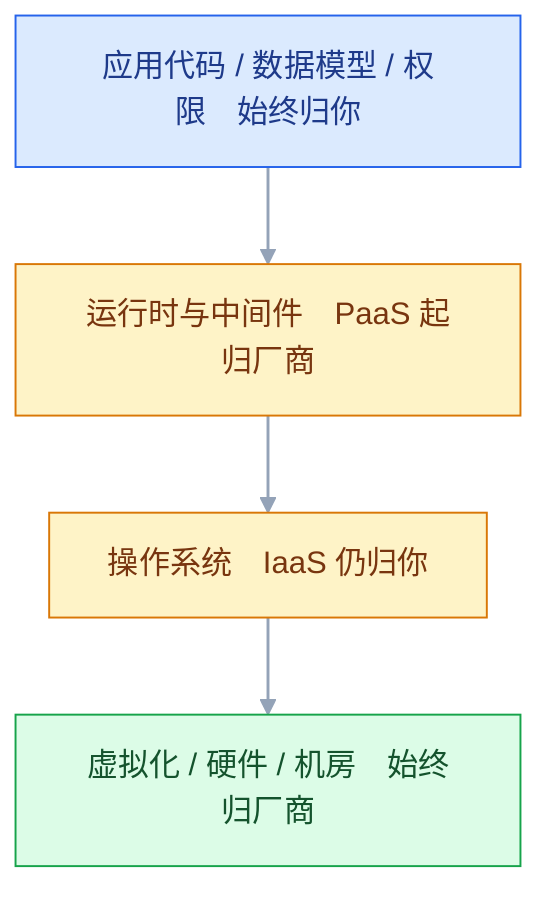
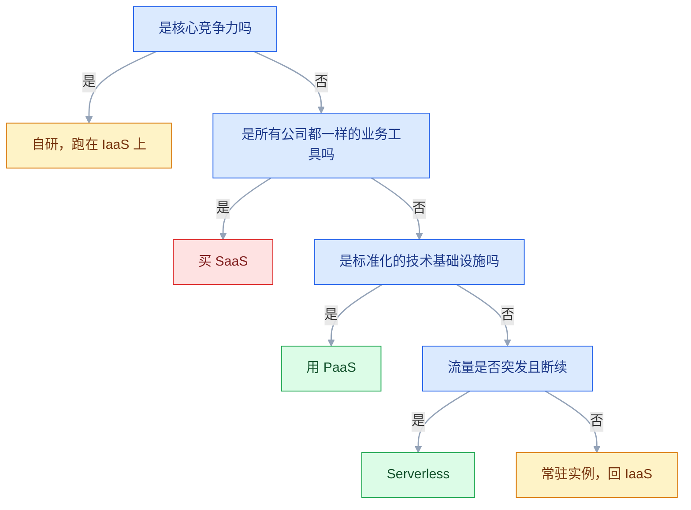

# IaaS、PaaS、SaaS 的区别

## 一、工程案例：给 5 人团队定三层边界并开通最小可用资源

**场景**：一家 5 人公司做垂直品类电商（小程序 + H5），两周后上线。现状是两个人共用一台 4C8G 云服务器，MySQL、Redis、应用、Nginx 全挤在上面，数据库靠人手工 `mysqldump`。目标不是「把东西搬上云」，而是**把 14 项能力逐项判定归属层级，产出一张责任矩阵和一张资源清单，按依赖顺序开通，最后用验收表确认这套边界真的立住了**。

**为什么先做判定**：三层模型不是技术先进程度的排序，是**责任划分**。同一件事——数据库备份——在 IaaS 上是你写脚本、自己定保留天数；在 PaaS 上是厂商执行、你确认保留天数并做恢复演练；在 SaaS 上你连「备份」这个入口都看不到，只能定期导出。边界没定清，后面所有「这该谁干」的争论都会回到原点。

**动手前确认**：企业实名已通过（企业实名未通过，企业备案和企业抬头发票都会卡住）；域名已完成 ICP 备案（新备案通常要数周，赶不上两周上线就必须提前启动）；账号已开 MFA；手边有一个能收短信的手机号，后面预算告警要用。

### 1.1 第一步：把能力清单落到三层

判定只看一个问题：**这件事的「交付物」是什么**。交付物是一台能登录的机器，就是 IaaS；是一个连接地址或一个平台，就是 PaaS；是一个打开就能用的账号，就是 SaaS。

| 能力 | 落位 | 拿到手的东西 | 日常谁负责 |
|---|---|---|---|
| 应用进程 | IaaS | 一台可登录的云服务器 | 你：部署、扩缩、补丁、进程守护 |
| 关系型数据库 | PaaS | 一个内网连接地址 | 厂商：主机、引擎、主备切换；你：库表、账号、白名单、慢 SQL |
| 缓存 | PaaS | 一个带密码的连接地址 | 厂商：主从与故障切换；你：键设计、过期策略、内存水位 |
| 对象存储 | PaaS | Bucket 与访问凭证 | 厂商：多副本与持久性；你：权限、生命周期、外网流量 |
| 负载均衡 | PaaS | 一个 VIP 或域名 | 厂商：实例可用性；你：监听、证书、健康检查、后端端口 |
| CDN | PaaS | 一个 CNAME 域名 | 厂商：节点与回源链路；你：缓存规则、防盗链、刷新 |
| 日志 | PaaS | 一个 Project 与 Logstore | 厂商：写入与存储；你：采集配置、字段、保留天数 |
| 监控告警 | PaaS | 指标曲线与通知通道 | 厂商：采集；你：阈值、通知人、值班响应 |
| 短信与邮件 | PaaS | 模板与 API | 厂商：通道与送达率；你：模板报备、频控、退订 |
| 办公协同 | SaaS | 一个账号 | 厂商：全部；你：成员与权限、离职回收、数据导出 |
| 代码托管 | SaaS | 一个仓库 | 厂商：服务可用性；你：分支策略、凭证、异地备份 |
| 域名与证书 | SaaS | 解析记录与证书文件 | 厂商：注册与签发；你：续费、到期监控、备案 |
| 密钥管理 | PaaS | 密钥与别名 | 厂商：托管与轮转；你：权限策略、调用审计 |
| 备份 | 分层 | 快照、备份集、导出文件 | 三层的责任各有一份，见下表 |

**这张表里最容易判错的是「备份」和「日志」**——备份不是某一层，而是每一层都有一份责任；日志的交付物虽然是 PaaS，但采集配置、字段格式、保留天数仍在你手里。把「备份」笼统写成「云厂商负责」，是这套矩阵里代价最高的一处错误。

| 层 | 备份机制由谁提供 | 你必须做的动作 |
|---|---|---|
| IaaS 云盘 | 快照能力 | 绑自动快照策略、设保留 7~30 天、定期验证可回滚 |
| IaaS 自建数据库 | 没有，全靠你 | 全备 + binlog 归档 + 异地存放 + 恢复演练 |
| PaaS 托管数据库 | 自动备份与日志备份 | 确认已开启、保留天数够、每季度恢复一次 |
| SaaS | 通常有回收站或导出 | 确认导出格式、频率、离职与合同终止时的数据归属 |

### 1.2 第二步：按依赖顺序开通

云资源有严格的依赖链：**没有 VPC 就没有交换机，没有交换机就没有实例，没有实例就没有后端**。顺序错了不是报错，而是开通到一半发现要推倒重来——地域和 VPC 网段都是开通后很难改的。

| 顺序 | 动作 | 依赖 | 漏了会怎样 |
|---|---|---|---|
| 1 | 子账号与权限策略 | 主账号 | 全员共用主账号，一个人泄露等于整个账号沦陷 |
| 2 | VPC 与两个交换机 | 地域选定 | 网段与公司内网冲突，后面打不通专线 |
| 3 | 安全组 | VPC | 实例建好才发现规则要重建，得换组 |
| 4 | 应用服务器 ×2 | 交换机、安全组、镜像 | 单台就是单点 |
| 5 | NAT 网关与路由 | 交换机 | 内网机器无法更新、无法调三方接口 |
| 6 | 数据库与缓存 | 私网交换机 | 建成公网实例，暴露面直接扩大 |
| 7 | 对象存储 Bucket | 地域 | 跨地域访问走公网，慢且产生流量费 |
| 8 | 负载均衡与证书 | 实例、交换机 | 没有健康检查，一台挂了请求还在往上打 |
| 9 | 解析、日志、监控、预算 | 以上全部 | 出问题没有证据链，账单涨了没人知道 |

```bash
# ① 权限：先建子账号，再谈资源。主账号只用来登录控制台和开子账号
# 控制台：RAM → 用户 → 创建 → 勾选「OpenAPI 调用访问」→ 绑定自定义策略
# 程序一律用角色（实例角色 / 服务角色），不要把 AccessKey 写进配置文件

# ② 网络底座：一个 VPC，两台交换机分属两个可用区
aliyun vpc CreateVpc --RegionId cn-hangzhou --CidrBlock 10.0.0.0/16 --VpcName prod
aliyun vpc CreateVSwitch --RegionId cn-hangzhou --VpcId vpc-xxxx \
  --CidrBlock 10.0.1.0/24 --ZoneId cn-hangzhou-h --VSwitchName app-a
aliyun vpc CreateVSwitch --RegionId cn-hangzhou --VpcId vpc-xxxx \
  --CidrBlock 10.0.2.0/24 --ZoneId cn-hangzhou-i --VSwitchName app-b

# ③ 安全组：实例不分配公网 IP，22 入方向只放堡垒机；没有堡垒机就用 ECS 会话管理，不必开 22
aliyun ecs CreateSecurityGroup --RegionId cn-hangzhou --VpcId vpc-xxxx --SecurityGroupName app-sg
# 示例：仅允许堡垒机内网地址登录，不要把 0.0.0.0/0 或办公网大段放进来
aliyun ecs AuthorizeSecurityGroup --RegionId cn-hangzhou --SecurityGroupId sg-xxxx \
  --IpProtocol tcp --PortRange 22/22 --SourceCidrIp 10.0.1.10/32

# ④ 两台应用服务器：分属两个交换机（跨可用区）、同安全组、不分配公网 IP（出网走 NAT）
# 控制台：ECS → 创建实例 → 规格族 g7 / 2C4G → 公共镜像 Ubuntu 24.04 → 密钥对
# 登录走会话管理或堡垒机；分配公网 IP 会让前面「单一入口」的设计失效

# ⑤ 数据库与缓存：选私网交换机，不开公网地址；白名单填两个应用交换机网段
# 10.0.1.0/24 与 10.0.2.0/24，不要填 0.0.0.0/0
# 控制台：RDS → 创建实例 → 高可用版 → 同 VPC → 数据安全性 → 白名单

# ⑥ 对象存储：私有 Bucket，与 ECS 同地域，后续只走内网 endpoint
ossutil mb oss://prod-assets-2026 -e oss-cn-hangzhou.aliyuncs.com

# ⑦ 负载均衡：七层监听 443，后端端口填应用真实端口，健康检查 /health
# 控制台：SLB → 创建实例（应用型）→ 监听 → 后端服务器组 → 添加两台 ECS

# ⑧ 收口：解析 A 记录指向 SLB 的 EIP，证书上传到 SLB，日志与告警接上
```

> 这里刻意**不给 ECS 分配公网 IP**：公网入口只有负载均衡一个，实例出网走 NAT。这样做的收益不是省钱，而是**暴露面只剩一个**——安全组、证书、WAF 都只需要在一个地方配。

### 1.3 验收（12 项全过才算交付）

| # | 检查 | 命令或路径 | 通过标准 |
|---|---|---|---|
| 1 | 子账号可用 | `aliyun sts GetCallerIdentity` | 返回子账号身份，不是主账号 |
| 2 | 主账号无 AK | RAM → 用户 → 主账号 | 没有启用 AccessKey |
| 3 | 数据库不暴露 | RDS → 数据库连接 | 没有公网地址，白名单只有应用网段 |
| 4 | 缓存不暴露 | Redis → 连接信息 | 仅私网，密码已设，未开公网访问 |
| 5 | 应用可达 | `curl -sS -o /dev/null -w '%{http_code}' https://www.example.com/health` | 返回 `200`，证书链完整 |
| 6 | 单点已消除 | 停掉一台 ECS 的应用进程 | 连续请求仍 200，ALB 里该后端变「异常」 |
| 7 | 数据可恢复 | 用备份恢复到新实例 | 表数量与关键行数一致，时间点正确 |
| 8 | 对象存储私有 | `curl -I https://bucket.oss-cn-hangzhou.aliyuncs.com/x` | 匿名访问返回 403 |
| 9 | 日志可检索 | 日志服务按 traceId 查询 | 能查到一条完整请求链路 |
| 10 | 告警能到人 | 手动触发一条 CPU 告警 | 手机与群里都收到，且知道该谁处理 |
| 11 | 账单可拆 | 费用中心 → 按标签 | 每项资源都有 project/env/owner |
| 12 | 责任有主 | 对照 1.1 的矩阵 | 14 项能力每一项都写了一个人名 |

> **第 6 项必须真停一次**。健康检查配了不等于生效：路径写错、端口填成 80 而应用监听 8080、返回 200 但内容是错误页，都会让「摘除」这件事不发生。
> **第 7 项必须恢复到新实例**，不要在原实例上验证——在原库上恢复会覆盖现场，而且证明不了备份文件本身可用。

### 1.4 三个月后怎么复核这张矩阵

| 信号 | 说明 | 动作 |
|---|---|---|
| 某项能力反复因同类问题出故障 | 自管的成本已经高于托管溢价 | 下沉到 PaaS |
| 某项 PaaS 费用明显高于自建总成本（含人力） | 规模上来了，溢价不再合理 | 重新算总账，含人力 |
| 业务要改引擎参数或装插件 | 撞到托管产品的硬边界 | 退回 IaaS 自建 |
| 新员工两周还上不了手 | 自建部分的运维知识没有沉淀 | 要么补文档，要么换成托管 |
| 账单里某一层占比突然变化 | 有资源漏删或用量异常 | 按资源 ID 逐个核对 |

**复核的产出不是一张新表，而是一个决定**：哪一项继续自管、哪一项下沉、哪一项退回。三层边界本来就是可以移动的，移动的依据是故障率、人力、成本和合规，而不是「哪家产品更先进」。

---

## 二、高频问答：会卡住你的地方，也是面试最常问的

### 2.1 以为买了 PaaS，数据库就「不用管」了

**现场**

RDS 控制台看三处：备份设置里的保留天数、数据安全性里的白名单、监控里的磁盘使用率。

```text
控制台：RDS → 备份恢复 → 备份设置       # 是否开启日志备份、保留几天
控制台：RDS → 数据安全性 → 白名单        # 是否还是 0.0.0.0/0
控制台：RDS → 监控与报警 → 磁盘使用率    # 是否已经超过 80%
```

**要点**

- 托管的是引擎进程和宿主机，库表设计、连接数、慢 SQL、白名单、备份保留天数、磁盘水位仍在你这边。
- 把「运维主机」当成「运维数据」是这条的根子：主机归厂商，数据模型和访问方式永远归你。
- 厂商只保证实例在运行，不保证你的数据可恢复。

**追问**

- 托管数据库厂商到底管什么？→ 引擎进程、宿主机、主备切换，不管库表和慢 SQL。
- 备份开了就够了吗？→ 不够，保留天数要够，还要定期做恢复演练。
- 为什么白名单也是你的责任？→ 它决定谁能连，填 `0.0.0.0/0` 等于把门敞开。

### 2.2 选型只比实例单价

**现场**

用同一套架构分别试算一个月，把「流量 + 存储 + 备份 + 请求」都填进去，再看总价。

```text
费用中心 → 价格计算器 → 按「架构」估，不要按「单产品」估
重点核对：公网出流量、对象存储外网下行、快照容量、日志存储量
```

**要点**

- 实例费只是账单的一项，云账单里最容易失控的从来不是实例，是流量和留存数据。
- 流量费、存储费、备份费、跨区复制费、请求次数、公网带宽与 EIP 保有费，任何一项都能反超差价。
- 比价要按架构算总价，不要拿「租金」比总价。

**追问**

- 按单产品估为什么会失真？→ 漏掉随架构变化的流量、存储、请求。
- 哪一项最容易反超实例费？→ 公网出流量和对象存储外网下行。
- 包年包月一定更便宜吗？→ 长期稳态才便宜，短期会锁死，退订还有损失。

### 2.3 认定「上云一定省钱」

**现场**

算两条曲线：固定负载下的年度总支出，以及波峰波谷比。波峰越尖，云越划算。

| 场景 | 更划算的形态 | 原因 |
|---|---|---|
| 5 人团队、一套业务、流量有波动 | 云（IaaS + PaaS 混合） | 省下的是人和一次故障的损失 |
| 常年 70% 以上利用率、规模稳定 | IDC 托管或自建 | 固定成本可以摊薄 |
| 活动页只跑 3 天 | Serverless 或按量 | 没有闲置成本 |
| 稳态核心服务 | 包年包月 + 预留 | 按量单价明显更高 |

```text
费用中心 → 价格计算器 → 选「按架构估算」→ 把实例、存储、流量、备份都加上
再看一眼：过去 3 个月的账单里，实例费占比是多少
```

**要点**

- 云卖的是弹性和免运维，不是低价；负载长期跑满、规模很大时，云的单位算力成本通常高于自建或 IDC 托管。
- 只算硬件钱会漏掉「不用养人」和「随时能扩」的价值；反过来只看单价，也会漏掉长期跑满时的总支出。
- 判断依据是波峰波谷比：波峰越尖云越划算，越平稳自建越划算。

**追问**

- 什么场景上云一定划算？→ 流量波动大、人手少、活动页只跑几天。
- 什么场景自建更便宜？→ 常年 70% 以上利用率、规模稳定。
- 稳态核心服务怎么买？→ 包年包月或预留，按量单价明显更高。

### 2.4 上了 PaaS 才发现参数改不了

**现场**

买之前查「参数模板」和「限制说明」两页文档，确认你要改的那一项在不在白名单里。

```text
控制台：RDS → 参数设置 → 看可修改参数列表
文档关键词：使用限制、不支持的操作、参数模板
```

**要点**

- 托管产品的可控性是按层出售的，RDS 给几十个参数，但不给 root、不给装自定义插件、不给改物理文件。
- 这是产品边界，不是 bug；把 PaaS 当成「带运维的 IaaS」就会在这里踩空。
- 需要改内核、装插件、改物理文件，就只有 IaaS 自建一条路。

**追问**

- 哪些操作 PaaS 一定不给你？→ root、自定义插件、物理文件。
- 参数改了为什么要重启？→ 部分参数是静态参数，只能重启生效。
- 选之前该看哪两页文档？→ 使用限制和参数模板。

### 2.5 买了「基础版」却以为有高可用

**现场**

实例详情看「系列」：基础版 / 高可用版 / 集群版，再看可用区是不是两个。

```text
控制台：RDS → 实例详情 → 基本信息 → 系列、主备可用区
```

**要点**

- 基础版是单节点，宿主机或实例故障就是不可用；只有高可用版/集群版才有主备与自动切换。
- 高可用是花钱买的产品特性，不是云的默认属性。
- 判断看两处：系列，以及主备是否跨两个可用区。

**追问**

- 高可用版切换要多久？→ 通常几十秒，业务侧仍要能重连。
- 单可用区的高可用版算高可用吗？→ 挡不住机房故障，可用区要跨两个。
- 怎么验证切换真的生效？→ 做一次主备切换演练，别只看控制台。

### 2.6 用 Serverless 跑常驻服务或长任务

**现场**

查函数的超时上限与内存上限，压测一次冷启动延迟，确认代码是否依赖本地磁盘或长连接。

```text
控制台：函数计算 → 函数配置 → 超时时间、内存规格、实例并发
日志里看：首次调用的 Init Duration
```

**要点**

- 函数有执行时长上限、冷启动、无状态三件事，长连接、常驻消费者、超过上限的批处理都不适合。
- 只看计费方式会漏掉执行模型，省下的闲置费可能抵不过一次超时失败。
- 流量越不均匀 FaaS 越省，越稳定常驻实例的单位成本越低。

**追问**

- 冷启动有多长？→ 几百毫秒到数秒，看运行时和包大小。
- 为什么函数必须无状态？→ 实例随时缩到零或换一个，本地状态留不住。
- 定时任务适合 FaaS 吗？→ 适合，短任务、事件驱动正是它的主场。

### 2.7 以为 SaaS 的数据随时能拿走

**现场**

买之前做一次真实导出：拿一个月的完整数据，看能不能还原关联关系。

```text
管理后台 → 数据导出 → 选全量 + 含附件 → 检查字段数与关联 ID
再问一句：合同到期后数据保留多久、以什么格式交付
```

**要点**

- 导出格式、频率、字段完整性、历史附件、API 限流都由厂商决定，合同终止后通常只保留一段时间。
- 把「能看见」当成「能迁走」是这条的误区；SaaS 的锁定往往不在功能，在数据和身份体系。
- 验证方法是真的导一次，看关联关系能不能还原。

**追问**

- SaaS 锁定最强的是哪一环？→ 数据和身份体系，不是功能。
- 合同里要约定什么？→ 到期后数据保留多久、以什么格式交付。
- 导出被限流怎么办？→ 分批导，或走厂商的批量导出能力。

### 2.8 为了「不被锁定」而上多云

**现场**

数一数跨云调用链有几条，每条的公网延迟与流量费是多少，再算两套运维要几个人。

```bash
# 跨云只能走公网，先测真实延迟与丢包
mtr -rw -c 20 <对端公网IP>
```

**要点**

- 跨厂商内网不通只能走公网，两套账号、账单、监控、工单，出故障时两家互相取证，排障时间翻倍。
- 把「议价能力」当成主要目标，会忽略多云带来的固定运维成本。
- 中小团队用一家，通常是更理性的选择。

**追问**

- 多云最大的固定成本是什么？→ 身份与网络不通，加上两套运维。
- 什么情况下多云值得？→ 有明确议价或合规诉求。
- 怎么量化跨云代价？→ 测公网延迟丢包，再算流量费和人力。

### 2.9 在 IaaS 上自建数据库，以为厂商会兜底

**现场**

看工单答复口径：能受理「宿主机异常」，不受理「误删表」和「主从延迟」。

```text
自建库必须自备：全备 + binlog、监控（连接数/延迟/磁盘）、主从切换脚本、恢复演练记录
```

**要点**

- 厂商的责任到虚拟化层和硬件层为止；MySQL 进程、主从、备份、参数、数据一致性全是你。
- 云保证的是机器在，不是你的数据库能查。
- 自建库必须自备全备 + binlog、监控、主从切换脚本、恢复演练记录。

**追问**

- 云厂商会帮你恢复误删的表吗？→ 不会，除非你另买了对应的托管或恢复服务。
- 自建库最少要配什么？→ 全备 + binlog 归档 + 监控 + 切换脚本。
- 怎么证明备份可用？→ 定期恢复到新实例演练。

### 2.10 按产品名对比方案，而不是按能力

**现场**

把需求写成能力清单（计算、块存储、对象存储、私网、七层负载、托管库），逐项对。

| 能力 | 常见叫法差异 | 对比时要看什么 |
|---|---|---|
| 云服务器 | ECS / CVM / EC2 | 规格族、CPU 积分、带宽计费 |
| 块存储 | 云盘 / 云硬盘 / EBS | IOPS 上限、是否随实例规格受限 |
| 对象存储 | OSS / COS / S3 | 一致性、外网下行价、内网 endpoint |
| 私网 | 三家都叫 VPC | 网段上限、跨区互通方式、能否引安全组 |
| 七层负载 | ALB / CLB / ALB | 是否支持域名与路径路由、证书管理 |
```text
对法：把左列能力逐项打开两家产品的「使用限制」页，只比限制和计费维度
不看：宣传页的功能列表和「业内领先」这类描述
```

**要点**

- 同一种能力各家命名不同，同名产品的能力边界也可能不同，要比的是「能力 + 限制 + 计费维度」。
- 名字是市场语言，能力清单才是工程语言。
- 对比时只打开两家的「使用限制」页，不看宣传页的功能列表。

**追问**

- 为什么同名产品不能直接比？→ 能力边界和计费维度可能完全不同。
- 比价的正确姿势是什么？→ 按能力清单逐项对限制，再按架构算总价。
- 哪一页文档最该看？→ 使用限制和配额。

### 2.11 员工离职了，SaaS 账号还在

**现场**

拉一次成员列表，和 HR 的离职名单对一遍，看有没有共享账号。

```text
管理后台 → 成员与部门 → 导出 → 与离职名单比对
优先接 SSO；有条件再接 SCIM 自动同步停用
```

**要点**

- 离职账号仍占席位继续计费，还可能保留着文档、代码库、财务系统的访问权。
- SaaS 账号不只是软件许可，它同时是一个身份。
- 处置优先接 SSO，有条件再接 SCIM 自动同步停用。

**追问**

- 为什么共享账号危险？→ 无法审计到人，离职后也回收不掉。
- SSO 解决什么问题？→ 一处停用，全线失效。
- 只删账号够吗？→ 不够，还要回收它创建的 API token 和共享链接。

---

## 三、核心知识：从零开始要建立的东西

### 3.1 三层模型的切分依据

三层模型出自 NIST 对云计算的定义，切的不是技术栈，而是**消费者管理到哪一层**。云本身有五条判据：按需自助、广泛网络访问、资源池化、快速弹性、可计量服务。少了「按需自助」和「可计量」，就只是「别人的机房」，不是云。

| 模型 | 消费者管理 | 交付物 | 计费粒度 |
|---|---|---|---|
| IaaS | 操作系统及以上 | 虚拟机、网络、磁盘 | 实例时长、带宽、存储容量 |
| PaaS | 应用与数据 | 连接地址、部署平台、运行时 | 实例规格、存储、连接数、调用次数 |
| SaaS | 只有使用行为与数据 | 一个账号 | 坐席数、用量、订阅周期 |

### 3.2 责任分界线

同一条栈，三种模型的分界线落在不同位置。**分界线以上是你的活，以下归厂商**。

| 层 | 自建 | IaaS | PaaS | SaaS |
|---|---|---|---|---|
| 机房、电力、硬件 | 你 | 厂商 | 厂商 | 厂商 |
| 虚拟化 | 你 | 厂商 | 厂商 | 厂商 |
| 物理存储与网络设备 | 你 | 厂商 | 厂商 | 厂商 |
| 操作系统 | 你 | **你**（镜像由厂商提供） | 厂商 | 厂商 |
| 运行时（JDK、Python） | 你 | 你 | **厂商** | 厂商 |
| 中间件（MySQL、Redis） | 你 | 你 | **厂商** | 厂商 |
| 应用代码 | 你 | 你 | 你 | 厂商 |
| 数据模型与内容 | 你 | 你 | 你 | **你**（存在厂商处） |
| 身份与访问权限 | 你 | 你 | 你 | **你** |



**这张表最实用的一行是「操作系统」**：IaaS 里它归你，但镜像由厂商提供——相当于租毛坯房送了个基础装修包，墙是你刷的，水管爆了也是你修。

> **面试**：常问「IaaS、PaaS、SaaS 的责任分界线在哪？」答：分界线以上是你的活、以下归厂商；操作系统在 IaaS 归你，运行时和中间件从 PaaS 起归厂商。

### 3.3 交付物形态

判断一个产品属于哪层，看它交付给你什么，比看宣传语可靠。

| 交付物 | 模型 | 你首先要做的事 |
|---|---|---|
| 一个 IP、一个登录入口 | IaaS | 装环境、配防火墙、部署进程 |
| 一个内网域名加端口 | PaaS（数据库/缓存） | 建库建表、配白名单、连连接池 |
| 一个镜像地址加副本数 | PaaS（容器平台） | 打镜像、配探针、定资源限额 |
| 一个函数入口 | PaaS（FaaS） | 写处理逻辑、设超时与内存 |
| 一个账号和后台地址 | SaaS | 配成员、配权限、迁数据 |

### 3.4 成本的四个组成部分

云账单永远由四块构成，只是比例不同。选型时漏掉任何一块，算出来的都是假账。

| 成本项 | 形态 | 谁容易漏 |
|---|---|---|
| 资源费 | 实例、节点、存储容量 | 只看实例单价的人 |
| 流量费 | 公网出流量、跨区复制、CDN 回源 | 没算过出口的人 |
| 请求与调用费 | API 调用、函数执行、日志写入 | 按量产品的新手 |
| 人力与迁移费 | 运维、排障、数据搬迁、改写代码 | 只对比报价单的人 |

**边界与取舍**：PaaS 通常把「人力」压到接近零，把「资源单价」抬高；IaaS 相反。团队越小、故障越贵，PaaS 的总成本越低；规模越大、负载越稳，自建的单价优势越明显。

### 3.5 弹性的三个层次

「弹性」经常被当成一个词用，实际是三种能力，成本差别很大。

| 层次 | 动作 | 生效时间 | 典型手段 |
|---|---|---|---|
| 容量弹性 | 同一台机器升配 | 分钟级，常需重启 | 改规格、扩内存 |
| 数量弹性 | 增减实例数量 | 分钟级 | 伸缩组 + 负载均衡 |
| 请求弹性 | 按请求自动分配 | 毫秒到秒级 | 函数计算、Serverless 容器 |

**取舍**：容量弹性最简单但会停机；数量弹性要求应用无状态；请求弹性最省闲置成本，但带来冷启动和状态管理的限制。**有状态服务先解决状态外置，再谈弹性。**

### 3.6 SLA 与业务可用性

云厂商的 SLA 承诺的是**服务可用性**，赔付的是**服务费抵扣**，不是你的营业损失。

| SLA | 每月允许不可用 | 现实含义 |
|---|---|---|
| 99.9% | 约 43 分钟 | 单可用区部署的常见水平 |
| 99.95% | 约 22 分钟 | 主备跨可用区 |
| 99.99% | 约 4.3 分钟 | 多可用区 + 自动切换 + 演练 |

**关键推论**：单实例不可能给你 99.99%。业务可用性是**架构叠加**出来的，不是买一个高可用版本就自动获得的。承诺 99.99% 的产品，通常也要求你至少跨两个可用区部署，否则赔付条款本身就不成立。

> **面试**：常问「买了 99.99% 的 SLA 就够了吗？」答：不够，SLA 赔的是服务费，业务可用性要靠跨可用区架构叠加。

### 3.7 锁定强度的三个来源

| 来源 | 表现 | 迁移代价 |
|---|---|---|
| 数据 | 专有存储格式、附件分离存放、导出限流 | 高，常常是真正的门槛 |
| 接口 | 专有 API、SDK、SQL 方言、触发器 | 中，改代码可解 |
| 身份 | 账号体系、SSO、权限模型绑在厂商 | 高，涉及全员 |

**对策不是「什么都不用」，而是把锁定控制在可接受的位置**：数据库坚持标准协议、对象存储用 S3 兼容接口、业务代码不直接调厂商专有 SDK，中间加一层适配。

### 3.8 数据可迁移性

迁移的成本不在「拷数据」，在**停机窗口、出口流量费、增量同步、回滚方案**四件事。

| 数据形态 | 迁移方式 | 主要成本 |
|---|---|---|
| 关系型数据库 | 逻辑导出或 DTS 类工具 | 出口流量、增量追平、切流窗口 |
| 对象存储 | 批量同步工具 | 外网下行费、请求费、元数据重建 |
| 缓存 | 通常不迁，重建 | 预热时间 |
| 日志 | 一般只迁近 30 天 | 存储格式转换 |

**边界**：跨厂商迁移一定要预留回滚路径——切过去之后旧环境至少保留一个计费周期，确认业务正常再释放。

### 3.9 共享责任模型

云安全的基本框架只有一句：**厂商负责「云本身」的安全，你负责「云里面」的安全**。

| 事项 | 厂商 | 你 |
|---|---|---|
| 物理机、机房、虚拟化 | 负责 | 无 |
| 云平台自身漏洞 | 负责修补 | 关注公告 |
| 操作系统补丁 | IaaS 下不负责 | 负责 |
| 安全组与网络 ACL | 提供能力 | 负责配置 |
| 账号与密钥 | 提供 IAM/KMS | 负责授权与轮转 |
| 应用漏洞与数据泄露 | 不负责 | 负责 |
| 备份是否开启、能否恢复 | 提供机制 | 负责验证 |

**最常见的误解**：买了云安全产品就等于安全了。产品只是能力，规则、策略、值班仍然要人配。

> **面试**：常问「云安全的共享责任怎么分？」答：厂商负责云本身的安全，你负责云里面的系统、配置、账号和数据。

### 3.10 Serverless 的位置

Serverless 不是第四层，是 PaaS 推到极致的结果：把「服务器」这个概念从你眼前彻底拿掉。它包含两块——FaaS（只给函数）和 BaaS（把数据库、存储、鉴权做成开箱即用的 API）。

| 维度 | 常驻 PaaS | FaaS |
|---|---|---|
| 是否有实例 | 有，一直计费 | 无请求时缩到零 |
| 伸缩粒度 | 实例 | 请求 |
| 冷启动 | 无 | 有，几百毫秒到数秒 |
| 状态 | 可有本地状态 | 必须无状态 |
| 适合 | 常驻服务、长连接、数据库 | 定时任务、Webhook、图片处理、突发接口 |

**取舍**：流量越不均匀，FaaS 越省；流量越稳定，常驻实例的单位成本越低。**有状态、长连接、超长任务，一律不要硬塞进 FaaS。**

### 3.11 中间形态的谱系

现实产品很少是纯三层，多数落在中间。

| 形态 | 你给什么 | 平台管什么 | 接近哪层 |
|---|---|---|---|
| CaaS（容器服务） | 镜像 | 调度、节点、网络 | IaaS 与 PaaS 之间 |
| FaaS | 函数代码 | 运行时、扩缩、计费 | PaaS 的极致 |
| BaaS | 前端与业务逻辑 | 数据库、存储、鉴权 | PaaS 的组件化 |
| iPaaS | 集成流程配置 | 连接器、重试、监控 | SaaS 与 PaaS 之间 |
| 低代码平台 | 表单与流程 | 运行时、发布、托管 | SaaS 与 PaaS 之间 |

### 3.12 选型判据

四个问题按顺序问，答案基本就定了。



**判据的优先级**：合规与数据驻留 > 可控性硬边界 > 成本 > 迁移成本。前两条一旦不满足，后面算得再细也没用。

> **面试**：常问「一个新系统该选 IaaS、PaaS 还是 SaaS？」答：先看是不是核心竞争力，再看是否标准化，最后看流量是否突发。

### 3.13 权限与采购边界

三层的账号模型不一样，混用会出事。

| 模型 | 权限主体 | 常见错误 |
|---|---|---|
| IaaS | 云账号 + 子账号 + 实例角色 | 多人共用主账号；AK 写进代码 |
| PaaS | 控制台角色 + 数据库账号 | 应用直接用 root；白名单填全网 |
| SaaS | 成员 + 角色 + SSO | 离职不回收；共享账号无法审计 |

**一条硬规则**：能开资源的人，和能看账单的人，应该是同一组人；能改生产配置的人，必须另有审计。

### 3.14 合规与数据驻留

| 要求 | 影响的选择 | 落地动作 |
|---|---|---|
| 网站备案 | 只能选中国大陆地域 | 上线前预留 5~20 个工作日 |
| 等保 | 需要日志留存、审计、堡垒机 | 选合规区域，开操作审计 |
| 数据出境 | 数据不能随便跨地域 | 固定地域，关闭跨区复制 |
| 行业监管 | 金融、医疗常有专有云要求 | 选专有云或混合云 |

**边界**：合规不是「买了合规产品」就完成，而是**配置、日志、审计、演练**四件事都有记录。

### 3.15 规模与成本拐点

云的成本结构是「低固定成本 + 高变动成本」，自建是「高固定成本 + 低变动成本」。两条线交叉的位置，就是拐点。

| 阶段 | 特征 | 合理选择 |
|---|---|---|
| 起步 | 流量小、人手少、变化快 | 全托管，别自建 |
| 增长 | 流量可预测、成本开始显形 | 稳态部分包年包月，峰值按量 |
| 成熟 | 负载稳定、规模大 | 预留实例/节省计划，评估 IDC |
| 收缩 | 业务下线 | 优先释放，而不是降配 |

**取舍**：拐点不是绝对值，和团队人力成本强相关。一个人月成本往往高于一台中配服务器的年费，这笔账要算进去。

### 3.16 演进路径

三层之间不是单向升级，而是**按能力逐项移动**。

| 触发条件 | 移动方向 | 说明 |
|---|---|---|
| 故障频繁、没人会修 | IaaS → PaaS | 用溢价换稳定性 |
| 需要改引擎、装插件 | PaaS → IaaS | 撞到硬边界只能回退 |
| 发布频率高、环境不一致 | IaaS → CaaS | 先容器化，再谈编排 |
| 流量极不均匀 | 常驻 → Serverless | 只为实际请求付费 |
| 业务标准化、无差异化 | 自研 → SaaS | 自研不产生竞争力 |
| 合规要求数据不出机房 | 公有云 → 专有云/混合云 | 合规优先于成本 |

**规律**：越靠近业务，越应该自管；越标准化，越应该外购。这条线会随着团队能力和规模反复移动，不存在一次选对的架构。

---

## 四、冷门知识汇总

| 知识点 | 为什么冷门 | 用到时的关键词 |
|---|---|---|
| 专有云与混合云 | 只有政企、金融项目才会碰到 | 专线、VPC 打通、数据不出机房 |
| CaaS 容器即服务 | 被 K8s 的光环盖住，很少单独讨论 | 你给镜像、平台管调度 |
| BaaS 后端即服务 | 前端团队用得多，后端很少主动选 | 托管鉴权、托管数据库、SDK 直连 |
| iPaaS 集成平台 | 系统间对接时才出现 | 连接器、字段映射、重试与死信 |
| 低代码平台 | 常被当成玩具，实际在审批流里很常见 | 表单引擎、流程引擎、私有化部署 |
| FinOps 与成本分摊 | 不做财务口径就没人提 | Showback、Chargeback、标签体系 |
| 数据驻留 | 不出海、不做跨国业务就遇不到 | Data Residency、地域锁定 |
| 出口流量费 | 账单里单列，容易被当成小数 | 公网下行、跨区复制、CDN 回源 |
| 预留实例与节省计划 | 规模不到一定量级不划算 | 承诺用量、折扣、闲置浪费 |
| 不可变基础设施 | 与「登录服务器改配置」的习惯冲突 | 改配置就重建镜像、不手工热修 |
| 可用区故障演练 | 没出过事就没人愿意做 | 混沌工程、AZ 级故障、切流预案 |
| 反向锁定 | 只讨论云厂商锁定，很少讨论自建锁定 | 自建中间件绑死团队、升级无人敢动 |
| 云原生 | 定义宽泛，常被当成营销词 | CNCF、声明式 API、容器化 |
| 边缘计算 | 只有低延迟场景才需要 | 边缘函数、就近接入、回源 |
